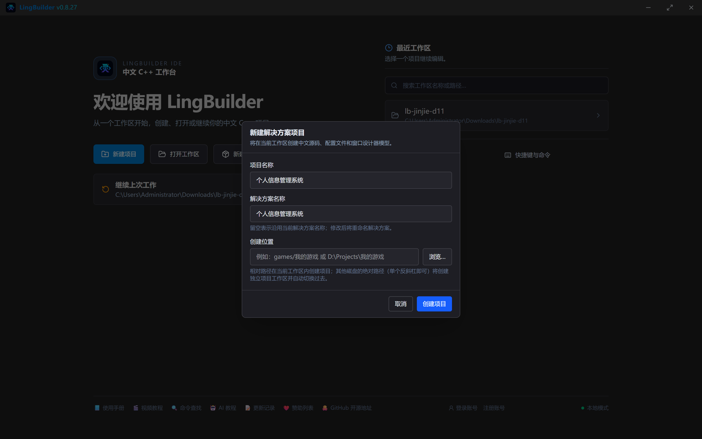
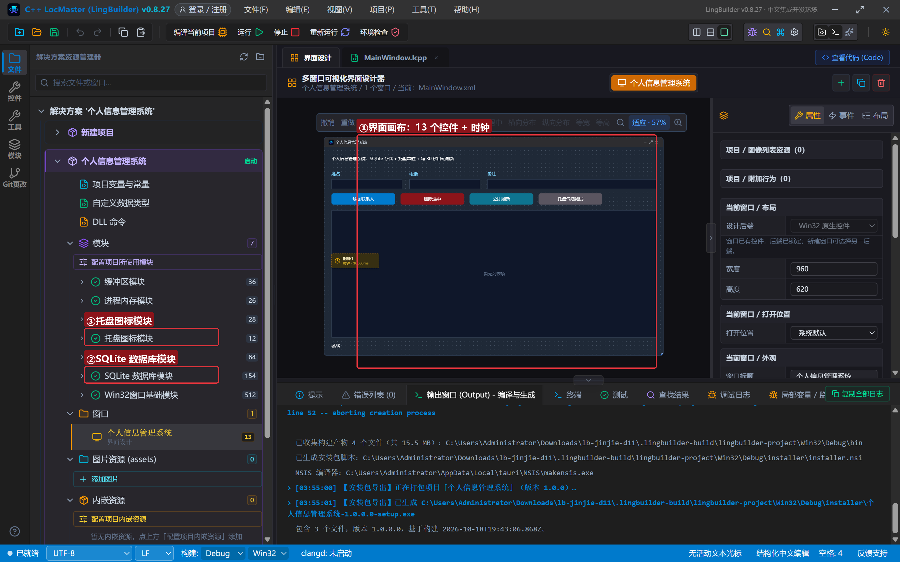
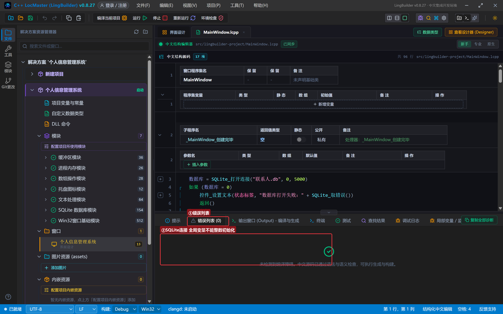
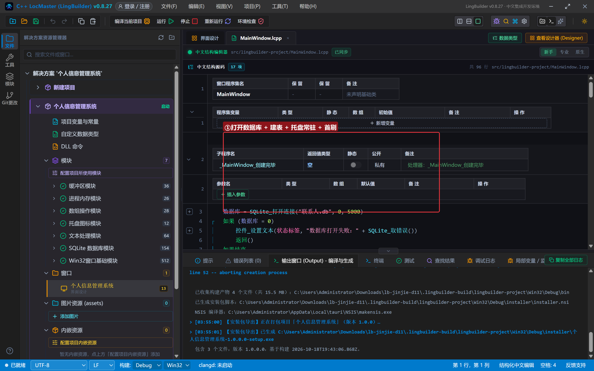
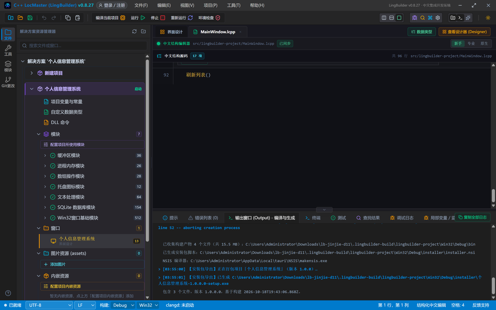
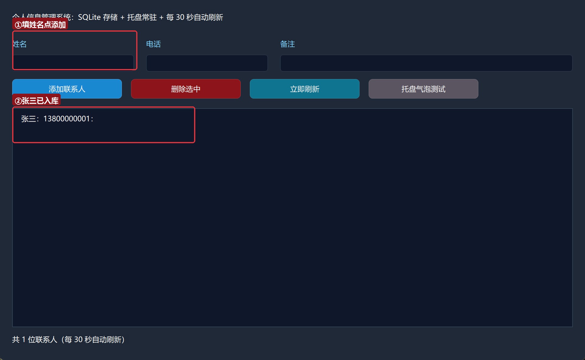
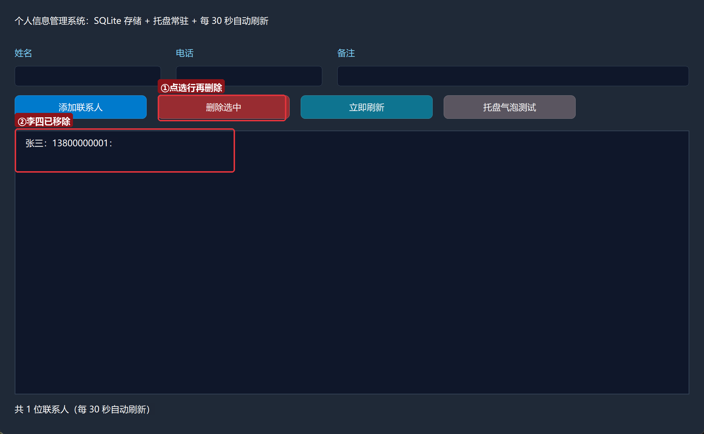
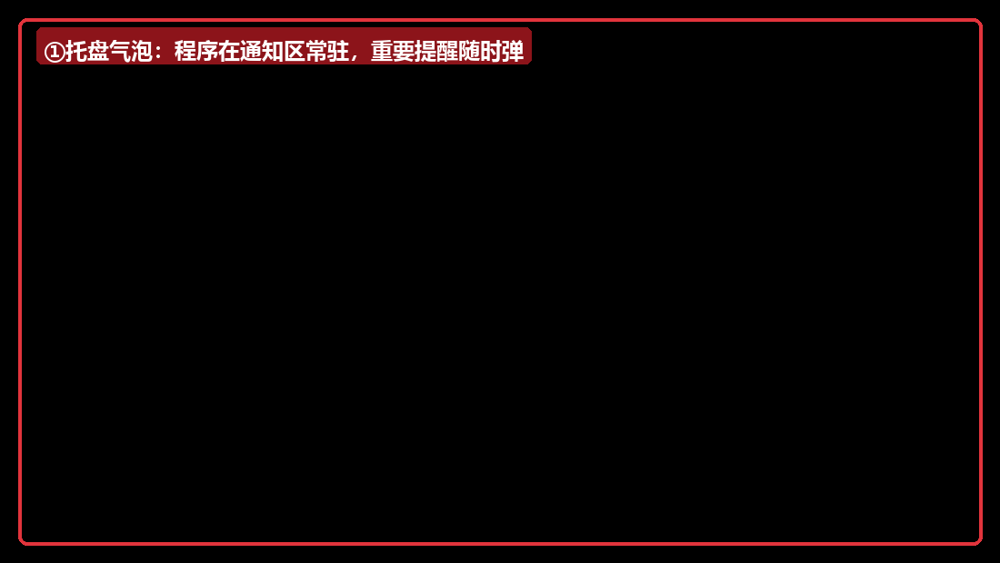
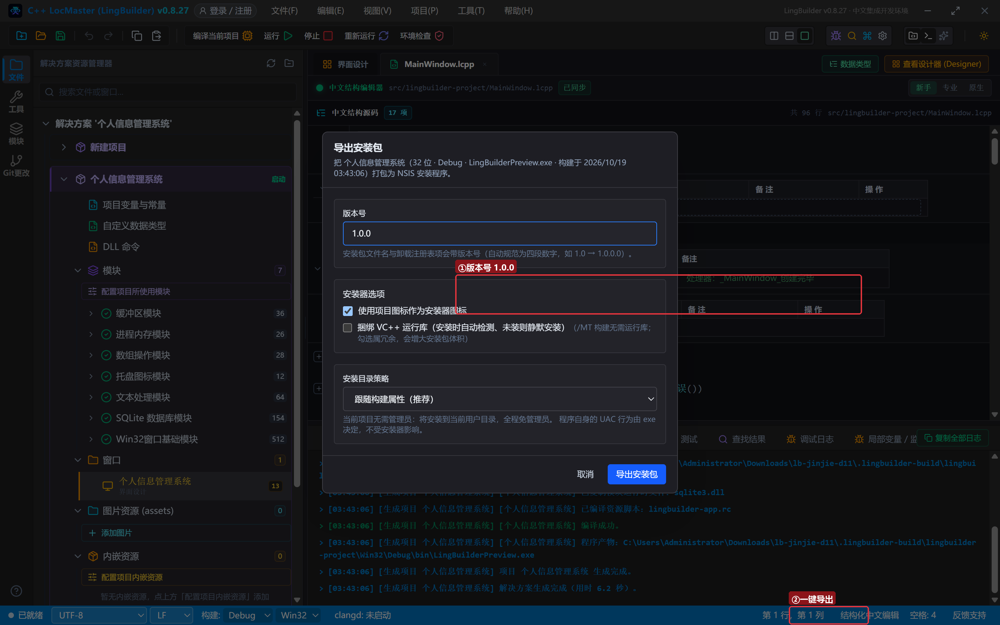
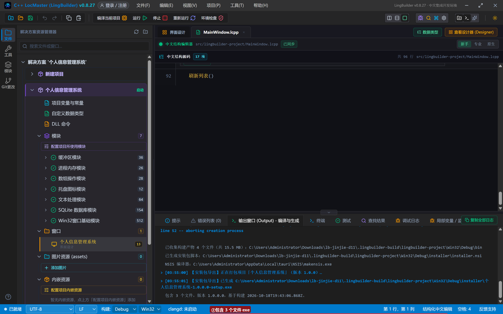

# 进阶实战 11 · 实战整合：个人信息管理系统 + 安装包导出（收官）

> 《LingBuilder 进阶实战系列》第 11 集，也是**收官集**。前面十集每集攻克一个模块；这一集把它们**串成一个真正的软件**：SQLite 存数据（第 1 集）、时钟自动刷新（第 2 集）、托盘常驻与气泡提醒（本集新学的 win32.tray），最后用**安装包导出**把 exe 打成给别人的 setup.exe——从「会写代码」到「能发软件」。全程约 40 分钟。
>
> 前置要求：学完[零基础入门系列](/guide/tutorials/beginner)与本系列前 10 集（第 1 集的 SQLite 五步曲和第 6 集的「失败问取错误」尤其重要）。本集源码包见文末。

## 这一集你将学会

- 整合思维：一个程序里同时用 SQLite + 时钟 + 托盘三个模块
- `托盘_添加` / `托盘_显示通知` / `托盘_修改提示`：程序常驻通知区
- 项目全局变量的类型规矩：`SQLite连接` 全局变量不能用整数初始化
- **安装包导出**：右键项目 → 导出安装包 → NSIS 打出 `setup.exe`，版本号、图标、安装目录策略一次配好
- 打包红线：先关自己、清掉运行期数据文件

## 1. 三十秒理解：整合 = 各司其职

个人信息管理系统要干四件事，每件交给最擅长的模块：

| 职责 | 模块 | 命令 |
| --- | --- | --- |
| 存数据（重启不丢） | SQLite 数据库模块 | `SQLite_打开连接`、五步曲 |
| 界面自动刷新 | 时钟组件 | 30 秒一次 `刷新列表()` |
| 通知区常驻 + 气泡 | 托盘图标模块 | `托盘_添加`、`托盘_显示通知` |
| 发给别人用 | 安装包导出 | 右键项目 → 导出安装包 |

这就是「整合」的全部秘密：**不是写更多代码，而是让每个模块干自己最擅长的事**。

## 2. 新建项目与启用模块

新建窗口项目：名称 **个人信息管理系统**，模板「Windows 界面设计」，创建位置留空：



启用四个模块：**SQLite 数据库模块**、**托盘图标模块**，以及文本处理、数组操作模块（分割选中行用）。

## 3. 设计界面

| 控件 | 名称 | 显示内容 | 左距 | 顶距 | 宽度 | 高度 |
| --- | --- | --- | --- | --- | --- | --- |
| 标签 | 说明标签 | 个人信息管理系统：SQLite 存储 + 托盘常驻 + 每 30 秒自动刷新 | 20 | 20 | 920 | 24 |
| 标签 | 姓名标签 | 姓名 | 20 | 64 | 60 | 22 |
| 编辑框 | 姓名框 | （空） | 20 | 90 | 200 | 28 |
| 标签 | 电话标签 | 电话 | 240 | 64 | 60 | 22 |
| 编辑框 | 电话框 | （空） | 240 | 90 | 200 | 28 |
| 标签 | 备注标签 | 备注 | 460 | 64 | 60 | 22 |
| 编辑框 | 备注框 | （空） | 460 | 90 | 480 | 28 |
| 按钮 | 添加按钮 | 添加联系人 | 20 | 130 | 180 | 32 |
| 按钮 | 删除按钮 | 删除选中 | 215 | 130 | 180 | 32 |
| 按钮 | 刷新按钮 | 立即刷新 | 410 | 130 | 180 | 32 |
| 按钮 | 通知按钮 | 托盘气泡测试 | 605 | 130 | 180 | 32 |
| 列表框 | 联系人列表 | — | 20 | 178 | 920 | 360 |
| 标签 | 状态标签 | 就绪 | 20 | 550 | 920 | 22 |

窗口宽 960、高 620。另外从设计器拖一个**时钟**组件进窗口（非可视资源），周期设 **30000 毫秒**、勾选启动，周期处理器填 `_时钟1_周期到期`。绑 4 个按钮事件 + 窗口「创建完毕」。



## 4. 写代码：三模块各就各位

项目全局变量声明数据库连接（**注意本集真实编译错误**：全局的 `SQLite连接` 不能写 `= 0`——只声明类型即可，写 `全局 SQLite连接 数据库 = 0` 会被拦下，如图）：



创建完毕把三件事一次办齐——开库建表、托盘常驻、首次刷新：

```lcpp
事件 _MainWindow_创建完毕()
    数据库 = SQLite_打开连接("联系人.db", 0, 5000)
    如果 (数据库 = 0)
        控件_设置文本(状态标签, "数据库打开失败：" + SQLite_取错误())
        返回()
    如果结束
    SQLite_执行于(数据库, "CREATE TABLE IF NOT EXISTS 联系人 (姓名 文本, 电话 文本, 备注 文本)")
    托盘_添加(窗口_取自身句柄(), 1, "个人信息管理系统")
    托盘_显示通知(窗口_取自身句柄(), 1, "个人信息管理系统", "数据已就绪，每 30 秒自动刷新")
    刷新列表()
    控件_设置文本(状态标签, "就绪。数据存在程序旁边的 联系人.db，托盘图标已常驻")
结束
```



`窗口_取自身句柄()` 来自 Win32窗口基础模块——托盘图标挂在哪个窗口上，报它的句柄就行。`刷新列表()` 就是第 1 集的五步曲查询（准备→步进循环→释放），把三列拼成一行塞进列表框；时钟每 30 秒调一次它，列表永远是最新的。

添加、删除与第 1 集同款：添加用 `INSERT` 三参数绑定；删除先 `控件_取选择项` 拿序号、`控件_取项目文本` 拿行文本、`文本_分割` 拆出姓名，再 `DELETE FROM 联系人 WHERE 姓名 = ?`。「托盘气泡测试」按钮调 `托盘_显示通知` 弹一个气泡——正式产品里，这个位置可以换成「备份完成」「新消息」等任何提醒。

## 5. 编译与运行

点「编译当前项目」，错误列表 (0)、输出「编译成功」：



点「运行」：屏幕右下角弹出托盘气泡「数据已就绪」，通知区多了本程序的图标。填入姓名电话点「添加联系人」：



张三入库，状态栏报「共 N 位联系人」。点选李四那一行再点「删除选中」：



李四从列表和数据库里一起消失。关掉程序再打开——数据还在（`联系人.db` 就躺在程序旁边）。点「托盘气泡测试」，看屏幕右下角：



## 6. 收官大招：导出安装包

写好的软件怎么发给别人？**右键解决方案树里的项目节点 → 「导出安装包…」**：



对话框里配三件事：**版本号**（自动规范成四段数字）、**图标**（默认用项目构建图标）、**安装目录策略**（跟随构建属性——本程序无需管理员，装到当前用户目录全程免提权）。点「导出安装包」，NSIS 开始打包，输出窗口全程汇报：



「已生成 `个人信息管理系统-1.0.0.0-setup.exe`」——一个 4MB 的独立安装程序，双击即可安装，不含任何 LingBuilder 依赖。这就是「把软件发给别人」的完整闭环。

> **打包红线**：导出前**关掉正在运行的程序**（文件被占用会让 NSIS 打包失败），并清掉运行期生成的数据文件（本集的 `联系人.db` 是运行数据，不属于程序本体；安装后首次运行会自动重建）。本集真机就撞了一次：带着运行中的 exe 导出，NSIS 直接报「failed opening file」，关掉重导即过。

## 7. 常见问题急救表

| 症状 | 原因 | 解法 |
| --- | --- | --- |
| 编译拦「SQLite连接 全局变量不能整数初始化」 | 全局 `SQLite连接` 写了 `= 0` | 全局只声明类型；`= 0` 哨兵只用于局部 |
| 托盘图标没出现 | `托盘_添加` 的句柄不对 | 用 `窗口_取自身句柄()`；编号前后一致 |
| NSIS 报 failed opening file | exe 还开着文件 / 数据文件被锁 | 关掉运行中的程序再导出 |
| 安装包很大 | 勾了「捆绑 VC++ 运行库」 | 免管理员+静态 CRT 构建无需勾选 |
| 时钟不刷新 | 周期处理器名与 `&` 引用不一致 | 名字一字不差；勾选「启动」 |
| 安装后首次运行数据是空的 | 数据文件没打进安装包（正确行为） | 运行期自动建库建表，属预期设计 |

## 本集小结 · 系列收官

- 整合 = 让每个模块干最擅长的事：SQLite 存、时钟刷、托盘驻、安装包发。
- `托盘_添加/显示通知/修改提示` 五条命令撑起通知区常驻。
- 全局 `SQLite连接` 别写 `= 0`；`= 0` 哨兵只属于局部变量。
- 安装包导出：右键项目 → 版本号 + 图标 + 目录策略 → `setup.exe`。
- 打包红线：先关程序、清运行期数据。

**十一个集子、十一个模块、十一个能用的软件**——从「你好世界」到「能发给别人安装的成品」，这条路你已经走完了。接下来：把你的点子变成下一个软件吧。遇到问题，回[系列总览](/guide/tutorials/jinjie)翻急救表；想让 AI 帮你写下一个软件，看[外部 AI 连接 MCP](/guide/tutorials/ai-bridge-mcp)。

[回系列总览](/guide/tutorials/jinjie)
