# NE 合集 03 · 输入类（一）：做出能校验的报名表

> 《LingBuilder new_emoji 合集》第 3 集（入门篇）。界面会「看」还要会「填」。这一集学 **5 种录入控件**：输入框 Input、数字输入框 InputNumber、自动完成 Autocomplete、组合输入 InputGroup、编辑框 EditBox，做一个「现代输入练习册」——姓名没填会拦截，填完一键汇总。全程约 35 分钟。
>
> 前置要求：完成[第 01 集](/guide/tutorials/new-emoji-01)与[第 02 集](/guide/tutorials/new-emoji-02)。本集还要额外启用一个文本处理模块。本集源码包见文末。

## 这一集你将学会

- **Input 输入框**：单行文本、占位提示 `placeholder`、一键清空 `clearable`
- **InputNumber 数字输入框**：`min`/`max`/`step` 范围钳制 + 自带加减按钮
- **Autocomplete 自动完成**：输入时自动弹建议列表（内置 北京/上海/广州/深圳/杭州）
- **InputGroup 组合输入**：带整体占位提示的单行输入
- **EditBox 编辑框**：`multiline` 多行备注
- `控件_取文本` / `控件_取数值`：把用户填的内容读进代码
- `文本_取长度`：判空的标准姿势（为什么不能写 `姓名 ≠ ""`）

先看一眼本集成品——输入框 + 校验拦截，提交汇总一气呵成：

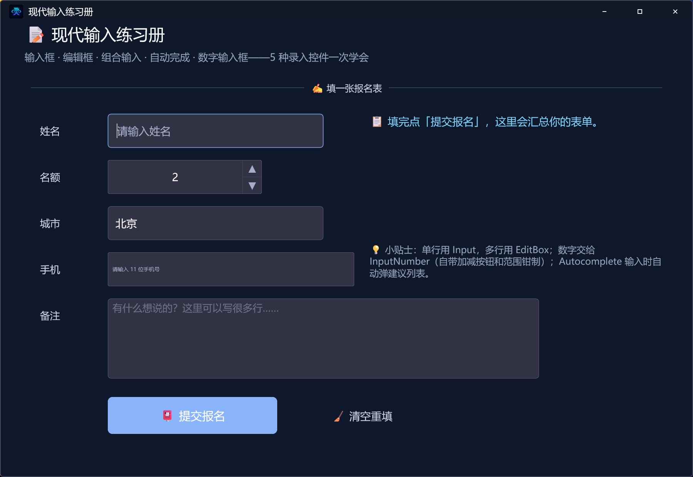

## 1. 命令预告

| 命令 | 作用 |
| --- | --- |
| `控件_取文本(控件名)` | 读输入框/编辑框里的文字 |
| `控件_取数值(控件名)` | 读数字输入框里的数（整数型） |
| `控件_设置数值(控件名, 数)` | 给数字输入框赋值 |
| `文本_取长度(文字)` | 算文字长度，长度为 0 就是没填 |
| `到文本(数值)` / `控件_设置文本` | 前两集学过 |

> 注意：`文本_取长度` 住在**文本处理模块**（std.text）里，不在 new_emoji 模块里——一会儿要连它一起启用。这也是 LingBuilder 的日常：**先想好用什么命令，再确认命令的「家」启用了没有**。

## 2. 新建项目 + 启用模块

老三样：欢迎页「新建项目」→「Windows 界面设计」→ 项目名称 **现代输入练习册** → 创建：

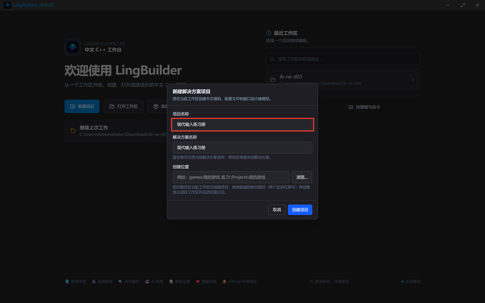

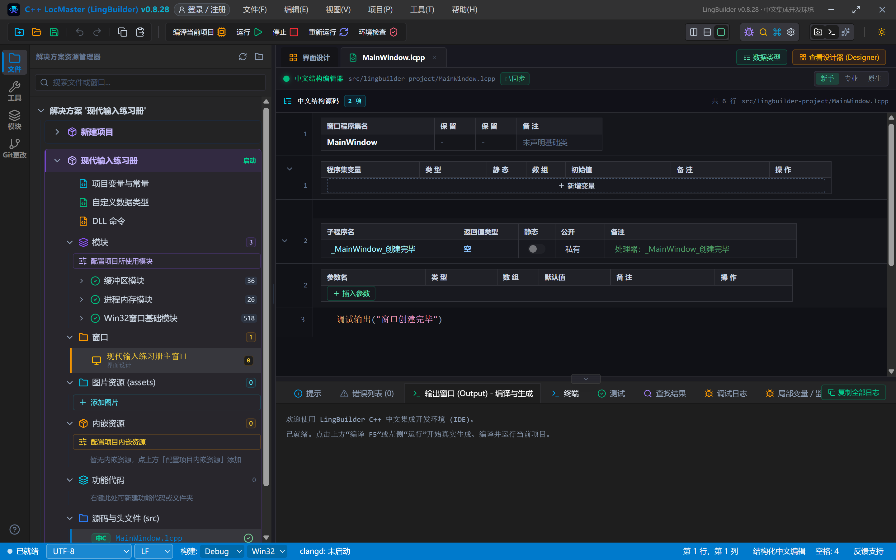

模块面板里这次要启用**两个**模块：搜「原生界面」启用「new_emoji 原生界面库」（首次会弹登录框，账号登录一次即可）：

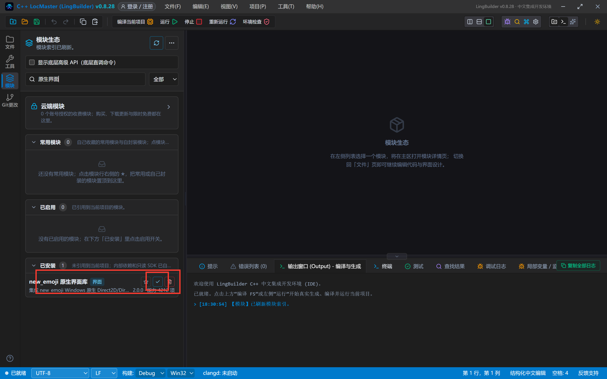

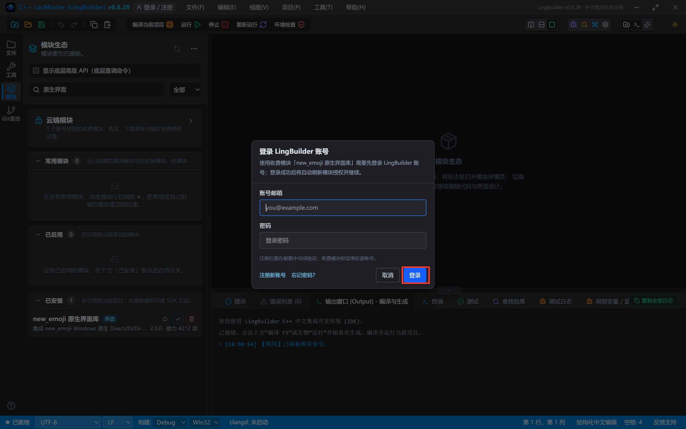

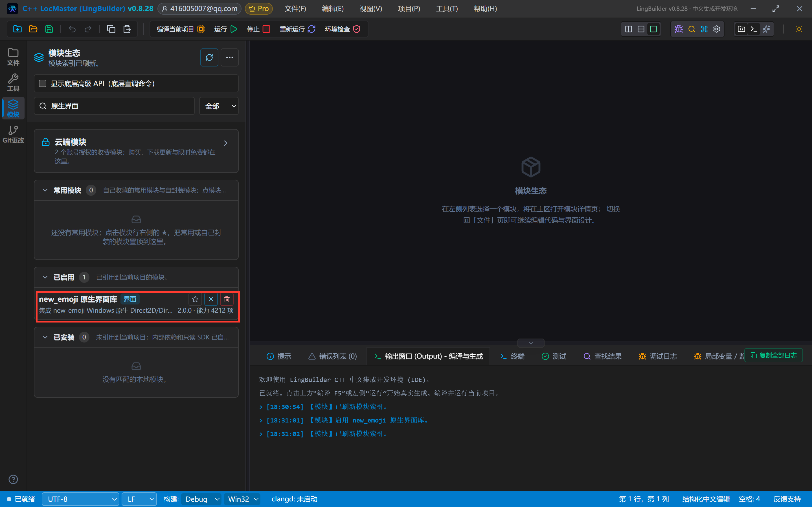

再搜「**文本处理**」，启用「文本处理模块」——`文本_取长度` 在它家里。

## 3. 切设计后端

界面设计 → 画布空白处选中窗口 → 属性面板把「设计后端」切为「new_emoji 模块」（和前两集一样，要先切后端再摆控件）：

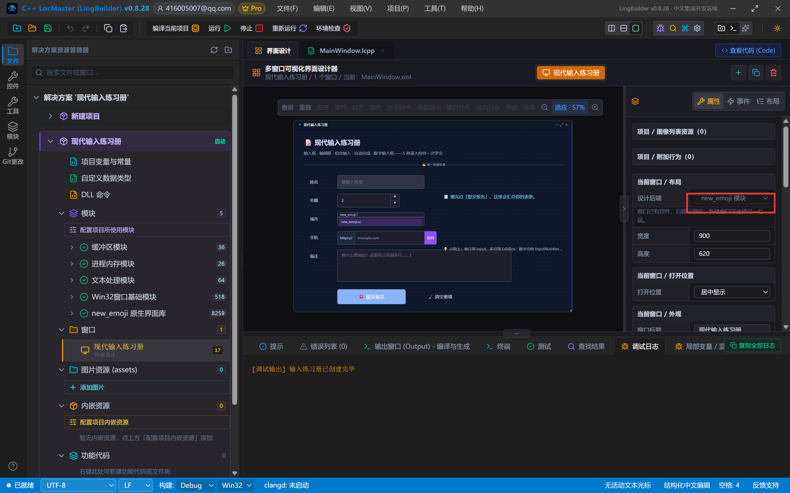

工具箱「New_Emoji 控件」组里能找到本集的全部组件：

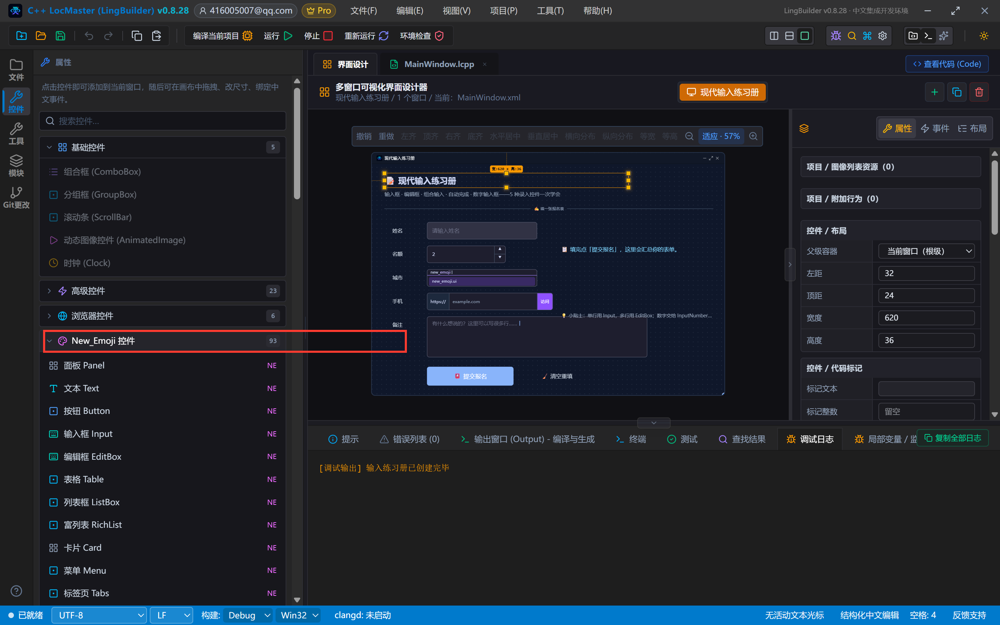

## 4. 设计界面

窗口 900×620。左列表单、右列提示，表格里坐标照抄即可：

| 控件 | 名称 | 显示内容 | 左距 | 顶距 | 宽度 | 高度 | 关键属性 |
| --- | --- | --- | --- | --- | --- | --- | --- |
| 文本 Text | 标题文本 | 📝 现代输入练习册 | 32 | 24 | 620 | 36 | 字号 21，粗体 |
| 文本 Text | 副标题文本 | 输入框 · 编辑框 · 组合输入 · 自动完成 · 数字输入框——5 种录入控件一次学会 | 32 | 66 | 720 | 24 | 字号 13，#94A3B8 |
| 分割线 Divider | 标题分割线 | ✍️ 填一张报名表 | 32 | 100 | 836 | 28 | — |
| 文本 Text | 姓名标签 | 姓名 | 52 | 150 | 80 | 40 | 垂直对齐=居中 |
| 输入框 Input | 姓名输入 | （清空） | 140 | 148 | 280 | 44 | **占位提示=请输入姓名**，**可清空=真**，字号 14 |
| 文本 Text | 数量标签 | 名额 | 52 | 210 | 80 | 40 | 同上 |
| 数字输入框 InputNumber | 名额输入 | （清空） | 140 | 208 | 200 | 44 | **值=2，最小=1，最大=10，步长=1**，字号 14 |
| 文本 Text | 城市标签 | 城市 | 52 | 270 | 80 | 40 | 同上 |
| 自动完成 Autocomplete | 城市输入 | （清空） | 140 | 268 | 280 | 44 | **建议列表=北京、上海、广州、深圳、杭州**（英文逗号分隔），占位提示=输入城市，自动弹建议 |
| 文本 Text | 手机标签 | 手机 | 52 | 330 | 80 | 40 | 同上 |
| 组合输入 InputGroup | 手机输入 | （清空） | 140 | 328 | 320 | 44 | 占位提示=请输入 11 位手机号 |
| 文本 Text | 备注标签 | 备注 | 52 | 390 | 80 | 40 | 同上 |
| 编辑框 EditBox | 备注编辑框 | （清空） | 140 | 388 | 560 | 104 | **多行=真**，占位提示=有什么想说的？这里可以写很多行…… |
| 按钮 Button | 提交按钮 | 📮 提交报名 | 140 | 516 | 220 | 48 | 变体=主要(1)，字号 15 |
| 按钮 Button | 清空按钮 | 🧹 清空重填 | 380 | 516 | 180 | 48 | 变体=文本(5) |
| 文本 Text | 状态文本 | 📋 填完点「提交报名」，这里会汇总你的表单。 | 480 | 148 | 388 | 140 | 字号 14，#7DD3FC，自动换行 |
| 文本 Text | 小贴士文本 | 💡 小贴士：单行用 Input，多行用 EditBox；数字交给 InputNumber（自带加减按钮和范围钳制）；Autocomplete 输入时自动弹建议列表。 | 480 | 316 | 388 | 140 | 字号 12，#94A3B8，自动换行 |

给窗口「创建完毕」、提交按钮「被点击」、清空按钮「被点击」绑事件，处理器名分别是 `_MainWindow_创建完毕`、`_提交按钮_被单击`、`_清空按钮_被单击`。

摆完的画布（城市自动完成在画布上会显示建议列表的占位预览，运行后是真实效果）：

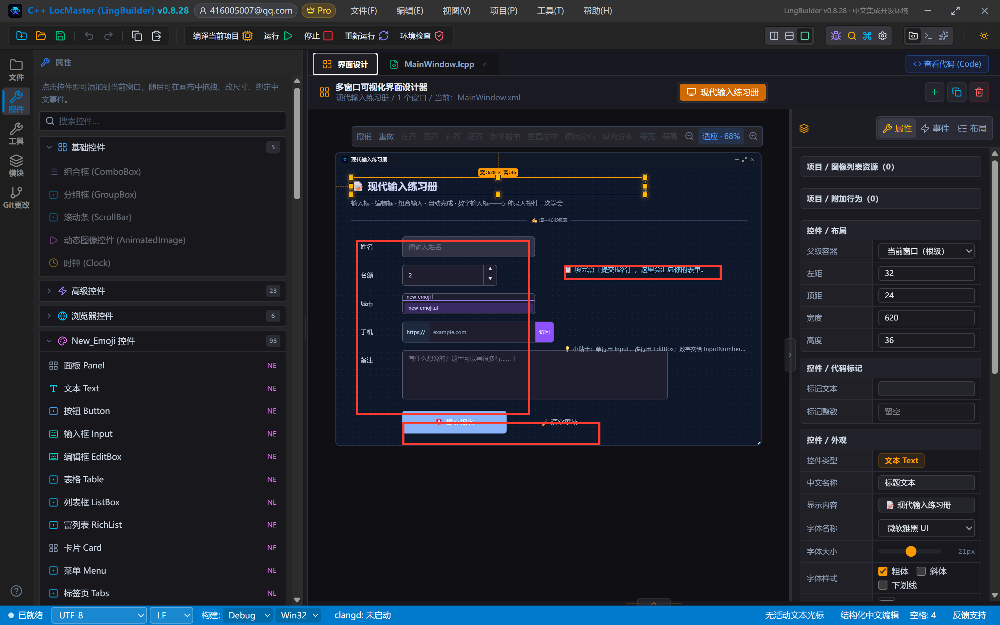

## 5. 写代码：读取、判空、汇总

```lcpp
类 MainWindow
    事件 _MainWindow_创建完毕()
        控件_设置文本(状态文本, "📋 填完点「提交报名」，这里会汇总你的表单。")
        调试输出("输入练习册已创建完毕")
    结束

    事件 _提交按钮_被单击()
        局部 文本型 姓名
        姓名 = 控件_取文本(姓名输入)
        如果 (文本_取长度(姓名) = 0)
            控件_设置文本(状态文本, "⚠️ 姓名还没填：请先在「姓名」输入框写下名字再提交。")
            返回()
        如果结束
        局部 整数型 名额
        名额 = 控件_取数值(名额输入)
        控件_设置文本(状态文本, "📮 报名成功：" + 姓名 + "，报 " + 到文本(名额) + " 个名额，城市 " + 控件_取文本(城市输入) + "，手机 " + 控件_取文本(手机输入) + "。备注已收到！")
    结束

    事件 _清空按钮_被单击()
        控件_设置文本(姓名输入, "")
        控件_设置文本(城市输入, "")
        控件_设置文本(手机输入, "")
        控件_设置文本(备注编辑框, "")
        控件_设置数值(名额输入, 2)
        控件_设置文本(状态文本, "🧹 已清空，可以重新填一张。")
    结束
结束类
```

三个要点：

- **判空必须用 `文本_取长度(姓名) = 0`**。不要写 `姓名 ≠ ""` 这种字符串比较表达式——中文代码的字符串比较表达式无法翻译成 C++，编译直接报错。这也是本集要启用文本处理模块的原因。
- **先声明再赋值**：`局部 文本型 姓名` 和 `姓名 = 控件_取文本(姓名输入)` 分两行写。带初始值的声明会被提升到处理器最前面，依赖执行顺序时容易出隐 bug，拆两行最稳。
- **数字走 `控件_取数值`**：名额输入是 InputNumber，读出来直接是整数型；别用 Input 存数字再手工转换。

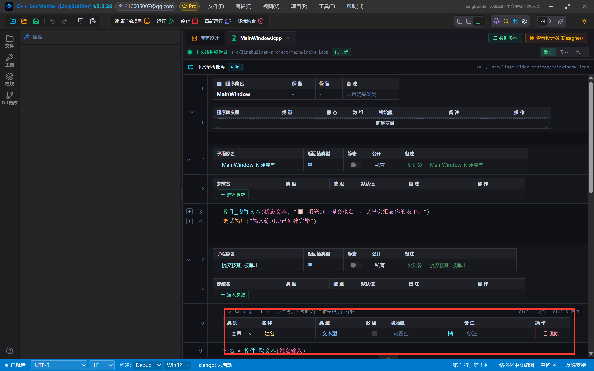

## 6. 编译前先看错误列表

「编译当前项目」→ 底部「错误列表 (0)」：

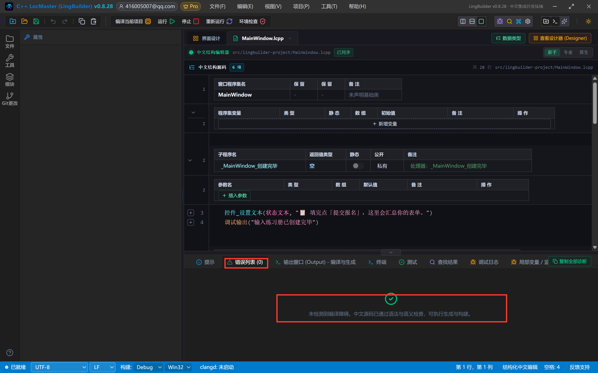

## 7. 运行！空表单先提交一次

点「运行」。窗口出来了——每个输入框都有自己的「空态长相」：占位提示是浅灰字，名额输入框带着 2 和上下箭头，城市框自动带了第一条建议「北京」：

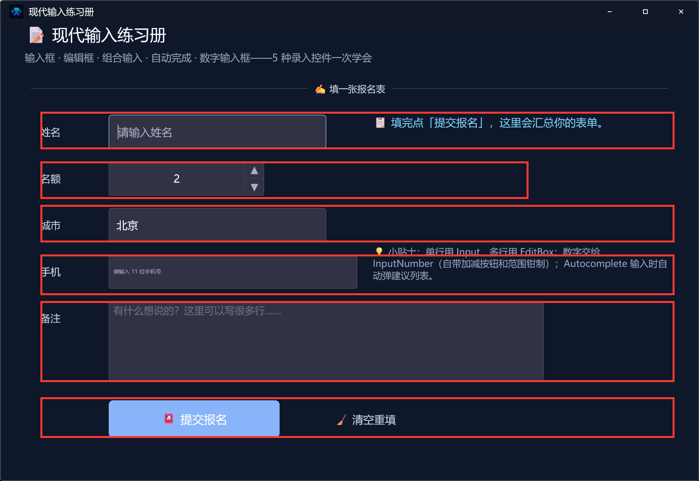

**什么都不填，直接点「📮 提交报名」**——被拦截了！状态文本变成 ⚠️ 提示，表单不会提交：

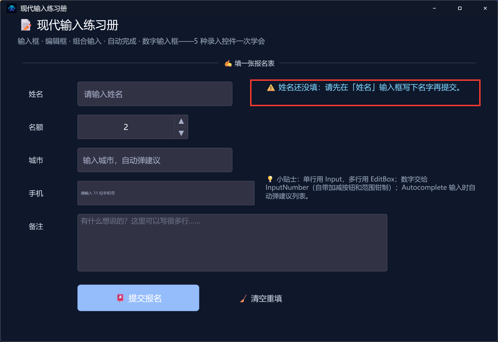

现在把表单填上（姓名填「小明」，备注写「下周三下午到达，麻烦留前排座位」），再点一次提交：


状态文本把姓名、名额、城市、手机全部拼进了一句话——这就是 `控件_取文本` / `控件_取数值` 的功劳。城市和手机没填就汇总成空串，这也是真实程序里最常见的「可选字段」处理方式。

## 8. 导出源码包

命令面板执行「项目：一键导出 LCPP 源码包」即可。

## 本集源码包

- 本集源码包已上架官网「[示例源码](https://lingbuilder.com/demos)」区，按名称「NE合集03-输入类一：现代输入练习册」即可下载（每集一个 `.lcpppkg`，配套预览图与图文教程直链）。
- 导入：LingBuilder 欢迎页 →「**导入源码包**」，选中 `.lcpppkg` 一键还原整个项目（含窗口设计与全部源码）。
- new_emoji 原生界面库为**收费模块**：导入后如未启用，在模块面板启用并用 LingBuilder 账号登录授权即可（和制作时是同一个账号体系，授权一次全合集通用）。


## 下一集预告

04 集「输入类（二）」：复选框 Checkbox、单选框 Radio、开关 Switch、滑块 Slider、评分 Rate——做一个「偏好设置面板」，单选互斥、滑块调值、星级打分全部真机演示。
