# NE 合集 04 · 输入类（二）：偏好设置面板

> 《LingBuilder new_emoji 合集》第 4 集（入门篇）。输入类收官之作：**复选框 Checkbox、单选框 Radio、开关 Switch、滑块 Slider、评分 Rate**——5 种「选择型」控件做一个「偏好设置面板」。这一集还能学到 NE 的一个重要红线：**单选互斥要自己写代码维护**。全程约 35 分钟。
>
> 前置要求：完成[第 01 集](/guide/tutorials/new-emoji-01)（启用模块、切设计后端、F5 全流程）。本集源码包见文末。

## 这一集你将学会

- **Checkbox 复选框**：`checked` 勾选态 + `控件_取勾选` 读取
- **Radio 单选框**：互斥逻辑的代码写法（NE 不自动互斥！）
- **Switch 开关**：开/关两态，语义是「立即生效」的设置
- **Slider 滑块**：`min`/`max`/`value`/`step`，拖动实时取值
- **Rate 评分**：星级打分，初值要用 `valueX2`（半星单位）
- **ValueChanged 数值变化事件**：五种控件共用的「状态变了」事件

## 1. 命令与事件预告

| 命令 / 事件 | 作用 |
| --- | --- |
| `控件_取勾选(控件名)` | 读复选框/单选框/开关的勾选状态（逻辑型） |
| `控件_设置勾选(控件名, 真/假)` | 设置勾选状态（互斥就靠它） |
| `控件_取数值(控件名)` | 读滑块/评分的当前值（整数型） |
| `数值变化` 事件 | 五种控件共用：勾选变了、开关拨了、滑块拖了、星星点了都会触发 |

> 这一集**没有任何新命令需要额外启用模块**——全部命令都在前几集启用过的模块里。

## 2. 新建项目 + 启用模块 + 切后端

流程和第 1 集完全一样，项目名称填 **偏好设置面板**：

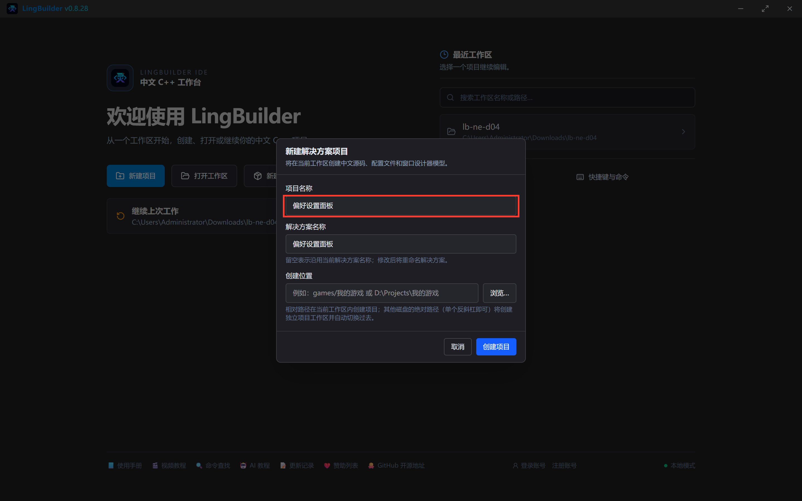

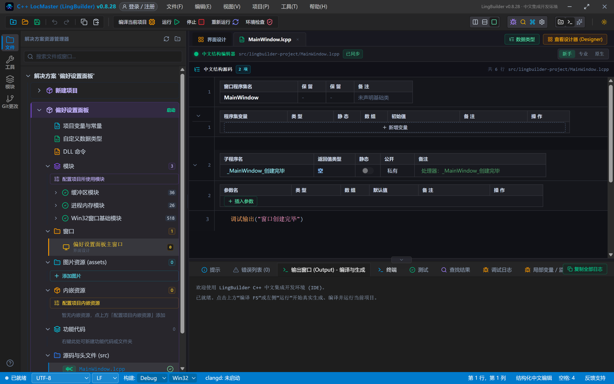

模块面板搜「原生界面」→ 启用「new_emoji 原生界面库」（首次弹登录框，登录一次即可）：

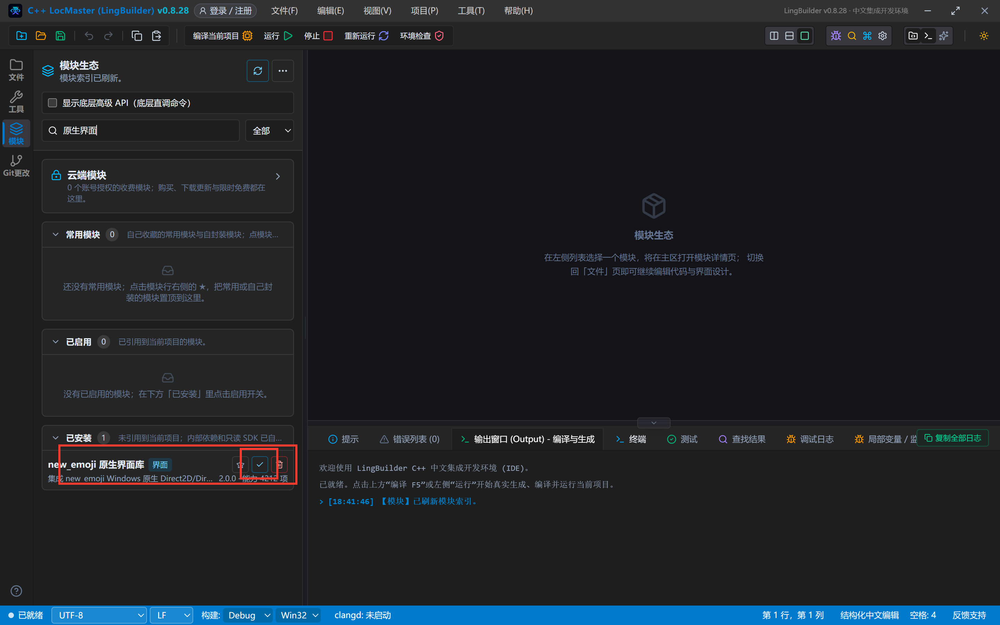

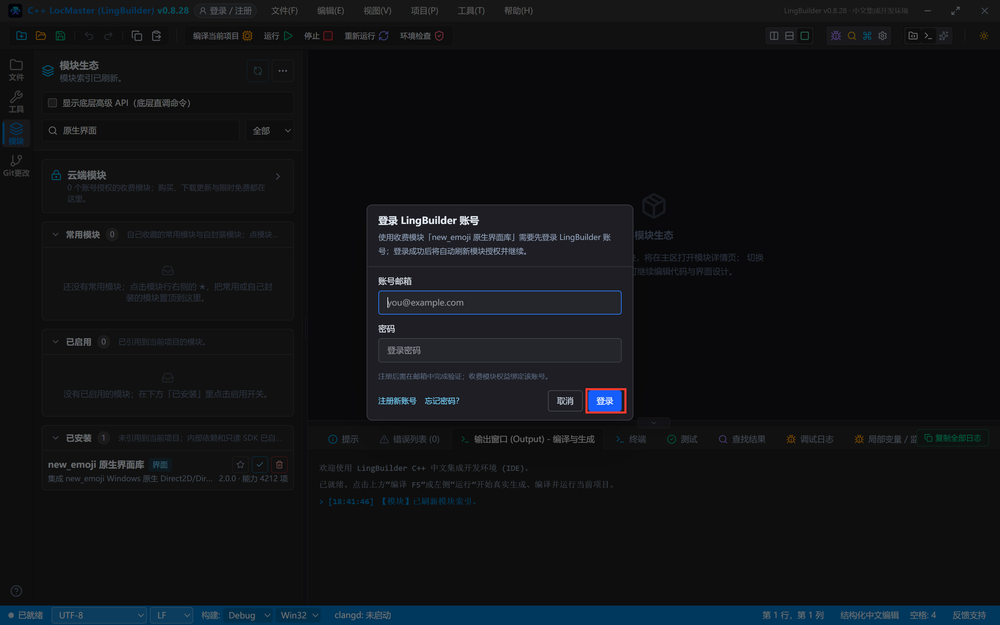

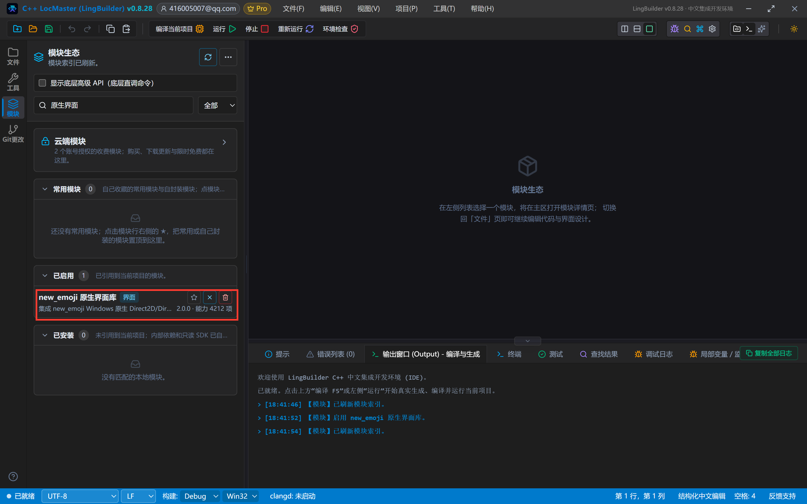

界面设计 → 画布空白选中窗口 → 「设计后端」切为「new_emoji 模块」：

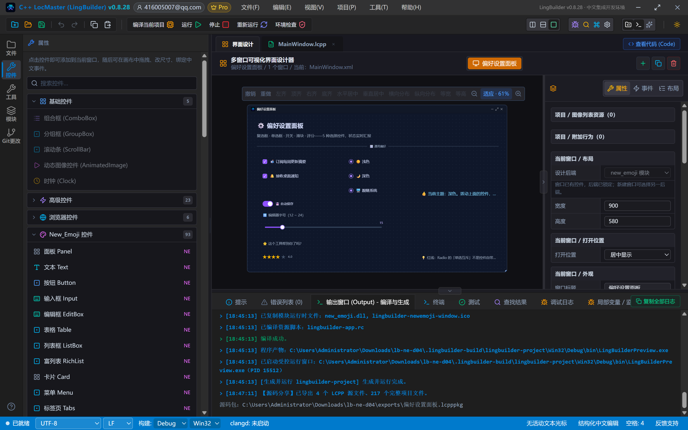

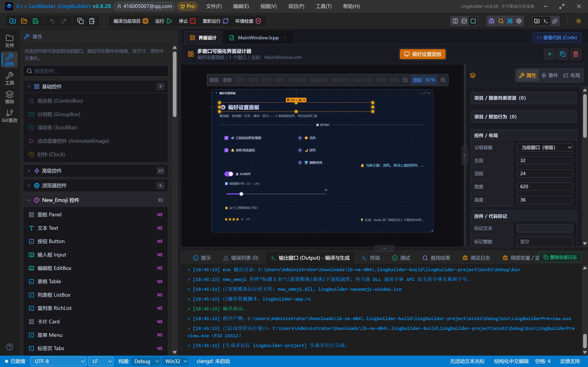

## 3. 设计界面

窗口 900×580。控件不多，但每一行都有讲究：

| 控件 | 名称 | 显示内容 | 左距 | 顶距 | 宽度 | 高度 | 关键属性 |
| --- | --- | --- | --- | --- | --- | --- | --- |
| 文本 Text | 标题文本 | ⚙️ 偏好设置面板 | 32 | 24 | 620 | 36 | 字号 21，粗体 |
| 文本 Text | 副标题文本 | 复选框 · 单选框 · 开关 · 滑块 · 评分——5 种选择控件，状态实时汇报 | 32 | 66 | 720 | 24 | 字号 13，#94A3B8 |
| 分割线 Divider | 标题分割线 | 🎛️ 通用偏好 | 32 | 100 | 836 | 28 | — |
| 复选框 Checkbox | 订阅周报 | 📬 订阅每周更新摘要 | 52 | 148 | 270 | 38 | 勾选=假 |
| 复选框 Checkbox | 接收通知 | 🔔 接收桌面通知 | 52 | 198 | 270 | 38 | **勾选=真** |
| 单选框 Radio | 主题浅色 | ☀️ 浅色 | 350 | 148 | 170 | 38 | 勾选=假 |
| 单选框 Radio | 主题深色 | 🌙 深色 | 350 | 198 | 170 | 38 | **勾选=真**（默认主题） |
| 单选框 Radio | 主题跟随 | 🖥️ 跟随系统 | 350 | 248 | 200 | 38 | 勾选=假 |
| 开关 Switch | 自动保存 | 💾 自动保存 | 52 | 292 | 260 | 42 | 勾选=假 |
| 文本 Text | 滑块说明 | 🔠 编辑器字号（12 ~ 24） | 52 | 340 | 300 | 26 | 字号 12，#94A3B8 |
| 滑块 Slider | 字号滑块 | （清空） | 52 | 372 | 420 | 44 | **最小=12，最大=24，值=15，步长=1** |
| 文本 Text | 评分说明 | ⭐ 这个工具帮到你了吗？ | 52 | 438 | 300 | 26 | 字号 12，#94A3B8 |
| 评分 Rate | 满意度评分 | （清空） | 52 | 470 | 330 | 52 | **最大=5，值=3，valueX2=6**（半星单位，见下方红线） |
| 文本 Text | 状态文本 | 👍 当前主题：深色。拨动上面的控件，这里会实时汇报。 | 600 | 148 | 268 | 260 | 字号 14，#7DD3FC，自动换行 |
| 文本 Text | 红线说明 | 💡 红线：Radio 的「单选互斥」不是控件自带的…… | 600 | 430 | 268 | 140 | 字号 12，#94A3B8，自动换行 |

事件绑定：窗口「创建完毕」+ 其余 8 个控件的「**数值变化**」事件，处理器名统一 `_控件名_数值变化`。

摆完的画布：

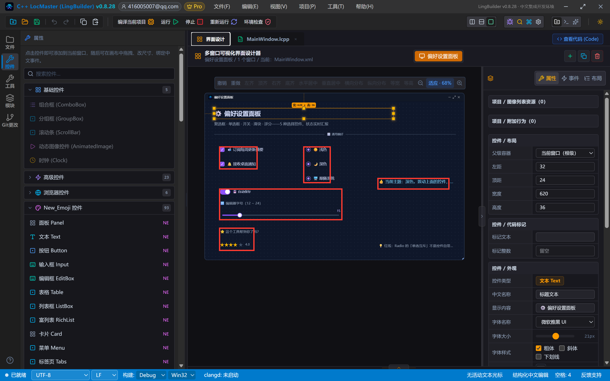

> **本集最重要的红线**：NE 的 Radio **不会自动互斥**——点「浅色」的时候「深色」不会自己弹起来，必须由你的代码在处理器里把同组另外两项 `控件_设置勾选(…, 假)`。很多新手在这里以为控件坏了，其实是设计语义：互斥组关系是业务逻辑，框架不替你猜。
>
> **第二个红线**：评分 Rate 的初值要写 `valueX2`（半星单位）：想默认亮 3 星就设 `valueX2=6`。只写 `value=3` 的话，设计器里看着是 3 星，运行起来却是全灰。

## 4. 写代码

```lcpp
类 MainWindow
    事件 _MainWindow_创建完毕()
        控件_设置文本(状态文本, "👍 当前主题：深色。拨动上面的控件，这里会实时汇报。")
        调试输出("偏好设置面板已创建完毕")
    结束

    事件 _订阅周报_数值变化()
        局部 逻辑型 开
        开 = 控件_取勾选(订阅周报)
        如果 (开)
            控件_设置文本(状态文本, "📬 已订阅周报：每周一早上见。")
        否则
            控件_设置文本(状态文本, "💤 已取消周报订阅。")
        如果结束
    结束

    事件 _接收通知_数值变化()
        局部 逻辑型 开
        开 = 控件_取勾选(接收通知)
        如果 (开)
            控件_设置文本(状态文本, "🔔 桌面通知已开启。")
        否则
            控件_设置文本(状态文本, "🔕 桌面通知已关闭。")
        如果结束
    结束

    事件 _主题浅色_数值变化()
        控件_设置勾选(主题深色, 假)
        控件_设置勾选(主题跟随, 假)
        控件_设置文本(状态文本, "☀️ 主题切换：浅色。互斥是上面两行代码维护的。")
    结束

    事件 _主题深色_数值变化()
        控件_设置勾选(主题浅色, 假)
        控件_设置勾选(主题跟随, 假)
        控件_设置文本(状态文本, "🌙 主题切换：深色。")
    结束

    事件 _主题跟随_数值变化()
        控件_设置勾选(主题浅色, 假)
        控件_设置勾选(主题深色, 假)
        控件_设置文本(状态文本, "🖥️ 主题切换：跟随系统。")
    结束

    事件 _自动保存_数值变化()
        局部 逻辑型 开
        开 = 控件_取勾选(自动保存)
        如果 (开)
            控件_设置文本(状态文本, "💾 自动保存已开启：每 30 秒存一次草稿。")
        否则
            控件_设置文本(状态文本, "🛑 自动保存已关闭：记得手动 Ctrl+S。")
        如果结束
    结束

    事件 _字号滑块_数值变化()
        控件_设置文本(状态文本, "🔠 编辑器字号调整为 " + 到文本(控件_取数值(字号滑块)) + " 号。")
    结束

    事件 _满意度评分_数值变化()
        控件_设置文本(状态文本, "⭐ 收到评分：" + 到文本(控件_取数值(满意度评分)) + " / 5 星，谢谢反馈！")
    结束
结束类
```

看点：`数值变化` 事件**不带参数**，想知道变成什么值，处理器里自己 `控件_取勾选` / `控件_取数值` 再读一次——「先变状态、再问状态」是 NE 事件的统一节奏。

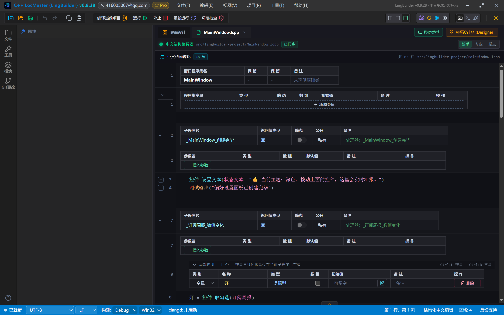

## 5. 编译前先看错误列表

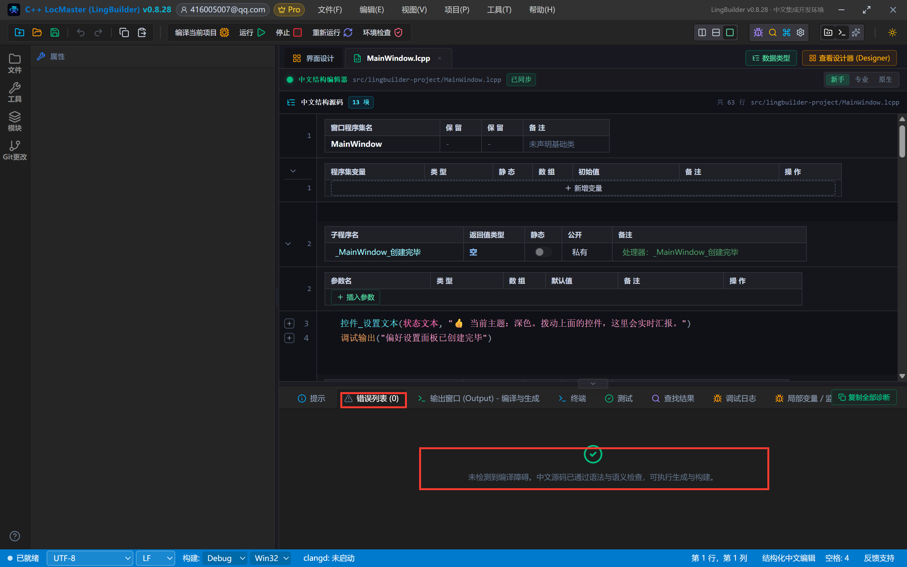

## 6. 运行！拨一遍所有开关

点「运行」。初始状态：接收通知已勾选、深色已选中、开关全灰、滑块停在 15、三颗星亮着：

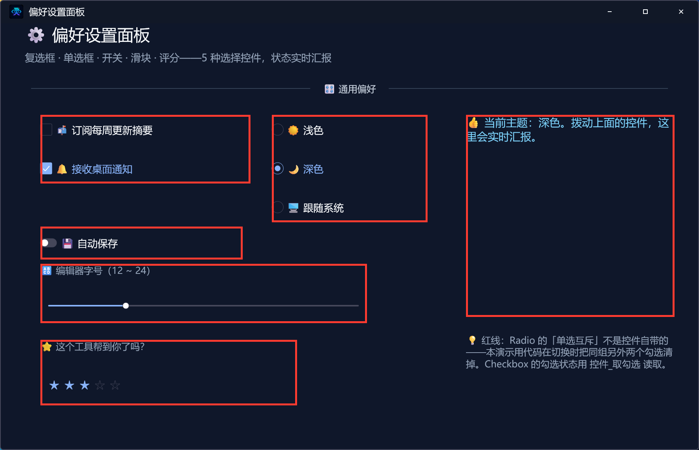

现在快速做四件事：点「☀️ 浅色」（看！深色自动弹起——互斥代码生效了）、拨开「💾 自动保存」、把滑块拖到中间偏右、点第 4 颗星：

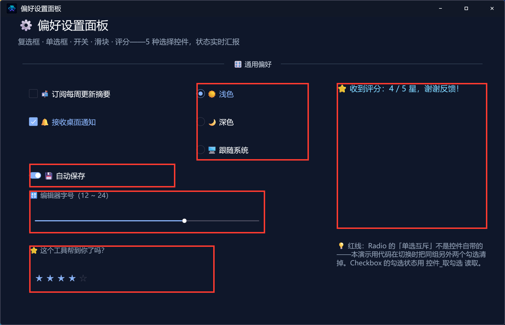

状态文本实时播报「⭐ 收到评分：4 / 5 星，谢谢反馈！」——五种控件、一个事件、一套读取命令，全部打通。

## 7. 导出源码包

命令面板执行「项目：一键导出 LCPP 源码包」即可。

## 本集源码包

- 本集源码包已上架官网「[示例源码](https://lingbuilder.com/demos)」区，按名称「NE合集04-输入类二：偏好设置面板」即可下载（每集一个 `.lcpppkg`，配套预览图与图文教程直链）。
- 导入：LingBuilder 欢迎页 →「**导入源码包**」，选中 `.lcpppkg` 一键还原整个项目（含窗口设计与全部源码）。
- new_emoji 原生界面库为**收费模块**：导入后如未启用，在模块面板启用并用 LingBuilder 账号登录授权即可（和制作时是同一个账号体系，授权一次全合集通用）。


## 下一集预告

入门篇 4 集到此收官，你已经能独立做出带彩色 Emoji 的现代窗口。05 集起进入选择类：「下拉与级联」——Select/SelectV2 虚拟选择器/Cascader/TreeSelect。
