# NE 合集 07 · 特殊输入：快速登记台

> 《LingBuilder new_emoji 合集》第 7 集（选择类收官）。一次学会 4 种「特殊输入」控件：**InputTag 标签输入、Mentions 提及、ColorPicker 颜色选择器、Upload 上传**——做一个「快速登记台」。全程约 35 分钟。
>
> 前置要求：完成[第 01 集](/guide/tutorials/new-emoji-01)（启用模块、切设计后端、F5 全流程）。本集源码包见文末。

## 这一集你将学会

- **InputTag**：`tags` 预置标签 + `placeholder`，输入文字按回车成签
- **Mentions**：`suggestions` 成员名单 + `trigger` 触发符，输入 @ 弹建议
- **ColorPicker**：`value` 初值，弹层渐变取色 + 十二色快捷色板
- **Upload**：`NE上传_设置文件列表` 在运行期写入文件列表（不用碰原生文件对话框）
- **控件_取文本**：读 InputTag 的标签列表（竖线分隔），本集唯一的「读值」彩蛋

## 1. 命令与事件预告

| 命令 / 事件 | 作用 |
| --- | --- |
| `NE上传_设置文件列表(控件名, 文件列表)` | 运行期给上传控件塞文件行（竖线分隔多个文件） |
| `控件_取文本(控件名)` | 读 InputTag 当前标签列表（如 `编程|摄影|Rust`） |
| `文本变化` 事件 | InputTag/Mentions 共用：标签成签、内容更新时触发 |
| `数值变化` 事件 | ColorPicker：颜色变了就触发 |
| `文件选择` 事件 | Upload：收到文件选择动作时触发 |

> 本集只需要 new_emoji 模块。

## 2. 新建项目 + 启用模块 + 切后端

流程和第 1 集完全一样，项目名称填 **快速登记台**：

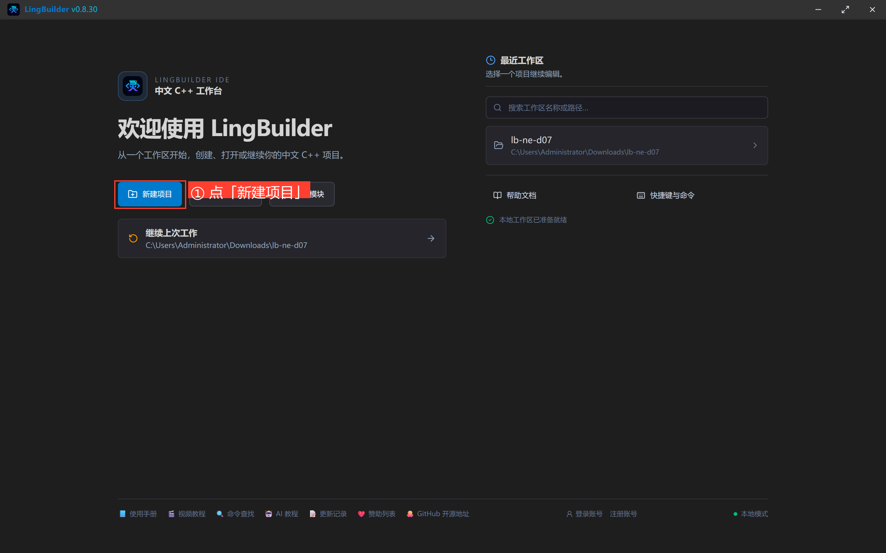

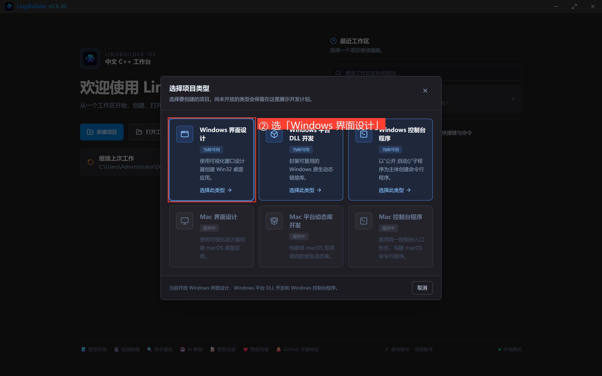

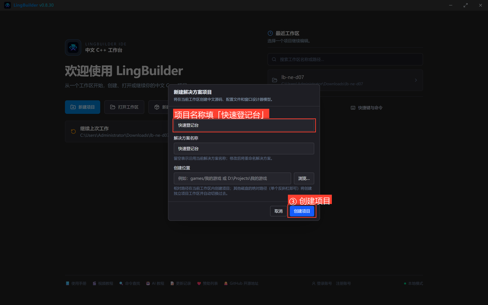

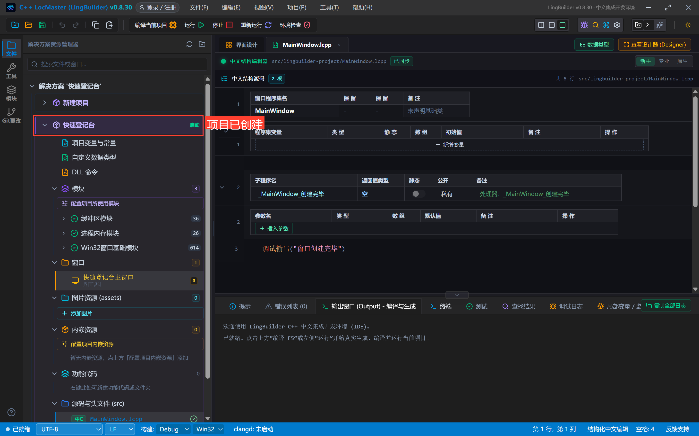

模块面板搜「原生界面」→ 启用「new_emoji 原生界面库」（首次弹登录框，登录一次即可）：

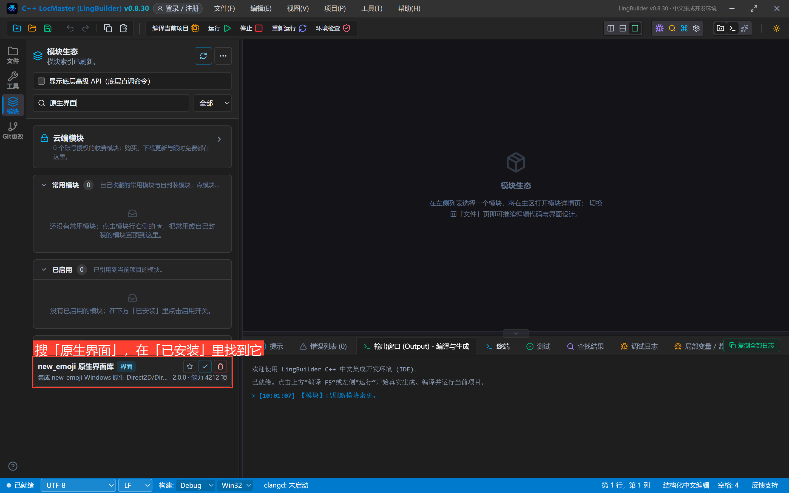

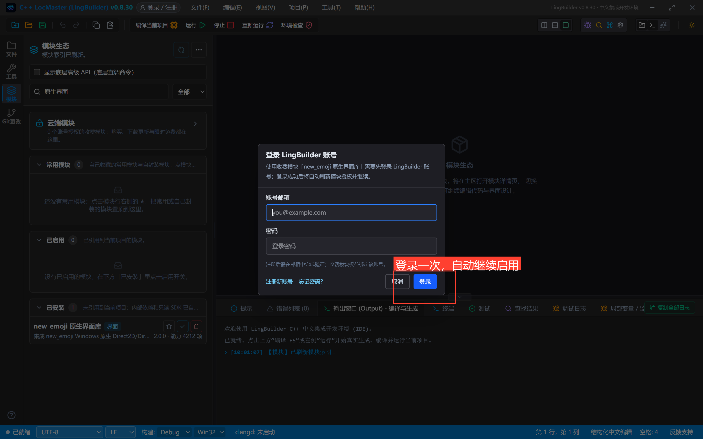

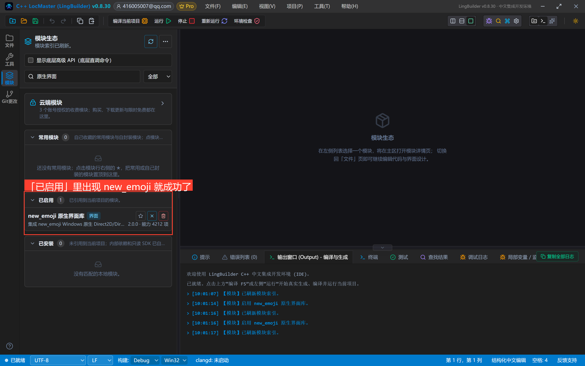

界面设计 → 选中窗口 → 「设计后端」切为「new_emoji 模块」：

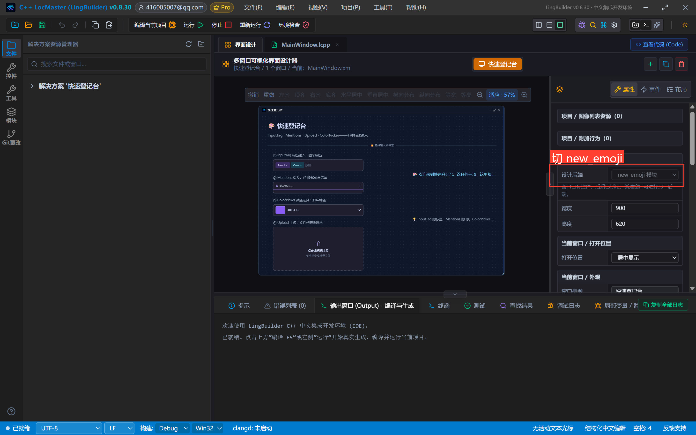

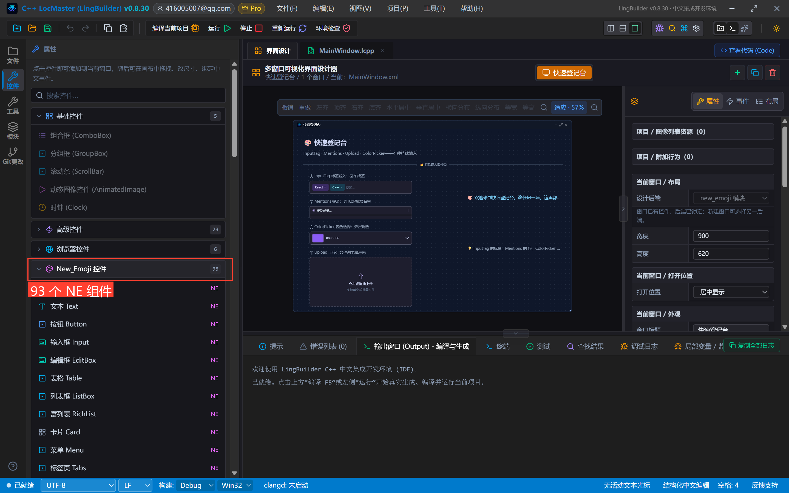

## 3. 设计界面

窗口 900×620。左边四个特殊输入，右边状态屏：

| 控件 | 名称 | 显示内容 | 左距 | 顶距 | 宽度 | 高度 | 关键属性 |
| --- | --- | --- | --- | --- | --- | --- | --- |
| 文本 Text | 标题文本 | 🎨 快速登记台 | 32 | 24 | 620 | 36 | 字号 21，粗体 |
| 文本 Text | 副标题文本 | InputTag · Mentions · Upload · ColorPicker——4 种特殊输入 | 32 | 66 | 780 | 24 | 字号 13，#94A3B8 |
| 分割线 Divider | 标题分割线 | ✍️ 特殊输入四件套 | 32 | 100 | 836 | 28 | — |
| 文本 Text | 标签标签 | ① InputTag 标签输入：回车成签 | 52 | 140 | 340 | 22 | 字号 12，#94A3B8 |
| 标签输入 InputTag | 兴趣标签 | （清空） | 52 | 166 | 330 | 42 | **tags=编程,摄影；placeholder=输入文字后按回车** |
| 文本 Text | 提及标签 | ② Mentions 提及：@ 唤起成员名单 | 52 | 222 | 340 | 22 | 字号 12，#94A3B8 |
| 提及 Mentions | 提及输入 | （清空） | 52 | 248 | 330 | 42 | **suggestions=张三,李四,王五；trigger=@** |
| 文本 Text | 颜色标签 | ③ ColorPicker 颜色选择：弹层调色 | 52 | 304 | 340 | 22 | 字号 12，#94A3B8 |
| 颜色选择器 ColorPicker | 主题颜色 | （清空） | 52 | 330 | 330 | 42 | **value=#FF2D7DFF**（带透明度前缀） |
| 文本 Text | 上传标签 | ④ Upload 上传：文件列表收进来 | 52 | 386 | 340 | 22 | 字号 12，#94A3B8 |
| 上传 Upload | 附件上传 | （清空） | 52 | 412 | 330 | 160 | **title=上传附件 📤；tip=点击或拖拽上传** |
| 文本 Text | 状态文本 | 🎨 欢迎来到快速登记台。改任何一项，这里都会记下来。 | 560 | 140 | 308 | 160 | 字号 14，#7DD3FC，自动换行 |
| 文本 Text | 红线说明 | 💡 InputTag 的标签、Mentions 的 @、ColorPicker 的色块都是「状态在控件身上」，处理器负责播报。 | 560 | 320 | 308 | 130 | 字号 12，#94A3B8，自动换行 |

事件绑定：兴趣标签/提及输入绑「**文本变化**」、主题颜色绑「**数值变化**」、附件上传绑「**文件选择**」，处理器名统一 `_控件名_事件名`。

摆完的画布：

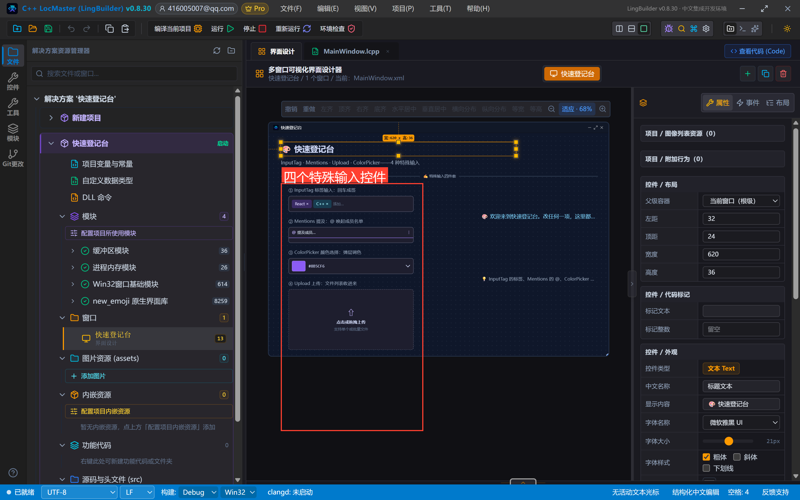

> **本集最重要的红线：上传控件别去点原生文件对话框**——自动化演示（以及很多真实场景）只需要「文件列表展示」，用 `NE上传_设置文件列表` 在运行期写入即可，文件行自带预览/上传/删除按钮。
>
> **第二个红线**：四个控件的状态都「长在控件身上」（签、@人名、色块、文件行），处理器只做播报。唯一例外是 InputTag——`控件_取文本` 能读到竖线分隔的标签列表。

## 4. 写代码

```lcpp
类 MainWindow
    事件 _MainWindow_创建完毕()
        控件_设置文本(状态文本, "🎨 欢迎来到快速登记台。改任何一项，这里都会记下来。")
        NE上传_设置文件列表(附件上传, "需求文档.docx|界面素材.zip")
        调试输出("快速登记台已创建完毕")
    结束

    事件 _兴趣标签_文本变化()
        控件_设置文本(状态文本, "🏷️ 标签列表变了：" + 控件_取文本(兴趣标签))
    结束

    事件 _提及输入_文本变化()
        控件_设置文本(状态文本, "💬 提及内容有更新，看输入框。")
    结束

    事件 _主题颜色_数值变化()
        控件_设置文本(状态文本, "🎨 主题色换好了——看色块和弹层里的十六进制。")
    结束

    事件 _附件上传_文件选择()
        控件_设置文本(状态文本, "📤 收到文件选择动作，文件列表已更新。")
    结束
结束类
```

看点：`创建完毕` 里一句 `NE上传_设置文件列表` 就把两个文件塞进了上传控件——运行期数据写入不算「代码创建控件」，这正是设计器模型 + 运行期数据的分工。

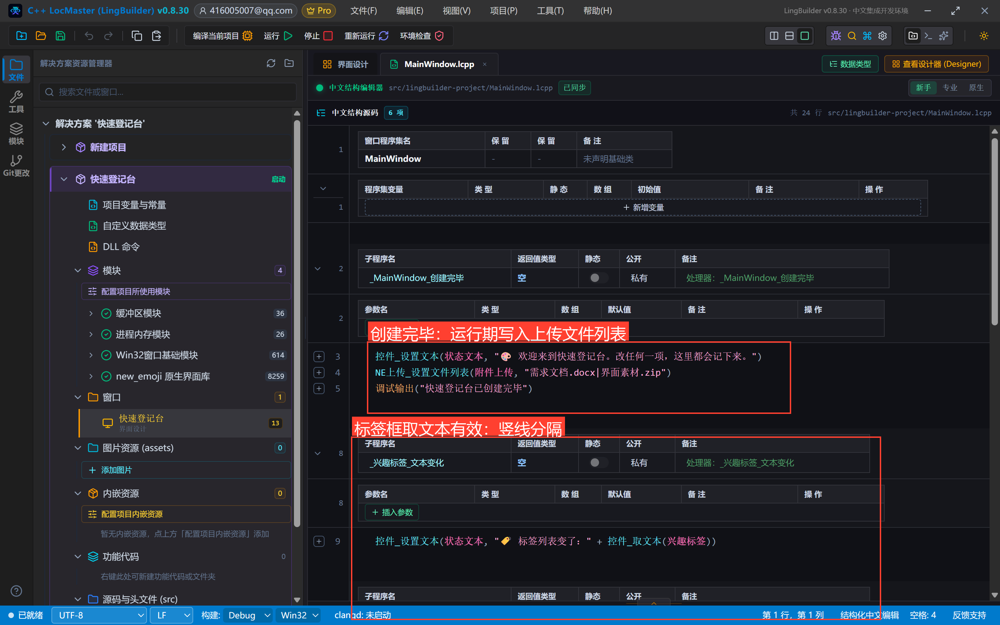

## 5. 编译前先看错误列表

点「编译当前项目」，先看底部错误列表——零报错再继续：

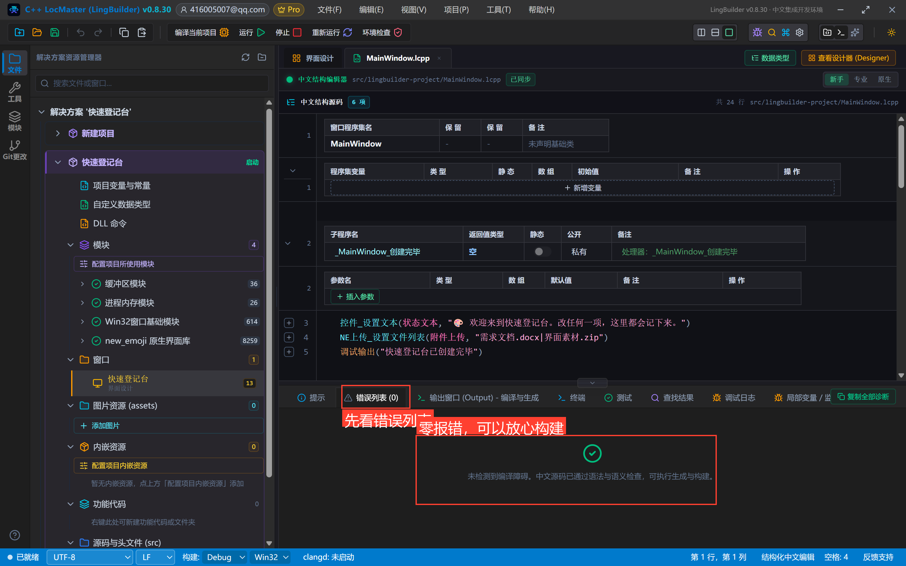

## 6. 运行！把四件套都摸一遍

点「运行」。初始状态：标签框里已经有「编程」「摄影」两个签，上传控件里躺着两个文件：

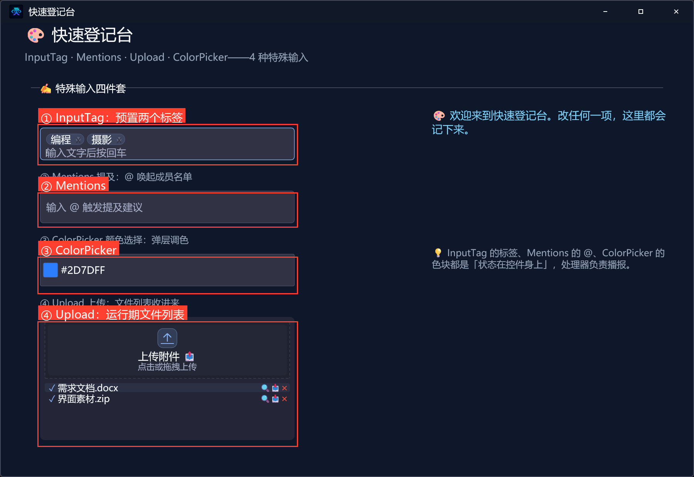

在标签框输入 `Rust` 按回车——第三个签立刻成签，状态屏读到完整列表「编程|摄影|Rust」：

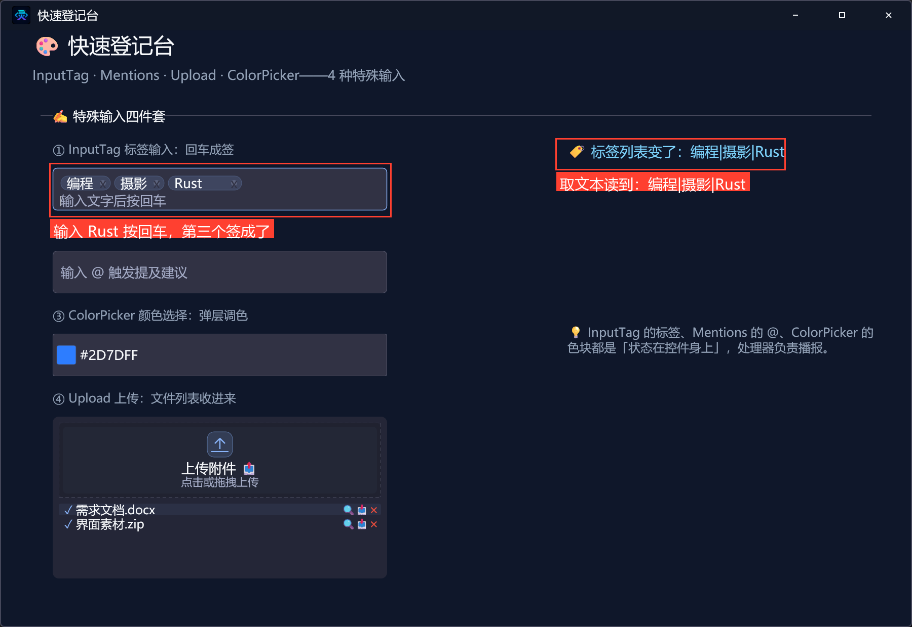

在提及框输入 `@`——成员建议弹出，点「张三」，@张三 入框：

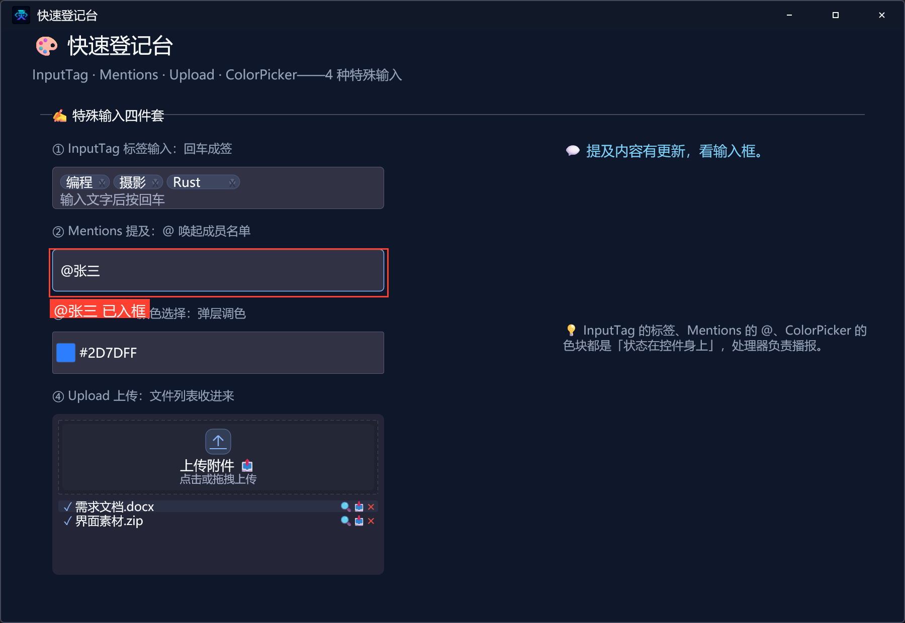

点开颜色选择器——渐变取色区 + 色相条 + 十二色板。在渐变区点一下，色块和十六进制实时变化，弹层保持打开可以继续微调：

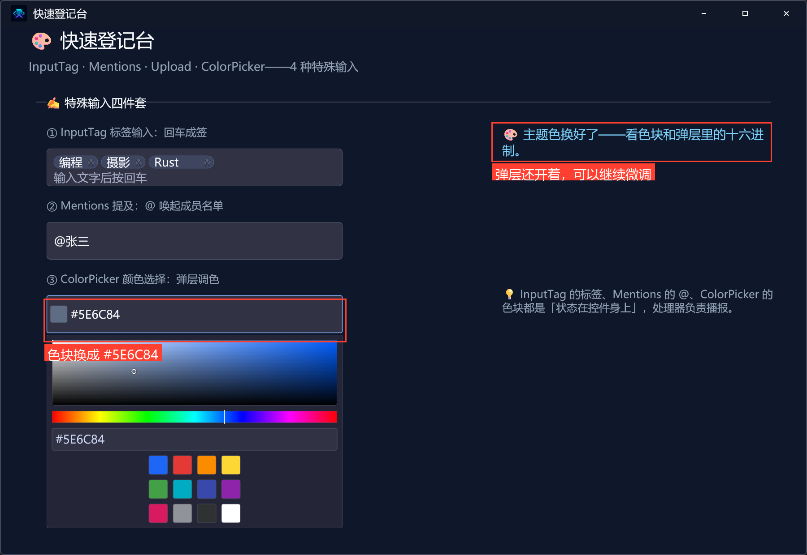

四种特殊输入、三种事件、一句运行期文件列表，全部打通。

## 7. 导出源码包

命令面板执行「项目：一键导出 LCPP 源码包」即可。

## 本集源码包

- 本集源码包已上架官网「[示例源码](https://lingbuilder.com/demos)」区，按名称「NE合集07-特殊输入：快速登记台」即可下载（每集一个 `.lcpppkg`，配套预览图与图文教程直链）。
- 导入：LingBuilder 欢迎页 →「**导入源码包**」，选中 `.lcpppkg` 一键还原整个项目（含窗口设计与全部源码）。
- new_emoji 原生界面库为**收费模块**：导入后如未启用，在模块面板启用并用 LingBuilder 账号登录授权即可（和制作时是同一个账号体系，授权一次全合集通用）。


## 下一集预告

选择类收官，导航篇开篇：「标签页 Tabs 与分段控制 Segmented」——做一个会换页的工作台壳子。
