# NE 合集 08 · 标签页 Tabs 与分段控制 Segmented

> 《LingBuilder new_emoji 合集》第 8 集（导航篇开篇）。做一个「工作台壳子」：**Tabs 标签页**承担三个页签（总览/任务/设置），**Segmented 分段控制**负责设置页里的「日 / 周 / 月」视图切换。这一集最重要的新知识点：**Tabs 的选择变化事件自带三个参数**——和前面几集「无参事件」完全不同。全程约 35 分钟。
>
> 前置要求：完成[第 01 集](/guide/tutorials/new-emoji-01)（启用模块、切设计后端、F5 全流程）。本集源码包见文末。

## 这一集你将学会

- **Tabs**：`items` 页签集合（id/title/icon），`headerAlign=1` 让页签头居中
- **页签页内容**：子控件写 `父级 + 页槽位`（设计器里挂到对应页），每页各放各的控件
- **Tabs 的选择变化事件**：处理器直接声明 `(整数型 选中索引, 整数型 项目数量, 整数型 动作)` 三个参数
- **Segmented**：`items` 分段文字 + `activeIndex` 默认高亮，事件不带参数
- **代码路径改页签**：`NE标签页_设置标签项(页签, "甲|乙|丙")`（竖线分隔，运行期数据）

## 1. 命令与事件预告

| 命令 / 事件 | 作用 |
| --- | --- |
| `选择变化` 事件（Tabs） | **带三个参数**：选中索引（从 0 起）、项目数量、动作码 |
| `选择变化` 事件（Segmented） | 不带参数：播报即可，高亮位置控件自己显示 |
| `控件_取选择项(控件名)` | 读 Tabs 当前页索引（Segmented 不在支持列表，别读它） |

> 本集只需要 new_emoji 模块。

## 2. 新建项目 + 启用模块 + 切后端

流程和第 1 集完全一样，项目名称填 **工作台壳子**：

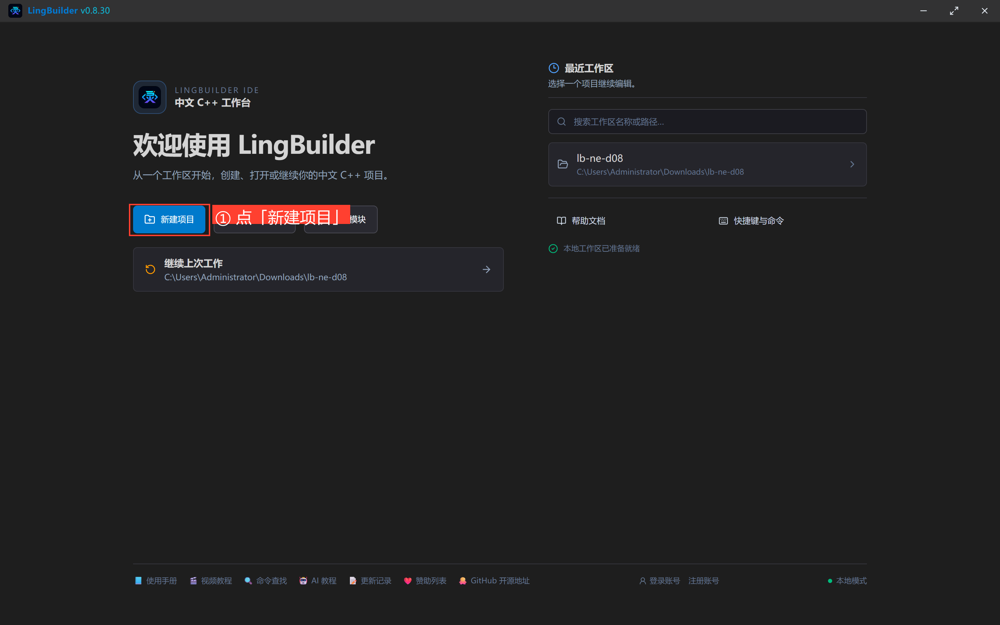

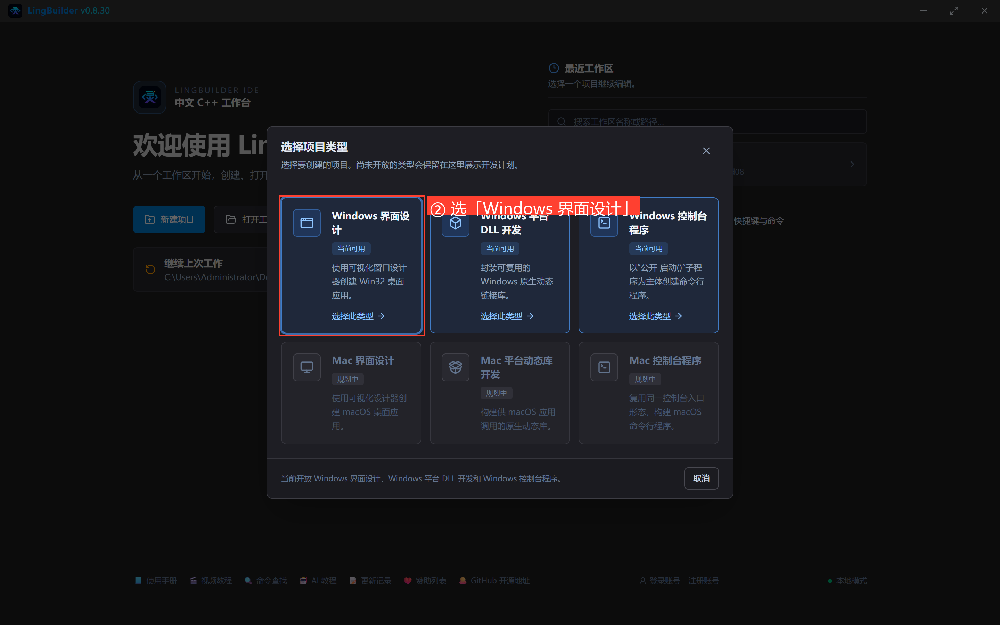

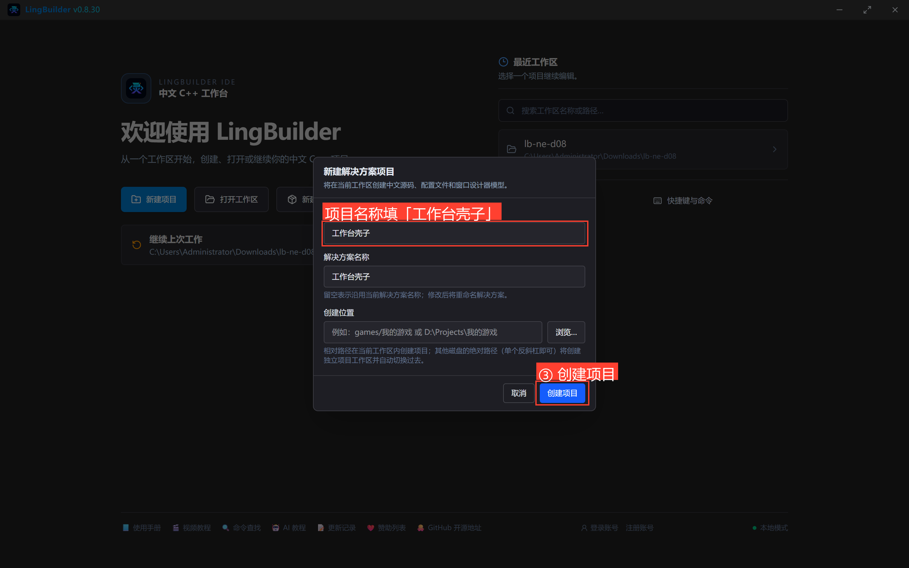

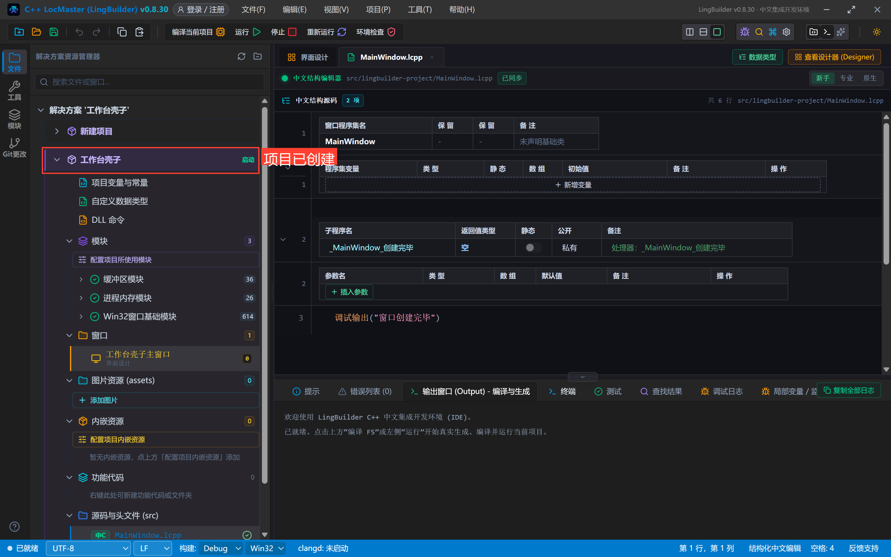

模块面板搜「原生界面」→ 启用「new_emoji 原生界面库」（首次弹登录框，登录一次即可）：

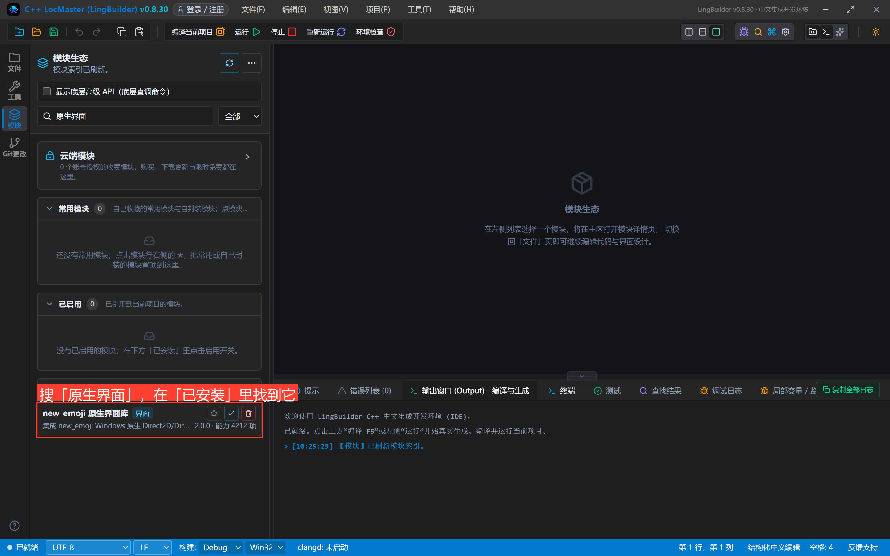

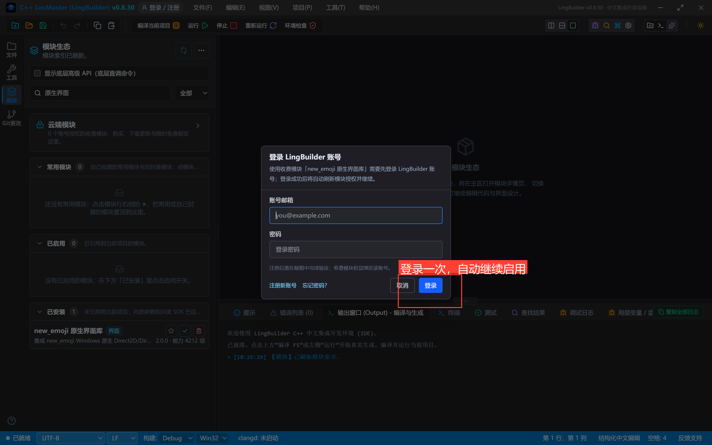

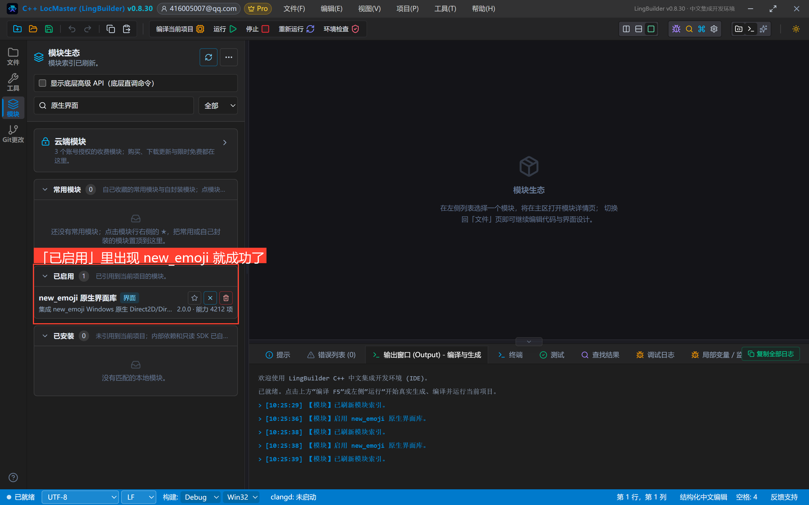

界面设计 → 选中窗口 → 「设计后端」切为「new_emoji 模块」：

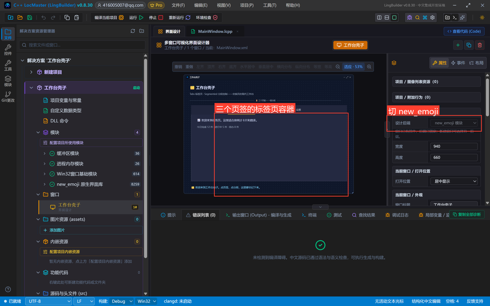

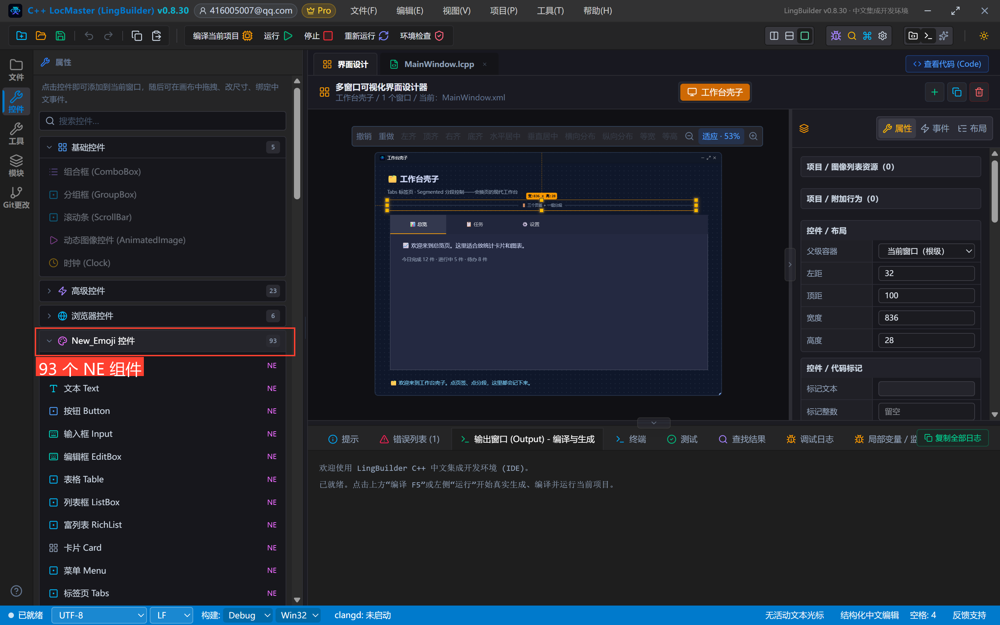

## 3. 设计界面

窗口 940×660。一个 Tabs 占满主区，状态条压在底部：

| 控件 | 名称 | 显示内容 | 左距 | 顶距 | 宽度 | 高度 | 关键属性 |
| --- | --- | --- | --- | --- | --- | --- | --- |
| 文本 Text | 标题文本 | 🗂️ 工作台壳子 | 32 | 24 | 620 | 36 | 字号 21，粗体 |
| 文本 Text | 副标题文本 | Tabs 标签页 · Segmented 分段控制——会换页的现代工作台 | 32 | 66 | 780 | 24 | 字号 13，#94A3B8 |
| 分割线 Divider | 标题分割线 | 🚪 三个页签 + 一组分段 | 32 | 100 | 836 | 28 | — |
| 标签页 Tabs | 主标签页 | （清空） | 40 | 140 | 860 | 420 | **items=📊 总览/📋 任务/⚙️ 设置（各带 id）；headerAlign=1 页签头居中** |
| 文本 Text | 概览文本 | 📈 欢迎来到总览页。这里适合放统计卡片和图表。 | 72 | 208 | 460 | 30 | 字号 15，**父级=主标签页·总览页** |
| 文本 Text | 概览数据 | 今日完成 12 件 · 进行中 5 件 · 待办 8 件 | 72 | 248 | 460 | 26 | 字号 13，#94A3B8，**父级=总览页** |
| 文本 Text | 任务文本 | 📋 任务页：勾掉一个少一个。 | 72 | 208 | 460 | 30 | 字号 15，**父级=任务页** |
| 分段控制 Segmented | 视图分段 | （清空） | 72 | 208 | 280 | 42 | **items=日/周/月；activeIndex=1**，**父级=设置页** |
| 文本 Text | 设置说明 | ⚙️ 设置页：点上面的「日 / 周 / 月」，这里跟着变。 | 72 | 280 | 500 | 30 | 字号 15，**父级=设置页** |
| 文本 Text | 状态文本 | 🗂️ 欢迎来到工作台壳子。点页签、点分段，这里都会记下来。 | 40 | 575 | 860 | 40 | 字号 14，#7DD3FC |

事件绑定：主标签页绑「**选择变化**」、视图分段绑「**选择变化**」。

摆完的画布：

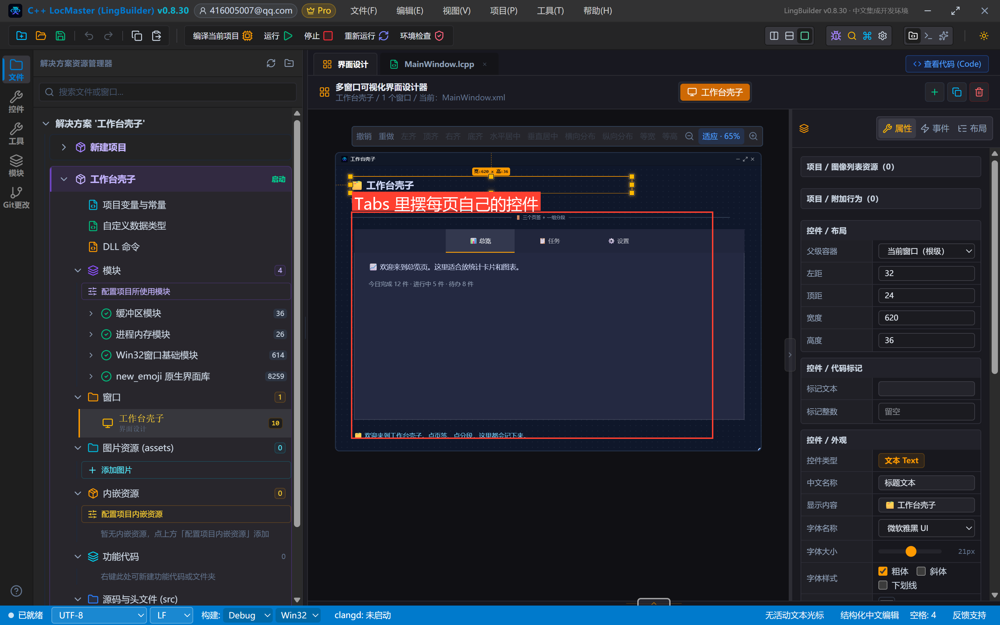

> **本集最重要的红线：Tabs 的子控件要挂到「页槽位」上**——设计器里把控件的父级设为主标签页并选对应页，坐标仍按窗口绝对坐标填。挂错页（或挂在窗口根上）的控件会常驻显示，不随页签切换。
>
> **第二个红线**：Tabs 的选择变化事件**带参数**，处理器要写成 `事件 _主标签页_选择变化(整数型 选中索引, 整数型 项目数量, 整数型 动作)`——参数必须带类型标注，少写/写错参数名会直接被「事件契约不匹配」阻断构建。而 Segmented 的事件**不带参数**，两个同名事件签名不同，别抄混。

## 4. 写代码

```lcpp
类 MainWindow
    事件 _MainWindow_创建完毕()
        控件_设置文本(状态文本, "🗂️ 欢迎来到工作台壳子。点页签、点分段，这里都会记下来。")
        调试输出("工作台壳子已创建完毕")
    结束

    事件 _主标签页_选择变化(整数型 选中索引, 整数型 项目数量, 整数型 动作)
        控件_设置文本(状态文本, "🗂️ 切到第 " + 到文本(选中索引 + 1) + " 页（共 " + 到文本(项目数量) + " 页，动作码 " + 到文本(动作) + "）。")
    结束

    事件 _视图分段_选择变化()
        控件_设置文本(状态文本, "🔀 分段切换了——高亮停在哪一格，视图就按哪一档看。")
    结束
结束类
```

看点：Tabs 的处理器**直接收参数**，不用再「先变状态再重读」；Segmented 的事件不带参数、`控件_取选择项` 也不支持它，所以状态屏只播报「切换了」——高亮在哪一格，控件自己显示得清清楚楚。

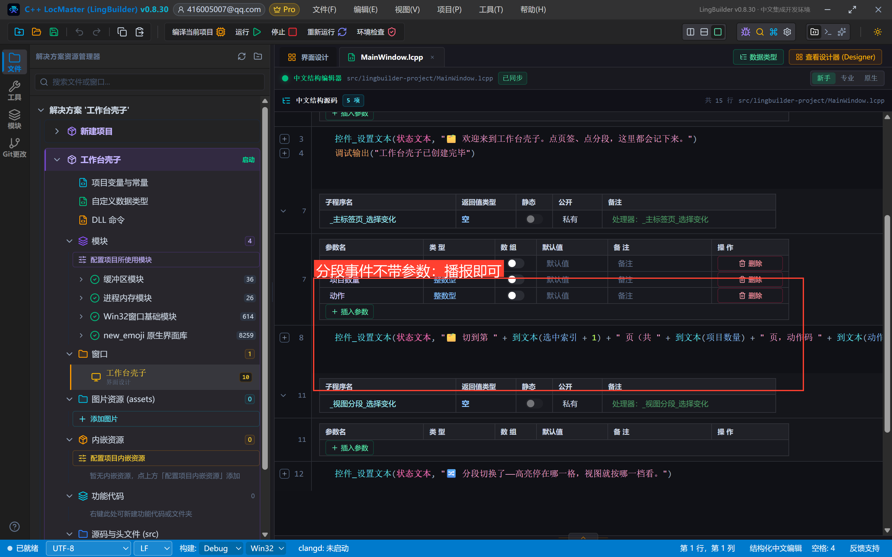


## 5. 编译前先看错误列表

点「编译当前项目」，先看底部错误列表——零报错再继续：

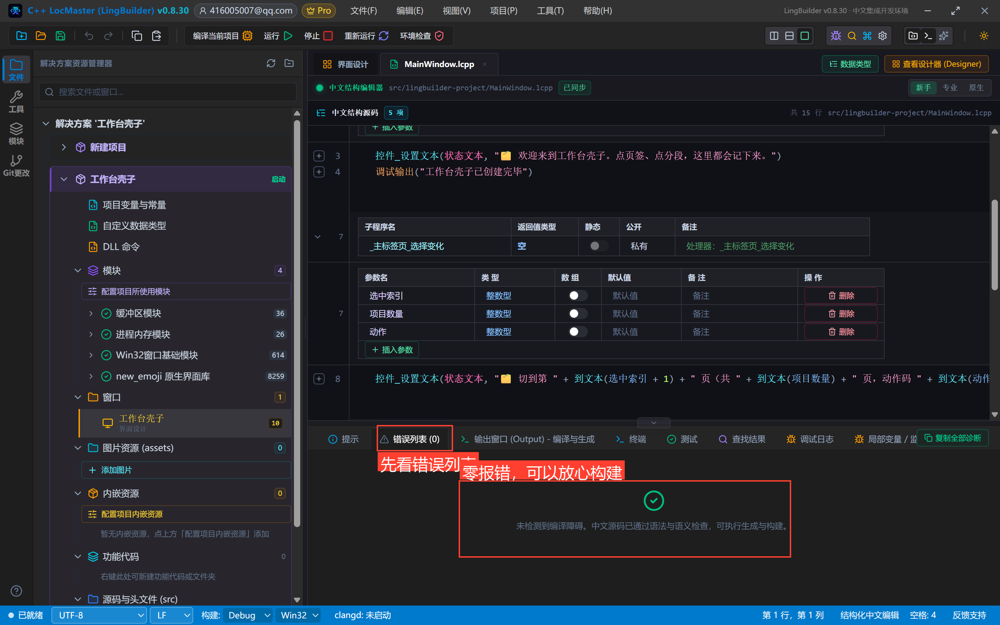

## 6. 运行！换页 + 切分段

点「运行」。页签头居中排布，默认停在总览页：

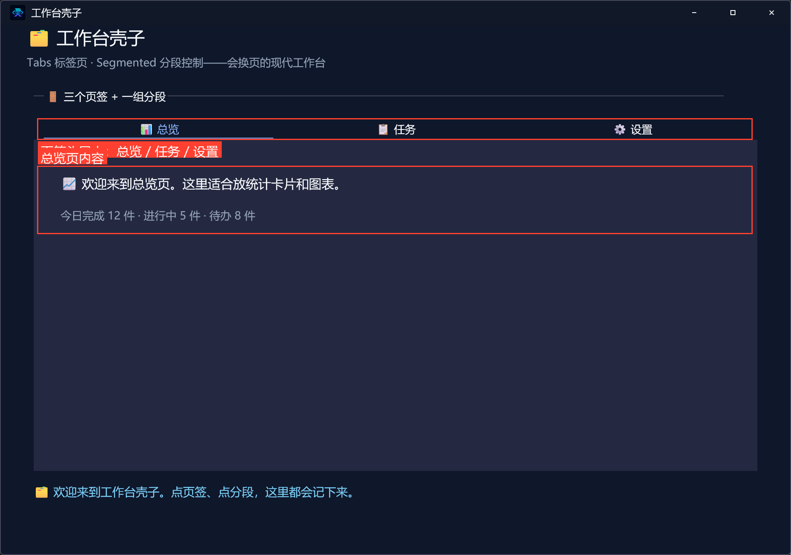

点「任务」页签——内容区整体换页，状态屏直接报「切到第 2 页（共 3 页，动作码 2）」：

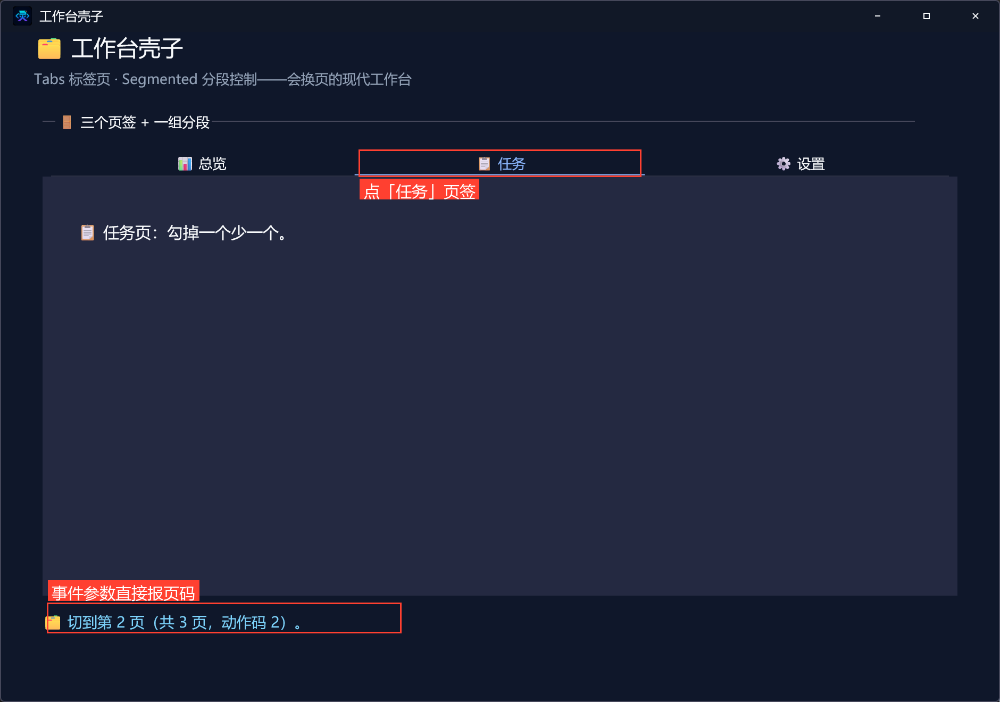

再点「设置」页签——设置页里有那组「日 / 周 / 月」分段，默认停在「周」：

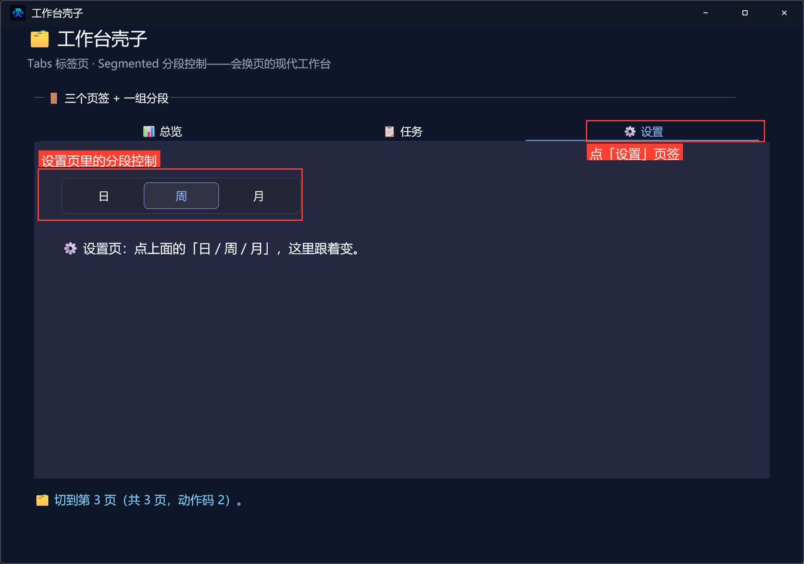

点「日」——高亮跳到第一格，状态屏播报分段切换：

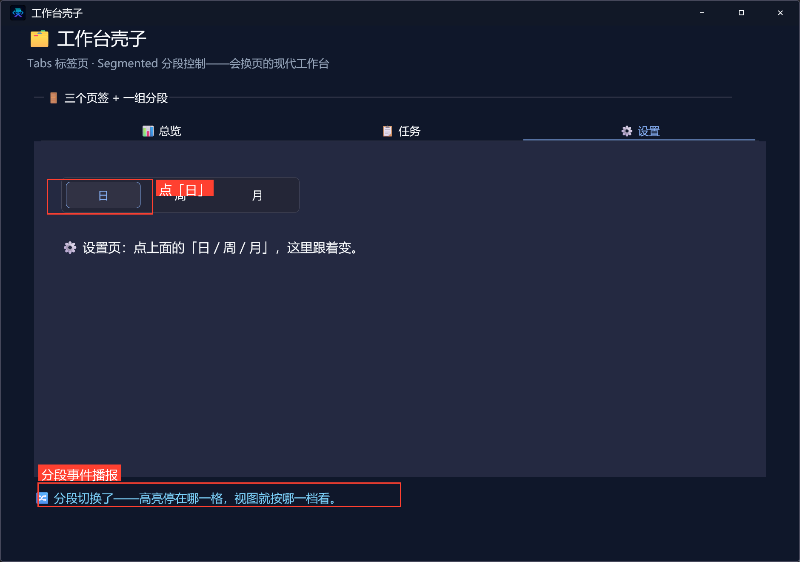

三个页签 + 一组分段，两种事件签名，一次学会。

## 7. 导出源码包

命令面板执行「项目：一键导出 LCPP 源码包」即可。

## 本集源码包

- 本集源码包已上架官网「[示例源码](https://lingbuilder.com/demos)」区，按名称「NE合集08-标签页与分段：工作台壳子」即可下载（每集一个 `.lcpppkg`，配套预览图与图文教程直链）。
- 导入：LingBuilder 欢迎页 →「**导入源码包**」，选中 `.lcpppkg` 一键还原整个项目（含窗口设计与全部源码）。
- new_emoji 原生界面库为**收费模块**：导入后如未启用，在模块面板启用并用 LingBuilder 账号登录授权即可（和制作时是同一个账号体系，授权一次全合集通用）。


## 下一集预告

导航篇继续：「菜单 Menu 与侧边栏 Aside」——多级菜单 + 侧边导航布局。
