# NE 合集 15 · 统计与进度六件套

> 《LingBuilder new_emoji 合集》第 15 集。我们从空项目开始，制作一个「项目健康度看板」：上排放统计数值、趋势、KPI 卡片，下排放进度条、环形进度、子弹进度，再用四个按钮修改和读取进度。
>
> 第一次使用 LingBuilder，可以先看[第 01 集](/guide/tutorials/new-emoji-01)。本集仍会逐步说明新建项目、启用模块、摆放控件和绑定事件；完整源码与本地源码包链接都在本文内。

## 这一集你将学会

- 分清六种组件的用途，以及「控件名称」「显示文字」「数值」的区别。
- 在设计器里设置初值、位置和尺寸，不用代码创建控件。
- 用 `控件_设置数值` 修改普通进度条，用两个专用中文命令分别修改环形进度和子弹进度。
- 把子弹进度的**当前值与目标值分开设置**，同时控制环形标签和两种进度的状态。
- 在新手中文结构化编辑器里编写五个事件，用局部文本变量分行拼接三个读数。
- 按「编译前查错 → 编译后再查错 → 实际点击核对」的顺序验证，再导出源码包分享。

先看一眼本集成品——统计数值、趋势、进度条、仪表盘一屏铺满：

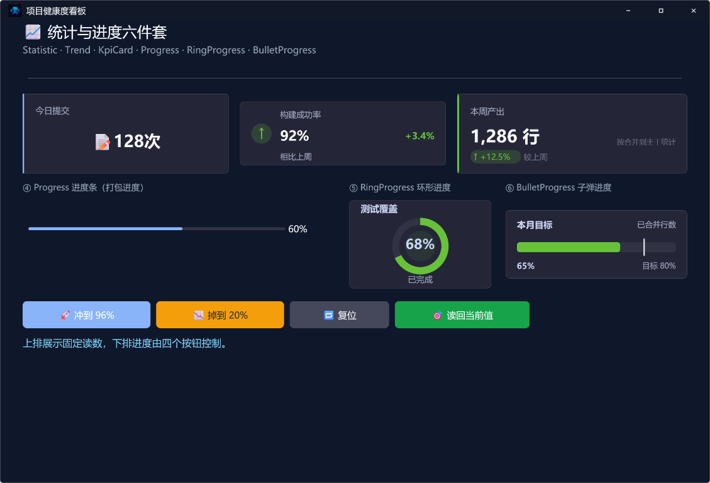

## 1. 先认识本集要做的界面

### 1.1 六种组件分别展示什么

| 组件 | 本集控件名称 | 本集用途 | 初始显示数据 |
| --- | --- | --- | --- |
| Statistic 统计数值 | 今日提交 | 显示一个统计量和单位 | 128 次 |
| Trend 趋势 | 构建成功率 | 显示当前读数及比较说明 | 92%、+3.4%、相比上周 |
| KpiCard 指标卡 | 本周产出 | 把指标、变化和补充说明放在卡片里 | 1,286 行、+12.5%、较上周 |
| Progress 进度条 | 打包进度 | 用横条展示当前百分比 | 60 |
| RingProgress 环形进度 | 覆盖率环 | 用圆环、中心文字展示进度 | 68，标签「已完成」 |
| BulletProgress 子弹进度 | 月度目标 | 对照当前进度与目标线 | 当前 65，目标 80 |

本集**选择让上排三个组件展示固定示例数据**，四个按钮只控制下排三个进度件。这是本例的教学分工，不是对上排组件运行期能力的限制。不要把本例的提交数、成功率、产出量当成自动读取了真实项目统计。

### 1.2 本集用到的命令

| 命令与参数顺序 | 本集用途 |
| --- | --- |
| `控件_设置数值(控件, 数值)` | 修改 `打包进度` 的当前值 |
| `NE环形进度_设置数值(控件, 数值, 标签, 状态)` | 同时设置 `覆盖率环` 的数值、环下标签和状态 |
| `NE子弹进度_设置当前值(控件, 当前值, 目标值, 描述, 状态)` | 分别设置 `月度目标` 的当前值、目标值、描述和状态 |
| `控件_取数值(控件)` | 分别读取上述三个进度件的当前值 |
| `到文本(数值)` | 把读到的数字转成可拼接的文字 |
| `控件_设置文本(控件, 文本)` | 把操作说明或读数显示在 `状态文本` 中 |
| `调试输出(文本)` | 在窗口创建完毕时写一条调试信息 |

先记住两条输入规则：**控件名不加引号，文字才加英文双引号。** 例如 `覆盖率环` 是控件引用，`"已完成"` 是标签文字；数值参数填 `96`，不是 `"96%"`。

## 2. 新建项目、启用模块、选择设计后端

### 2.1 新建「项目健康度看板」

1. 启动 LingBuilder，在欢迎页点击「新建项目」。

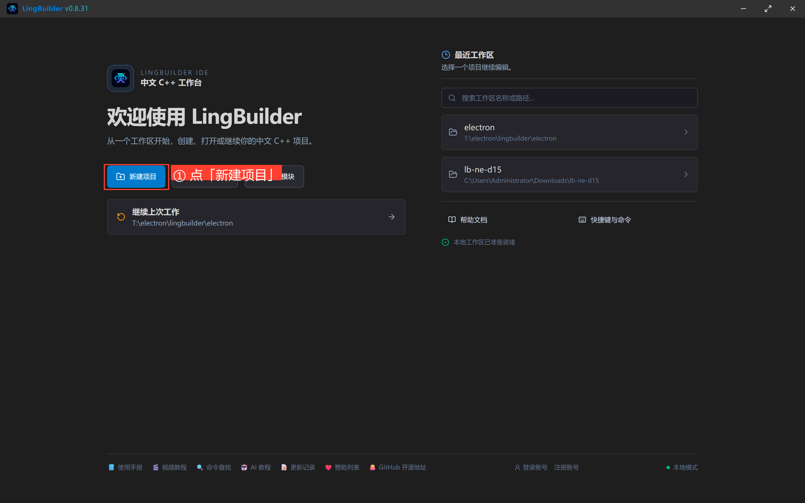

2. 在「选择项目类型」对话框中选择 **Windows 界面设计**。本集要制作带按钮的窗口，不选控制台程序，也不选 DLL 开发。

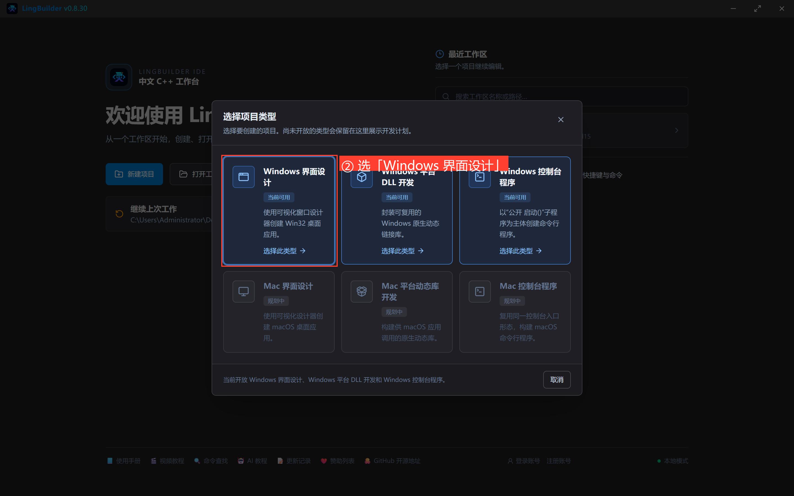

3. 「项目名称」填 `项目健康度看板`；新练习的「解决方案名称」也可填同名。
4. 在「创建位置」选择自己用于练习的独立目录，建议通过「浏览…」选择。不要照抄截图中的作者电脑路径，也不要把练习放进已有重要项目中。
5. 点击「创建项目」，等待工作台打开。

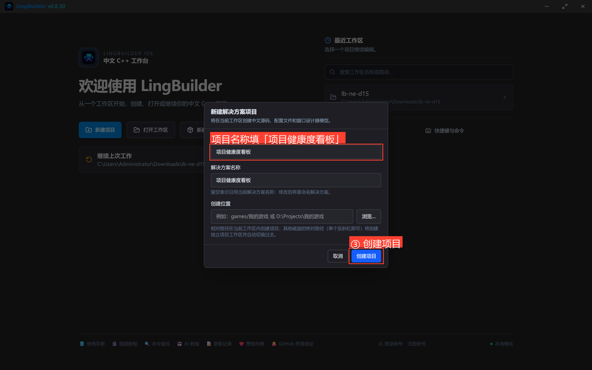

6. 在左侧解决方案资源管理器中确认当前项目是「项目健康度看板」。后面修改的设计器和 `MainWindow.lcpp` 都要属于这个项目；有多个项目时不要选错。

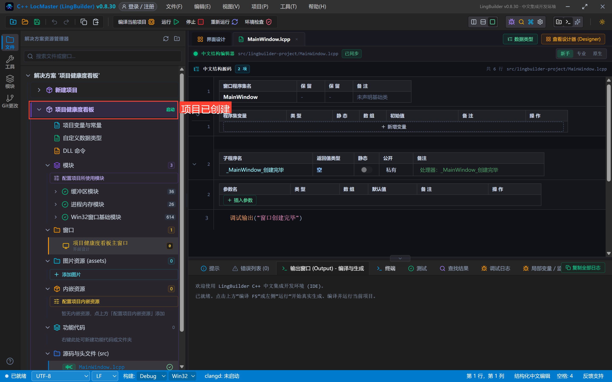

### 2.2 安装、授权并在当前项目启用 new_emoji

1. 点击左侧活动栏的「模块」。
2. 搜索「原生界面」，找到 **new_emoji 原生界面库**，模块 ID 为 `lingbuilder.new_emoji.ui`。
3. 确认模块已经安装。如果当前环境缺少模块，先完成安装；**已安装**与**已在当前项目启用**是两件事。
4. 选择当前练习项目，为它启用该模块。

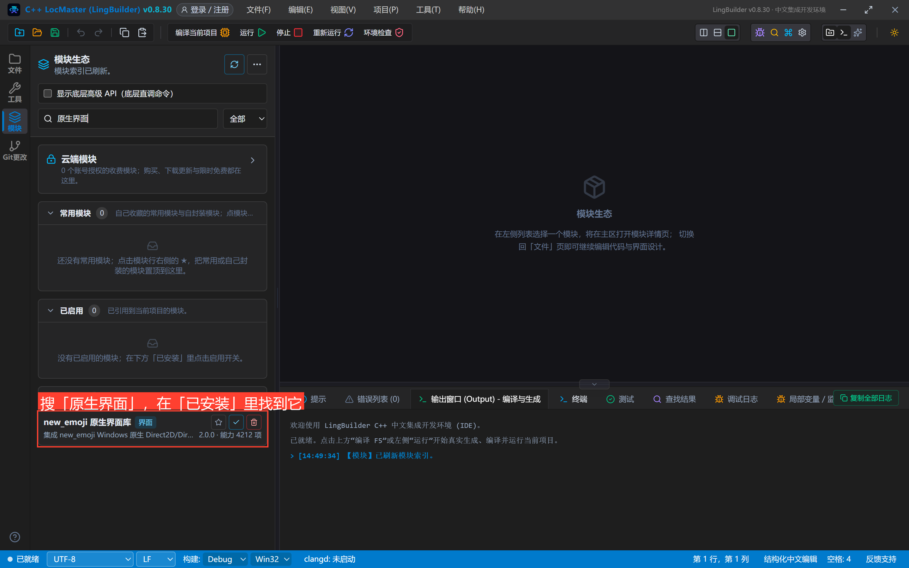

5. 若出现登录或授权提示，使用自己的 LingBuilder 账号完成登录，并按界面提示完成模块授权。登录框关闭不代表所有步骤已经完成；仍需确认模块没有授权错误、当前项目的启用状态正确。

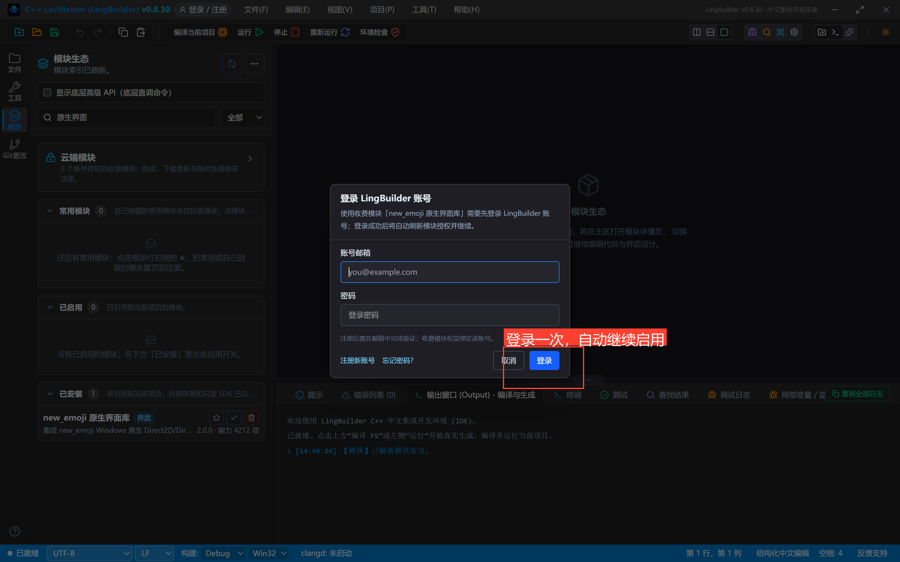

6. 回到模块面板，确认该模块已在「项目健康度看板」中启用，再继续设计。不要通过删除模块引用来消除授权或缺少模块的报错。

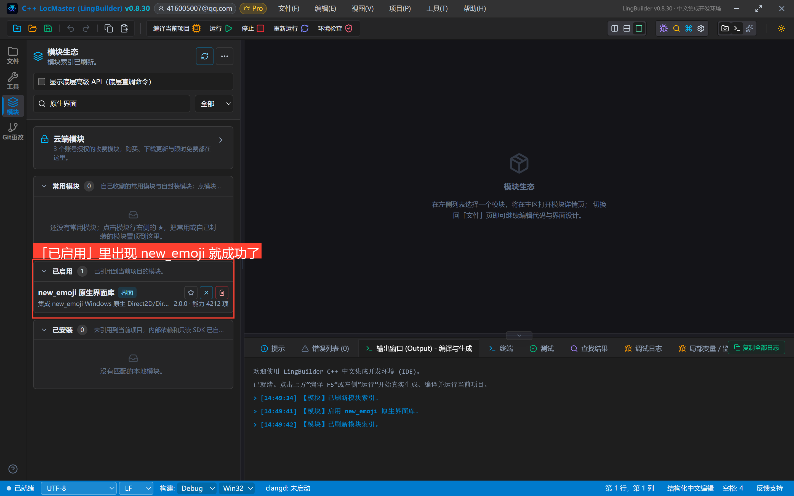

### 2.3 先切后端，再放控件

1. 点击编辑区的「界面设计」页签。
2. 选中窗口本身，而不是某个按钮或文本控件；可点击窗口空白处。
3. 在右侧「属性」页找到窗口的「设计后端」，选择 **new_emoji 模块**。
4. 设置窗口标题为 `项目健康度看板`，窗口类名保持 `MainWindow`，宽度填 `1000`，高度填 `680`，打开位置选居中显示。
5. 本例窗口背景为 `#0F172A`，标题栏背景为 `#111827`，标题栏文字颜色为 `#F8FAFC`。

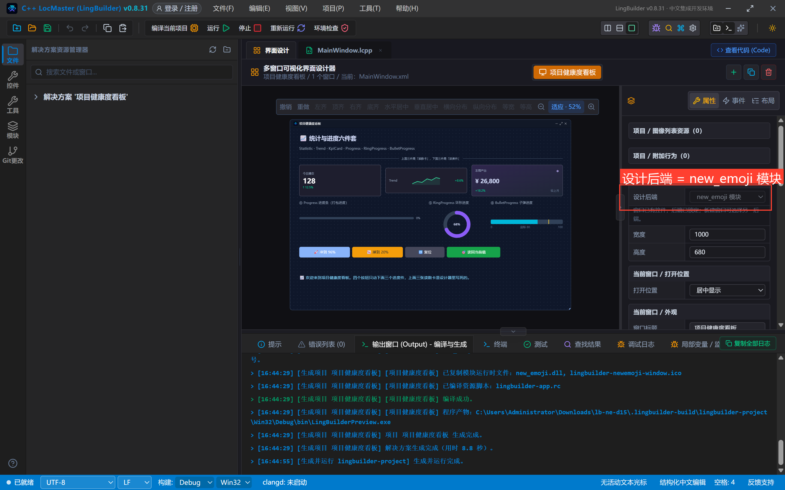

> 后端应在空窗口时选好。若下拉框因窗口已有控件而不能切换，不要硬把普通 Win32 控件混进本例；可新建一个空窗口再选后端。若工具箱找不到 NE 控件，先检查「当前项目已启用模块」和「当前窗口后端」这两个条件。

6. 打开左侧「工具」，在工具箱中找到 new_emoji 控件分组。后面所有界面元素都从设计器添加，不在 `.lcpp` 里调用创建控件命令。

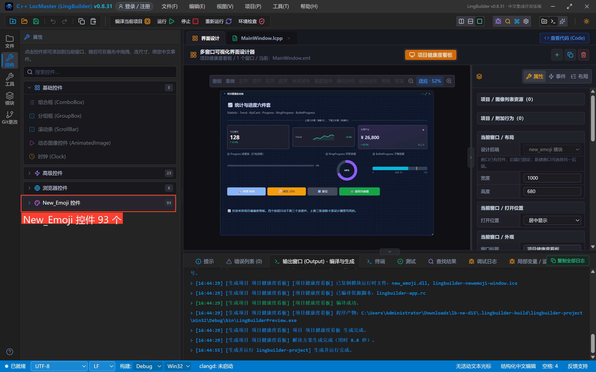

## 3. 设计界面：先摆位置，再逐项填属性

### 添加与重命名的基本操作

每增加一个控件，都重复下面的动作：

1. 在工具箱找到对应类型，**单击添加到当前窗口**。
2. 在画布选中刚加入的控件，按住鼠标左键拖到大致位置；拖动边缘控制点可以粗调尺寸。
3. 看右侧「属性」面板，先把控件的「名称」改成下表中的名称。名称是代码定位控件用的，必须逐字一致、不能重名。
4. 再填位置与尺寸。左距 `x`、顶距 `y` 是相对窗口客户区左上角的位置，宽度、高度是控件自己的盒子尺寸。**拖拽只负责粗摆，最终以属性面板的数字为准。**
5. 找到内容、字体及组件专属属性，按后面的表格填写。输入完成后切到别的属性，再选回控件，核对数值有没有保留。

「名称」和「内容」不是一回事。例如按钮名称是 `冲高按钮`，按钮上显示的内容是「冲到 96%」；代码用名称，用户看内容。统计卡的数值则要填在它自己的 `value` 属性中，不是把整个卡片名称改成 `128`。

### 全部控件的位置与尺寸

| 类型 | 名称 | 左距 x | 顶距 y | 宽度 | 高度 |
| --- | --- | --- | --- | --- | --- |
| Text 文本 | 标题文本 | 32 | 20 | 700 | 36 |
| Text 文本 | 副标题文本 | 32 | 62 | 880 | 24 |
| Divider 分割线 | 标题分割线 | 32 | 96 | 936 | 28 |
| Statistic 统计数值 | 今日提交 | 32 | 132 | 290 | 112 |
| Trend 趋势 | 构建成功率 | 338 | 143 | 290 | 90 |
| KpiCard 指标卡 | 本周产出 | 644 | 132 | 324 | 112 |
| Text 文本 | 进度标签 | 32 | 256 | 300 | 22 |
| Progress 进度条 | 打包进度 | 32 | 300 | 430 | 44 |
| Text 文本 | 环形标签 | 492 | 256 | 200 | 22 |
| RingProgress 环形进度 | 覆盖率环 | 492 | 282 | 200 | 124 |
| Text 文本 | 子弹标签 | 712 | 256 | 256 | 22 |
| BulletProgress 子弹进度 | 月度目标 | 712 | 296 | 256 | 96 |
| Button 按钮 | 冲高按钮 | 32 | 424 | 180 | 38 |
| Button 按钮 | 回落按钮 | 220 | 424 | 180 | 38 |
| Button 按钮 | 复位按钮 | 408 | 424 | 140 | 38 |
| Button 按钮 | 读数按钮 | 556 | 424 | 190 | 38 |
| Text 文本 | 状态文本 | 32 | 474 | 936 | 120 |

### 3.1 按逻辑内容自然高度给盒子，在视觉带里居中

本集使用已修正 DPI 换算的 new_emoji 引擎。**控件按逻辑内容需要的自然高度排版，系统缩放由引擎处理，不需要修改 Windows 缩放比例。** 不要把截图的物理像素数直接当成属性面板里的尺寸。

「视觉带」只是我们对齐时使用的参考范围，并不是要再拖一个容器控件：

- 上排以 `y=132`、高 `112` 为同一条视觉带。左右的 Statistic、KpiCard 使用完整的 `112` 高；中间 Trend 使用 `90` 高，顶距算为 `132 + (112 - 90) / 2 = 143`。因此 Trend 的最终位置尺寸为 **`(338, 143, 290, 90)`**。
- 下排以环形进度的 `y=282`、高 `124` 为参考。BulletProgress 使用 `96` 高，顶距算为 `282 + (124 - 96) / 2 = 296`，最终为 **`(712, 296, 256, 96)`**。
- KpiCard 保持 **`(644, 132, 324, 112)`**，不要为了和 Trend 一样高而压缩卡片。

填好后既要看设计器的整体间距，也要在第 6 节运行时检查标题、数值、说明有没有完整显示。不要以缩小字号或改变系统缩放来掩盖内容裁切。

### 3.2 填写标题、说明与按钮文字

以下「内容」是属性面板中的文字，不需要额外输入包围它的双引号。字体统一使用 `Microsoft YaHei UI`；除表中另有说明外，字号为 `13`、文字颜色为 `#F8FAFC`，背景透明。所有控件保持可见、启用。

| 控件名称 | 内容 | 字体或其他属性 |
| --- | --- | --- |
| 标题文本 | 📈 统计与进度六件套 | 字号 `21`，粗体 |
| 副标题文本 | Statistic · Trend · KpiCard · Progress · RingProgress · BulletProgress | 字号 `13`，颜色 `#94A3B8` |
| 标题分割线 | 留空 | 不额外填写分割线说明文字 |
| 进度标签 | ④ Progress 进度条（打包进度） | 字号 `12`，颜色 `#94A3B8` |
| 环形标签 | ⑤ RingProgress 环形进度 | 字号 `12`，颜色 `#94A3B8` |
| 子弹标签 | ⑥ BulletProgress 子弹进度 | 字号 `12`，颜色 `#94A3B8` |
| 冲高按钮 | 🚀 冲到 96% | `variant=1`，`size=0` |
| 回落按钮 | 📉 掉到 20% | `variant=3`，`size=0` |
| 复位按钮 | 🔁 复位 | `variant=0`，`size=0` |
| 读数按钮 | 🎯 读回当前值 | `variant=2`，`size=0` |
| 状态文本 | 上排展示固定读数，下排进度由四个按钮控制。 | 字号 `14`，颜色 `#7DD3FC`；自动换行 `wrap=真`，垂直对齐 `valign=0`（顶部） |

后面表格中的英文是属性键，方便在中文属性名称旁核对。数值框直接填数字；开关选择真/开启；下拉框选择相应枚举项，不要把 `title=今日提交` 这一整段塞进一个文本框。

### 3.3 填写上排三张读数卡

依次选中 `今日提交`、`构建成功率`、`本周产出`，在组件专属属性区逐项填入：

| 控件 | 属性键 | 填写值 | 含义 |
| --- | --- | --- | --- |
| 今日提交 | `title` | 今日提交 | 统计标题 |
| 今日提交 | `value` | 128 | 显示的读数文本 |
| 今日提交 | `prefix` | 📝 | 数值前的显示内容 |
| 今日提交 | `suffix` | 次 | 数值后的单位 |
| 今日提交 | `animated` | 真 | 开启动画选项 |
| 构建成功率 | `title` | 构建成功率 | 趋势标题 |
| 构建成功率 | `value` | 92% | 当前读数文本 |
| 构建成功率 | `percent` | +3.4% | 变化幅度文本 |
| 构建成功率 | `detail` | 相比上周 | 比较说明 |
| 构建成功率 | `direction` | 1 | 本例的上升方向 |
| 构建成功率 | `showIcon` | 真 | 显示趋势图标 |
| 本周产出 | `title` | 本周产出 | 指标标题 |
| 本周产出 | `value` | 1,286 行 | 当前读数文本，保留单位 |
| 本周产出 | `subtitle` | 较上周 | 副标题 |
| 本周产出 | `trend` | +12.5% | 变化幅度文本 |
| 本周产出 | `trendType` | 1 | 本例的上升趋势 |
| 本周产出 | `helper` | 按合并到主干统计 | 补充说明 |

这些 `value` 是显示文字，可以包含百分号、逗号和单位。下一节的进度数值则直接填数字，不要混淆。

### 3.4 填写下排三个进度件

| 控件 | 属性键 | 填写值 | 需要注意 |
| --- | --- | --- | --- |
| 打包进度 | `percentage` | 60 | Progress 的初始百分比属性叫 `percentage` |
| 打包进度 | `status` | 0 | 本例普通进度条保持信息状态、蓝色 |
| 打包进度 | `showText` | 真 | 显示进度文字 |
| 打包进度 | `strokeWidth` | 8 | 进度条粗细 |
| 覆盖率环 | `title` | 测试覆盖 | 环形标题 |
| 覆盖率环 | `value` | 68 | 初始数值 |
| 覆盖率环 | `label` | 已完成 | 环下标签文字 |
| 覆盖率环 | `status` | 1 | 成功状态 |
| 覆盖率环 | `strokeWidth` | 10 | 环线粗细 |
| 覆盖率环 | `showCenter` | 真 | **必须开启，才能显示中心内容** |
| 月度目标 | `title` | 本月目标 | 子弹进度标题 |
| 月度目标 | `desc` | 已合并行数 | 描述文字 |
| 月度目标 | `value` | 65 | 初始当前值 |
| 月度目标 | `target` | 80 | 初始目标值，与当前值分开填写 |
| 月度目标 | `status` | 1 | 成功状态 |
| 月度目标 | `showTarget` | 真 | 显示目标线 |

本例对环形、子弹进度显式设置状态：`1` 是成功（绿色），`2` 是警告（橙色），`3` 是错误（红色）。**数值变大不等于自动变绿**；普通进度条的代码只改数值，不改状态，因此它在冲高、回落、复位时都保持蓝色。

完成后，对照整张布局检查：上排三个读数组件，下排三个进度件，下面四个按钮，最后是一块能显示多行说明的 `状态文本`。

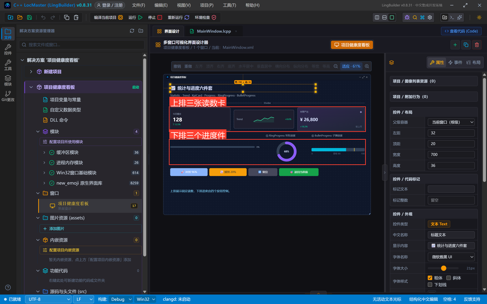

### 3.5 绑定窗口和四个按钮的事件

「被单击」是动作发生的时机；「处理器名」是动作发生后要执行哪一段代码。**只写按钮上的文字，或只在源码里写同名事件，都不能替代本节的绑定核对。**

1. 选中 `冲高按钮`，点击右侧「事件」页。
2. 找到「被单击」事件，对应事件键 `Clicked`，将处理器名设为 `_冲高按钮_被单击`。
3. 对另外三个按钮重复操作，逐项使用下表中的名字。
4. 再选中窗口本身，找到「创建完毕」事件，对应 `Loaded`，绑定 `_MainWindow_创建完毕`。
5. 如果 IDE 已生成事件骨架，接下来只填写该骨架内的正文，别重复新建第二个同名事件。

| 选中的对象 | 事件 | 处理器名（完整照填） |
| --- | --- | --- |
| 主窗口 `MainWindow` | 创建完毕 `Loaded` | `_MainWindow_创建完毕` |
| 冲高按钮 | 被单击 `Clicked` | `_冲高按钮_被单击` |
| 回落按钮 | 被单击 `Clicked` | `_回落按钮_被单击` |
| 复位按钮 | 被单击 `Clicked` | `_复位按钮_被单击` |
| 读数按钮 | 被单击 `Clicked` | `_读数按钮_被单击` |

这里填写的是**处理器名称**：保留开头的下划线，不加引号，不把 `事件` 两字、括号或 `&` 填进设计器的名称字段。源码中的声明则是 `事件 _冲高按钮_被单击()` 这样的完整结构。四个按钮不要误绑定到同一个处理器。

## 4. 切到新手中文结构化编辑，逐个填写五个事件

### 4.1 准备编辑区域

1. 点击 `MainWindow.lcpp` 页签，或从设计器点击「查看代码」。
2. 在编辑区右上角选择 **新手**。确认看到「中文结构编辑器」，底部状态显示「结构化中文编辑」。本集代码讲解都在此模式完成。
3. 开始看代码、截图前，先折叠底部面板：将鼠标移到编辑区与底部面板之间的分隔条，点击中央的「折叠底部面板」按钮。
4. 检查编辑区下方不再显示「提示 / 错误列表 / 输出窗口 / 终端」页签条。第 5 节查错时再临时展开，查完继续看代码就折回。
5. 一个事件放不下时，滚动到该事件并分段查看；**不要为了容纳长行而缩小编辑器字号**。本集读数已拆成局部变量和多行累加，不需要把三次读取挤在一行。

新手模式会用表格显示事件名、参数和局部变量，用代码行显示事件正文。下面五个事件声明的 `()` 都是空的，因此**事件的参数表不用新增参数**。命令括号里的「控件、数值、标签」是命令实参，按本节表格从左到右填进命令行，不是加到事件参数表里。

### 4.2 创建完毕：先显示操作说明

找到 `_MainWindow_创建完毕` 事件，在正文中填写完整源码中的两行：先调用 `控件_设置文本`，再调用 `调试输出`。

| 命令 | 第 1 个参数 | 第 2 个参数 |
| --- | --- | --- |
| `控件_设置文本` | `状态文本` | `"上排展示固定读数，下排进度由四个按钮控制。"` |
| `调试输出` | `"项目健康度看板已创建完毕"` | 无 |

第一行出现在运行窗口底部，第二行是调试信息，不会替代界面上的说明文字。三个进度件的初值已由设计器设置，不需要在这里再创建控件。

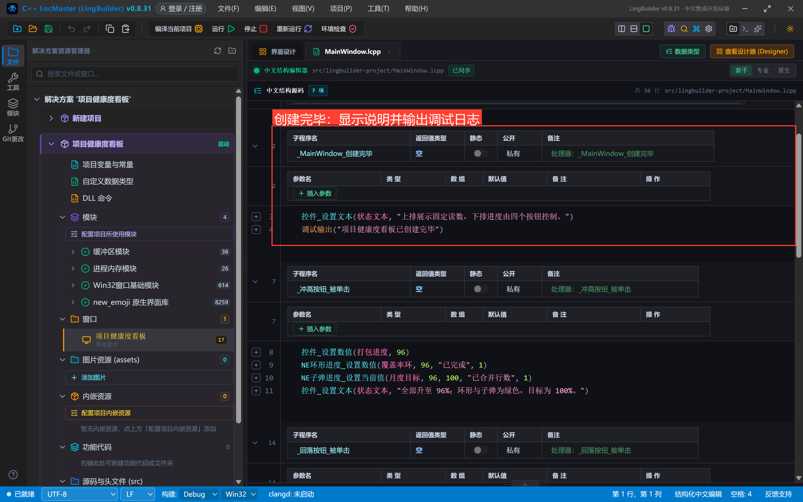

### 4.3 冲高：当前值 96，子弹目标 100

找到 `_冲高按钮_被单击`，按顺序填写三条进度命令，再填写一条状态说明。先看参数表，特别注意子弹进度比环形多一个独立的「目标值」。

| 命令 | 控件 | 数值／当前值 | 目标值 | 标签／描述 | 状态 |
| --- | --- | --- | --- | --- | --- |
| `控件_设置数值` | `打包进度` | `96` | 无 | 无 | 此命令不传状态 |
| `NE环形进度_设置数值` | `覆盖率环` | `96` | 无 | `"已完成"` | `1` |
| `NE子弹进度_设置当前值` | `月度目标` | `96` | `100` | `"已合并行数"` | `1` |

表中的「无」表示没有这个参数，**不要把「无」写进源码**。环形按「控件、数值、标签、状态」四项填；子弹按「控件、当前值、目标值、描述、状态」五项填。

最后用 `控件_设置文本` 显示「全部升至 96%；环形与子弹为绿色，目标为 100%。」。这里的 96 还不是 100%，普通进度条仍为蓝色，只有环形与子弹被设成成功绿色。子弹的当前值是 96、目标值是 100，不是把两者一起设成 96。

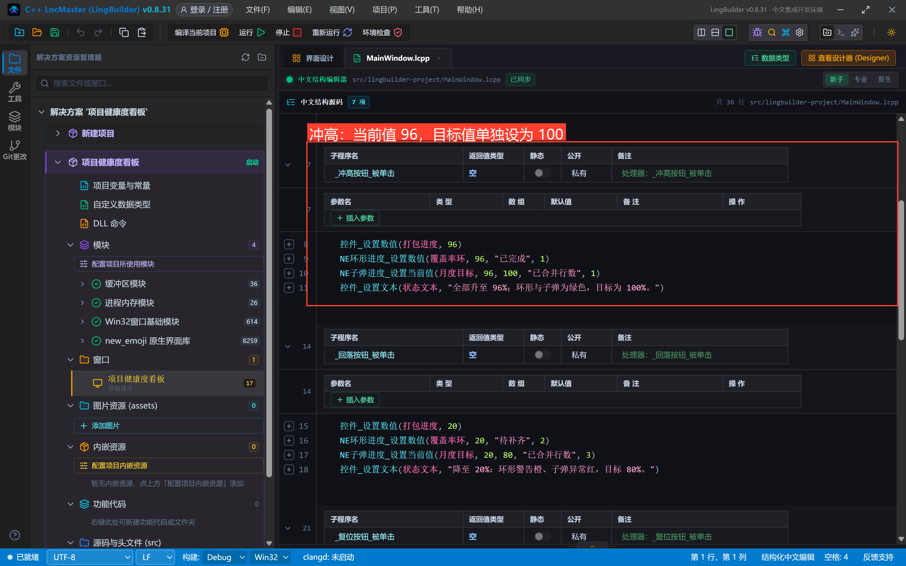

### 4.4 回落：当前值 20，环形橙色、子弹红色

找到 `_回落按钮_被单击`，仍然先改三个进度件，再更新说明。

| 命令 | 控件 | 数值／当前值 | 目标值 | 标签／描述 | 状态 |
| --- | --- | --- | --- | --- | --- |
| `控件_设置数值` | `打包进度` | `20` | 无 | 无 | 此命令不传状态 |
| `NE环形进度_设置数值` | `覆盖率环` | `20` | 无 | `"待补齐"` | `2` |
| `NE子弹进度_设置当前值` | `月度目标` | `20` | `80` | `"已合并行数"` | `3` |

状态说明填「降至 20%：环形警告橙、子弹异常红，目标 80%。」。虽然三个数值相同，但环形和子弹用的是不同状态，所以颜色不同。普通进度条只改变长度，仍是蓝色。

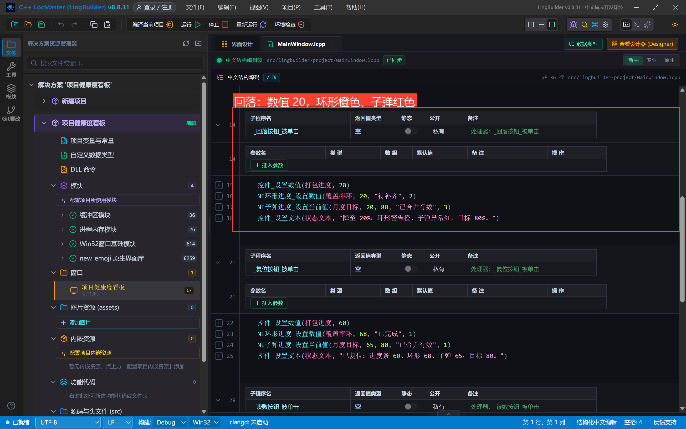

### 4.5 复位：三个当前值与目标值都恢复

找到 `_复位按钮_被单击`。复位不是只改说明文字，也不是重新打开设计器，而是明确执行下面三次设置。

| 命令 | 控件 | 数值／当前值 | 目标值 | 标签／描述 | 状态 |
| --- | --- | --- | --- | --- | --- |
| `控件_设置数值` | `打包进度` | `60` | 无 | 无 | 此命令不传状态 |
| `NE环形进度_设置数值` | `覆盖率环` | `68` | 无 | `"已完成"` | `1` |
| `NE子弹进度_设置当前值` | `月度目标` | `65` | `80` | `"已合并行数"` | `1` |

最后显示「已复位：进度条 60、环形 68、子弹 65，目标 80。」。这一步同时把环形的标签从「待补齐」恢复为「已完成」，把环形与子弹恢复为绿色，并把子弹目标恢复为 80。

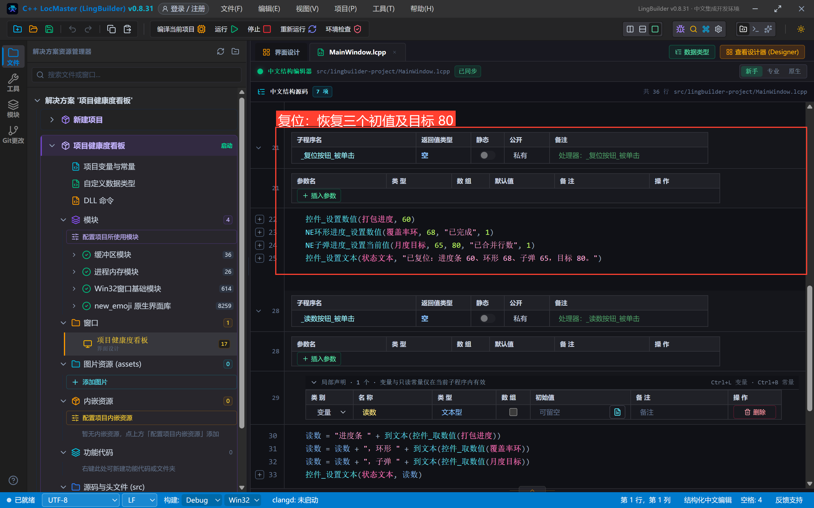

### 4.6 读数：用局部变量逐行累加

找到 `_读数按钮_被单击`：

1. 在该事件中声明一个局部变量，类型选 **文本型**，名称填 `读数`，不填初始值。对应源码为 `局部 文本型 读数`。
2. 第一条赋值读取 `打包进度`，用 `到文本` 转为文字，与「进度条 」拼起来存进 `读数`。
3. 第二条写成 `读数 = 读数 + …`，把环形读数追加到原有文字后面；第三条同样追加子弹读数。不要漏掉等号右边原有的 `读数`，否则会覆盖前面已经拼好的内容。
4. 最后调用 `控件_设置文本(状态文本, 读数)`，一次性显示完整结果。这里的 `读数` 是变量，不加引号。

| 读取调用 | 读的是什么 | 刚执行复位后的预期值 |
| --- | --- | --- |
| `控件_取数值(打包进度)` | 普通进度条当前值 | 60 |
| `控件_取数值(覆盖率环)` | 环形进度当前值 | 68 |
| `控件_取数值(月度目标)` | 子弹进度当前值，**不是目标值** | 65 |

因此，要得到「进度条 60，环形 68，子弹 65」，请先点「复位」，再点「读回当前值」。如果刚点的是回落，读到三个 20 才符合当前状态。读数事件本身不修改进度。

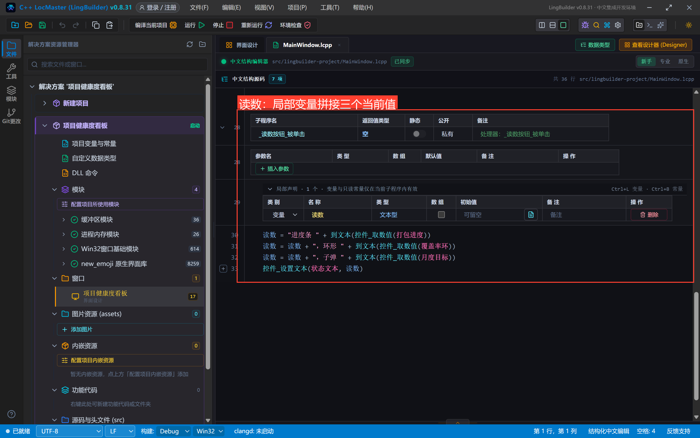

### 4.7 完整源码（供复制、逐行核对）

下面是一份完整的 `MainWindow.lcpp`，只需保留一份。若前面已经生成事件骨架，按对应事件填入正文即可，不要把整段 `类 MainWindow … 结束类` 再嵌套到某个事件内部。完整复制时也不要把 Markdown 的代码围栏复制进源码。

```lcpp
类 MainWindow
    事件 _MainWindow_创建完毕()
        控件_设置文本(状态文本, "上排展示固定读数，下排进度由四个按钮控制。")
        调试输出("项目健康度看板已创建完毕")
    结束

    事件 _冲高按钮_被单击()
        控件_设置数值(打包进度, 96)
        NE环形进度_设置数值(覆盖率环, 96, "已完成", 1)
        NE子弹进度_设置当前值(月度目标, 96, 100, "已合并行数", 1)
        控件_设置文本(状态文本, "全部升至 96%；环形与子弹为绿色，目标为 100%。")
    结束

    事件 _回落按钮_被单击()
        控件_设置数值(打包进度, 20)
        NE环形进度_设置数值(覆盖率环, 20, "待补齐", 2)
        NE子弹进度_设置当前值(月度目标, 20, 80, "已合并行数", 3)
        控件_设置文本(状态文本, "降至 20%：环形警告橙、子弹异常红，目标 80%。")
    结束

    事件 _复位按钮_被单击()
        控件_设置数值(打包进度, 60)
        NE环形进度_设置数值(覆盖率环, 68, "已完成", 1)
        NE子弹进度_设置当前值(月度目标, 65, 80, "已合并行数", 1)
        控件_设置文本(状态文本, "已复位：进度条 60、环形 68、子弹 65，目标 80。")
    结束

    事件 _读数按钮_被单击()
        局部 文本型 读数
        读数 = "进度条 " + 到文本(控件_取数值(打包进度))
        读数 = 读数 + "，环形 " + 到文本(控件_取数值(覆盖率环))
        读数 = 读数 + "，子弹 " + 到文本(控件_取数值(月度目标))
        控件_设置文本(状态文本, 读数)
    结束
结束类
```

每个 `事件` 最后都有独立一行 `结束`，整个类最后是 `结束类`。这里的 `结束` 是结构结束标记，**不要改成 `结束()`**，以免变成退出命令。

## 5. 编译前先看错误列表，编译后再检查一次

不能先运行再忽略报错，也不能把「错误列表为零」当作按钮行为已经正确。按下面顺序进行：

1. 保存源码和设计器，确认当前项目仍是「项目健康度看板」。
2. **先展开底部面板并点击「错误列表」**，检查当前项目的诊断，确认错误数量为 0。若有错误，点击错误项定位源码，先修复再继续；同时阅读警告内容。
3. 错误清零后，点击工具栏的「编译当前项目」，等待本次编译结束。
4. **编译结束后再次查看错误列表**，并检查输出窗口里本次编译是否成功。若编译器、模块依赖或授权报错，先处理原因，不要继续运行或把旧的成功输出当成本次结果。
5. 两次查错都完成、且本次编译成功后，再按第 6 节运行。若返回代码区继续查看或截图，立即折叠底部面板；只有讲解错误列表、输出窗口时才保持展开。

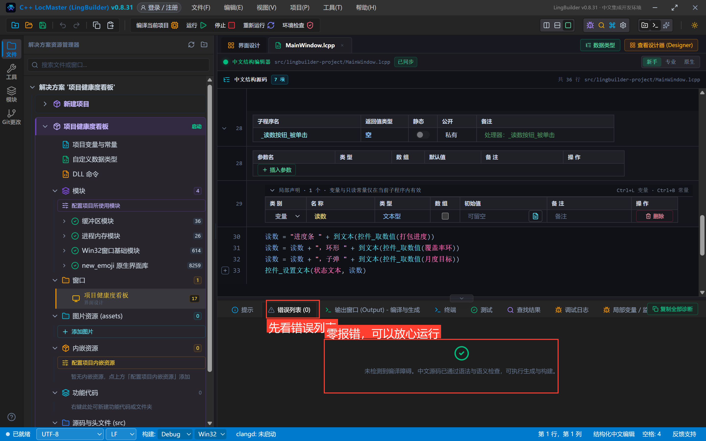

> 编译成功只说明源码通过了这一轮构建，**不说明事件一定绑对、读数一定正确、文字一定显示完整**。这些要靠下一节真实点击验证。

## 6. 运行并按顺序核对五种状态

以下是按照本集源码应逐项观察的结果，不要只看窗口能否打开。

### 6.1 刚打开窗口

点击工具栏「运行」，找到标题为「项目健康度看板」的原生窗口，检查：

- 上排显示 `128 次`、`92% / +3.4%`、`1,286 行 / +12.5%` 等示例读数。
- 普通进度条为 **60、蓝色**；环形为 **68、绿色**，环下标签「已完成」可见；子弹当前值 **65**、目标 **80**，为绿色。
- Trend、KpiCard、BulletProgress 的标题、数值及说明没有被裁掉，环形中心内容可见，四个按钮均能看清。
- 下方说明为「上排展示固定读数，下排进度由四个按钮控制。」。

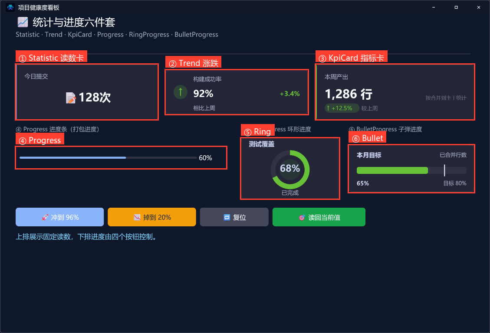

### 6.2 点击「冲到 96%」

三个当前值应都变成 **96**，但不是全部变绿：普通进度条仍是蓝色，环形与子弹是绿色。环形标签保持「已完成」，子弹目标应为 **100**。核对状态文本中的说明，而不只盯着条形长度。

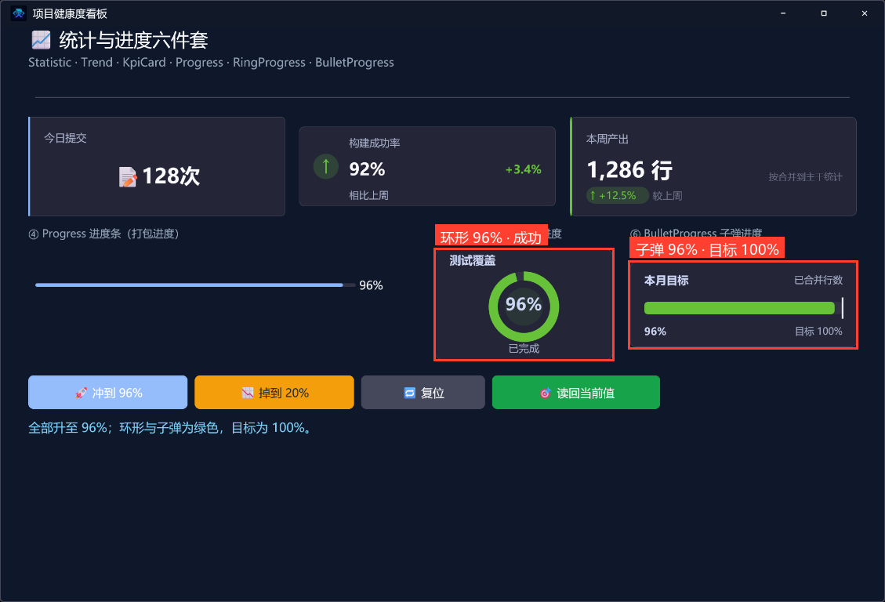

### 6.3 点击「掉到 20%」

三个当前值应都变成 **20**。普通进度条仍为蓝色；环形变成警告橙色，标签变成「待补齐」；子弹变成错误红色，目标回到 **80**。两种颜色来自事件里分别传入的状态 `2` 和 `3`。

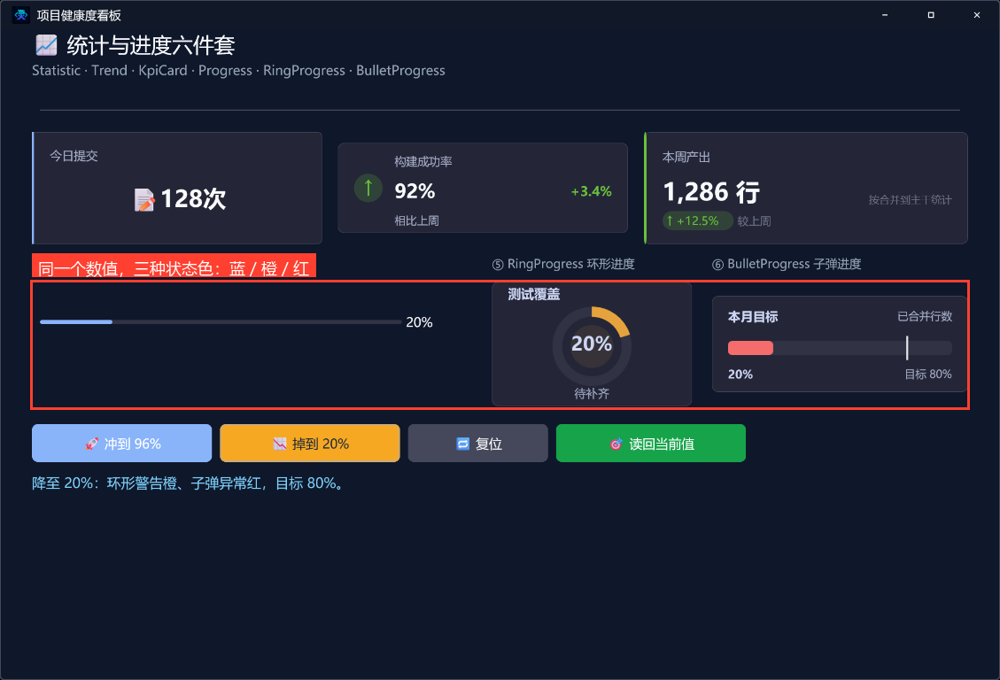

### 6.4 先点击「复位」，再点击「读回当前值」

1. 点「复位」，先看三个当前值是否分别恢复为 **60、68、65**，子弹目标是否为 **80**。
2. 确认环形恢复绿色与「已完成」标签，子弹恢复绿色，普通进度条仍为蓝色。
3. 再点「读回当前值」，状态文本应显示 **「进度条 60，环形 68，子弹 65」**。这里没有读取目标 80。
4. 为排除把结果写死的情况，可以再点一次「回落」后读数，检查是否变成三个 20；最后复位后读数收尾。

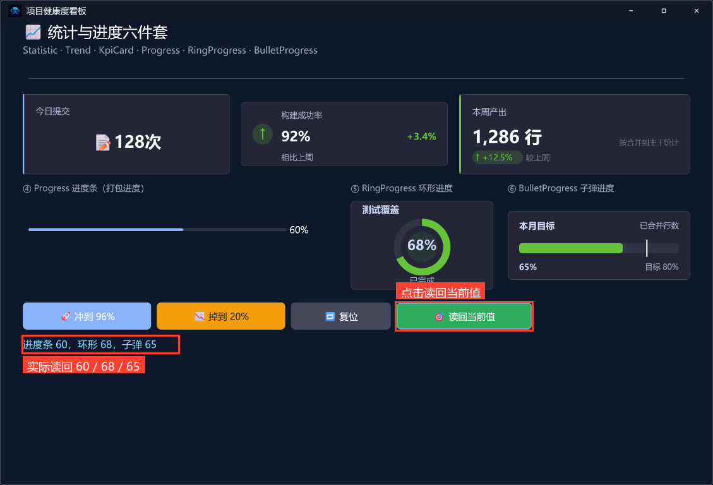

### 操作结果对照表

| 操作 | 普通进度条 | 环形进度 | 子弹当前值／目标值 | 关键检查 |
| --- | --- | --- | --- | --- |
| 刚打开 | 60，蓝 | 68，绿，已完成 | 65／80，绿 | 初值来自设计器 |
| 冲高 | 96，蓝 | 96，绿，已完成 | 96／100，绿 | 当前值与目标值不同 |
| 回落 | 20，蓝 | 20，橙，待补齐 | 20／80，红 | 状态、标签也随事件更新 |
| 复位 | 60，蓝 | 68，绿，已完成 | 65／80，绿 | 三个当前值及目标都恢复 |
| 复位后读数 | 不变 | 不变 | 不变 | 文字读回 60、68、65 |

若某一项与表格不同，先停止运行，回到对应事件、控件名称、属性或事件绑定处检查；修好后重新编译运行，不要只改状态说明让它看起来正确。

## 7. 下载、导出与导入完整源码包

### 7.1 本地源码包下载

[下载本集源码包：项目健康度看板.lcpppkg](https://lingbuilder.com/demos)

这是**本教程目录内的相对下载链接**，文件与本文放在同一目录，不是官网示例区的发布地址。若复制本教程到别处，需同时保留 `README.md`、`images` 目录和这个 `.lcpppkg` 文件，否则图片或下载链接会失效。

`.lcpppkg` 是交给 LingBuilder 打开的项目源码包，**不是双击直接运行的 exe，也不是安装程序**。只有第 4 节的 `.lcpp` 源码不足以还原整个界面；还需要设计器中的控件、属性、事件绑定以及项目的模块依赖。

### 7.2 把自己完成的练习导出

1. 按第 5、6 节完成编译与交互核对，保存源码和设计器。导出只是打包项目内容，不会替你确认按钮行为。
2. 在解决方案资源管理器中选中「项目健康度看板」，尤其注意不要把别的练习项目导出去。
3. 在工作台打开命令面板，搜索并执行 **「项目：一键导出 LCPP 源码包」**；也可在项目节点右键菜单使用「一键导出 LCPP 源码包…」。
4. 保存对话框中选择自己能找到的位置，文件名使用 **`项目健康度看板.lcpppkg`**，保留扩展名。不要误选「导出安装包」，那是另一种交付方式。
5. 等待导出结束，查看输出窗口显示的「源码包」完整路径，以及是否有错误或提醒；再到该目录确认文件存在。
6. 分享时发送这个源码包。后续修改过代码或布局，必须再次导出；以前导出的文件不会自动跟着工程更新。

### 7.3 在 LingBuilder 中导入

1. 把下载的 `项目健康度看板.lcpppkg` 保存到本机，确认文件名末尾不是误加了 `.txt`。
2. 若 IDE 正在编辑其他项目，先保存当前工作，避免切换时丢失未保存内容。
3. 在工作台的「文件」菜单选择 **「打开 LCPP 源码包…」**，或在命令面板执行 **「打开 LCPP 源码包」**。
4. 选择刚保存的 `.lcpppkg` 文件，等待 IDE 校验并导入为独立工作区。这个过程不是把包当成文本文件打开，也不需要手动把其中一个 `.lcpp` 拖进旧项目。
5. 打开后，确认项目名、`MainWindow.lcpp` 和「界面设计」都在；到设计器检查六种组件、四个按钮及其事件绑定。
6. **确认本机已安装 new_emoji 原生界面库、已完成当前账号授权，并在导入的项目中启用。** 源码包不会替接收方登录，也不会把作者的账号授权转给接收方。缺少模块或出现授权提示时，回到第 2.2 节处理。
7. 确认当前窗口仍使用 `new_emoji 模块` 后端，然后重新执行「先查错误列表 → 编译 → 再查错误列表 → 运行与逐按钮核对」。不要因为源码包能打开，就认为本机的构建环境和交互已经验证过。

## 8. 新手常见错误：按现象找检查点

| 现象 | 先检查什么 | 如何处理 |
| --- | --- | --- |
| 工具箱里找不到 NE 控件 | 模块是否在当前项目启用、窗口是否选了 NE 后端 | 回到第 2 节逐项检查；后端先于控件选择 |
| 修改了按钮文字，代码却找不到控件 | 是否把「内容」当成了「名称」 | 按第 3 节名称表重命名，代码仍使用 `冲高按钮` 等准确名称 |
| 提示控件不存在或控件类型不匹配 | 名称拼写、所选组件类型、是否属于当前窗口 | 在设计器选中控件核对，别给控件名加引号来绕过错误 |
| 点按钮没反应，错误列表却为 0 | `Clicked` 是否绑到正确事件、源码是否属于当前项目 | 按第 3.5 节核对四个处理器；保存后重新编译 |
| 专用命令没有补全或报未知命令 | 当前项目模块状态、使用的模块是否包含本集命令 | 检查模块详情与安装状态；不要猜命令名或换成三个通用设置调用 |
| 子弹的目标值不对 | 五个实参是否按顺序填写 | 冲高填当前 `96`、目标 `100`；回落填 `20`、`80`；复位填 `65`、`80` |
| 环形中心百分比看不见，或环下标签不对 | `showCenter` 是否为真、标签实参是否正确 | 中心数字由 `showCenter` 控制；环下标签成功状态传 `"已完成"`，回落传 `"待补齐"` |
| 冲高后普通进度条没有变绿 | 本例是否只调用了 `控件_设置数值` | 蓝色就是本例的预期；不要把环形、子弹的状态套到普通进度条上 |
| 复位后子弹仍不是 65 | 是否漏写第三条设置命令 | 检查复位事件中子弹的当前值 `65`、目标值 `80` 是否都传了 |
| 读数只剩最后一个值 | 是否漏了 `读数 = 读数 + …` 中右边的变量 | 按完整源码分三行累加，最后统一设置文本 |
| 想读到 60、68、65，却读到三个 20 | 上一次点击的是哪个按钮 | 先复位再读数；读取当前值不会自动复位 |
| 文字裁切、卡片上下不齐 | 坐标尺寸、字体、是否使用含 DPI 修正的引擎 | 按第 3.1 节逻辑高度与居中公式核对，不靠改 Windows 缩放或缩字号解决 |
| 编译失败、但以前的窗口还能打开 | 是否运行了旧产物、是否只看旧日志 | 先处理本次错误，等待本次编译成功，再重新运行 |
| 导入后提示模块缺失或无授权 | 接收方本机的安装、启用与账号授权 | 按第 7.3 节补齐，不要删除模块引用或认为包会转移授权 |

## 下一集预告

图表开篇：LineChart 折线图与 BarChart 柱状图——数据序列怎么给、坐标轴和图例怎么配。
