# NE 合集 17 · 图表（二）：环形图与仪表盘

> 《LingBuilder new_emoji 合集》第 17 集。图表 family 的最后两位成员：**DonutChart 环形图**（看占比）和 **Gauge 仪表盘**（看健康分）。这一集有个好消息和一个坏消息：好消息是仪表盘是**图表里唯一能运行期改数的**（一条命令的事）；坏消息是环形图是「固定画法」，圆心半径写死在引擎里，还和图例有个先天重叠的坑。全程约 35 分钟。
>
> 前置要求：完成[第 01 集](/guide/tutorials/new-emoji-01)；建议先看[第 16 集](/guide/tutorials/new-emoji-16)（折线图与柱状图），本集延续「展示件」这条线。本集源码包见文末。

## 这一集你将学会

- **DonutChart**：`slices` 一行一片（名称 + 制表符 + 数值），占比自动算角度；`showLegend` 图例、`ringWidth` 环宽
- **Gauge**：`value` 当前值、`status` 状态色、`warningValue` / `dangerValue` 两条阈值线
- 仪表盘的运行期命令：`控件_设置数值` 改分数、`控件_取数值` 读分数——**图表家族里独一份**
- 三个必须知道的引擎行为：环形图**圆心半径固定**；环上标签(showLabels)**会和图例重叠**；`控件_设置数值` 会把说明文字换成默认的「📍 当前状态」

先看一眼本集成品——环形图与仪表盘同框，占比和健康分一眼看清：

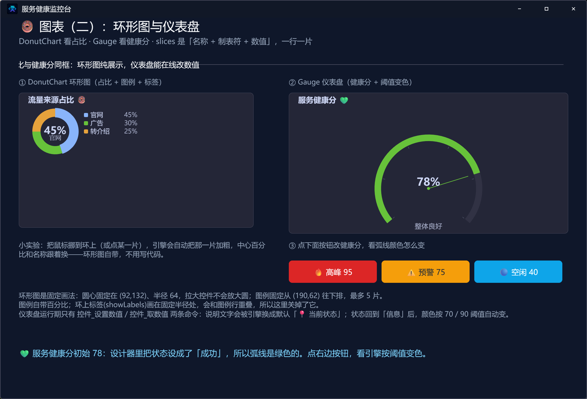

## 1. 命令与事件预告

| 命令 / 事件 | 作用 |
| --- | --- |
| `控件_设置数值(仪表盘, 95)` | 改仪表盘当前值（Gauge 专属分支） |
| `控件_取数值(仪表盘)` | 读回当前值，返回整数型 |
| `鼠标按下` 事件 | 参数 `整数型 横坐标, 整数型 纵坐标, 整数型 鼠标按钮`，坐标相对控件内容区 |
| （无数据事件） | 环形图没有「点了第几片」事件——扇区切换是引擎内置行为，代码只拿得到坐标 |

> 本集只需要 new_emoji 模块。

## 2. 新建项目 + 启用模块 + 切后端

流程和第 1 集一样，项目名称填 **服务健康监控台**：

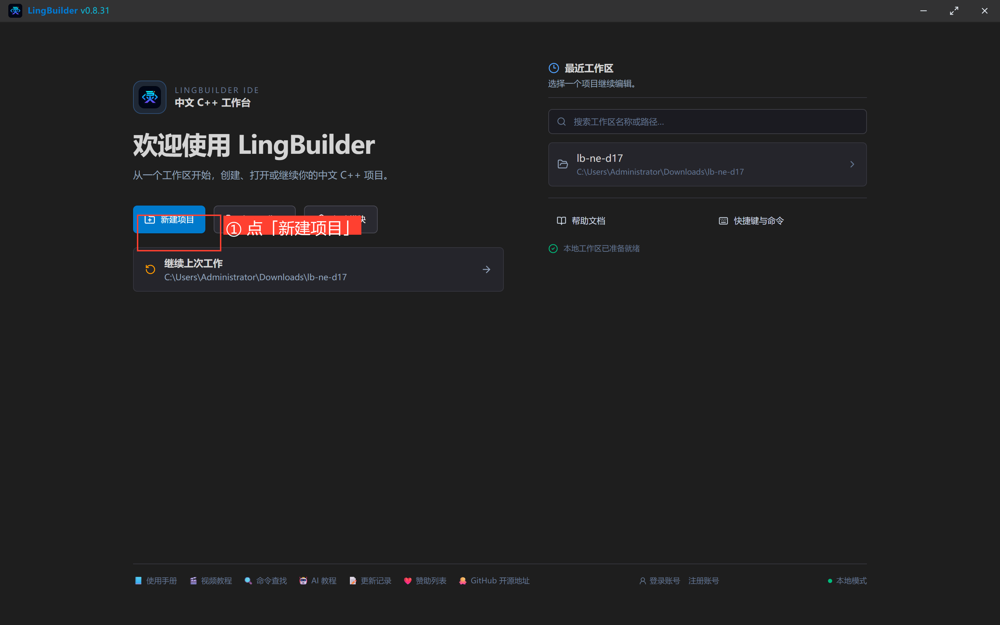

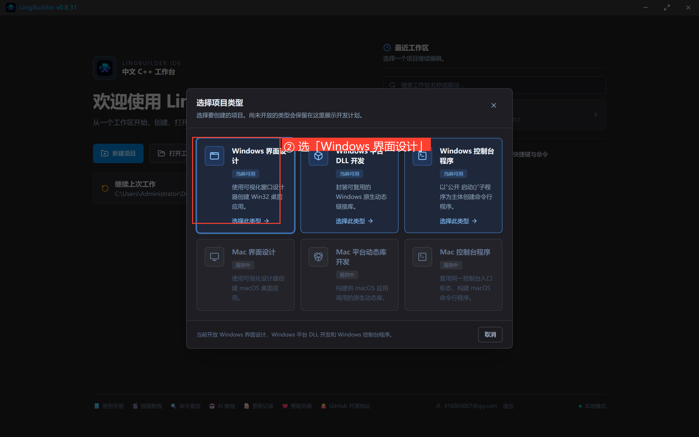

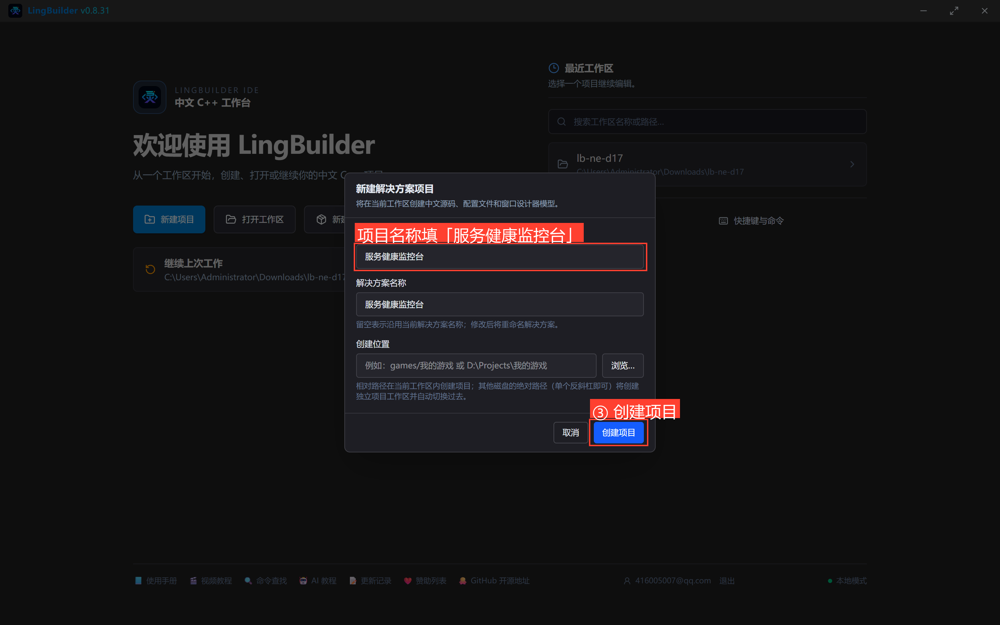

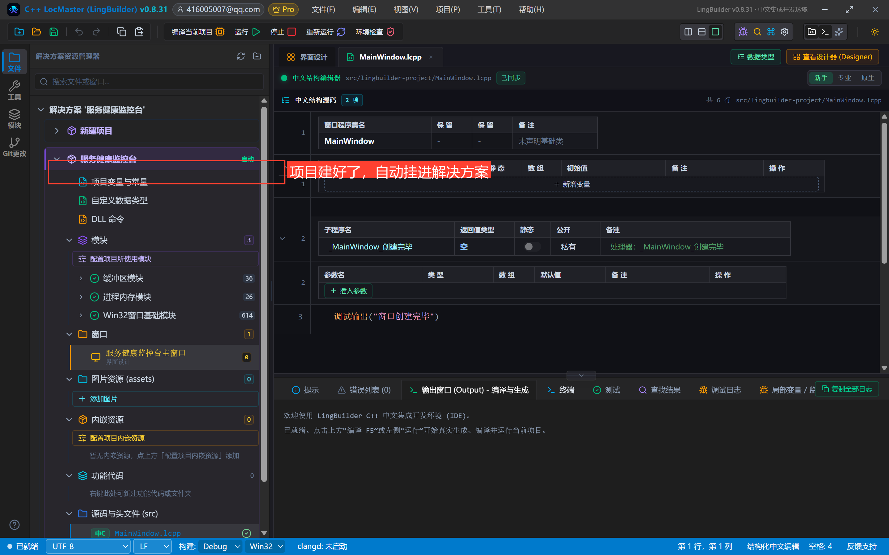

模块面板搜「原生界面」→ 启用「new_emoji 原生界面库」（首次会弹登录框，登录一次即可）：

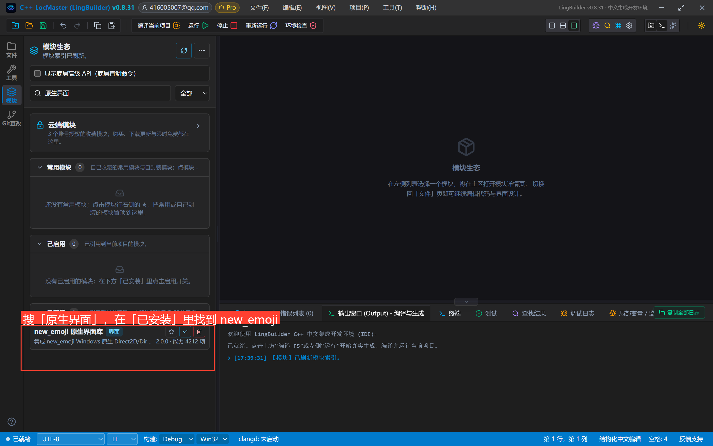

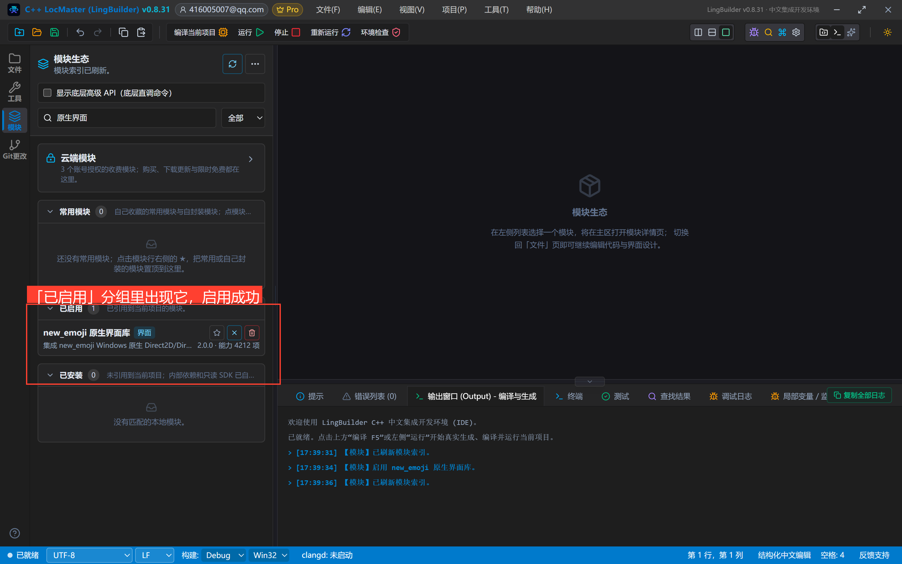

界面设计 → 选中窗口 → 确认「设计后端」是 **new_emoji 模块**：

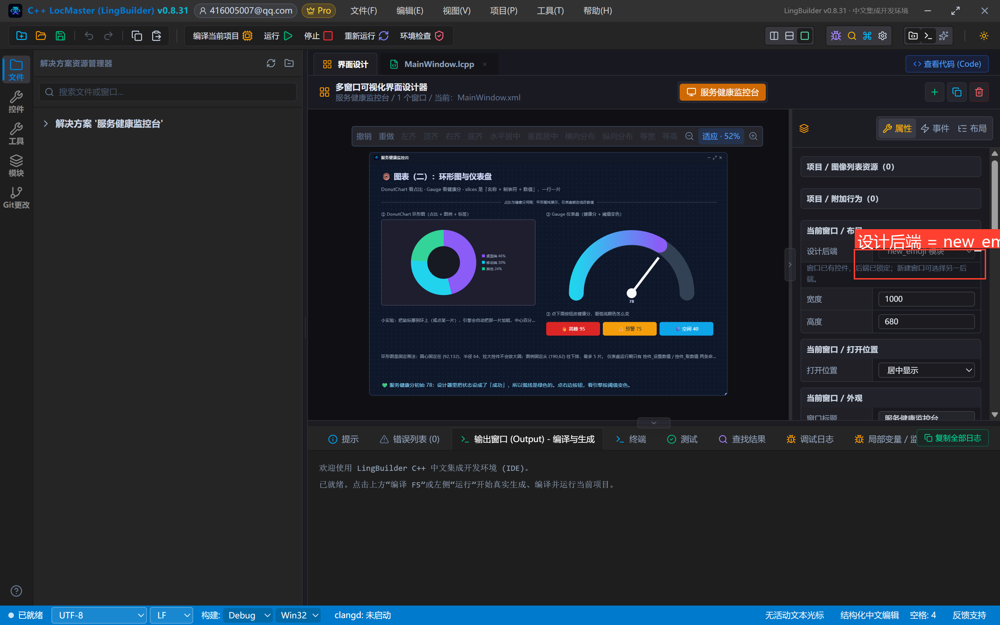

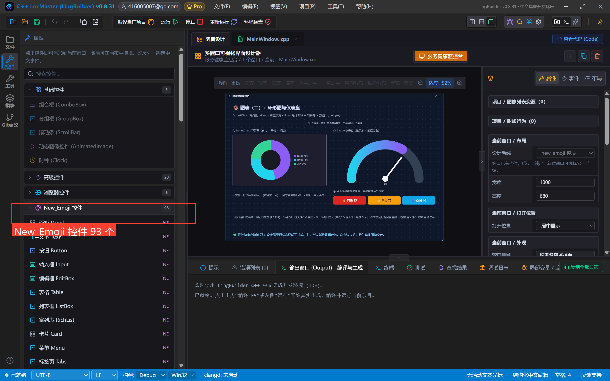

## 3. 设计界面

窗口 1000×680，左边环形图、右边仪表盘，下面一排按钮和速查条。

| 控件 | 名称 | 左距 | 顶距 | 宽度 | 高度 | 关键属性 |
| --- | --- | --- | --- | --- | --- | --- |
| 文本 Text | 标题文本 | 32 | 20 | 700 | 36 | 🍩 图表（二）：环形图与仪表盘，字号 21 粗体 |
| 文本 Text | 副标题文本 | 32 | 62 | 900 | 24 | 字号 13，#94A3B8 |
| 分割线 Divider | 标题分割线 | 32 | 96 | 936 | 28 | 占比与健康分同框：环形图纯展示，仪表盘能在线改数值 |
| 文本 Text | 环形标签 | 32 | 132 | 430 | 22 | ① DonutChart 环形图（占比 + 图例 + 标签） |
| 环形图 DonutChart | 流量来源 | 32 | 158 | 400 | 230 | **slices 三片；showLegend=真；ringWidth=28；showLabels=假** |
| 文本 Text | 仪表标签 | 492 | 132 | 476 | 22 | ② Gauge 仪表盘（健康分 + 阈值变色） |
| 仪表盘 Gauge | 服务健康 | 492 | 158 | 476 | 240 | **value=78；caption=整体良好；status=1（成功）；warningValue=70；dangerValue=90；strokeWidth=12** |
| 文本 Text | 环形小实验 | 32 | 410 | 430 | 60 | 悬停/点击扇区的小实验说明，字号 12 |
| 文本 Text | 按钮引导 | 492 | 410 | 476 | 22 | ③ 点下面按钮改健康分，看弧线颜色怎么变 |
| 按钮 Button | 高峰按钮 | 492 | 444 | 150 | 38 | 🔥 高峰 95，样式=危险(4) |
| 按钮 Button | 预警按钮 | 650 | 444 | 150 | 38 | ⚠️ 预警 75，样式=警告(3) |
| 按钮 Button | 空闲按钮 | 808 | 444 | 150 | 38 | 🔵 空闲 40，样式=信息(6) |
| 文本 Text | 数据协议说明 | 32 | 496 | 936 | 88 | 字号 12，#94A3B8，自动换行 |
| 文本 Text | 状态文本 | 32 | 592 | 936 | 56 | 字号 14，#7DD3FC，自动换行 |

### 3.1 数据格式：一行一片，名称和数值之间放一个制表符

环形图的 `slices`（三片）：

```
官网	45
广告	30
转介绍	25
```

和折线图的 `points`、柱状图的 `bars` 是同一个协议：**一行填一条，名称敲完按一次 Tab 再敲数值**。数值不必加起来等于 100，引擎按「单片 ÷ 总和」算百分比——上面三片总和 100，所以中心直接显示 45%。

### 3.2 环形图的「固定画法」：控件大小不改变圆的大小

这是环形图和折线/柱状最大的差异——它的几何**写死在引擎里**：

- 圆心固定在控件左上角往右 92、往下 132 的位置，半径固定 64；
- 图例固定从 (190, 62) 开始往下排，每行 28 像素，最多 5 片；
- 所以把控件拉大，**圆不会变大，只会多出空白**。本集给 400×230，刚好装下环 + 图例。

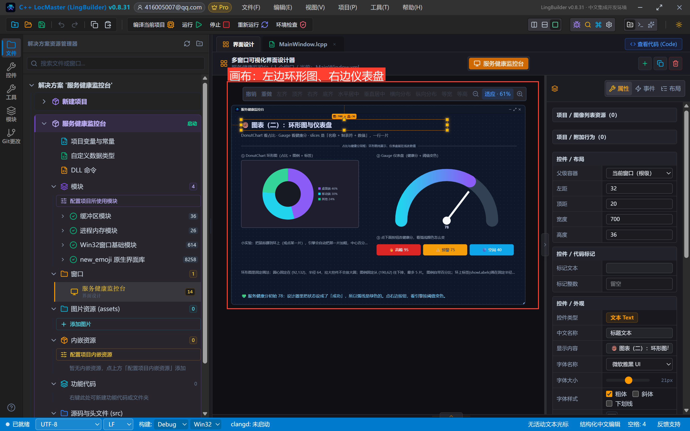

> **红线：`showLabels`（环上百分比标签）默认开，但会和图例行重叠。** 标签画在固定半径处，官网那片的「45%」正好压进图例第三行的位置——这是引擎固定坐标的先天冲突，不是你摆错了。图例本身就带百分比（官网 45% / 广告 30% / 转介绍 25%），所以本集直接把 `showLabels` 关掉，画面立刻清爽。

### 3.3 Gauge 的状态色与阈值色

| 属性 | 作用 |
| --- | --- |
| `value` / `caption` | 当前分数 / 弧线下方那行说明文字 |
| `status` | 固定颜色：0=信息(蓝)、1=成功(绿)、2=警告(黄)、3=错误(红)，**优先级高于阈值** |
| `warningValue` / `dangerValue` | 两条阈值线；状态为「信息」时才生效：越过 warning 变黄、越过 danger 变红 |
| `strokeWidth` | 弧线粗细，6~32 |

本集初始值 78、状态设成「成功」——所以弧线是绿色的，哪怕 78 其实已越过 70 的预警线。想让它「按阈值自动变色」，把状态留在「信息」即可（点完按钮你会亲眼看到这套规则）。

## 4. 写代码

```lcpp
类 MainWindow
    事件 _MainWindow_创建完毕()
        控件_设置文本(状态文本, "💚 服务健康分初始 78：设计器里把状态设成了「成功」，所以弧线是绿色的。点右边按钮，看引擎按阈值变色。")
        调试输出("服务健康监控台已创建完毕")
    结束

    事件 _流量来源_鼠标按下(整数型 横坐标, 整数型 纵坐标, 整数型 鼠标按钮)
        控件_设置文本(状态文本, "🍩 环形图：按下位置 x=" + 到文本(横坐标) + " y=" + 到文本(纵坐标) + "。落在环上的点击会自动切换活动扇区（引擎内置），代码只能拿到坐标。")
    结束

    事件 _高峰按钮_被单击()
        控件_设置数值(服务健康, 95)
        控件_设置文本(状态文本, "🔥 高峰模式：健康分 95 越过危险线 90，弧线自动变红。说明文字被引擎换成了默认的「📍 当前状态」——通用命令只改数字。")
    结束

    事件 _预警按钮_被单击()
        控件_设置数值(服务健康, 75)
        控件_设置文本(状态文本, "⚠️ 预警模式：健康分 75 落在 70~90 区间，弧线自动变黄。")
    结束

    事件 _空闲按钮_被单击()
        控件_设置数值(服务健康, 40)
        控件_设置文本(状态文本, "🔵 空闲模式：健康分 40 低于 70，弧线是「信息」蓝色。读回当前分数：" + 到文本(控件_取数值(服务健康)) + "。")
    结束
结束类
```

三个看点：

1. **处理器参数必须带类型**（`整数型 横坐标` 等），这是 new_emoji 所有控件的统一要求。
2. **`控件_设置数值` 是仪表盘唯一的改数命令**——它只改数字，说明文字会被引擎替换成默认的「📍 当前状态」，状态色也会回到「信息」。好消息是状态=信息时引擎按阈值自动变色，所以弧线照样会变红变黄；坏消息是想保住自定义说明文字，只能在改完数值后想办法（运行期没有「设置说明」的中文命令，这条留给进阶篇的底层直调）。
3. **`控件_取数值` 能把分数读回来**——注意它写在字符串拼接里，要包一层 `到文本(...)`。

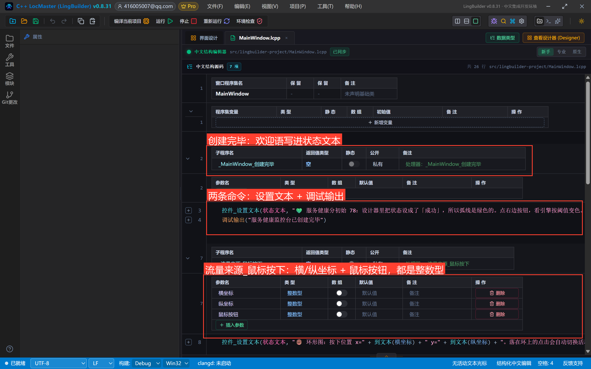

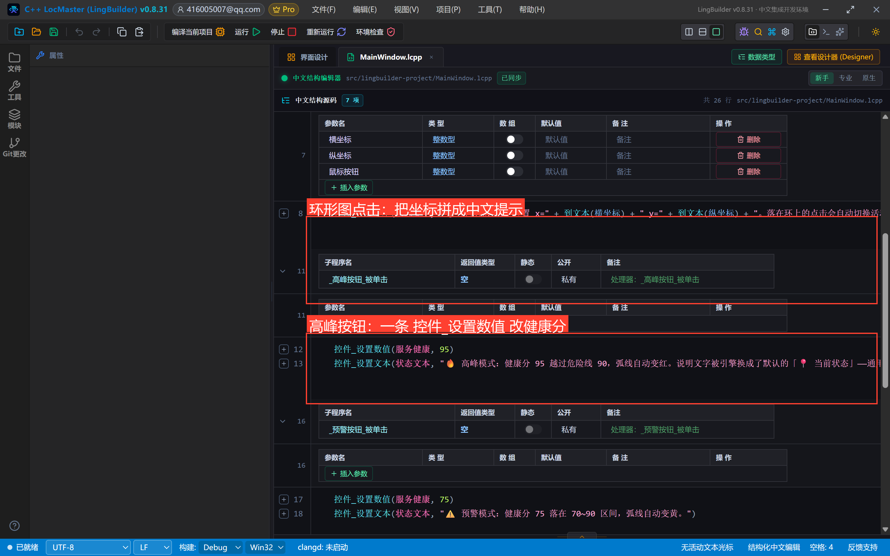

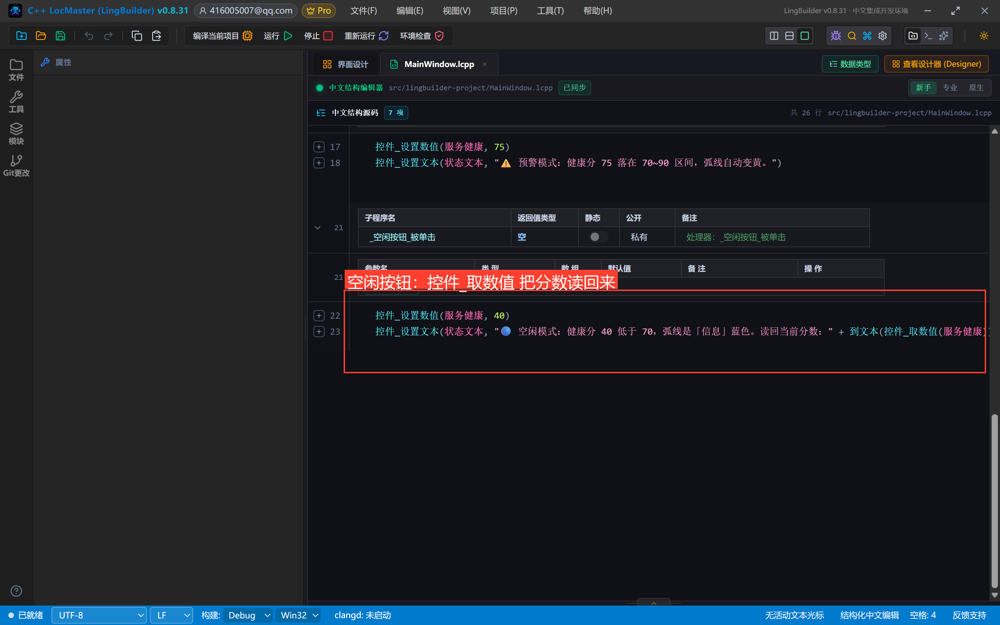

## 5. 编译前先看错误列表

点「编译当前项目」，先看底部错误列表——零报错再继续：

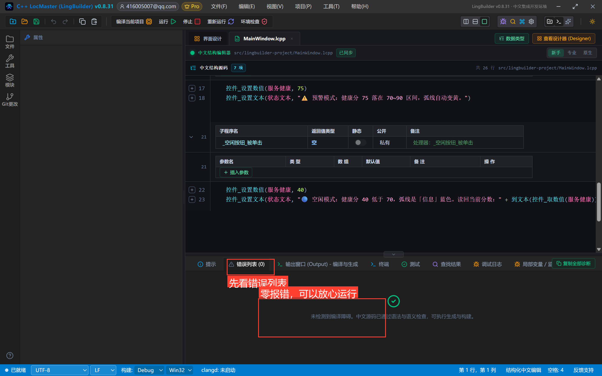

## 6. 运行！四个互动各试一次

点「运行」。左边环形图、右边绿色仪表盘（78 分，状态「成功」），下面三个彩色按钮：

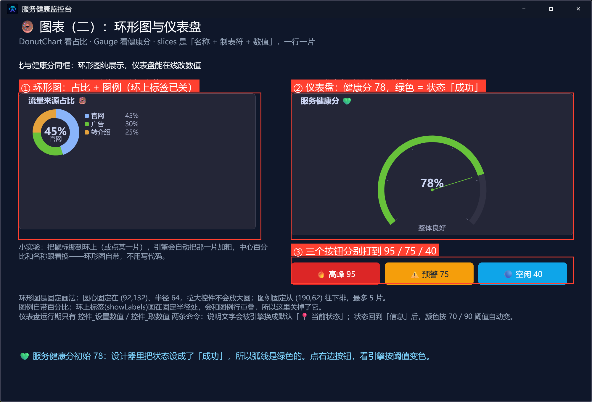

**① 点环形图上绿色的「广告」片**——中心大数字从「45% 官网」变成「30% 广告」，被点中的片加粗。这个扇区切换是**引擎内置**的，一行代码都不用写；代码里的 `鼠标按下` 只拿到了坐标：

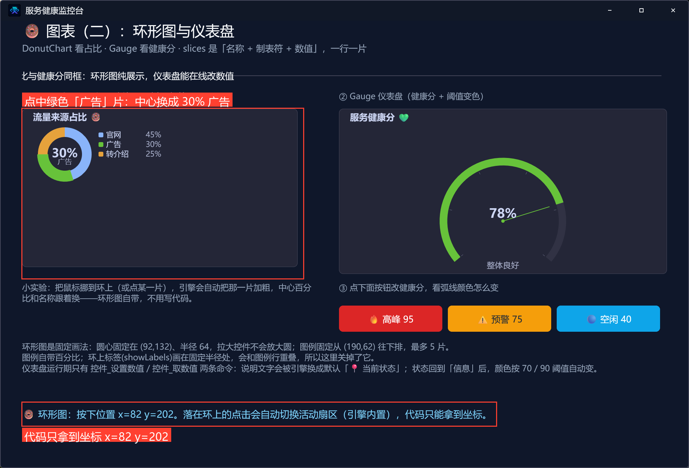

**② 点「高峰 95」**——95 越过危险线 90，弧线自动变红，指针转过去。同时注意弧线下方：说明文字「整体良好」被换成了默认的「📍 当前状态」，这就是 `控件_设置数值` 的边界：

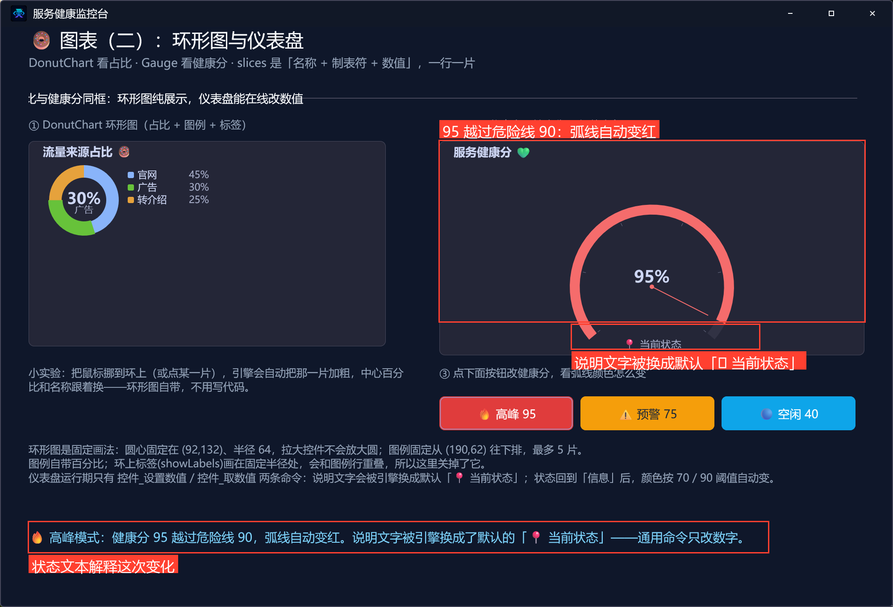

**③ 点「预警 75」**——75 落在 70~90 区间，弧线变黄：

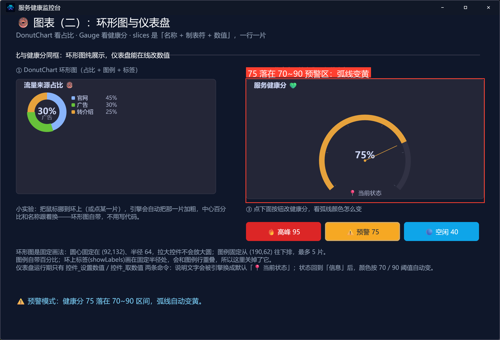

**④ 点「空闲 40」**——40 低于 70，弧线恢复「信息」蓝色；状态栏把 `控件_取数值` 读回来的 40 拼进了提示，证明读写闭环：

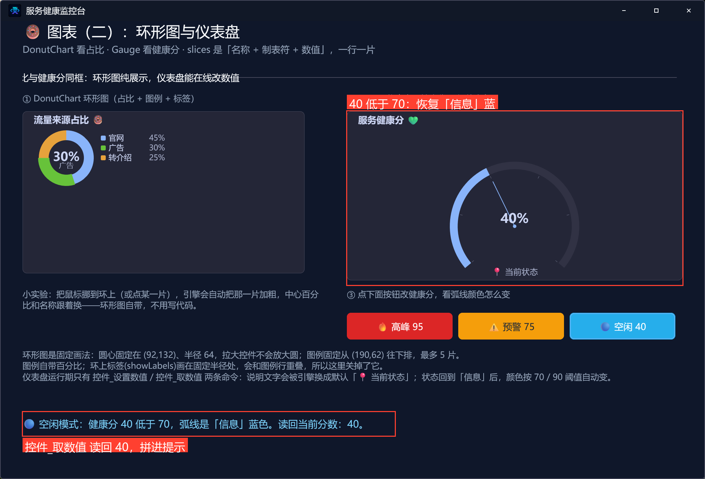

## 7. 导出源码包

命令面板执行「项目：一键导出 LCPP 源码包」即可。

## 本集源码包

- 网页版：[17-服务健康监控台.lcpppkg](https://lingbuilder.com/demos)（示例源码区可下载）

## 下一集预告

消息与通知：Message 轻提示、MessageBox 确认框、Notification 通知、Alert 警告条——程序怎么「开口说话」。
