# NE 合集 22 · 窗口结构件：用六个结构件拼一个迷你浏览器骨架

> 《LingBuilder new_emoji 合集》第 22 集。**Header 页眉**、**Footer 页脚**、**Panel 面板**、**PageHeader 页头**、**Omnibox 地址栏**、**BrowserViewport 浏览器视口**——这六个「结构件」不直接产出业务功能，但任何一个「像软件」的界面都靠它们撑骨架。这一集左列摆结构件小样，右列用页头 + 地址栏 + 视口拼出浏览器真身：视口里就是 lingbuilder.com 的**真实截图**，在地址栏输入地址回车即可「导航」。全程约 40 分钟。
>
> 前置要求：完成[第 21 集](/guide/tutorials/new-emoji-21)。本集源码包见文末。

## 这一集你将学会

- **Header / Footer**：页眉、页脚横幅容器，`NE页眉_设置标题` / `NE页脚_设置标题` 一条命令改文字
- **Panel**：圆角卡片容器，`cornerRadius` / `borderColor` / `backgroundColor` 全部显式设置
- **PageHeader**：返回 + 标题 + 副标题 + 面包屑 + 动作，高度 ≥64 自动排成两行（上行「返回+标题+动作」、下行「面包屑+副标题」），运行期全部可换
- **Omnibox**：安全徽标、建议列表、两个事件（提交回调 / 图标按钮回调）；**地址栏获得焦点时自动弹出建议**（和真实浏览器一致）
- **BrowserViewport**：`NE浏览器视口_设置截图资源` 让视口显示**真实网页截图**，提交回调里一条命令完成「导航」

先看一眼本集成品——左列结构件小样，右列页头 + 地址栏 + 大视口，视口里就是 lingbuilder.com 的真实截图：

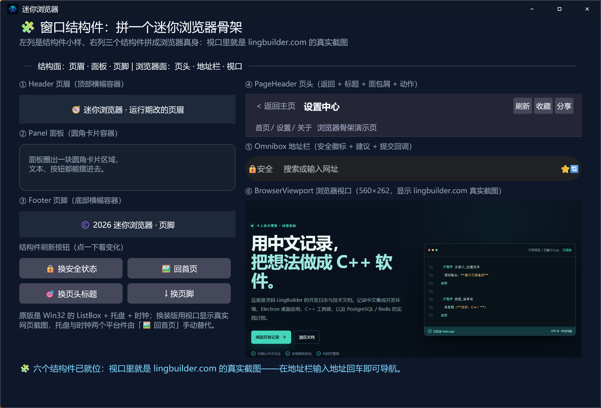

## 1. 命令与事件预告

| 命令 / 事件 | 作用 |
| --- | --- |
| `NE页眉_设置标题(页眉, "…")` / `NE页脚_设置标题(页脚, "…")` | 改页眉/页脚横幅文字 |
| `NE页头_设置标题(页头, 标题, 副标题)` | 一次改页头主副标题 |
| `NE页头_设置面包屑(页头, "首页\|设置\|关于")` | 面包屑，`\|` 分隔 |
| `NE页头_设置动作项(页头, "刷新\|收藏\|分享")` | 右侧动作按钮组 |
| `NE页头_设置返回文本(页头, "返回主页")` | 左侧返回文字 |
| `NE地址栏_设置安全状态(地址栏, 1, "安全")` | 安全徽标：0=🌐 1=🔒 2/3=⚠️ 4=📄 5=🔍 |
| `NE地址栏_设置动作图标(地址栏, "⭐\t收藏\|🔄\t刷新")` | 右侧动作图标，`\|` 分行、Tab 分列（图标、名称） |
| `NE地址栏_设置建议列表(地址栏, …)` | 建议列表，`\|` 分行、Tab 分列（类型、图标、主文本、副文本） |
| `NE浏览器视口_设置截图资源(视口, "assets/…png")` | 让视口显示真实网页截图（state 自动切到「截图态」） |
| `NE浏览器视口_设置占位标题(视口, 标题, 描述, 图标)` | 视口占位页三件套 |
| `地址栏_提交回调(文本型 地址)` 事件 | 用户在地址栏输入后回车触发，参数是地址 |
| `地址栏_图标按钮回调(整数型 图标索引, 整数型 起始位置, 整数型 结束位置)` 事件 | 点右侧动作图标触发 |

> 本集只需要 new_emoji 模块。

## 2. 新建项目 + 启用模块 + 切后端

流程和第 1 集一样，项目名称填 **迷你浏览器**：

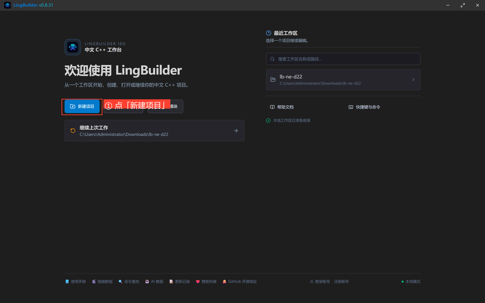

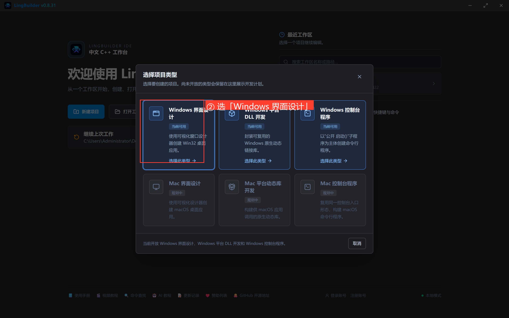

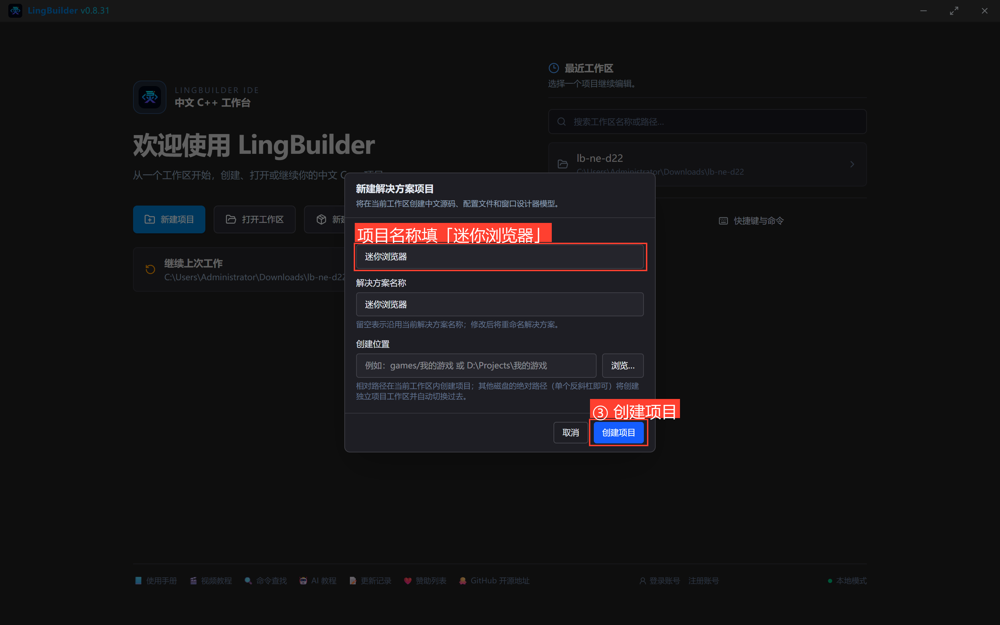

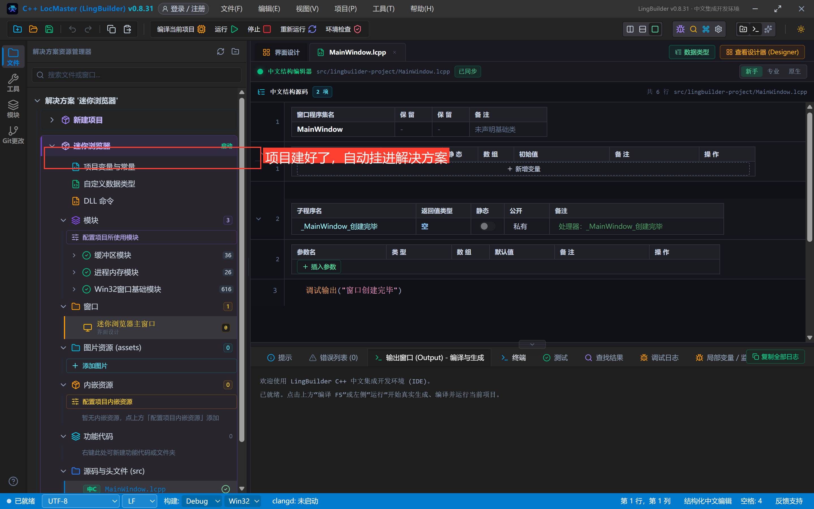

模块面板搜「原生界面」→ 启用「new_emoji 原生界面库」（首次会弹登录框，登录一次即可）：

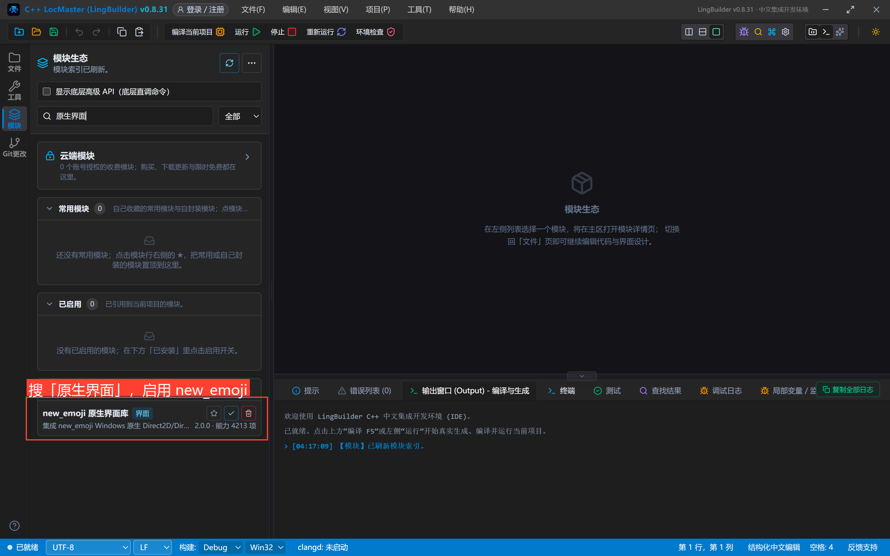

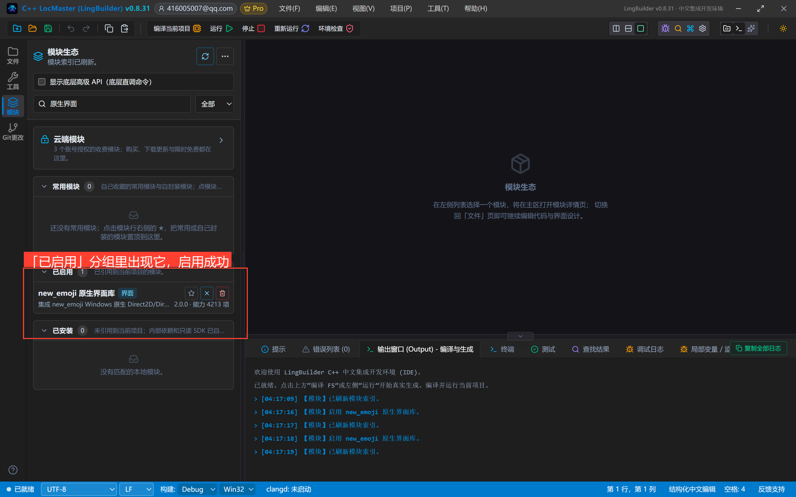

界面设计 → 选中窗口 → 确认「设计后端」是 **new_emoji 模块**：

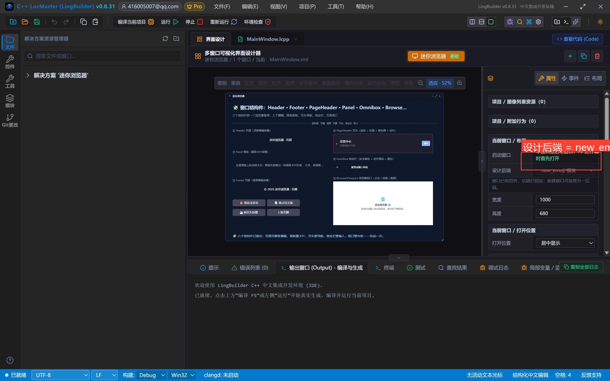

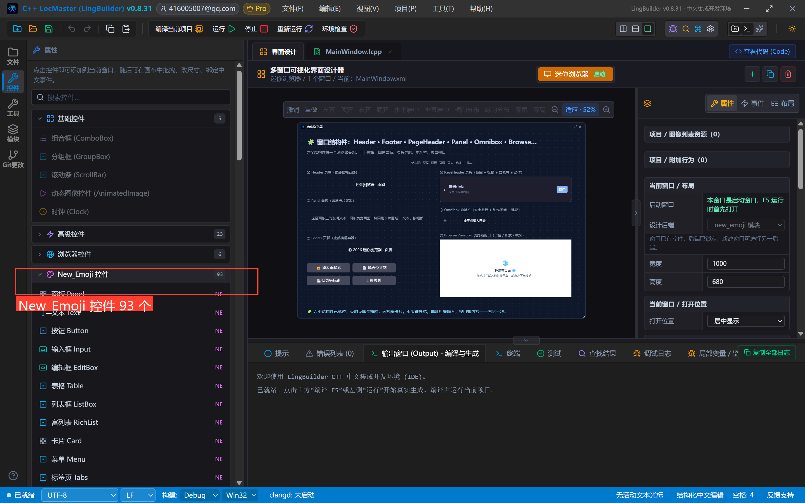

## 3. 设计界面

窗口 1000×680 分两列：**左列是结构件小样**（页眉 / 面板 / 页脚 + 四个刷新按钮），**右列是浏览器真身**（页头 → 地址栏 → 大视口）。布局的关键红线只有一条：左列每个控件的「左距 + 宽度」都不得超过 392，右列从 408 起——两列之间留 16px 通道，谁也压不着谁。

| 控件 | 名称 | 左距 | 顶距 | 宽度 | 高度 | 关键属性 |
| --- | --- | --- | --- | --- | --- | --- |
| 文本 Text | 标题文本 | 32 | 20 | 760 | 36 | 🧩 窗口结构件：拼一个迷你浏览器骨架，字号 21 粗体 |
| 文本 Text | 副标题文本 | 32 | 62 | 900 | 24 | 字号 13，#94A3B8 |
| 分割线 Divider | 标题分割线 | 32 | 96 | 936 | 28 | 结构面：页眉 · 面板 · 页脚 \| 浏览器面：页头 · 地址栏 · 视口 |
| 文本 Text | 页眉标签 | 32 | 132 | 360 | 22 | ① Header 页眉（顶部横幅容器） |
| 页眉 Header | 页眉 | 32 | 158 | 360 | 48 | **title=迷你浏览器 · 页眉；align=居中；backgroundColor=#FF1E293B** |
| 文本 Text | 面板标签 | 32 | 214 | 360 | 22 | ② Panel 面板（圆角卡片容器） |
| 面板 Panel | 面板 | 32 | 240 | 360 | 78 | **cornerRadius=10；borderWidth=1；backgroundColor=#FF16202F；borderColor=#FF334155** |
| 文本 Text | 面板说明 | 48 | 258 | 330 | 46 | 摆在面板上面的说明文本，字号 12 |
| 文本 Text | 页脚标签 | 32 | 326 | 360 | 22 | ③ Footer 页脚（底部横幅容器） |
| 页脚 Footer | 页脚 | 32 | 352 | 360 | 44 | **title=© 2026 迷你浏览器 · 页脚；align=居中；backgroundColor=#FF1E293B** |
| 文本 Text | 按钮标签 | 32 | 404 | 360 | 22 | 结构件刷新按钮（点一下看变化） |
| 按钮 Button | 换安全状态 | 32 | 430 | 172 | 34 | 🔒 换安全状态 |
| 按钮 Button | 回首页截图 | 212 | 430 | 172 | 34 | 🖼 回首页 |
| 按钮 Button | 换页头标题 | 32 | 472 | 172 | 34 | 🎯 换页头标题 |
| 按钮 Button | 换页脚 | 212 | 472 | 172 | 34 | ↓ 换页脚 |
| 文本 Text | 换装说明 | 32 | 518 | 360 | 76 | 字号 12，#94A3B8，自动换行 |
| 文本 Text | 页头标签 | 408 | 132 | 560 | 22 | ④ PageHeader 页头（返回 + 标题 + 面包屑 + 动作） |
| 页头 PageHeader | 页头 | 408 | 156 | 560 | 72 | **title=设置中心；subtitle=浏览器骨架演示页；back=返回主页；actions=刷新/收藏/分享；breadcrumbs=首页/设置/关于** |
| 文本 Text | 地址栏标签 | 408 | 236 | 560 | 22 | ⑤ Omnibox 地址栏（安全徽标 + 建议 + 提交回调） |
| 地址栏 Omnibox | 地址栏 | 408 | 260 | 560 | 42 | **placeholder=搜索或输入网址；securityState=1；securityText=安全；绑定提交回调 + 图标按钮回调** |
| 文本 Text | 视口标签 | 408 | 310 | 560 | 22 | ⑥ BrowserViewport 浏览器视口（560×262） |
| 视口 BrowserViewport | 视口 | 408 | 334 | 560 | 262 | **screenshot=assets/lingbuilder-project/browser-home.png；placeholder 三件套同步填** |
| 文本 Text | 状态文本 | 32 | 604 | 936 | 44 | 字号 14，#7DD3FC，自动换行 |

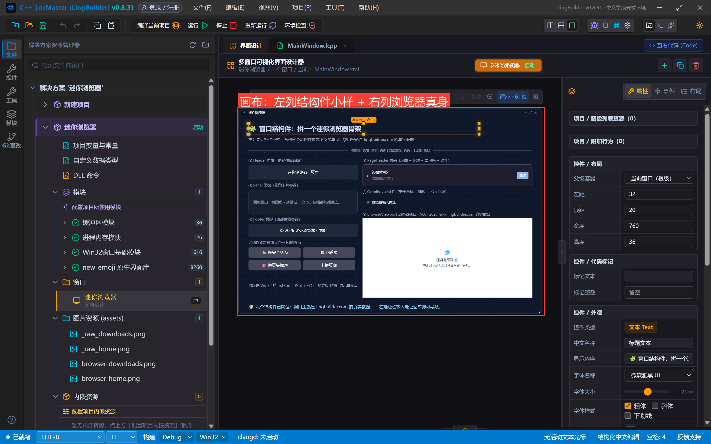

### 3.1 结构件的属性必须显式设置：默认值不会发下去

本集最重要的红线：**属性发射器只发射你显式设置过的属性**。页眉、页脚、面板在设计器默认值里都带浅色背景，但你没动过它就不会被发射——运行期横幅和面板全是透明的，只剩一行文字悬在窗口里。把页眉/页脚的 `backgroundColor` 显式设成 `#FF1E293B`、面板显式设 `backgroundColor` + `borderColor` 之后，横幅和圆角卡片才真正「长出来」。拍摄这一集时真实踩到：没设背景色的第一版运行图里，三个容器全部隐形。

### 3.2 视口的真实截图：一张 PNG 放进 assets，一个属性

视口的 `screenshot` 属性填一张 PNG 的工作区相对路径（本集是 `assets/lingbuilder-project/browser-home.png`，用「图片资源 (assets) → 添加图片」导入即可），编译时该文件会自动复制到 exe 旁边，启动就是「载入完成」的样子——本集放的是 lingbuilder.com 的真实截图。运行期换页面只要一条 `NE浏览器视口_设置截图资源(视口, "assets/…png")`，state 会自动切到截图态。

截这张图的方式也顺带一提：Edge/Chrome 无头模式 `--headless=new --window-size=1120,524 --screenshot=…` 对目标页面截一张 2 倍图（560×262 的视口正好 2x 显示，不糊）。

### 3.3 地址栏聚焦才弹建议：首屏别让浮层挡内容

建议列表内容用 `NE地址栏_设置建议列表` 运行期下发；「弹出建议」的 `suggestionOpen` 属性**不要设**——引擎的行为是：设了真就常开（浮层一直盖在地址栏下方，把视口顶上一截全挡住），不设则**地址栏获得焦点时自动弹出**，和真实浏览器一致。拍摄这一集时真实踩到：常开的建议面板把大视口的顶部盖掉一条，改成聚焦弹出后首屏干干净净。

另外两条地址栏红线：前置徽片的 `prefixText` 建议留空（「HTTPS」这样的长词会溢出徽片压住占位文本，只留 `prefixIcon` 最稳）；建议列表的演示 URL 别指向后台/登录类页面——截图会连页面一起「载入」进视口。

## 4. 写代码

```lcpp
类 MainWindow
    事件 _MainWindow_创建完毕()
        NE页眉_设置标题(页眉, "🧭 迷你浏览器 · 运行期改的页眉")
        NE页头_设置面包屑(页头, "首页|设置|关于")
        NE页头_设置动作项(页头, "刷新|收藏|分享")
        NE页头_设置返回文本(页头, "返回主页")
        NE地址栏_设置动作图标(地址栏, "⭐\t收藏|🔄\t刷新")
        NE地址栏_设置建议列表(地址栏, "搜索\t🔎\tnew_emoji 窗口结构件教程\t今天|网址\t🌐\tlingbuilder.com/downloads\t下载中心")
        NE浏览器视口_设置占位标题(视口, "还没有页面 🌐", "在地址栏输入地址按回车即可导航。", "🌐")
        控件_设置文本(状态文本, "🧩 六个结构件已就位：视口里就是 lingbuilder.com 的真实截图——在地址栏输入地址回车即可导航。")
        调试输出("迷你浏览器已创建完毕")
    结束

    事件 _换安全状态_被单击()
        安全序号 = 安全序号 + 1
        如果 (安全序号 > 2)
            安全序号 = 0
        如果结束
        如果 (安全序号 = 1)
            NE地址栏_设置安全状态(地址栏, 1, "安全")
            控件_设置文本(状态文本, "🔒 NE地址栏_设置安全状态(地址栏, 1, 「安全」)：1 = 锁图标，连接可信。")
        如果结束
        如果 (安全序号 = 2)
            NE地址栏_设置安全状态(地址栏, 2, "不安全")
            控件_设置文本(状态文本, "⚠️ 安全状态 2 = 感叹号，提示用户这个连接有问题。")
        如果结束
        如果 (安全序号 = 0)
            NE地址栏_设置安全状态(地址栏, 0, "无状态")
            控件_设置文本(状态文本, "🌐 安全状态 0 = 地球图标，还没有加载任何页面。")
        如果结束
    结束

    事件 _回首页_被单击()
        NE浏览器视口_设置截图资源(视口, "assets/lingbuilder-project/browser-home.png")
        控件_设置文本(状态文本, "🖼 NE浏览器视口_设置截图资源(视口, …)：一条命令切回首页截图。")
    结束

    事件 _换页头标题_被单击()
        NE页头_设置标题(页头, "关于迷你浏览器", "运行期改的副标题")
        NE页头_设置面包屑(页头, "首页|关于")
        控件_设置文本(状态文本, "🎯 NE页头_设置标题 + NE页头_设置面包屑：标题、副标题、面包屑运行期都能换。")
    结束

    事件 _换页脚_被单击()
        NE页脚_设置标题(页脚, "💾 运行期改的页脚 · NE页脚_设置标题")
        控件_设置文本(状态文本, "↓ NE页脚_设置标题(页脚, …)：一条命令改页脚横幅文字。")
    结束

    事件 _地址栏_提交回调(文本型 地址)
        NE浏览器视口_设置截图资源(视口, "assets/lingbuilder-project/browser-downloads.png")
        控件_设置文本(状态文本, "⌨️ 提交回调拿到地址：" + 地址 + "——视口已切到该页的截图（真实浏览器在这里开始导航）。")
    结束

    事件 _地址栏_图标按钮回调(整数型 图标索引, 整数型 起始位置, 整数型 结束位置)
        控件_设置文本(状态文本, "⭐ 地址栏的「图标按钮回调」触发：点了第 " + 到文本(图标索引) + " 个动作图标。")
    结束
结束类
```

四个看点：

1. **`安全序号` 是项目全局变量**（`全局 整数型 安全序号 = 1`），点一次循环 1 → 2 → 0。
2. **多行列表协议只有两个符号**：`|` 分行、Tab 分列。动作图标一行两列（图标、名称），建议列表一行四列（类型、图标、主文本、副文本）。
3. **两个回调的处理器参数必须一个字不差**：提交回调 1 个文本型参数，图标按钮回调 3 个整数型参数——写少了写多了编译前就被拦下。
4. **`screenshot` 属性 + `NE浏览器视口_设置截图资源` 是同一件事的两个时机**：设计器属性定「启动时的页面」，运行期命令做「导航切换」——本集两处用的是同一张 assets 图的两个不同文件。

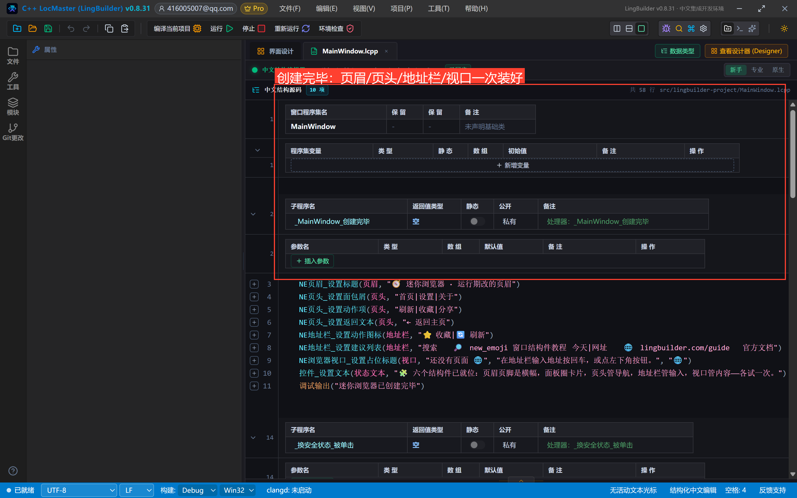

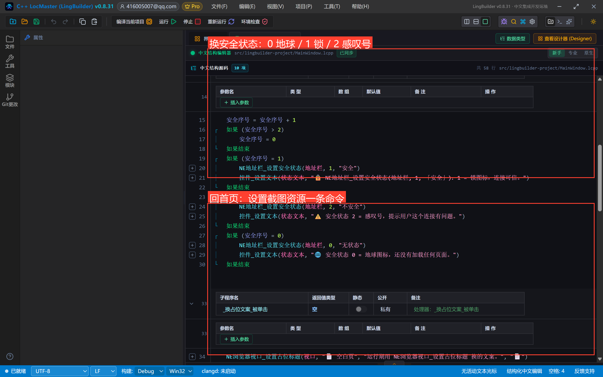

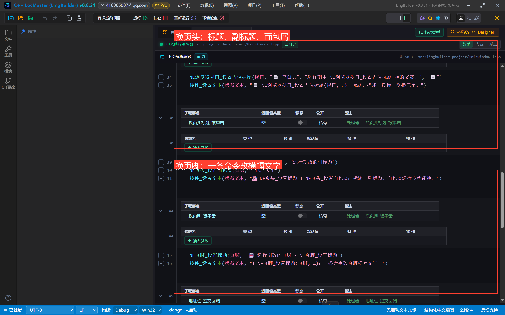

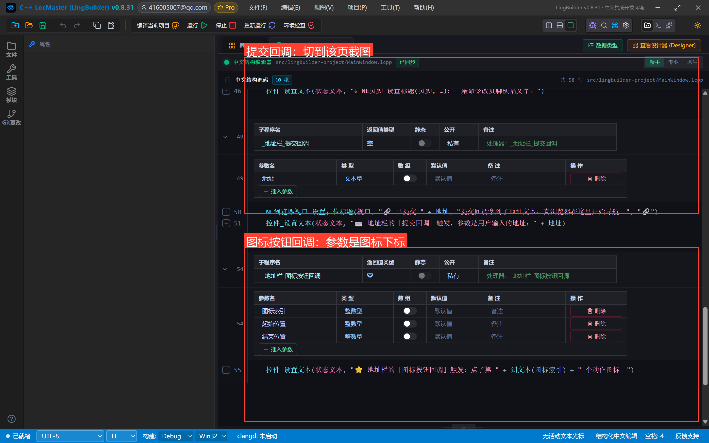

## 5. 编译前先看错误列表

点「编译当前项目」，先看底部错误列表——零报错再继续：

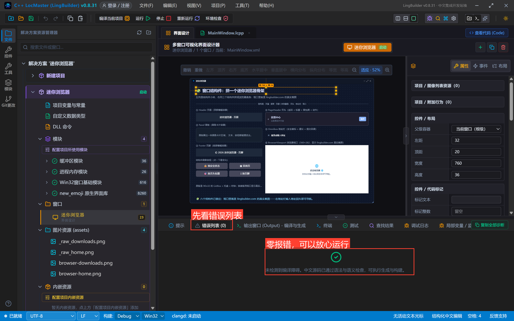

## 6. 运行！六个互动各试一次

点「运行」。左列结构件小样，右列浏览器真身——视口直接显示 lingbuilder.com 的真实截图：

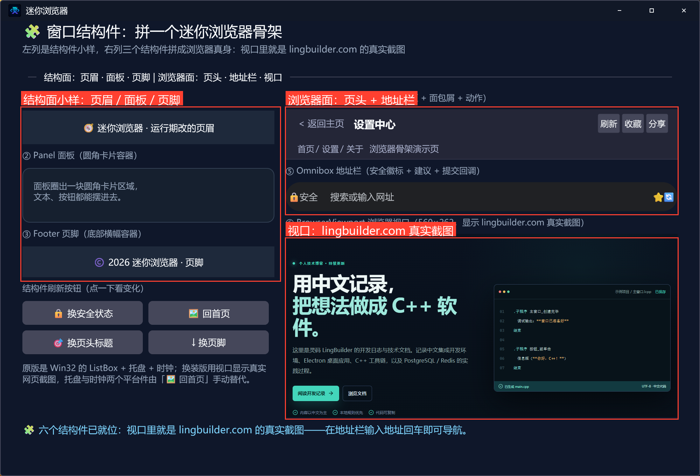

**① 点「🔒 换安全状态」**——地址栏左侧的锁变成 ⚠️，文本换成「不安全」；再点两次回到 🌐 无状态：

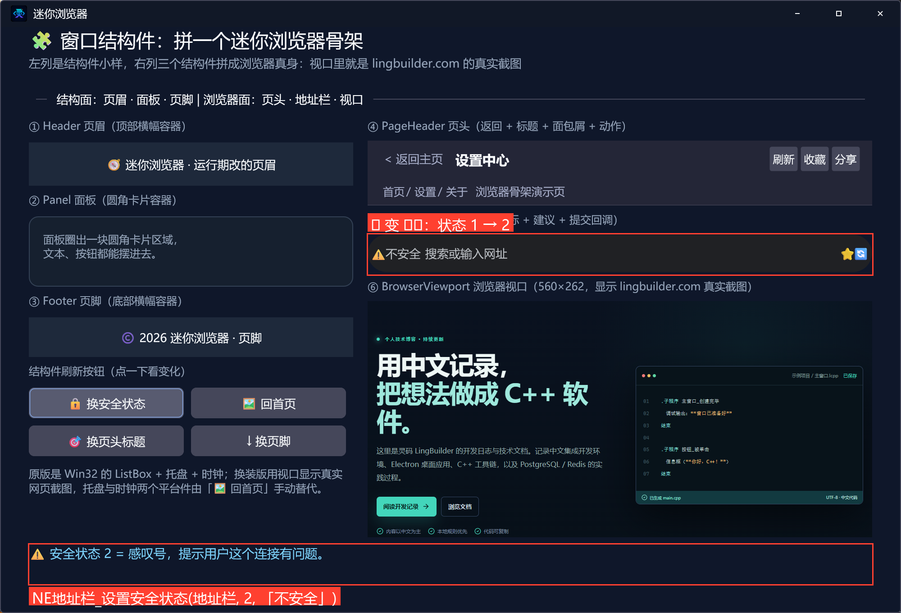

**② 点「🎯 换页头标题」**——页头标题换成「关于迷你浏览器」，两行排布依旧整齐，副标题、面包屑（首页 / 关于）跟着换：

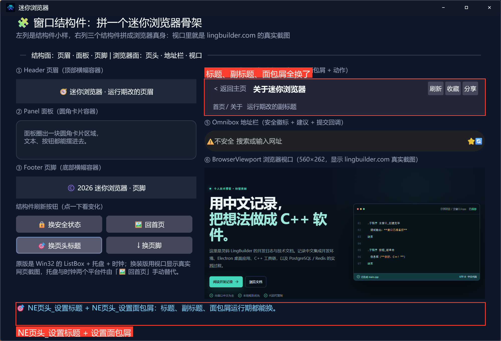

**③ 点地址栏输入 `lingbuilder.com/downloads` 回车**——聚焦瞬间弹出建议列表（引擎行为，和真实浏览器一致），提交回调拿到地址，视口切到下载中心的真实截图：

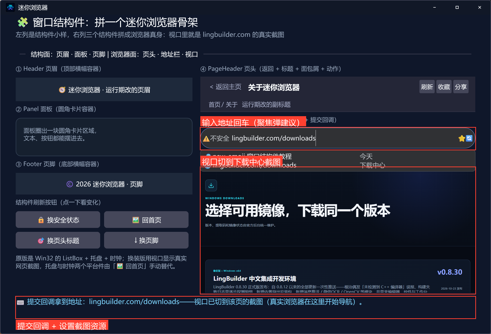

**④ 点「🖼 回首页」**——一条 `NE浏览器视口_设置截图资源` 切回首页截图：

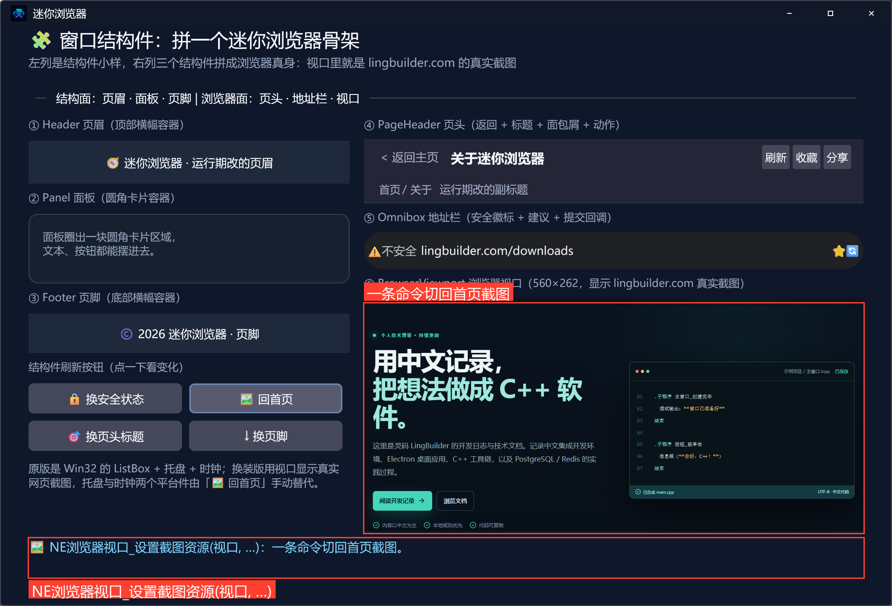

**⑤ 点地址栏右侧的 ⭐ 动作图标**——「图标按钮回调」触发，状态栏报出点的第 0 个图标（参数是图标下标）：

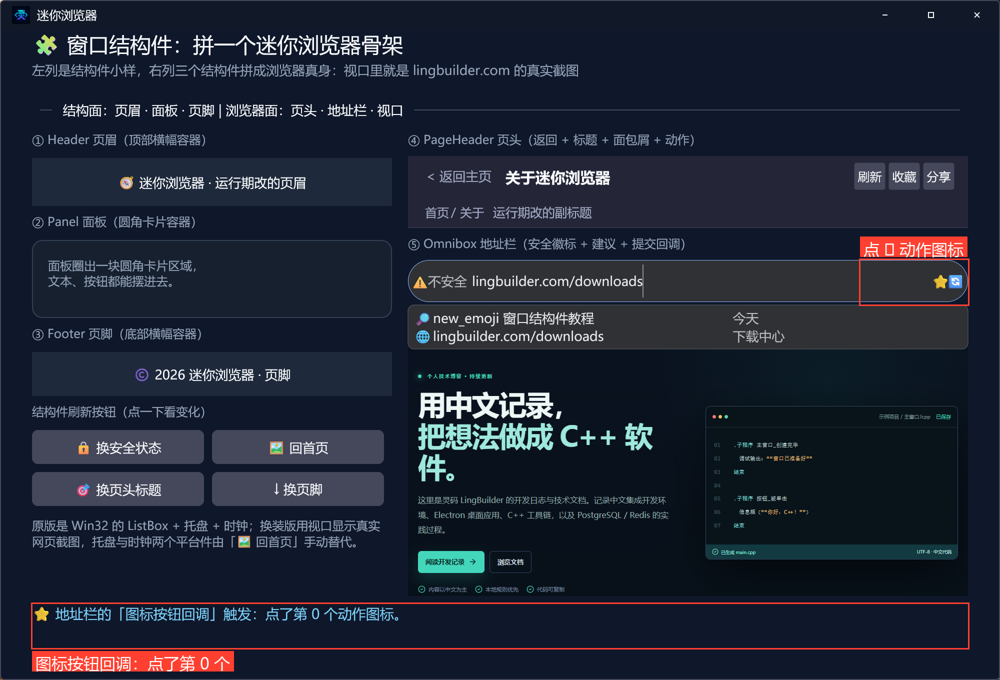

**⑥ 点「↓ 换页脚」**——一条命令改掉页脚横幅文字：

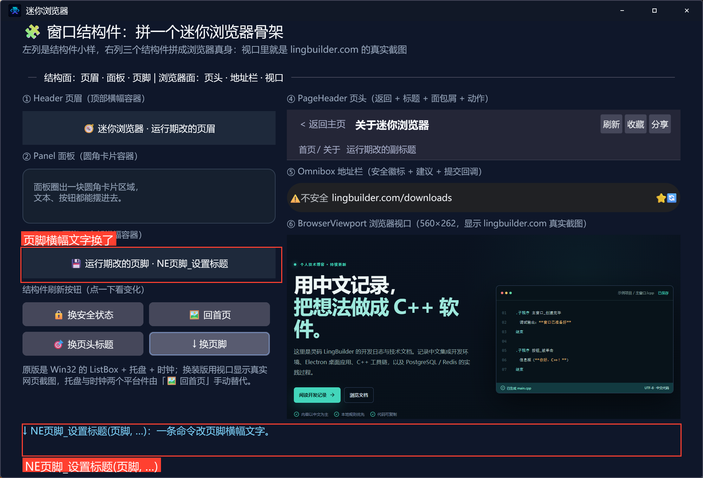

## 7. 导出源码包

命令面板执行「项目：一键导出 LCPP 源码包」即可。导出前确认 `assets/lingbuilder-project/` 里的两张截图还在——源码包会把它们一起带上，别人导入后视口照样有图。

## 本集源码包

- 网页版：[22-迷你浏览器.lcpppkg](https://lingbuilder.com/demos)（示例源码区可下载）

## 下一集预告

主题定制：`NE_设置主题令牌` 换肤、亮暗色体系、窗口背景与标题栏配色——哪些运行期真能换、哪些只吃设计器初值，逐个真机验证。
