# CEF3 合集 01 · 初识 CEF3：迷你浏览器

> 《LingBuilder CEF3 浏览器合集》第 1 集（入门篇）。从这一集起，我们学习 **CEF3 浏览器模块（lingbuilder.cef3.browser）**——它把 Chromium 官方嵌入式框架 CEF（Chromium Embedded Framework）装进你自己的窗口里，命令规模是三大浏览器内核之最。本集做一个**迷你浏览器**：地址栏输网址、打开网页、后退、前进、刷新、回主页，五脏俱全。全程约 30 分钟。
>
> **模块获取**：CEF3 浏览器模块是**收费模块**，在模块生态里点「启用」时按提示登录 LingBuilder 账号购买授权即可；随包的「CEF3 内核 SDK 包」会在构建时自动被发现，**不需要**单独启用或下载。
>
> 前置要求：会新建窗口项目、会在设计器里摆控件（学过[零基础入门系列](/guide/tutorials/beginner)即可）。本集源码包见文末。

## 这一集你将学会

- 三大浏览器内核怎么选：CEF3、EdgeView、FBro 各适合什么场景
- 设计器里的 **CEF3浏览器（CefBrowser）控件**：把整个 Chromium 当普通控件摆进窗口
- 控件的「打开地址」属性：程序一启动就自动打开主页
- `CEF3_导航` / `CEF3_后退` / `CEF3_前进` / `CEF3_刷新`：四条最常用的浏览命令

## 1. 三十秒选内核：CEF3 还是 EdgeView 还是 FBro？

LingBuilder 里三个浏览器内核模块都能「把网页装进窗口」，怎么选？

| | **CEF3 浏览器模块** | **EdgeView 模块** | **FBro 指纹浏览器模块** |
| --- | --- | --- | --- |
| 内核 | Chromium 官方 CEF 框架 | Microsoft Edge (WebView2) | CEF 深度定制版 |
| 命令规模 | **最大（500+ 条）** | 中等（660+ 条） | 中等 |
| 立身之本 | 老系统兼容、协议层控制、填表、框架树 | 系统自带运行时、开箱即用 | 多开防关联、指纹伪装 |
| 适合 | 想深入控制网页的进阶用户 | 快速做个带网页的软件 | 电商多店铺、账号矩阵 |

一句话：**入门做软件选 EdgeView 最省事；要精控网页、学本合集的 30 集，CEF3 是主力；做多开防关联用 FBro**。三者控件用法几乎一样，学会一个，另外两个看命令名就会用。

本集只用到 4 条命令（模块共 500+ 条，慢慢学不着急）：

| 命令 | 作用 |
| --- | --- |
| `CEF3_导航(控件名, 地址)` | 让内嵌浏览器打开一个网址 |
| `CEF3_后退(控件名)` | 退回上一页 |
| `CEF3_前进(控件名)` | 前进到下一页 |
| `CEF3_刷新(控件名)` | 重载当前页面 |

## 2. 新建项目

欢迎页点「新建项目」，项目名称填 **迷你浏览器**，模板选「Windows 界面设计」，创建位置留空（就在当前工作区创建），点「创建项目」：

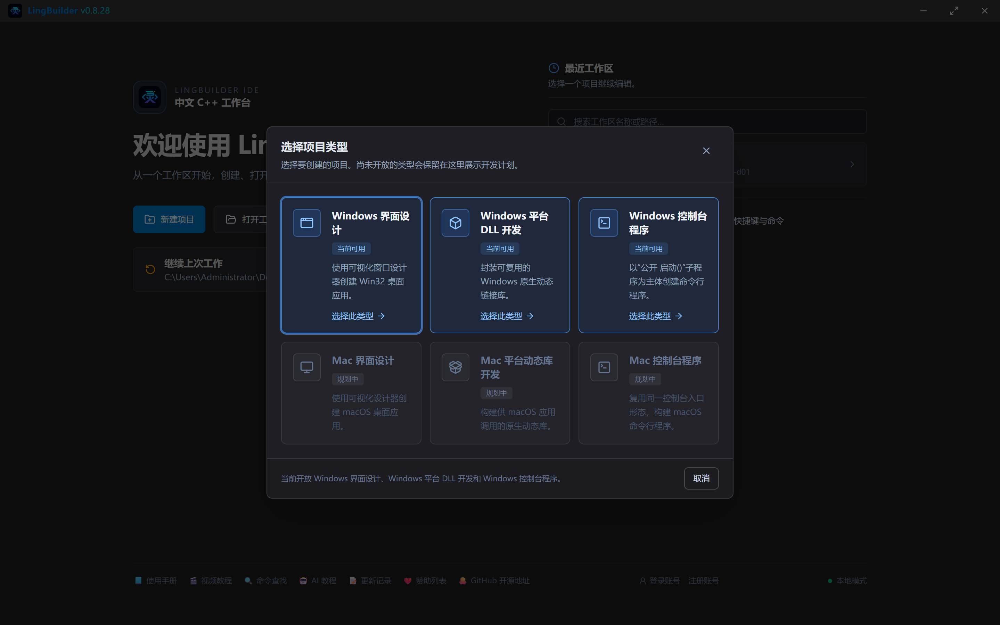

## 3. 启用模块

点左侧活动栏的「模块」图标打开模块生态，搜索「CEF3」，确认这几个模块已启用（在「已启用」分组里能看到即可）：

- **CEF3浏览器模块**——本合集的主角，浏览器控件和全部 CEF3 命令都在这里（收费，按提示登录授权）；
- **Win32窗口基础模块**——窗口、按钮、编辑框等基础控件命令；
- **文本处理模块**——本集用 `文本_取长度` 判断地址栏是否为空。

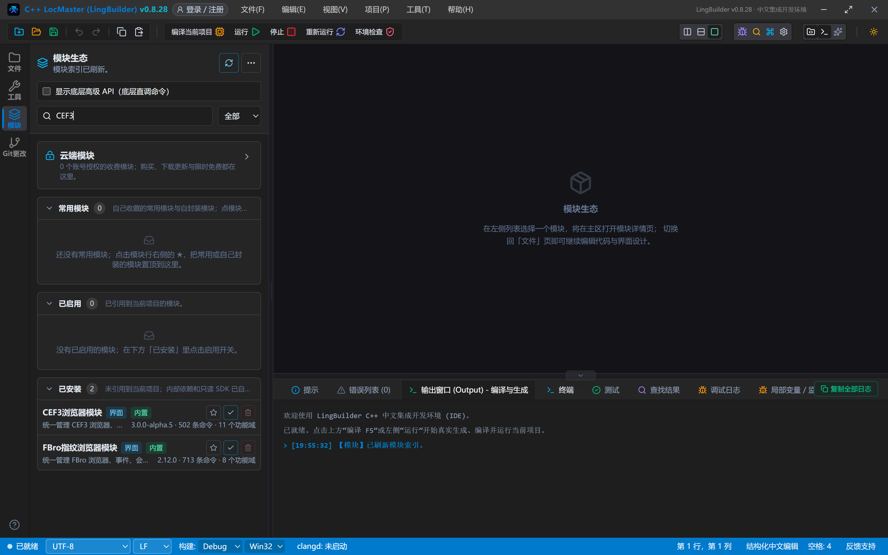

> 小知识：每个命令都有自己的「家」（模块）。编译时报「未知的命令」，第一反应就是查对应模块启用了没有。

## 4. 设计界面

窗口做宽一点（960×700），给网页留足地方。从控件面板把「**CEF3浏览器**」拖进窗口——它和按钮、编辑框一样，摆好位置就行：

| 控件 | 名称 | 显示内容/属性 | 左距 | 顶距 | 宽度 | 高度 |
| --- | --- | --- | --- | --- | --- | --- |
| 标签 | 地址标签 | 地址: | 20 | 18 | 50 | 22 |
| 编辑框 | 地址框 | https://example.com | 76 | 14 | 660 | 28 |
| 按钮 | 打开按钮 | 打开网页 | 746 | 12 | 90 | 32 |
| 按钮 | 后退按钮 | 后退 | 20 | 56 | 90 | 30 |
| 按钮 | 前进按钮 | 前进 | 120 | 56 | 90 | 30 |
| 按钮 | 刷新按钮 | 刷新 | 220 | 56 | 90 | 30 |
| 按钮 | 主页按钮 | 主页 | 310 | 56 | 90 | 30 |
| **CEF3浏览器** | **浏览器1** | 打开地址 = https://example.com | 20 | 96 | 920 | 520 |
| 标签 | 状态标签 | 就绪 | 20 | 628 | 920 | 22 |

CEF3浏览器控件的关键属性是**打开地址**：填上 `https://example.com`，程序一启动它就自动打开这个网页——不用写一行代码。

绑 6 个事件：窗口「创建完毕」+ 5 个按钮的「被单击」。

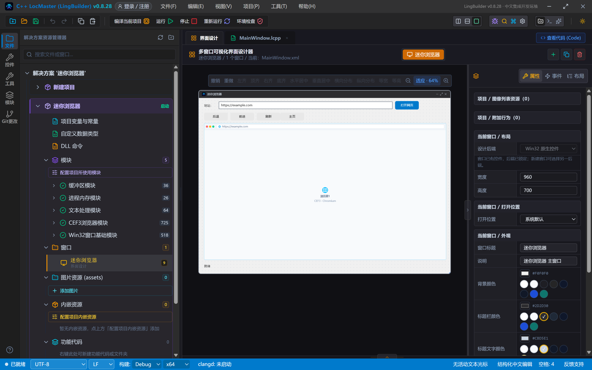

设计器画布上 CEF3 浏览器控件只是一张占位图；运行起来以后，那个位置就是一整颗 Chromium 内核在渲染网页。

## 5. 写代码

### 5.1 窗口创建完毕：报告状态

```lcpp
事件 _MainWindow_创建完毕()
    控件_设置文本(状态标签, "正在打开主页 example.com……")
结束
```

主页本身由控件的「打开地址」属性负责，创建完毕里只更新状态文字。

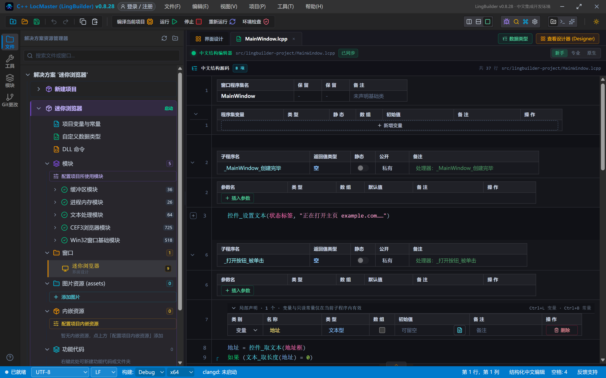

### 5.2 「打开网页」按钮：读地址栏 → 导航

```lcpp
事件 _打开按钮_被单击()
    局部 文本型 地址
    地址 = 控件_取文本(地址框)
    如果 (文本_取长度(地址) = 0)
        控件_设置文本(状态标签, "请先在地址栏输入网址")
        返回()
    如果结束
    CEF3_导航(浏览器1, 地址)
    控件_设置文本(状态标签, "正在打开：" + 地址)
结束
```

先取地址栏文本，判空（`文本_取长度(地址) = 0` 表示一个字都没输），没问题就一条命令导航。**注意判空要用 `文本_取长度`**——不要写 `地址 ≠ ""` 这种字符串比较表达式，中文代码的字符串比较表达式无法翻译成 C++，编译会直接报错。

### 5.3 后退 / 前进 / 刷新 / 主页

```lcpp
事件 _后退按钮_被单击()
    CEF3_后退(浏览器1)
    控件_设置文本(状态标签, "已后退一页")
结束

事件 _前进按钮_被单击()
    CEF3_前进(浏览器1)
    控件_设置文本(状态标签, "已前进一页")
结束

事件 _刷新按钮_被单击()
    CEF3_刷新(浏览器1)
    控件_设置文本(状态标签, "已刷新当前页面")
结束

事件 _主页按钮_被单击()
    CEF3_导航(浏览器1, "https://example.com")
    控件_设置文本(状态标签, "已回到主页")
结束
```

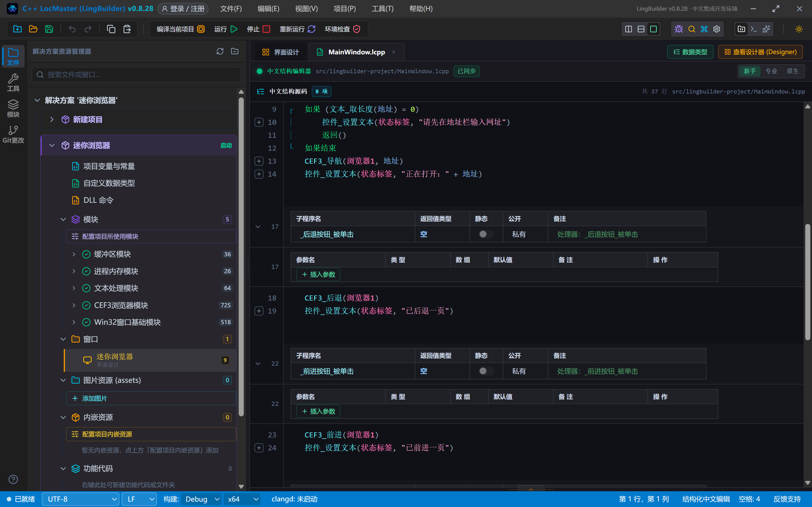

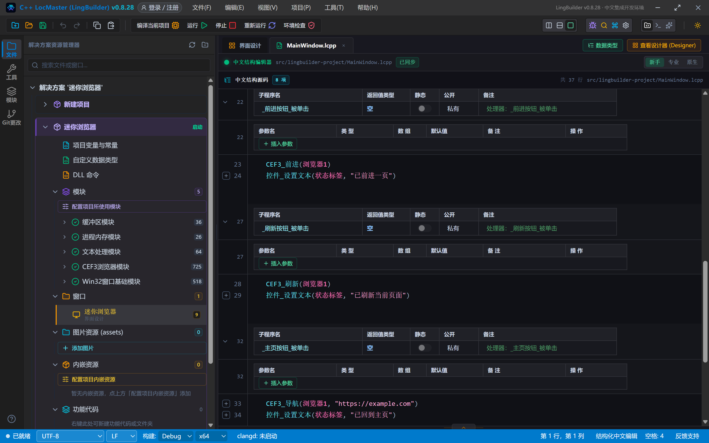

## 6. 编译：先看错误列表

点工具栏「编译当前项目」。**养成习惯：编译完先看底部「错误列表」**——本集是 (0)，提示「未检测到编译障碍」：

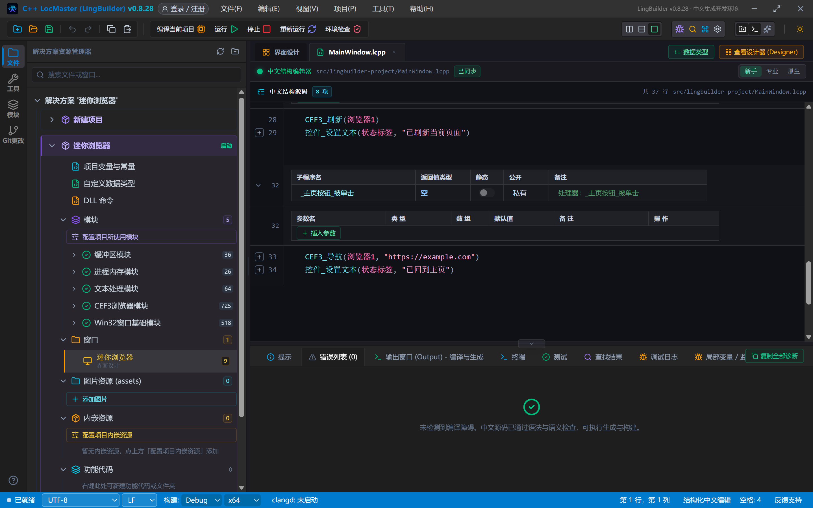

如果有报错，双击错误行就能跳到出问题的代码，改完再编译，**不要带着报错去运行**。第一次编译 CEF3 项目时，构建系统会自动把 Chromium 的运行时文件（libcef.dll 等）复制到程序旁边，所以会比普通项目慢一些，耐心等。

## 7. 运行：你的第一颗 Chromium 内核

点「运行」——窗口打开，example.com 已经装在你的程序里了：

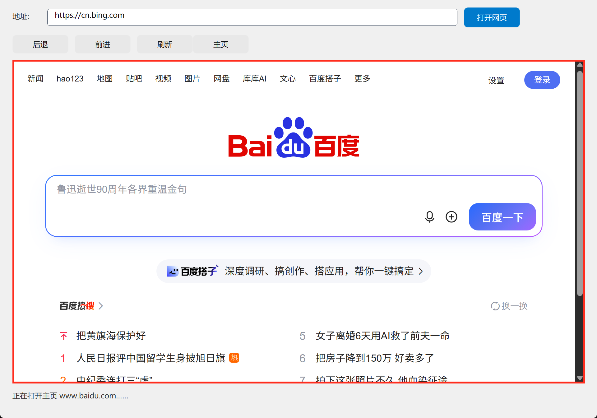

这不是截图、不是模拟，是 Chromium 官方 CEF 框架在你的软件里渲染网页。页面可以滚动、可以选中文字，和浏览器里一模一样。

### 7.1 打开新网页

在地址栏输入 `https://cn.bing.com`，点「打开网页」：

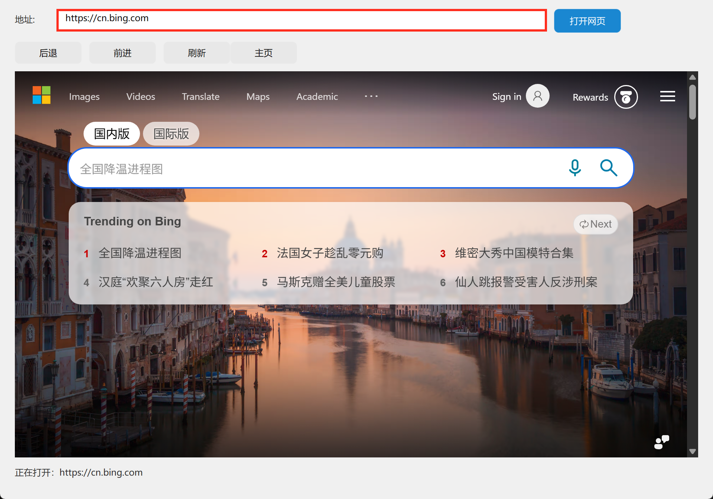

内嵌浏览器切到了必应。教程演示统一用 example.com 和 cn.bing.com 这类稳定站点，避免搜索页偶发的验证码干扰。

### 7.2 后退 / 前进

点「后退」——回到 example.com；再点「前进」——又回到必应：

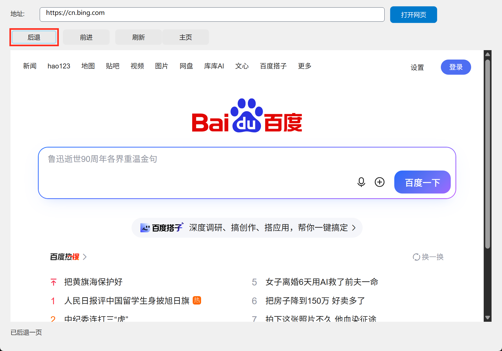

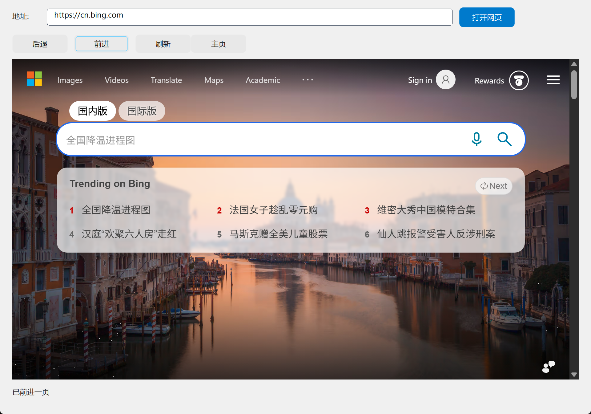

后退、前进浏览的是**历史记录**：只要这个窗口里先后打开过两个页面，后退/前进就有得翻。

### 7.3 主页

点「主页」——代码里 `CEF3_导航` 回 example.com：

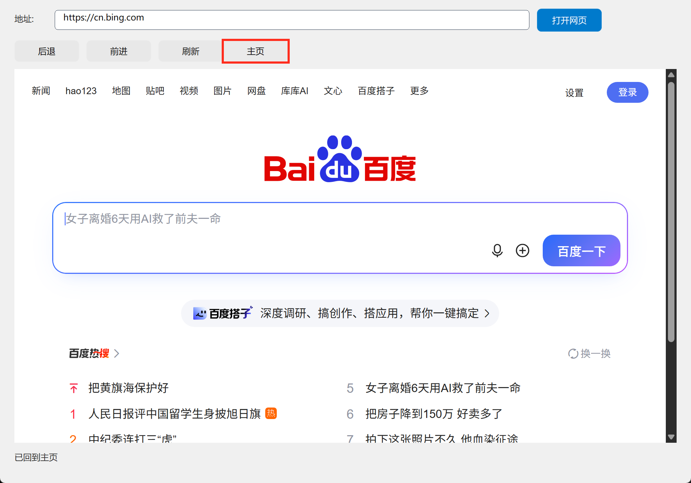

## 8. 留一个「为什么」给下一集

你有没有注意到：点「后退」回到旧页面之后，**状态栏还是我们自己写的那句话**——程序并不知道「页面已经换了」。浏览器在加载、换址、改标题时都在发生「事件」，想让程序自动感知，就得把这些事件接住。

- 第 2 集：事件族——用 `CEF3_绑定事件` 把「开始加载 / 加载完成 / 地址被改变 / 标题被改变」统统接到自己的处理器里，做一个浏览器事件观察器。

## 常见问题急救表

| 症状 | 原因 | 解法 |
| --- | --- | --- |
| 编译报「未知的命令 CEF3_导航」 | CEF3浏览器模块没启用 | 在模块生态里启用 CEF3浏览器模块（收费，需登录授权） |
| 编译报「未知的命令 文本_取长度」 | 文本命令归文本处理模块管 | 一并启用文本处理模块 |
| 编译报字符串比较表达式无法翻译 | 写了 `地址 ≠ ""` | 判空改用 `文本_取长度(地址) = 0` |
| 浏览器区域一片空白 | 还在加载 / 断网 | 首次加载 Chromium 要几秒；检查网络 |
| 打开网页没反应 | 网址少了 `https://` | 网址要写全，如 `https://cn.bing.com` |
| 后退按钮点了没变化 | 历史记录是空的 | 先用「打开网页」访问第二个页面，再后退 |
| 提示需要登录或授权 | CEF3浏览器模块是收费模块 | 按模块面板提示登录账号并购买授权 |

## 本集小结

- 三内核怎么选：快速做软件用 EdgeView，精控网页学 CEF3，多开防关联用 FBro。
- CEF3浏览器控件把真 Chromium 嵌进窗口，「打开地址」属性就是启动主页。
- 四条命令入门：`CEF3_导航` / `CEF3_后退` / `CEF3_前进` / `CEF3_刷新`。
- 判空用 `文本_取长度`，不要用字符串比较表达式。

## 源码包

本集完整源码已打包为 **CEF3合集01-迷你浏览器.lcpppkg**（见[示例源码区](/demos)）。在 LingBuilder 欢迎页点「打开工作区」，或直接双击 `.lcpppkg` 文件即可导入运行；CEF3 运行时由随包 SDK 模块自动补齐，无需额外下载。

**下一集预告**：《导航与页面事件》——`CEF3_绑定事件` 把浏览器的一举一动接进你的处理器，做一个实时滚动的事件观察器。

[回合集总览](/guide/tutorials/cef3)
