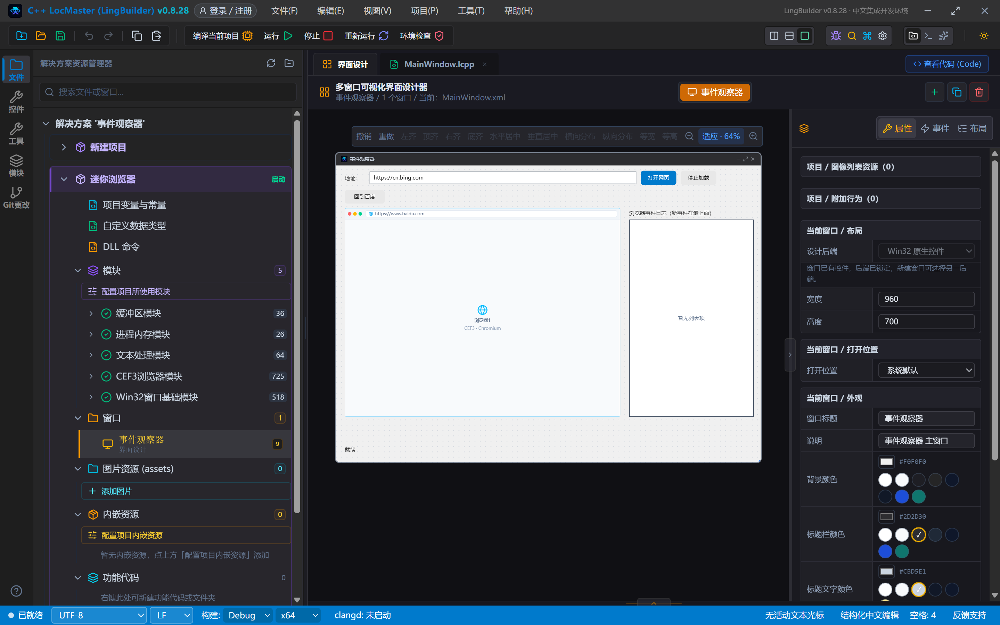
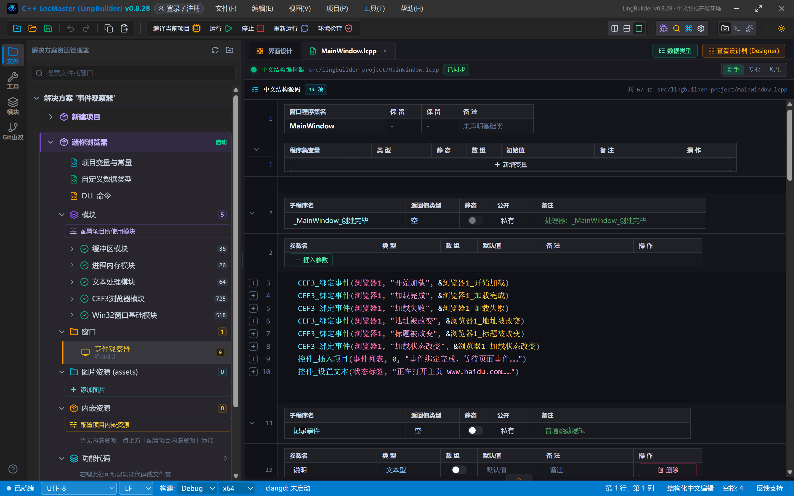
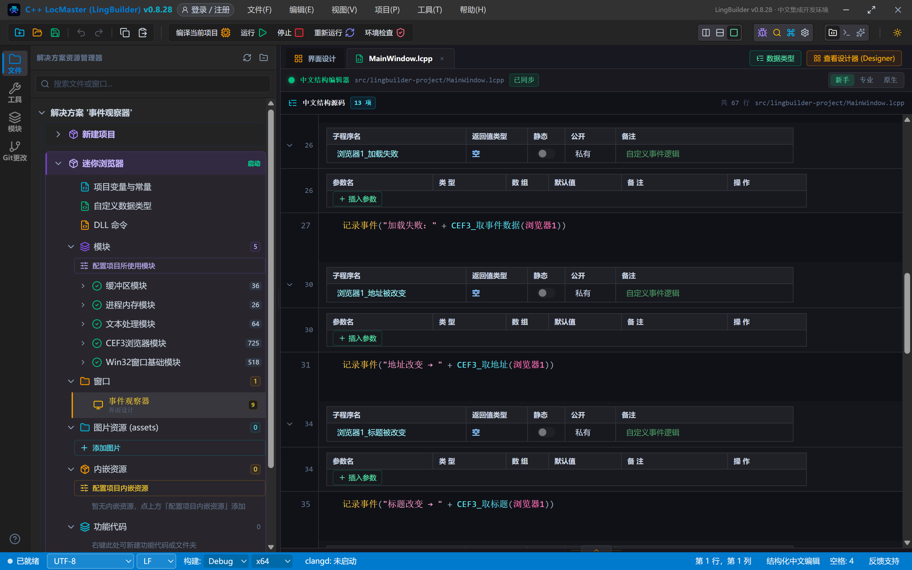
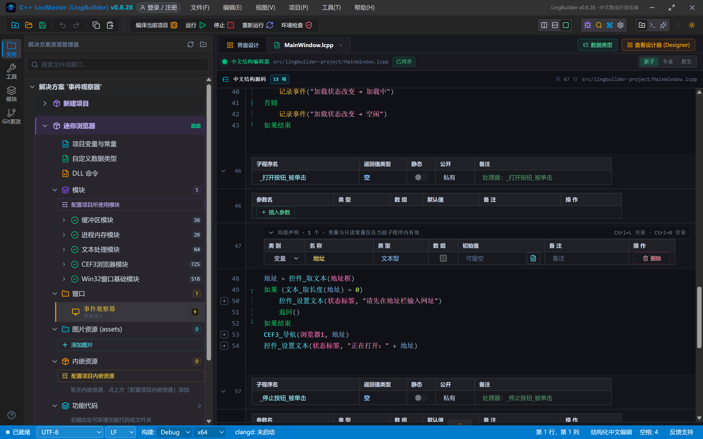
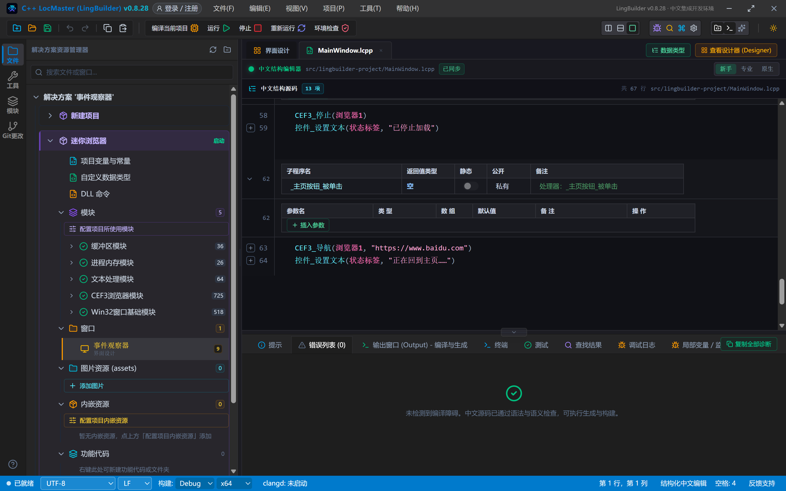
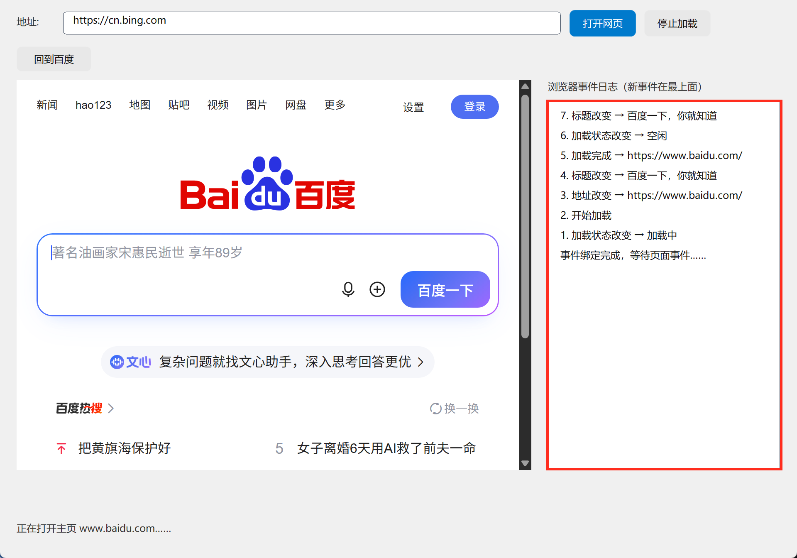
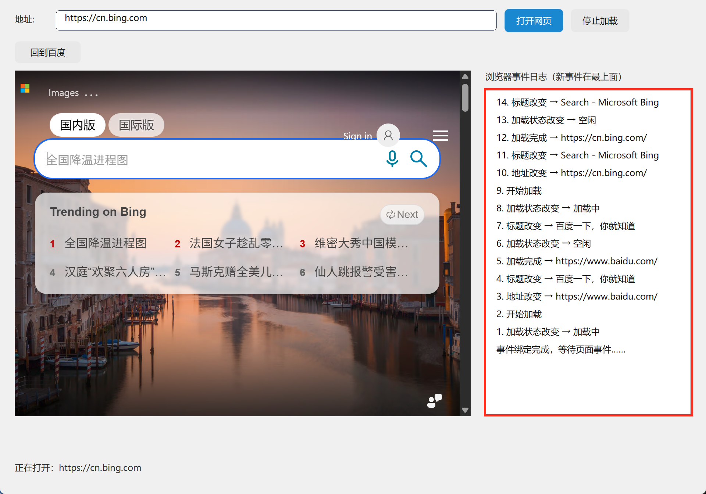
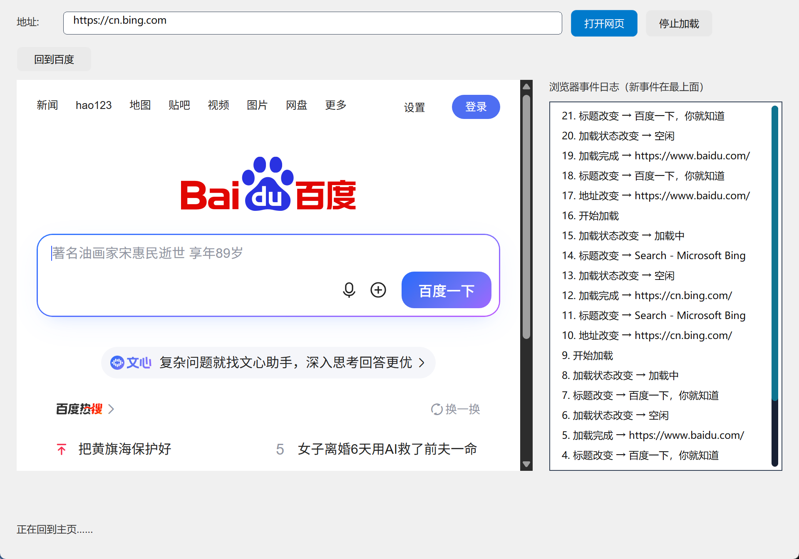

# CEF3 合集 02 · 导航与页面事件：事件观察器

> 《LingBuilder CEF3 浏览器合集》第 2 集（入门篇）。浏览器加载页面、改变地址、修改标题，每一步都在发生「事件」。本集用 `CEF3_绑定事件` 把 6 种事件接到自己的处理器里，做一个**事件观察器**：左边浏览网页，右边实时滚动显示浏览器的一举一动。全程约 30 分钟。
>
> **模块获取**：CEF3 浏览器模块是**收费模块**，在模块生态里点「启用」时按提示登录购买授权即可（第 1 集已启用过的工作区无需重复）。
>
> 前置要求：学过[第 1 集](/guide/tutorials/cef3-01)，会摆控件、会编译运行。本集源码包见文末。

## 这一集你将学会

- `CEF3_绑定事件(控件名, 事件名, &处理器)`：把浏览器事件接到中文处理器
- 六个最常用的事件：**开始加载 / 加载完成 / 加载失败 / 地址被改变 / 标题被改变 / 加载状态改变**
- `CEF3_取地址` / `CEF3_取标题` / `CEF3_是否加载中`：在事件里读取浏览器当前状态
- `CEF3_停止`：中断正在进行的加载
- 列表框置顶插入：让最新事件永远排在第一行

## 1. 事件是怎么接上的

CEF3 浏览器有上百种事件，用一条命令就能把某个事件「接到」你自己写的处理器上：

```lcpp
CEF3_绑定事件(浏览器1, "加载完成", &浏览器1_加载完成)
```

三个参数：

| 参数 | 写法 | 说明 |
| --- | --- | --- |
| 控件名 | `浏览器1` | 裸控件名，**不带引号** |
| 事件名 | `"加载完成"` | 带引号的文本，一字不差 |
| 处理器 | `&浏览器1_加载完成` | **必须带 & 号**，指向窗口里的无参数处理器 |

> 红线：处理器参数**必须用 `&处理器名`**，写成 `"浏览器1_加载完成"`（带引号的普通文本）事件将永远收不到。

本集用到的 6 个事件名（都是文本，注意一字不差）：

| 事件名 | 触发时机 |
| --- | --- |
| `开始加载` | 页面开始加载 |
| `加载完成` | 页面加载完成 |
| `加载失败` | 页面加载失败（断网、域名不存在等） |
| `地址被改变` | 页面地址发生变化 |
| `标题被改变` | 页面标题发生变化 |
| `加载状态改变` | 加载中 ↔ 空闲 的状态切换 |

## 2. 设计界面

| 控件 | 名称 | 显示内容/属性 | 左距 | 顶距 | 宽度 | 高度 |
| --- | --- | --- | --- | --- | --- | --- |
| 标签 | 地址标签 | 地址: | 20 | 18 | 50 | 22 |
| 编辑框 | 地址框 | https://cn.bing.com | 76 | 14 | 600 | 28 |
| 按钮 | 打开按钮 | 打开网页 | 686 | 12 | 80 | 32 |
| 按钮 | 停止按钮 | 停止加载 | 776 | 12 | 80 | 32 |
| 按钮 | 主页按钮 | 回到百度 | 20 | 56 | 90 | 30 |
| **CEF3浏览器** | **浏览器1** | 打开地址 = https://www.baidu.com | 20 | 96 | 620 | 470 |
| 标签 | 日志标签 | 浏览器事件日志（新事件在最上面） | 660 | 96 | 280 | 22 |
| 列表框 | 事件列表 | （空） | 660 | 122 | 280 | 444 |
| 标签 | 状态标签 | 就绪 | 20 | 628 | 920 | 22 |

绑 4 个事件：窗口「创建完毕」+ 打开/停止/主页三个按钮的「被单击」。



## 3. 写代码

### 3.1 创建完毕：一次绑定六个事件

```lcpp
事件 _MainWindow_创建完毕()
    CEF3_绑定事件(浏览器1, "开始加载", &浏览器1_开始加载)
    CEF3_绑定事件(浏览器1, "加载完成", &浏览器1_加载完成)
    CEF3_绑定事件(浏览器1, "加载失败", &浏览器1_加载失败)
    CEF3_绑定事件(浏览器1, "地址被改变", &浏览器1_地址被改变)
    CEF3_绑定事件(浏览器1, "标题被改变", &浏览器1_标题被改变)
    CEF3_绑定事件(浏览器1, "加载状态改变", &浏览器1_加载状态改变)
    控件_插入项目(事件列表, 0, "事件绑定完成，等待页面事件……")
    控件_设置文本(状态标签, "正在打开主页 www.baidu.com……")
结束
```



### 3.2 记录事件：置顶插入

每来一个事件就往列表里加一行。列表框**不会自动滚动**，用「追加项目」加在末尾的新行根本看不见——所以用 `控件_插入项目` 插到最前面：

```lcpp
空 记录事件(文本型 说明)
    事件序号 = 事件序号 + 1
    控件_插入项目(事件列表, 0, 格式化文本("{}. {}", 事件序号, 说明))
结束
```

`事件序号` 是一个**项目全局变量**（整数型，初始值 0），在项目全局变量表里声明，整个项目的源码都能直接用。

### 3.3 六个事件处理器

```lcpp
事件 浏览器1_开始加载()
    记录事件("开始加载")
结束

事件 浏览器1_加载完成()
    记录事件("加载完成 → " + CEF3_取地址(浏览器1))
结束

事件 浏览器1_加载失败()
    记录事件("加载失败：" + CEF3_取事件数据(浏览器1))
结束

事件 浏览器1_地址被改变()
    记录事件("地址改变 → " + CEF3_取地址(浏览器1))
结束

事件 浏览器1_标题被改变()
    记录事件("标题改变 → " + CEF3_取标题(浏览器1))
结束

事件 浏览器1_加载状态改变()
    如果 (CEF3_是否加载中(浏览器1) = 1)
        记录事件("加载状态改变 → 加载中")
    否则
        记录事件("加载状态改变 → 空闲")
    如果结束
结束
```



> 两个细节：① `CEF3_取地址` / `CEF3_取标题` 返回的就是浏览器此刻的地址和标题，直接拼接显示；② 「开始加载」事件里不要急着取地址——此刻导航刚刚发起，等「地址被改变」事件来报地址最可靠。

### 3.4 打开 / 停止 / 回主页

```lcpp
事件 _打开按钮_被单击()
    局部 文本型 地址
    地址 = 控件_取文本(地址框)
    如果 (文本_取长度(地址) = 0)
        控件_设置文本(状态标签, "请先在地址栏输入网址")
        返回()
    如果结束
    CEF3_导航(浏览器1, 地址)
    控件_设置文本(状态标签, "正在打开：" + 地址)
结束

事件 _停止按钮_被单击()
    CEF3_停止(浏览器1)
    控件_设置文本(状态标签, "已停止加载")
结束

事件 _主页按钮_被单击()
    CEF3_导航(浏览器1, "https://www.baidu.com")
    控件_设置文本(状态标签, "正在回到主页……")
结束
```

`CEF3_停止` 用来中断慢得离谱的页面：点一下，加载立刻停。



## 4. 编译：先看错误列表

点工具栏「编译当前项目」，底部「错误列表」是 (0)：



## 5. 运行：看浏览器的一举一动

点「运行」。窗口打开，百度主页加载的同时，右侧事件日志已经滚动出一串记录：



从下往上读就是完整的一生：**1.加载状态改变→加载中 → 2.开始加载 → 3.地址改变 → 4.标题改变 → 5.加载完成 → 6.加载状态改变→空闲**。网页的每一次加载都是这条流水线。

### 5.1 导航到必应：日志再滚一轮

地址栏预填了 `https://cn.bing.com`，点「打开网页」：



第二轮事件又滚了出来（8~14 号），两个页面的生命周期一目了然。注意「标题改变」来了两次——必应先给了个临时标题，加载完又改成正式标题，这都是真实浏览器会干的事。

### 5.2 回到百度

点「回到百度」：



## 常见问题急救表

| 症状 | 原因 | 解法 |
| --- | --- | --- |
| 事件一条都不来 | 处理器参数写成了带引号的文本 | `CEF3_绑定事件` 第 3 参必须写 `&处理器名` |
| 事件名绑定返回 0 | 事件名拼写不符 | 对照本集事件名表，一字不差（如「加载状态改变」不是「加载状态变化」） |
| 列表里看不到新事件 | 用了「追加项目」加在末尾 | 列表框不自动滚动，改用 `控件_插入项目(列表, 0, 文本)` 置顶 |
| 「开始加载」里取到的地址不对 | 加载刚发起，地址还没切换 | 在「地址被改变」事件里取地址 |
| 报「未声明的标识符 事件序号」 | 没声明项目全局变量 | 在项目全局变量表加 `事件序号`（整数型，初始值 0） |
| 事件处理器里做耗时操作界面卡死 | 事件在浏览器线程回调 | 事件处理器只做记录、显示等轻活 |

## 本集小结

- `CEF3_绑定事件(控件名, "事件名", &处理器)` 一条命令接一个事件，处理器必须带 `&`。
- 六个入门事件覆盖网页加载的一生：开始加载 → 地址/标题改变 → 加载完成/失败 → 状态改变。
- `CEF3_取地址` / `CEF3_取标题` / `CEF3_是否加载中` 在事件里读状态；`CEF3_停止` 中断加载。
- 列表框日志用 `控件_插入项目` 置顶插入。

## 源码包

本集完整源码已打包为 **CEF3合集02-事件观察器.lcpppkg**（见[示例源码区](/demos)），导入即可运行对照学习。

**下一集预告**：《执行 JavaScript 与返回值》——`CEF3_执行JS` 让中文程序对网页发号施令：取标题、改颜色、数链接，还能拿回返回值。

[回合集总览](/guide/tutorials/cef3)
