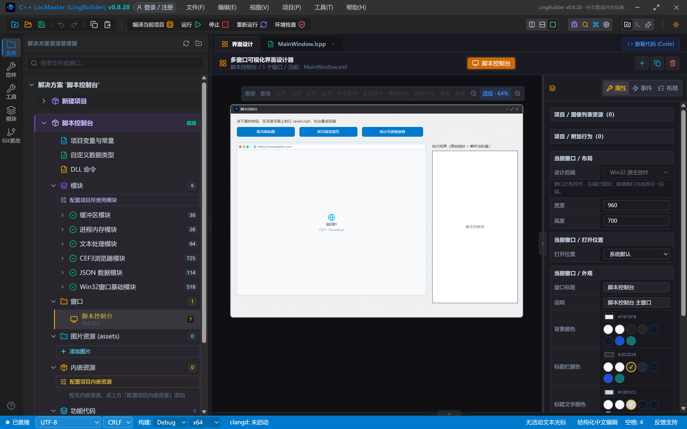
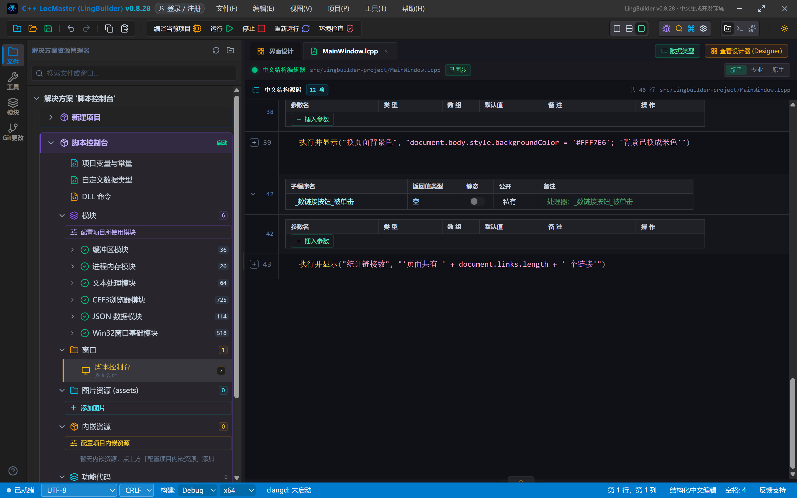
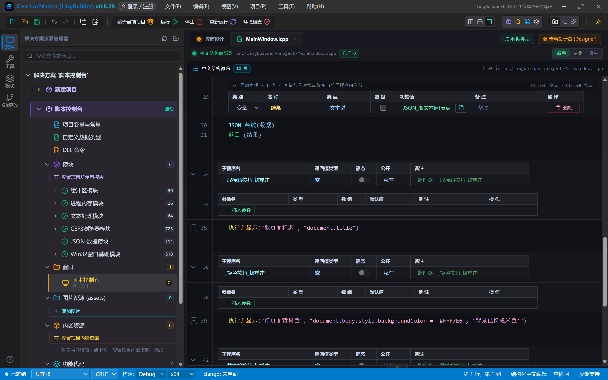
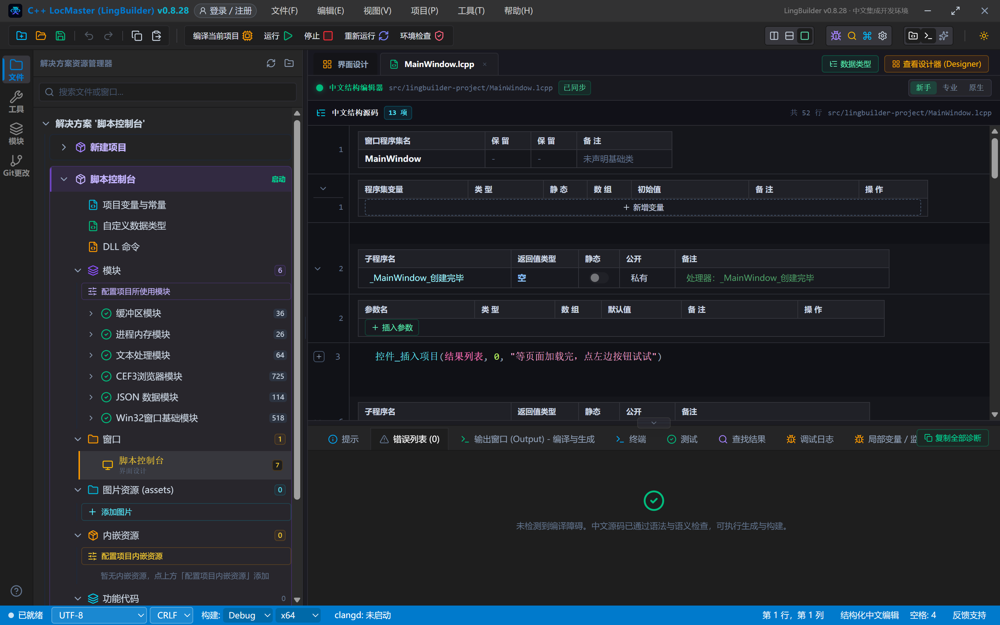
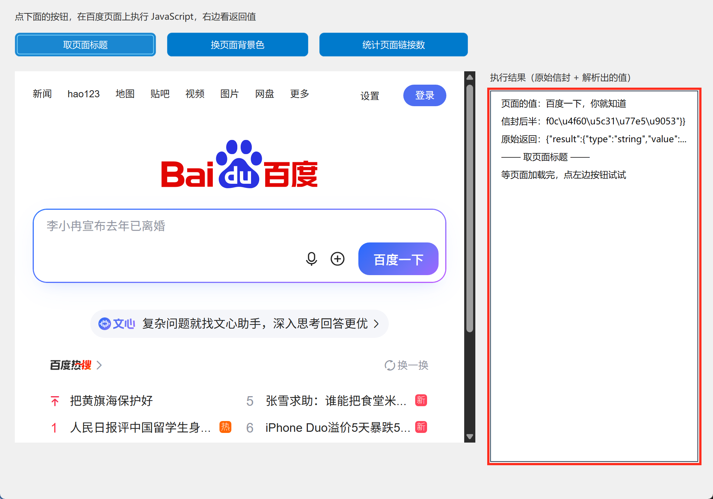
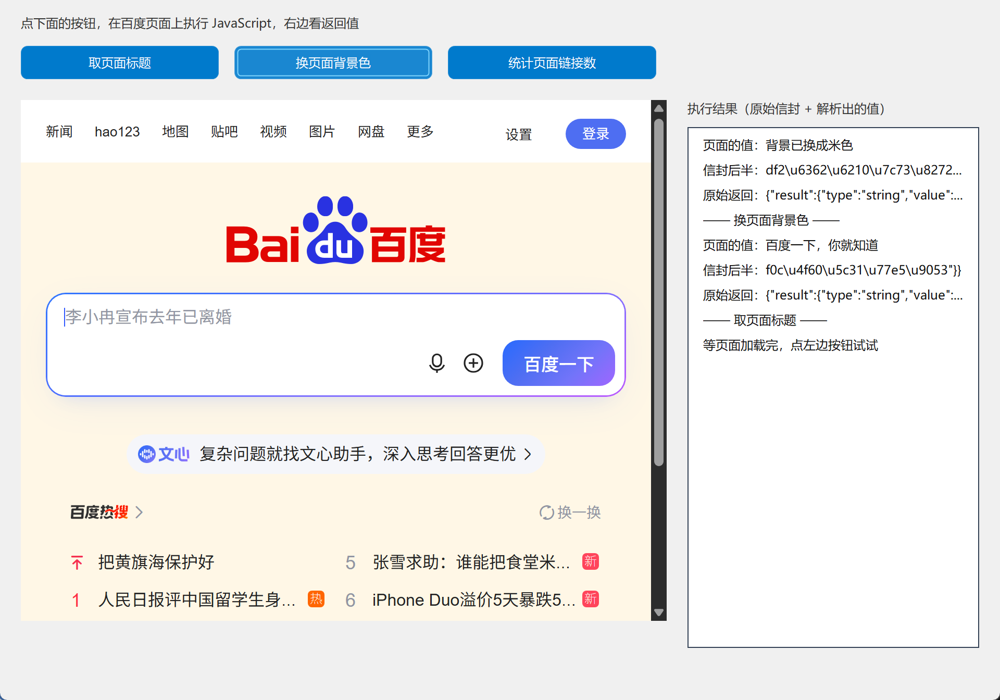
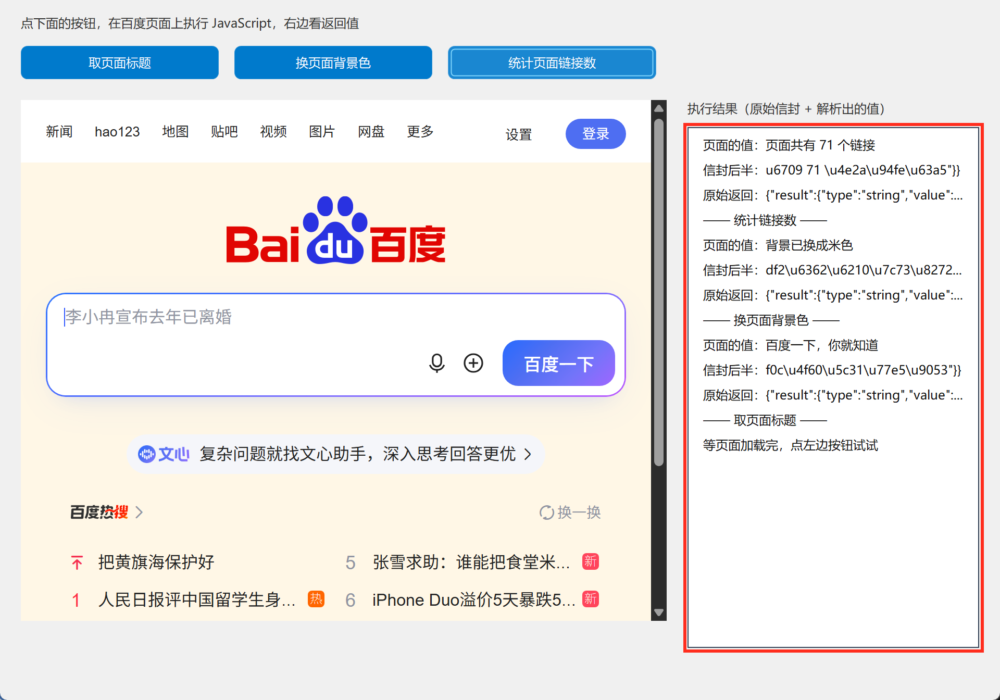

# CEF3 合集 03 · 执行 JavaScript 与返回值：脚本控制台

> 《LingBuilder CEF3 浏览器合集》第 3 集（入门篇）。CEF 和网页之间最深的一座桥是 JavaScript：中文程序发一行 JS 过去，网页替你干活，还能把结果送回来。本集做一个**脚本控制台**——三个按钮分别在百度页面上取标题、换背景色、数链接数，右侧同时显示「原始信封」和「解析出的值」。全程约 30 分钟。
>
> **模块获取**：CEF3 浏览器模块是**收费模块**，按模块面板提示登录购买授权即可。本集还要多启用一个免费的 **JSON 数据模块**（解析返回值用）。
>
> 前置要求：学过[第 1 集](/guide/tutorials/cef3-01)。本集源码包见文末。

## 这一集你将学会

- `CEF3_执行JS(控件名, 脚本)`：在网页里执行 JavaScript
- 看懂返回的 **DevTools 结果信封**：`{"result":{"type":"string","value":"..."}}`
- 用 **JSON 数据模块**（`JSON_解析` + `JSON_指针_取` + `JSON_取文本值`）从信封里抠出值
- 一个必须避开的语言坑：**局部变量声明拆两行**（声明提升）

## 1. 执行 JS 的基本姿势

```lcpp
局部 文本型 原始返回
原始返回 = CEF3_执行JS(浏览器1, "document.title")
```

第二个参数是一段 JavaScript 文本，跟你写进浏览器控制台的东西一模一样。注意两个规矩：

- JS 里的字符串用**单引号**（中文代码的字符串用双引号包着，里面的双引号会打架）；
- 命令**最多等 5 秒**，页面没加载完就执行会拿不到结果——在「加载完成」事件之后再用。

## 2. 返回值不是裸的：认识 DevTools 信封

`CEF3_执行JS` 拿回的不是纯文本，而是一个 JSON **信封**——真实运行截下来的样子：

```json
{"result":{"type":"string","value":"百度一下，你就知道"}}
```

| 字段 | 含义 |
| --- | --- |
| `result.type` | 值的类型：`string` 文本、`number` 数字…… |
| `result.value` | 你要的值就在这里 |

信封里的中文是 `\u767e\u5ea6...` 这样的转义写法，**不要用文本命令去截**，交给 JSON 模块解析才是正路。所以本集要在模块生态里多启用一个 **JSON 数据模块**。

## 3. 设计界面

| 控件 | 名称 | 显示内容/属性 | 左距 | 顶距 | 宽度 | 高度 |
| --- | --- | --- | --- | --- | --- | --- |
| 标签 | 说明标签 | 点下面的按钮，在百度页面上执行 JavaScript，右边看返回值 | 20 | 14 | 620 | 22 |
| 按钮 | 取标题按钮 | 取页面标题 | 20 | 44 | 190 | 32 |
| 按钮 | 换色按钮 | 换页面背景色 | 225 | 44 | 190 | 32 |
| 按钮 | 数链接按钮 | 统计页面链接数 | 430 | 44 | 200 | 32 |
| **CEF3浏览器** | **浏览器1** | 打开地址 = https://www.baidu.com | 20 | 96 | 620 | 500 |
| 标签 | 结果标签 | 执行结果（原始信封 + 解析出的值） | 660 | 96 | 280 | 22 |
| 列表框 | 结果列表 | （空） | 660 | 122 | 280 | 500 |

绑 3 个事件：三个按钮的「被单击」。



## 4. 写代码

### 4.1 执行并显示：一条子程序搞定三件事

三个按钮的活儿几乎一样：执行脚本 → 显示原始信封 → 显示解析出的值。抽成一个子程序，每个按钮只剩一行：

```lcpp
空 执行并显示(文本型 脚本说明, 文本型 脚本)
    局部 文本型 原始返回
    局部 文本型 页面的值
    原始返回 = CEF3_执行JS(浏览器1, 脚本)
    控件_插入项目(结果列表, 0, "—— " + 脚本说明 + " ——")
    控件_插入项目(结果列表, 0, "原始返回：" + 原始返回)
    页面的值 = 取页面值(原始返回)
    控件_插入项目(结果列表, 0, "页面的值：" + 页面的值)
结束
```



### 4.2 取页面值：从信封里抠出 value

用 JSON 模块的标准三步：**解析 → 指针取值 → 读文本**。信封可能是 `{"result":{...}}` 也可能多包一层，两把指针都试一下最稳：

```lcpp
文本型 取页面值(文本型 信封)
    局部 JSON值 数据 = JSON_解析(信封)
    如果 (数据 = 0)
        返回 ("(信封解析失败)")
    如果结束
    局部 JSON值 节点 = JSON_指针_取(数据, "/result/result/value")
    如果 (节点 = 0)
        节点 = JSON_指针_取(数据, "/result/value")
    如果结束
    如果 (节点 = 0)
        JSON_释放(数据)
        返回 ("(信封里没有 value 字段)")
    如果结束
    局部 文本型 结果
    结果 = JSON_取文本值(节点, "(非文本值，见原始返回)")
    JSON_释放(数据)
    返回 (结果)
结束
```



> **新手必看：`局部 文本型 结果` 和 `结果 = JSON_取文本值(...)` 为什么要拆成两行？** 中文代码的「局部声明 + 赋初值」会被生成器整体搬到子程序开头，如果初值里用到了后面才会变化的变量，就会出现「先用后算」。声明和赋值拆成两行是最稳的写法——本集制作时真机踩过这个坑，拆开后一次通过。

### 4.3 三个按钮：三个脚本

```lcpp
事件 _取标题按钮_被单击()
    执行并显示("取页面标题", "document.title")
结束

事件 _换色按钮_被单击()
    执行并显示("换页面背景色", "document.body.style.backgroundColor = '#FFF7E6'; '背景已换成米色'")
结束

事件 _数链接按钮_被单击()
    执行并显示("统计链接数", "'页面共有 ' + document.links.length + ' 个链接'")
结束
```

- 取标题：`document.title`，网页标题原样返回；
- 换背景：改完颜色后跟一个单引号字符串 `'背景已换成米色'`——**JS 表达式的最后一句就是返回值**；
- 数链接：用 JS 拼好一句话再返回，中文程序一行都不用处理。

## 5. 编译：先看错误列表

点工具栏「编译当前项目」，底部「错误列表」是 (0)：



## 6. 运行：给网页发号施令

点「运行」，等百度加载完。

### 6.1 取页面标题

点「取页面标题」——右侧列表出现原始信封和解析出的「百度一下，你就知道」：



### 6.2 换页面背景色

点「换页面背景色」——左边百度页面真的变成了米色，右侧报「背景已换成米色」：



### 6.3 统计链接数

点「统计页面链接数」——「页面共有 71 个链接」，71 就是这一刻页面里的真实链接数：



## 常见问题急救表

| 症状 | 原因 | 解法 |
| --- | --- | --- |
| `CEF3_执行JS` 返回空 | 页面没加载完就执行了 | 等「加载完成」事件后再执行；或先点一下刷新 |
| 报「未知的命令 JSON_解析」 | JSON 数据模块没启用 | 模块生态里启用 JSON 数据模块 |
| 解析出的值是默认文案 | 指针路径没对上信封 | 按 `/result/value` 与 `/result/result/value` 两把指针都试 |
| 编译报「不能使用 JSON值 初始化」 | 用 整数型 接 JSON_解析 的返回 | 局部变量类型写 `JSON值` |
| 子程序返回值总是初始文案 | `局部 文本型 结果 = ...` 被声明提升提前算 | 声明与赋值拆成两行 |
| JS 里的双引号让编译报错 | 中文代码字符串用双引号包裹 | JS 内部字符串一律用单引号 |
| 页面改了又弹回去 | 网页自己刷新了 | 正常现象，刷新后重新执行即可 |

## 本集小结

- `CEF3_执行JS(控件名, 脚本)` 执行网页脚本，最后一句表达式就是返回值。
- 返回的是 DevTools 信封 `{"result":{"type":...,"value":...}}`，用 JSON 模块三步抠值：解析 → 指针 → 取文本。
- 中文程序 + JavaScript 混编：JS 管网页内部的事，中文程序管流程和界面。
- `局部` 声明与赋值拆两行，绕开声明提升。

## 源码包

本集完整源码已打包为 **CEF3合集03-脚本控制台.lcpppkg**（见[示例源码区](/demos)），导入即可运行对照学习。

**下一集预告**：《cefQuery 双向交互》——不只网页听命令，网页还能主动呼叫原生程序：一个网页点餐器，网页下单、原生做汉堡、回复送到网页上。

[回合集总览](/guide/tutorials/cef3)
