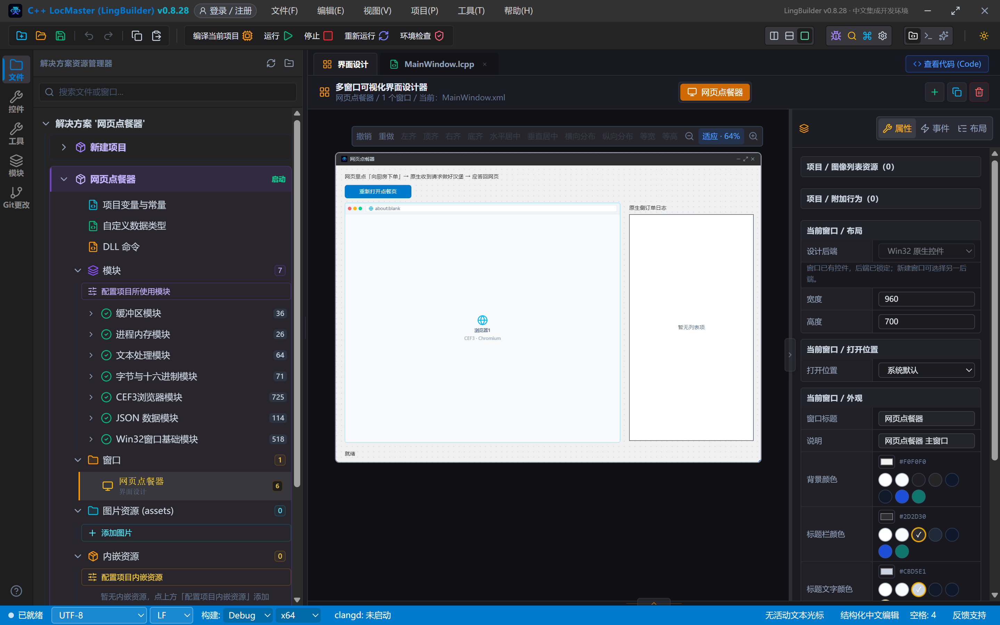
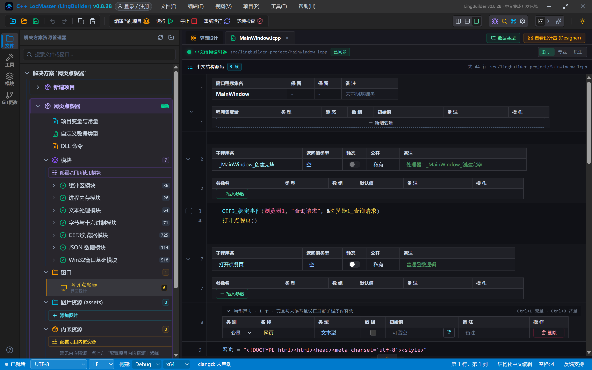
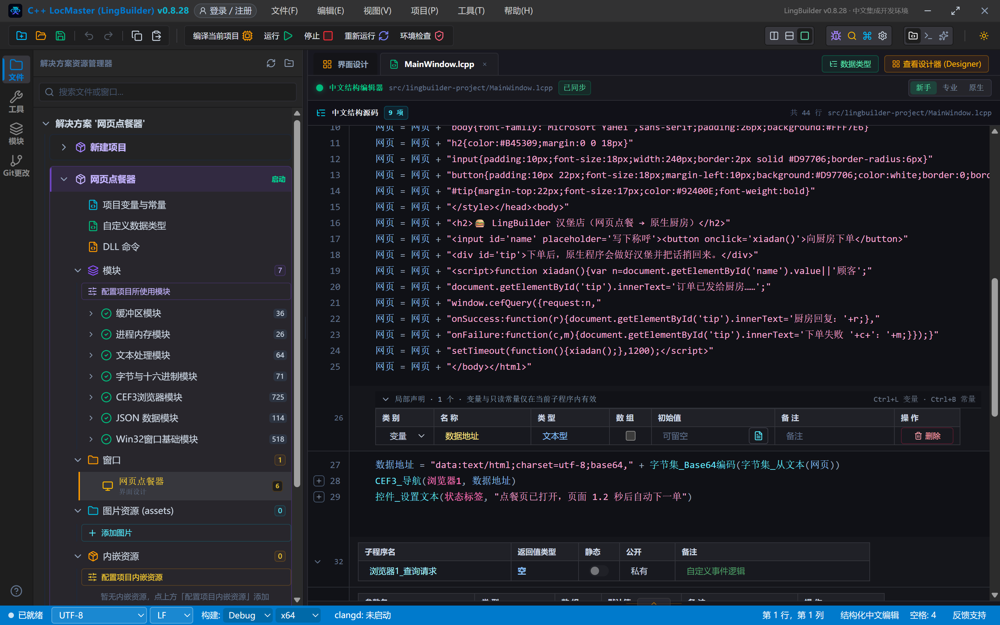
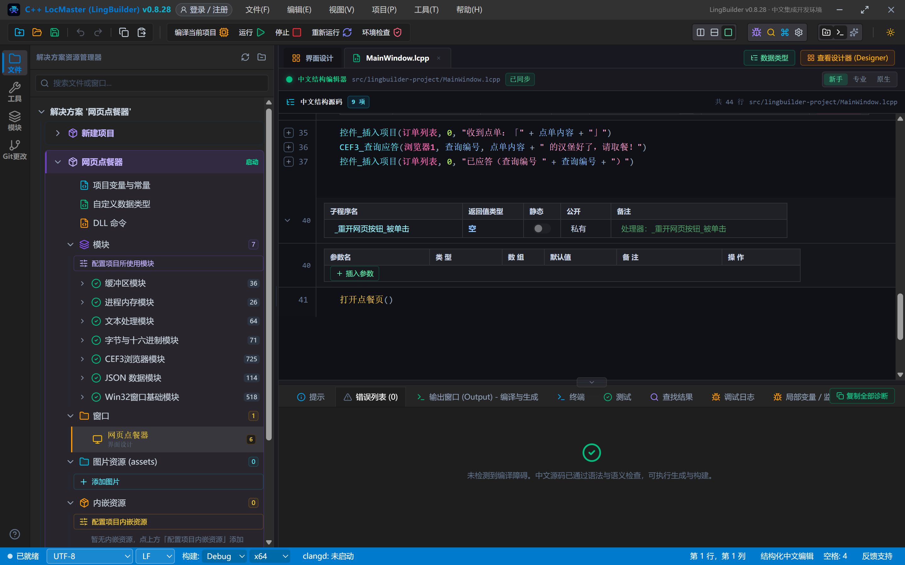
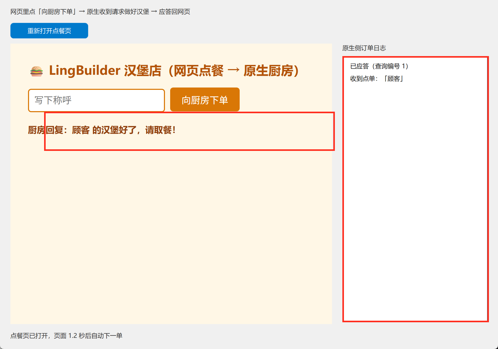
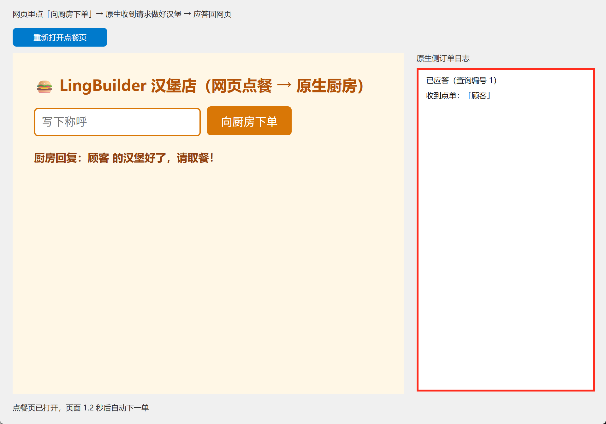

# CEF3 合集 04 · cefQuery 双向交互：网页点餐器

> 《LingBuilder CEF3 浏览器合集》第 4 集（入门篇）。前三集都是「程序指挥网页」，这一集反过来：**网页主动呼叫原生程序**。我们做一个网页点餐器——网页里点「向厨房下单」，原生程序收到请求、做好汉堡、把回复送回网页。这条通道就是 CEF 的 **cefQuery** 机制。全程约 35 分钟。
>
> **模块获取**：CEF3 浏览器模块是**收费模块**，按模块面板提示登录购买授权即可。
>
> 前置要求：学过[第 2 集](/guide/tutorials/cef3-02)的事件绑定。本集源码包见文末。

## 这一集你将学会

- 控件的「**JS交互查询函数**」属性：注册 cefQuery 通道（必须在浏览器创建之前配置）
- 网页侧 `window.cefQuery({request, onSuccess, onFailure})`：发起呼叫
- 原生侧「**查询请求**」事件 + `CEF3_取事件字段` + `CEF3_查询应答`：接单与回复
- 用 **data: 地址**把 HTML 做进程序里（源码包可直接分享，不带外部文件）

## 1. cefQuery 是怎么工作的

一次完整交互像去餐厅点餐：

```text
网页                                原生程序
 │ window.cefQuery({request:"顾客"})   │
 │ ────────────查询请求事件──────────→ │ 收到 queryId=1, request="顾客"
 │                                    │ 做汉堡…
 │ ←──────────CEF3_查询应答────────── │ 应答 "顾客 的汉堡好了"
 │ onSuccess(r) 显示回复               │
```

三条硬规矩（都是 CEF 的机制，务必记住）：

1. **通道必须在浏览器创建之前配置**——CEF 在启动网页时就往页面里注入查询函数，事后注册不生效。在 LingBuilder 里就是配 CEF3浏览器控件的「JS交互查询函数」属性；
2. **每条查询只能应答一次**，用 `CEF3_查询应答` 或 `CEF3_查询应答失败`；
3. **120 秒不应答**，页面会自动收到错误码 `-4`；网页侧点「取消」时，部分页面框架收不到取消回调——别把业务押在取消回调上。

## 2. 设计界面

| 控件 | 名称 | 显示内容/属性 | 左距 | 顶距 | 宽度 | 高度 |
| --- | --- | --- | --- | --- | --- | --- |
| 标签 | 说明标签 | 网页里点「向厨房下单」→ 原生收到请求做好汉堡 → 应答回网页 | 20 | 14 | 620 | 22 |
| 按钮 | 重开网页按钮 | 重新打开点餐页 | 20 | 44 | 150 | 30 |
| **CEF3浏览器** | **浏览器1** | 打开地址 = about:blank；**JS交互查询函数 = cefQuery,cefQueryCancel** | 20 | 84 | 620 | 540 |
| 标签 | 订单标签 | 原生侧订单日志 | 660 | 84 | 280 | 22 |
| 列表框 | 订单列表 | （空） | 660 | 110 | 280 | 510 |
| 标签 | 状态标签 | 就绪 | 20 | 638 | 920 | 22 |

选中控件「浏览器1」，在属性面板找到「**JS交互查询函数**」，填：

```text
cefQuery,cefQueryCancel
```

逗号前是**查询函数名**（网页里调 `window.cefQuery(...)`），逗号后是**取消函数名**（网页里调 `window.cefQueryCancel(...)`）。这一步就是「在浏览器创建之前配置通道」。

绑 2 个事件：窗口「创建完毕」+ 重开网页按钮的「被单击」。



## 3. 写代码

### 3.1 点餐页：一段 HTML，一个 data: 地址

点餐页是一小段 HTML。为了**程序不带外部文件、源码包发谁都能跑**，我们把 HTML 用 Base64 打包成 `data:` 地址直接导航：

```lcpp
空 打开点餐页()
    局部 文本型 网页
    网页 = "<!DOCTYPE html><html><head><meta charset='utf-8'><style>"
    网页 = 网页 + "body{font-family:'Microsoft YaHei',sans-serif;padding:26px;background:#FFF7E6}"
    网页 = 网页 + "h2{color:#B45309;margin:0 0 18px}"
    网页 = 网页 + "input{padding:10px;font-size:18px;width:240px;border:2px solid #D97706;border-radius:6px}"
    网页 = 网页 + "button{padding:10px 22px;font-size:18px;margin-left:10px;background:#D97706;color:white;border:0;border-radius:6px;cursor:pointer}"
    网页 = 网页 + "#tip{margin-top:22px;font-size:17px;color:#92400E;font-weight:bold}"
    网页 = 网页 + "</style></head><body>"
    网页 = 网页 + "<h2>🍔 LingBuilder 汉堡店（网页点餐 → 原生厨房）</h2>"
    网页 = 网页 + "<input id='name' placeholder='写下称呼'><button onclick='xiadan()'>向厨房下单</button>"
    网页 = 网页 + "<div id='tip'>下单后，原生程序会做好汉堡并把话捎回来。</div>"
    网页 = 网页 + "<script>function xiadan(){var n=document.getElementById('name').value||'顾客';"
    网页 = 网页 + "document.getElementById('tip').innerText='订单已发给厨房……';"
    网页 = 网页 + "window.cefQuery({request:n,"
    网页 = 网页 + "onSuccess:function(r){document.getElementById('tip').innerText='厨房回复：'+r;},"
    网页 = 网页 + "onFailure:function(c,m){document.getElementById('tip').innerText='下单失败 '+c+'：'+m;}});}"
    网页 = 网页 + "setTimeout(function(){xiadan();},1200);</script>"
    网页 = 网页 + "</body></html>"
    局部 文本型 数据地址
    数据地址 = "data:text/html;charset=utf-8;base64," + 字节集_Base64编码(字节集_从文本(网页))
    CEF3_导航(浏览器1, 数据地址)
    控件_设置文本(状态标签, "点餐页已打开，页面 1.2 秒后自动下一单")
结束
```

要点：

- HTML 里的引号一律用**单引号**（和第 3 集同一规矩）；
- `window.cefQuery({request: n, onSuccess: ..., onFailure: ...})` 就是网页侧的全部——`request` 想传什么都行（本集传称呼，进阶可以传 JSON 字符串）；
- 页面加载 1.2 秒后**自动下一单**，程序一打开就能看到完整流程；
- `字节集_从文本` 把 HTML 变字节集（UTF-8），`字节集_Base64编码` 转成 Base64 文本，拼上 `data:text/html;charset=utf-8;base64,` 就是一个自包含的网页地址（需要启用**字节数据模块**）。



### 3.2 创建完毕：接单准备

```lcpp
事件 _MainWindow_创建完毕()
    CEF3_绑定事件(浏览器1, "查询请求", &浏览器1_查询请求)
    打开点餐页()
结束

事件 _重开网页按钮_被单击()
    打开点餐页()
结束
```

### 3.3 接单与应答：查询请求事件

```lcpp
事件 浏览器1_查询请求()
    局部 文本型 查询编号 = CEF3_取事件字段(浏览器1, "queryId")
    局部 文本型 点单内容 = CEF3_取事件字段(浏览器1, "request")
    控件_插入项目(订单列表, 0, "收到点单：「" + 点单内容 + "」")
    CEF3_查询应答(浏览器1, 查询编号, 点单内容 + " 的汉堡好了，请取餐！")
    控件_插入项目(订单列表, 0, "已应答（查询编号 " + 查询编号 + "）")
结束
```

- `CEF3_取事件字段(浏览器1, "queryId")`：这条查询的编号，**应答时原样传回**；
- `CEF3_取事件字段(浏览器1, "request")`：网页发来的内容；
- `CEF3_查询应答(控件名, 查询编号, 结果文本)`：回复网页，网页的 `onSuccess` 立刻收到。
- 如果要报错，用 `CEF3_查询应答失败(控件名, 查询编号, 错误码, 错误文本)`，网页的 `onFailure` 收到。



## 4. 编译：先看错误列表

点工具栏「编译当前项目」，底部「错误列表」是 (0)：



## 5. 运行：网页下单，原生做菜

点「运行」。窗口打开，点餐页出现，1.2 秒后页面自动下一单——右侧日志立刻出现「收到点单：『顾客』」「已应答（查询编号 1）」，网页上的提示也变成了「厨房回复：顾客 的汉堡好了，请取餐！」：



在输入框写个称呼（比如「小林」），再点「向厨房下单」：



每一次下单，右侧日志都多两条记录，网页提示同步更新——**网页和原生程序你一句我一句，全靠这一条 cefQuery 通道**。点「重新打开点餐页」可再来一轮。

## 6. 往深处走（本集先记住，进阶篇实操）

- **传结构化数据**：`request` 里放 JSON 字符串（配合第 3 集的 JSON 模块），原生解析后按字段办事，应答也回 JSON——这是实战标配；
- **120 秒超时**：原生一直不应答，页面 `onFailure` 会收到错误码 `-4`；耗时活儿应该「先应答受理、干完再想办法通知」，别让查询挂着；
- **取消查询**：网页可调 `window.cefQueryCancel(...)`，注意 CEF 150 下页面侧基本收不到取消回调，逻辑别依赖它。

## 常见问题急救表

| 症状 | 原因 | 解法 |
| --- | --- | --- |
| 点下单毫无反应 | 「JS交互查询函数」属性没配 | 通道必须在浏览器创建前配置：控件属性填 `cefQuery,cefQueryCancel` |
| onFailure 收到 -4 | 原生 120 秒没应答 | 处理器里必须调 `CEF3_查询应答` 或 `CEF3_查询应答失败`，且每条只应答一次 |
| 应答了网页没收到 | queryId 不对 | `CEF3_查询应答` 的编号参数原样传回取到的 `queryId` |
| 报「未知的命令 字节集_Base64编码」 | 字节数据模块没启用 | 模块生态里启用字节数据模块 |
| 页面中文乱码 | HTML 没写 charset | `<meta charset='utf-8'>` 必须在 head 里 |
| 绑定「查询请求」收不到 | 处理器参数带了引号 | `CEF3_绑定事件` 第 3 参写 `&处理器名` |

## 本集小结

- cefQuery 三件套：控件属性配通道 → 网页 `window.cefQuery` 发起 → 原生「查询请求」事件 + `CEF3_查询应答` 回复。
- 通道必须在浏览器创建**之前**配置；每条查询只能应答一次；120 秒超时页面收 -4。
- data: 地址把 HTML 做进程序，源码包发谁都能跑。

## 源码包

本集完整源码已打包为 **CEF3合集04-网页点餐器.lcpppkg**（见[示例源码区](/demos)），导入即可运行对照学习。

**下一篇预告**：入门篇四集收官。填表与框架篇将从「网页填表」开始——输入、点击、选择，让程序替你在网页上操作。

[回合集总览](/guide/tutorials/cef3)
