# CEF3 合集 05 · 网页填表（一）：输入、点击、选择

> 《LingBuilder CEF3 浏览器合集》第 5 集（填表与框架篇）。前四集里我们的程序会导航、会执行 JS、会接网页的呼叫，这一集开始做最实用的一件事：**让程序替你在网页上填表**——输入姓名手机号、选中下拉框、勾上协议、点提交按钮。我们做一个「体验课报名页」，右侧一排按钮，点哪个，程序就用 `CEF3填表_` 命令族替网页干哪件事。全程约 40 分钟。
>
> **模块获取**：CEF3 浏览器模块**免费**，在 IDE 左侧「模块」面板搜索 CEF3 启用即可（本集还要额外点一下「启用自动化」，下面有截图跟着走）。
>
> 前置要求：学过[第 2 集](/guide/tutorials/cef3-02)的事件绑定和[第 4 集](/guide/tutorials/cef3-04)的 data: 地址。本集源码包见文末。

## 这一集你将学会

- **填表族 12 条命令**的全套用法：赋值、置选择框、置选择项、点击元素、聚焦元素、滚动到元素、触发事件、置内文本、置外文本、置内代码、置外代码、置属性
- 一切填表的前提：`CEF3框架_取主框架` 拿**主框架句柄**
- 两个关键参数：**CSS 选择器**（`#name` 这种写法）和**序号**（多个同名元素时挑第几个）
- 每条命令都返回 1/0：**1 是成功，0 是失败**，程序里随手写进日志就能诊断
- 网页事件监听如何证明「填进去的值网页真的收到了」

## 1. 填表族 12 条命令地图

`CEF3填表_` 命令族共 12 条，全部长一个模样：**第一个参数都是框架句柄，第二个都是 CSS 选择器，第三个都是序号**，后面才是各自的专属参数。按用途分四组：

| 分组 | 命令 | 干什么 |
| --- | --- | --- |
| 填值 | `CEF3填表_赋值` | 给输入框写值；也给没有 value 的元素写 textContent，并**自动补发 input 和 change 事件** |
| 填值 | `CEF3填表_置选择框` | 勾上/取消复选框、单选框，补发 change 事件 |
| 填值 | `CEF3填表_置选择项` | 把下拉框选中第几个 option（从 0 起），补发 change 事件 |
| 点击 | `CEF3填表_点击元素` | 点击元素：优先调它自身的 click，失败就合成 click 事件 |
| 点击 | `CEF3填表_聚焦元素` | 把输入焦点交给元素（或移除） |
| 点击 | `CEF3填表_滚动到元素` | 把元素滚到可视区域（可指定贴顶还是贴底） |
| 点击 | `CEF3填表_触发事件` | 在元素上手动合成一个 DOM 事件（click、dblclick、keydown、change、input…） |
| 改内容 | `CEF3填表_置内文本` | 改 innerText（只改内容，标签不动） |
| 改内容 | `CEF3填表_置外文本` | 改 outerText（**连元素自己一起换掉**） |
| 改内容 | `CEF3填表_置内代码` | 改 innerHTML，可以写入带标签的结构 |
| 改内容 | `CEF3填表_置外代码` | 改 outerHTML（**连标签带属性整个换掉**） |
| 改内容 | `CEF3填表_置属性` | 给元素设置任意 HTML 属性（placeholder、value、data-* 都行） |

两条通用规矩，先记住：

1. **序号**：选择器匹配到多个元素时，用序号挑第几个，**从 0 起**；拿不准有几个就传 `-1`（取首个）；
2. **返回值都是整数型**：1 成功、0 失败。选择器没匹配到任何元素、框架句柄无效，都返回 0——所以把返回值写进日志，问题当场现形。

## 2. 一切的前提：主框架句柄

填表命令不认「浏览器控件」，认的是**框架句柄**。先从控件把主框架取出来：

```lcpp
局部 长整数型 主框架
主框架 = CEF3框架_取主框架(浏览器1)
如果真 (主框架 == 0)
    写日志("还没取到主框架，等页面就绪再试")
    返回 ()
如果真结束
```

- `CEF3框架_取主框架(控件名)`：返回**长整数型**受管句柄，页面还没产生任何框架时返回 0；
- 判无效**只用 `== 0`**：这是 64 位受管句柄，按整数读恒为负数，写 `> 0` 会把合法句柄全部误判成无效——**千万别写 `> 0`**；
- 页面没加载完时主框架可能还没建好，所以每个按钮处理器里都先取一次、判一次 0。

后面所有命令都写成这个形态：`CEF3填表_赋值(主框架, "#name", -1, "林小灵")`。

## 3. 新建项目与启用模块

点「新建项目」→ 选「Windows 界面设计」卡：

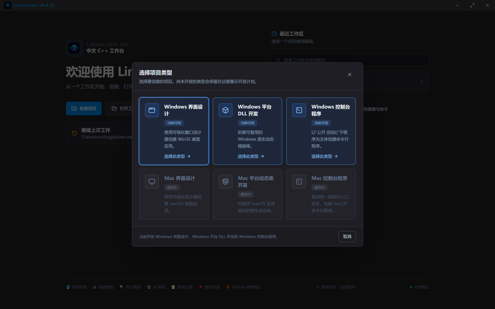

项目名称填「网页填表体验课」，创建位置留空（就建在当前工作区里），点「创建项目」：

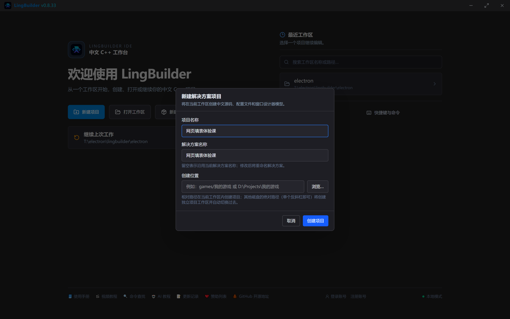

然后启用 CEF3 模块：左侧切到「模块」面板，搜索 CEF3，在「CEF3浏览器模块」行点启用（✓）：

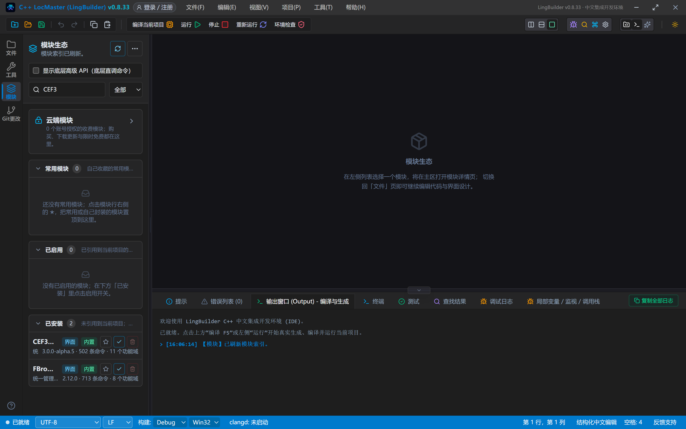

**本集关键一步**：点开模块名字进详情页，在「CEF3 功能范围」里找到「**自动化**」卡（43 条命令——填表族和框架族都在这里面），点「**启用自动化**」。基础/事件/会话/下载与传输/对象这五块随标准功能一起启用了，**自动化、网络、开发者工具这几块要单独确认**，不启用的话，写 `CEF3填表_赋值` 会报「命令…当前项目尚未引用该模块」：

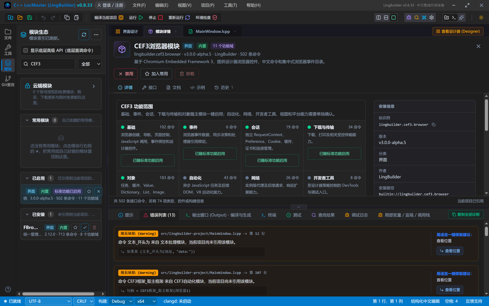

另外，本集源码用了 `文本_开头为` 判断页面地址，它属于**文本处理模块**，也顺手在模块面板里启用（写代码时错误列表会提醒你缺哪个模块，照着补就行）。

## 4. 设计界面

窗口声明 **980×688**（客户区 980×660），摆 13 个控件：

| 控件 | 名称 | 显示内容/属性 | 左距 | 顶距 | 宽度 | 高度 |
| --- | --- | --- | --- | --- | --- | --- |
| 标签 | 说明标签 | 下面是内嵌网页：程序用 CEF3填表_ 命令替它输入、点选、勾选并提交 | 20 | 14 | 620 | 22 |
| 按钮 | 重开网页按钮 | 重新打开报名页 | 20 | 44 | 150 | 30 |
| **CEF3浏览器** | **浏览器1** | 打开地址 = about:blank | 20 | 84 | 620 | 540 |
| 标签 | 操作台标题 | 填表操作台（点按钮 → 看网页反应） | 660 | 84 | 280 | 22 |
| 按钮 | 一键填表按钮 | 一键填表：输入+下拉+勾选 | 660 | 114 | 280 | 30 |
| 按钮 | 提交报名按钮 | 点击「提交报名」按钮 | 660 | 152 | 280 | 30 |
| 按钮 | 聚焦按钮 | 聚焦「姓名」输入框 | 660 | 190 | 280 | 30 |
| 按钮 | 滚动按钮 | 滚动到「协议底部」 | 660 | 228 | 280 | 30 |
| 按钮 | 双击按钮 | 在活动卡上触发双击 | 660 | 266 | 280 | 30 |
| 按钮 | 改造按钮 | 网页改造：欢迎语+徽章+提示 | 660 | 304 | 280 | 30 |
| 按钮 | 替换按钮 | 整体替换旧提示（置外文本） | 660 | 342 | 280 | 30 |
| 列表框 | 操作日志 | （空） | 660 | 380 | 280 | 244 |
| 标签 | 状态标签 | 就绪 | 20 | 638 | 920 | 22 |

7 个按钮各绑自己的「被单击」事件，窗口「创建完毕」也要绑，共 8 个事件 + 浏览器的「加载完成」事件在代码里绑定（下一节讲）。摆完长这样：

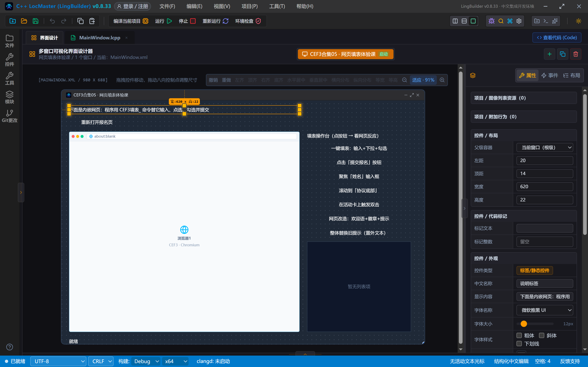

## 5. 写代码

### 5.1 报名页：一段 HTML，一个 data: 地址

报名页是一小段 HTML，和第 4 集同一规矩：**HTML 里的引号一律用单引号**，最后 Base64 打包成 data: 地址导航过去，程序不带外部文件，源码包发谁都能跑。页面特意留了三处「证据位」：

- 每个表单控件都挂着 input/change 监听，最新一条写进「最近事件」行——**待会儿程序填表时，这行字会变，证明网页真的收到了值和事件**；
- 提交按钮带校验：姓名为空或没勾协议就显示红字错误，全对才显示绿字成功；
- 页面下半截放了一块 520 像素高的「协议全文区」和一张「双击我」活动卡，给滚动和触发事件当靶子。

```lcpp
空 打开报名页()
    局部 文本型 网页
    网页 = "<!DOCTYPE html><html><head><meta charset='utf-8'><title>CEF3体验课报名</title><style>"
    网页 = 网页 + "body{font-family:'Microsoft YaHei',sans-serif;margin:0;padding:22px 26px;background:#F8FAFC;color:#1E293B}"
    // ……（样式与表单结构逐行拼接，完整代码见截图与源码包）
    网页 = 网页 + "<div class='row'><label>姓名</label><input type='text' id='name' placeholder='请输入姓名'></div>"
    网页 = 网页 + "<div class='row'><label>手机号</label><input type='text' id='phone' placeholder='11 位手机号'></div>"
    网页 = 网页 + "<div class='row'><label>城市</label><select id='city'><option value='0'>请选择城市</option>……</select></div>"
    网页 = 网页 + "<div class='row'><label></label><input type='checkbox' id='agree'><span style='font-size:14px'>我已阅读并同意《体验协议》</span></div>"
    网页 = 网页 + "<div class='row'><button id='submit'>提交报名</button></div>"
    // ……（协议全文区 #tiaokuan、活动卡 #card、事件监听 <script> 同法拼接）
    局部 文本型 数据地址
    数据地址 = "data:text/html;charset=utf-8;base64," + 字节集_Base64编码(字节集_从文本(网页))
    CEF3_导航(浏览器1, 数据地址)
    控件_设置文本(状态标签, "报名页已打开，右侧按钮逐个试")
结束
```

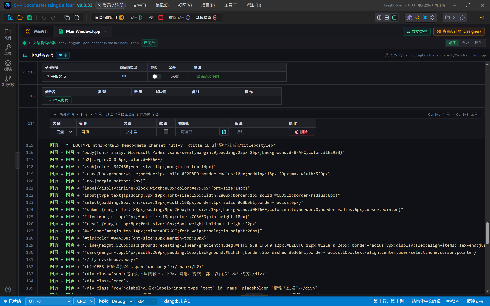

`字节集_从文本`（UTF-8）→ `字节集_Base64编码` → 拼上 `data:text/html;charset=utf-8;base64,`，需要启用**字节与十六进制模块**。

### 5.2 创建完毕：绑定「加载完成」+ data: 地址守卫

```lcpp
事件 _MainWindow_创建完毕()
    CEF3_绑定事件(浏览器1, "加载完成", &浏览器1_加载完成)
    打开报名页()
结束

事件 浏览器1_加载完成()
    局部 文本型 地址
    地址 = CEF3_取地址(浏览器1)
    如果真 (文本_开头为(地址, "data:"))
        写日志("报名页就绪，开始填表吧")
    如果真结束
结束
```

两个细节：

- 浏览器控件启动时会先加载一次 about:blank，**它也触发一次「加载完成」**。所以处理器里先 `CEF3_取地址` 拿当前地址，用 `文本_开头为(地址, "data:")` 确认是报名页自己，才写日志——**判断页面就绪看地址，别裸看加载完成**；
- `CEF3_绑定事件` 的第 3 参是处理器名，**必须带 &**。

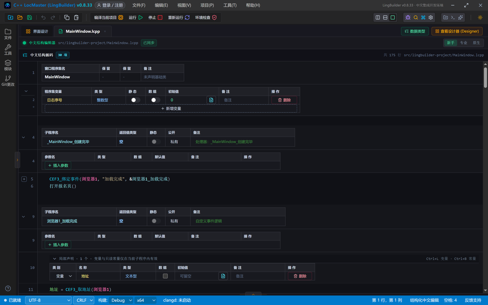

### 5.3 一键填表：赋值 + 置选择项 + 置选择框

先看公共的两步——取主框架（§2 讲过），然后四条填表命令，每条都把返回值写进日志：

```lcpp
事件 _一键填表按钮_被单击()
    局部 长整数型 主框架
    主框架 = 取主框架()
    如果真 (主框架 == 0)
        写日志("还没取到主框架，等页面就绪再试")
        返回 ()
    如果真结束
    局部 整数型 结果1
    结果1 = CEF3填表_赋值(主框架, "#name", -1, "林小灵")
    写日志("输入姓名 → " + 到文本(结果1))
    局部 整数型 结果2
    结果2 = CEF3填表_赋值(主框架, "#phone", -1, "13800001234")
    写日志("输入手机 → " + 到文本(结果2))
    局部 整数型 结果3
    结果3 = CEF3填表_置选择项(主框架, "#city", -1, 2)
    写日志("下拉选「上海」→ " + 到文本(结果3))
    局部 整数型 结果4
    结果4 = CEF3填表_置选择框(主框架, "#agree", -1, 真)
    写日志("勾选协议 → " + 到文本(结果4))
结束
```

逐参数拆一条：`CEF3填表_赋值(主框架, "#name", -1, "林小灵")`——

1. `主框架`：长整数型框架句柄，填表命令的定位起点；
2. `"#name"`：**CSS 选择器**，`#` 开头按 id 找，页面上 `id='name'` 的输入框就是它；
3. `-1`：序号，取首个（匹配到多个时按 0、1、2 挑）；
4. `"林小灵"`：要写入的值。

`CEF3填表_置选择项(主框架, "#city", -1, 2)` 的最后一参是 **option 序号**，从 0 起：0=请选择城市、1=北京、**2=上海**。`CEF3填表_置选择框` 最后一参是**逻辑值**，传 `真` 勾上、`假` 取消。

⚠️ **本集最重要的坑——声明与赋值拆两行**：`局部 整数型 结果1 = CEF3填表_赋值(…)` 这种一行写法，声明会被提升到主框架赋值之前执行，拿到的是空值。**所有「声明带初始化」都拆成两行**，先 `局部 整数型 结果1`，再 `结果1 = CEF3填表_赋值(…)`。上面代码全部是两行式，照抄就安全。

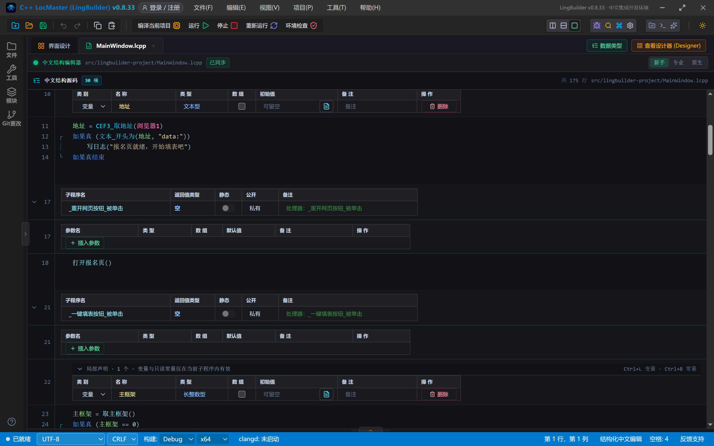

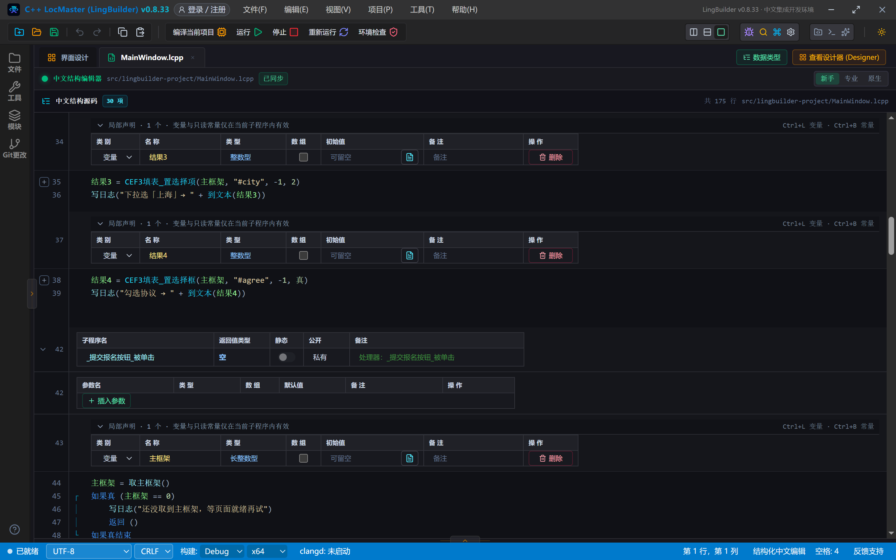

### 5.4 点击元素：替网页点提交

```lcpp
事件 _提交报名按钮_被单击()
    局部 长整数型 主框架
    主框架 = 取主框架()
    如果真 (主框架 == 0)
        写日志("还没取到主框架，等页面就绪再试")
        返回 ()
    如果真结束
    CEF3填表_点击元素(主框架, "#submit", -1)
    写日志("已点击页面按钮「提交报名」")
结束
```

`CEF3填表_点击元素` 优先调用元素自身的 click()（和真人点一样会触发完整校验流程），失败才退回合成 click 事件。点了之后页面自己走校验：缺姓名显示红字「✗ 请先填写姓名」，全对显示绿字「✔ 报名成功」。

### 5.5 聚焦、滚动、触发事件

```lcpp
CEF3填表_聚焦元素(主框架, "#name", -1, 真)          // 真=聚焦，假=移除焦点
CEF3填表_滚动到元素(主框架, "#tiaokuan", -1, 真)     // 真=贴顶对齐，假=尽量贴底
CEF3填表_触发事件(主框架, "#card", -1, "dblclick", 0) // 在活动卡上合成一次双击
```

- `CEF3填表_滚动到元素`：页面比浏览器窗口长时才有得滚，我们的「协议全文区」特意做了 520 像素高；
- `CEF3填表_触发事件`：第 4 参是事件名（click、dblclick、keydown、change、input…），第 5 参是键盘类事件用的按键代码（比如回车 13），非键盘事件传 0。活动卡监听 dblclick，收到就计数 +1。

### 5.6 网页改造五连：置内文本 / 置内代码 / 置属性 / 置外文本 / 置外代码

```lcpp
事件 _改造按钮_被单击()
    局部 长整数型 主框架
    主框架 = 取主框架()
    如果真 (主框架 == 0)
        返回 ()
    如果真结束
    CEF3填表_置内文本(主框架, "#welcome", -1, "欢迎，林小灵！座位已锁定")
    CEF3填表_置内代码(主框架, "#badge", -1, "<span style='background:#0F766E;color:#fff;padding:2px 10px;border-radius:999px;font-size:13px'>已代填</span>")
    CEF3填表_置属性(主框架, "#name", -1, "placeholder", "必填：与身份证一致")
    写日志("改造完成：欢迎语/徽章/占位提示")
结束

事件 _替换按钮_被单击()
    局部 长整数型 主框架
    主框架 = 取主框架()
    如果真 (主框架 == 0)
        返回 ()
    如果真结束
    CEF3填表_置外文本(主框架, "#tip", -1, "这条提示已被 CEF3填表_置外文本 整体换掉")
    写日志("旧提示元素已被文本整体替换")
    CEF3填表_置外代码(主框架, "#result", -1, "<div id=result style='margin-top:8px;font-size:15px;color:#7C3AED'>✔ 我被 CEF3填表_置外代码 连标签带样式整个换新</div>")
    写日志("结果区元素已被 置外代码 换新")
结束
```

「内」「外」一字之差，行为天壤之别：

- **置内文本/置内代码**：只换元素**肚子里**的内容，元素自己还在（innerText vs innerHTML：文本当纯文字，代码当 HTML 解析，所以徽章能塞 `<span>` 进去）；
- **置外文本/置外代码**：**连元素带标签整个换掉**——原元素从此不存在，页面上看到的是新东西。置外代码换掉 #result 后，连 id、样式都是新的；
- **置属性**：第 4 参属性名、第 5 参属性值，改 placeholder 立刻能在输入框里看到。

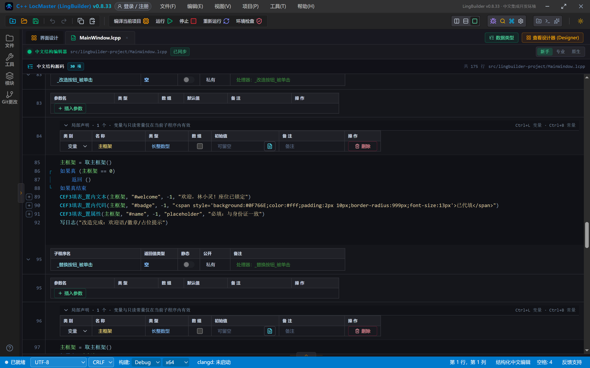

## 6. 编译：先看错误列表

点工具栏「编译当前项目」，底部「错误列表」是 (0)：

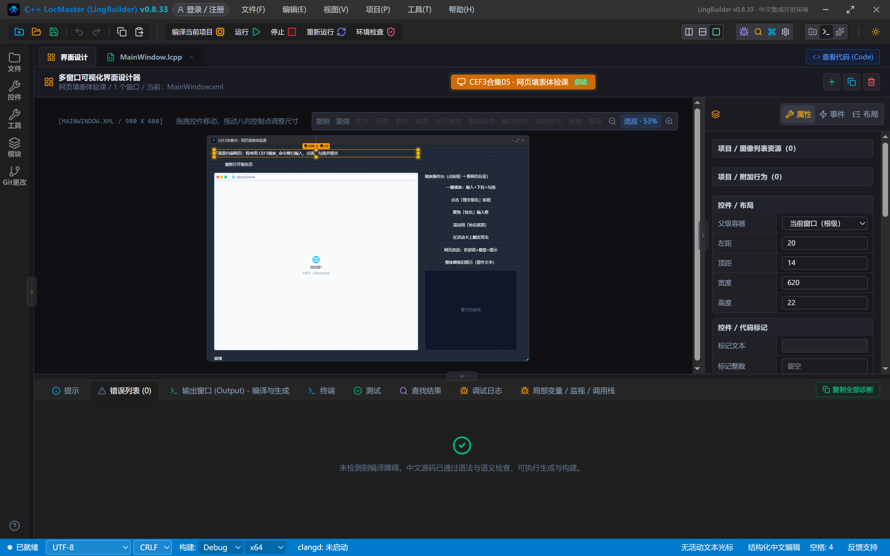

如果报「命令 CEF3填表_xxx 来自 CEF3自动化模块，当前项目尚未引用该模块」，回到第 3 节把「自动化」启用；报「文本_开头为 来自 文本处理模块」同理。

## 7. 运行：程序替网页填表

点「运行」。窗口打开，报名页出现，右侧日志第一条「报名页就绪，开始填表吧」——这是「加载完成」+ data: 地址守卫在工作：

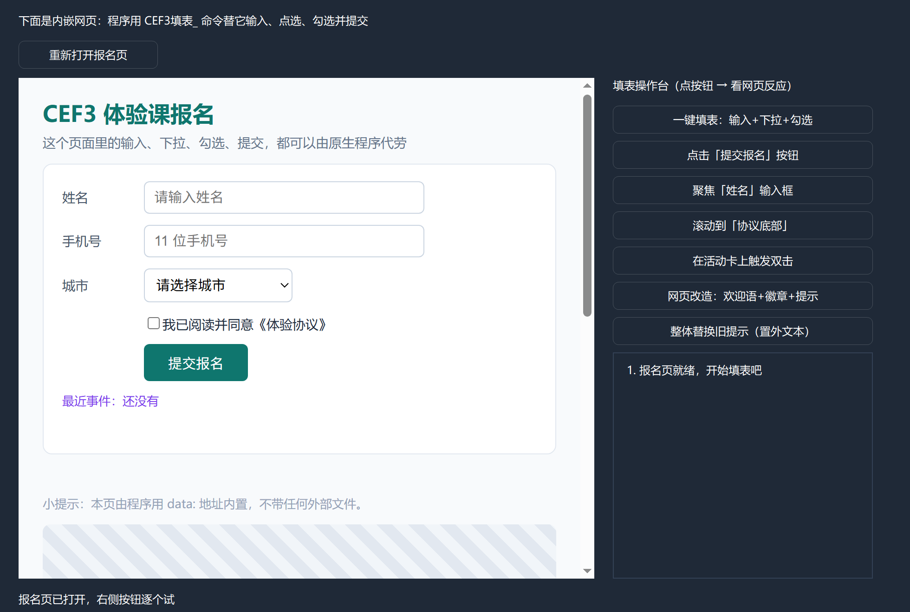

先别填，直接点「点击『提交报名』按钮」——页面红字「✗ 请先填写姓名」。**程序替你点的按钮，网页校验照样拦你**，说明点击元素触发的是真实的页面逻辑：

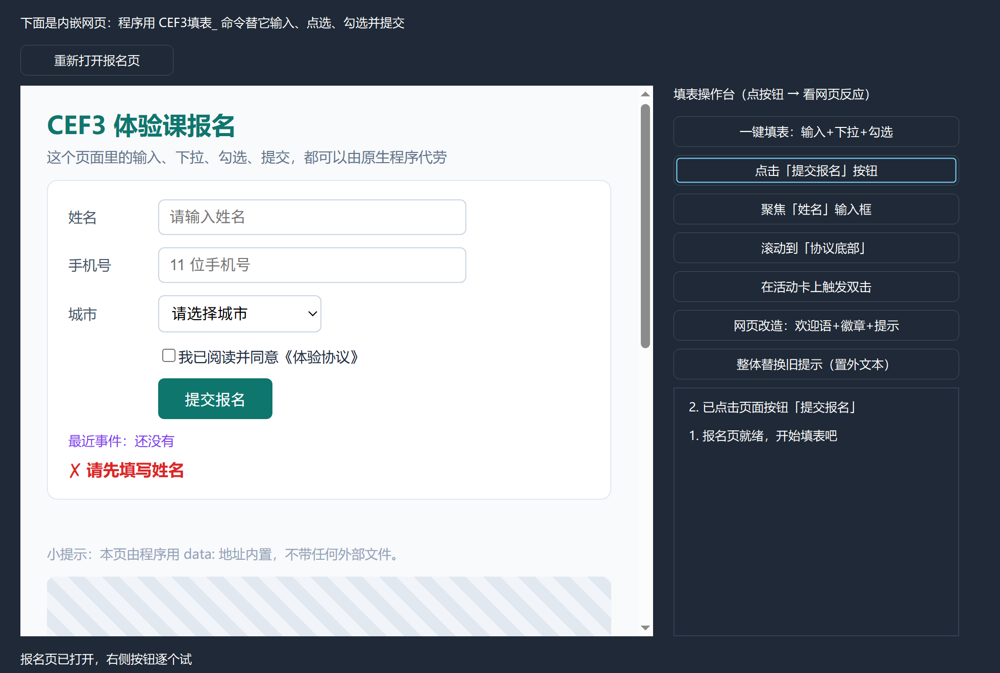

点「一键填表：输入+下拉+勾选」——姓名、手机号瞬间填好，城市变「上海」，协议勾上；页面「最近事件」行显示「agree 勾选 = true」，右侧日志四条全部「→ 1」：

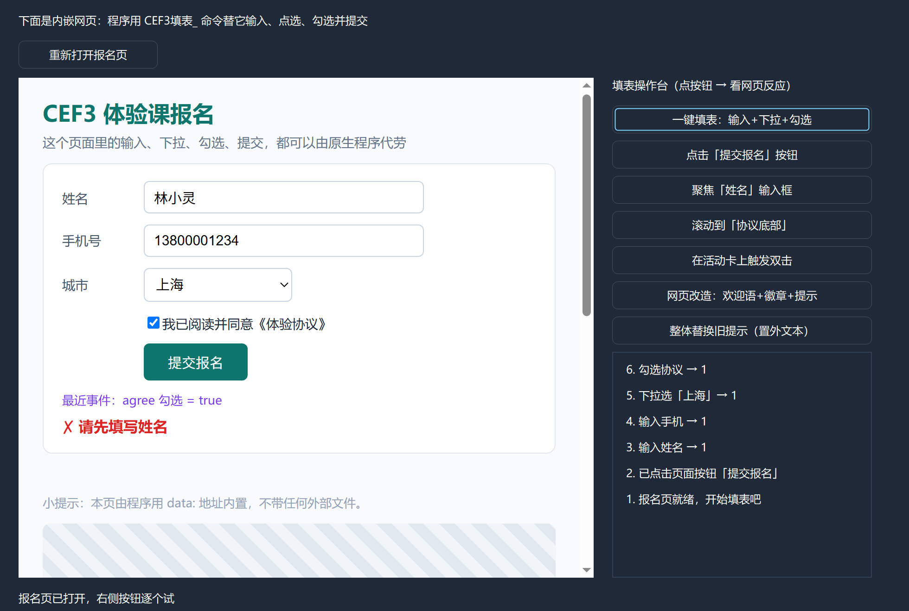

再点「点击『提交报名』按钮」——绿字「✔ 报名成功：林小灵（上海）」：

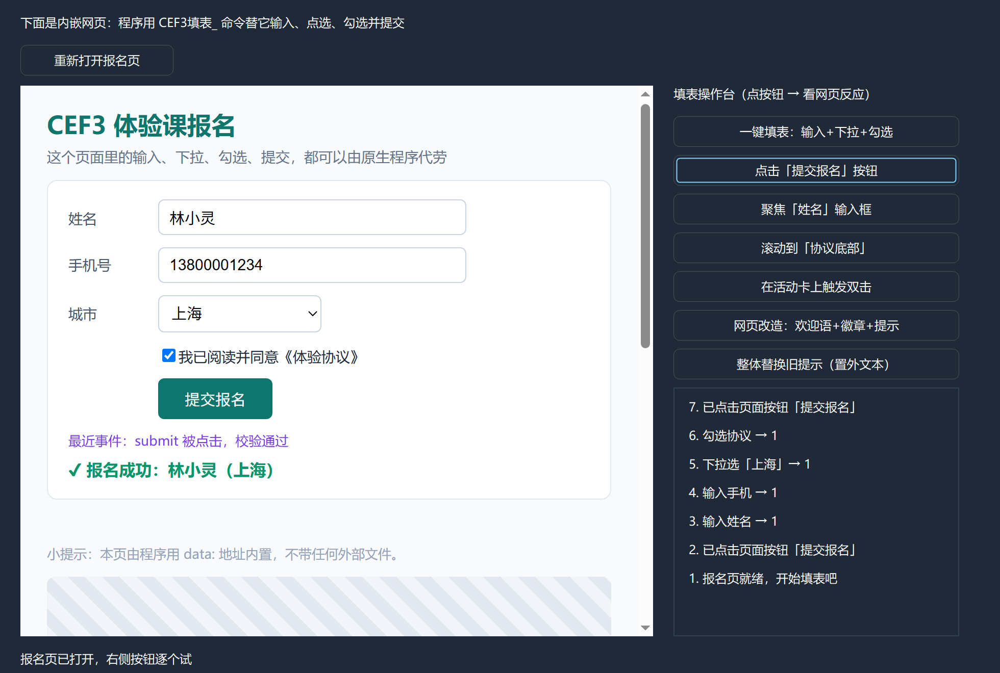

依次点「聚焦」「滚动到协议底部」「在活动卡上触发双击」——页面滚到协议区，活动卡计数变「1 次」，日志 8/9/10 三条记录：

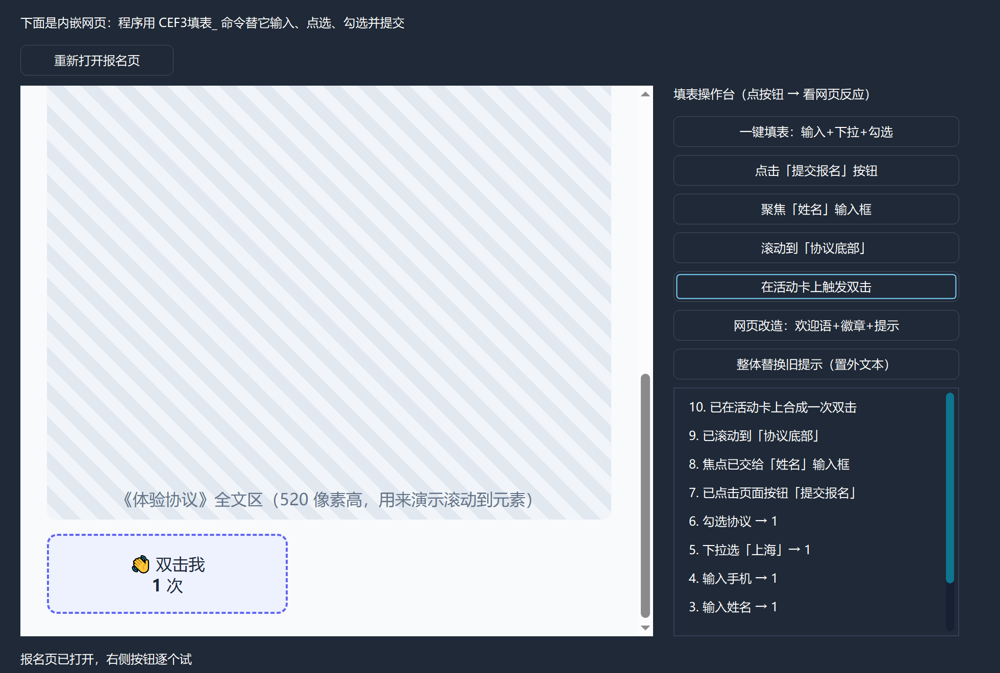

最后点「重新打开报名页」（页面复位，顺便验证重开），再点「网页改造」和「整体替换旧提示」——标题旁多出「已代填」徽章、姓名框占位文字变成「必填：与身份证一致」、欢迎语出现、旧提示被整句换掉、结果区被置外代码换成了带样式的新元素：

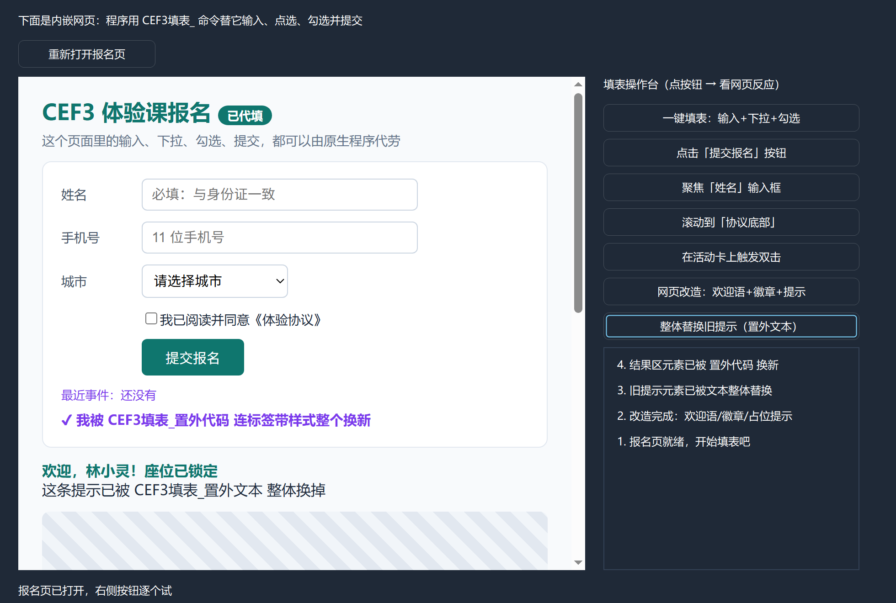

到这里，**填表族 12 条命令全部真机跑了一遍**。每一件「网页动作」右侧日志都留了痕，网页自己的事件行也在实时应答——这就是原生程序和内嵌网页的配合方式。

## 8. 十二条命令速查

| 命令 | 关键参数（除句柄/选择器/序号外） | 备注 |
| --- | --- | --- |
| CEF3填表_赋值 | 值 | 补发 input + change |
| CEF3填表_置选择框 | 是否选中（逻辑值） | 复选框/单选框，补发 change |
| CEF3填表_置选择项 | 选项序号（从 0 起） | 下拉框，补发 change |
| CEF3填表_点击元素 | — | 优先元素自身 click |
| CEF3填表_聚焦元素 | 是否聚焦（逻辑值） | 假=移除焦点 |
| CEF3填表_滚动到元素 | 滚到顶部（逻辑值） | 真=贴顶 |
| CEF3填表_触发事件 | 事件名，按键代码 | 键盘类回车传 13 |
| CEF3填表_置内文本 | 文本 | 只换内容 |
| CEF3填表_置内代码 | 代码文本 | 内容按 HTML 解析 |
| CEF3填表_置外文本 | 文本 | 连元素一起换 |
| CEF3填表_置外代码 | 代码文本 | 连标签带属性整个换 |
| CEF3填表_置属性 | 属性名，值 | placeholder/value/data-* 都行 |

## 常见问题急救表

| 症状 | 原因 | 解法 |
| --- | --- | --- |
| 报「命令 CEF3填表_xxx 当前项目尚未引用该模块」 | 只启用了标准功能 | 模块详情页 →「自动化」卡 → 启用自动化 |
| 命令全返回 0 | 选择器没匹配到元素 | 浏览器 F12 确认 id；`#` 开头按 id，`.` 开头按 class |
| 一填就崩或值全是空 | `局部 整数型 x = 命令(…)` 一行式声明提升 | 声明与赋值**拆两行**（见 5.3） |
| 主框架取回来恒是 0 | 页面还没建好框架 | 等「加载完成」再取；判无效只用 `== 0` |
| 判断就绪用了「加载完成」但触发两次 | about:blank 也触发一次加载完成 | `CEF3_取地址` + `文本_开头为(地址, "data:")` 守卫 |
| 值填进去了但页面逻辑没反应 | 页面监听 input/change，而你是直接改的 DOM | 用 `CEF3填表_赋值/置选择框/置选择项`，它们自动补发事件 |
| HTML 写进去中文乱码 | 缺 charset 或引号打架 | `<meta charset='utf-8'>` 必须有；HTML 引号全用单引号 |
| 绑定「加载完成」收不到 | 处理器参数带了引号 | `CEF3_绑定事件` 第 3 参写 `&处理器名` |

## 本集小结

- 填表族 12 条命令同一种骨架：**主框架句柄 + CSS 选择器 + 序号 + 专属参数**，返回 1/0；
- 主框架用 `CEF3框架_取主框架` 取，判无效只用 `== 0`；
- 赋值/置选择框/置选择项会**补发 input/change**，页面监听照常工作——这是和「执行JS 改 DOM」最大的区别；
- 「内」字辈只换内容，「外」字辈连元素一起换；置属性改任何 HTML 属性；
- 页面就绪断言看地址（data: 开头），不裸看「加载完成」。

## 源码包

本集完整源码已打包为 **CEF3合集05-网页填表体验课.lcpppkg**（见[示例源码区](/demos)），导入即可运行对照学习。

**下一篇预告**：填表只会写还不够，下一集读回来——取输入框的值、判断勾选状态，把「自动登录」完整做一遍。

[回合集总览](/guide/tutorials/cef3)
