# CEF3 合集 06 · 网页填表（二）：取值回读与自动登录

> 《LingBuilder CEF3 浏览器合集》第 6 集（填表与框架篇）。上一集程序会「写」网页了，这一集学会「读」——把网页输入框里的值、勾选状态读回程序，再把这些串成一次完整的**自动登录**。顺便把两条异步链路（执行 JS 异步任务、框架取正文任务）跑通，你就能写出不卡界面的填表机器人。全程约 40 分钟。
>
> **模块获取**：CEF3 浏览器模块**免费**，模块面板启用即可（自动化子域要单独点「启用自动化」，见第 5 集）；本集还要多启用 **JSON 数据模块**。
>
> 前置要求：学过[第 3 集](/guide/tutorials/cef3-03)的执行 JS 与信封解析、[第 5 集](/guide/tutorials/cef3-05)的填表族。本集源码包见文末。

## 这一集你将学会

- `CEF3_执行JS` 读网页值：**原始信封 → JSON 模块解析 → 拿到值**的标准三步（和第 3 集同一把钥匙）
- `CEF3自动化_执行JS异步` + 任务族（`CEF3任务_取状态/取结果/释放`）：**不卡界面的异步读法**
- `CEF3框架_取文本异步`：一句话拿回整个页面的可见正文
- 实战串珠：代填账号 → 勾「记住我」→ 点登录 → 回读登录结果
- **点击之后要等一等**：填表命令是投递到浏览器线程的，立刻读会读到旧状态

## 1. 读值的两条路

| 路线 | 命令 | 特点 |
| --- | --- | --- |
| 同步读 | `CEF3_执行JS(控件名, 脚本)` | 最多等 5 秒，返回 **DevTools 信封 JSON**，配 JSON 模块解析；小量取值最顺手 |
| 异步读 | `CEF3自动化_执行JS异步(控件名, 脚本)` | 立刻返回**任务句柄**，用任务族轮询取结果；耗时脚本也不冻窗口 |
| 读正文 | `CEF3框架_取文本异步(框架句柄)` | 异步返回页面可见文本，任务句柄同上 |

同步读返回的信封长这样（真实截取）：

```json
{"result":{"type":"string","valu...
```

中文以 `\uXXXX` 转义存放，**别用文本命令去截**，交给 JSON 模块：`JSON_解析 → JSON_指针_取 → JSON_取文本值` 三步（第 3 集的「取页面值」子程序原样复用，源码包里就有）。

任务族三步：`CEF3任务_取状态`（0=进行中，2=成功，3=失败）→ `CEF3任务_取结果`（UTF-16 文本，**同样可能是信封**，先看原始返回再解析）→ `CEF3任务_释放`（用完必须还）。

## 2. 设计界面

新建项目「取值回读与自动登录」（流程与第 5 集相同，见[第 5 集图 1/2](../05_网页填表一输入点击选择/images/01-新建项目-选类型.png)），模块多启用一个 **JSON 数据模块**。窗口仍是 980×688（客户区 980×660）：

| 控件 | 名称 | 显示内容/属性 | 左距 | 顶距 | 宽度 | 高度 |
| --- | --- | --- | --- | --- | --- | --- |
| 标签 | 说明标签 | 第二集填表：网页里的值读得回来——信封解析、异步任务、自动登录 | 20 | 14 | 620 | 22 |
| 按钮 | 重开网页按钮 | 重新打开登录页 | 20 | 44 | 150 | 30 |
| **CEF3浏览器** | **浏览器1** | 打开地址 = about:blank | 20 | 84 | 620 | 540 |
| 标签 | 操作台标题 | 取值回读操作台（点按钮 → 看日志） | 660 | 84 | 280 | 22 |
| 按钮 | 回读账号按钮 | 回读账号：信封+解析值 | 660 | 114 | 280 | 30 |
| 按钮 | 自动登录按钮 | 自动登录：代填+点击登录 | 660 | 152 | 280 | 30 |
| 按钮 | 异步读按钮 | 异步读用户名（任务轮询） | 660 | 190 | 280 | 30 |
| 按钮 | 读正文按钮 | 读页面正文（框架任务） | 660 | 228 | 280 | 30 |
| 列表框 | 操作日志 | （空） | 660 | 266 | 280 | 358 |
| 标签 | 状态标签 | 就绪 | 20 | 638 | 920 | 22 |

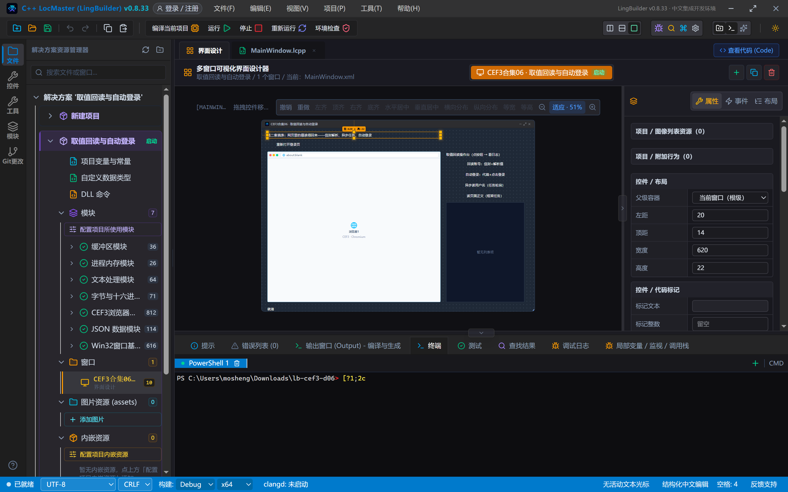

登录页也是 data: 地址（HTML 写法同第 5 集：**引号全用单引号**）：用户名 `#user`、密码 `#pass`、记住我 `#remember`、登录按钮 `#login`；页面加载 0.7 秒后**自动填入演示账号**（这样我们不用碰键盘就有值可读）；点登录会校验非空，通过后整块表单隐藏、显示绿色成功面板 `#ok`。

## 3. 写代码

### 3.1 创建完毕 + 加载完成：还是 data: 地址守卫

```lcpp
事件 _MainWindow_创建完毕()
    CEF3_绑定事件(浏览器1, "加载完成", &浏览器1_加载完成)
    打开登录页()
结束

事件 浏览器1_加载完成()
    局部 文本型 地址
    地址 = CEF3_取地址(浏览器1)
    如果真 (文本_开头为(地址, "data:"))
        写日志("登录页就绪，页面 0.7 秒后自动填入演示账号")
    如果真结束
结束
```

about:blank 也触发一次「加载完成」，所以**看地址开头是不是 data:** 才算页面真就绪（第 5 集同款守卫）。

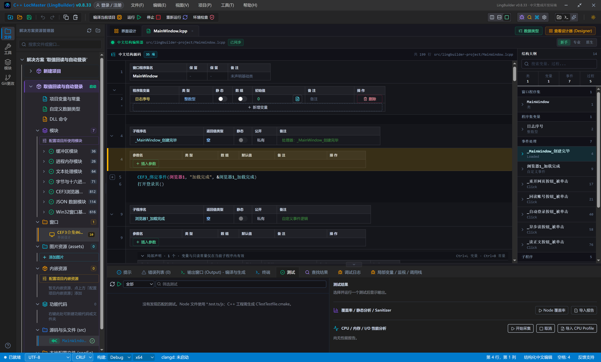

### 3.2 回读账号：信封三步解析

```lcpp
事件 _回读账号按钮_被单击()
    局部 长整数型 主框架
    主框架 = 取主框架()
    如果真 (主框架 == 0)
        写日志("还没取到主框架，等页面就绪再试")
        返回 ()
    如果真结束
    局部 文本型 信封
    信封 = CEF3_执行JS(浏览器1, "document.getElementById('user').value")
    写日志("原始信封：" + 信封)
    写日志("回读用户名 = " + 取页面值(信封))
    局部 文本型 信封2
    信封2 = CEF3_执行JS(浏览器1, "document.getElementById('pass').value")
    写日志("回读密码 = " + 取页面值(信封2))
    局部 文本型 信封3
    信封3 = CEF3_执行JS(浏览器1, "document.getElementById('remember').checked ? '已勾选' : '未勾选'")
    写日志("记住我 = " + 取页面值(信封3))
结束
```

三个细节：

- JS 里的字符串字面量用**单引号**，避免和外层中文代码的双引号打架；
- 读勾选状态别直接回 `true/false`，在 JS 里就 ternary 成中文（`? '已勾选' : '未勾选'`），解析侧永远拿到文本，新手不用处理布尔信封；
- 信封先原样进日志再解析——出问题时一眼看出是「没读到」还是「解析错」。

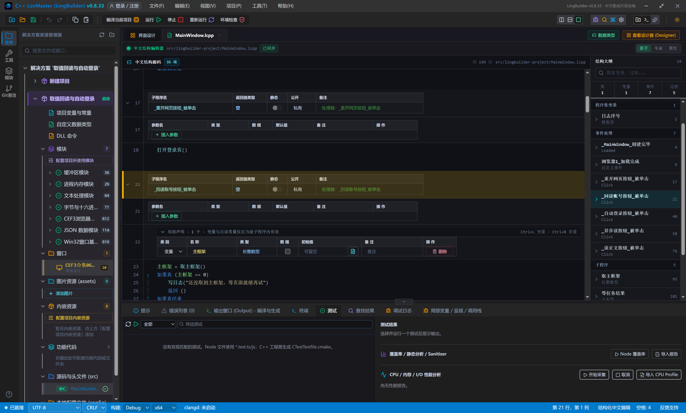

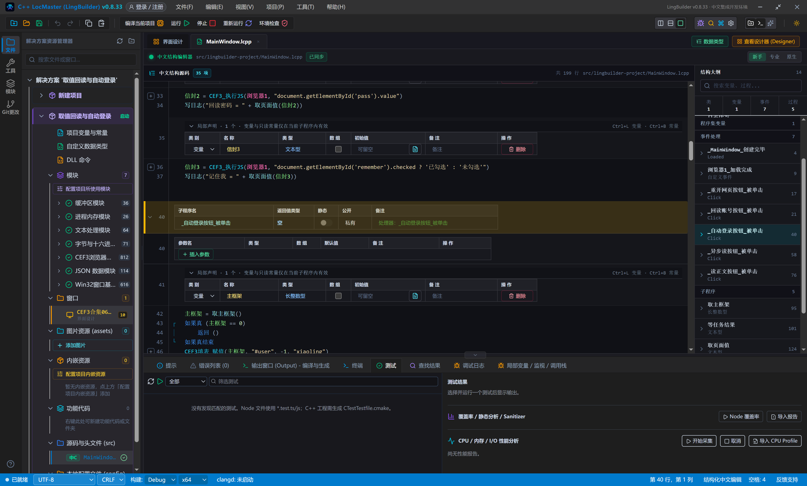

### 3.3 自动登录：代填 + 点击 + **等一等再读**

```lcpp
事件 _自动登录按钮_被单击()
    局部 长整数型 主框架
    主框架 = 取主框架()
    如果真 (主框架 == 0)
        返回 ()
    如果真结束
    CEF3填表_赋值(主框架, "#user", -1, "xiaoling")
    CEF3填表_赋值(主框架, "#pass", -1, "lb2026")
    CEF3填表_置选择框(主框架, "#remember", -1, 真)
    CEF3填表_点击元素(主框架, "#login", -1)
    写日志("已代填账号并点击登录")
    延时(300)
    局部 文本型 信封4
    信封4 = CEF3_执行JS(浏览器1, "document.getElementById('ok').style.display")
    写日志("面板原始信封：" + 信封4)
    写日志("登录成功面板 = " + 取页面值(信封4) + "（block 即已显示）")
结束
```

⚠️ **本集最重要的坑：点击之后立刻读，会读到旧状态。** 填表命令（包括点击元素）是**投递到浏览器线程**执行的，本行代码不等它跑完。制作本集时真机踩过：点击登录后马上读 `#ok` 的 display，拿到的是空串；补一行 `延时(300)`（它会泵消息、界面不冻结）再读，稳稳拿到 `block`。**凡是「写完就读」，中间都隔一个延时。**

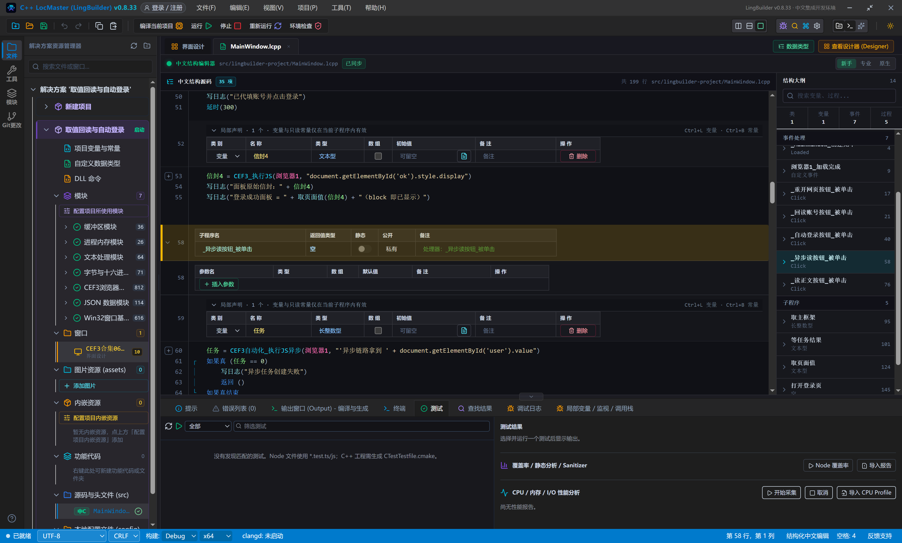

### 3.4 异步读：任务句柄三步

```lcpp
事件 _异步读按钮_被单击()
    局部 长整数型 任务
    任务 = CEF3自动化_执行JS异步(浏览器1, "'异步链路拿到 ' + document.getElementById('user').value")
    如果真 (任务 == 0)
        写日志("异步任务创建失败")
        返回 ()
    如果真结束
    写日志("任务已创建（编号 " + 到文本(任务) + "），轮询中……")
    局部 文本型 结果
    结果 = 等任务结果(任务)
    写日志("任务原始返回：" + 结果)
    如果真 (文本_开头为(结果, "{"))
        写日志("解析值 = " + 取页面值(结果))
    如果真结束
    CEF3任务_释放(任务)
    写日志("任务句柄已释放")
结束
```

`等任务结果` 是自己写的轮询子程序：**状态 0（进行中）就 `延时(50)` 再查**，超过 100 轮（约 5 秒）放弃；状态 2（成功）取结果，否则返回带状态码的错误文本：

```lcpp
文本型 等任务结果(长整数型 任务)
    局部 整数型 状态
    状态 = 0
    局部 整数型 轮次
    轮次 = 0
    判断循环首 (状态 == 0)
        延时(50)
        轮次 = 轮次 + 1
        如果真 (轮次 > 100)
            跳出循环
        如果真结束
        状态 = CEF3任务_取状态(任务)
    判断循环尾 ()
    局部 文本型 结果
    如果真 (状态 == 2)
        结果 = CEF3任务_取结果(任务)
    如果真结束
    如果真 (状态 != 2)
        结果 = "(任务未成功，状态=" + 到文本(状态) + "，轮次=" + 到文本(轮次) + ")"
    如果真结束
    返回 (结果)
结束
```

注意看日志里的「任务原始返回」——**异步任务的结果同样是 DevTools 信封**，所以代码里先判断 `文本_开头为(结果, "{")` 再解析。任务用完 `CEF3任务_释放`，不还句柄会泄漏。

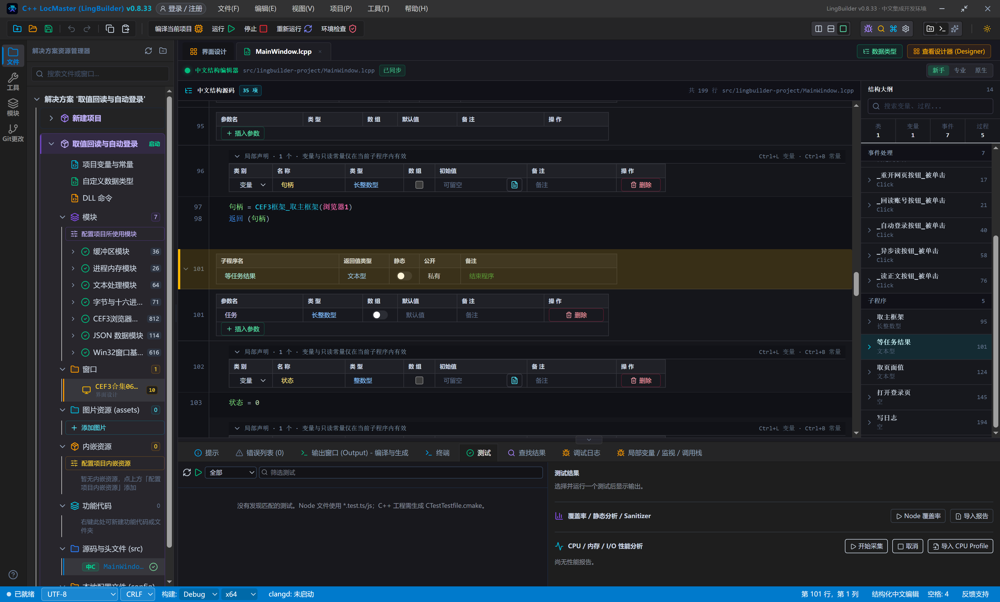

### 3.5 读页面正文：框架任务

```lcpp
事件 _读正文按钮_被单击()
    局部 长整数型 主框架
    主框架 = 取主框架()
    如果真 (主框架 == 0)
        返回 ()
    如果真结束
    局部 长整数型 任务
    任务 = CEF3框架_取文本异步(主框架)
    如果真 (任务 == 0)
        写日志("正文任务创建失败")
        返回 ()
    如果真结束
    局部 文本型 正文
    正文 = 等任务结果(任务)
    写日志("正文共 " + 到文本(文本_取长度(正文)) + " 字，前 60 字：")
    写日志(文本_取左边(正文, 60))
    CEF3任务_释放(任务)
结束
```

`CEF3框架_取文本异步(框架句柄)` 直接给页面**可见文本**（不是源码），同样走任务三步。取源码用隔壁的 `CEF3框架_取源码异步`，用法一模一样。

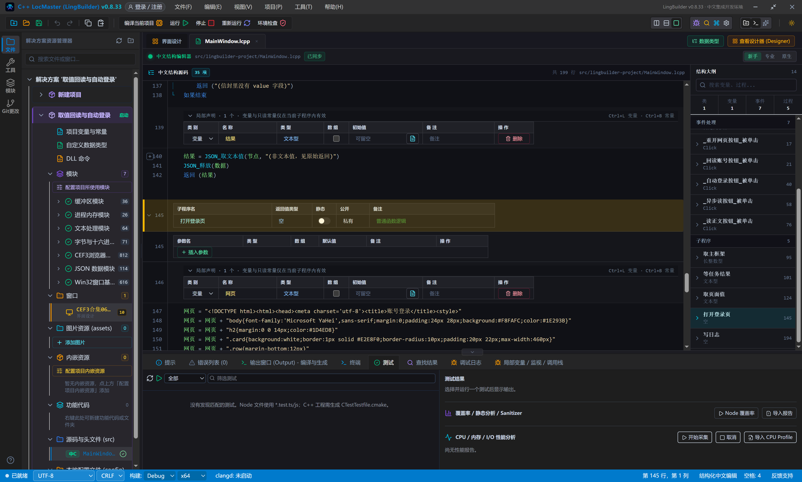

## 4. 编译：先看错误列表

点「编译当前项目」，底部「错误列表」是 (0)：

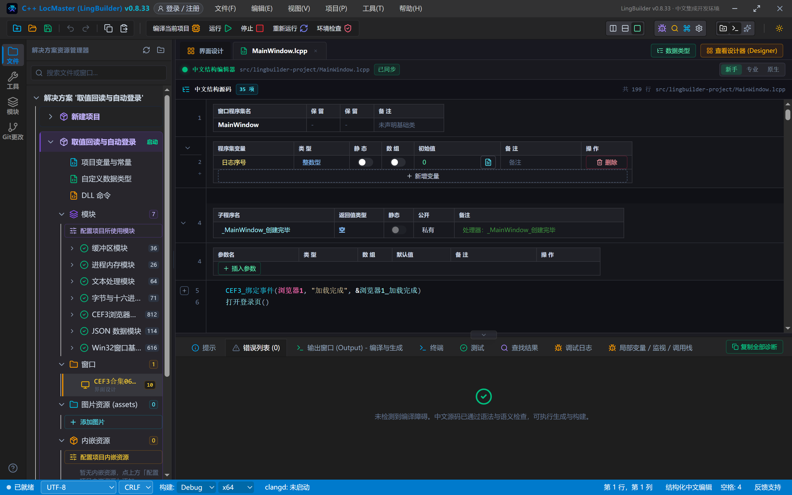

## 5. 运行：从读值到自动登录

点「运行」。登录页出现，0.7 秒后页面自己填好演示账号（用户名 xiaoling、密码圆点、记住我勾上），日志第 1 条报就绪：

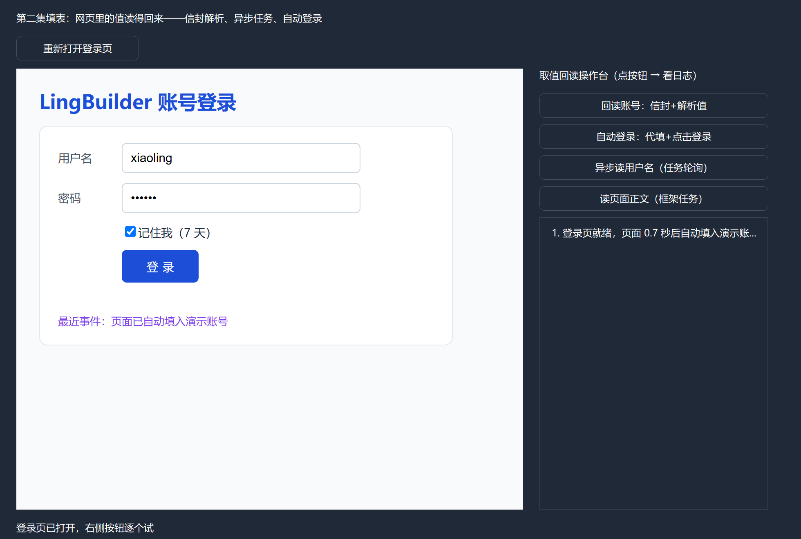

点「回读账号：信封+解析值」——日志里先是原始信封（`{"result":{"type":"string","valu...`），随后三行解析值：用户名 xiaoling、密码 lb2026、记住我 已勾选。**网页里的值，程序原样读了回来**：

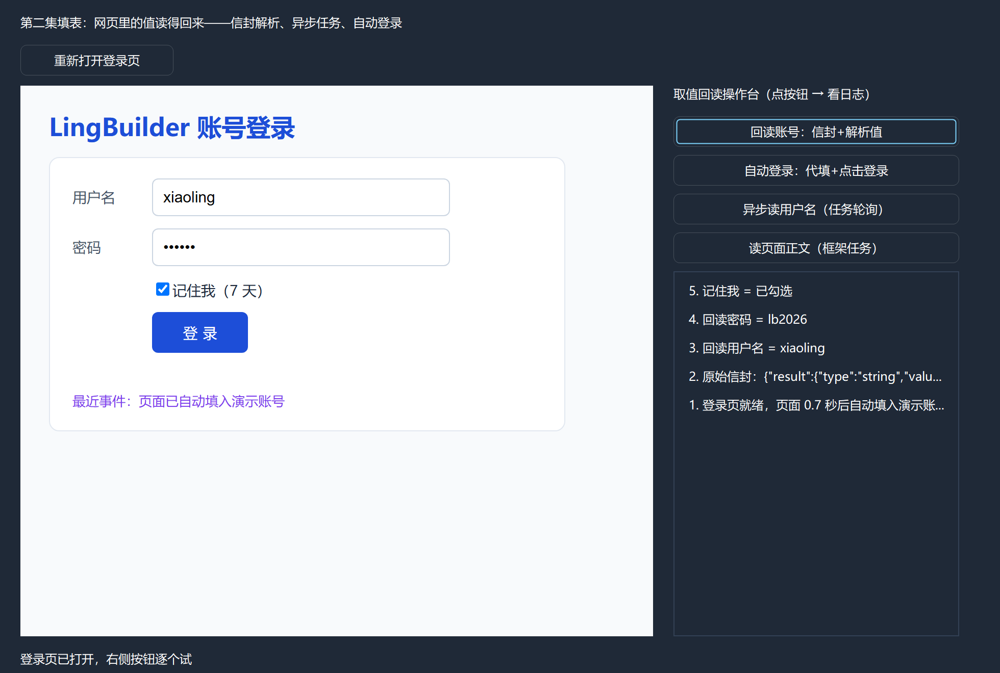

点「自动登录：代填+点击登录」——页面表单整块隐藏，绿色成功面板弹出「✔ 登录成功，欢迎回来：xiaoling（已记住 7 天）」，日志显示「登录成功面板 = block（block 即已显示）」：

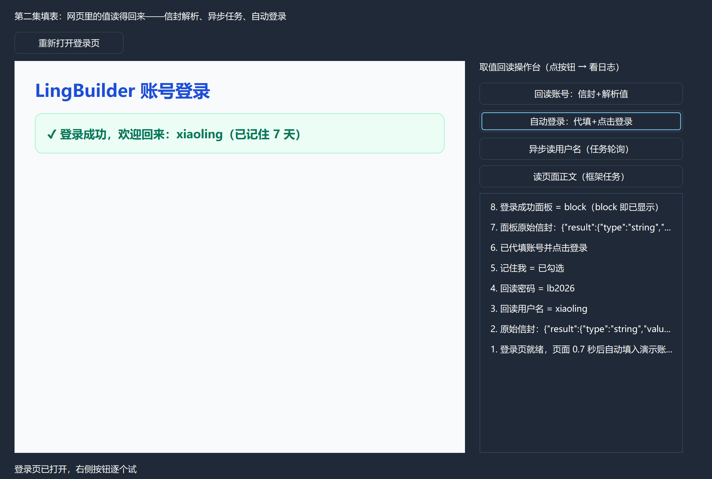

点「异步读用户名（任务轮询）」——日志依次出现：任务已创建（编号是个大负数，正常）→ 任务原始返回（信封）→ 解析值 = 异步链路拿到 xiaoling → 任务句柄已释放：

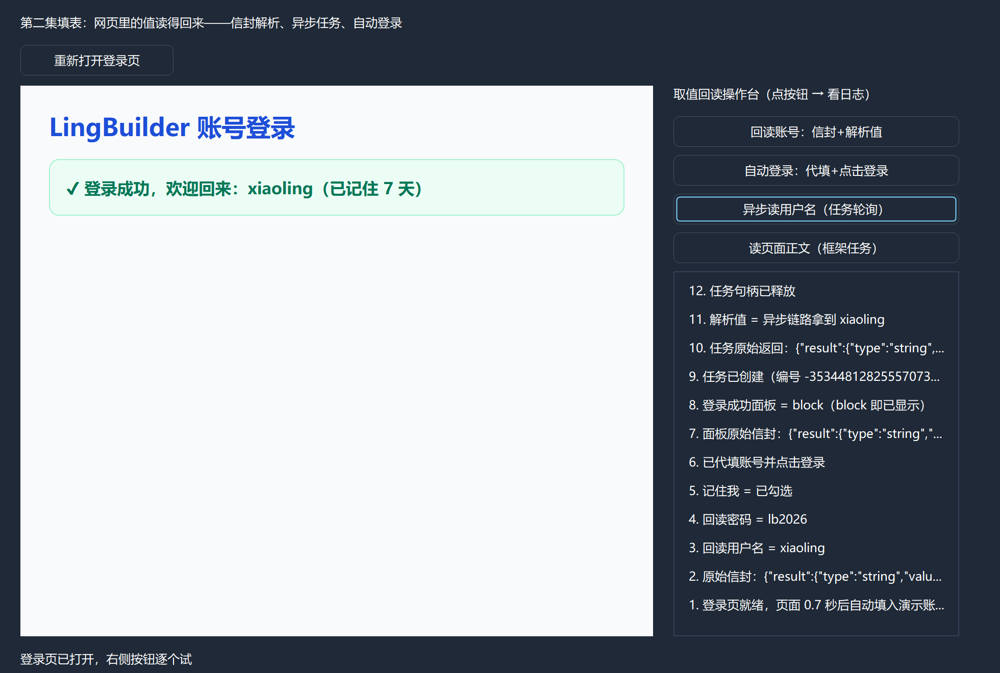

点「读页面正文（框架任务）」——日志报出「正文共 46 字」和前 60 字内容（登录成功面板的文字）：

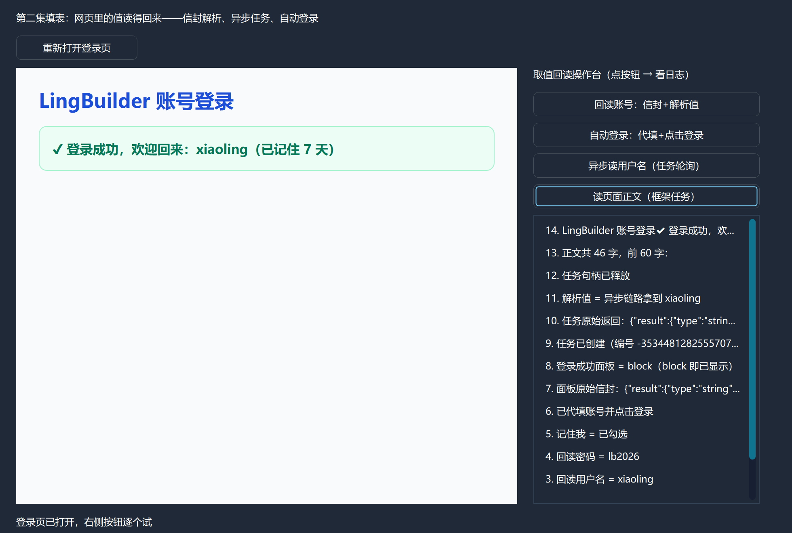

## 常见问题急救表

| 症状 | 原因 | 解法 |
| --- | --- | --- |
| 点击登录后读状态是空/旧值 | 填表命令投递到浏览器线程，读早了 | 写完就读之间加 `延时(300)`，或轮询确认 |
| 取页面值返回「(信封解析失败)」 | 执行 JS 报错，信封是异常结构 | 先把原始信封写日志看；JS 里单引号别打架 |
| JSON_取文本值 给出默认文本 | 信封 value 不是字符串 | 在 JS 里就把值转成文本（如 ternary） |
| 任务状态一直是 0 | 页面还没就绪或脚本死循环 | 轮询加轮次上限；确认 data: 地址守卫已过 |
| 任务句柄忘记释放 | 没调 CEF3任务_释放 | 每条任务路径（成功/失败）都要释放 |
| 回读密码是圆点 | 那是页面显示样式 | value 读回来是明文，本集演示即如此 |
| 报「未引用 JSON 数据模块」 | 信封解析需要它 | 模块面板启用 JSON 数据模块 |

## 本集小结

- 读值标准三步：`CEF3_执行JS` 拿信封 → `JSON_解析/指针_取/取文本值` → 拿值；勾选状态在 JS 里转成中文文本最省心。
- 异步两件套：`CEF3自动化_执行JS异步` 与 `CEF3框架_取文本异步` 都返回任务句柄，轮询 `取状态`（0 进行中 / 2 成功 / 3 失败）→ `取结果` → `释放`；任务结果可能也是信封，先看原始返回。
- **写完就读要隔一个延时**——填表命令是异步投递的，这是自动登录类脚本的头号坑。
- 自动登录 = 第 5 集的填表四连 + 本集的回读确认，拼起来就是完整闭环。

## 源码包

本集完整源码已打包为 **CEF3合集06-取值回读与自动登录.lcpppkg**（见[示例源码区](/demos)），导入即可运行对照学习。

**下一篇预告**：一个网页里不止一个框架——下一集把 iframe 的框架树数清楚：取框架数量、枚举标识、分清主框架和子框架。

[回合集总览](/guide/tutorials/cef3)
