# CEF3 合集 07 · 框架与 iframe（一）：框架树遍历

> 《LingBuilder CEF3 浏览器合集》第 7 集（填表与框架篇）。一个网页往往不止一层：主页面里嵌着 iframe，iframe 里还可能再嵌 iframe。CEF3 把每一层都叫**框架（Frame）**，并给了一套 25 条命令的「框架族」把整棵框架树查个底朝天。本集做一个框架树演示页，把**数框架、列标识、遍历报名、按名称定位、认父认焦点**一次跑通。全程约 35 分钟。
>
> **模块获取**：CEF3 浏览器模块**免费**（自动化子域要单独点「启用自动化」，见第 5 集）；本集还要 **JSON 数据模块**（标识列表是 JSON 数组，要解析它）。
>
> 前置要求：学过[第 5 集](/guide/tutorials/cef3-05)的填表族基础、[第 6 集](/guide/tutorials/cef3-06)的 JSON 模块。本集源码包见文末。

## 这一集你将学会

- 框架族核心 9 条：取主框架、取框架数量、取标识列表JSON、按标识取框架、按名称取框架、取父框架、取焦点框架、是否主框架、取名称/取标识
- **框架标识（Identifier）**与 **iframe 的 name** 是两码事：标识是 CEF 发的官方字符串，name 是网页作者起的别名
- 用 JSON 模块解析标识数组，写一个通用的「遍历框架树」子程序
- 报身份子程序：一句 `CEF3框架_是否主框架` 分清主框架和子框架

## 1. 框架族地图（本集用到的 9 条）

| 命令 | 参数 | 返回 | 干什么 |
| --- | --- | --- | --- |
| `CEF3框架_取主框架` | 控件名 | 长整数型句柄 | 主框架句柄；页面没起来时返回 0 |
| `CEF3框架_取框架数量` | 控件名 | 长整数型 | 主框架+全部 iframe 的总数 |
| `CEF3框架_取标识列表JSON` | 控件名 | 文本型 | 全部框架标识的 JSON 数组，如 `["5-9D87...","5-26B6..."]` |
| `CEF3框架_按标识取框架` | 控件名, 标识 | 长整数型句柄 | 按官方标识取框架，不存在返回 0 |
| `CEF3框架_按名称取框架` | 控件名, 名称 | 长整数型句柄 | 按 iframe 的 name 属性取，命中不了返回 0 |
| `CEF3框架_取父框架` | 框架句柄 | 长整数型句柄 | 子框架的爹；主框架返回 0 |
| `CEF3框架_取焦点框架` | 控件名 | 长整数型句柄 | 焦点在哪个框架；没有焦点框架返回 0 |
| `CEF3框架_是否主框架` | 框架句柄 | 整数型 | 1=主框架，0=子框架 |
| `CEF3框架_取名称 / 取标识` | 框架句柄 | 文本型 | 框架的 name / 官方标识 |

两条通用规矩：句柄判无效**只用 `== 0`**；句柄对应的框架被销毁后再用会返回稳定错误，遍历前最好重新取。

## 2. 设计界面

新建项目「框架树遍历」（同第 5 集流程），窗口 980×688（客户区 980×660）：

| 控件 | 名称 | 显示内容/属性 | 左距 | 顶距 | 宽度 | 高度 |
| --- | --- | --- | --- | --- | --- | --- |
| 标签 | 说明标签 | 主框架里嵌 ad、chat 两个 iframe：数框架、列标识、按名称定位、认焦点框架 | 20 | 14 | 620 | 22 |
| 按钮 | 重开网页按钮 | 重新打开框架页 | 20 | 44 | 150 | 30 |
| **CEF3浏览器** | **浏览器1** | 打开地址 = about:blank | 20 | 84 | 620 | 540 |
| 标签 | 操作台标题 | 框架遍历操作台（点按钮 → 看日志） | 660 | 84 | 280 | 22 |
| 按钮 | 数框架按钮 | 取框架数量 | 660 | 114 | 280 | 30 |
| 按钮 | 列标识按钮 | 列出全部框架标识（JSON） | 660 | 152 | 280 | 30 |
| 按钮 | 遍历框架按钮 | 遍历框架：逐个报身份 | 660 | 190 | 280 | 30 |
| 按钮 | 找聊天框按钮 | 按名称找「chat」并认父 | 660 | 228 | 280 | 30 |
| 按钮 | 焦点框架按钮 | 当前焦点在哪个框架 | 660 | 266 | 280 | 30 |
| 列表框 | 操作日志 | （空） | 660 | 304 | 280 | 320 |
| 标签 | 状态标签 | 就绪 | 20 | 638 | 920 | 22 |

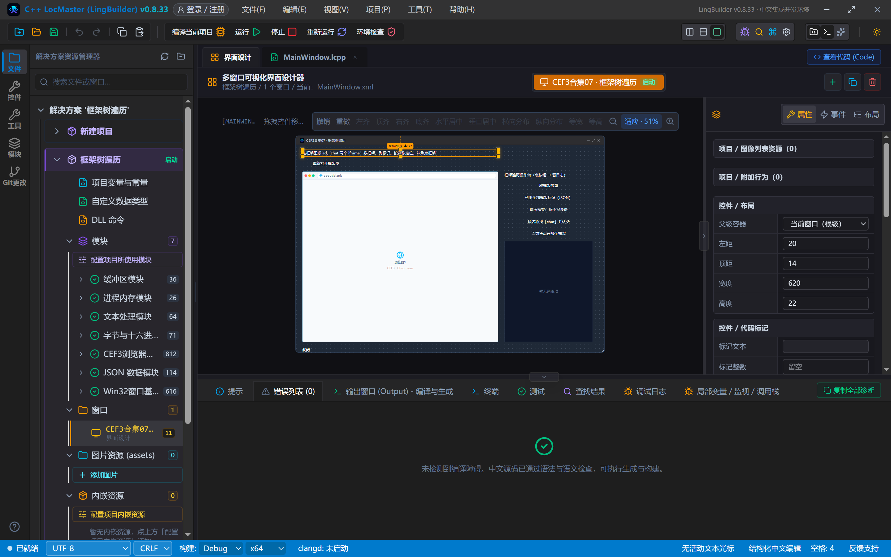

演示页仍是 data: 地址（第 4 集的规矩）：主页面里嵌 `name=ad`（广告位）和 `name=chat`（聊天）两个 iframe。这里有个**本集新技巧**——iframe 的页面也是我们拼的 HTML，先转 Base64，再用 `文本_替换` 把占位符 `__A__`/`__B__` 换成 data: 地址，嵌套页面也能自包含：

```lcpp
局部 文本型 头像地址
头像地址 = "data:text/html;charset=utf-8;base64," + 字节集_Base64编码(字节集_从文本(子页C))
子页B = 文本_替换(子页B, "__C__", 头像地址)
```

## 3. 写代码

### 3.1 创建完毕：绑定加载完成 + data: 守卫

和前几集同款：绑定「加载完成」，用 `CEF3_取地址` + `文本_开头为(地址, "data:")` 确认页面真就绪（about:blank 也会触发一次加载完成）。

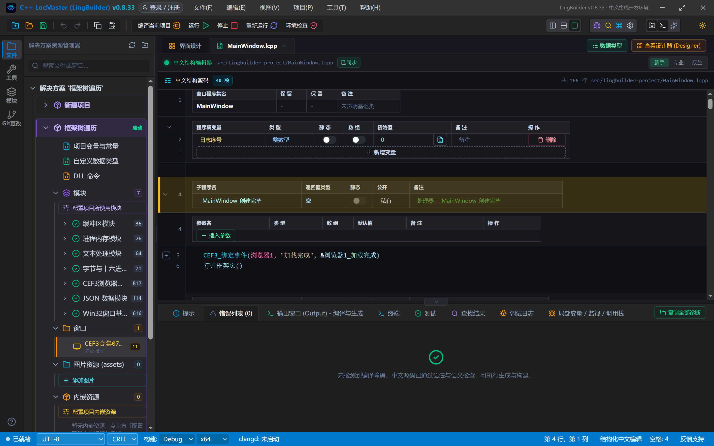

### 3.2 数框架、列标识：两条查询命令

```lcpp
事件 _数框架按钮_被单击()
    局部 长整数型 数量
    数量 = CEF3框架_取框架数量(浏览器1)
    写日志("当前框架数量 = " + 到文本(数量))
结束

事件 _列标识按钮_被单击()
    局部 文本型 列表
    列表 = CEF3框架_取标识列表JSON(浏览器1)
    写日志("标识列表JSON = " + 列表)
结束
```

注意**时机**：iframe 是页面加载过程中陆续挂载的，导航刚完成时数量可能是 1（只有主框架），等一两秒再点才是最终数量。

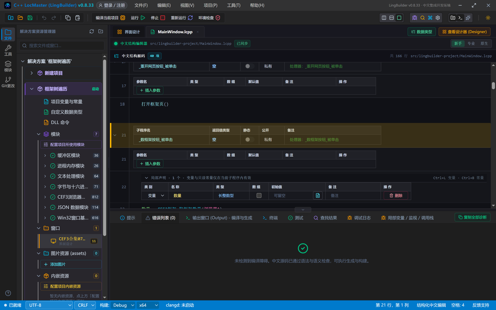

### 3.3 遍历框架：JSON 数组解析 + 逐个报身份

这是本集的主角——**取标识列表 → JSON 解析 → 循环取框架 → 报身份**：

```lcpp
事件 _遍历框架按钮_被单击()
    局部 文本型 列表
    列表 = CEF3框架_取标识列表JSON(浏览器1)
    局部 JSON值 数组
    数组 = JSON_解析(列表)
    如果 (数组 = 0)
        写日志("标识列表解析失败")
        返回 ()
    如果结束
    局部 整数型 数量
    数量 = JSON_数组_数量(数组)
    写日志("开始遍历，共 " + 到文本(数量) + " 个框架：")
    局部 整数型 序号
    序号 = 0
    计次循环首 (数量, 序号)
        局部 JSON值 项
        项 = JSON_数组_取(数组, 序号 - 1)
        局部 文本型 标识
        标识 = JSON_取文本值(项, "")
        局部 长整数型 框架
        框架 = CEF3框架_按标识取框架(浏览器1, 标识)
        如果真 (框架 == 0)
            写日志("框架 " + 到文本(序号 - 1) + "：句柄已失效")
        如果真结束
        如果真 (框架 != 0)
            报身份(框架, 标识)
        如果真结束
        JSON_释放(项)
    计次循环尾 ()
    JSON_释放(数组)
结束
```

四个要点：

1. `JSON_数组_取(数组, 索引)` 的索引**从 0 起**，而 `计次循环首` 的序号从 1 起，所以取值用 `序号 - 1`；
2. `JSON_数组_取` 返回的是**深度副本**，每个都要单独 `JSON_释放`，循环结束后整个数组也要释放；
3. 框架可能在遍历途中被销毁，`按标识取框架` 返回 0 要有心理准备，日志里如实记录；
4. 这段循环加上 `报身份` 就是通用的框架树遍历器，以后任何网页都能用。

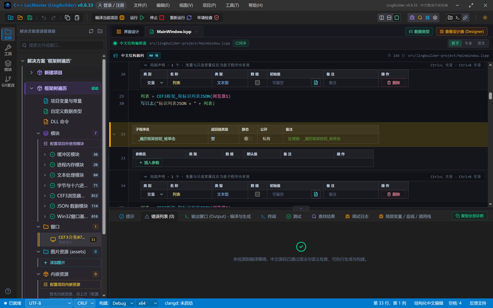

`报身份` 子程序用 `CEF3框架_是否主框架` 分清主/子，再带上 name 和标识：

```lcpp
空 报身份(长整数型 框架, 文本型 来源)
    局部 整数型 是主
    是主 = CEF3框架_是否主框架(框架)
    局部 文本型 名称
    名称 = CEF3框架_取名称(框架)
    局部 文本型 标识
    标识 = CEF3框架_取标识(框架)
    局部 文本型 身份
    如果真 (是主 == 1)
        身份 = "主框架"
    如果真结束
    如果真 (是主 != 1)
        身份 = "子框架"
    如果真结束
    如果真 (名称 != "")
        身份 = 身份 + " name=" + 名称
    如果真结束
    写日志(身份 + " " + 来源 + " 标识=" + 标识)
结束
```

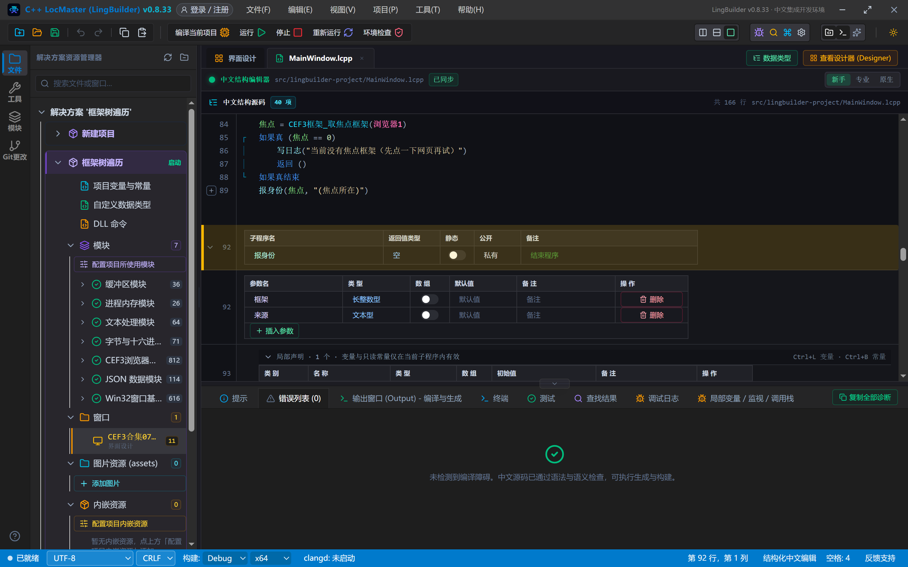

### 3.4 按名称找 chat 并认父

```lcpp
事件 _找聊天框按钮_被单击()
    局部 长整数型 聊天框
    聊天框 = CEF3框架_按名称取框架(浏览器1, "chat")
    如果真 (聊天框 == 0)
        写日志("没找到 name=chat 的框架")
        返回 ()
    如果真结束
    报身份(聊天框, "(按名称取得)")
    局部 长整数型 父框架
    父框架 = CEF3框架_取父框架(聊天框)
    如果真 (父框架 == 0)
        写日志("chat 没有父框架")
        返回 ()
    如果真结束
    报身份(父框架, "(chat 的父框架)")
结束
```

实战里 iframe 往往没有 name（第三方广告、统计框），这时只能靠**标识遍历**；有 name 的框架（登录框、播放器）用 `按名称取框架` 一步到位。`取父框架` 对主框架返回 0——这也是判断「这个框架是不是顶层」的第二种办法。

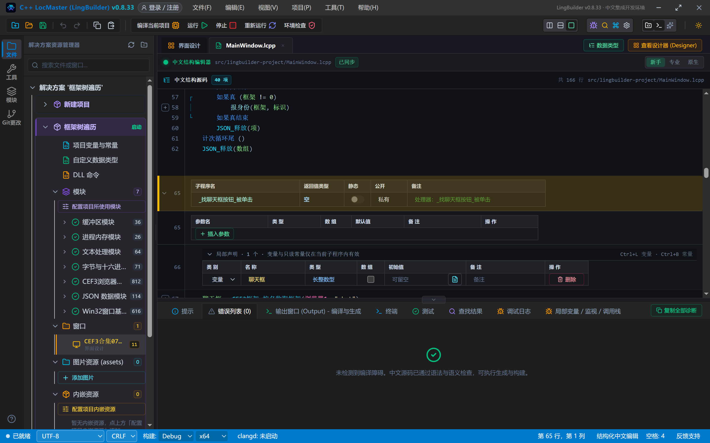

### 3.5 焦点框架

```lcpp
局部 长整数型 焦点
焦点 = CEF3框架_取焦点框架(浏览器1)
如果真 (焦点 == 0)
    写日志("当前没有焦点框架（先点一下网页再试）")
    返回 ()
如果真结束
报身份(焦点, "(焦点所在)")
```

网页里的输入框被点了，焦点框架就是它所在的 iframe——做「往哪个框里填」的判断时很有用。没有焦点框架时返回 0，程序要接得住。

## 4. 编译：先看错误列表

点「编译当前项目」，底部「错误列表」是 (0)：

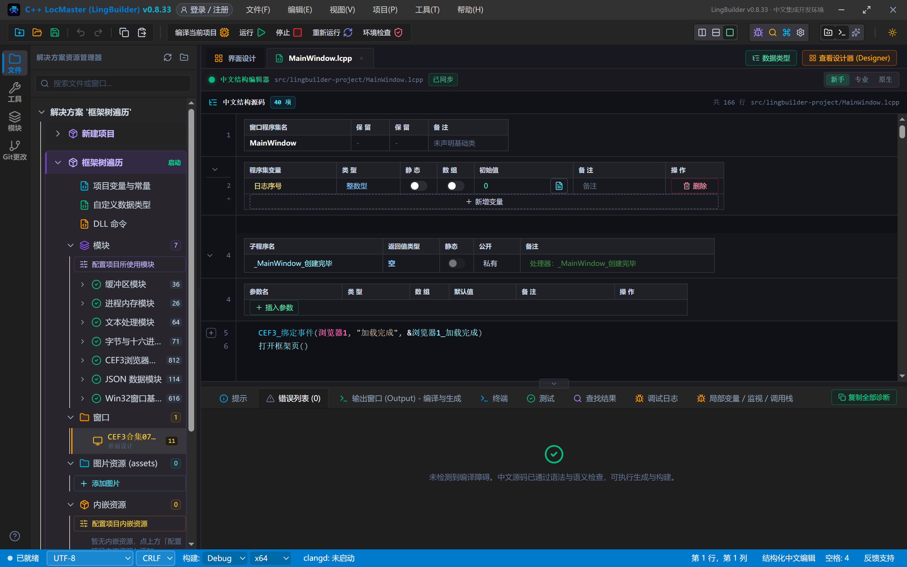

## 5. 运行：把框架树查个底朝天

点「运行」，框架页出现，日志连报三条「框架页就绪」——**主框架和两个 iframe 各触发一次加载完成**（第 5 集的 data: 守卫保证日志只认加载完成的页面）：

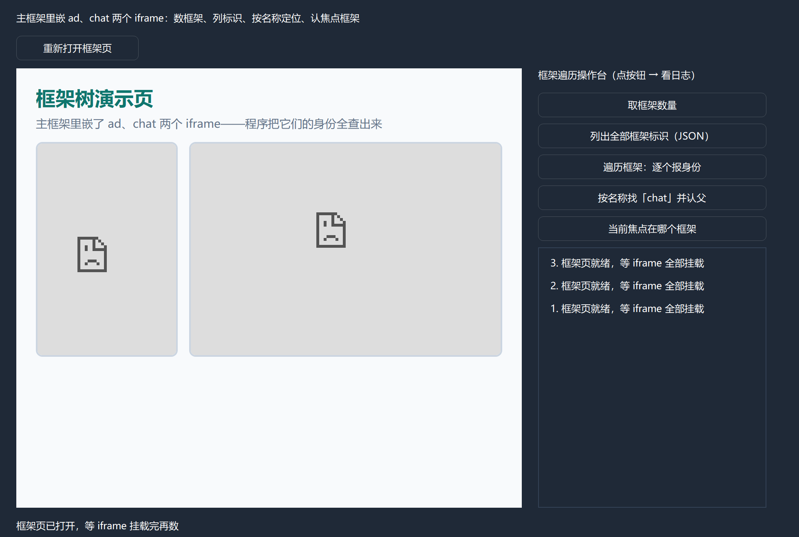

点「取框架数量」——`3`（主框架 + ad + chat）：

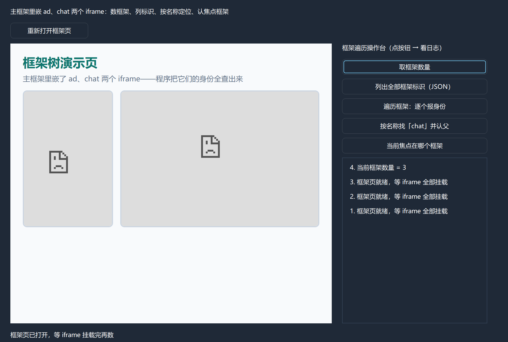

点「列出全部框架标识（JSON）」——拿到一个 JSON 数组，形如 `["5-7612...","5-D3A3...","5-B566..."]`：

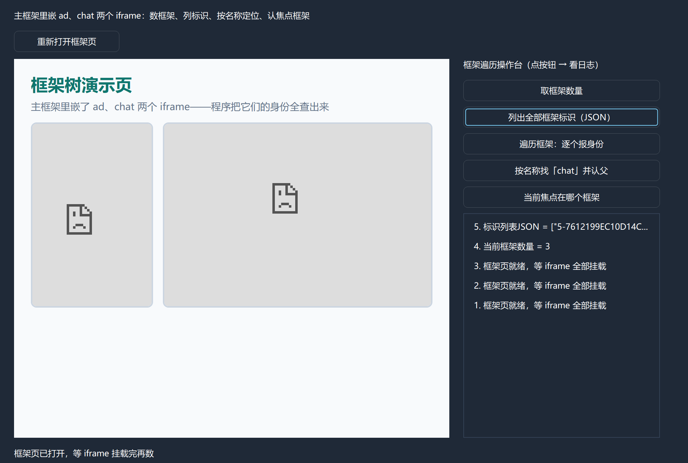

点「遍历框架：逐个报身份」——三个框架挨个报名：主框架、子框架 name=ad、子框架 name=chat，每个都带官方标识：

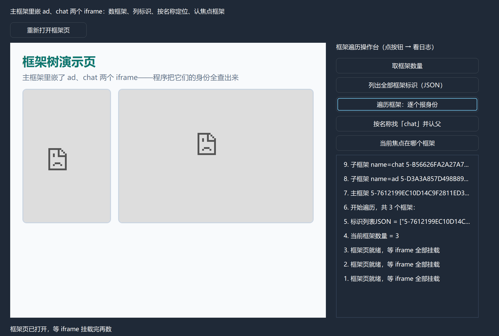

点「按名称找『chat』并认父」——先报 chat 的身份，再报它爹：**主框架**（chat 的父框架）。一查便知 chat 是直接嵌在主页里的：

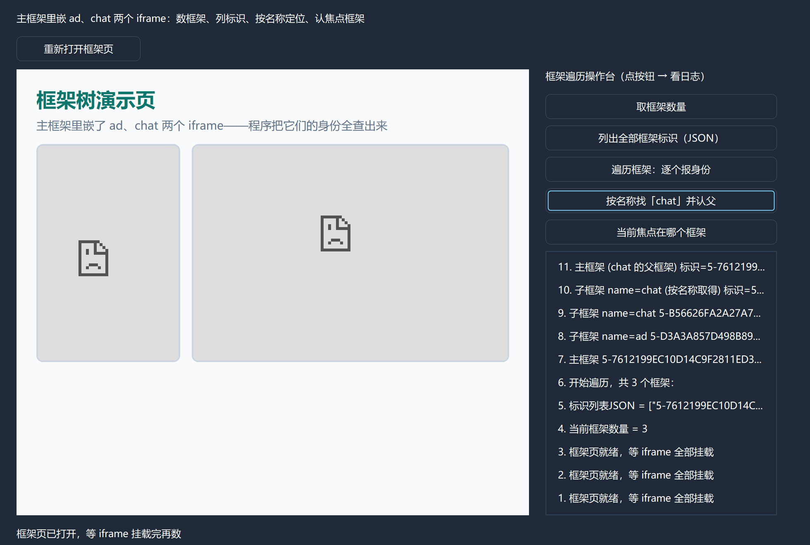

点「当前焦点在哪个框架」——没点过网页时焦点框架为空，程序如实报告；先用鼠标点一下网页里任意位置再点按钮，就会报「主框架 (焦点所在)」：

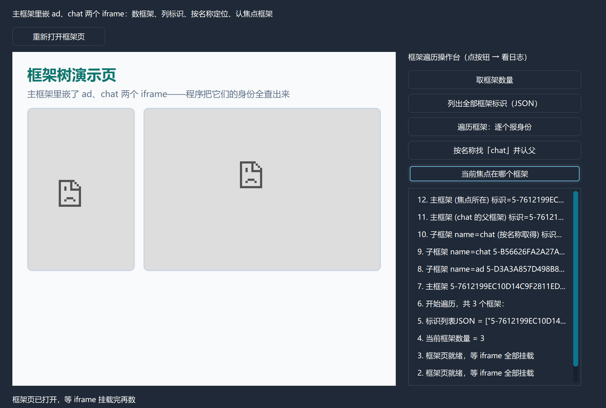

## 常见问题急救表

| 症状 | 原因 | 解法 |
| --- | --- | --- |
| 框架数量一会儿是 1 一会儿是 3 | iframe 陆续挂载 | 导航完成后等 1~2 秒再数；或用「加载完成」+ 计数确认 |
| 按名称取框架返回 0 | 该 iframe 没写 name 属性 | 无名框架只能靠标识遍历定位 |
| 遍历中「句柄已失效」 | 框架在遍历途中被销毁（页面跳转/广告刷新） | 如实记录即可；操作前重新按标识取一次 |
| 焦点框架恒为 0 | 焦点还在原生窗口上 | 先点一下网页内容再取 |
| 标识列表解析失败 | 页面还没产生框架（数量 0 时是 `[]`，解析得过去） | 确认 data: 守卫已过、页面真的加载了 |
| 程序整页 Aw, Snap!（STATUS_BREAKPOINT） | 本机 GPU 兼容问题，CEF 150 的 GPU 进程反复崩溃拖垮渲染进程 | 更新显卡驱动；开发期可设系统环境变量 `LB_CEF3_TEST_DISABLE_GPU=1` 再启动 IDE（运行会继承） |
| 页面里的 iframe 内容加载不出来（框架能枚举） | data: 页面是不透明源，子框架导航被策略拦截 | 多框架演示页放 **assets 目录**用 `CEF3_取资源地址` 导航（第 8 集示范）；本集枚举不受影响 |
| 报「未引用 JSON 数据模块」 | 解析标识数组需要它 | 模块面板启用 JSON 数据模块 |

## 本集小结

- 框架树三件套：`取框架数量` 知道有几层，`取标识列表JSON` 拿到全部身份牌，`按标识取框架` 逐个上手。
- **标识 ≠ name**：标识是 CEF 发的（遍历用），name 是网页写的（定位用）；`是否主框架` 一句分主子，`取父框架` 认亲戚。
- 遍历器 = JSON 数组解析 + 计次循环 + 报身份子程序，注意索引从 0 起、JSON 值要逐个释放。
- 下一集就在这些框架里动手：跨框架取源码、执行 JS、填表。

## 源码包

本集完整源码已打包为 **CEF3合集07-框架树遍历.lcpppkg**（见[示例源码区](/demos)），导入即可运行对照学习。

**下一篇预告**：框架与 iframe（二）——拿到子框架句柄之后，跨框架取源码、执行 JS、代填表单。

[回合集总览](/guide/tutorials/cef3)
