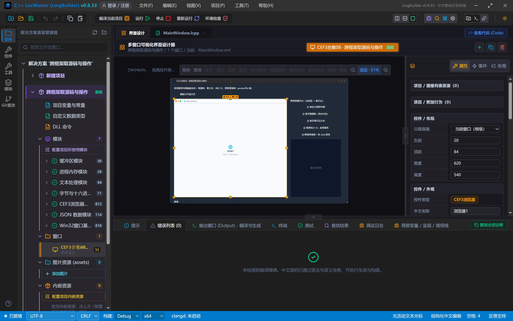
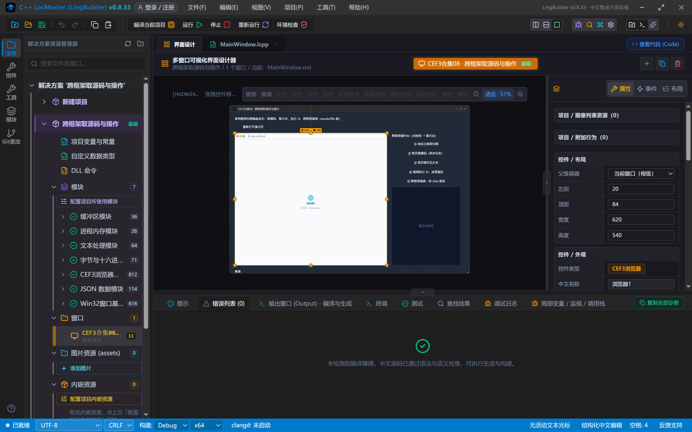
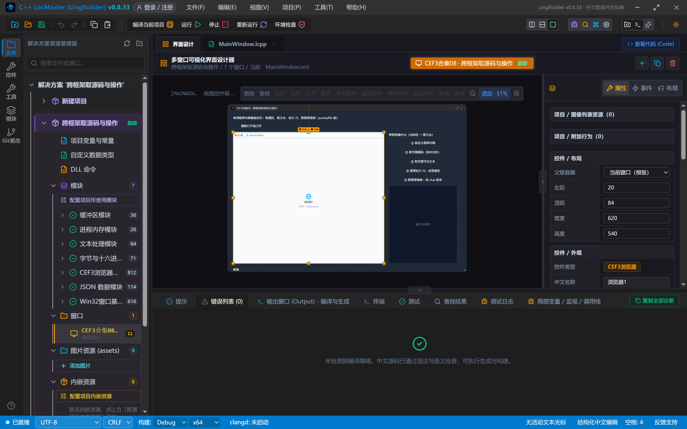
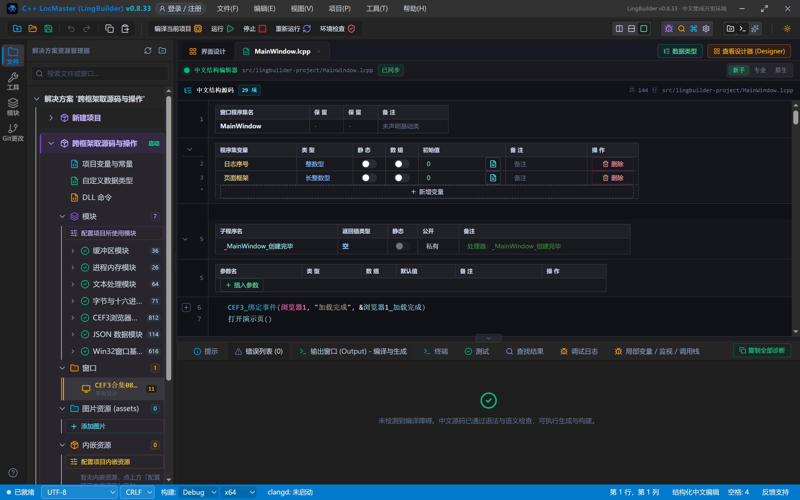
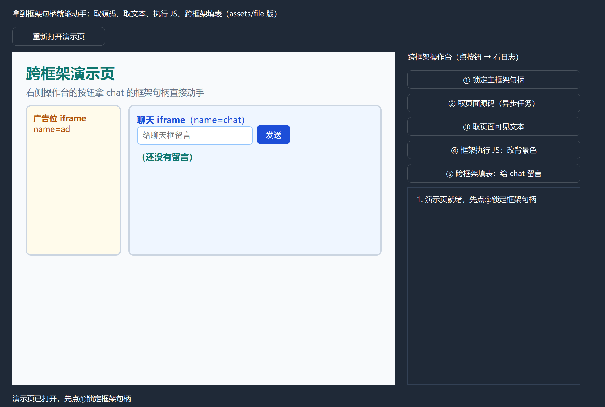
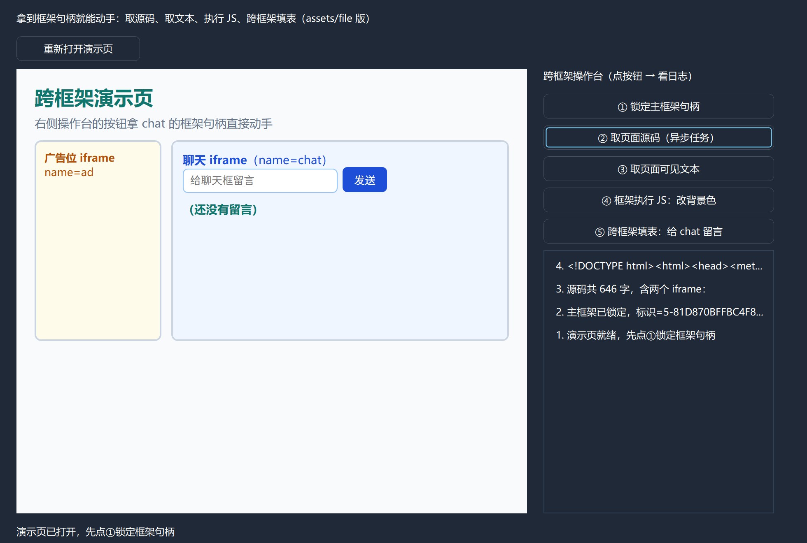
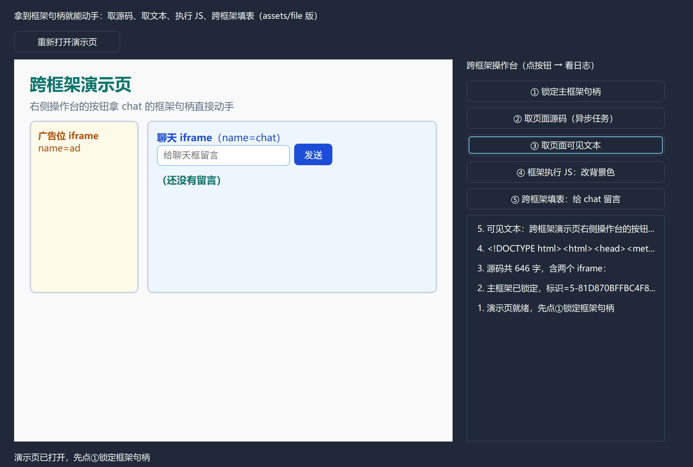
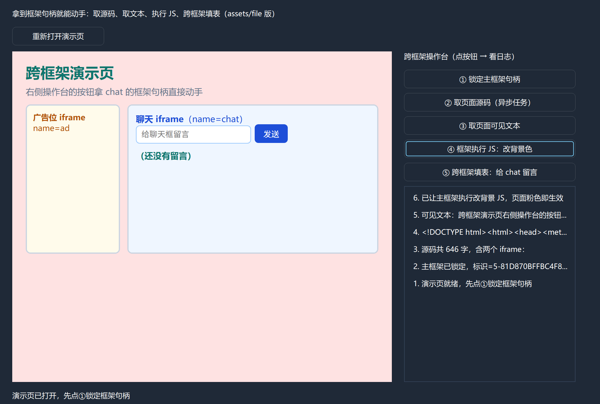
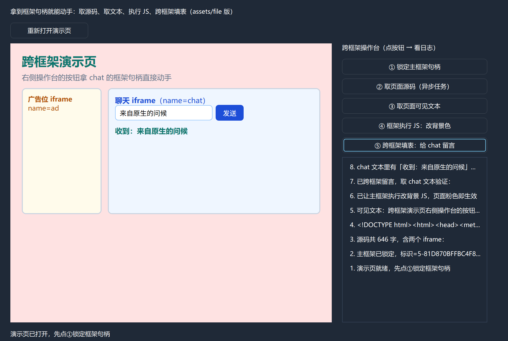

# CEF3 合集 08 · 框架与 iframe（二）：跨框架取源码与操作

> 《LingBuilder CEF3 浏览器合集》第 8 集（填表与框架篇）。第 7 集我们能把框架树查个底朝天，这一集正式**动手**：拿到框架句柄之后，四类操作挨个来——**取页面源码、取可见文本、框架执行 JS、跨框架填表**。演示页里嵌了一个「聊天 iframe」，程序的按钮直接把留言写进它、替它点发送、再取它的文本回读验证。全程约 35 分钟。
>
> **模块获取**：CEF3 浏览器模块**免费**（自动化子域单独启用，见第 5 集）；另需 JSON 数据模块与文本处理模块。
>
> 前置要求：学过[第 6 集](/guide/tutorials/cef3-06)的异步任务轮询、[第 7 集](/guide/tutorials/cef3-07)的框架句柄。本集源码包见文末。

## 这一集你将学会

- `CEF3框架_取源码异步` / `CEF3框架_取文本异步`：对**指定框架**取完整 HTML 源码 / 可见文本（异步任务三步）
- `CEF3框架_执行JS(框架句柄, 脚本, "", 1)`：在**指定框架**里执行 JS
- **真·跨框架填表**：`CEF3框架_按名称取框架` 拿到 iframe 句柄后，`CEF3填表_赋值/点击元素` 直接往 iframe 里填、替它点按钮，再取它的文本回读验证
- 新利器 **`CEF3_取资源地址`**：把随程序部署的 assets 文件变成可导航地址——多框架演示页的正路
- 新属性「**禁用 GPU 加速**」：部分显卡驱动下 CEF GPU 进程反复崩溃（整页 Aw, Snap!）的官方解法

## 1. 演示页这次用 assets 部署（重要经验）

第 5~7 集的页面都是 data: 地址。但**多框架页面别用 data: 当主框架地址**：data: 页面是不透明源，它里面的 iframe 会被浏览器策略拦下（实测 data:/srcdoc 子页加载不出来，部分环境甚至整页崩溃）。正路是：**演示页 HTML 放进项目的 assets 目录，用 `CEF3_取资源地址("main.html")` 导航**——file:// 同源下 iframe 一切正常。

做法：在项目的 `assets` 目录里放三个文件——`main.html`（主页面，嵌两个 iframe）、`chat.html`（聊天子页：输入框+发送按钮+留言显示）、`ad.html`（广告位子页）。构建时会自动复制到 exe 同级 `assets/`，源码包也会带上它们，谁导入都能跑。

`chat.html` 里的关键部分：输入框 `#msg`、发送按钮 `#send`、显示区 `#inbox`，点击发送后显示「收到：×××」——**它就是等着被原生程序跨框架操作的靶子**。

## 2. 设计界面

| 控件 | 名称 | 显示内容/属性 | 左距 | 顶距 | 宽度 | 高度 |
| --- | --- | --- | --- | --- | --- | --- |
| 标签 | 说明标签 | 拿到框架句柄就能动手：取源码、取文本、执行 JS、跨框架填表（assets/file 版） | 20 | 14 | 620 | 22 |
| 按钮 | 重开网页按钮 | 重新打开演示页 | 20 | 44 | 150 | 30 |
| **CEF3浏览器** | **浏览器1** | 打开地址 = about:blank；**勾选「禁用 GPU 加速」** | 20 | 84 | 620 | 540 |
| 标签 | 操作台标题 | 跨框架操作台（点按钮 → 看日志） | 660 | 84 | 280 | 22 |
| 按钮 | 锁框架按钮 | ① 锁定主框架句柄 | 660 | 114 | 280 | 30 |
| 按钮 | 取源码按钮 | ② 取页面源码（异步任务） | 660 | 152 | 280 | 30 |
| 按钮 | 取文本按钮 | ③ 取页面可见文本 | 660 | 190 | 280 | 30 |
| 按钮 | 改背景按钮 | ④ 框架执行 JS：改背景色 | 660 | 228 | 280 | 30 |
| 按钮 | 填表按钮 | ⑤ 跨框架填表：给 chat 留言 | 660 | 266 | 280 | 30 |
| 列表框 | 操作日志 | （空） | 660 | 304 | 280 | 320 |
| 标签 | 状态标签 | 就绪 | 20 | 638 | 920 | 22 |

程序集变量：`日志序号`（整数型）、`页面框架`（**长整数型**）。选中浏览器控件，在属性面板勾选「**禁用 GPU 加速**」——生成程序会在 CEF 初始化前自动追加 disable-gpu 开关，规避 GPU 进程反复崩溃：



## 3. 写代码

### 3.1 创建完毕 + 打开演示页

```lcpp
事件 _MainWindow_创建完毕()
    CEF3_绑定事件(浏览器1, "加载完成", &浏览器1_加载完成)
    打开演示页()
结束

事件 浏览器1_加载完成()
    局部 文本型 地址
    地址 = CEF3_取地址(浏览器1)
    如果真 (文本_结尾为(地址, "assets/main.html"))
        写日志("演示页就绪，先点①锁定框架句柄")
    如果真结束
结束

事件 _重开网页按钮_被单击()
    页面框架 = 0
    打开演示页()
结束
```

页面就绪守卫从 data: 换成了 **`文本_结尾为(地址, "assets/main.html")`**——file:// 地址很长且带机器路径，判断结尾最稳。「重开网页」里把 `页面框架` 清零：**框架句柄跟着框架生死，导航之后旧句柄不能再信**。

`打开演示页` 只有两行核心：

```lcpp
局部 文本型 页面地址
页面地址 = CEF3_取资源地址("main.html")
CEF3_导航(浏览器1, 页面地址)
```


### 3.2 锁定句柄 + 取源码/取文本（异步任务三步）

```lcpp
事件 _锁框架按钮_被单击()
    局部 长整数型 句柄
    句柄 = CEF3框架_取主框架(浏览器1)
    如果真 (句柄 == 0)
        写日志("还没取到主框架，等页面就绪")
        返回 ()
    如果真结束
    页面框架 = 句柄
    局部 文本型 标识
    标识 = CEF3框架_取标识(句柄)
    写日志("主框架已锁定，标识=" + 标识)
结束
```

取源码/取文本一模一样，只换异步命令：

```lcpp
局部 长整数型 任务
任务 = CEF3框架_取源码异步(页面框架)
如果真 (任务 == 0)
    写日志("源码任务创建失败")
    返回 ()
如果真结束
局部 文本型 源码
源码 = 等任务结果(任务)
CEF3任务_释放(任务)
写日志("源码共 " + 到文本(文本_取长度(源码)) + " 字，含两个 iframe：")
写日志(文本_取左边(源码, 80))
```

`等任务结果` 是第 6 集的轮询子程序（上限放宽到 300 轮≈15 秒）。




### 3.3 框架执行 JS

```lcpp
CEF3框架_执行JS(页面框架, "document.body.style.background='#FEE2E2'; document.title='主框架被原生改色';", "", 1)
写日志("已让主框架执行改背景 JS，页面粉色即生效")
```

这条命令**不返回值**，最可靠的验证就是页面本身：背景变粉、标记出现。



### 3.4 真跨框架填表：往 chat iframe 里写

```lcpp
事件 _填表按钮_被单击()
    局部 长整数型 聊天框
    聊天框 = CEF3框架_按名称取框架(浏览器1, "chat")
    如果真 (聊天框 == 0)
        写日志("没找到 name=chat 的框架，等 iframe 挂载完")
        返回 ()
    如果真结束
    CEF3填表_赋值(聊天框, "#msg", -1, "来自原生的问候")
    CEF3填表_点击元素(聊天框, "#send", -1)
    延时(300)
    写日志("已跨框架留言，取 chat 文本验证：")
    局部 长整数型 任务
    任务 = CEF3框架_取文本异步(聊天框)
    如果真 (任务 == 0)
        返回 ()
    如果真结束
    局部 文本型 正文
    正文 = 等任务结果(任务)
    CEF3任务_释放(任务)
    局部 逻辑型 有留言
    有留言 = 文本_是否包含(正文, "收到：来自原生的问候")
    如果真 (有留言)
        写日志("chat 文本里有「收到：来自原生的问候」——跨框架填表成功")
    如果真结束
    如果真 (有留言 == 假)
        写日志("chat 文本里还没有留言，稍后再试")
    如果真结束
结束
```

这是全合集到目前为止最「跨」的一段：**第 7 集拿 iframe 句柄 → 第 5 集填表四连（第一参换成 iframe 句柄）→ 第 6 集延时+轮询回读验证**，三层楼叠在十行里。`文本_是否包含` 返回**逻辑型**，变量要用 `逻辑型` 声明。


## 4. 编译：先看错误列表

点「编译当前项目」，底部「错误列表」是 (0)；构建日志里会看到 assets 三个 html 已复制到 exe 同级 `assets/`：



## 5. 运行：四类操作 + 真跨框架

点「运行」，演示页出现，**chat iframe 完整渲染**（留言板可见）。依次点五个按钮：

- ① 锁定主框架句柄 → 日志报标识；
- ② 取页面源码 → 「源码共 646 字」，前 80 字能看到两个 iframe 标签；
- ③ 取页面可见文本 → 「可见文本：跨框架演示页…」；
- ④ 框架执行 JS → **整个页面变粉色**；
- ⑤ 跨框架填表 → chat 的输入框出现「来自原生的问候」、留言板显示「收到：来自原生的问候」，日志确认「跨框架填表成功」：











## 常见问题急救表

| 症状 | 原因 | 解法 |
| --- | --- | --- |
| data:/srcdoc 页面里的 iframe 加载不出来 | data: 页面是不透明源，子框架导航被策略拦截 | 多框架页面放 **assets 目录**，用 `CEF3_取资源地址` 导航（本集做法） |
| 整页 Aw, Snap!（STATUS_BREAKPOINT） | GPU 兼容问题：CEF GPU 进程反复崩溃拖垮渲染进程 | 浏览器控件勾选「**禁用 GPU 加速**」属性；或更新显卡驱动 |
| 句柄用一次就失效 | 导航/刷新后旧框架销毁 | 每次导航后重新锁定；「重开」按钮里清零句柄变量 |
| 按名称取框架返回 0 | iframe 还没挂载完 | 等主页面加载完成后 1~2 秒再取 |
| 跨框架填表后马上读不到 | 填表是异步投递 | 点击与验证之间隔 `延时(300)` |
| `文本_是否包含` 赋给整数型报错 | 它返回**逻辑型** | 变量声明 `逻辑型` |
| 任务一直状态 0 | 框架正忙 | 轮询带上限（300 轮≈15 秒），超时如实报告 |

## 本集小结

- 框架句柄四类操作：`取源码异步`、`取文本异步`（任务三步）、`执行JS`（同步投递）、`填表/点击元素`（第一参换成目标框架句柄就是跨框架）。
- **多框架页面走 assets+取资源地址**，别用 data: 当主框架地址（不透明源的 iframe 会被拦）。
- 新属性「禁用 GPU 加速」：勾上即可，生成程序在 CEF 初始化前自动加开关。
- 句柄生命周期跟着框架走：导航后重锁、程序集变量清零。

## 源码包

本集完整源码已打包为 **CEF3合集08-跨框架取源码与操作.lcpppkg**（含 assets 三个 html，见[示例源码区](/demos)），导入即可运行对照学习。

**下一篇预告**：资源拦截篇开始——网页的每一个请求都能被看见：网络族 27 条命令，读正文、看状态码、翻响应头。

[回合集总览](/guide/tutorials/cef3)
