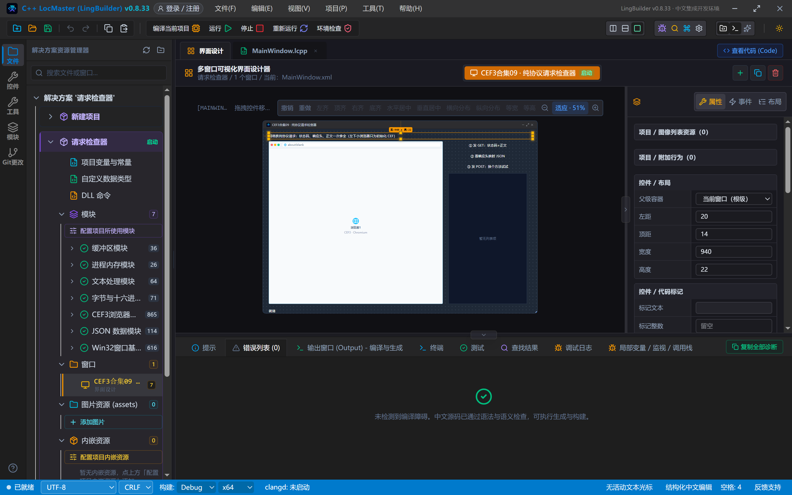
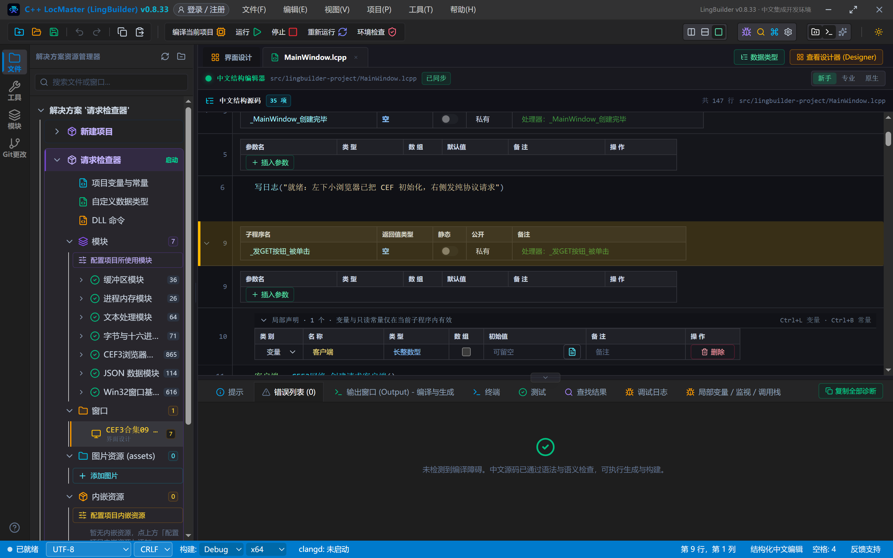
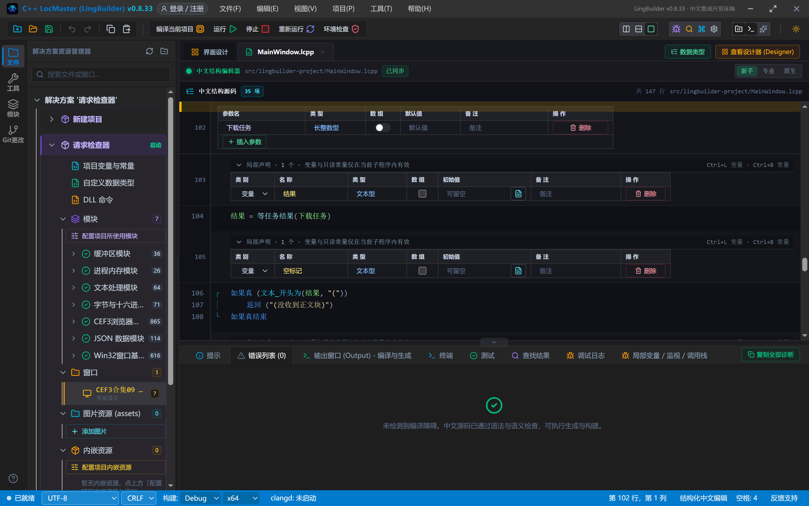
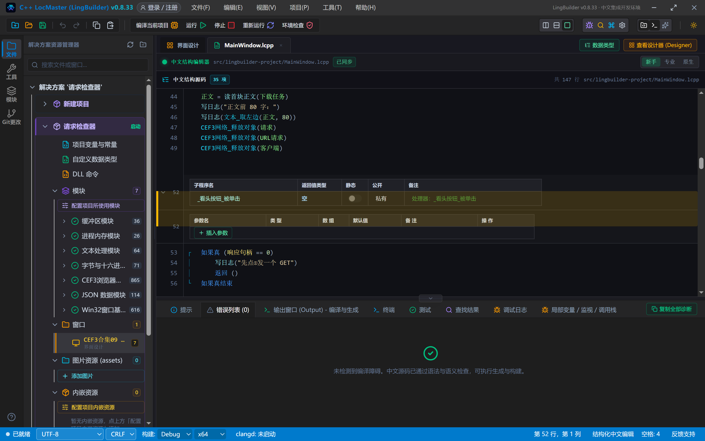
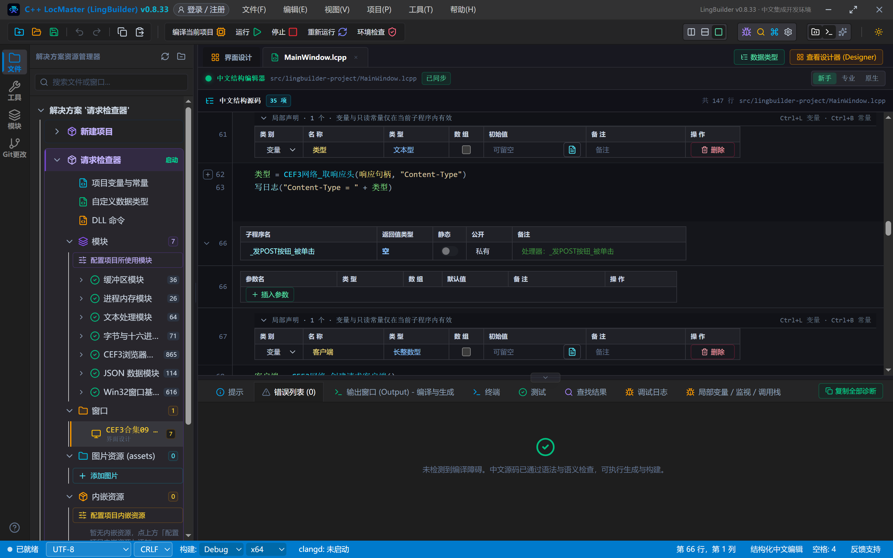
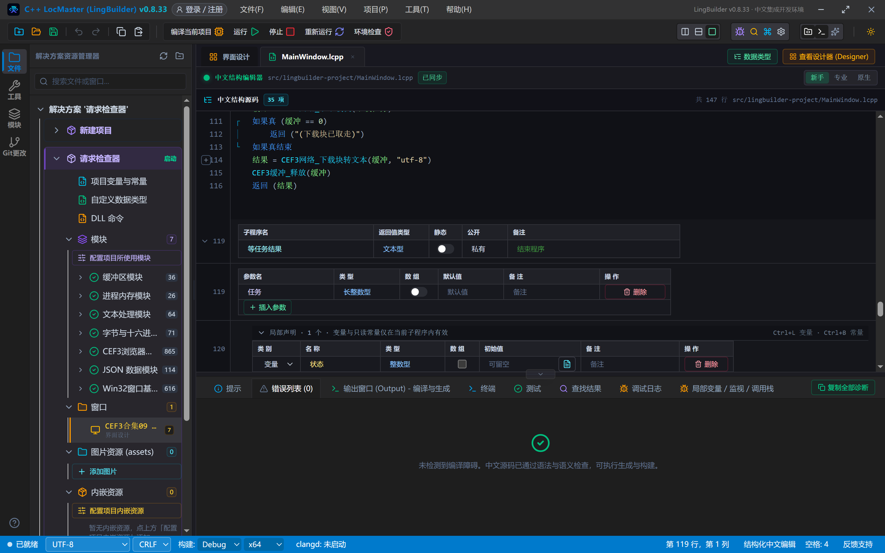
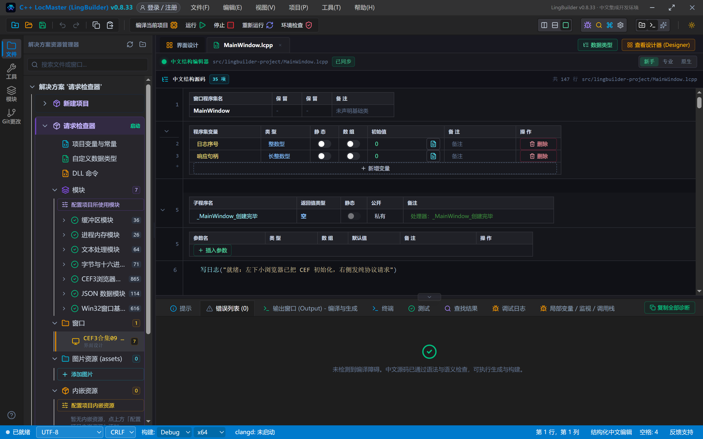
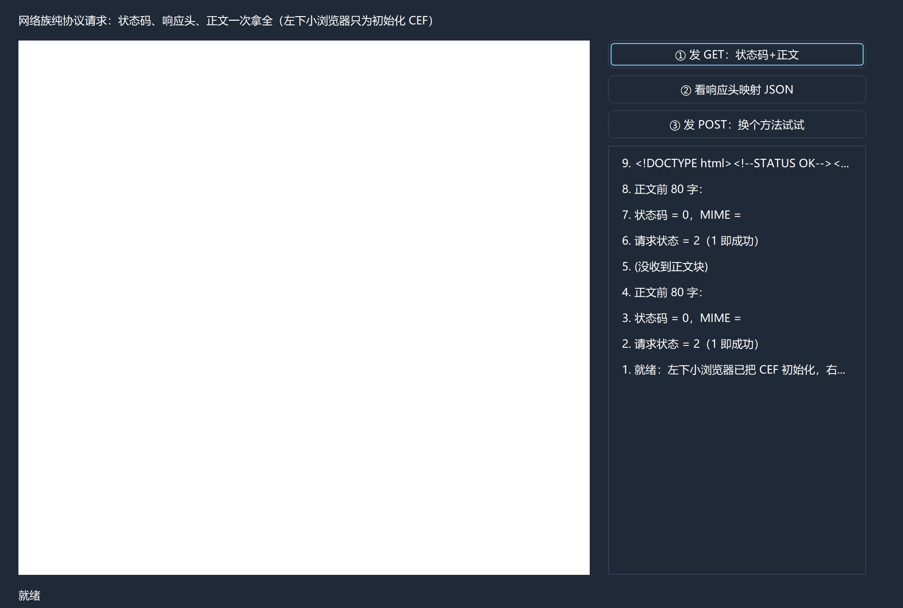
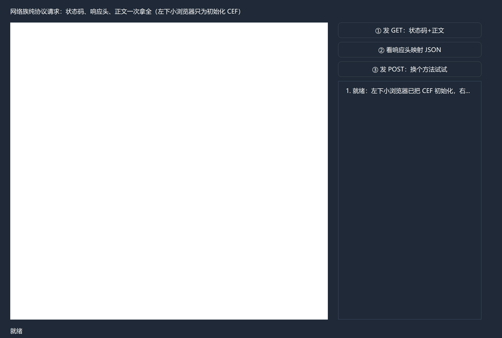

# CEF3 合集 09 · 资源响应读取：网络族纯协议请求

> 《LingBuilder CEF3 浏览器合集》第 9 集（资源拦截篇）。前八集都在「操控界面里的浏览器」，这一集换个姿势：**不发界面请求，直接在代码里发 HTTP**——状态码、响应头、正文一次拿全。这就是网络族 27 条命令的「纯协议请求」能力：走 Chromium 网络栈，TLS/HTTP2 指纹与内核浏览器一致，适合直连协议接口。全程约 35 分钟。
>
> **模块获取**：CEF3 浏览器模块**免费**；本集要在模块详情页多点两个子域：「**自动化**」与「**网络**」（网络族 27 条在「网络」域里），另需 JSON 数据、文本处理、字节与十六进制模块。
>
> 前置要求：学过[第 6 集](/guide/tutorials/cef3-06)的异步任务轮询。本集源码包见文末。

## 这一集你将学会

- 纯协议请求五连：`创建请求客户端` → `创建请求` → `设置请求地址` → `发起请求` → `取完成事件`
- 从响应对象读：`取响应状态码`、`取响应头映射JSON`、`取响应头`、`取响应MIME类型`、`取响应地址`
- 读正文：`取下载数据事件`（预约）→ `取下载块` → `下载块转文本`，块用完 `CEF3缓冲_释放`
- `设置请求方法`+`设置请求正文`：一行换成 POST

## 1. 发起前先初始化：CEF 从哪来

网络族跑在 Chromium 网络栈上，**进程里必须先初始化 CEF**。最省事的办法：窗口里放一个 CEF3浏览器控件（打开地址 about:blank，不用它导航），它一创建 CEF 就绪。本集就是这么做的。

## 2. 设计界面

新建项目「请求检查器」，窗口 980×688（客户区 980×660）：

| 控件 | 名称 | 显示内容/属性 | 左距 | 顶距 | 宽度 | 高度 |
| --- | --- | --- | --- | --- | --- | --- |
| 标签 | 说明标签 | 网络族纯协议请求：状态码、响应头、正文一次拿全（左下小浏览器只为初始化 CEF） | 20 | 14 | 940 | 22 |
| **CEF3浏览器** | **浏览器1** | 打开地址 = about:blank（只为初始化） | 20 | 44 | 620 | 580 |
| 按钮 | 发GET按钮 | ① 发 GET：状态码+正文 | 660 | 44 | 280 | 30 |
| 按钮 | 看头按钮 | ② 看响应头映射 JSON | 660 | 82 | 280 | 30 |
| 按钮 | 发POST按钮 | ③ 发 POST：换个方法试试 | 660 | 120 | 280 | 30 |
| 列表框 | 操作日志 | （空） | 660 | 158 | 280 | 466 |
| 标签 | 状态标签 | 就绪 | 20 | 638 | 920 | 22 |

程序集变量：`日志序号`、`响应句柄`（长整数型，存最近一次响应供按钮②复用）。



## 3. 写代码：GET 全链

```lcpp
事件 _发GET按钮_被单击()
    局部 长整数型 客户端
    客户端 = CEF3网络_创建请求客户端()
    如果真 (客户端 == 0)
        写日志("创建请求客户端失败")
        返回 ()
    如果真结束
    局部 长整数型 下载任务
    下载任务 = CEF3网络_取下载数据事件(客户端)
    局部 长整数型 请求
    请求 = CEF3网络_创建请求()
    CEF3网络_设置请求地址(请求, "https://www.baidu.com/")
    局部 长整数型 URL请求
    URL请求 = CEF3网络_发起请求(请求, 客户端, 0)
    如果真 (URL请求 == 0)
        写日志("发起请求失败")
        返回 ()
    如果真结束
    局部 长整数型 完成任务
    完成任务 = CEF3网络_取完成事件(客户端)
    局部 文本型 完成标记
    完成标记 = 等任务结果(完成任务)
    CEF3任务_释放(完成任务)
    局部 整数型 URL状态
    URL状态 = CEF3网络_取请求状态(URL请求)
    写日志("请求状态 = " + 到文本(URL状态) + "（1 即成功）")
    响应句柄 = CEF3网络_取响应对象(URL请求)
    如果真 (响应句柄 != 0)
        局部 整数型 状态码
        状态码 = CEF3网络_取响应状态码(响应句柄)
        局部 文本型 MIME
        MIME = CEF3网络_取响应MIME类型(响应句柄)
        写日志("状态码 = " + 到文本(状态码) + "，MIME = " + MIME)
    如果真结束
    局部 文本型 正文
    正文 = 读首块正文(下载任务)
    写日志("正文前 80 字：")
    写日志(文本_取左边(正文, 80))
    CEF3网络_释放对象(请求)
    CEF3网络_释放对象(URL请求)
    CEF3网络_释放对象(客户端)
结束
```

五个要点：

1. **先预约后发起**：`取下载数据事件` 要在 `发起请求` **之前**调用（可预约），发起后再领就可能错过数据块；
2. `发起请求` 第三参传 0 = 默认全局请求上下文；
3. 完成事件任务的状态：0=进行中、2=成功、3=失败——还是第 6 集那套 `等任务结果` 轮询；
4. **请求状态**（`取请求状态`）另一套编码：0=未知 1=成功 2=进行中 3=已取消 4=失败；
5. 用完的句柄逐个 `CEF3网络_释放对象`，下载块缓冲用 `CEF3缓冲_释放`。



`读首块正文` 子程序：等下载事件完成 → `CEF3网络_取下载块` 拿字节缓冲 → `下载块转文本(缓冲, "utf-8")` 解码。**大页面会分成很多块**，本集只收第一块演示；要收全就循环领取直到超时。二进制正文别转文本，用 `CEF3缓冲_保存文件`。



## 4. 看响应头、发 POST

```lcpp
事件 _看头按钮_被单击()
    如果真 (响应句柄 == 0)
        写日志("先点①发一个 GET")
        返回 ()
    如果真结束
    局部 文本型 头JSON
    头JSON = CEF3网络_取响应头映射JSON(响应句柄)
    写日志("响应头映射JSON 前 200 字：")
    写日志(文本_取左边(头JSON, 200))
    局部 文本型 类型
    类型 = CEF3网络_取响应头(响应句柄, "Content-Type")
    写日志("Content-Type = " + 类型)
结束
```

POST 只多两行：

```lcpp
CEF3网络_设置请求方法(请求, "POST")
CEF3网络_设置请求正文(请求, 字节集_从文本("wd=cef3"))
```

`取响应地址` 返回**跟随重定向后**的实际地址，做风控分析时很有用。







## 5. 编译与运行

「错误列表」(0)：



点「① 发 GET」，等几秒——本机实测拿到了百度的真实正文：日志第 9 条 `<!DOCTYPE html><!--STATUS OK--><...`：



**诚实说明（本集实测环境现象）**：本机网络对 CEF UrlRequest 的直连请求**偶发重置**，有时 15 秒内请求一直停在「请求状态 = 2（进行中）」，状态码读出 0、正文块收不到——再点一两次即可成功（下图就是停滞时的样子）。代码本身是对的；生产环境网络正常时状态码稳定 200。



## 常见问题急救表

| 症状 | 原因 | 解法 |
| --- | --- | --- |
| 请求状态一直是 2（进行中） | 网络对目标站偶发重置/风控，或 5 秒轮询上限太短 | 轮询上限放宽（本集 300 轮≈15 秒）；换个目标站再试；重试一两次 |
| 状态码 = 0 | 完成事件还没交付就去读了 | 以「完成事件任务状态=2」为准，别只看耗时 |
| 正文收不到（没收到正文块） | 下载事件没预约就发起了 | `取下载数据事件` 必须在 `发起请求` 之前调用 |
| 正文乱码 | 字符集不对 | `下载块转文本` 第二参用 "utf-8"/"gbk"/"gb18030" |
| 想保存图片/文件 | 下载块是二进制 | `CEF3缓冲_保存文件`，别转文本 |
| 报「未引用网络相关模块」 | 网络族在「网络」子域 | 模块详情页点「启用网络」 |
| 句柄忘记释放 | 客户端/请求/URL请求/响应都要还 | 每条路径收尾统一 `CEF3网络_释放对象` |

## 本集小结

- 纯协议五连：`创建请求客户端`（先预约下载事件）→ `创建请求`+`设置地址` → `发起请求(…, …, 0)` → `取完成事件` 轮询 → `取响应对象` 读状态码/头/MIME。
- 正文=下载块事件流：`取下载数据事件` → `取下载块` → `下载块转文本`；多块循环收，二进制走 `缓冲_保存文件`。
- POST = `设置请求方法` + `设置请求正文`（字节集）；`取响应地址` 给你重定向后的真身。
- 本机对直连请求偶发重置属环境现象，重试即可；生产网络正常时状态码稳定。

## 源码包

本集完整源码已打包为 **CEF3合集09-请求检查器.lcpppkg**（见[示例源码区](/demos)），导入即可运行对照学习。

**下一篇预告**：看得见还要改得动——资源响应替换：导航前配置替换规则，网页内容在到达前就被改写。

[回合集总览](/guide/tutorials/cef3)
