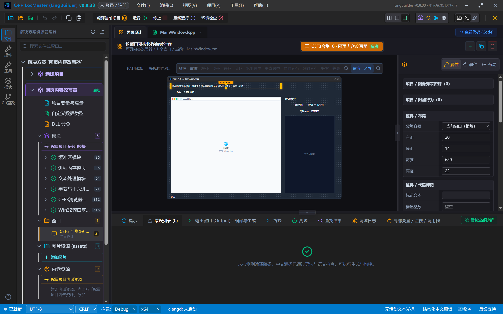
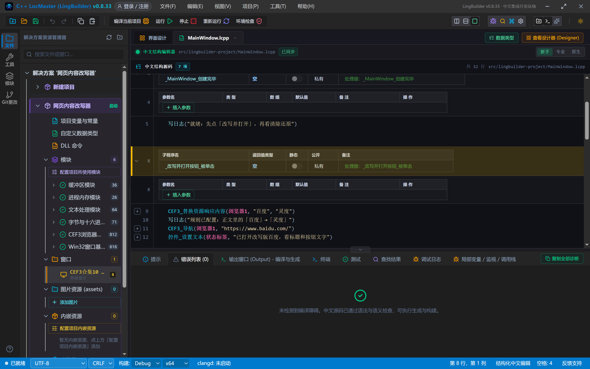
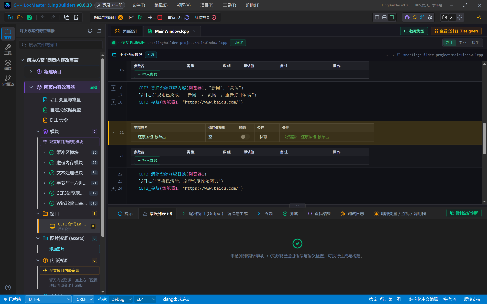
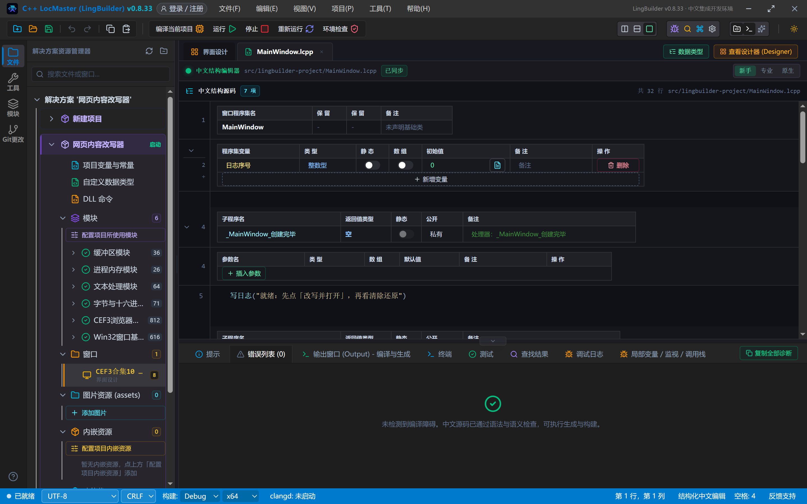
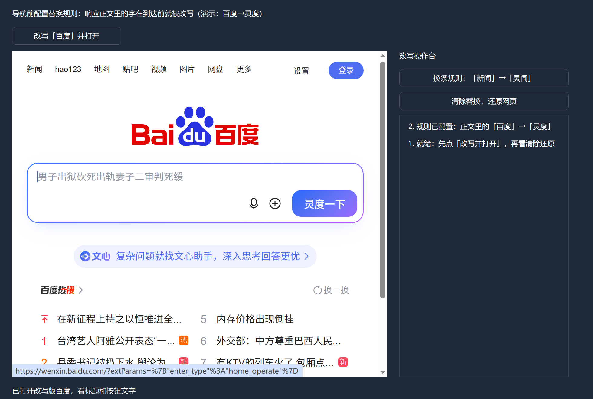
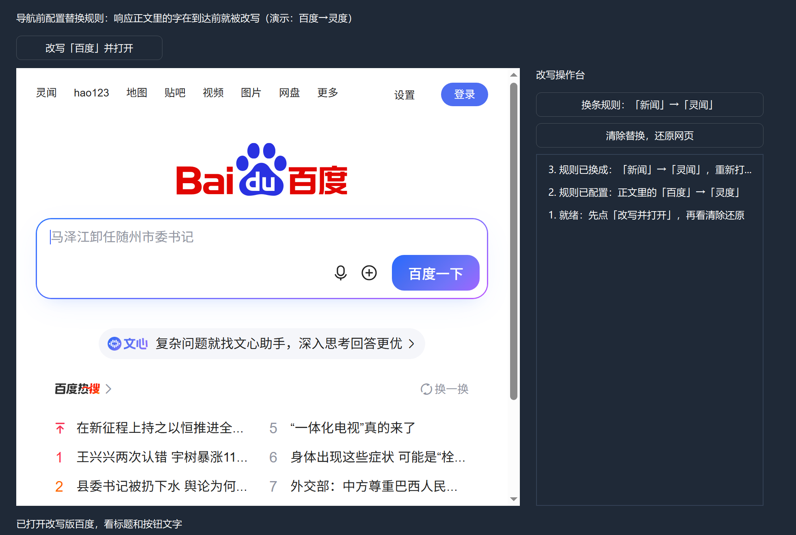
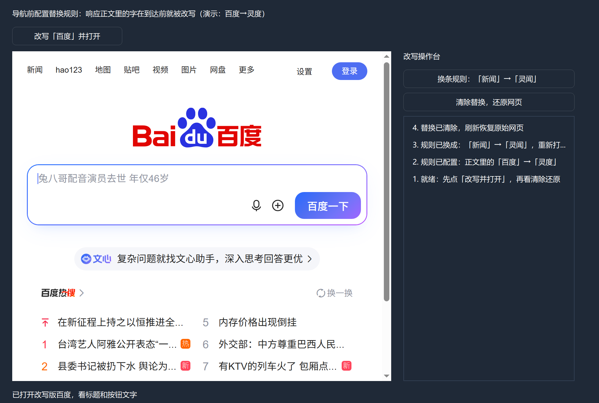

# CEF3 合集 10 · 资源响应替换：网页内容改写器

> 《LingBuilder CEF3 浏览器合集》第 10 集（资源拦截篇）。上一集我们「读」响应，这一集「改」响应：**导航前配一条替换规则，网页正文里的字在到达浏览器之前就被改掉**。本集把百度首页改成「灵度」——按钮、热搜词全部现场改写，再用「清除替换」一键还原。全程约 25 分钟，是全合集最短也最直观的一集。
>
> **模块获取**：CEF3 浏览器模块**免费**（自动化子域单独启用，见第 5 集）。
>
> 前置要求：学过[第 2 集](/guide/tutorials/cef3-02)的导航。本集源码包见文末。

## 这一集你将学会

- `CEF3_替换资源响应内容(控件名, 查找内容, 替换内容)`：导航前配置正文替换规则
- `CEF3_清除资源响应替换(控件名)`：一键还原
- 替换的边界：**只改正文文字，不改图片**；重复配置以最后一次为准

## 1. 两条命令

| 命令 | 参数 | 说明 |
| --- | --- | --- |
| `CEF3_替换资源响应内容` | 控件名, 查找内容, 替换内容 | 之后加载的资源正文里「查找内容」（UTF-8 字节匹配）被改写；替换内容为空=删除。**导航前配置可覆盖首个页面**；未就绪时自动排队 |
| `CEF3_清除资源响应替换` | 控件名 | 移除规则；已加载页面不受影响，之后加载的恢复原文 |

三条特性记牢：**二进制安全、流式处理**（gzip 解压后按字节匹配，大页面不卡）；**只修改文不修改图**（Logo 是图片，改不到）；**重复调用以最后一次为准**（换规则=覆盖）。

## 2. 设计界面

新建项目「网页内容改写器」，窗口 980×688（客户区 980×660）：

| 控件 | 名称 | 显示内容/属性 | 左距 | 顶距 | 宽度 | 高度 |
| --- | --- | --- | --- | --- | --- | --- |
| 标签 | 说明标签 | 导航前配置替换规则：响应正文里的字在到达前就被改写（演示：百度→灵度） | 20 | 14 | 620 | 22 |
| 按钮 | 改写并打开按钮 | 改写「百度」并打开 | 20 | 44 | 180 | 30 |
| **CEF3浏览器** | **浏览器1** | 打开地址 = about:blank | 20 | 84 | 620 | 540 |
| 标签 | 操作台标题 | 改写操作台 | 660 | 84 | 280 | 22 |
| 按钮 | 换规则按钮 | 换条规则：「新闻」→「灵闻」 | 660 | 114 | 280 | 30 |
| 按钮 | 还原按钮 | 清除替换，还原网页 | 660 | 152 | 280 | 30 |
| 列表框 | 操作日志 | （空） | 660 | 190 | 280 | 434 |
| 标签 | 状态标签 | 就绪 | 20 | 638 | 920 | 22 |



## 3. 写代码（全 project 只有 32 行）

```lcpp
事件 _改写并打开按钮_被单击()
    CEF3_替换资源响应内容(浏览器1, "百度", "灵度")
    写日志("规则已配置：正文里的「百度」→「灵度」")
    CEF3_导航(浏览器1, "https://www.baidu.com/")
    控件_设置文本(状态标签, "已打开改写版百度，看标题和按钮文字")
结束

事件 _换规则按钮_被单击()
    CEF3_替换资源响应内容(浏览器1, "新闻", "灵闻")
    写日志("规则已换成：「新闻」→「灵闻」，重新打开看看")
    CEF3_导航(浏览器1, "https://www.baidu.com/")
结束

事件 _还原按钮_被单击()
    CEF3_清除资源响应替换(浏览器1)
    写日志("替换已清除，刷新恢复原始网页")
    CEF3_导航(浏览器1, "https://www.baidu.com/")
结束
```

顺序就是一切：**先配规则、后导航**——规则在响应到达时生效，所以第一个页面就被改写。清除之后重新导航，网页恢复原样。





## 4. 编译与运行

「错误列表」(0)：



点「改写『百度』并打开」——百度首页照常打开，但搜索按钮变成了「**灵度一下**」，热搜栏目变成「**灵度热搜**」；Logo 还是百度（那是图片，正文替换不动它）：



点「换条规则」——导航栏的「新闻」变成「**灵闻**」（同时旧规则「百度→灵度」被覆盖，正文里的「百度」恢复原样）：



点「清除替换，还原网页」——一切复原，「新闻」回来了：



## 常见问题急救表

| 症状 | 原因 | 解法 |
| --- | --- | --- |
| 页面没变化 | 规则在导航之后才配置 | 先 `替换资源响应内容` 再 `导航`；未就绪会自动排队，首个页面也能覆盖 |
| 图片上的字没变 | 替换只处理响应正文 | 图片内容改不了；文字类（HTML/JSON）都在射程内 |
| 想同时生效两条规则 | 重复调用以最后一次为准 | 把多条替换合并成一次调用前，先确认当前版本规则模型；或按序重配 |
| 换了规则旧的还在生效 | 记住「以最后一次为准」就是覆盖式 | 直接配新规则即可，无需先清除 |
| 清除后页面还是旧的 | 清除只影响「之后加载」的资源 | 清除后重新导航一次 |
| 中文替换不生效 | 查找按 UTF-8 字节匹配 | 确认页面确实是 UTF-8（百度是）；GBK 页面要用对应字节的查找文本 |

## 本集小结

- 两条命令一个循环：**配置 → 导航 → （清除 → 导航）**；规则覆盖首个页面。
- 替换是**正文级、流式、二进制安全**的：文字全能改，图片改不了。
- 应用场景预告：去广告文案、内网术语替换、接口返回值纠偏——第 11 集的 Hook 会给你更细的粒度。

## 源码包

本集完整源码已打包为 **CEF3合集10-网页内容改写器.lcpppkg**（见[示例源码区](/demos)），导入即可运行对照学习。

**下一篇预告**：Hook 钩子族——把 JS 脚本注入进每一个页面，请求/响应的深度拦截。

[回合集总览](/guide/tutorials/cef3)
