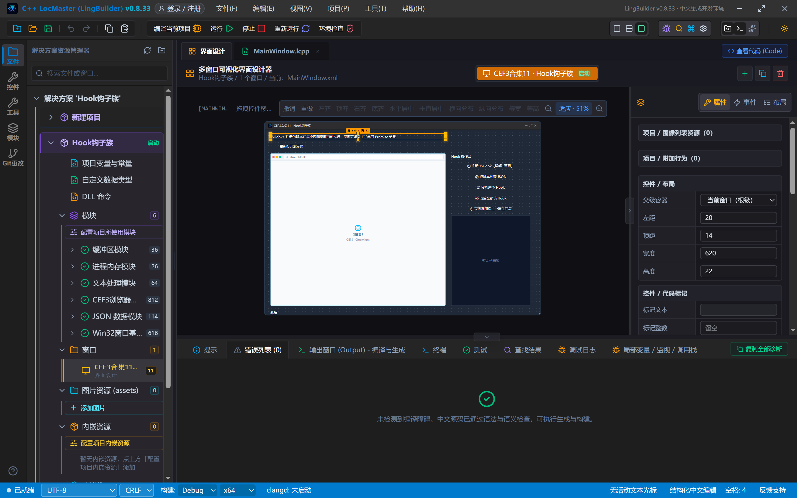
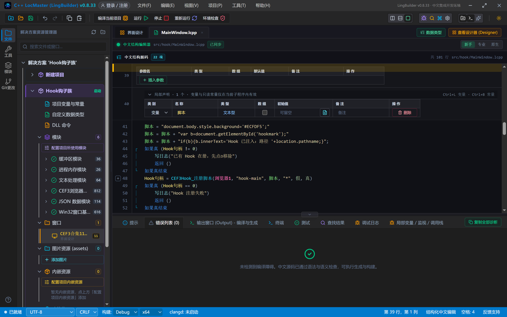
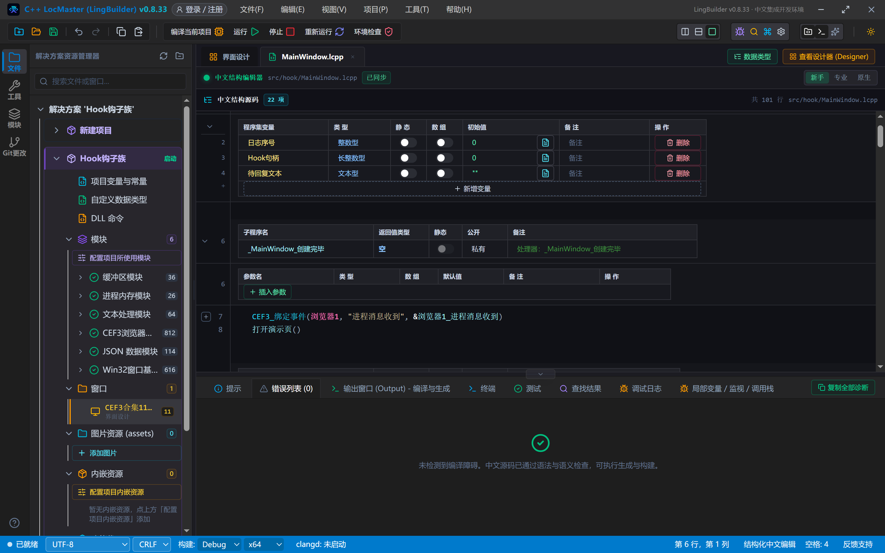
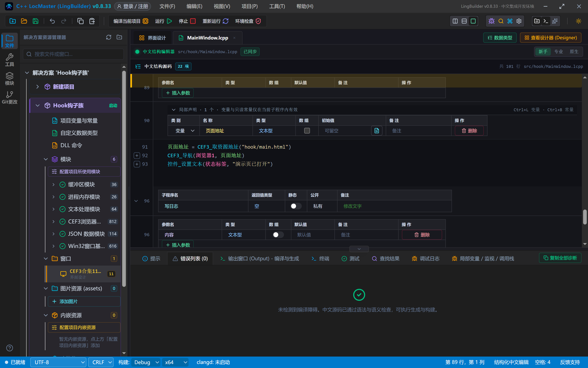
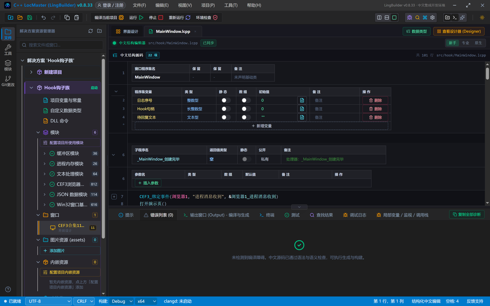
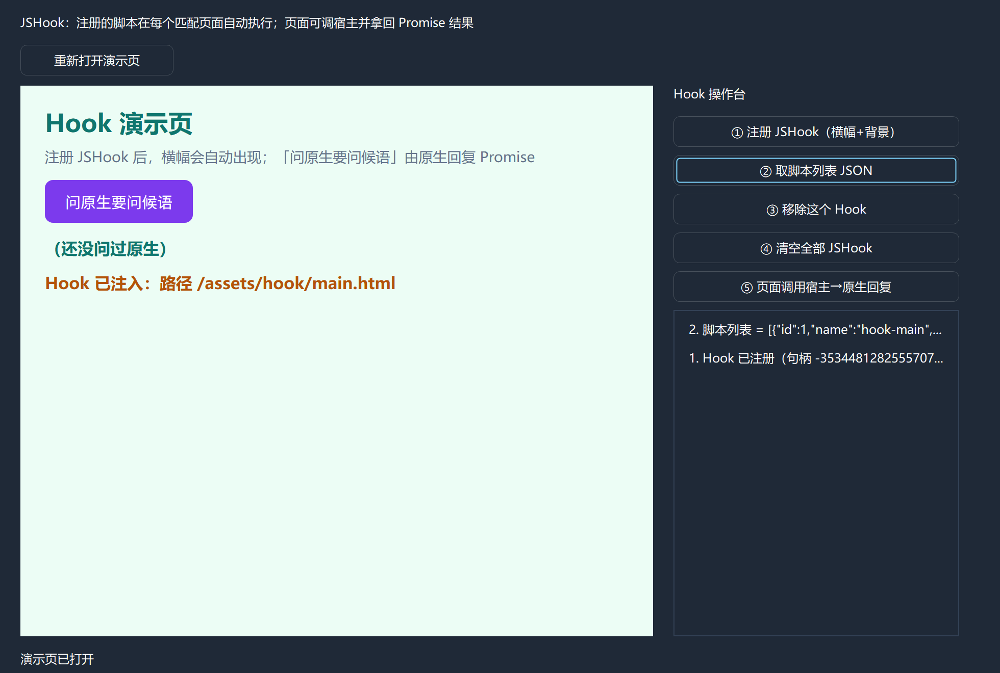
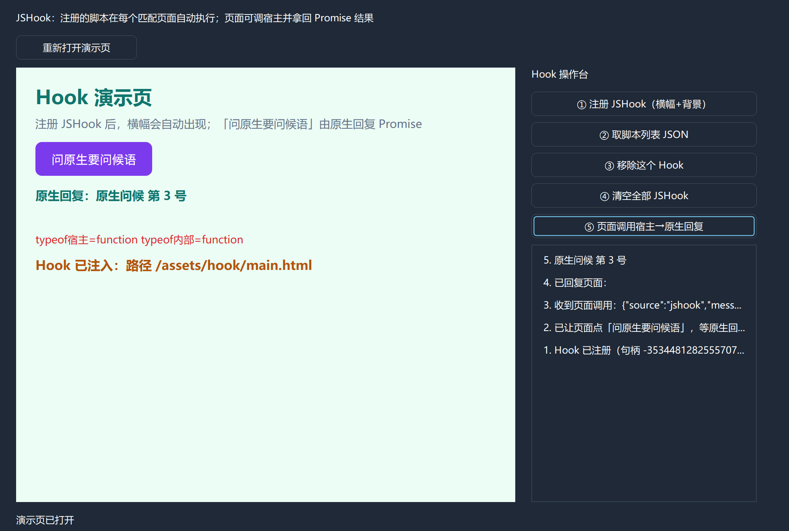
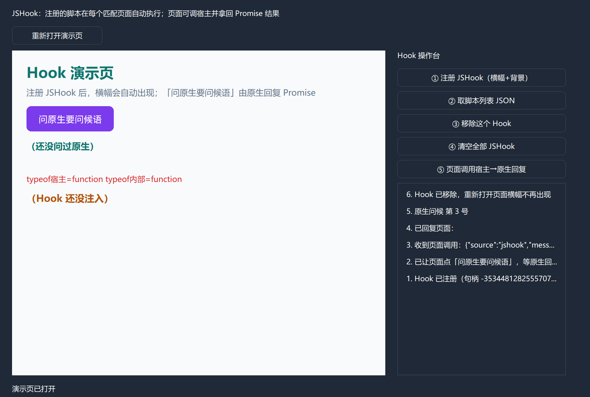
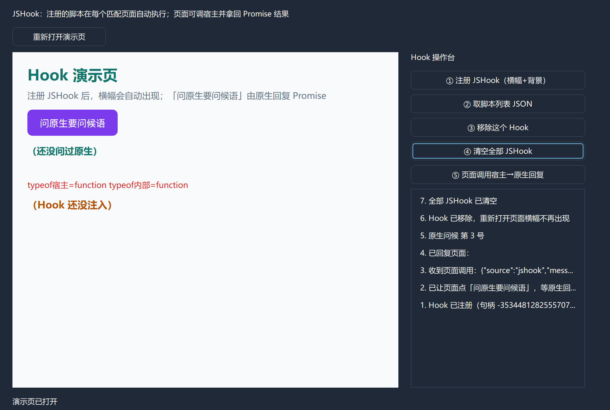

# CEF3 合集 11 · Hook 钩子族：请求/响应深度拦截

> 《LingBuilder CEF3 浏览器合集》第 11 集（资源拦截篇）。网络族是对「请求」动手，这一族的 **JSHook** 则是对「页面」动手：**注册一次脚本，之后每个匹配页面（含刷新、导航后的新页面）的 V8 上下文一创建就自动执行**——横幅、改写、埋点、监控都不用再操心时机。更妙的是页面可以反向呼叫原生：`LingBuilder调用宿主(名字, 数据)` 发起 Promise，原生用 `CEF3Hook_回复页面消息` 回复结果。全程约 35 分钟。
>
> **模块获取**：CEF3 浏览器模块**免费**（自动化子域单独启用，见第 5 集）；另需 JSON 数据模块。
>
> 前置要求：学过[第 8 集](/guide/tutorials/cef3-08)的 assets 部署与框架句柄。本集源码包见文末。

## 这一集你将学会

- Hook 族 5 条核心：`注册脚本`（名称/脚本/地址匹配/全部框架/立即执行）、`取脚本列表`、`移除脚本`、`清空脚本`、`回复页面消息`
- 页面侧反向呼叫：`LingBuilder调用宿主(名字, 数据)` 返回 **Promise**，原生「进程消息收到」事件里用 `CEF3Hook_回复页面消息` 应答
- 「立即执行当前上下文」参数：对**已经打开**的页面也立即注入一次
- 移除/清空的生效边界：**只影响之后加载的页面**，已注入的函数留在原页面

## 1. Hook 族 5 条一张表

| 命令 | 参数 | 说明 |
| --- | --- | --- |
| `CEF3Hook_注册脚本` | 控件名, 名称, 脚本, 地址匹配, 全部框架, 立即执行当前上下文 | 注册持久 JSHook，返回**长整数型句柄**；在匹配 Frame 的 V8 上下文创建时执行，导航后自动重建 |
| `CEF3Hook_取脚本列表` | 控件名 | 文本型 JSON：句柄/名称/地址匹配/Frame 范围 |
| `CEF3Hook_移除脚本` | Hook句柄 | 移除指定 Hook 并释放句柄 |
| `CEF3Hook_清空脚本` | 控件名 | 清空该浏览器全部 JSHook |
| `CEF3Hook_回复页面消息` | 控件名, 请求ID, 是否成功, 返回文本 | 应答页面 `LingBuilder调用宿主` 产生的 Promise |

两个内建机制先记住：页面侧 `LingBuilder调用宿主(名字, 数据)` 由桥**自动注入**（无需注册）；原生的应答入口是「**进程消息收到**」事件，字段 JSON 带 `messageName / payload / requestId`。

## 2. 设计界面

新建项目「Hook钩子族」（同第 5 集流程），窗口 980×688（客户区 980×660）。演示页继续用第 8 集的 **assets+取资源地址** 方案（多框架/data: 的坑已绕开）：

| 控件 | 名称 | 显示内容/属性 | 左距 | 顶距 | 宽度 | 高度 |
| --- | --- | --- | --- | --- | --- | --- |
| 标签 | 说明标签 | JSHook：注册的脚本在每个匹配页面自动执行；页面可调宿主并拿回 Promise 结果 | 20 | 14 | 620 | 22 |
| 按钮 | 重开网页按钮 | 重新打开演示页 | 20 | 44 | 150 | 30 |
| **CEF3浏览器** | **浏览器1** | 打开地址 = about:blank；勾选「禁用 GPU 加速」 | 20 | 84 | 620 | 540 |
| 标签 | 操作台标题 | Hook 操作台 | 660 | 84 | 280 | 22 |
| 按钮 | 注册按钮 | ① 注册 JSHook（横幅+背景） | 660 | 114 | 280 | 30 |
| 按钮 | 列表按钮 | ② 取脚本列表 JSON | 660 | 152 | 280 | 30 |
| 按钮 | 移除按钮 | ③ 移除这个 Hook | 660 | 190 | 280 | 30 |
| 按钮 | 清空按钮 | ④ 清空全部 JSHook | 660 | 228 | 280 | 30 |
| 按钮 | 唤起按钮 | ⑤ 页面调用宿主→原生回复 | 660 | 266 | 280 | 30 |
| 列表框 | 操作日志 | （空） | 660 | 304 | 280 | 320 |
| 标签 | 状态标签 | 就绪 | 20 | 638 | 920 | 22 |

程序集变量：`日志序号`、`Hook句柄`（长整数型）。



演示页 `assets/hook/main.html`：「问原生要问候语」按钮调用 `LingBuilder调用宿主` 并把 Promise 结果写进 `#hostreply`；`#hookmark` 是 Hook 注入横幅的落点。构建时 assets 自动复制到 exe 同级。

## 3. 写代码

### 3.1 注册 JSHook：横幅自动注入

```lcpp
事件 _注册按钮_被单击()
    如果真 (Hook句柄 != 0)
        写日志("已有 Hook 在册，先点③移除")
        返回 ()
    如果真结束
    局部 文本型 脚本
    脚本 = "document.body.style.background='#ECFDF5';"
    脚本 = 脚本 + "var b=document.getElementById('hookmark');"
    脚本 = 脚本 + "if(b){b.innerText='Hook 已注入：路径 '+location.pathname;}"
    Hook句柄 = CEF3Hook_注册脚本(浏览器1, "hook-main", 脚本, "*", 假, 真)
    如果真 (Hook句柄 == 0)
        写日志("Hook 注册失败")
        返回 ()
    如果真结束
    写日志("Hook 已注册（句柄 " + 到文本(Hook句柄) + "），当前页立即注入一次")
结束
```

六个参数逐个说：控件名；`"hook-main"` 是 Hook 名称（列表/排错用）；脚本串里 JS 一律**单引号**；`"*"` 匹配所有地址（也可写通配模式如 `"*://www.baidu.com/*"`）；`全部框架=假` 只注入主框架（真则连 iframe 一起）；`立即执行当前上下文=真` 让**已经打开的当前页**也立刻注入一次——不用先刷新。



### 3.2 列表、移除、清空

```lcpp
事件 _列表按钮_被单击()
    局部 文本型 列表
    列表 = CEF3Hook_取脚本列表(浏览器1)
    写日志("脚本列表 = " + 列表)
结束

事件 _移除按钮_被单击()
    如果真 (Hook句柄 == 0)
        写日志("当前没有在册 Hook")
        返回 ()
    如果真结束
    CEF3Hook_移除脚本(Hook句柄)
    Hook句柄 = 0
    写日志("Hook 已移除，重新打开页面横幅不再出现")
结束

事件 _清空按钮_被单击()
    CEF3Hook_清空脚本(浏览器1)
    Hook句柄 = 0
    写日志("全部 JSHook 已清空")
结束
```

移除/清空的生效边界：**只影响之后加载的页面**。已经注入过函数的页面不会凭空消失——重开一次页面即可看到横幅不再出现。


### 3.3 页面调用宿主 → 原生回复（双向通道）

页面按钮的 click 里调 `LingBuilder调用宿主('get-greeting','')`，它返回 Promise。原生的应答入口是「**进程消息收到**」事件：

```lcpp
事件 浏览器1_进程消息收到()
    局部 文本型 数据
    数据 = CEF3_取事件数据(浏览器1)
    写日志("收到页面调用：" + 数据)
    局部 JSON值 节点
    节点 = JSON_解析(数据)
    如果 (节点 = 0)
        返回 ()
    如果结束
    局部 JSON值 请求节点
    请求节点 = JSON_指针_取(节点, "/requestId")
    如果 (请求节点 = 0)
        JSON_释放(节点)
        返回 ()
    如果结束
    局部 长整数型 请求编号
    请求编号 = JSON_取长整数值(请求节点, 0)
    JSON_释放(节点)
    待回复文本 = "原生问候 第 " + 到文本(日志序号) + " 号"
    CEF3Hook_回复页面消息(浏览器1, 请求编号, 真, 待回复文本)
    写日志("已回复页面：")
    写日志(待回复文本)
结束
```

字段 JSON 形如 `{"source":"jshook","messageName":"get-greeting","payload":"","frameId":"…","url":"…","requestId":3}`——`requestId` 是**数字**，用 `JSON_取长整数值` 读取后再原样传给 `CEF3Hook_回复页面消息`。每条调用必须恰好回复一次。



### 3.4 唤起按钮：让页面自己发起调用

```lcpp
事件 _唤起按钮_被单击()
    局部 长整数型 句柄
    句柄 = CEF3框架_取主框架(浏览器1)
    如果真 (句柄 == 0)
        写日志("还没取到主框架，等页面就绪")
        返回 ()
    如果真结束
    CEF3框架_执行JS(句柄, "document.getElementById('ask').click();", "", 1)
    写日志("已让页面点「问原生要问候语」，等原生回复……")
结束
```

**注意第 7 集踩过的同款坑**：`CEF3框架_执行JS` 第一参是**长整数型框架句柄**，传控件名会直接 C2065 未声明标识符。运行期用 `CEF3框架_取主框架` 现取句柄即可。



## 4. 编译：先看错误列表

「错误列表」(0)：



## 5. 运行：注册→注入→双向通道→移除

点「运行」。点「① 注册 JSHook」——**当前页立刻见效**：背景变绿、横幅「Hook 已注入：路径 /assets/hook/main.html」出现：


点「② 取脚本列表 JSON」——`[{"id":1,"name":"hook-main",…}]`：



点「⑤ 页面调用宿主→原生回复」——页面按钮被代点，Promise 发起→原生「进程消息收到」→解析 requestId→回复→**页面显示「原生回复：原生问候 第 3 号」**，日志同步记录「收到页面调用」「已回复页面」：



点「③ 移除这个 Hook」再「重新打开演示页」——横幅不再出现（`#hookmark` 保持「Hook 还没注入」）。页面上的 `LingBuilder调用宿主` 函数仍在（已注入的页面不会凭空消失），这正是「移除只影响之后加载」的活教材：



点「④ 清空全部 JSHook」兜底清场：



## 常见问题急救表

| 症状 | 原因 | 解法 |
| --- | --- | --- |
| 页面调用宿主无任何反应 | 「进程消息收到」事件未绑定，或 requestId 解析失败 | 先绑事件再开页面；日志打印整段事件数据排查 |
| 页面 Promise 一直挂起 | 原生没有回复 | 每条调用必须恰好一次 `CEF3Hook_回复页面消息`（成功/失败二选一） |
| `CEF3框架_执行JS(浏览器1, …)` 编译 C2065 | 第一参是**长整数型框架句柄** | 用 `CEF3框架_取主框架/按名称取框架` 现取句柄 |
| 移除 Hook 后页面函数还在 | 移除只影响之后加载的页面 | 重开/刷新页面验证；已注入函数属预期行为 |
| Hook 对 iframe 不生效 | 「全部框架」参数为假 | 传真；或脚本里按 frame 判断 |
| 想匹配特定网站 | 地址匹配参数支持通配 | 如 `*://www.baidu.com/*`；`*` 匹配全部 |
| 注册返回 0 | 名称重复或参数不合法 | 名称唯一；脚本非空 |

## 本集小结

- JSHook = **持久脚本注入**：注册一次，匹配页面的 V8 上下文一创建就执行，导航后自动重建；「立即执行当前上下文」让已打开页面也马上生效。
- 双向通道：页面 `LingBuilder调用宿主(名字, 数据)` → 原生「进程消息收到」事件（字段含 requestId）→ `CEF3Hook_回复页面消息` 完成 Promise。
- 移除/清空只影响之后加载的页面；句柄变量随移除清零。
- `CEF3框架_执行JS` 等句柄族命令的第一参是框架句柄，不是控件名。

## 源码包

本集完整源码已打包为 **CEF3合集11-Hook钩子族.lcpppkg**（含 assets 演示页，见[示例源码区](/demos)），导入即可运行对照学习。

**下一篇预告**：会话与多开篇开始——Cookie 读写：会话族 23 条里的读写四件套，登录态也能搬进程序。

[回合集总览](/guide/tutorials/cef3)
