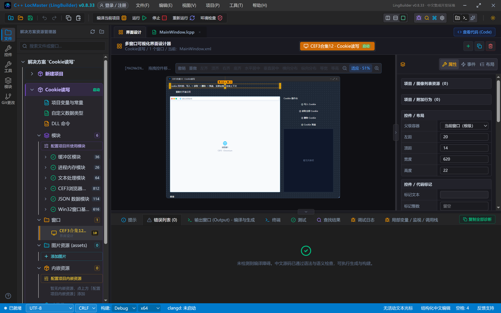
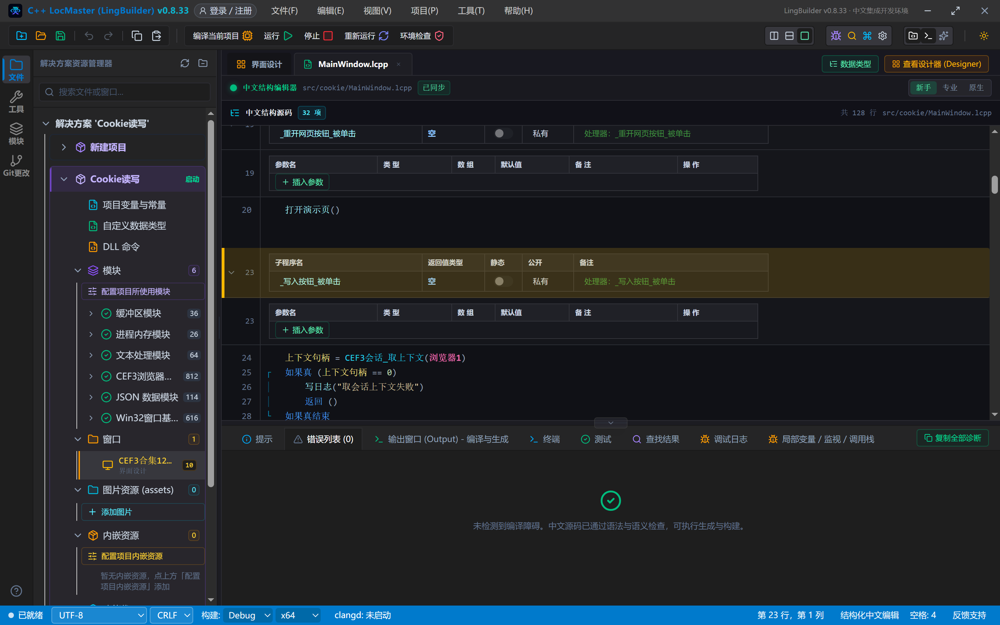
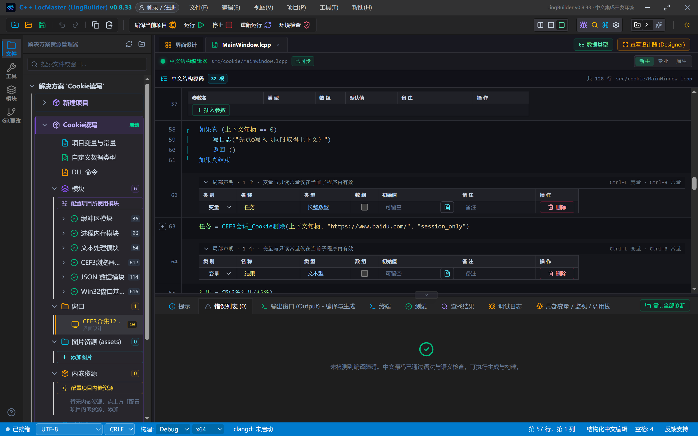
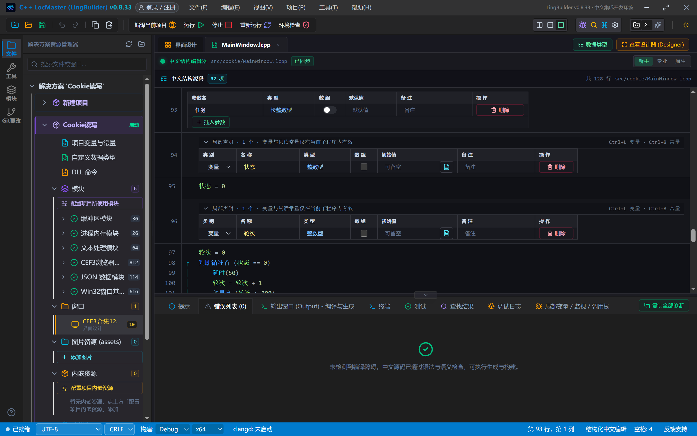
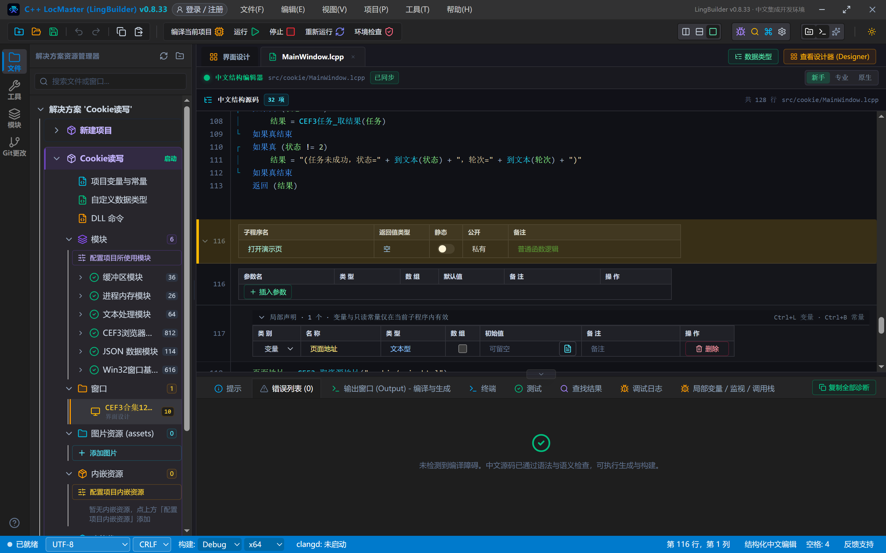
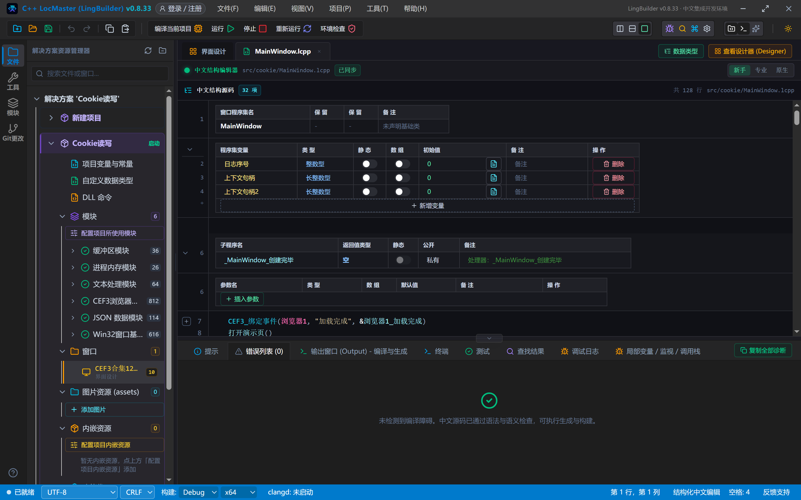
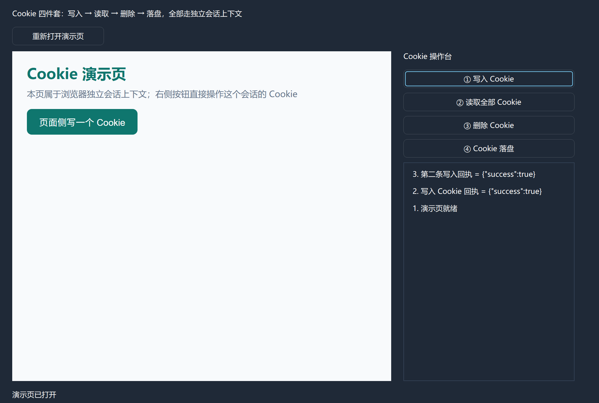
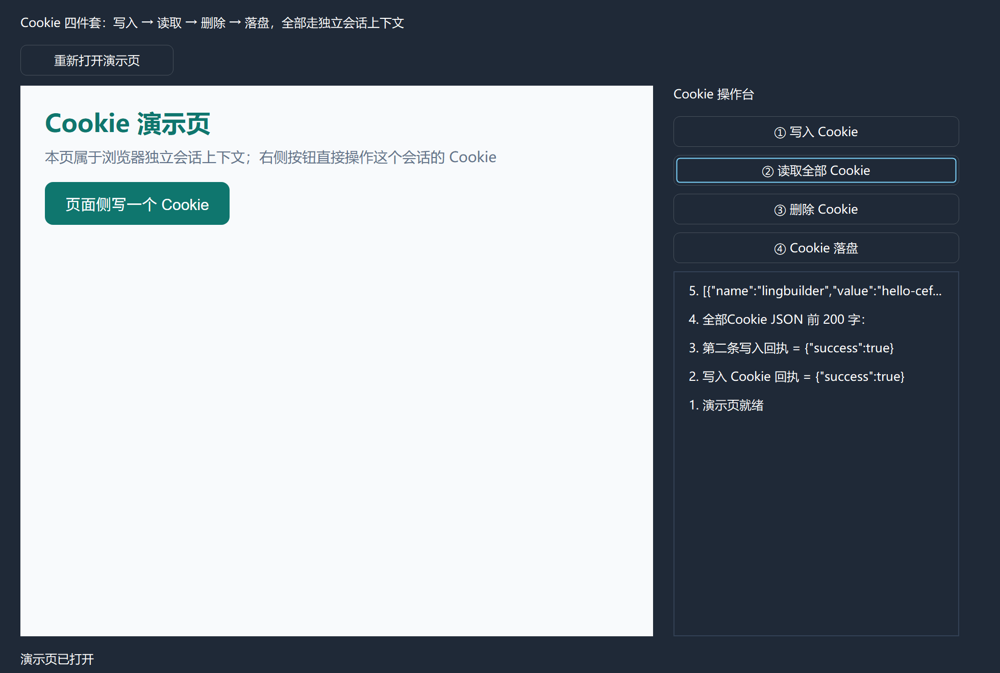
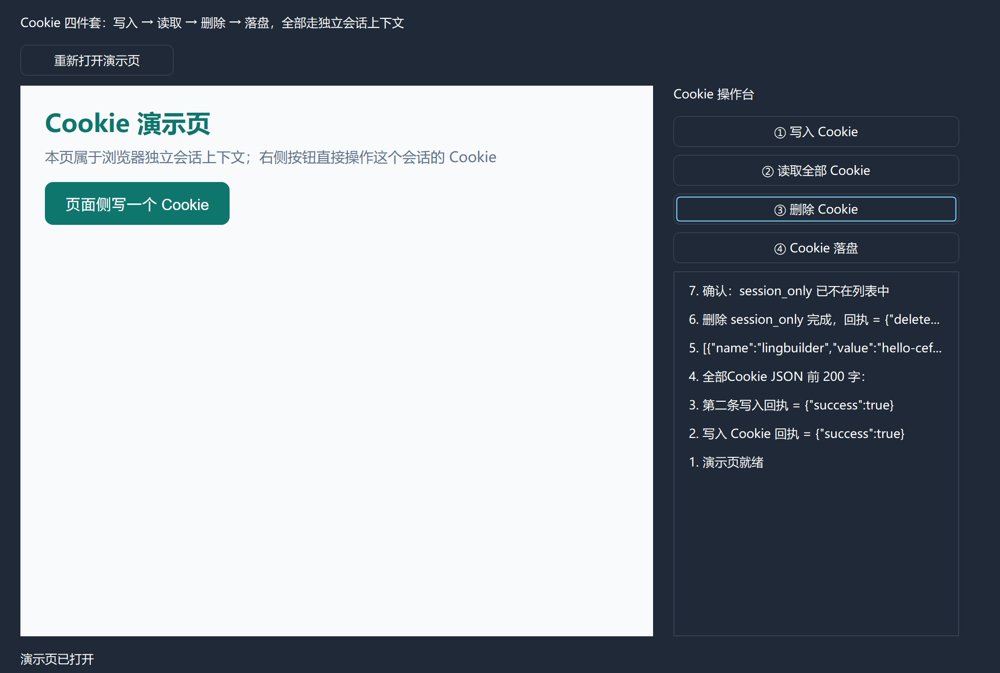
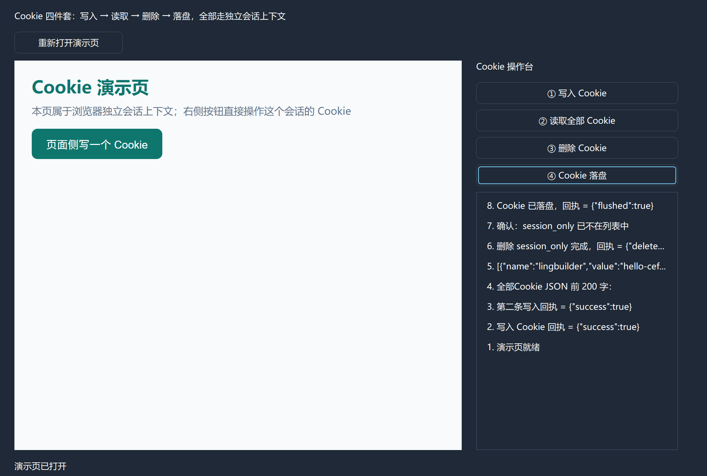

# CEF3 合集 12 · Cookie 读写：会话族（一）

> 《LingBuilder CEF3 浏览器合集》第 12 集（会话与多开篇）。浏览器里的一切登录态都活在 **Cookie** 里：会话族 23 条命令中的 Cookie 四件套——**写入、读取、删除、落盘**——让你把登录态搬进程序、按需清理、持久保存。本集对着浏览器独立会话上下文把四件套一次跑通。全程约 30 分钟。
>
> **模块获取**：CEF3 浏览器模块**免费**（自动化子域单独启用，见第 5 集）；另需 JSON 数据模块与文本处理模块。
>
> 前置要求：学过[第 6 集](/guide/tutorials/cef3-06)的异步任务轮询。本集源码包见文末。

## 这一集你将学会

- `CEF3会话_取上下文`：拿到浏览器的**独立会话上下文句柄**（一切 Cookie 操作的前提）
- Cookie 四件套：`CEF3会话_Cookie设置` / `Cookie读取全部` / `Cookie删除` / `Cookie落盘`
- 所有 Cookie 命令都是**异步任务**：继续用第 6 集的 `等任务结果` 轮询子程序
- 回执是 JSON 文本：`{"success":true}`、`{"deletedCount":N}`，读起来一目了然

## 1. 四件套一张表

一切 Cookie 命令的第一参都是**上下文句柄**——`CEF3会话_取上下文(控件名)` 取得，它代表这个浏览器控件的独立会话：

| 命令 | 参数 | 返回（任务结果） |
| --- | --- | --- |
| `CEF3会话_Cookie设置` | 上下文句柄, 地址, 名称, 值, 域, 路径, 安全, HttpOnly, 过期Unix秒 | `{"success":true}`；过期时间 ≤0 时创建会话 Cookie |
| `CEF3会话_Cookie读取全部` | 上下文句柄 | Cookie 数组的 UTF-16 JSON |
| `CEF3会话_Cookie删除` | 上下文句柄, 地址, 名称 | `{"deletedCount":N}` |
| `CEF3会话_Cookie落盘` | 上下文句柄 | 异步写入独立存储（持久化） |

四条命令都返回**任务句柄**，配第 6 集的 `等任务结果`（轮询状态 0→2）使用。

## 2. 设计界面

新建项目「Cookie读写」（同第 5 集流程），窗口 980×688（客户区 980×660）：

| 控件 | 名称 | 显示内容/属性 | 左距 | 顶距 | 宽度 | 高度 |
| --- | --- | --- | --- | --- | --- | --- |
| 标签 | 说明标签 | Cookie 四件套：写入 → 读取 → 删除 → 落盘，全部走独立会话上下文 | 20 | 14 | 620 | 22 |
| 按钮 | 重开网页按钮 | 重新打开演示页 | 20 | 44 | 150 | 30 |
| **CEF3浏览器** | **浏览器1** | 打开地址 = about:blank；勾选「禁用 GPU 加速」 | 20 | 84 | 620 | 540 |
| 标签 | 操作台标题 | Cookie 操作台 | 660 | 84 | 280 | 22 |
| 按钮 | 写入按钮 | ① 写入 Cookie | 660 | 114 | 280 | 30 |
| 按钮 | 读取按钮 | ② 读取全部 Cookie | 660 | 152 | 280 | 30 |
| 按钮 | 删除按钮 | ③ 删除 Cookie | 660 | 190 | 280 | 30 |
| 按钮 | 落盘按钮 | ④ Cookie 落盘 | 660 | 228 | 280 | 30 |
| 列表框 | 操作日志 | （空） | 660 | 266 | 280 | 358 |
| 标签 | 状态标签 | 就绪 | 20 | 638 | 920 | 22 |

程序集变量：`日志序号`、`上下文句柄`（长整数型）。演示页仍是 assets+取资源地址（第 8 集正路）。



## 3. 写代码

### 3.1 写入：设置两条 Cookie

```lcpp
事件 _写入按钮_被单击()
    上下文句柄 = CEF3会话_取上下文(浏览器1)
    如果真 (上下文句柄 == 0)
        写日志("取会话上下文失败")
        返回 ()
    如果真结束
    局部 长整数型 任务1
    任务1 = CEF3会话_Cookie设置(上下文句柄, "https://www.baidu.com/", "lingbuilder", "hello-cef3", ".baidu.com", "/", 真, 假, 0)
    局部 文本型 回执1
    回执1 = 等任务结果(任务1)
    CEF3任务_释放(任务1)
    写日志("写入 Cookie 回执 = " + 回执1)
    局部 长整数型 任务2
    任务2 = CEF3会话_Cookie设置(上下文句柄, "https://www.baidu.com/", "session_only", "临时", ".baidu.com", "/", 真, 假, 0)
    局部 文本型 回执2
    回执2 = 等任务结果(任务2)
    CEF3任务_释放(任务2)
    写日志("第二条写入回执 = " + 回执2)
结束
```

`Cookie设置` 九参逐个说：**上下文句柄**；**地址**（Cookie 归属的 URL）；**名称/值**；**域**（`.baidu.com` 带点前缀表示含子域）；**路径**（`/` 全站）；**安全**（仅 HTTPS 传递）；**HttpOnly**（禁止页面 JS 读取）；**过期 Unix 秒**——**传 0 就是会话 Cookie**（浏览器关闭即失效），要持久就传未来的时间戳。



### 3.2 读取全部

```lcpp
局部 长整数型 任务
任务 = CEF3会话_Cookie读取全部(上下文句柄)
局部 文本型 结果
结果 = 等任务结果(任务)
CEF3任务_释放(任务)
写日志("全部Cookie JSON 前 200 字：")
写日志(文本_取左边(结果, 200))
```

任务结果就是 **Cookie JSON 数组**（每个元素带 name/value/domain/path/expires 等字段），要精取某个值就配 JSON 模块解析。

### 3.3 删除并确认

```lcpp
局部 长整数型 任务
任务 = CEF3会话_Cookie删除(上下文句柄, "https://www.baidu.com/", "session_only")
局部 文本型 结果
结果 = 等任务结果(任务)
CEF3任务_释放(任务)
写日志("删除 session_only 完成，回执 = " + 结果)
```

删除后再读一次全部，用 `文本_是否包含` 确认目标已不在列表——**删了要验**是好习惯。



### 3.4 落盘

```lcpp
局部 长整数型 任务
任务 = CEF3会话_Cookie落盘(上下文句柄)
局部 文本型 结果
结果 = 等任务结果(任务)
CEF3任务_释放(任务)
写日志("Cookie 已落盘，回执 = " + 结果)
结束
```

落盘把会话 Cookie 写入独立存储，下次启动还在——做「保持登录」就是它。





## 4. 编译：先看错误列表

「错误列表」(0)：



## 5. 运行：四件套挨个来

点「运行」。点「① 写入 Cookie」——两条回执都是 `{"success":true}`：



点「② 读取全部 Cookie」——JSON 数组里能看到 `{"name":"lingbuilder","value":"hello-cef…`：



点「③ 删除 Cookie」——回执确认删除完成，且「确认：session_only 已不在列表中」：



点「④ Cookie 落盘」——回执确认写入独立存储：



## 常见问题急救表

| 症状 | 原因 | 解法 |
| --- | --- | --- |
| 取上下文返回 0 | 浏览器控件还没创建完成 | 等「加载完成」事件后再取 |
| Cookie 设置回执 false | 域与地址不匹配 | 地址 `https://www.baidu.com/` 配域 `.baidu.com` 即可 |
| 会话 Cookie 重启后消失 | 过期 Unix 秒传了 0 | 要持久就传未来时间戳（如 `取时间戳+7×86400`），再 `Cookie落盘` |
| 读取结果被截断 | 页面日志展示限制 | 结果是完整 JSON，按需 `文本_取左边` 或 JSON 解析精取 |
| 任务一直状态 0 | 会话忙 | 轮询上限放宽（本集 300 轮≈15 秒） |
| 删除不生效 | 地址/名称不匹配 | 删除按地址+名称精确匹配；名称传空删全部 |

## 本集小结

- Cookie 四件套全异步：`设置`（九参，过期 0=会话 Cookie）→ `读取全部`（JSON 数组）→ `删除`（回执带数量）→ `落盘`（持久化）。
- 一切操作先 `CEF3会话_取上下文` 拿句柄；任务三步（轮询→取结果→释放）贯穿始终。
- 删了要验：再读一遍全量确认目标消失。

## 源码包

本集完整源码已打包为 **CEF3合集12-Cookie读写.lcpppkg**（见[示例源码区](/demos)），导入即可运行对照学习。

**下一篇预告**：Cookie 之外的会话能力——清缓存、清证书例外、首选项读写，把浏览器的「隐私与偏好」也管起来。

[回合集总览](/guide/tutorials/cef3)
