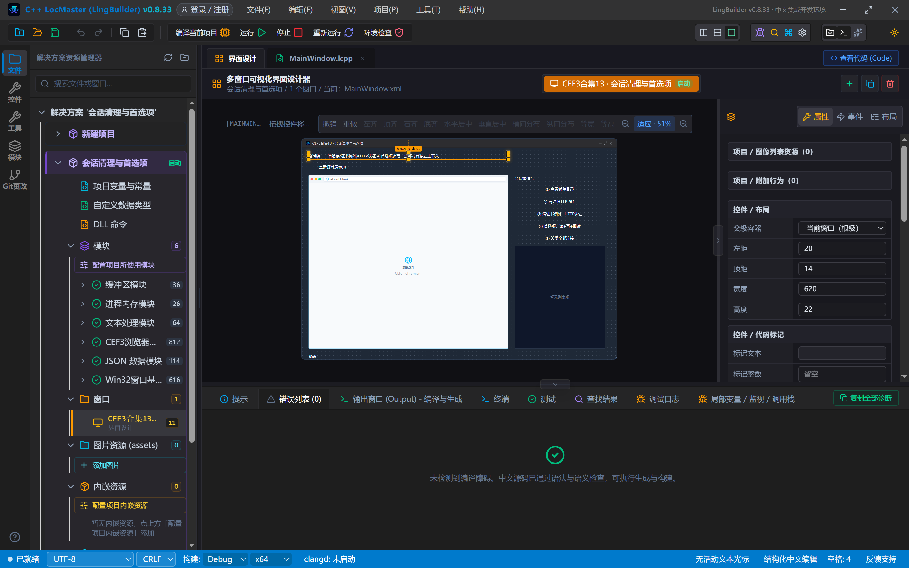
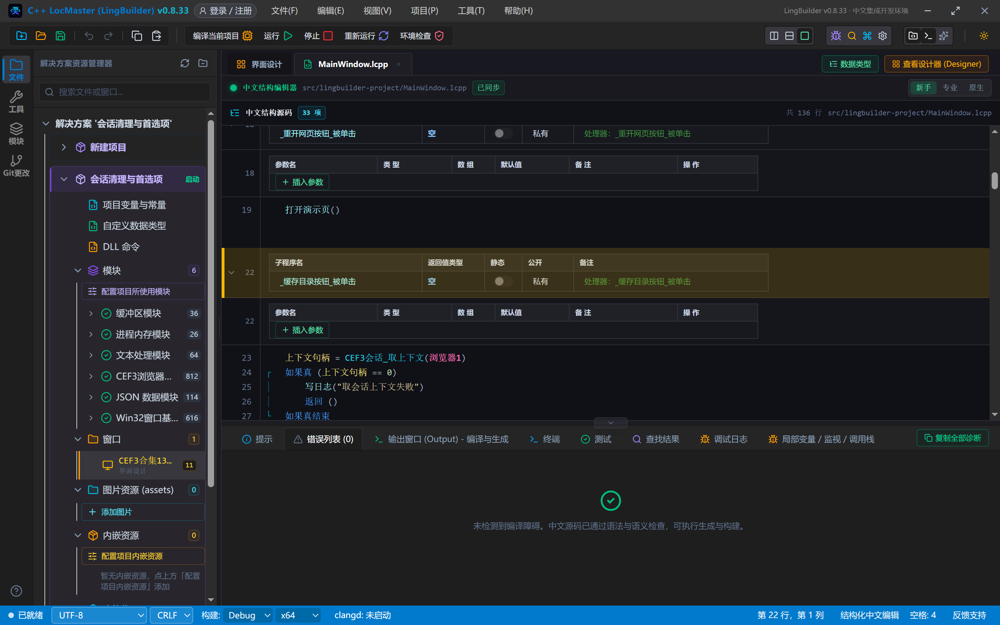
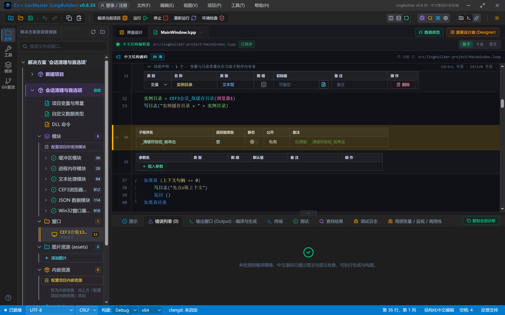
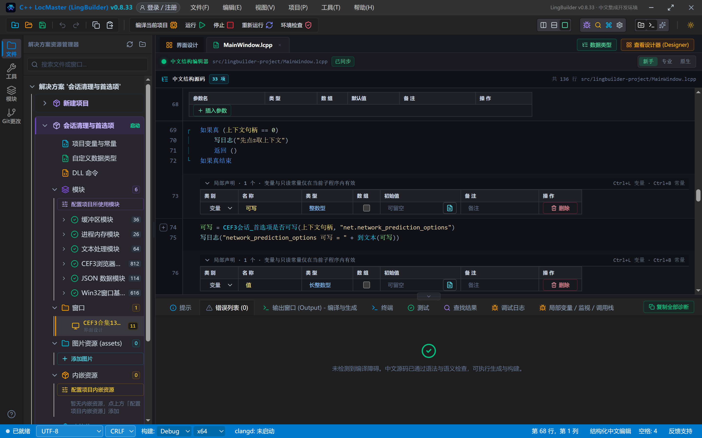
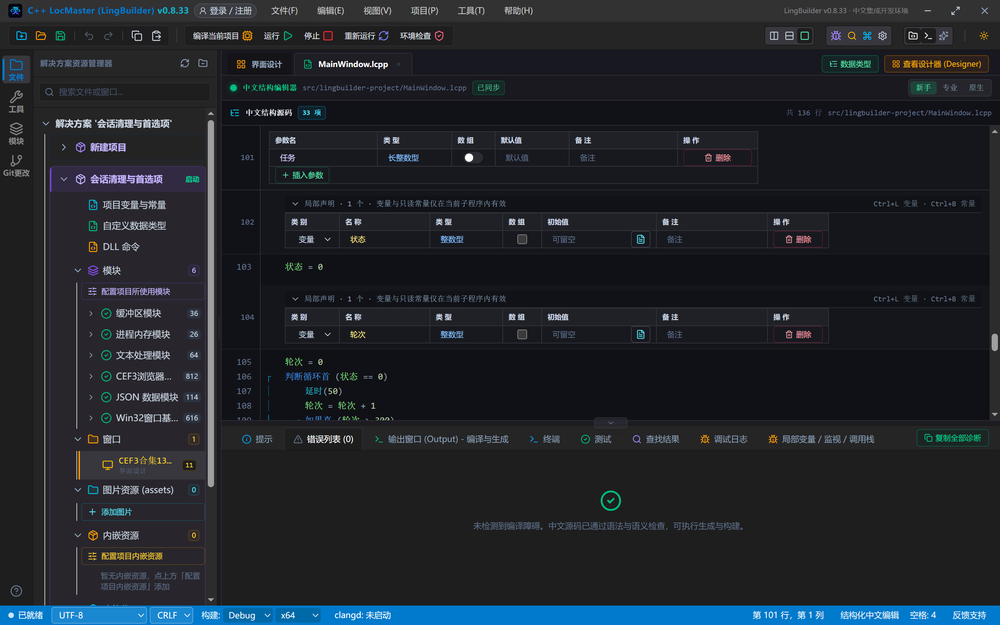
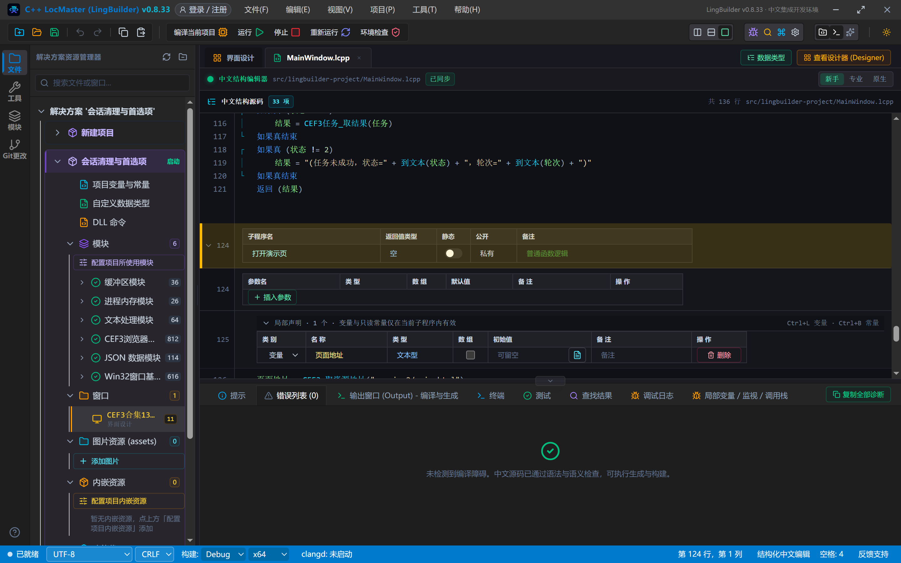
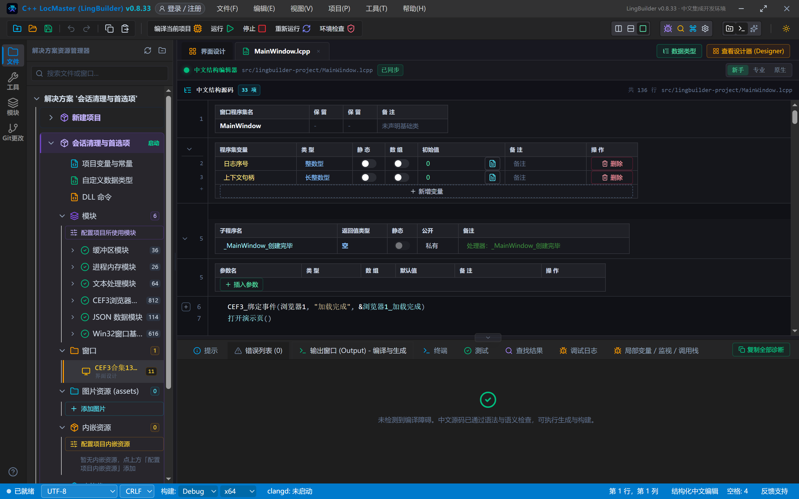
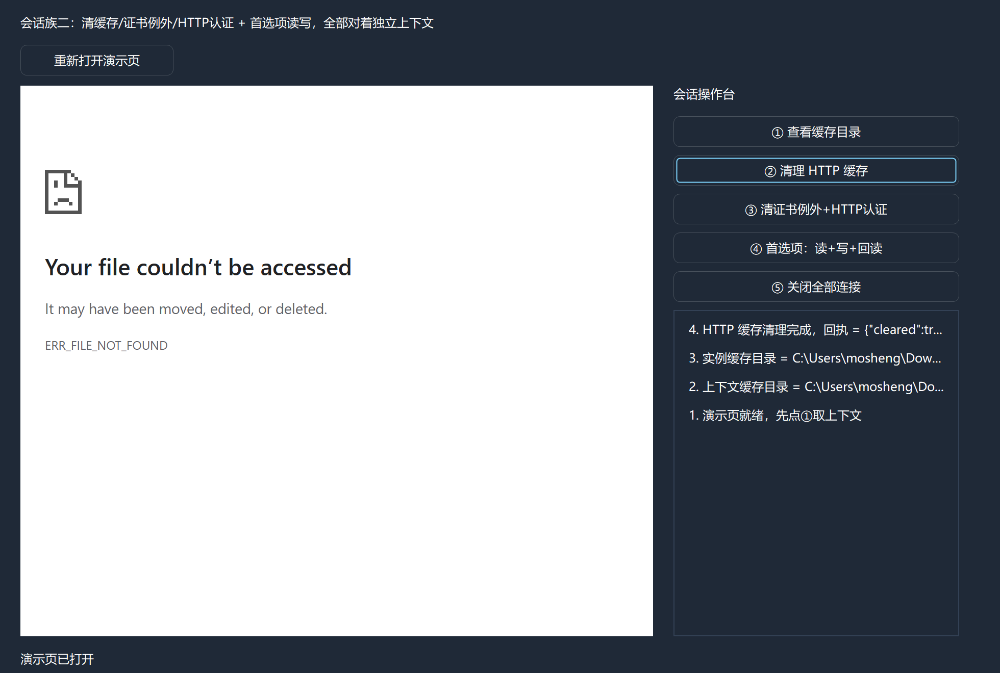
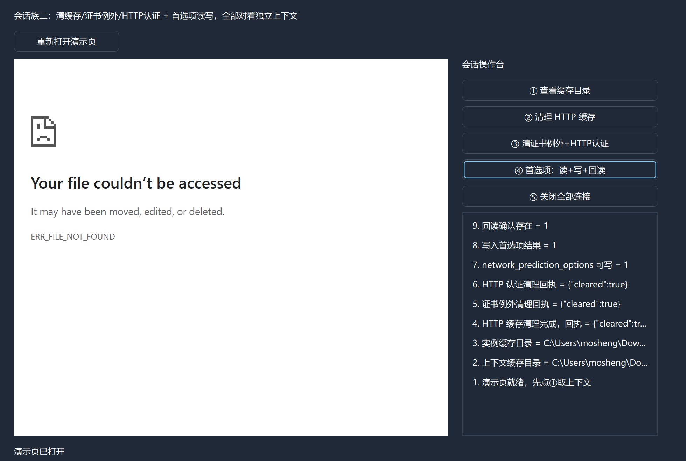
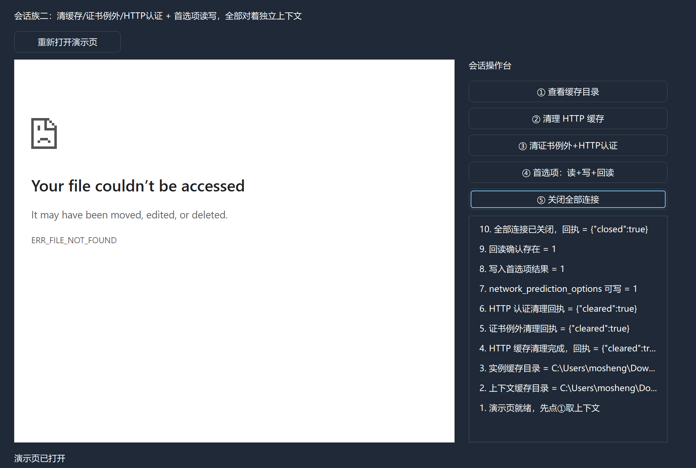

# CEF3 合集 13 · Cookie 落盘、清缓存与首选项：会话族（二）

> 《LingBuilder CEF3 浏览器合集》第 13 集（会话与多开篇）。上一集管好了 Cookie，这一集管剩下的三样：**HTTP 缓存清理**、**证书例外与 HTTP 认证凭据清理**、**首选项（Preference）读写**，外加「关闭全部连接」这个会话级大杀器。全部对着第 12 集同款独立会话上下文操作。全程约 30 分钟。
>
> **模块获取**：CEF3 浏览器模块**免费**（自动化子域单独启用，见第 5 集）；另需 JSON 数据模块与文本处理模块。
>
> 前置要求：学过[第 12 集](/guide/tutorials/cef3-12)的会话上下文与任务轮询。本集源码包见文末。

## 这一集你将学会

- `CEF3会话_上下文取缓存目录` / `CEF3会话_取缓存目录`：从上下文和实例两侧看缓存位置
- 三个异步清理：`清理HTTP缓存` / `清理证书例外` / `清理HTTP认证`（任务三步）
- 首选项三连：`首选项是否可写` → `设置首选项`（CEF 值句柄）→ `是否有首选项` 回读确认
- `CEF3会话_关闭全部连接`：会话级断网开关

## 1. 命令一张表

| 命令 | 参数 | 返回 |
| --- | --- | --- |
| `CEF3会话_取上下文` | 控件名 | 上下文句柄（一切的前提） |
| `CEF3会话_上下文取缓存目录` | 上下文句柄 | 文本型 |
| `CEF3会话_取缓存目录` | 控件名 | 文本型（实例视角） |
| `CEF3会话_清理HTTP缓存` | 上下文句柄 | 任务句柄 |
| `CEF3会话_清理证书例外` | 上下文句柄 | 任务句柄 |
| `CEF3会话_清理HTTP认证` | 上下文句柄 | 任务句柄 |
| `CEF3会话_关闭全部连接` | 上下文句柄 | 任务句柄 |
| `CEF3会话_首选项是否可写` | 上下文句柄, 名称 | 整数型（1=可写） |
| `CEF3会话_是否有首选项` | 上下文句柄, 名称 | 整数型 |
| `CEF3会话_设置首选项` | 上下文句柄, 名称, **值句柄** | 整数型（值句柄为 0 恢复默认） |

清理类和关连接都返回**任务句柄**——继续用 `等任务结果` 轮询（本集上限 300 轮≈15 秒）。首选项的值是 **CEF3值（Value）受管句柄**：`CEF3值_创建` → `CEF3值_设整数/设文本` → 传入 → 用完 `CEF3值_释放`。

## 2. 设计界面

新建项目「会话清理与首选项」，窗口 980×688（客户区 980×660）：

| 控件 | 名称 | 显示内容/属性 | 左距 | 顶距 | 宽度 | 高度 |
| --- | --- | --- | --- | --- | --- | --- |
| 标签 | 说明标签 | 会话族二：清缓存/证书例外/HTTP认证 + 首选项读写，全部对着独立上下文 | 20 | 14 | 620 | 22 |
| 按钮 | 重开网页按钮 | 重新打开演示页 | 20 | 44 | 150 | 30 |
| **CEF3浏览器** | **浏览器1** | 打开地址 = about:blank；勾选「禁用 GPU 加速」 | 20 | 84 | 620 | 540 |
| 标签 | 操作台标题 | 会话操作台 | 660 | 84 | 280 | 22 |
| 按钮 | 缓存目录按钮 | ① 查看缓存目录 | 660 | 114 | 280 | 30 |
| 按钮 | 清缓存按钮 | ② 清理 HTTP 缓存 | 660 | 152 | 280 | 30 |
| 按钮 | 清凭据按钮 | ③ 清证书例外+HTTP认证 | 660 | 190 | 280 | 30 |
| 按钮 | 首选项按钮 | ④ 首选项：读+写+回读 | 660 | 228 | 280 | 30 |
| 按钮 | 关连接按钮 | ⑤ 关闭全部连接 | 660 | 266 | 280 | 30 |
| 列表框 | 操作日志 | （空） | 660 | 304 | 280 | 320 |
| 标签 | 状态标签 | 就绪 | 20 | 638 | 920 | 22 |



## 3. 写代码

### 3.1 两个视角的缓存目录

```lcpp
事件 _缓存目录按钮_被单击()
    上下文句柄 = CEF3会话_取上下文(浏览器1)
    如果真 (上下文句柄 == 0)
        写日志("取会话上下文失败")
        返回 ()
    如果真结束
    局部 文本型 缓存目录
    缓存目录 = CEF3会话_上下文取缓存目录(上下文句柄)
    写日志("上下文缓存目录 = " + 缓存目录)
    局部 文本型 实例目录
    实例目录 = CEF3会话_取缓存目录(浏览器1)
    写日志("实例缓存目录 = " + 实例目录)
结束
```

`上下文取缓存目录`（对句柄）和 `取缓存目录`（对控件名）在单浏览器场景结果一致；多实例/共享上下文场景前者才是权威。



### 3.2 清缓存 + 清凭据：任务三步

```lcpp
事件 _清缓存按钮_被单击()
    局部 长整数型 任务
    任务 = CEF3会话_清理HTTP缓存(上下文句柄)
    局部 文本型 结果
    结果 = 等任务结果(任务)
    CEF3任务_释放(任务)
    写日志("HTTP 缓存清理完成，回执 = " + 结果)
结束

事件 _清凭据按钮_被单击()
    局部 长整数型 任务1
    任务1 = CEF3会话_清理证书例外(上下文句柄)
    局部 文本型 结果1
    结果1 = 等任务结果(任务1)
    CEF3任务_释放(任务1)
    写日志("证书例外清理回执 = " + 结果1)
    局部 长整数型 任务2
    任务2 = CEF3会话_清理HTTP认证(上下文句柄)
    局部 文本型 结果2
    结果2 = 等任务结果(任务2)
    CEF3任务_释放(任务2)
    写日志("HTTP 认证清理回执 = " + 结果2)
结束
```

回执是 JSON：证书例外/HTTP 认证为 `{"cleared":true}`，HTTP 缓存同理。「关闭全部连接」也是任务三步，常在清缓存前调用以确保连接不缓存旧数据。



### 3.3 首选项：可写判断 → 写入 → 回读

```lcpp
事件 _首选项按钮_被单击()
    局部 整数型 可写
    可写 = CEF3会话_首选项是否可写(上下文句柄, "net.network_prediction_options")
    写日志("network_prediction_options 可写 = " + 到文本(可写))
    局部 长整数型 值
    值 = CEF3值_创建()
    CEF3值_设整数(值, 0)
    局部 整数型 写入结果
    写入结果 = CEF3会话_设置首选项(上下文句柄, "net.network_prediction_options", 值)
    CEF3值_释放(值)
    写日志("写入首选项结果 = " + 到文本(写入结果))
    局部 整数型 存在
    存在 = CEF3会话_是否有首选项(上下文句柄, "net.network_prediction_options")
    写日志("回读确认存在 = " + 到文本(存在))
结束
```

三条命令串成闭环：**先问可写 → 用 CEF3值句柄写入 → 回读确认存在**。首选项名称必须用 CEF 认知的键（如 `net.network_prediction_options`）；值句柄传 0 表示恢复默认。







## 4. 编译：先看错误列表

「错误列表」(0)：



## 5. 运行：清干净、写进去、读回来

点「运行」。依次点五个按钮：

- ① 查看缓存目录 → 上下文/实例两侧都报出 `.cef3-profiles` 下的实际缓存路径；
- ② 清理 HTTP 缓存 → 回执确认清理完成；
- ③ 清证书例外+HTTP认证 → 两条回执都是 `{"cleared":true}`；
- ④ 首选项读写 → 「可写=1」「写入结果=1」「回读确认存在=1」三连；
- ⑤ 关闭全部连接 → 回执确认。







## 常见问题急救表

| 症状 | 原因 | 解法 |
| --- | --- | --- |
| 取上下文返回 0 | 浏览器控件还没创建完成 | 等「加载完成」事件后再取 |
| 首选项写入结果 = 0 | 名称不是 CEF 认知的键，或值类型不符 | 用 `首选项是否可写` 先探；值句柄类型要与首选项匹配 |
| 清理任务一直状态 0 | 会话忙（下载/请求进行中） | 轮询上限放宽；先「关闭全部连接」再清理 |
| 上下文与实例缓存目录不一致 | 多实例共享/独立缓存配置差异 | 单浏览器场景一致；多开时以上下文为准 |
| 值句柄忘记释放 | CEF3值_释放 漏调 | 写入后立即释放；值已拷贝进首选项存储 |
| 首选项名称写错不报错 | CEF 对未知键按新增处理 | 用「是否有首选项」回读确认 |

## 本集小结

- 清理三件套 + 关连接都是异步任务：轮询状态 0→2、取结果、释放，一条不少。
- 缓存目录有两个视角：上下文（会话权威）与实例（控件视角），多开场景以上下文为准。
- 首选项闭环：是否可写 → CEF3值句柄写入 → 是否有回读；值句柄用完即释放。

## 源码包

本集完整源码已打包为 **CEF3合集13-会话清理与首选项.lcpppkg**（见[示例源码区](/demos)），导入即可运行对照学习。

**下一篇预告**：多实例（一）——不靠设计器控件，用 CEF3_创建区域 在窗口里动态铺多个浏览器。

[回合集总览](/guide/tutorials/cef3)
