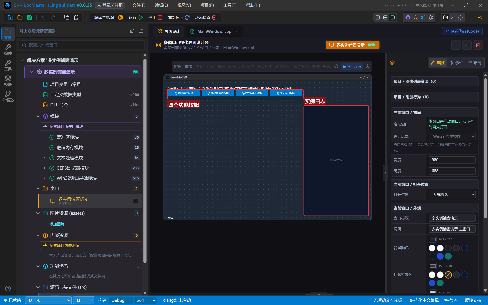
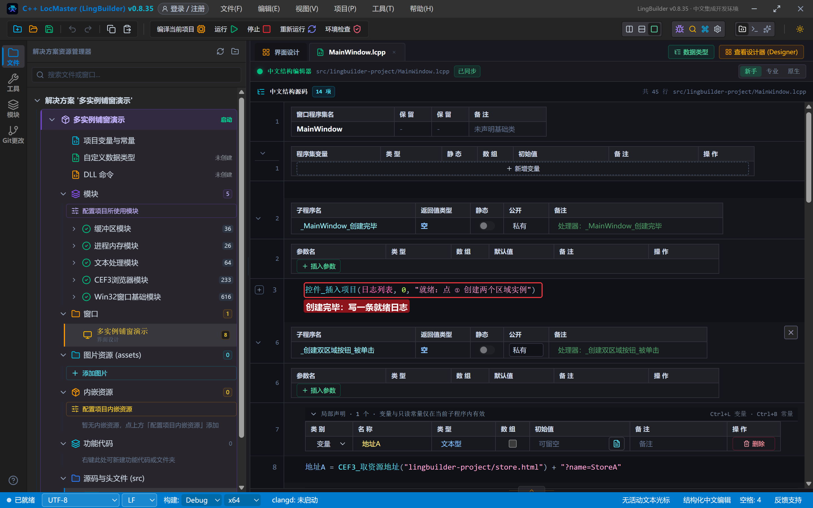
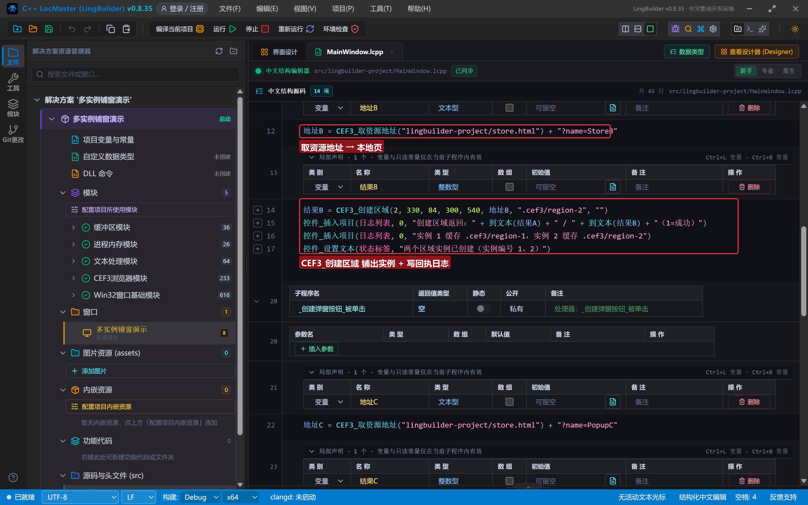
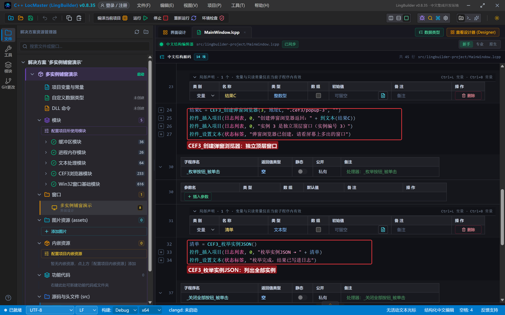
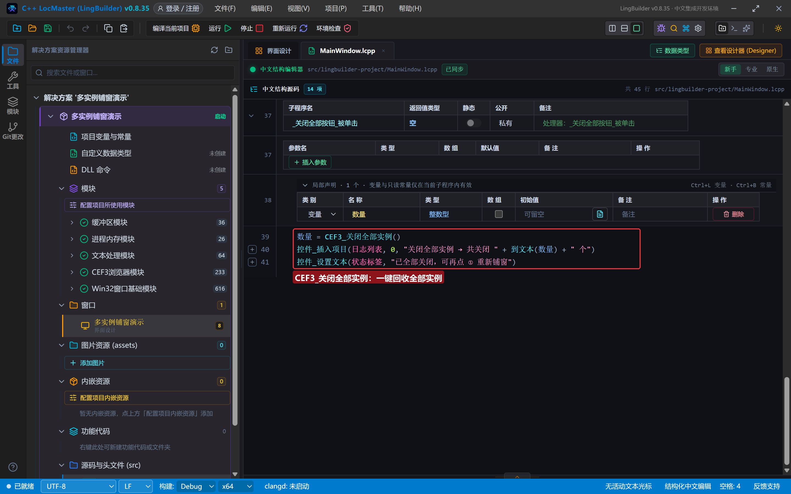
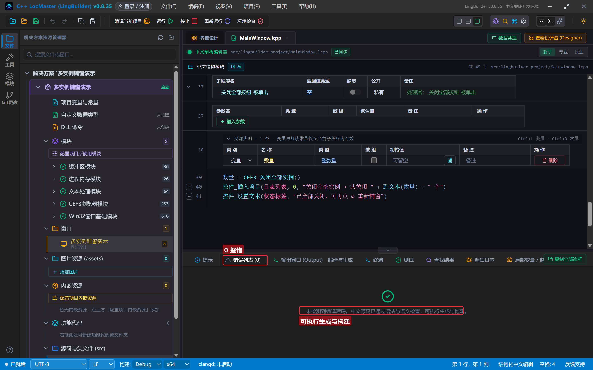
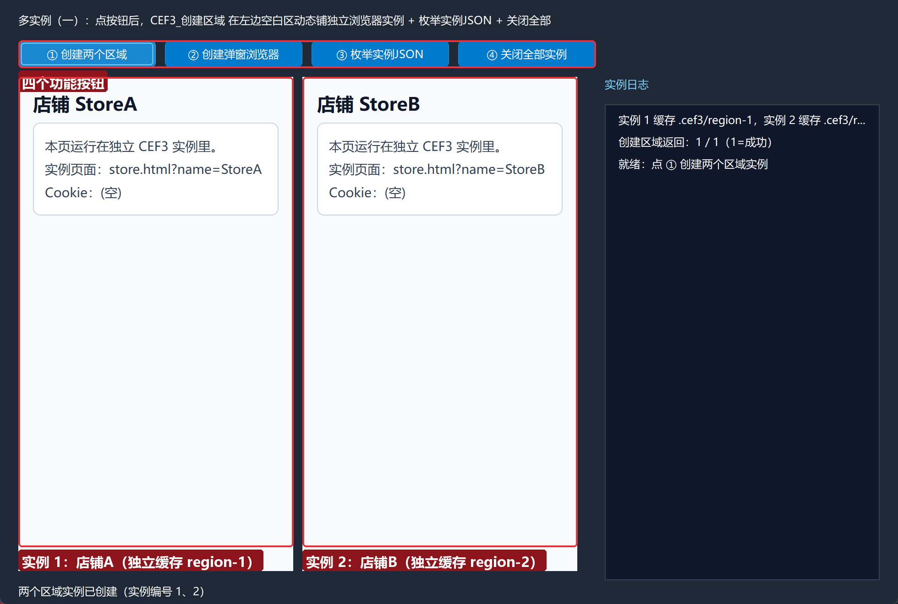
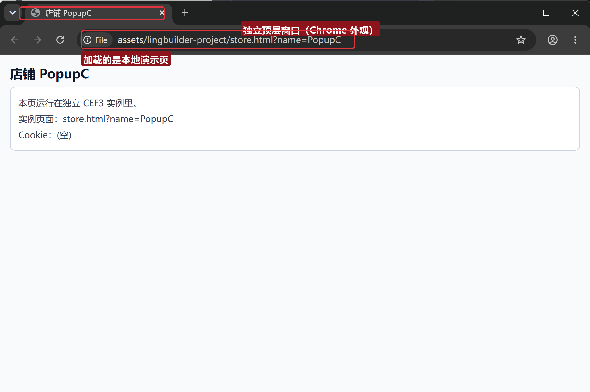
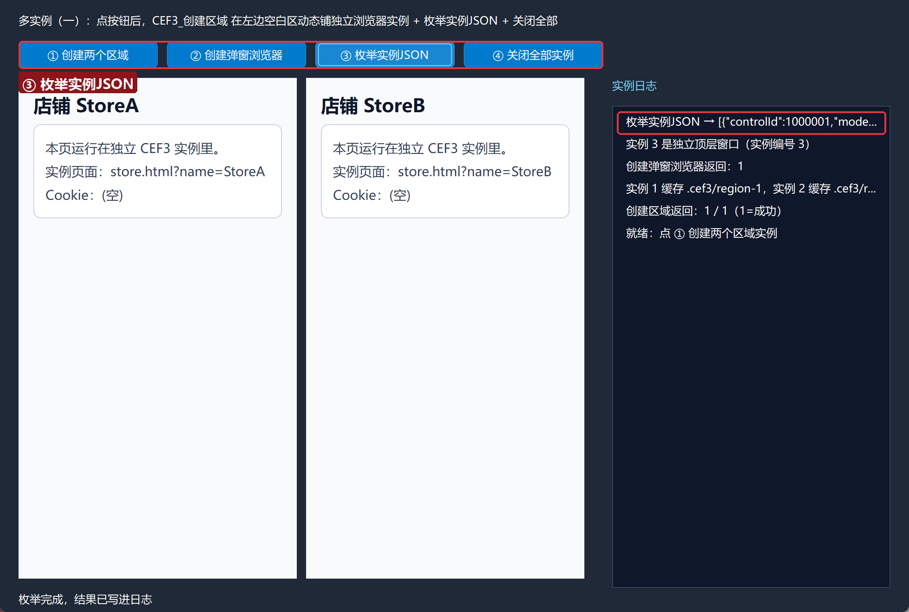
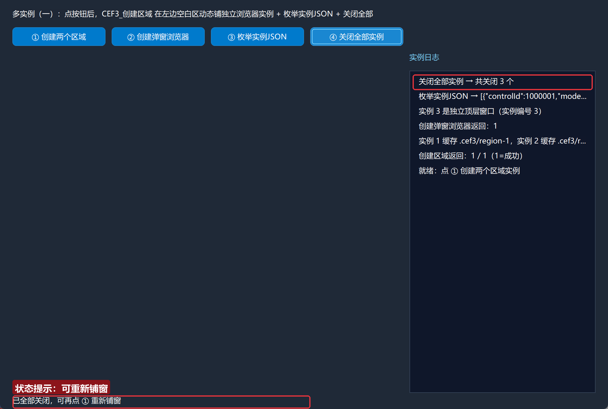

# CEF3 合集 14 · 多实例（一）：创建区域、实例枚举、关闭全部

> 《LingBuilder CEF3 浏览器合集》第 14 集（会话与多开篇）。前面 13 集的浏览器都是**设计器里拖出来的控件**——一个窗口放一个，数量在画图时就定死了。这一集开始学 CEF3 的**运行期动态多开**：不拖任何浏览器控件，用一条 `CEF3_创建区域` 命令在窗口的任意矩形里"凭空铺"出一个独立浏览器，想铺几个铺几个；再用 `CEF3_枚举实例JSON` 盘点家底、`CEF3_关闭全部实例` 一键回收。全程约 30 分钟。
>
> **模块获取**：CEF3 浏览器模块**免费**（模块面板搜索 CEF3 启用即可；本集只用到主模块）。另需 Win32 窗口基础模块与文本处理模块（默认已启用）。
>
> 前置要求：学过[第 1 集](/guide/tutorials/cef3-01)的基本操作。本集不需要第 12/13 集的会话知识，是新篇章的起点。本集源码包见文末。

## 这一集你将学会

- `CEF3_创建区域(实例编号, 左, 顶, 宽, 高, 地址, 独立缓存目录, 代理地址)`：在窗口客户区任意矩形动态创建独立浏览器实例
- `CEF3_创建弹窗浏览器(实例编号, 地址, 独立缓存目录, 代理地址)`：不依赖窗口区域，凭空弹一个独立顶层浏览器窗口
- `CEF3_取资源地址(相对路径)`：把随程序部署的本地演示页变成可导航地址
- `CEF3_枚举实例JSON()`：列出当前全部实例（编号/形态/地址/缓存目录）
- `CEF3_关闭全部实例()`：一键关闭并回收全部实例

## 1. 命令一张表

| 命令 | 参数 | 返回 |
| --- | --- | --- |
| `CEF3_创建区域` | 实例编号, 左, 顶, 宽, 高, 地址, 独立缓存目录, 代理地址 | 整数型（1=成功） |
| `CEF3_创建弹窗浏览器` | 实例编号, 地址, 独立缓存目录, 代理地址 | 整数型（1=成功） |
| `CEF3_取资源地址` | 相对路径 | 文本型（file:/// 地址） |
| `CEF3_枚举实例JSON` | （无） | 文本型（JSON 数组） |
| `CEF3_关闭全部实例` | （无） | 整数型（关闭数量） |

三个要点先记住：

- **坐标是"逻辑像素"**：`左/顶/宽/高` 与设计器属性面板里的单位一致（980×688 窗口里写 300 就是 300），高 DPI 屏幕下 IDE 会自动缩放，不用自己乘系数。
- **独立缓存目录是隔离的关键**：传 `.cef3/region-1` 这样的相对目录，每个实例就有自己独立的 profile——Cookie、缓存互不串门。传空文本则共用默认目录。
- **实例编号是运行期编号**：它不是控件名！后续按它寻址（本集的枚举/关闭全部都认它）。重复编号会先关旧再建新。

## 2. 设计界面

新建项目「多实例铺窗演示」，窗口 980×688（客户区 980×660）。注意：**左侧那一大片空白区域什么都不用拖**——那是运行期给 `CEF3_创建区域` 留的画布：

| 控件 | 名称 | 显示内容/属性 | 左距 | 顶距 | 宽度 | 高度 |
| --- | --- | --- | --- | --- | --- | --- |
| 标签 | 说明标签 | 多实例（一）：点按钮后，CEF3_创建区域 在左边空白区动态铺独立浏览器实例 + 枚举实例JSON + 关闭全部 | 20 | 14 | 620 | 44 |
| 按钮 | 创建双区域按钮 | ① 创建两个区域 | 20 | 44 | 150 | 30 |
| 按钮 | 创建弹窗按钮 | ② 创建弹窗浏览器 | 180 | 44 | 150 | 30 |
| 按钮 | 枚举按钮 | ③ 枚举实例JSON | 340 | 44 | 150 | 30 |
| 按钮 | 关闭全部按钮 | ④ 关闭全部实例 | 500 | 44 | 150 | 30 |
| 标签 | 日志标题 | 实例日志 | 660 | 84 | 280 | 22 |
| 列表框 | 日志列表 | （空） | 660 | 114 | 300 | 520 |
| 标签 | 状态标签 | 就绪 | 20 | 638 | 920 | 22 |



## 3. 准备本地演示页

在项目的 `assets/lingbuilder-project/` 目录下放一个 `store.html`（工作区资源管理器里右键新建文件即可）。这个页面会读地址栏的 `?name=` 参数显示店铺名，并显示自己的 Cookie：

```html
<!DOCTYPE html>
<html><head><meta charset="utf-8"><title>店铺实例</title></head><body>
<h1 id="shop">店铺</h1>
<div>本页运行在独立 CEF3 实例里。<br>实例页面：<span id="addr"></span><br>Cookie：<span id="ck">(空)</span></div>
<script>
var name = new URLSearchParams(location.search).get('name') || '?';
document.getElementById('shop').innerText = '店铺 ' + name;
document.title = '店铺 ' + name;
document.getElementById('ck').innerText = document.cookie || '(空)';
</script>
</body></html>
```

**为什么放 assets 目录？** 构建时 `assets/项目ID/` 下的文件会原样复制到 exe 同级的 `assets/` 目录；`CEF3_取资源地址("lingbuilder-project/store.html")` 把它解析成 `file:///` 地址。这样演示页跟着程序走，换机器也能跑。**别把 HTML 放在源码目录**——只有 assets 目录会随构建部署。

## 4. 写代码

### 4.1 创建完毕：写一条就绪日志

```lcpp
事件 _MainWindow_创建完毕()
    控件_插入项目(日志列表, 0, "就绪：点 ① 创建两个区域实例")
结束
```



### 4.2 创建两个区域实例

```lcpp
事件 _创建双区域按钮_被单击()
    局部 文本型 地址A
    地址A = CEF3_取资源地址("lingbuilder-project/store.html") + "?name=StoreA"
    局部 整数型 结果A
    结果A = CEF3_创建区域(1, 20, 84, 300, 540, 地址A, ".cef3/region-1", "")
    局部 文本型 地址B
    地址B = CEF3_取资源地址("lingbuilder-project/store.html") + "?name=StoreB"
    局部 整数型 结果B
    结果B = CEF3_创建区域(2, 330, 84, 300, 540, 地址B, ".cef3/region-2", "")
    控件_插入项目(日志列表, 0, "创建区域返回：" + 到文本(结果A) + " / " + 到文本(结果B) + "（1=成功）")
    控件_插入项目(日志列表, 0, "实例 1 缓存 .cef3/region-1，实例 2 缓存 .cef3/region-2")
    控件_设置文本(状态标签, "两个区域实例已创建（实例编号 1、2）")
结束
```

逐参数拆解 `CEF3_创建区域(1, 20, 84, 300, 540, 地址A, ".cef3/region-1", "")`：

| 参数 | 值 | 含义 |
| --- | --- | --- |
| 实例编号 | 1 | 运行期编号，枚举/关闭都认它 |
| 左, 顶 | 20, 84 | 矩形左上角（客户区坐标，和设计器属性面板同口径） |
| 宽, 高 | 300, 540 | 矩形大小 |
| 地址 | 地址A | 要打开的页面（本地演示页 + 店铺名参数） |
| 独立缓存目录 | ".cef3/region-1" | 独立 profile，Cookie/缓存隔离 |
| 代理地址 | "" | 空文本=跟随系统；实例独立代理留到第 15 集 |



### 4.3 创建弹窗浏览器 + 枚举实例

```lcpp
事件 _创建弹窗按钮_被单击()
    局部 文本型 地址C
    地址C = CEF3_取资源地址("lingbuilder-project/store.html") + "?name=PopupC"
    局部 整数型 结果C
    结果C = CEF3_创建弹窗浏览器(3, 地址C, ".cef3/popup-3", "")
    控件_插入项目(日志列表, 0, "创建弹窗浏览器返回：" + 到文本(结果C))
    控件_插入项目(日志列表, 0, "实例 3 是独立顶层窗口（实例编号 3）")
    控件_设置文本(状态标签, "弹窗浏览器已创建，请看屏幕上多出的窗口")
结束

事件 _枚举按钮_被单击()
    局部 文本型 清单
    清单 = CEF3_枚举实例JSON()
    控件_插入项目(日志列表, 0, "枚举实例JSON → " + 清单)
    控件_设置文本(状态标签, "枚举完成，结果已写进日志")
结束
```

`CEF3_创建弹窗浏览器` 和区域版的区别：**不占窗口里的矩形**，直接弹一个带 Chrome 外观的独立顶层窗口（有地址栏、页签），适合"多店铺各开一个小窗"。`CEF3_枚举实例JSON` 返回 JSON 数组，每项含 `controlId`（运行时编号）、`mode`（region/chrome-popup/control/windowless）、地址、缓存目录等，可以直接交给 JSON 模块解析或直接展示。



### 4.4 关闭全部实例

```lcpp
事件 _关闭全部按钮_被单击()
    局部 整数型 数量
    数量 = CEF3_关闭全部实例()
    控件_插入项目(日志列表, 0, "关闭全部实例 → 共关闭 " + 到文本(数量) + " 个")
    控件_设置文本(状态标签, "已全部关闭，可再点 ① 重新铺窗")
结束
```

返回值是**实际关闭的数量**。关闭后窗口里的区域画面会立刻消失，弹窗窗口也会被关掉——回收是彻底的，再点 ① 可以原样重铺。



## 5. 编译：先看错误列表

点「编译当前项目」，先看底部「错误列表」——**(0)** 才继续：



## 6. 运行：铺窗 → 弹窗 → 盘点 → 回收

点「运行」。依次点四个按钮：

- **① 创建两个区域** → 左侧空白区瞬间铺出两个浏览器，各加载自己的店铺页（StoreA / StoreB）：



- **② 创建弹窗浏览器** → 屏幕上多出一个独立的 Chrome 外观窗口，地址栏就是我们传的本地演示页：



- **③ 枚举实例JSON** → 日志第一行写出了 JSON 数组，能看到三个实例的编号、形态与缓存目录：



- **④ 关闭全部实例** → 日志报出「共关闭 3 个」，左侧区域清空、弹窗窗口消失：



## 常见问题急救表

| 症状 | 原因 | 解法 |
| --- | --- | --- |
| 创建区域返回 0 | 宽/高不是正数，或实例编号 ≤ 0 | 检查参数；实例编号从 1 开始 |
| 区域里白屏/加载失败 | 演示页没部署到 exe 同级 assets | HTML 放 `assets/项目ID/` 目录后重新编译；用 `CEF3_取资源地址` 导航 |
| 两个店铺 Cookie 串了 | 独立缓存目录传了空 | 每个实例给不同的 `.cef3/xxx` 目录 |
| 弹窗窗口找不到 | 被主窗口挡住 | 看任务栏；弹窗是独立顶层窗口 |
| 重复点 ① 出现旧画面闪烁 | 同编号重建会先关旧的 | 正常现象；要追加就换新编号 |
| 关闭全部后返回 0 | 当前没有实例 | 先点 ① 再试 |
| 想单独关某一个实例 | 本集只教一键全关 | 按编号关单实例走 `CEF3_关闭`（设计器控件）或重建覆盖，动态单关在进阶集展开 |

## 本集小结

- `CEF3_创建区域` = 在窗口矩形里动态铺浏览器；`CEF3_创建弹窗浏览器` = 凭空弹独立顶层窗口；两者都靠**实例编号 + 独立缓存目录**工作。
- 本地演示页放 `assets/项目ID/`，用 `CEF3_取资源地址` 变成可导航地址，随构建自动部署。
- `CEF3_枚举实例JSON` 盘点、`CEF3_关闭全部实例` 回收——铺窗自由，回收也要利落。

## 源码包

本集完整源码已打包为 **CEF3合集14-多实例铺窗演示.lcpppkg**（见[示例源码区](/demos)），导入即可运行对照学习。

**下一篇预告**：多实例（二）——给每个实例配独立 UA 与独立代理，再认识全局代理这道总闸。

[回合集总览](/guide/tutorials/cef3)
