# CEF3 合集 15 · 多实例（二）：实例 UA 与实例代理、全局代理

> 《LingBuilder CEF3 浏览器合集》第 15 集（会话与多开篇）。上一集学会了"凭空铺"浏览器，这一集解决多开的核心痛点：**每个实例长得不一样、走的路也不一样**——给实例 1 配一个 UA、给实例 2 配一个独立代理，再认识全局代理这道"总闸"和它的回落规则。多店铺防关联的地基，从这一集打下。全程约 30 分钟。
>
> **模块获取**：CEF3 浏览器模块**免费**（本集仍只用到主模块）。
>
> 前置要求：学过[第 14 集](/guide/tutorials/cef3-14)的创建区域与实例编号。本集源码包见文末。

## 这一集你将学会

- `CEF3_创建区域` 第 8 个参数：**创建期**就给实例配独立代理
- `CEF3_设置实例用户代理(实例编号, UA)` / `CEF3_取实例用户代理(实例编号)`：逐实例 UA 覆盖与读回
- `CEF3_取实例代理(实例编号)`：读回实例生效的代理（自带优先，空则回落全局）
- `CEF3_设置全局代理(代理地址)` / `CEF3_取全局代理()` / `CEF3_清除全局代理()`：全局总闸三件套

## 1. 命令一张表

| 命令 | 参数 | 返回 |
| --- | --- | --- |
| `CEF3_创建区域` | 实例编号, 左, 顶, 宽, 高, 地址, 独立缓存目录, **代理地址** | 整数型（1=成功） |
| `CEF3_设置实例用户代理` | 实例编号, 用户代理 | 整数型（1=成功；实例必须已创建） |
| `CEF3_取实例用户代理` | 实例编号 | 文本型 |
| `CEF3_取实例代理` | 实例编号 | 文本型（自带优先，空则回落全局） |
| `CEF3_设置全局代理` | 代理地址 | 整数型 |
| `CEF3_取全局代理` | （无） | 文本型 |
| `CEF3_清除全局代理` | （无） | 整数型 |

两条**必须刻在脑子里的规则**：

- **全局代理只对"之后创建"的无代理实例生效**。它是创建期的回落值：实例创建那一刻，自己没带代理、全局代理非空，才吃全局；已经跑起来的实例不受之后的全局设置影响。
- **实例 UA 是"资源加载前"改写请求头**：对设置之后的网络请求生效。想让首个页面就带上新 UA，设置完重新导航/重建实例即可。置空文本 = 清除覆盖。

## 2. 设计界面

新建项目「实例UA与代理工作台」，窗口 980×688（客户区 980×660）。五个按钮 + 右侧日志，左侧留白给区域实例：

| 控件 | 名称 | 显示内容/属性 | 左距 | 顶距 | 宽度 | 高度 |
| --- | --- | --- | --- | --- | --- | --- |
| 标签 | 说明标签 | 多实例（二）：实例 UA 与实例代理逐个配，全局代理是「之后创建的无代理实例」的回落值 | 20 | 14 | 700 | 22 |
| 按钮 | 创建双实例按钮 | ① 创建双实例 | 20 | 44 | 130 | 30 |
| 按钮 | 实例UA按钮 | ② 设置实例UA | 158 | 44 | 130 | 30 |
| 按钮 | 读回代理按钮 | ③ 读回代理 | 296 | 44 | 120 | 30 |
| 按钮 | 全局代理按钮 | ④ 设置全局代理 | 424 | 44 | 140 | 30 |
| 按钮 | 清除全局按钮 | ⑤ 清除全局代理 | 572 | 44 | 140 | 30 |
| 标签 | 日志标题 | UA/代理日志 | 730 | 84 | 230 | 22 |
| 列表框 | 日志列表 | （空） | 730 | 114 | 230 | 546 |
| 标签 | 状态标签 | 就绪 | 20 | 638 | 690 | 22 |

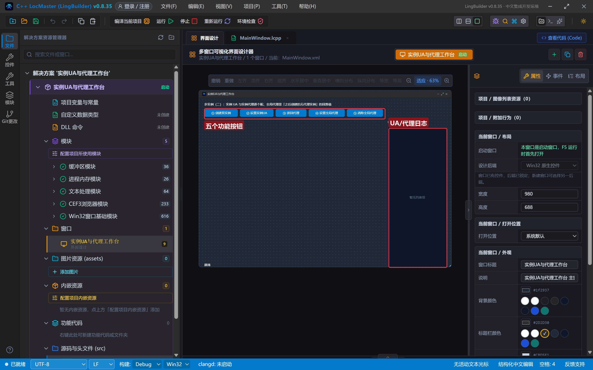

演示页复用第 14 集的 `assets/lingbuilder-project/store.html`（读 `?name=` 显示店铺名），本集把它当"实例身份牌"用。

## 3. 写代码

### 3.1 创建双实例：一个不带代理、一个带独立代理

```lcpp
事件 _创建双实例按钮_被单击()
    局部 文本型 地址A
    地址A = CEF3_取资源地址("lingbuilder-project/store.html") + "?name=ShopA"
    局部 整数型 结果A
    结果A = CEF3_创建区域(1, 20, 84, 330, 540, 地址A, ".cef3/ua-shop", "")
    局部 文本型 地址B
    地址B = CEF3_取资源地址("lingbuilder-project/store.html") + "?name=ShopB"
    局部 整数型 结果B
    结果B = CEF3_创建区域(2, 370, 84, 330, 540, 地址B, ".cef3/proxy-shop", "http://127.0.0.1:8888")
    控件_插入项目(日志列表, 0, "创建区域返回：" + 到文本(结果A) + " / " + 到文本(结果B))
    控件_插入项目(日志列表, 0, "实例 1 无代理（吃全局回落），实例 2 独立代理 8888")
    控件_设置文本(状态标签, "两个实例已创建（编号 1、2）")
结束
```

唯一的差别在第 8 个参数：实例 1 传空文本（跟随回落），实例 2 传 `"http://127.0.0.1:8888"`。代理地址支持 `http://` 与 `socks5://` 形态。本机没跑 8888 端口的代理也不影响演示——我们的演示页是本地 `file:///` 页面，不走代理；代理配置本身已经登记进实例，用 ③ 读回验证。

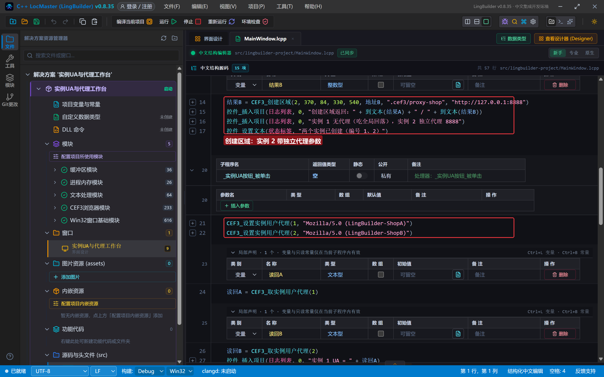

### 3.2 逐实例 UA：设置 + 读回

```lcpp
事件 _实例UA按钮_被单击()
    CEF3_设置实例用户代理(1, "Mozilla/5.0 (LingBuilder-ShopA)")
    CEF3_设置实例用户代理(2, "Mozilla/5.0 (LingBuilder-ShopB)")
    局部 文本型 读回A
    读回A = CEF3_取实例用户代理(1)
    局部 文本型 读回B
    读回B = CEF3_取实例用户代理(2)
    控件_插入项目(日志列表, 0, "实例 1 UA = " + 读回A)
    控件_插入项目(日志列表, 0, "实例 2 UA = " + 读回B)
    控件_设置文本(状态标签, "UA 在后续请求的协议头里生效")
结束
```

两个实例、两个 UA，互不干扰——这就是"多店铺防关联"的第一层：出站请求的 UA 指纹各用各的。

### 3.3 读回代理：自带优先，空则回落全局

```lcpp
事件 _读回代理按钮_被单击()
    局部 文本型 代理1
    代理1 = CEF3_取实例代理(1)
    局部 文本型 代理2
    代理2 = CEF3_取实例代理(2)
    控件_插入项目(日志列表, 0, "实例 1 代理 = [" + 代理1 + "]")
    控件_插入项目(日志列表, 0, "实例 2 代理 = [" + 代理2 + "]")
    控件_插入项目(日志列表, 0, "全局代理 = [" + CEF3_取全局代理() + "]")
    控件_设置文本(状态标签, "取实例代理：自带优先，空则回落全局")
结束
```

此刻全局代理还是空，所以读到 `实例 1 代理 = []`、`实例 2 代理 = [http://127.0.0.1:8888]`。

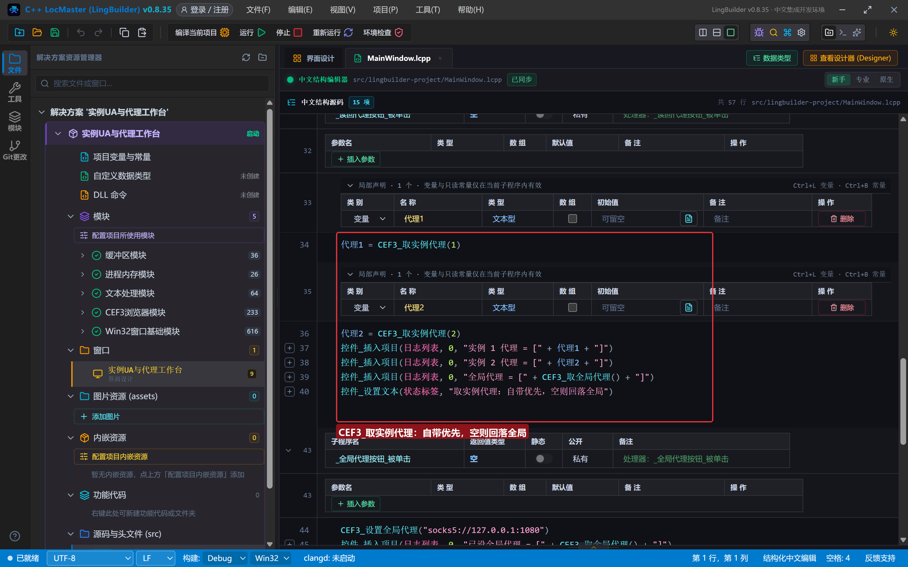

### 3.4 全局代理：总闸与回落

```lcpp
事件 _全局代理按钮_被单击()
    CEF3_设置全局代理("socks5://127.0.0.1:1080")
    控件_插入项目(日志列表, 0, "已设全局代理 = [" + CEF3_取全局代理() + "]")
    控件_插入项目(日志列表, 0, "红线：只对之后创建的无代理实例生效")
    控件_设置文本(状态标签, "再点 ① 重建，实例 1 就继承全局代理")
结束

事件 _清除全局代理按钮_被单击()
    CEF3_清除全局代理()
    控件_插入项目(日志列表, 0, "已清除全局代理 = [" + CEF3_取全局代理() + "]")
    控件_设置文本(状态标签, "全局代理已清空")
结束
```

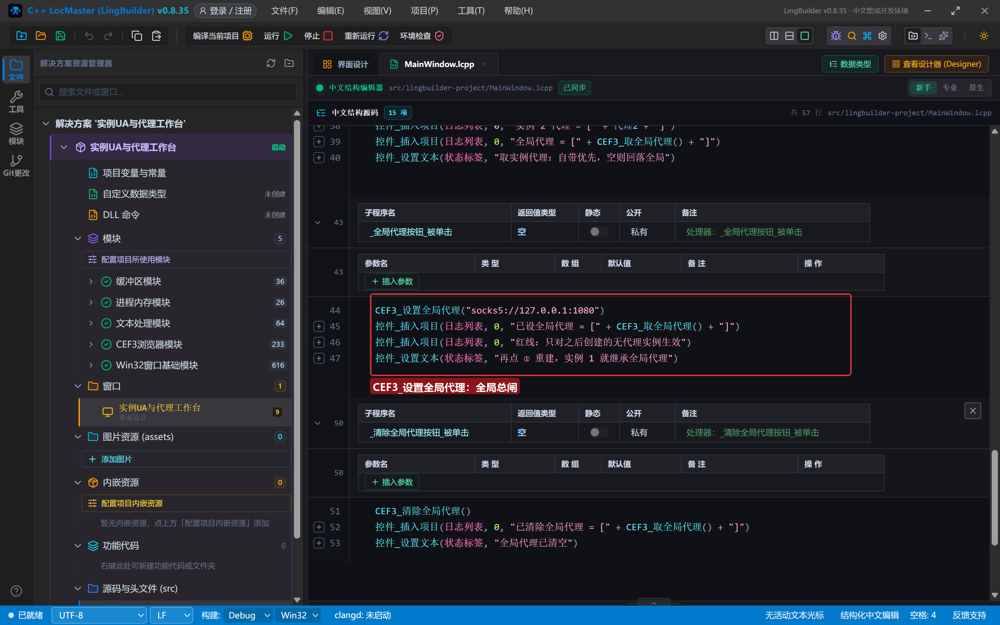

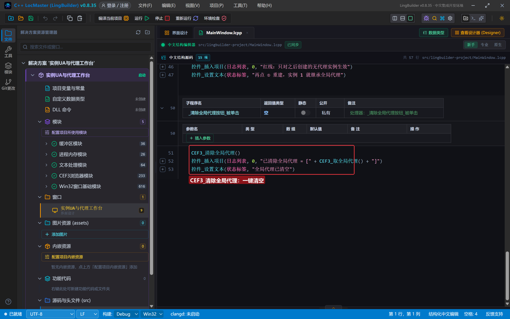

## 4. 编译：先看错误列表

「错误列表」**(0)** 才继续：

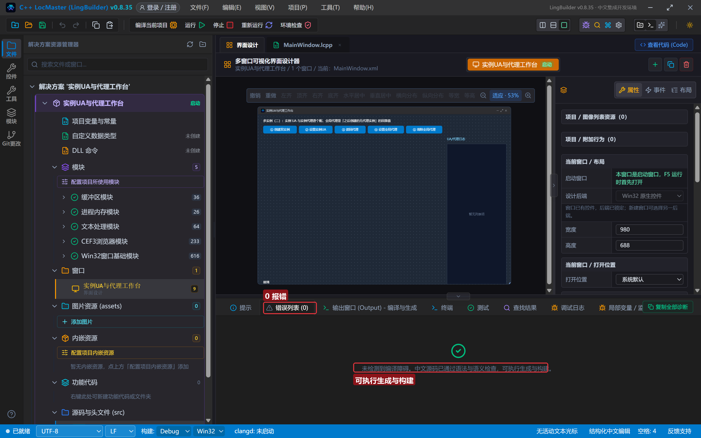

## 5. 运行：一条命令验完三件事

点「运行」，按顺序体验：

- **① 创建双实例** → 两个店铺铺进左侧区域：

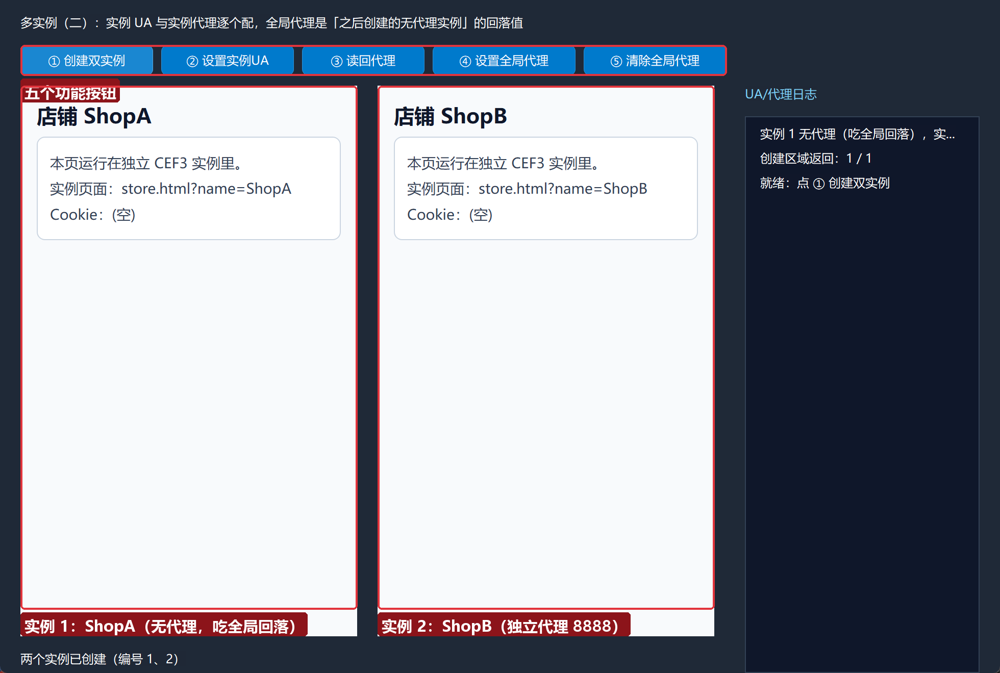

- **② 设置实例UA** → 日志读回两个 UA，各归各的实例：

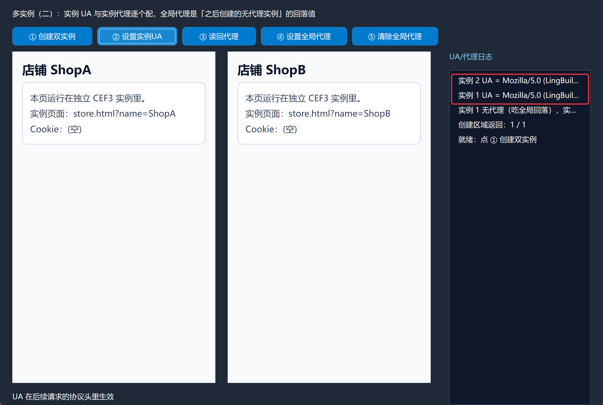

- **③ 读回代理** → 实例 1 空、实例 2 是 8888、全局空：

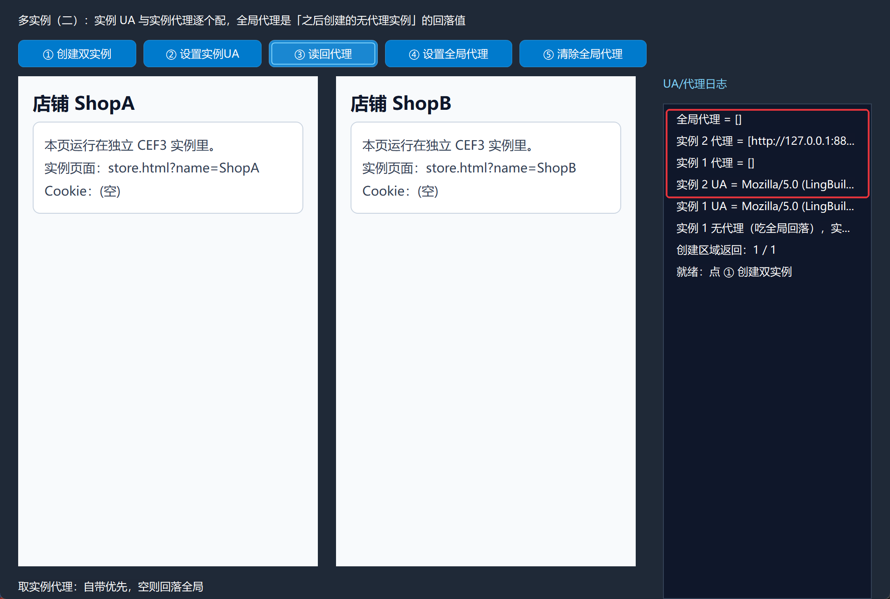

- **④ 设置全局代理** → 全局代理变为 `socks5://127.0.0.1:1080`：

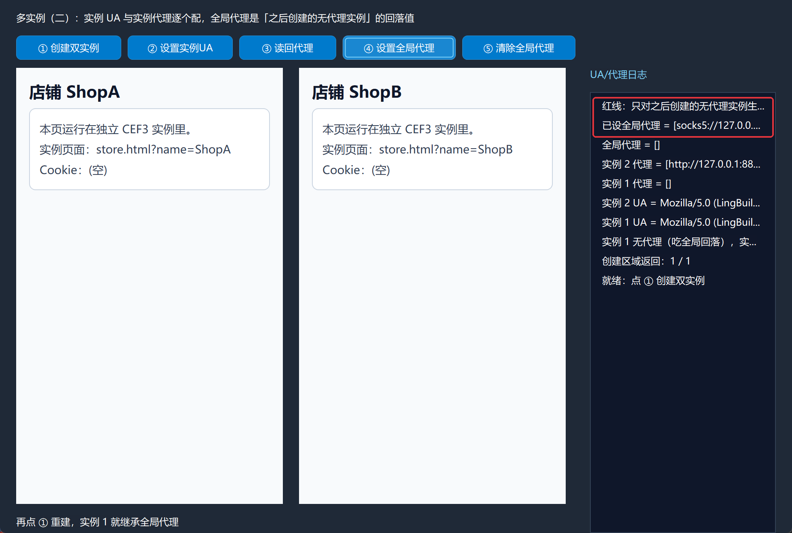

- **再点 ① 重建，再点 ③ 读回** → 见证回落：重建时实例 1 没带代理、全局非空，于是**创建期吃掉全局代理**；`取实例代理` 读回 `socks5://127.0.0.1:1080`。实例 2 照旧是自己的 8888：

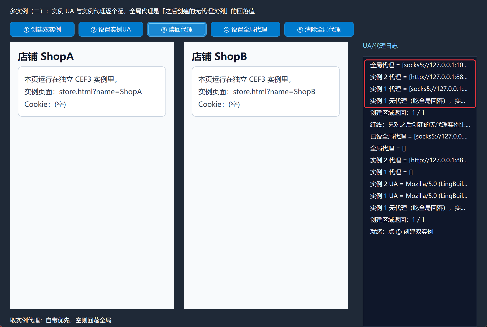

- **⑤ 清除全局代理** → 全局回空，再重建就又直连了。

## 常见问题急救表

| 症状 | 原因 | 解法 |
| --- | --- | --- |
| 设置实例用户代理返回 0 | 实例编号不存在或还没创建完成 | 先创建成功再设置；编号是运行期编号不是控件名 |
| 页面里 `navigator.userAgent` 没变 | UA 覆盖改的是 **HTTP 协议头**，不是 JS 环境值 | 在服务端/请求侧看 UA；本地 file 页验证不了，属正常 |
| 设了全局代理实例却没走 | 实例创建在设置之前 | 全局代理是**创建期回落**；重建实例或先设全局再创建 |
| 重建后实例 UA 丢了 | 同编号重建=关旧建新，覆盖随实例走 | 重建后重设 UA；或在创建参数阶段统一配好 |
| 取实例代理返回空 | 实例没带代理且全局也是空 | 空文本=直连/跟随系统；不是错误 |
| 想让单个实例直连不走全局 | 代理参数只能传地址 | 本集口径：带代理参数即独立；「显式直连」走 `CEF3_设置代理`（控件实例），实例级直连可传无效地址规避或用第 24 集平台命令 |
| socks5 代理连不上 | 本机没跑代理服务 | 演示页是本地 file 页不受影响；真实验证需可用代理 |

## 本集小结

- 实例隔离三层：**独立缓存目录**（第 14 集）+ **独立 UA** + **独立代理**（本集）。
- `取实例代理` 的读出口径：自带优先，空则回落全局；全局代理是创建期回落，不是实时广播。
- UA 覆盖作用于后续请求的协议头；重建实例会连 UA 一起重置。

## 源码包

本集完整源码已打包为 **CEF3合集15-实例UA与代理工作台.lcpppkg**（见[示例源码区](/demos)），导入即可运行对照学习。

**下一篇预告**：无头浏览器（一）——不创建任何窗口的官方 OSR 真无头，等待加载完成 ≠ 已出帧。

[回合集总览](/guide/tutorials/cef3)
