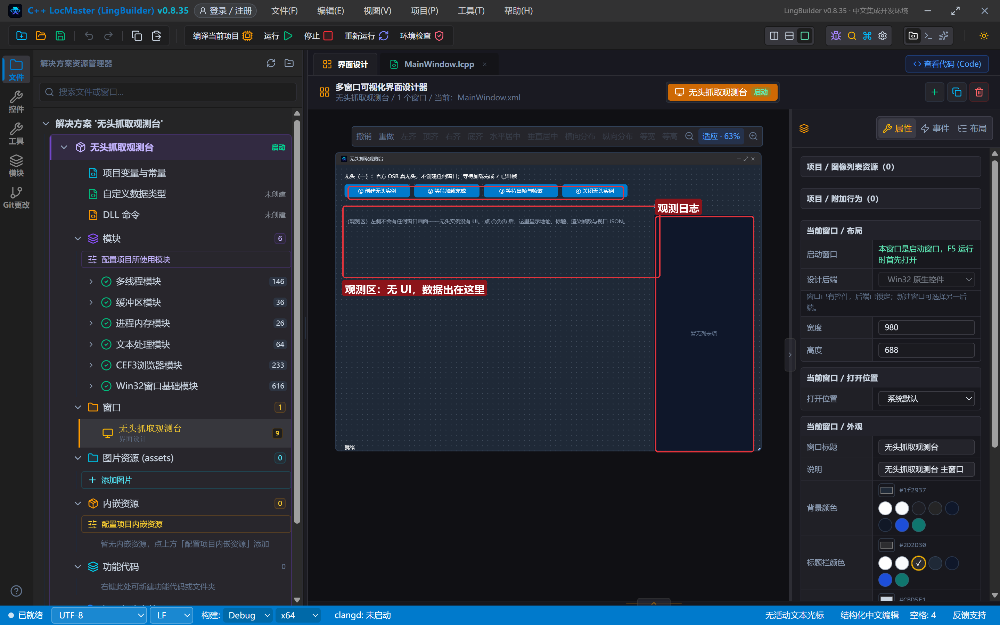
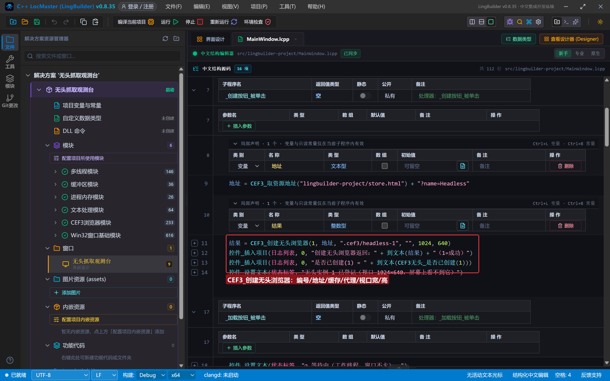
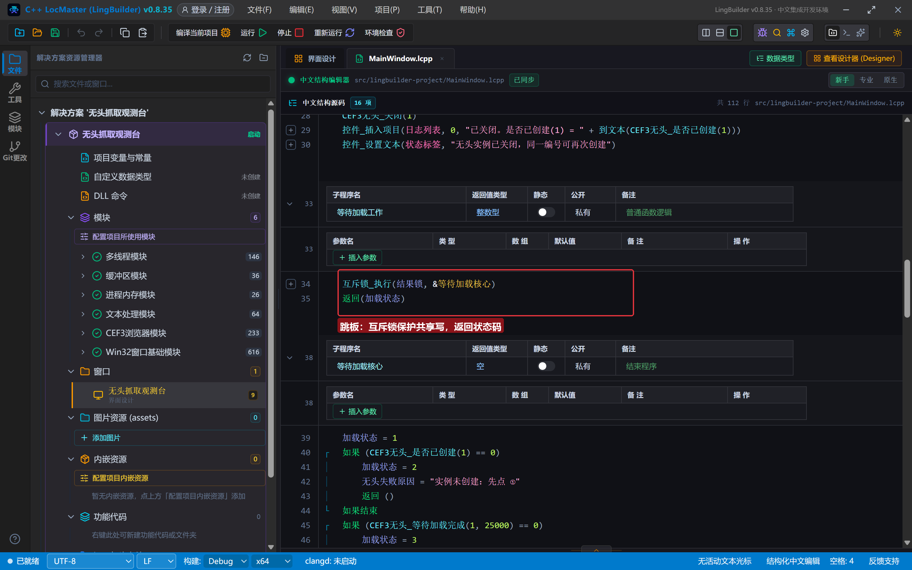
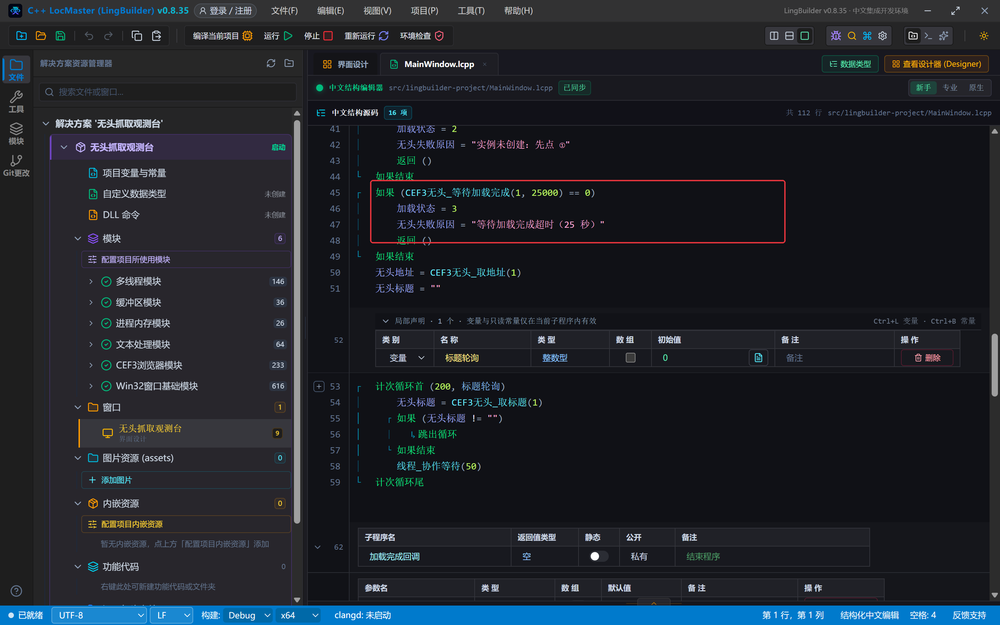
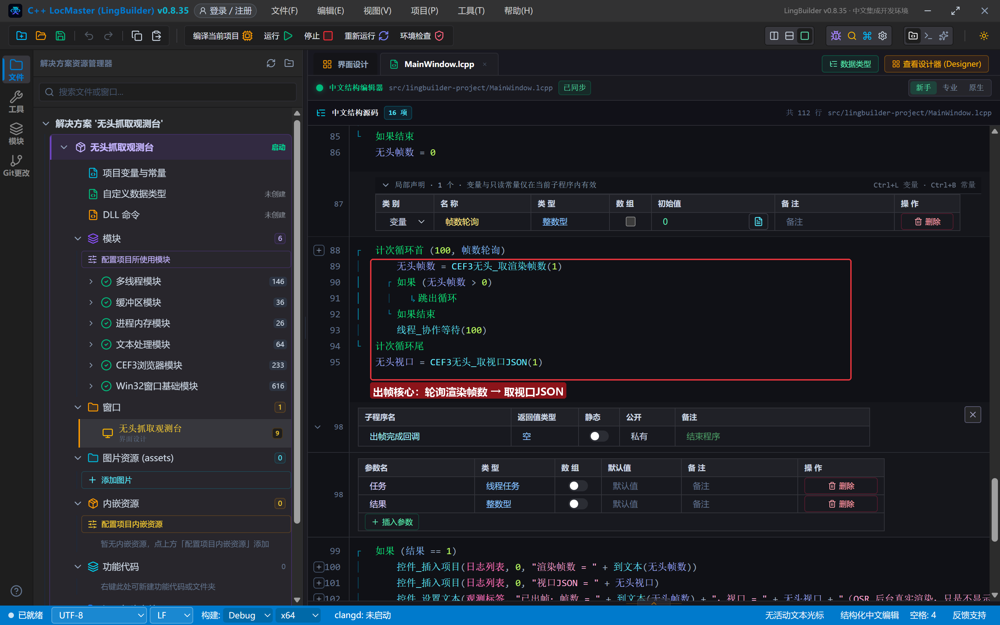
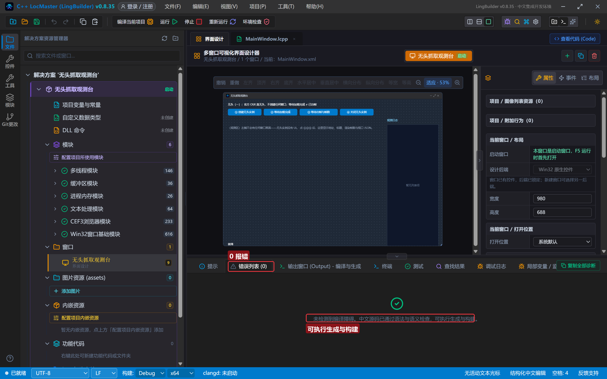
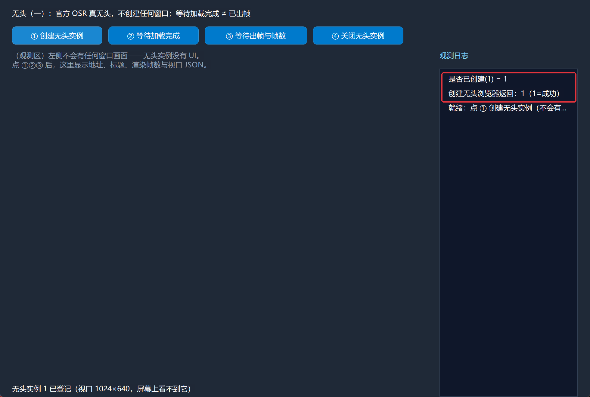
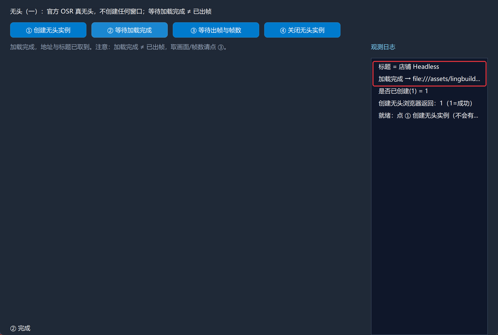
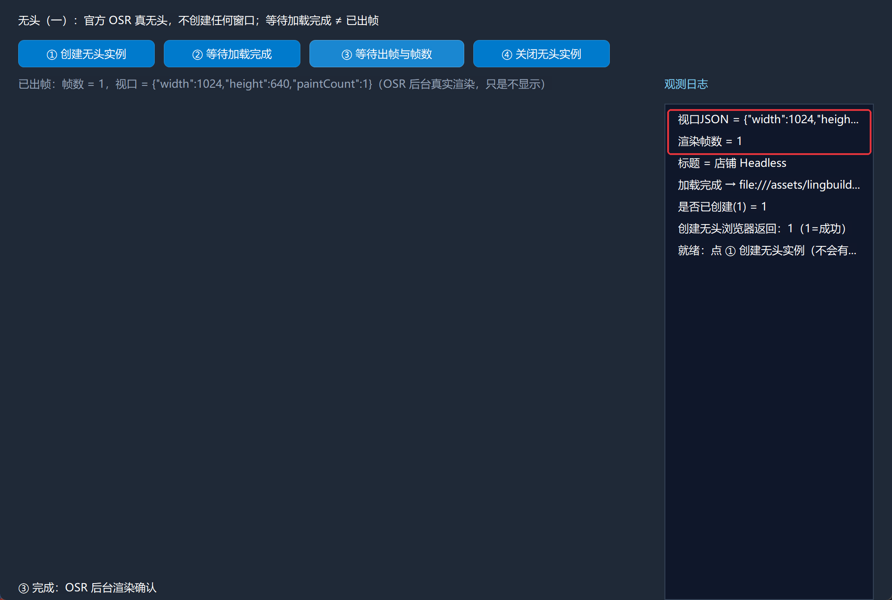
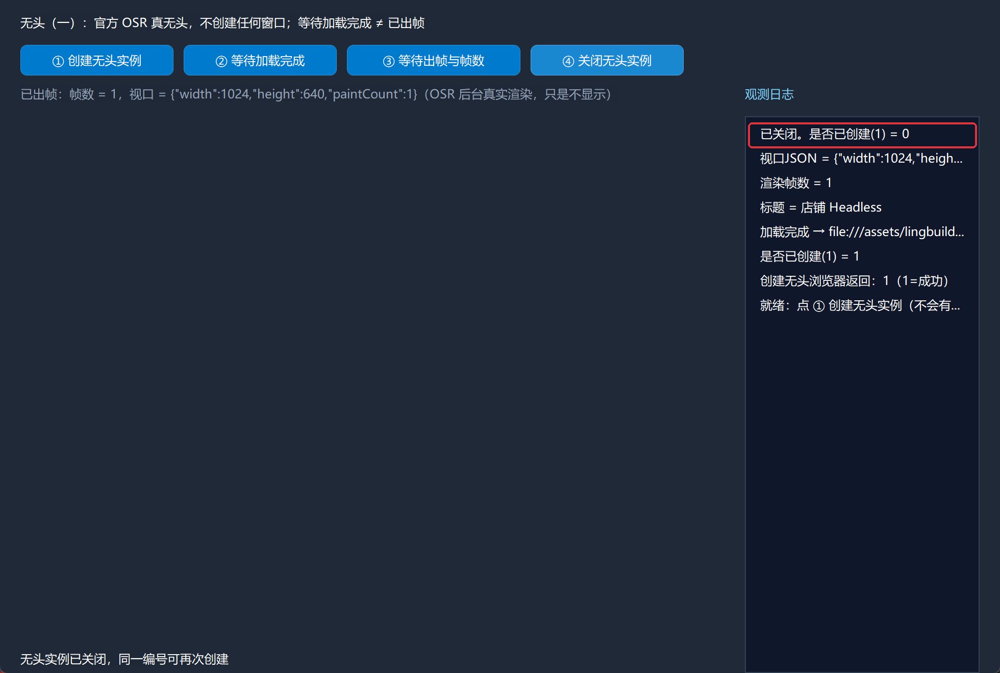

# CEF3 合集 16 · 无头浏览器（一）：创建与等待

> 《LingBuilder CEF3 浏览器合集》第 16 集（无头与自动化篇）。从这一集开始学 CEF3 的看家本领：**官方 OSR 真无头**。前面 15 集的浏览器不管怎么开，屏幕上都有个窗口；无头浏览器**从头到尾不创建任何窗口**，页面在后台照常加载、照常渲染、照常跑 JS——批量抓取、定时巡检、服务端渲染全靠它。本集先打通"创建 → 等待 → 确认渲染 → 关闭"的生命周期。全程约 30 分钟。
>
> **模块获取**：CEF3 浏览器模块**免费**；本集另需**多线程模块**（等待类命令必须放进工作线程，理由见下）。
>
> 前置要求：学过[第 14 集](/guide/tutorials/cef3-14)的实例编号概念。本集源码包见文末。

## 这一集你将学会

- `CEF3_创建无头浏览器(实例编号, 地址, 独立缓存目录, 代理地址, 视口宽, 视口高)`：凭空创建不产生任何窗口的浏览器实例
- `CEF3无头_是否已创建(实例编号)` / `CEF3无头_关闭(实例编号)`：生命周期两端
- `CEF3无头_等待加载完成(实例编号, 超时毫秒)`：等页面加载完成
- `CEF3无头_等待出帧(实例编号, 超时毫秒)` / `CEF3无头_取渲染帧数(实例编号)` / `CEF3无头_取视口JSON(实例编号)`：确认 OSR 真的在后台渲染
- `互斥锁_创建()` / `互斥锁_执行(锁, &处理器)`：工作线程写共享结果的标准姿势

## 1. 命令一张表

| 命令 | 参数 | 返回 |
| --- | --- | --- |
| `CEF3_创建无头浏览器` | 实例编号, 地址, 独立缓存目录, 代理地址, 视口宽, 视口高 | 整数型（1=成功） |
| `CEF3无头_是否已创建` | 实例编号 | 整数型（1=已登记） |
| `CEF3无头_等待加载完成` | 实例编号, 超时毫秒 | 整数型（1=完成，0=超时） |
| `CEF3无头_等待出帧` | 实例编号, 超时毫秒 | 整数型（1=已出帧） |
| `CEF3无头_取渲染帧数` | 实例编号 | 长整数型 |
| `CEF3无头_取视口JSON` | 实例编号 | 文本型（宽/高/绘制计数） |
| `CEF3无头_取地址` / `CEF3无头_取标题` | 实例编号 | 文本型 |
| `CEF3无头_关闭` | 实例编号 | 整数型 |

三条**红线**先背下来：

- **无头 = 官方 OSR 真无头**，不创建任何窗口。禁止"创建可见窗口再隐藏"来冒充无头。
- **等待加载完成 ≠ 已出帧**：加载完成只说明网络与 DOM 就绪；要确认画面真的渲染过（截图、取像素前），用 `CEF3无头_等待出帧` + `CEF3无头_取渲染帧数`。
- **等待类命令会阻塞调用线程**：直接写在按钮事件里会把整个窗口卡死（CEF 的消息泵也在 UI 线程）。**必须放进工作线程**（`线程_提交完成`），工作线程里用 `线程_协作等待` 做真休眠轮询。

## 2. 设计界面

新建项目「无头抓取观测台」，窗口 980×688（客户区 980×660）。左侧是**观测区**——无头没有 UI，数据都出在标签和日志里：

| 控件 | 名称 | 显示内容/属性 | 左距 | 顶距 | 宽度 | 高度 |
| --- | --- | --- | --- | --- | --- | --- |
| 标签 | 说明标签 | 无头（一）：官方 OSR 真无头，不创建任何窗口；等待加载完成 ≠ 已出帧 | 20 | 14 | 700 | 22 |
| 按钮 | 创建按钮 | ① 创建无头实例 | 20 | 44 | 150 | 30 |
| 按钮 | 加载按钮 | ② 等待加载完成 | 180 | 44 | 150 | 30 |
| 按钮 | 出帧按钮 | ③ 等待出帧与帧数 | 340 | 44 | 170 | 30 |
| 按钮 | 关闭按钮 | ④ 关闭无头实例 | 520 | 44 | 150 | 30 |
| 标签 | 观测标签 | （观测区）左侧不会有任何窗口画面——无头实例没有 UI…… | 20 | 84 | 690 | 90 |
| 标签 | 日志标题 | 观测日志 | 730 | 84 | 230 | 22 |
| 列表框 | 日志列表 | （空） | 730 | 114 | 230 | 546 |
| 标签 | 状态标签 | 就绪 | 20 | 638 | 690 | 22 |



演示页沿用前两集的 `assets/lingbuilder-project/store.html`。

## 3. 写代码

### 3.1 创建无头实例

```lcpp
事件 _创建按钮_被单击()
    局部 文本型 地址
    地址 = CEF3_取资源地址("lingbuilder-project/store.html") + "?name=Headless"
    局部 整数型 结果
    结果 = CEF3_创建无头浏览器(1, 地址, ".cef3/headless-1", "", 1024, 640)
    控件_插入项目(日志列表, 0, "创建无头浏览器返回：" + 到文本(结果) + "（1=成功）")
    控件_插入项目(日志列表, 0, "是否已创建(1) = " + 到文本(CEF3无头_是否已创建(1)))
    控件_设置文本(状态标签, "无头实例 1 已登记（视口 1024×640，屏幕上看不到它）")
结束
```

逐参数拆解：实例编号 `1`（无头实例与区域/弹窗共用一套运行期编号表）；地址是本地演示页；独立缓存目录 `.cef3/headless-1`（隔离 profile）；代理地址空文本；视口 `1024×640`——**这就是无头浏览器"看不见的屏幕"的尺寸**，OSR 按它渲染画面。宽高传非正数会直接创建失败。



### 3.2 工作线程 = 互斥锁跳板

创建完毕事件里先建一把项目级互斥锁；两个等待按钮各自把工作提交给线程池：

```lcpp
事件 _MainWindow_创建完毕()
    结果锁 = 互斥锁_创建()
    控件_插入项目(日志列表, 0, "就绪：点 ① 创建无头实例（不会有窗口弹出）")
结束

事件 _加载按钮_被单击()
    控件_设置文本(状态标签, "② 等待中（工作线程，窗口不卡）……")
    线程_提交完成(&等待加载工作, &加载完成回调)
结束
```

工作处理器只做一件事——**持锁执行核心逻辑，再把状态码交回去**：

```lcpp
整数型 等待加载工作()
    互斥锁_执行(结果锁, &等待加载核心)
    返回(加载状态)
结束
```

为什么要这样绕一层？工作处理器要往全局变量里写结果（地址、标题、失败原因），而语言服务的线程检查会提醒你：**工作线程写共享值要有互斥锁保护**。用 `互斥锁_执行(锁, &核心)` 把全部写操作包进持锁区，既过检查，也是真规范——两个按钮连点也不会把共享状态写花。



### 3.3 等待加载核心：等待 → 取地址 → 轮询标题

```lcpp
空 等待加载核心()
    加载状态 = 1
    如果 (CEF3无头_是否已创建(1) == 0)
        加载状态 = 2
        无头失败原因 = "实例未创建：先点 ①"
        返回 ()
    如果结束
    如果 (CEF3无头_等待加载完成(1, 25000) == 0)
        加载状态 = 3
        无头失败原因 = "等待加载完成超时（25 秒）"
        返回 ()
    如果结束
    无头地址 = CEF3无头_取地址(1)
    无头标题 = ""
    局部 整数型 标题轮询 = 0
    计次循环首 (200, 标题轮询)
        无头标题 = CEF3无头_取标题(1)
        如果 (无头标题 != "")
            跳出循环
        如果结束
        线程_协作等待(50)
    计次循环尾
结束
```

注意两点：`线程_协作等待(50)` 是**真休眠**（不占 CPU，也不卡 UI），标题要用它轮询——标题从渲染进程传回比加载完成事件晚半拍。完成处理器（UI 线程）拿到状态码后写日志：



### 3.4 出帧核心：确认 OSR 真的在画

```lcpp
整数型 出帧工作()
    互斥锁_执行(结果锁, &出帧核心)
    返回(出帧状态)
结束

空 出帧核心()
    出帧状态 = 1
    如果 (CEF3无头_等待出帧(1, 8000) == 0)
        出帧状态 = 2
        无头失败原因 = "OSR 未出帧（8 秒）"
        返回 ()
    如果结束
    无头帧数 = 0
    局部 整数型 帧数轮询 = 0
    计次循环首 (100, 帧数轮询)
        无头帧数 = CEF3无头_取渲染帧数(1)
        如果 (无头帧数 > 0)
            跳出循环
        如果结束
        线程_协作等待(100)
    计次循环尾
    无头视口 = CEF3无头_取视口JSON(1)
结束
```

`CEF3无头_等待出帧` 等的是 OSR 的**第一帧画面**；`取渲染帧数` 是累计绘制计数；`取视口JSON` 回报 `{"width":1024,"height":640,"paintCount":1}` 这样的视口信息——三者一起构成"后台真的在渲染"的证据链。



### 3.5 关闭

```lcpp
事件 _关闭按钮_被单击()
    CEF3无头_关闭(1)
    控件_插入项目(日志列表, 0, "已关闭。是否已创建(1) = " + 到文本(CEF3无头_是否已创建(1)))
    控件_设置文本(状态标签, "无头实例已关闭，同一编号可再次创建")
结束
```

关闭后 `是否已创建` 归 0，同一编号可以再建——进程退出时运行时也会统一回收全部无头实例，正常流程不必逐个手动关。

## 4. 编译：先看错误列表

「错误列表」**(0)**——用了互斥锁跳板之后，线程共享写检查也是绿的：



## 5. 运行：看不见的浏览器，看得见的数据

点「运行」，依次体验：

- **① 创建无头实例** → 屏幕上**什么都没出现**（这就是真无头），日志确认返回 1、已登记：



- **② 等待加载完成** → 窗口全程不卡，日志报出地址与标题（店铺 Headless）：



- **③ 等待出帧与帧数** → 渲染帧数 = 1，视口 JSON 回报 1024×640——OSR 在后台真实渲染了画面，只是不给你看：



- **④ 关闭无头实例** → 是否已创建归 0：



## 常见问题急救表

| 症状 | 原因 | 解法 |
| --- | --- | --- |
| 创建返回 0 | 视口宽高非正数，或编号被占用未关闭 | 检查参数；同编号先关闭再建 |
| 等待加载完成永远超时 | 等待命令写在了 UI 线程（窗口冻结） | 移进工作线程（本集跳板模式）；25 秒超时可按页面情况放宽 |
| 标题一直是空 | 标题从渲染进程传回晚于加载完成 | 用 `线程_协作等待` 轮询到非空（本集已示范） |
| 说了"无头"却有窗口出现 | 用了可见控件/弹窗命令冒充 | 用 `CEF3_创建无头浏览器`；它不创建任何窗口 |
| 取不到画面/像素 | 一期截图未开放（`CEF3离屏_订阅像素帧` 只点亮订阅位） | 取内容走第 17 集的取文本/源码/执行JS |
| 工作线程写全局变量报警告 | 共享写没有互斥锁保护 | 按 3.2 的 `互斥锁_执行` 跳板模式改写 |
| 关闭后再点 ② 报"实例未创建" | 实例已关闭 | 先点 ① 重新创建 |

## 本集小结

- 无头生命周期：`创建 → 等待加载完成 → 等待出帧 → 取数据 → 关闭`，全部按**实例编号**寻址。
- **加载完成 ≠ 已出帧**：要画面证据就等出帧 + 查渲染帧数 + 看视口 JSON。
- 等待类命令必须进工作线程；共享结果用 `互斥锁_执行` 持锁写——窗口不卡、检查全绿。

## 源码包

本集完整源码已打包为 **CEF3合集16-无头抓取观测台.lcpppkg**（见[示例源码区](/demos)），导入即可运行对照学习。

**下一篇预告**：无头浏览器（二）——无头里怎么"看"页面：取页面文本/源码与执行JS（DevTools 信封解析）。

[回合集总览](/guide/tutorials/cef3)
