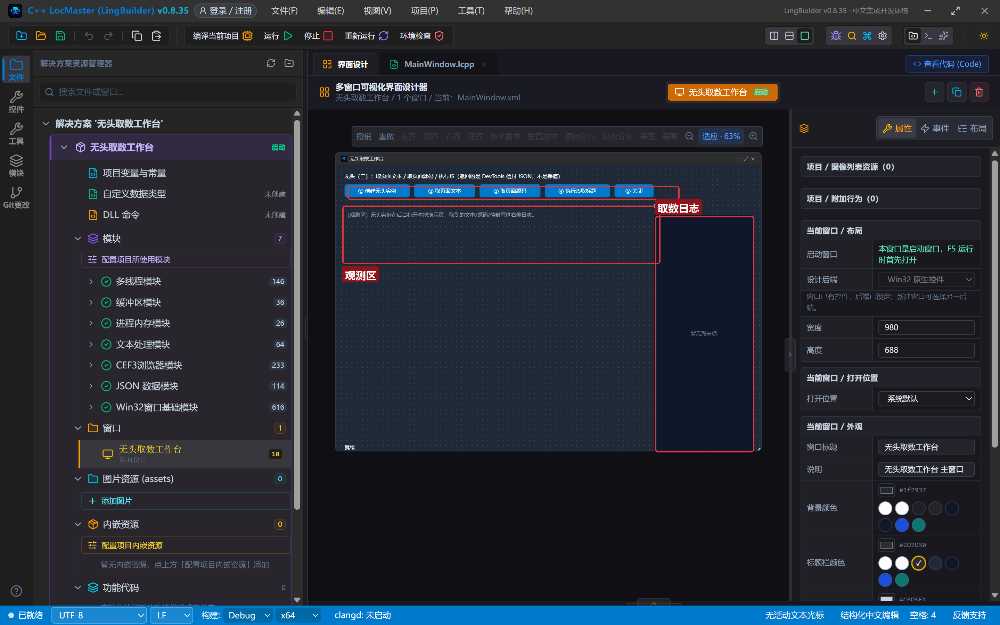
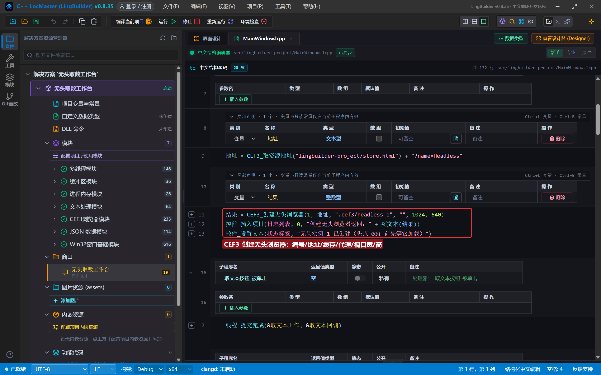
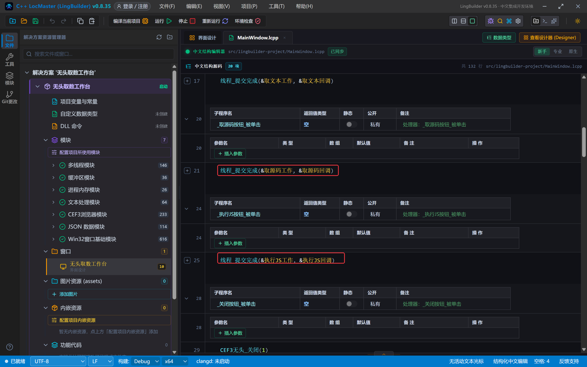
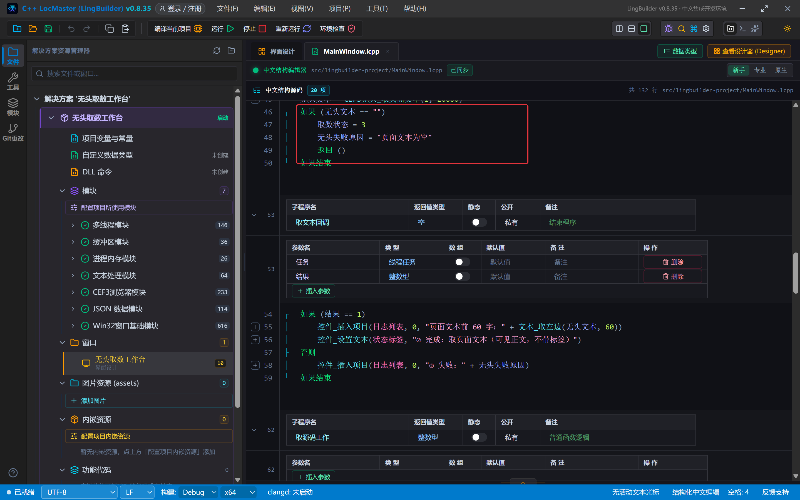
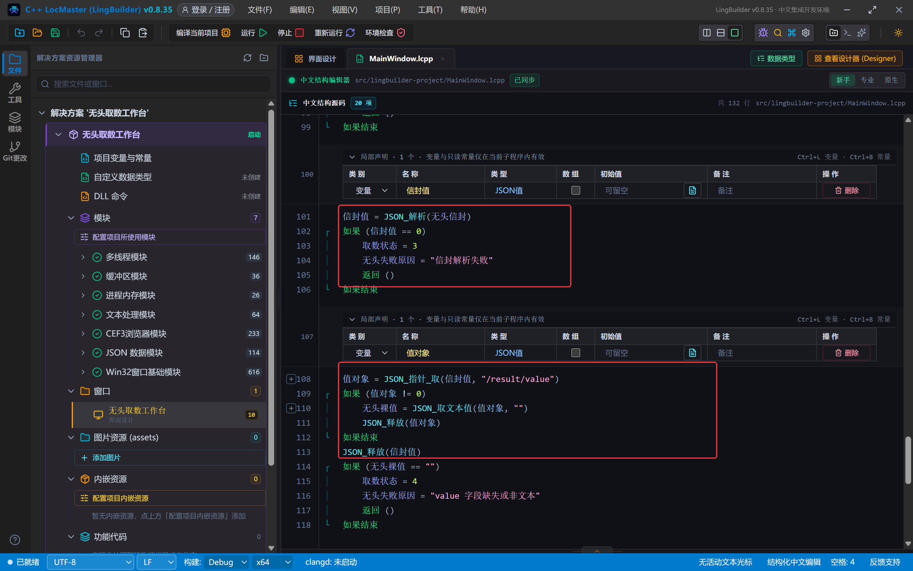
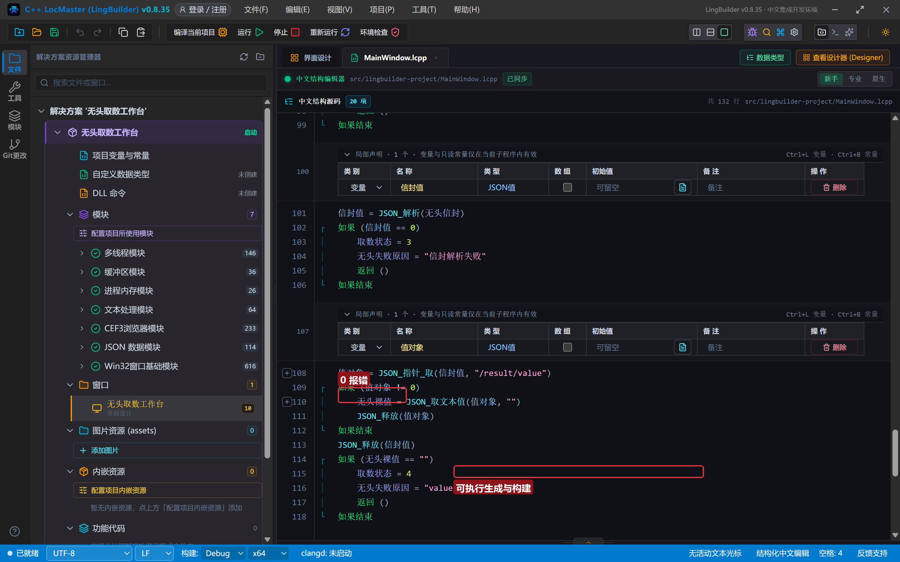
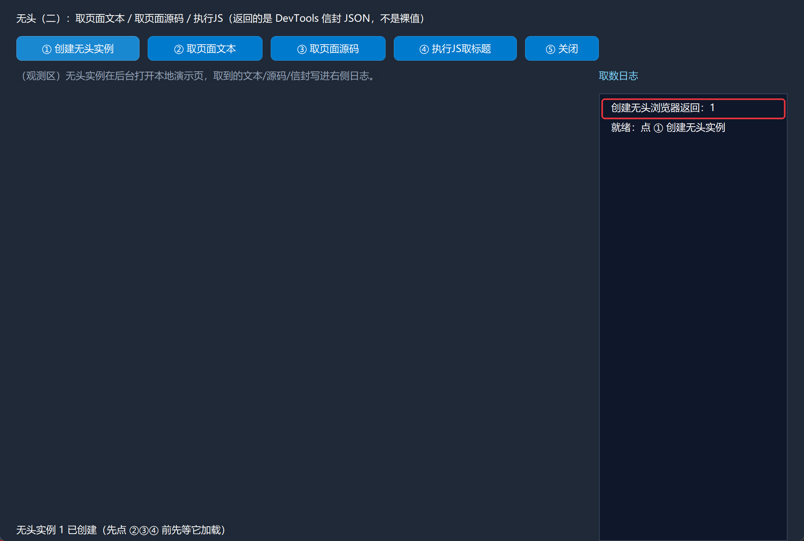
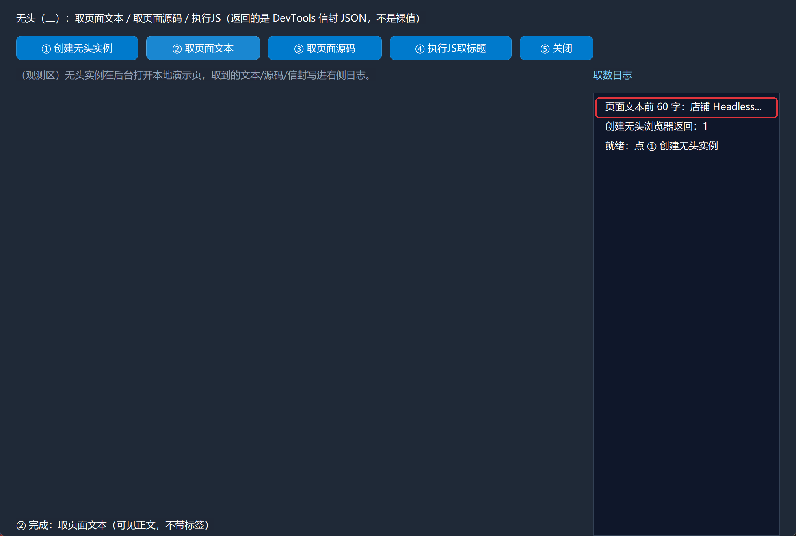
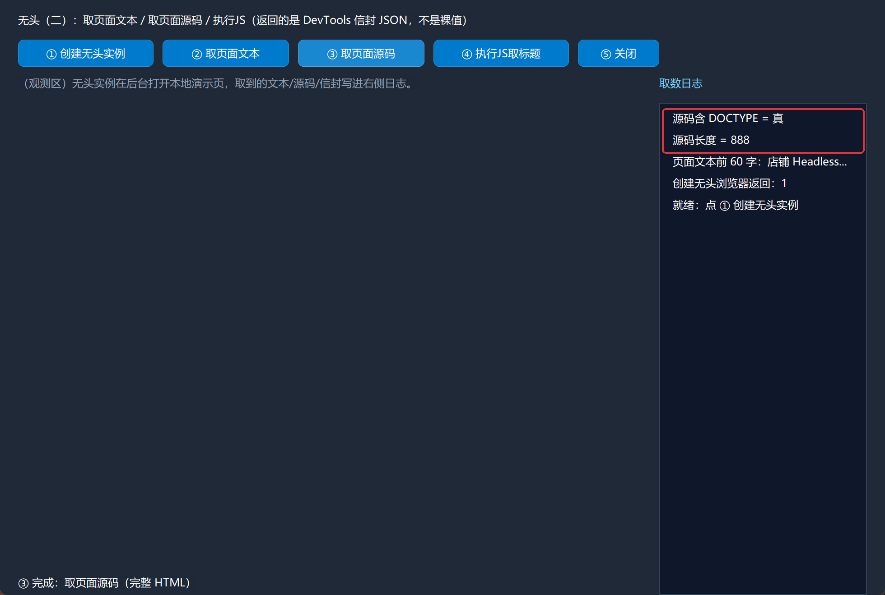
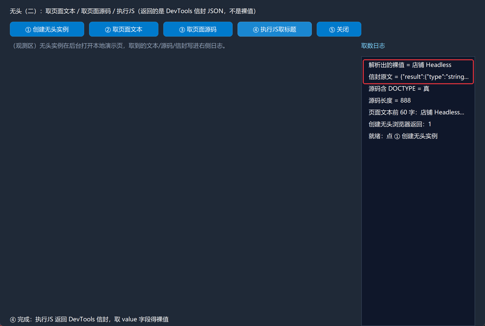

# CEF3 合集 17 · 无头浏览器（二）：取页面文本、源码与执行 JS

> 《LingBuilder CEF3 浏览器合集》第 17 集（无头与自动化篇）。第 16 集让无头实例"活"了起来，这一集教它"交货"：把页面**可见正文**、**完整 HTML 源码**、以及任意 **JS 表达式的返回值**从看不见的浏览器里取出来。重点拆解一个高频坑：`CEF3无头_执行JS` 返回的不是裸值，而是 **DevTools 信封 JSON**——中文还会以 `\uXXXX` 转义出现，本集给出一条把它安全变回"店铺 Headless"的完整链路。全程约 30 分钟。
>
> **模块获取**：CEF3 浏览器模块**免费**；另需**多线程模块**（等待/取数进工作线程）与 **JSON 数据模块**（解析信封）。
>
> 前置要求：学过[第 16 集](/guide/tutorials/cef3-16)的无头生命周期与互斥锁跳板。本集源码包见文末。

## 这一集你将学会

- `CEF3无头_取页面文本(实例编号, 超时毫秒)`：拿渲染后的**可见正文**（不带任何标签）
- `CEF3无头_取页面源码(实例编号, 超时毫秒)`：拿**完整 HTML 源码**
- `CEF3无头_执行JS(实例编号, 脚本)`：执行任意 JS 并拿回 DevTools 信封
- `JSON_解析` + `JSON_指针_取(信封, "/result/value")` + `JSON_取文本值`：信封 → 裸值的标准三步（顺带把 `\uXXXX` 转义解回中文）
- `JSON_释放`：受管句柄用完即还

## 1. 命令一张表

| 命令 | 参数 | 返回 |
| --- | --- | --- |
| `CEF3无头_取页面文本` | 实例编号, 超时毫秒 | 文本型（可见正文） |
| `CEF3无头_取页面源码` | 实例编号, 超时毫秒 | 文本型（完整 HTML） |
| `CEF3无头_执行JS` | 实例编号, 脚本 | 文本型（**DevTools 信封 JSON**） |
| `JSON_解析` | JSON 文本 | JSON值（受管句柄；失败返回 0） |
| `JSON_指针_取` | JSON值, 指针 | JSON值（深度副本，需单独释放） |
| `JSON_取文本值` | JSON值, 默认值 | 文本型 |
| `JSON_释放` | JSON值 | 整数型 |

三条红线先记住：

- **`CEF3无头_执行JS` 返回 DevTools 信封，不是裸值**。执行 `document.title` 拿到的是 `{"result":{"type":"string","value":"…"}}` 这样的信封，要取值必须解析。
- **信封里的中文是 `\uXXXX` 转义**（如 `\u5e97\u94fa` = 店铺）。别用文本命令硬抠——`JSON_解析` 会在解析时把转义解回原文，一步到位。
- **取文本/取源码/执行JS 都按实例编号寻址**；超时类命令放工作线程（第 16 集的跳板模式原样复用）。

## 2. 设计界面

新建项目「无头取数工作台」，窗口 980×688（客户区 980×660），五个按钮 + 右侧日志：

| 控件 | 名称 | 显示内容/属性 | 左距 | 顶距 | 宽度 | 高度 |
| --- | --- | --- | --- | --- | --- | --- |
| 标签 | 说明标签 | 无头（二）：取页面文本 / 取页面源码 / 执行JS（返回的是 DevTools 信封 JSON，不是裸值） | 20 | 14 | 740 | 22 |
| 按钮 | 创建按钮 | ① 创建无头实例 | 20 | 44 | 150 | 30 |
| 按钮 | 取文本按钮 | ② 取页面文本 | 180 | 44 | 140 | 30 |
| 按钮 | 取源码按钮 | ③ 取页面源码 | 330 | 44 | 140 | 30 |
| 按钮 | 执行JS按钮 | ④ 执行JS取标题 | 480 | 44 | 150 | 30 |
| 按钮 | 关闭按钮 | ⑤ 关闭 | 640 | 44 | 90 | 30 |
| 标签 | 观测标签 | （观测区）无头实例在后台打开本地演示页…… | 20 | 84 | 690 | 60 |
| 标签 | 日志标题 | 取数日志 | 730 | 84 | 230 | 22 |
| 列表框 | 日志列表 | （空） | 730 | 114 | 230 | 546 |
| 标签 | 状态标签 | 就绪 | 20 | 638 | 690 | 22 |



模块面板确认启用：CEF3 浏览器模块、多线程模块、文本处理模块、**JSON 数据模块**。

## 3. 写代码

### 3.1 创建与线程提交

创建无头实例与第 16 集完全一致；②③④ 三个按钮都只做一件事——把对应工作提交给线程池：

```lcpp
事件 _创建按钮_被单击()
    局部 文本型 地址
    地址 = CEF3_取资源地址("lingbuilder-project/store.html") + "?name=Headless"
    局部 整数型 结果
    结果 = CEF3_创建无头浏览器(1, 地址, ".cef3/headless-1", "", 1024, 640)
    控件_插入项目(日志列表, 0, "创建无头浏览器返回：" + 到文本(结果))
    控件_设置文本(状态标签, "无头实例 1 已创建（先点 ②③④ 前先等它加载）")
结束

事件 _取文本按钮_被单击()
    线程_提交完成(&取文本工作, &取文本回调)
结束

事件 _取源码按钮_被单击()
    线程_提交完成(&取源码工作, &取源码回调)
结束

事件 _执行JS按钮_被单击()
    线程_提交完成(&执行JS工作, &执行JS回调)
结束
```





### 3.2 取页面文本：等加载 → 取正文 → 判空

```lcpp
整数型 取文本工作()
    互斥锁_执行(结果锁, &取文本核心)
    返回(取数状态)
结束

空 取文本核心()
    取数状态 = 1
    如果 (CEF3无头_等待加载完成(1, 25000) == 0)
        取数状态 = 2
        无头失败原因 = "等待加载完成超时"
        返回 ()
    如果结束
    无头文本 = CEF3无头_取页面文本(1, 20000)
    如果 (无头文本 == "")
        取数状态 = 3
        无头失败原因 = "页面文本为空"
        返回 ()
    如果结束
结束
```

`取页面文本` 返回的是**渲染后的可见正文**——和你肉眼在页面里看到的文字一致，标签、脚本全部剥掉。完成处理器里用 `文本_取左边(无头文本, 60)` 截前 60 字写日志，避免长正文刷屏。



### 3.3 取页面源码

```lcpp
空 取源码核心()
    取数状态 = 1
    无头源码 = CEF3无头_取页面源码(1, 20000)
    如果 (无头源码 == "")
        取数状态 = 2
        无头失败原因 = "页面源码为空"
        返回 ()
    如果结束
结束
```

源码 = 完整 HTML。回调里用 `文本_取长度` 报长度、`文本_寻找(无头源码, "DOCTYPE") > 0` 验证"真的是 HTML"。

### 3.4 执行JS：信封 → 裸值的标准三步（本集核心）

```lcpp
空 执行JS核心()
    取数状态 = 1
    无头信封 = CEF3无头_执行JS(1, "document.title")
    如果 (无头信封 == "")
        取数状态 = 2
        无头失败原因 = "执行JS 无返回（实例未建或脚本出错）"
        返回 ()
    如果结束
    局部 JSON值 信封值
    信封值 = JSON_解析(无头信封)
    如果 (信封值 == 0)
        取数状态 = 3
        无头失败原因 = "信封解析失败"
        返回 ()
    如果结束
    局部 JSON值 值对象
    值对象 = JSON_指针_取(信封值, "/result/value")
    如果 (值对象 != 0)
        无头裸值 = JSON_取文本值(值对象, "")
        JSON_释放(值对象)
    如果结束
    JSON_释放(信封值)
    如果 (无头裸值 == "")
        取数状态 = 4
        无头失败原因 = "value 字段缺失或非文本"
        返回 ()
    如果结束
结束
```

两个新手最容易踩的细节：

- **声明与赋值分两行写**（`局部 JSON值 信封值` 换行 `信封值 = JSON_解析(…)`）。带初始值的局部声明会被生成器提升到函数开头执行——那时 `无头信封` 还是空的，解析必然失败（本集作者真机踩过，日志里信封明明是好的、句柄却是 0）。
- **`/result/value` 是 JSON Pointer 写法**：信封是 `{"result":{"type":"string","value":"…"}}`，两层嵌套用 `JSON_指针_取` 一次取到底。指针取到的是**深度副本**，用完 `JSON_释放`；原信封句柄也要 `JSON_释放`。



## 4. 编译：先看错误列表

「错误列表」**(0)** 才继续：



## 5. 运行：三样货一次取齐

点「运行」：

- **① 创建无头实例** → 屏幕依旧无窗口：



- **② 取页面文本** → 日志报出正文前 60 字（店铺 Headless……）：



- **③ 取页面源码** → 源码长度 888、含 DOCTYPE = 真：



- **④ 执行JS取标题** → 关键镜头：信封原文 `{"result":{"type":"string…`，解析出的裸值 **店铺 Headless**——`\u5e97\u94fa` 转义已被 JSON 解析解回中文：



- **⑤ 关闭** → 收工。

## 常见问题急救表

| 症状 | 原因 | 解法 |
| --- | --- | --- |
| 执行JS 返回空文本 | 实例未创建、脚本语法错误，或实例刚关闭 | 先确认 `CEF3无头_是否已创建`；脚本先在浏览器里验证 |
| 信封解析句柄一直是 0 | 带初始值的局部声明被生成器提升，解析执行时输入还是空 | **声明与赋值分两行**（本集 3.4） |
| 解析出的值是 `\u5e97\u94fa` | 直接用文本命令抠字段，JSON 转义没被解码 | 用 `JSON_解析` + `JSON_取文本值`，解析时自动解转义 |
| `JSON_指针_取` 返回 0 | 路径写错（信封顶层是 result，value 在第二层） | 严格按 `/result/value`；数组下标用 `/0` 形态 |
| 取页面文本是空的 | 页面没加载完成，或正文真的为空 | 先 `CEF3无头_等待加载完成`；file 页注意 assets 部署 |
| 忘了 JSON_释放 | 句柄泄漏 | 指针副本与原句柄各释放一次；解析失败（句柄 0）不用释放 |
| 信封结构对不上文档 | 返回类型不同信封字段不同 | 先把信封原文打进日志看结构，再定指针路径 |

## 本集小结

- 无头取数三件套：**取页面文本**（可见正文）、**取页面源码**（完整 HTML）、**执行JS**（任意表达式）。
- `执行JS` 产物是 **DevTools 信封**：`JSON_解析 → JSON_指针_取("/result/value") → JSON_取文本值 → JSON_释放` 四步走，中文转义自动解回。
- 受管句柄纪律：指针副本与原句柄分开释放；声明与赋值分两行，避开生成器提升陷阱。

## 源码包

本集完整源码已打包为 **CEF3合集17-无头取数工作台.lcpppkg**（见[示例源码区](/demos)），导入即可运行对照学习。

**下一篇预告**：无头浏览器（三）——OSR/离屏族：帧率控制与像素帧订阅，把"看不见的画面"变成可分析的数据。

[回合集总览](/guide/tutorials/cef3)
