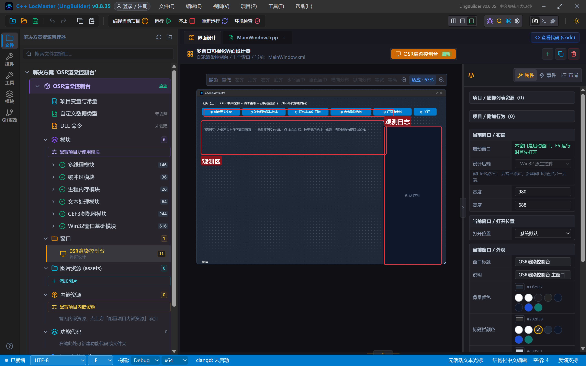
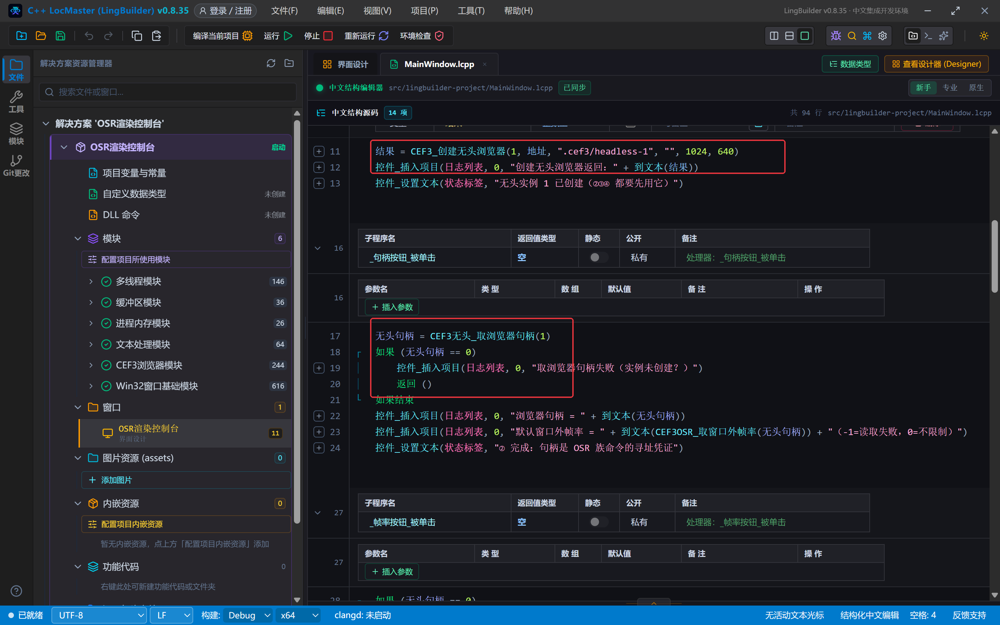
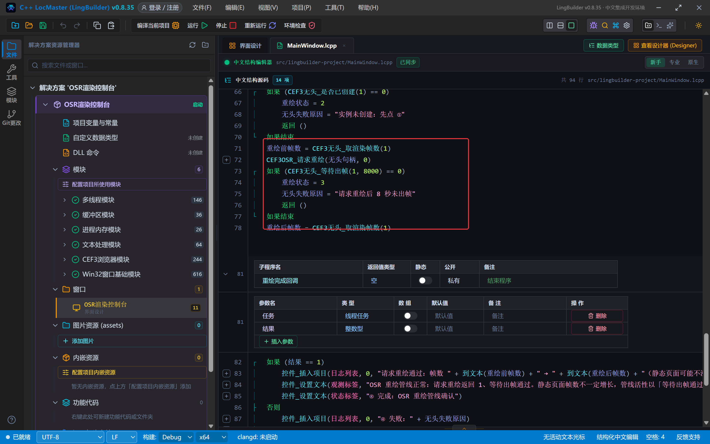
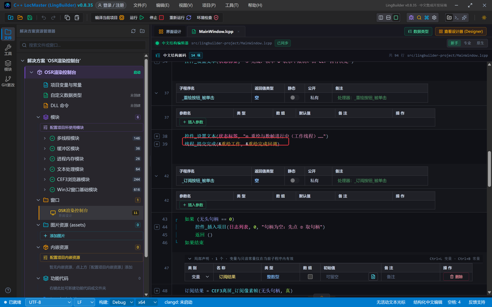
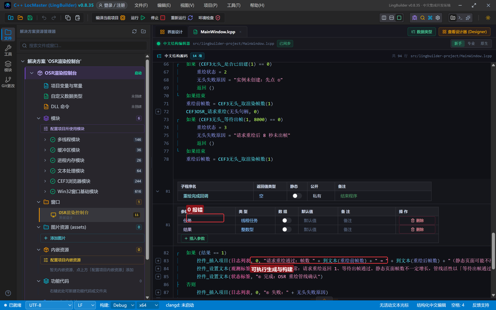
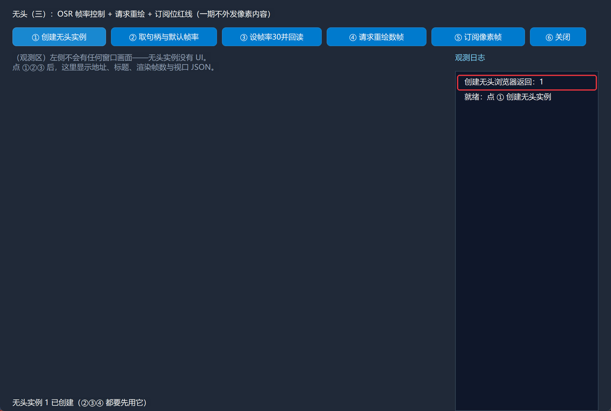
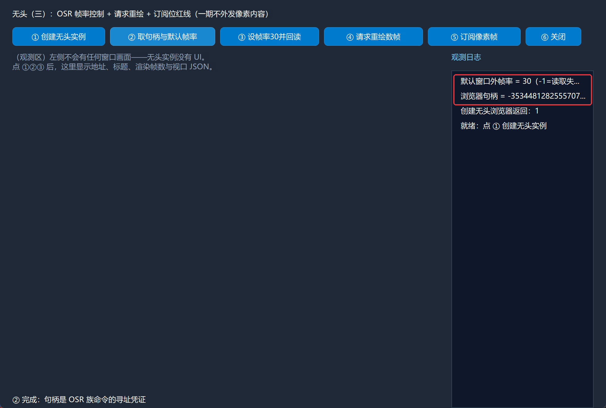
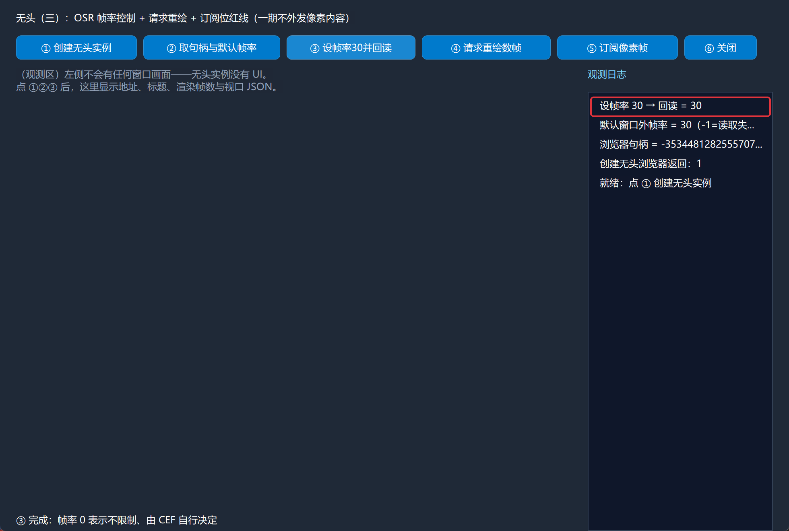
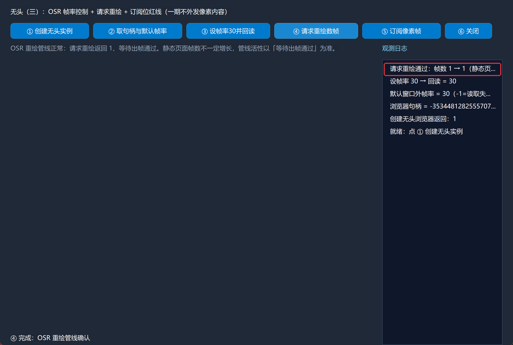
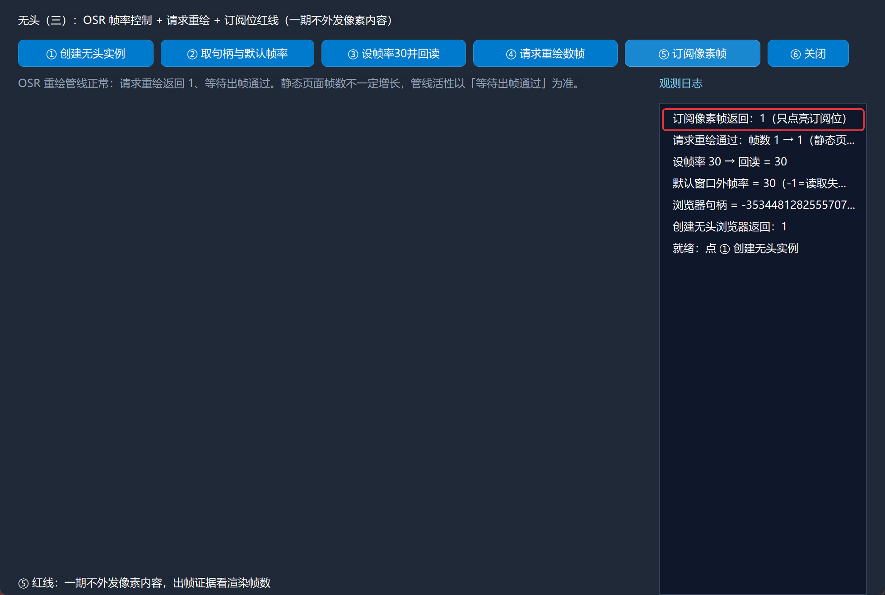

# CEF3 合集 18 · 无头浏览器（三）：OSR/离屏族——帧率控制与订阅位红线

> 《LingBuilder CEF3 浏览器合集》第 18 集（无头与自动化篇）。前两集把无头实例跑通了、取数也通了，这一集掀开最后一块引擎盖：**OSR（Off-Screen Rendering，窗口外渲染）到底怎么控制**——拿浏览器句柄、查/设绘制帧率、手动请求重绘，以及一条必须划清的红线：`CEF3离屏_订阅像素帧` 一期**只点亮订阅位、不外发任何像素内容**。全程约 30 分钟。
>
> **模块获取**：CEF3 浏览器模块**免费**；本集命令属「CEF3 无头渲染模块」（OSR/离屏族），随主模块一起启用；另需多线程模块（重绘数帧进工作线程）。
>
> 前置要求：学过[第 16 集](/guide/tutorials/cef3-16)的无头生命周期。本集源码包见文末。

## 这一集你将学会

- `CEF3无头_取浏览器句柄(实例编号)`：OSR 族命令的**寻址凭证**
- `CEF3OSR_取窗口外帧率(句柄)` / `CEF3OSR_设置窗口外帧率(句柄, 帧率)`：查与设绘制帧率
- `CEF3OSR_请求重绘(句柄, 元素类型)`：让 CEF 立刻重查视口并出一帧
- `CEF3离屏_订阅像素帧(句柄, 是否订阅)`：订阅位的真实语义（红线命令）
- 受管句柄判有效的铁律：**只用 `!= 0` 判空**（int64 句柄正常值是负数）

## 1. 命令一张表

| 命令 | 参数 | 返回 |
| --- | --- | --- |
| `CEF3无头_取浏览器句柄` | 实例编号 | 长整数型（OSR 族寻址凭证） |
| `CEF3OSR_取窗口外帧率` | 浏览器句柄 | 整数型（-1=读取失败，0=不限制） |
| `CEF3OSR_设置窗口外帧率` | 浏览器句柄, 帧率 | 整数型（1=已接受） |
| `CEF3OSR_请求重绘` | 浏览器句柄, 元素类型 | 整数型（0=视图、1=弹窗） |
| `CEF3离屏_订阅像素帧` | 浏览器句柄, 是否订阅（逻辑型） | 整数型（**一期不外发内容**） |

三条红线先记住：

- **句柄判有效只用 `!= 0`**。实测句柄长这样：`-3534481282555707…`——int64 受管句柄正常值恒为负数，**千万别写 `句柄 > 0` 当有效**。
- **订阅位 ≠ 拿到画面**。`CEF3离屏_订阅像素帧(句柄, 真)` 返回 1 只说明订阅点亮了；一期中文命令层拿不到像素、也不产出截图。**出帧证据一律用 `CEF3无头_取渲染帧数` / `CEF3无头_等待出帧`**。
- **帧率 0 = 不限制**，由 CEF 自行决定；读取失败返回 **-1**，不得把 -1 当成"帧率为 0"。

## 2. 设计界面

新建项目「OSR渲染控制台」，窗口 980×688（客户区 980×660），六个按钮一行排开 + 右侧日志：

| 控件 | 名称 | 显示内容/属性 | 左距 | 顶距 | 宽度 | 高度 |
| --- | --- | --- | --- | --- | --- | --- |
| 标签 | 说明标签 | 无头（三）：OSR 帧率控制 + 请求重绘 + 订阅位红线（一期不外发像素内容） | 20 | 14 | 740 | 22 |
| 按钮 | 创建按钮 | ① 创建无头实例 | 20 | 44 | 150 | 30 |
| 按钮 | 句柄按钮 | ② 取句柄与默认帧率 | 178 | 44 | 170 | 30 |
| 按钮 | 帧率按钮 | ③ 设帧率30并回读 | 356 | 44 | 160 | 30 |
| 按钮 | 重绘按钮 | ④ 请求重绘数帧 | 524 | 44 | 160 | 30 |
| 按钮 | 订阅按钮 | ⑤ 订阅像素帧 | 692 | 44 | 150 | 30 |
| 按钮 | 关闭按钮 | ⑥ 关闭 | 850 | 44 | 90 | 30 |
| 标签 | 观测标签 | （观测区）本集命令都按「浏览器句柄」寻址…… | 20 | 84 | 690 | 60 |
| 标签 | 日志标题 | 观测日志 | 730 | 84 | 230 | 22 |
| 列表框 | 日志列表 | （空） | 730 | 114 | 230 | 546 |
| 标签 | 状态标签 | 就绪 | 20 | 638 | 690 | 22 |



模块面板确认启用：CEF3 浏览器模块、**CEF3 无头渲染模块**、多线程模块。

## 3. 写代码

### 3.1 创建与取句柄

```lcpp
事件 _创建按钮_被单击()
    局部 文本型 地址
    地址 = CEF3_取资源地址("lingbuilder-project/store.html") + "?name=Headless"
    局部 整数型 结果
    结果 = CEF3_创建无头浏览器(1, 地址, ".cef3/headless-1", "", 1024, 640)
    控件_插入项目(日志列表, 0, "创建无头浏览器返回：" + 到文本(结果))
    控件_设置文本(状态标签, "无头实例 1 已创建（②③④ 都要先用它）")
结束

事件 _句柄按钮_被单击()
    无头句柄 = CEF3无头_取浏览器句柄(1)
    如果 (无头句柄 == 0)
        控件_插入项目(日志列表, 0, "取浏览器句柄失败（实例未创建？）")
        返回 ()
    如果结束
    控件_插入项目(日志列表, 0, "浏览器句柄 = " + 到文本(无头句柄))
    控件_插入项目(日志列表, 0, "默认窗口外帧率 = " + 到文本(CEF3OSR_取窗口外帧率(无头句柄)) + "（-1=读取失败，0=不限制）")
    控件_设置文本(状态标签, "② 完成：句柄是 OSR 族命令的寻址凭证")
结束
```

注意判空只写 `== 0`——实测句柄是 `-3534481282555707…` 这样的负数，`> 0` 判断会把正常句柄当失败。



### 3.2 设帧率并回读

```lcpp
事件 _帧率按钮_被单击()
    如果 (无头句柄 == 0)
        控件_插入项目(日志列表, 0, "句柄为空：先点 ② 取句柄")
        返回 ()
    如果结束
    CEF3OSR_设置窗口外帧率(无头句柄, 30)
    控件_插入项目(日志列表, 0, "设帧率 30 → 回读 = " + 到文本(CEF3OSR_取窗口外帧率(无头句柄)))
    控件_设置文本(状态标签, "③ 完成：帧率 0 表示不限制、由 CEF 自行决定")
结束
```

`设置窗口外帧率` 与 `取窗口外帧率` 成对使用，设完立刻回读验证——真机实测默认值是 30，设 30 回读 30。

### 3.3 请求重绘 + 数帧（工作线程）

```lcpp
事件 _重绘按钮_被单击()
    控件_设置文本(状态标签, "④ 重绘与数帧进行中（工作线程）……")
    线程_提交完成(&重绘工作, &重绘完成回调)
结束

整数型 重绘工作()
    互斥锁_执行(结果锁, &重绘核心)
    返回(重绘状态)
结束

空 重绘核心()
    重绘状态 = 1
    如果 (CEF3无头_是否已创建(1) == 0)
        重绘状态 = 2
        无头失败原因 = "实例未创建：先点 ①"
        返回 ()
    如果结束
    重绘前帧数 = CEF3无头_取渲染帧数(1)
    CEF3OSR_请求重绘(无头句柄, 0)
    如果 (CEF3无头_等待出帧(1, 8000) == 0)
        重绘状态 = 3
        无头失败原因 = "请求重绘后 8 秒未出帧"
        返回 ()
    如果结束
    重绘后帧数 = CEF3无头_取渲染帧数(1)
结束
```

`请求重绘` 的元素类型传 `0`（视图；弹窗层才是 1）。它催促 CEF 立刻重查视口并绘制；管线活性用 `CEF3无头_等待出帧` 验证。注意：**静态页面重绘后帧数不一定增长**（CEF 可能复用既有帧），所以判断管线正常的标准是"等待出帧通过"，不是"帧数必涨"。



### 3.4 订阅像素帧：把话说清楚

```lcpp
事件 _订阅按钮_被单击()
    如果 (无头句柄 == 0)
        控件_插入项目(日志列表, 0, "句柄为空：先点 ② 取句柄")
        返回 ()
    如果结束
    局部 整数型 订阅结果
    订阅结果 = CEF3离屏_订阅像素帧(无头句柄, 真)
    控件_插入项目(日志列表, 0, "订阅像素帧返回：" + 到文本(订阅结果) + "（只点亮订阅位）")
    控件_设置文本(状态标签, "⑤ 红线：一期不外发像素内容，出帧证据看渲染帧数")
结束
```

`是否订阅` 是**逻辑型**参数，写 `真`/`假`（写整数 1 会被实参类型门禁拦下）。命令返回 1 只代表订阅位点亮；**一期不外发帧内容，拿不到像素也产不出截图**——想确认渲染在跑，看渲染帧数。



### 3.5 关闭

```lcpp
事件 _关闭按钮_被单击()
    CEF3无头_关闭(1)
    无头句柄 = 0
    控件_插入项目(日志列表, 0, "已关闭，句柄已作废")
结束
```

实例关闭后句柄立即作废——**先置 0 再用，避免拿旧句柄调用 OSR 族命令**。

## 4. 编译：先看错误列表

「错误列表」**(0)** 才继续：



## 5. 运行：把引擎盖掀开看

点「运行」：

- **① 创建无头实例** → 老规矩，屏幕上什么都没有：



- **② 取句柄与默认帧率** → 日志报出负数句柄与默认帧率 30：



- **③ 设帧率30并回读** → 设 30 回读 30：



- **④ 请求重绘数帧** → 等待出帧通过，帧数 1 → 1（静态页面不涨属正常）：



- **⑤ 订阅像素帧** → 返回 1（订阅位点亮），红线写进状态栏：



- **⑥ 关闭** → 句柄作废，收工。

## 常见问题急救表

| 症状 | 原因 | 解法 |
| --- | --- | --- |
| 取窗口外帧率返回 -1 | 句柄无效或桥接层读取失败 | 句柄判空只用 `== 0`；重新取句柄 |
| 设帧率后再读还是旧值 | 句柄已作废（实例被关闭重建） | 重建后重新取句柄 |
| `订阅像素帧` 传 1 报类型错 | 形参是逻辑型 | 写 `真` / `假` |
| 订阅后拿不到像素 | **一期设计如此**：只点亮订阅位不外发内容 | 出帧证据用 `CEF3无头_取渲染帧数` / `CEF3无头_等待出帧` |
| 请求重绘后帧数没涨 | 静态页面无新内容可画 | 以"等待出帧通过"为管线正常标准；页面有动画/交互时帧数会涨 |
| 拿旧句柄调用报句柄无效 | 实例关闭后句柄作废 | 关闭后把句柄全局变量置 0 |

## 本集小结

- OSR 族的寻址凭证是**浏览器句柄**（`CEF3无头_取浏览器句柄`），判空只用 `== 0`——正常句柄是负数。
- 帧率三件套：取帧率（-1=失败、0=不限制）、设帧率、请求重绘；管线活性用等待出帧验证。
- `CEF3离屏_订阅像素帧` 一期**不外发像素内容**——这是产品红线，不是故障；出帧证据看渲染帧数。

## 源码包

本集完整源码已打包为 **CEF3合集18-OSR渲染控制台.lcpppkg**（见[示例源码区](/demos)），导入即可运行对照学习。

**下一篇预告**：模拟输入——不碰真实鼠标键盘，往浏览器里发送鼠标单击/移动/滚轮/按键/触摸事件。

[回合集总览](/guide/tutorials/cef3)
