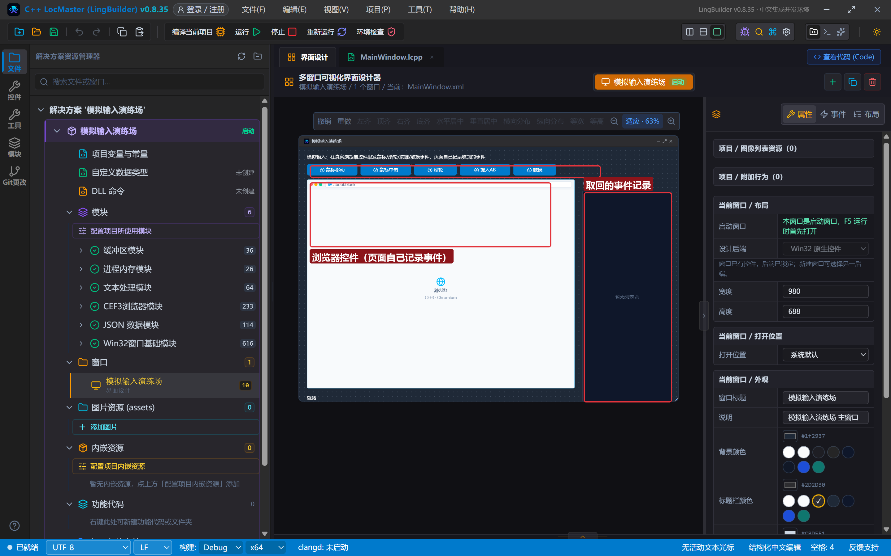
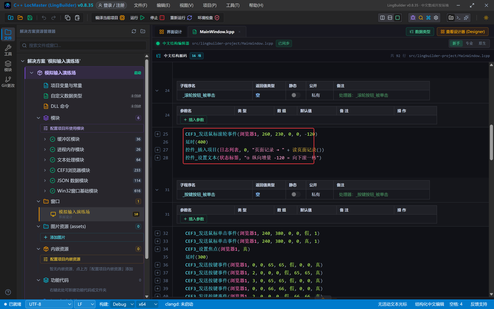
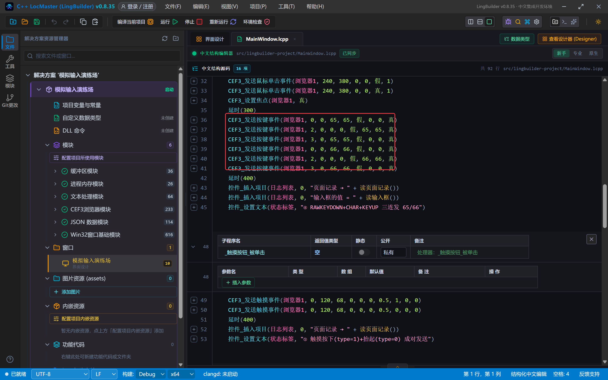
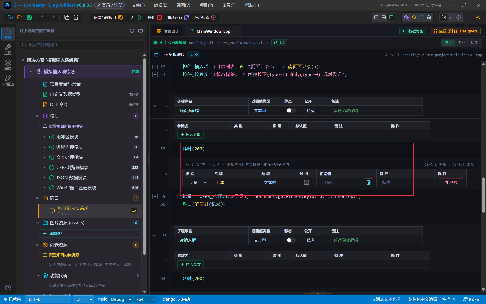
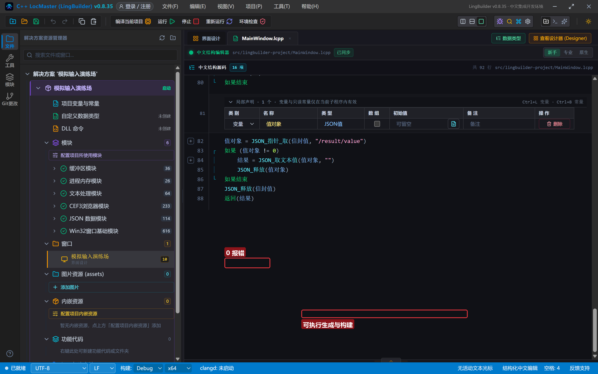
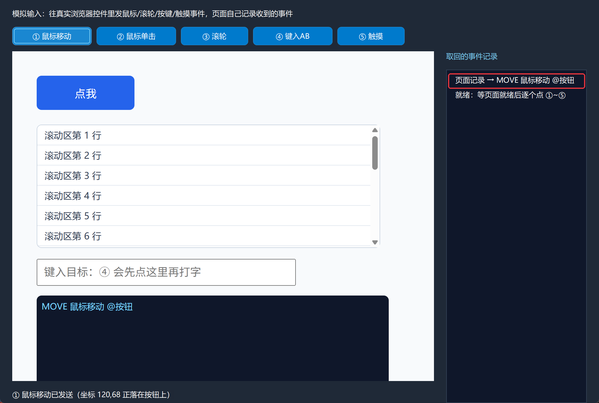
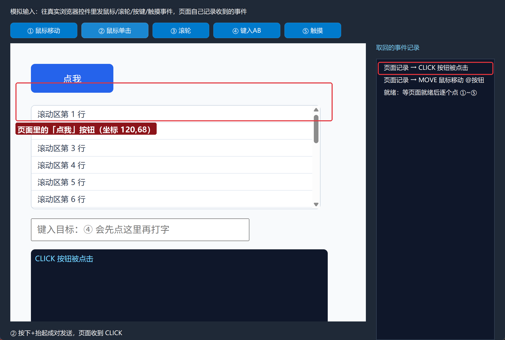
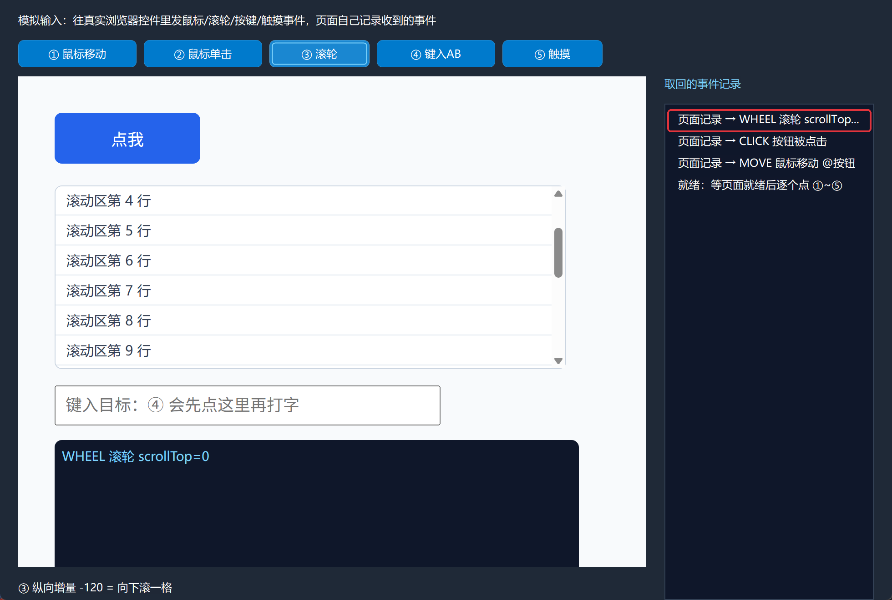
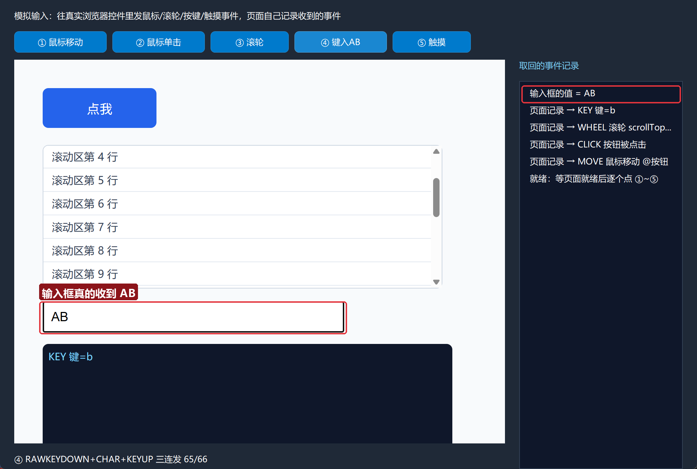
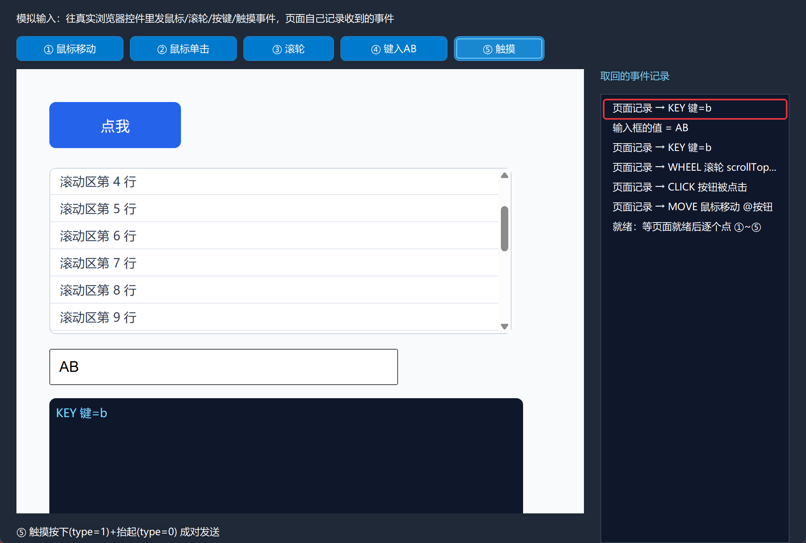

# CEF3 合集 19 · 模拟输入：鼠标单击/移动/滚轮/按键/触摸

> 《LingBuilder CEF3 浏览器合集》第 19 集（无头与自动化篇）。自动化经常需要"替用户操作页面"：点按钮、滚动列表、往输入框打字。这一集用 CEF3 的**模拟输入事件族**——不碰真实鼠标键盘，直接把鼠标单击/移动/滚轮/按键/触摸事件喂给浏览器，页面收到的事件和真人操作**一模一样**。演示页自己当裁判：谁的事件到了、值变了多少，全写在页面日志里。全程约 30 分钟。
>
> **模块获取**：CEF3 浏览器模块**免费**（本集用回设计器里的**可见浏览器控件**）。
>
> 前置要求：学过[第 3 集](/guide/tutorials/cef3-03)的执行JS。本集源码包见文末。

## 这一集你将学会

- `CEF3_发送鼠标移动事件(控件名, X, Y, 修饰键, 是否离开)`
- `CEF3_发送鼠标单击事件(控件名, X, Y, 修饰键, 按钮类型, 是否抬起, 单击次数)`——按下/抬起成对发
- `CEF3_发送鼠标滚轮事件(控件名, X, Y, 修饰键, 横向增量, 纵向增量)`
- `CEF3_发送按键事件(控件名, 类型, 修饰键, Windows键码, 原生键码, 是否系统键, 字符编码, 未修改字符编码, 焦点在可编辑字段)`——打字三连发
- `CEF3_发送触摸事件(控件名, 触点ID, X, Y, 半径X, 半径Y, 旋转角度, 压力, 事件类型, 修饰键, 指针类型)`
- `CEF3_设置焦点(控件名, 真)`：打字前先把焦点给浏览器
- `延时(毫秒)`：等待期间持续泵消息，窗口不卡，专门伺候"发完事件再读结果"

## 1. 命令一张表

| 命令 | 关键参数 | 说明 |
| --- | --- | --- |
| `CEF3_发送鼠标移动事件` | X, Y, 修饰键, 是否离开 | 悬停/hover 效果靠它 |
| `CEF3_发送鼠标单击事件` | X, Y, 按钮类型(0=左), 是否抬起, 单击次数 | **按下(假)+抬起(真)成对发**才有点击 |
| `CEF3_发送鼠标滚轮事件` | X, Y, 横向增量, 纵向增量 | 纵向 -120 = 向下滚一格 |
| `CEF3_发送按键事件` | 类型(0=RAWKEYDOWN, 2=CHAR, 3=KEYUP), Windows键码, 字符编码, 焦点在可编辑字段 | 打字用三连发 |
| `CEF3_发送触摸事件` | 触点ID, X, Y, 压力, 事件类型(1=按下, 0=抬起), 指针类型 | 按下/抬起成对发 |
| `CEF3_执行JS` | 控件名, 脚本 | 读回页面状态（返回 DevTools 信封，见下） |

三条经验先记住：

- **坐标是页面坐标**（CSS 像素）：(120, 68) 就是页面里横 120 纵 68 的位置，与浏览器控件大小对应，不用自己换算 DPI。
- **打字三连发**：`RAWKEYDOWN(0) + CHAR(2) + KEYUP(3)` 一起发才稳——只发 CHAR 在部分环境进不了输入框（本集真机验证过）。CHAR 事件里 Windows键码/原生键码传 0，字符编码传真正的字符码（A=65、B=66）。
- **`CEF3_执行JS`（控件版）返回的也是 DevTools 信封 JSON**（第 17 集的结论对控件同样成立），读回页面状态记得走 `JSON_解析 → /result/value → JSON_取文本值` 三步。

## 2. 设计界面

新建项目「模拟输入演练场」，窗口 980×688（客户区 980×660）。这次拖的是**可见的 CEF3浏览器控件**：

| 控件 | 名称 | 显示内容/属性 | 左距 | 顶距 | 宽度 | 高度 |
| --- | --- | --- | --- | --- | --- | --- |
| 标签 | 说明标签 | 模拟输入：往真实浏览器控件里发鼠标/滚轮/按键/触摸事件，页面自己记录收到的事件 | 20 | 14 | 740 | 22 |
| 按钮 | 移动按钮 | ① 鼠标移动 | 20 | 44 | 130 | 30 |
| 按钮 | 单击按钮 | ② 鼠标单击 | 158 | 44 | 130 | 30 |
| 按钮 | 滚轮按钮 | ③ 滚轮 | 296 | 44 | 110 | 30 |
| 按钮 | 按键按钮 | ④ 键入AB | 414 | 44 | 130 | 30 |
| 按钮 | 触摸按钮 | ⑤ 触摸 | 552 | 44 | 110 | 30 |
| **CEF3浏览器** | **浏览器1** | 打开地址 about:blank；勾选「禁用 GPU 加速」 | 20 | 84 | 690 | 540 |
| 标签 | 日志标题 | 取回的事件记录 | 730 | 84 | 230 | 22 |
| 列表框 | 日志列表 | （空） | 730 | 114 | 230 | 546 |
| 标签 | 状态标签 | 就绪 | 20 | 638 | 690 | 22 |



测试页 `assets/lingbuilder-project/input-test.html`：左上「点我」按钮（中心约在页面 120,68）、中段滚动区、下方输入框、底部事件黑板。页面脚本监听 mousemove/click/wheel/keydown/input/touchstart/touchend，把**最近一条事件**写到黑板 `#ev`。核心监听：

```html
<script>
function log(t){document.getElementById('ev').innerText = t;}
document.getElementById('btn').addEventListener('click',function(){log('CLICK 按钮被点击');});
document.getElementById('scroller').addEventListener('wheel',function(){log('WHEEL 滚轮 scrollTop=' + Math.round(this.scrollTop));});
document.getElementById('inp').addEventListener('keydown',function(e){log('KEY 键=' + (e.key||e.keyCode));});
document.getElementById('btn').addEventListener('touchstart',function(){log('TOUCH 触摸按下 @按钮');});
</script>
```

## 3. 写代码

### 3.1 创建导航 + 读回助手

```lcpp
事件 _MainWindow_创建完毕()
    局部 文本型 地址
    地址 = CEF3_取资源地址("lingbuilder-project/input-test.html")
    CEF3_导航(浏览器1, 地址)
    控件_插入项目(日志列表, 0, "就绪：等页面就绪后逐个点 ①~⑤")
结束

文本型 读页面记录()
    延时(200)
    局部 文本型 记录
    记录 = CEF3_执行JS(浏览器1, "document.getElementById('ev').innerText")
    返回(解信封(记录))
结束

文本型 读输入框()
    延时(200)
    局部 文本型 值
    值 = CEF3_执行JS(浏览器1, "document.getElementById('inp').value")
    返回(解信封(值))
结束
```

`延时(200)` 是关键：发出去的事件要穿过 CEF 的进程管线才落到页面，**读早了读到的是旧状态**。

### 3.2 解信封（第 17 集的三步，这里封装成子程序）

```lcpp
文本型 解信封(文本型 信封)
    局部 文本型 结果
    结果 = ""
    如果 (信封 == "")
        返回("")
    如果结束
    局部 JSON值 信封值
    信封值 = JSON_解析(信封)
    如果 (信封值 == 0)
        返回("")
    如果结束
    局部 JSON值 值对象
    值对象 = JSON_指针_取(信封值, "/result/value")
    如果 (值对象 != 0)
        结果 = JSON_取文本值(值对象, "")
        JSON_释放(值对象)
    如果结束
    JSON_释放(信封值)
    返回(结果)
结束
```

### 3.3 鼠标移动、单击与滚轮

```lcpp
事件 _移动按钮_被单击()
    CEF3_发送鼠标移动事件(浏览器1, 120, 68, 0, 假)
    延时(400)
    控件_插入项目(日志列表, 0, "页面记录 → " + 读页面记录())
    控件_设置文本(状态标签, "① 鼠标移动已发送（坐标 120,68 正落在按钮上）")
结束

事件 _单击按钮_被单击()
    CEF3_发送鼠标单击事件(浏览器1, 120, 68, 0, 0, 假, 1)
    CEF3_发送鼠标单击事件(浏览器1, 120, 68, 0, 0, 真, 1)
    延时(400)
    控件_插入项目(日志列表, 0, "页面记录 → " + 读页面记录())
    控件_设置文本(状态标签, "② 按下+抬起成对发送，页面收到 CLICK")
结束

事件 _滚轮按钮_被单击()
    CEF3_发送鼠标滚轮事件(浏览器1, 260, 230, 0, 0, -120)
    延时(400)
    控件_插入项目(日志列表, 0, "页面记录 → " + 读页面记录())
    控件_设置文本(状态标签, "③ 纵向增量 -120 = 向下滚一格")
结束
```

注意单击**必须按下+抬起两发**——只发"按下"页面只会收到 mousedown，不会触发 click。



### 3.4 键入 AB：聚焦 + 三连发（本集核心）

```lcpp
事件 _按键按钮_被单击()
    CEF3_发送鼠标单击事件(浏览器1, 240, 380, 0, 0, 假, 1)
    CEF3_发送鼠标单击事件(浏览器1, 240, 380, 0, 0, 真, 1)
    CEF3_设置焦点(浏览器1, 真)
    延时(300)
    CEF3_发送按键事件(浏览器1, 0, 0, 65, 65, 假, 0, 0, 真)
    CEF3_发送按键事件(浏览器1, 2, 0, 0, 0, 假, 65, 65, 真)
    CEF3_发送按键事件(浏览器1, 3, 0, 65, 65, 假, 0, 0, 真)
    CEF3_发送按键事件(浏览器1, 0, 0, 66, 66, 假, 0, 0, 真)
    CEF3_发送按键事件(浏览器1, 2, 0, 0, 0, 假, 66, 66, 真)
    CEF3_发送按键事件(浏览器1, 3, 0, 66, 66, 假, 0, 0, 真)
    延时(400)
    控件_插入项目(日志列表, 0, "页面记录 → " + 读页面记录())
    控件_插入项目(日志列表, 0, "输入框的值 = " + 读输入框())
    控件_设置文本(状态标签, "④ RAWKEYDOWN+CHAR+KEYUP 三连发 65/66")
结束
```

流程拆开看：**先模拟单击输入框把它聚焦**（第 4、5 行），`CEF3_设置焦点` 兜底把焦点交给浏览器控件；然后每个字符三连发——`RAWKEYDOWN(类型0)` 报按键、`CHAR(类型2)` 送字符（这一发才是真正往输入框里插字的）、`KEYUP(类型3)` 收尾。CHAR 事件的键码参数传 0、字符编码传 65/66。



### 3.5 触摸

```lcpp
事件 _触摸按钮_被单击()
    CEF3_发送触摸事件(浏览器1, 0, 120, 68, 0, 0, 0, 0.5, 1, 0, 0)
    CEF3_发送触摸事件(浏览器1, 0, 120, 68, 0, 0, 0, 0.5, 0, 0, 0)
    延时(400)
    控件_插入项目(日志列表, 0, "页面记录 → " + 读页面记录())
    控件_设置文本(状态标签, "⑤ 触摸按下(type=1)+抬起(type=0) 成对发送")
结束
```

事件类型 1=按下、0=抬起，与鼠标一样成对发。**注意**：页面要收到 DOM `touchstart/touchend`，需要浏览器启用触摸事件（CEF 的 `--touch-events=enabled` 启动开关，属第 23 集命令行开关族的范围）；本环境未启用该开关时，事件已发出但页面监听不到——这是环境配置问题，不是命令用错了。



## 4. 编译：先看错误列表

「错误列表」**(0)** 才继续：



## 5. 运行：五连发全记录

点「运行」，依次点五个按钮：

- **① 鼠标移动** → 页面黑板：`MOVE 鼠标移动 @按钮`：



- **② 鼠标单击** → 黑板：`CLICK 按钮被点击`：



- **③ 滚轮** → 黑板：`WHEEL 滚轮 scrollTop=…`（黑板记录的是滚轮落点时刻的偏移；肉眼能看到滚动区真的滚下去了）：



- **④ 键入AB** → 输入框出现 **AB**，日志读回 `输入框的值 = AB`：



- **⑤ 触摸** → 命令已发送（触摸事件需要 `--touch-events` 开关，见 3.5 的说明）：



## 常见问题急救表

| 症状 | 原因 | 解法 |
| --- | --- | --- |
| 单击了但页面没反应 | 只发了"按下"没发"抬起" | 按下(假)+抬起(真)成对发 |
| 读回的还是上一次的状态 | 事件经 CEF 进程管线有延迟 | 发完 `延时(300~500)` 再读 |
| 读回一堆 `{"result":…}` | `CEF3_执行JS` 返回 DevTools 信封 | 用第 17 集的 `解信封` 三步 |
| 打字进不了输入框 | 只发了 CHAR，或焦点不在输入框 | 先模拟单击输入框 + `CEF3_设置焦点`，再 RAWKEYDOWN+CHAR+KEYUP 三连发 |
| 页面收不到 touch 事件 | 未启用 `--touch-events=enabled` 启动开关 | 第 23 集命令行开关族补上；命令本身没发错 |
| 滚轮方向反了 | 纵向增量符号理解错 | 正值向上、负值向下（以实测为准） |
| 键码对照 | 字符编码要传字符码 | A=65、B=66……与 ASCII 一致 |

## 本集小结

- 模拟输入五件套全部按 **页面坐标** 寻址；单击/触摸都要 **按下+抬起成对发**。
- 打字 = 聚焦（模拟单击 + `CEF3_设置焦点`）+ 每字符 `RAWKEYDOWN+CHAR+KEYUP` 三连发。
- `CEF3_执行JS`（控件版）同样返回 DevTools 信封——读页面状态走 `解信封` 三步，`延时` 是事件与读取之间的传送带。

## 源码包

本集完整源码已打包为 **CEF3合集19-模拟输入演练场.lcpppkg**（见[示例源码区](/demos)），导入即可运行对照学习。

**下一篇预告**：弹窗管理与自动化族——尝试关闭、是否弹出窗口、取打开者浏览器 ID。

[回合集总览](/guide/tutorials/cef3)
