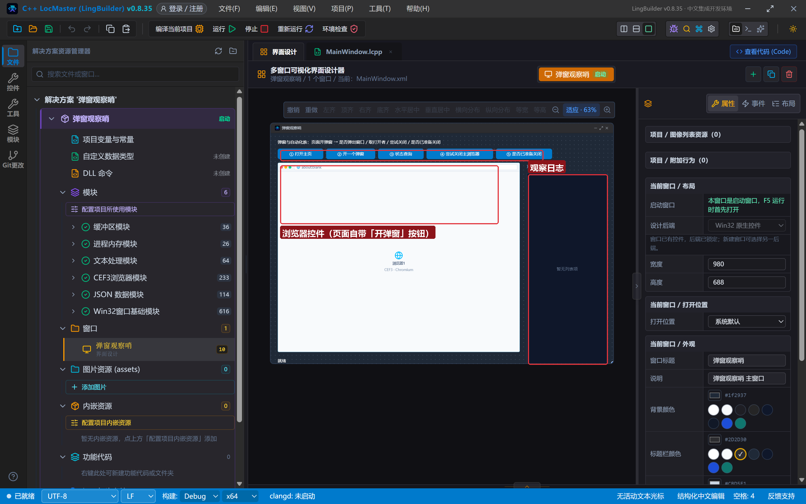
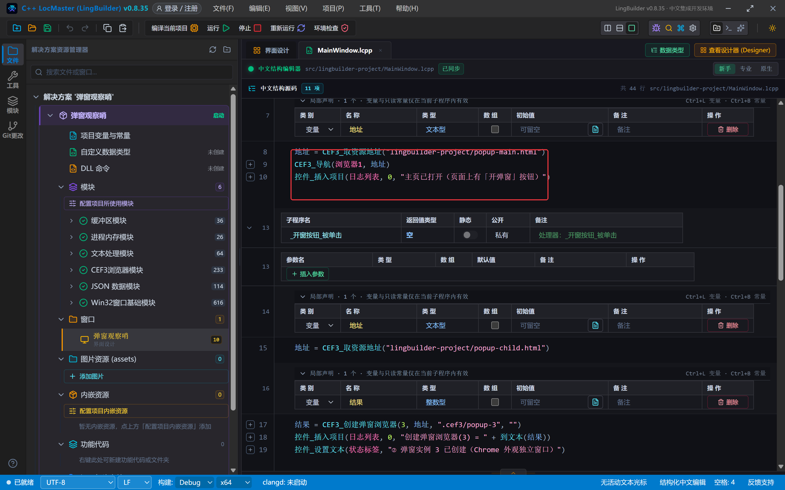
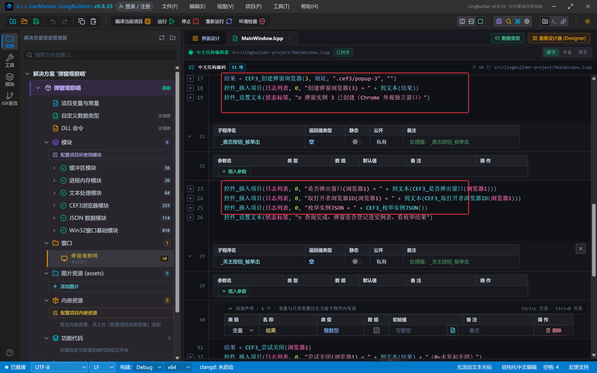
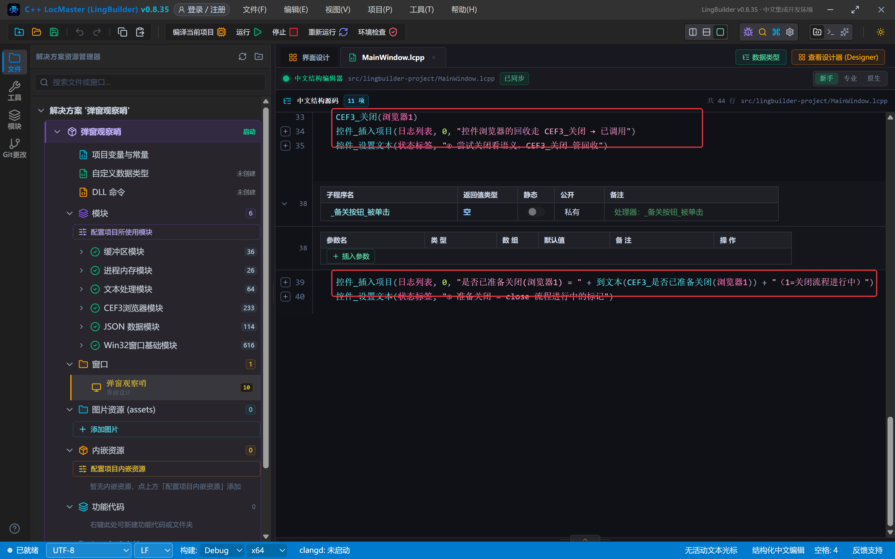
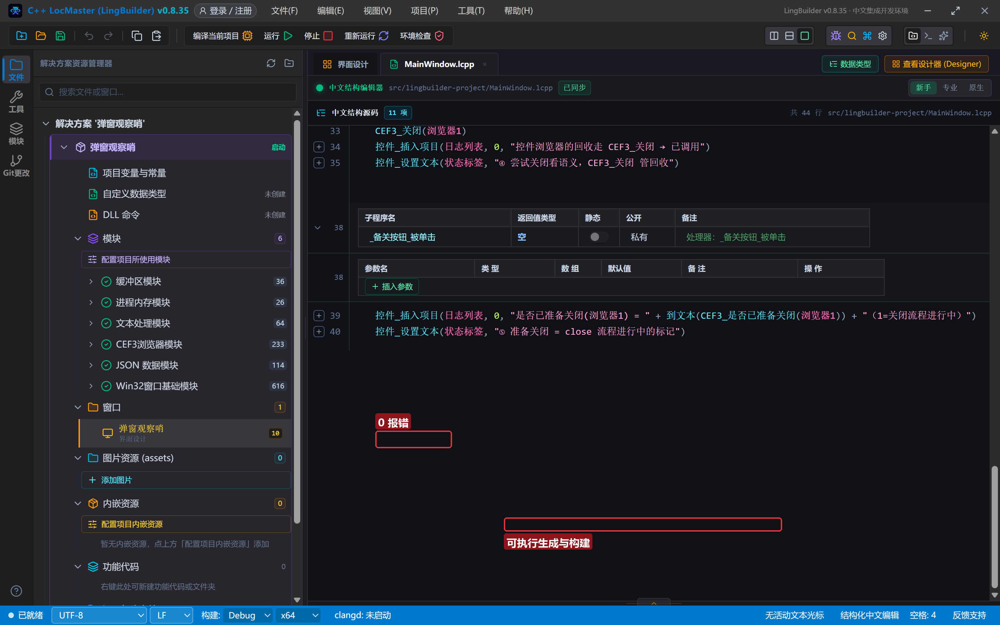
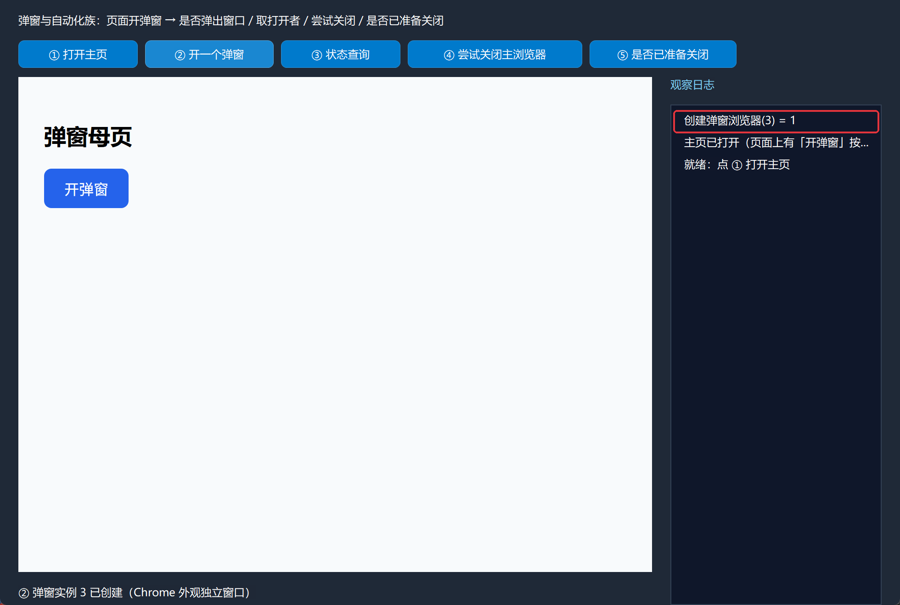
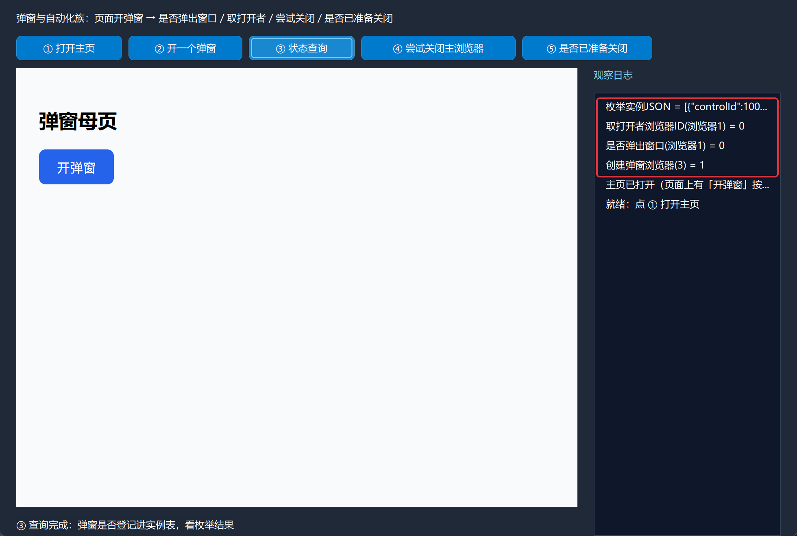
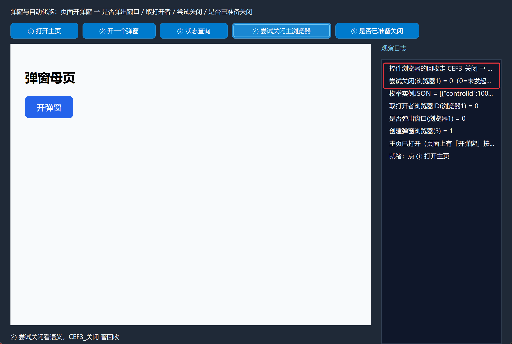
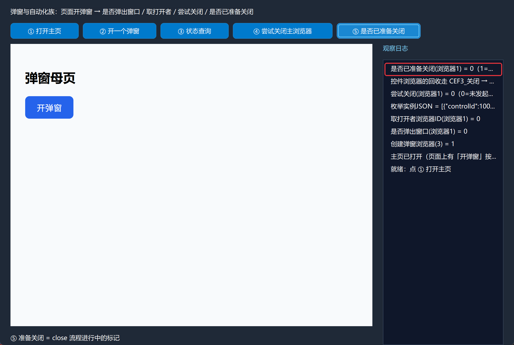

# CEF3 合集 20 · 弹窗管理与自动化族：尝试关闭 / 是否弹窗 / 取打开者

> 《LingBuilder CEF3 浏览器合集》第 20 集（无头与自动化篇）。浏览器自动化绕不开两个问题：**"这个浏览器是不是弹窗、是谁开的"** 和 **"怎么把一个浏览器体面地关掉"**。这一集把弹窗与自动化族的四条命令一次讲透，并给出一个重要的实测结论：**页面里的 `window.open` 不是开弹窗的正路，`CEF3_创建弹窗浏览器` 才是**。全程约 30 分钟。
>
> **模块获取**：CEF3 浏览器模块**免费**。
>
> 前置要求：学过[第 14 集](/guide/tutorials/cef3-14)的实例编号概念。本集源码包见文末。

## 这一集你将学会

- `CEF3_是否弹出窗口(控件名)`：判断一个浏览器是不是弹窗
- `CEF3_取打开者浏览器ID(控件名)`：查这个弹窗是谁开的
- `CEF3_尝试关闭(控件名)`：发起"带确认流程"的关闭（返回值语义要实测着理解）
- `CEF3_是否已准备关闭(控件名)`：close 流程进行中的标记
- `CEF3_关闭(控件名)`：控件浏览器的直接回收
- `CEF3_创建弹窗浏览器(实例编号, 地址, 独立缓存目录, 代理地址)`：弹窗的正路（第 14 集已上手，本集纳入弹窗管理体系）

## 1. 命令一张表

| 命令 | 参数 | 返回 |
| --- | --- | --- |
| `CEF3_是否弹出窗口` | 控件名 | 整数型（1=这个浏览器本身就是弹窗） |
| `CEF3_取打开者浏览器ID` | 控件名 | 长整数型（打开者的浏览器 ID；0=不是弹窗） |
| `CEF3_尝试关闭` | 控件名 | 整数型（1=已发起关闭；0=未发起） |
| `CEF3_是否已准备关闭` | 控件名 | 整数型（1=close 流程进行中） |
| `CEF3_关闭` | 控件名 | 整数型 |
| `CEF3_创建弹窗浏览器` | 实例编号, 地址, 独立缓存目录, 代理地址 | 整数型（1=成功） |

两条**实测结论**先摆上来：

- **`window.open` 不是弹窗正路**。在 `CEF3_执行JS` 里执行 `window.open(...)`，本构建不会弹出任何窗口——CEF 把弹窗决定权交给宿主，宿主没放行。想让"页面开一个新浏览器"，直接调 `CEF3_创建弹窗浏览器`（实例编号进枚举表，能管理能回收）。
- **设计器控件浏览器永远 `是否弹出窗口=0`、`取打开者浏览器ID=0`**——它们是主浏览器，不是任何人的弹窗。这两条命令的用武之地是配合弹窗实例做身份判断（比如遍历枚举表时分辨谁是弹窗、谁的爹是谁）。
- **`CEF3_尝试关闭` 实测返回 0**（无页面确认流程可走时），控件浏览器的真正回收走 `CEF3_关闭`。`尝试关闭` 的设计语义是"走页面的关闭确认流程"（onbeforeunload 那套），没有确认流程可走时它就不发起。

## 2. 设计界面

新建项目「弹窗观察哨」，窗口 980×688（客户区 980×660），五个按钮 + 可见浏览器控件 + 右侧日志：

| 控件 | 名称 | 显示内容/属性 | 左距 | 顶距 | 宽度 | 高度 |
| --- | --- | --- | --- | --- | --- | --- |
| 标签 | 说明标签 | 弹窗与自动化族：页面开弹窗 → 是否弹出窗口 / 取打开者 / 尝试关闭 / 是否已准备关闭 | 20 | 14 | 740 | 22 |
| 按钮 | 开页按钮 | ① 打开主页 | 20 | 44 | 130 | 30 |
| 按钮 | 开窗按钮 | ② 开一个弹窗 | 158 | 44 | 140 | 30 |
| 按钮 | 查态按钮 | ③ 状态查询 | 306 | 44 | 130 | 30 |
| 按钮 | 关主按钮 | ④ 尝试关闭主浏览器 | 444 | 44 | 190 | 30 |
| 按钮 | 备关按钮 | ⑤ 是否已准备关闭 | 642 | 44 | 160 | 30 |
| **CEF3浏览器** | **浏览器1** | about:blank；勾选「禁用 GPU 加速」 | 20 | 84 | 690 | 540 |
| 标签 | 日志标题 | 观察日志 | 730 | 84 | 230 | 22 |
| 列表框 | 日志列表 | （空） | 730 | 114 | 230 | 546 |
| 标签 | 状态标签 | 就绪 | 20 | 638 | 690 | 22 |



测试页两枚（`assets/lingbuilder-project/`）：`popup-main.html`（母页，页面上的"开弹窗"按钮走 `window.open`——演示"这条路不通"）、`popup-child.html`（子页，给 `CEF3_创建弹窗浏览器` 当加载目标）。

## 3. 写代码

### 3.1 打开主页

```lcpp
事件 _开页按钮_被单击()
    局部 文本型 地址
    地址 = CEF3_取资源地址("lingbuilder-project/popup-main.html")
    CEF3_导航(浏览器1, 地址)
    控件_插入项目(日志列表, 0, "主页已打开（页面上有「开弹窗」按钮）")
结束
```



### 3.2 开一个弹窗：正路

```lcpp
事件 _开窗按钮_被单击()
    局部 文本型 地址
    地址 = CEF3_取资源地址("lingbuilder-project/popup-child.html")
    局部 整数型 结果
    结果 = CEF3_创建弹窗浏览器(3, 地址, ".cef3/popup-3", "")
    控件_插入项目(日志列表, 0, "创建弹窗浏览器(3) = " + 到文本(结果))
    控件_设置文本(状态标签, "② 弹窗实例 3 已创建（Chrome 外观独立窗口）")
结束
```

一执行，屏幕上真的多出一个 Chrome 外观的独立弹窗窗口（地址栏、页签俱全）。它按**实例编号 3** 登记，枚举表里能查到，`CEF3_关闭全部实例` 能回收。



### 3.3 状态查询

```lcpp
事件 _查态按钮_被单击()
    控件_插入项目(日志列表, 0, "是否弹出窗口(浏览器1) = " + 到文本(CEF3_是否弹出窗口(浏览器1)))
    控件_插入项目(日志列表, 0, "取打开者浏览器ID(浏览器1) = " + 到文本(CEF3_取打开者浏览器ID(浏览器1)))
    控件_插入项目(日志列表, 0, "枚举实例JSON = " + CEF3_枚举实例JSON())
    控件_设置文本(状态标签, "③ 查询完成：弹窗是否登记进实例表，看枚举结果")
结束
```

主控件的查询结果：`是否弹出窗口 = 0`、`取打开者浏览器ID = 0`——它不是弹窗、没有打开者。枚举表里则是两个条目：主控件（`mode: control`）和弹窗实例 3（`mode: chrome-popup`）。

### 3.4 尝试关闭与直接回收

```lcpp
事件 _关主按钮_被单击()
    局部 整数型 结果
    结果 = CEF3_尝试关闭(浏览器1)
    控件_插入项目(日志列表, 0, "尝试关闭(浏览器1) = " + 到文本(结果) + "（0=未发起关闭）")
    CEF3_关闭(浏览器1)
    控件_插入项目(日志列表, 0, "控件浏览器的回收走 CEF3_关闭 → 已调用")
    控件_设置文本(状态标签, "④ 尝试关闭看语义，CEF3_关闭 管回收")
结束
```

实测 `尝试关闭` 返回 0——页面没有 `onbeforeunload` 确认流程可走，它就不发起。**控件浏览器的回收用 `CEF3_关闭`**；`尝试关闭` 留给"页面会弹确认框"的场景（配合第 2 集的关闭决策事件）。

### 3.5 是否已准备关闭

```lcpp
事件 _备关按钮_被单击()
    控件_插入项目(日志列表, 0, "是否已准备关闭(浏览器1) = " + 到文本(CEF3_是否已准备关闭(浏览器1)) + "（1=关闭流程进行中）")
    控件_设置文本(状态标签, "⑤ 准备关闭 = close 流程进行中的标记")
结束
```



## 4. 编译：先看错误列表

「错误列表」**(0)** 才继续：



## 5. 运行：把弹窗这件事彻底看清

点「运行」：

- **① 打开主页** → 浏览器控件加载母页：


- **② 开一个弹窗** → 屏幕上多出独立的 Chrome 外观弹窗（截图时已把它挪到画面右侧）：



- **③ 状态查询** → 主控件 `是否弹出窗口=0`、`取打开者=0`，枚举表里能看到弹窗实例：



- **④ 尝试关闭主浏览器** → `尝试关闭 = 0`（未发起），随后 `CEF3_关闭` 接管回收：



- **⑤ 是否已准备关闭** → 读回 close 流程标记：



## 常见问题急救表

| 症状 | 原因 | 解法 |
| --- | --- | --- |
| `window.open` 没弹窗 | CEF 把弹窗决定权交给宿主，宿主未放行 | 用 `CEF3_创建弹窗浏览器`（正路） |
| 尝试关闭返回 0 | 页面无关闭确认流程可走 | 控件浏览器回收用 `CEF3_关闭`；带确认流程的场景才轮到 `尝试关闭` |
| 是否弹出窗口一直是 0 | 设计器控件是主浏览器，本来就 0 | 弹窗身份判断配合 `CEF3_枚举实例JSON` 的 mode 字段（chrome-popup） |
| 取打开者一直是 0 | 控件不是弹窗，没有打开者 | 弹窗实例的 lineage 走枚举表与创建记录 |
| 弹窗窗口盖住主窗口 | 系统把新弹窗放前台 | 用窗口 API 挪位，或阅读截图时注意区分 |
| 关了主控件再查询报错值 | 浏览器已销毁，命令返回失败值 | 关闭后的控件命令一律按失败值处理 |

## 本集小结

- 弹窗的正路是 `CEF3_创建弹窗浏览器`（实例编号登记、枚举可查、可回收）；页面 `window.open` 在本构建不产弹窗。
- 四条查询/关闭命令的实测语义：控件浏览器 `是否弹出窗口=0`、`取打开者=0`；`尝试关闭` 无确认流程时返回 0，回收用 `CEF3_关闭`；`是否已准备关闭` 是 close 流程标记。
- 身份判断的正确姿势：`CEF3_枚举实例JSON` 的 `mode` 字段（control / chrome-popup / region / windowless）。

## 源码包

本集完整源码已打包为 **CEF3合集20-弹窗观察哨.lcpppkg**（见[示例源码区](/demos)），导入即可运行对照学习。

**下一篇预告**：菜单定制（一）——浏览器默认菜单的控制：菜单族的查询、改标题、禁用与可见性。

[回合集总览](/guide/tutorials/cef3)
