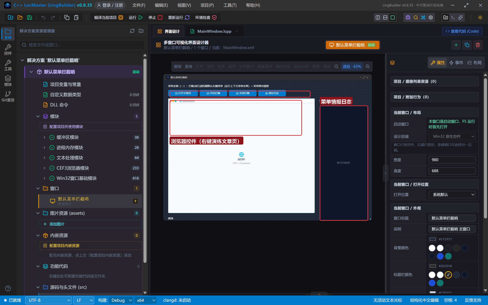
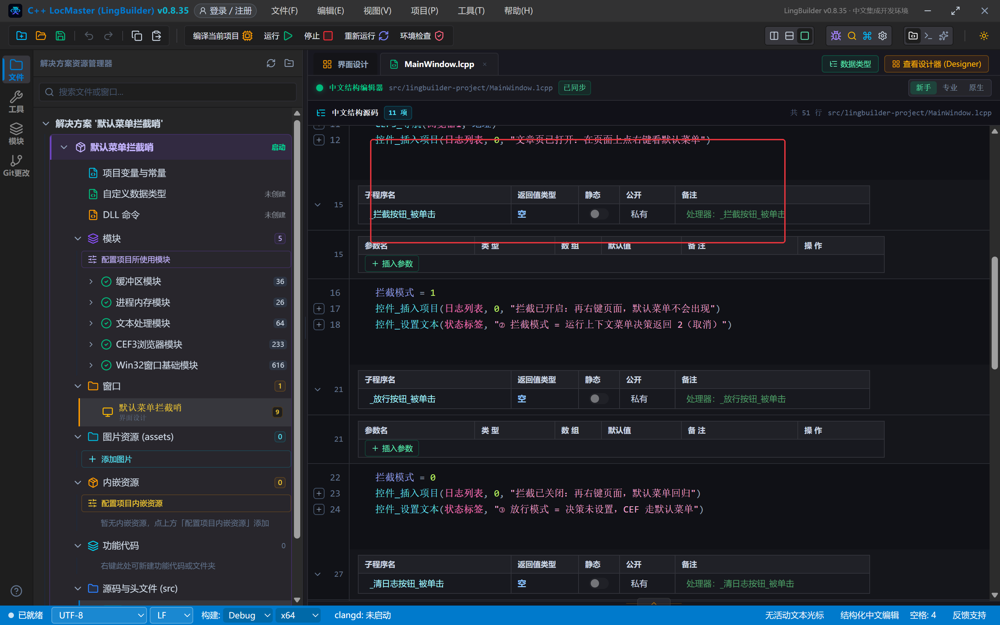
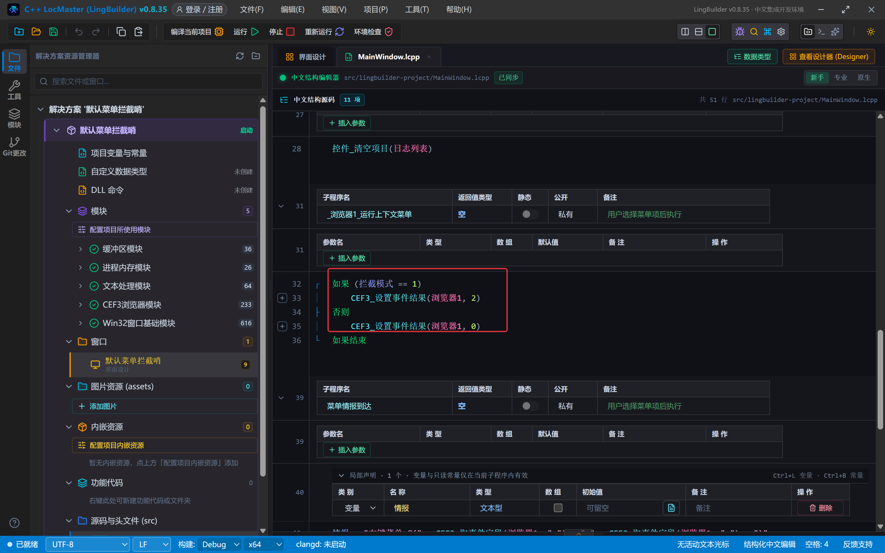
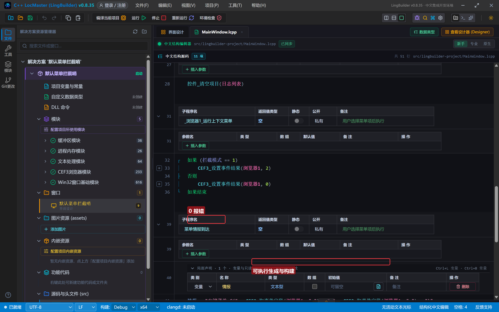
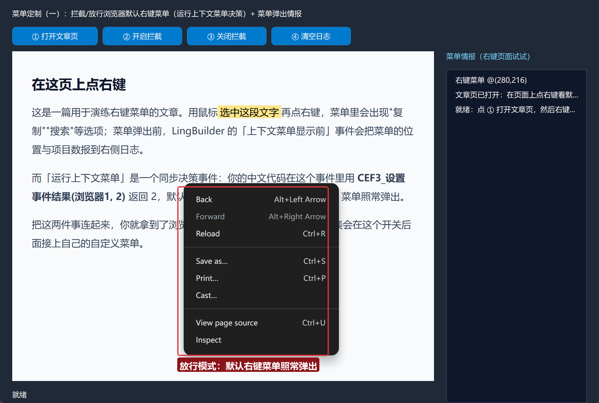
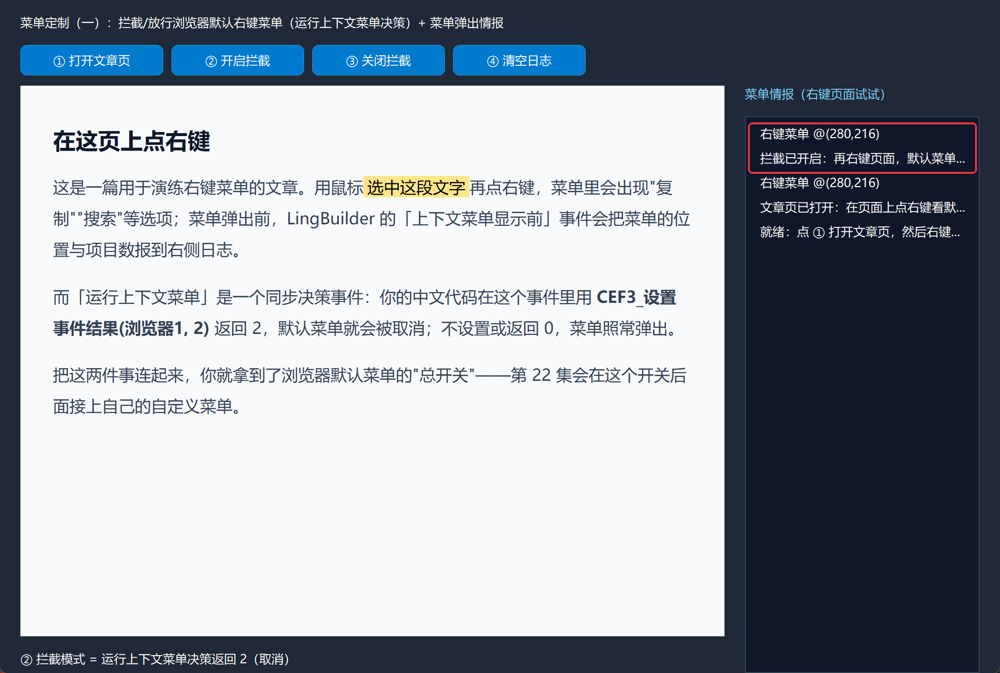
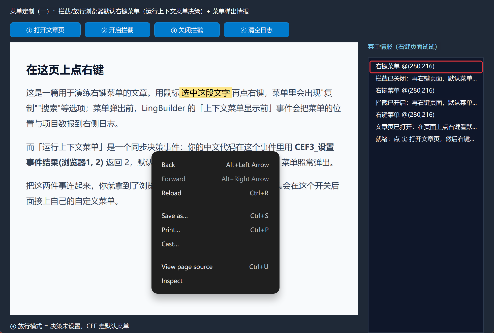
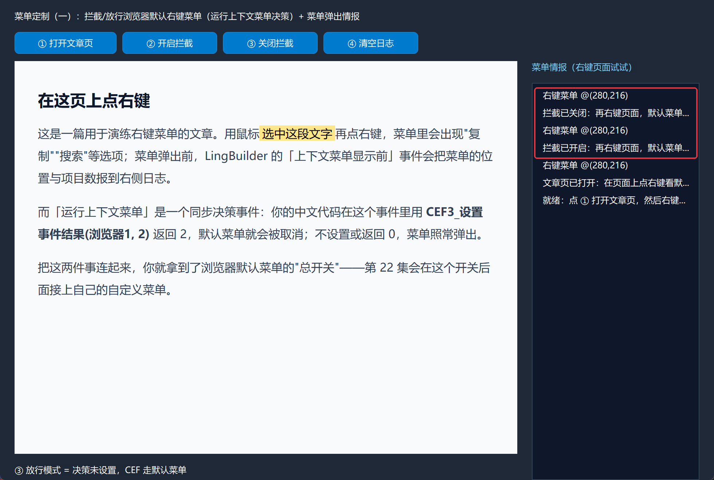

# CEF3 合集 21 · 菜单定制（一）：默认菜单的控制（拦截与放行）

> 《LingBuilder CEF3 浏览器合集》第 21 集（CEF3 特色大族篇）。从本集开始进入菜单族——CEF3 全家命令数最多的领域之一。第一课先抓**总开关**：浏览器默认右键菜单（后退/刷新/另存为/打印/查看源代码……）的弹出与否，由「运行上下文菜单」这个**同步决策事件**说了算。你的中文代码在事件里返回一个数字，默认菜单就听你的：弹，还是不弹。全程约 30 分钟。
>
> **模块获取**：CEF3 浏览器模块**免费**。
>
> 前置要求：学过[第 2 集](/guide/tutorials/cef3-02)的事件与决策。本集源码包见文末。

## 这一集你将学会

- **「运行上下文菜单」同步决策事件**：`_浏览器1_运行上下文菜单()` 处理器 + `CEF3_设置事件结果` 控制默认菜单的生死
- **「上下文菜单显示前」异步事件**：菜单弹出前拿到位置（x/y）等情报
- `CEF3_绑定事件(控件名, "上下文菜单显示前", &处理器)`：给异步事件挂处理器
- `CEF3_取事件字段(控件名, "x"/"y"/"selection")`：读事件字段
- 用一个全局开关变量实现"拦截/放行"随时切换

## 1. 命令一张表

| 命令/事件 | 用法 | 说明 |
| --- | --- | --- |
| 事件 `_浏览器1_运行上下文菜单()` | 同步决策 | 处理器内 `CEF3_设置事件结果(浏览器1, 2)` = **取消默认菜单**；返回 0 / 不设置 = 默认菜单照常弹 |
| 事件 `_浏览器1_上下文菜单显示前()` | 异步通知 | 菜单弹出前触发；配合 `CEF3_取事件字段` 读 x、y、selection |
| `CEF3_绑定事件` | 控件名, "上下文菜单显示前", &处理器 | 异步事件绑定 |
| `CEF3_取事件字段` | 控件名, 字段名 | 读最近事件的字段（x/y 坐标、selection 选中文字等） |
| `CEF3_设置事件结果` | 控件名, 结果 | 同步决策事件的"回答" |

**决策语义**（本集真机验证）：「运行上下文菜单」处理器里设置事件结果 **2** → CEF 取消默认菜单；设置 **0** 或不设置 → CEF 照常弹默认菜单。这个开关就是第 22 集"自定义右键菜单"的地基：先取消默认，再弹自己的。

## 2. 设计界面

新建项目「默认菜单拦截哨」，窗口 980×688（客户区 980×660）：

| 控件 | 名称 | 显示内容/属性 | 左距 | 顶距 | 宽度 | 高度 |
| --- | --- | --- | --- | --- | --- | --- |
| 标签 | 说明标签 | 菜单定制（一）：拦截/放行浏览器默认右键菜单（运行上下文菜单决策）+ 菜单弹出情报 | 20 | 14 | 740 | 22 |
| 按钮 | 开页按钮 | ① 打开文章页 | 20 | 44 | 140 | 30 |
| 按钮 | 拦截按钮 | ② 开启拦截 | 168 | 44 | 130 | 30 |
| 按钮 | 放行按钮 | ③ 关闭拦截 | 306 | 44 | 130 | 30 |
| 按钮 | 清日志按钮 | ④ 清空日志 | 444 | 44 | 130 | 30 |
| **CEF3浏览器** | **浏览器1** | about:blank；勾选「禁用 GPU 加速」 | 20 | 84 | 690 | 540 |
| 标签 | 日志标题 | 菜单情报（右键页面试试） | 730 | 84 | 230 | 22 |
| 列表框 | 日志列表 | （空） | 730 | 114 | 230 | 546 |
| 标签 | 状态标签 | 就绪 | 20 | 638 | 690 | 22 |



测试页 `assets/lingbuilder-project/article.html`：一篇短文，提醒用户"在这页上点右键"。

## 3. 写代码

### 3.1 创建完毕：置开关 + 绑情报事件

```lcpp
事件 _MainWindow_创建完毕()
    拦截模式 = 0
    CEF3_绑定事件(浏览器1, "上下文菜单显示前", &菜单情报到达)
    控件_插入项目(日志列表, 0, "就绪：点 ① 打开文章页，然后右键页面试试")
结束
```

`拦截模式` 是项目全局变量（整数型，0=放行 1=拦截），在「项目变量与常量」里声明。

### 3.2 拦截/放行开关

```lcpp
事件 _拦截按钮_被单击()
    拦截模式 = 1
    控件_插入项目(日志列表, 0, "拦截已开启：再右键页面，默认菜单不会出现")
    控件_设置文本(状态标签, "② 拦截模式 = 运行上下文菜单决策返回 2（取消）")
结束

事件 _放行按钮_被单击()
    拦截模式 = 0
    控件_插入项目(日志列表, 0, "拦截已关闭：再右键页面，默认菜单回归")
    控件_设置文本(状态标签, "③ 放行模式 = 决策未设置，CEF 走默认菜单")
结束

事件 _清日志按钮_被单击()
    控件_清空项目(日志列表)
结束
```



### 3.3 核心：运行上下文菜单决策（本集灵魂）

```lcpp
事件 _浏览器1_运行上下文菜单()
    如果 (拦截模式 == 1)
        CEF3_设置事件结果(浏览器1, 2)
    否则
        CEF3_设置事件结果(浏览器1, 0)
    如果结束
结束
```

这个处理器名字里的「运行上下文菜单」是 CEF3 事件的中文原名，`_浏览器1_` 前缀表示它属于浏览器1控件。**它是同步决策事件**：右键按下的一瞬间 CEF 会等你的回答——返回 2 取消菜单，返回 0 放行。处理得快，用户无感；这也意味着别在处理器里做耗时操作。



### 3.4 菜单情报：弹出前的位置

```lcpp
事件 菜单情报到达()
    局部 文本型 情报
    情报 = "右键菜单 @(" + CEF3_取事件字段(浏览器1, "x") + "," + CEF3_取事件字段(浏览器1, "y") + ")"
    局部 文本型 选中
    选中 = CEF3_取事件字段(浏览器1, "selection")
    如果 (选中 != "")
        情报 = 情报 + " 选中文字=" + 选中
    如果结束
    控件_插入项目(日志列表, 0, 情报)
结束
```

「上下文菜单显示前」是异步通知：每次右键都会先来这一条，把菜单锚点坐标（页面内坐标）与用户选中的文字报给你——自定义菜单时，你就知道该把菜单弹在哪、该不该显示"复制"。

## 4. 编译：先看错误列表

「错误列表」**(0)** 才继续：



## 5. 运行：一个开关管住默认菜单

点「运行」：

- **① 打开文章页** → 页面就绪；这时在页面上**点右键**——默认菜单照常弹出（放行模式）：



- **② 开启拦截** → 再右键——**菜单消失了**，但「上下文菜单显示前」情报照常进日志（拦截的是显示，不是事件）：



- **③ 关闭拦截** → 再右键——默认菜单回归：



- 每次右键的坐标情报：



## 常见问题急救表

| 症状 | 原因 | 解法 |
| --- | --- | --- |
| 设了事件结果 2 菜单还弹 | 决策事件没绑到这个处理器名 | 处理器名必须是 `_控件名_运行上下文菜单`，一字不差 |
| 菜单情报日志没动静 | 绑定事件写在导航之前、处理器名拼错 | 绑定放创建完毕；`&菜单情报到达` 与事件处理器名一致 |
| 右键后窗口短暂卡顿 | 决策处理器里做了耗时操作 | 决策事件是同步的：只做开关判断，重活交给异步事件或工作线程 |
| 取事件字段拿到空文本 | 字段名写错（区分大小写） | 用 `x`、`y`、`selection`（全小写） |
| 想改默认菜单里的某一项 | 默认菜单模型一期未开放逐项编辑 | 第 22 集：取消默认菜单后弹自己的 |
| 拦截后右键"没有任何反应" | 这就是拦截成功（CEF 连菜单都不画） | 第 22 集接自定义菜单 |

## 本集小结

- 默认右键菜单的总开关 = 「运行上下文菜单」同步决策事件：结果 **2 = 取消**、0/不设置 = 放行。
- 「上下文菜单显示前」异步事件报坐标与选中文字，是自定义菜单的情报来源。
- 决策处理器要快；全局开关变量让拦截/放行随时切换。

## 源码包

本集完整源码已打包为 **CEF3合集21-默认菜单拦截哨.lcpppkg**（见[示例源码区](/demos)），导入即可运行对照学习。

**下一篇预告**：菜单定制（二）——取消默认菜单之后，弹一个自己的右键菜单。

[回合集总览](/guide/tutorials/cef3)
