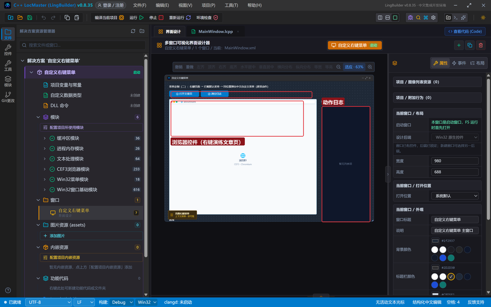
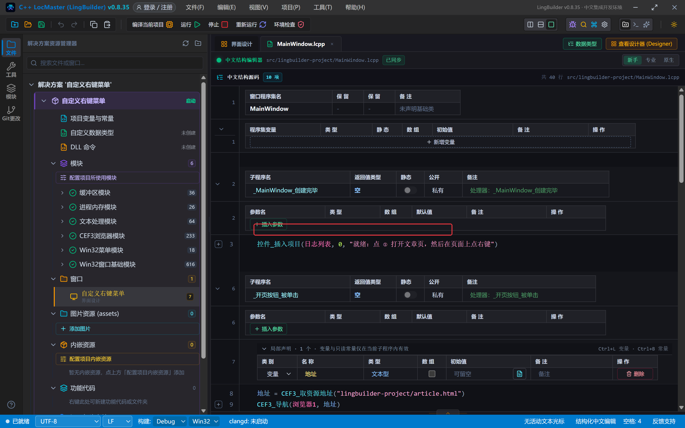
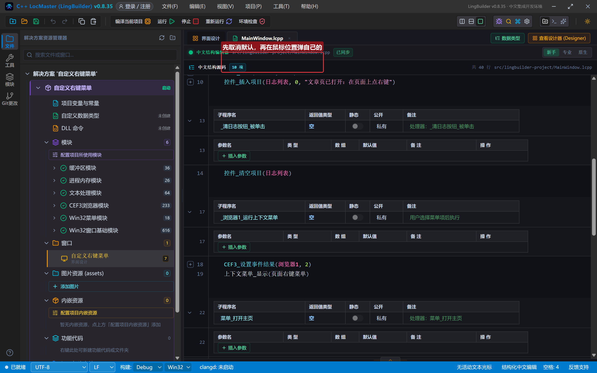
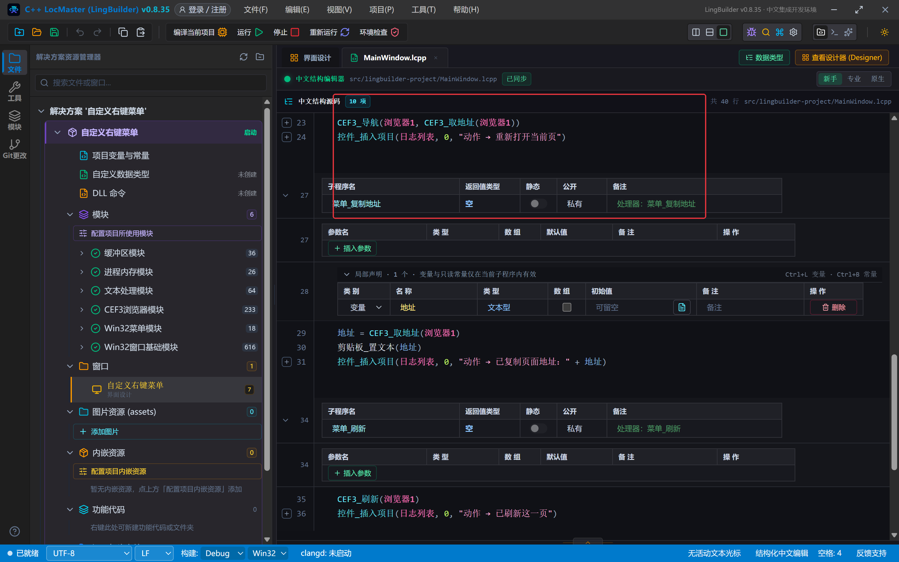
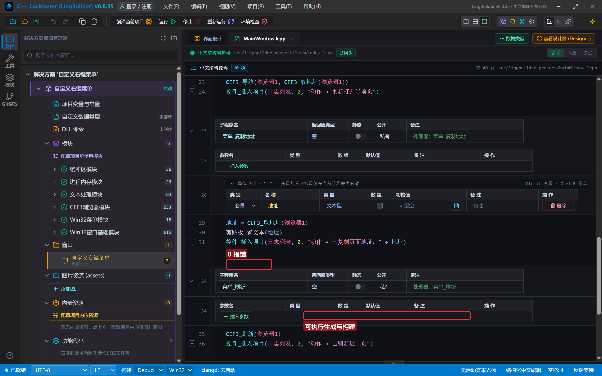
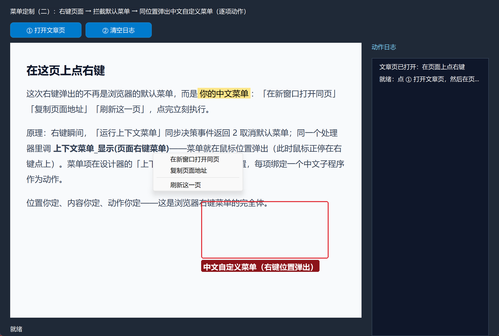
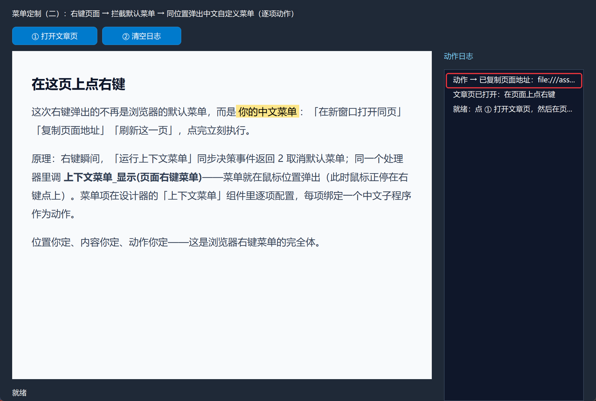

# CEF3 合集 22 · 菜单定制（二）：自定义右键菜单项

> 《LingBuilder CEF3 浏览器合集》第 22 集（CEF3 特色大族篇）。上一集拿到了默认菜单的总开关，这一集把开关后面接上**自己的菜单**：右键页面 → 取消默认菜单 → **在同一位置弹出一个中文自定义菜单**——菜单项在设计器里逐项配置，每项绑定一个中文子程序作为动作，点完立刻执行。位置你定、内容你定、动作你定。全程约 30 分钟。
>
> **模块获取**：CEF3 浏览器模块**免费**；另需 Win32 窗口基础模块、Win32 高级控件模块（上下文菜单组件）、文本处理模块、系统剪贴板模块。
>
> 前置要求：学过[第 21 集](/guide/tutorials/cef3-21)的菜单决策。本集源码包见文末。

## 这一集你将学会

- 设计器**「上下文菜单」非可视组件**：菜单项逐条配置（标题、分隔线、禁用、勾选）
- 菜单项的**逐项动作绑定**：每项 `selectedHandler` 直连一个无参中文子程序
- 决策处理器里的黄金组合：`CEF3_设置事件结果(浏览器1, 2)` 取消默认 → `上下文菜单_显示(页面右键菜单)` 在鼠标位置弹自己的
- 动作子程序三例：刷新页面、取页面地址、写剪贴板

## 1. 命令一张表

| 命令/组件 | 用法 | 说明 |
| --- | --- | --- |
| 设计器组件「上下文菜单」 | 菜单项 columns + 目标控件 | 非可视组件；`targetControlId` 指向浏览器1 |
| 事件 `_浏览器1_运行上下文菜单()` | 决策返回 2 | 取消默认菜单，为自定义菜单让路 |
| `上下文菜单_显示(页面右键菜单)` | （组件名） | **在鼠标当前位置**显示菜单；返回所选与否 |
| `CEF3_设置焦点` / `CEF3_刷新` / `CEF3_取地址` | 控件名 | 动作子程序里用 |
| `剪贴板_置文本(文本)` | 文本 | 写系统剪贴板 |

三个要点：

- **`上下文菜单_显示` 弹在鼠标当前位置**——而右键那一瞬间鼠标正好停在用户右键的点上，所以"同位置弹出"不用任何坐标换算。
- **菜单项动作 = `selectedHandler`**：在组件的菜单项表里给每项填一个**无参、无返回值的子程序名**，选中后自动执行（生成器逐项生成动作分派）。
- 顺序不能反：**先 `CEF3_设置事件结果(浏览器1, 2)` 取消默认，再 `上下文菜单_显示`**——反过来默认菜单会先弹出来。

## 2. 设计界面

新建项目「自定义右键菜单」，窗口 980×688（客户区 980×660）：

| 控件 | 名称 | 显示内容/属性 | 左距 | 顶距 | 宽度 | 高度 |
| --- | --- | --- | --- | --- | --- | --- |
| 标签 | 说明标签 | 菜单定制（二）：右键页面 → 取消默认菜单 → 在同一位置弹出中文自定义菜单 | 20 | 14 | 740 | 22 |
| 按钮 | 开页按钮 | ① 打开文章页 | 20 | 44 | 140 | 30 |
| 按钮 | 清日志按钮 | ② 清空日志 | 168 | 44 | 130 | 30 |
| **CEF3浏览器** | **浏览器1** | about:blank；勾选「禁用 GPU 加速」 | 20 | 84 | 690 | 540 |
| 标签 | 日志标题 | 动作日志 | 730 | 84 | 230 | 22 |
| 列表框 | 日志列表 | （空） | 730 | 114 | 230 | 546 |
| 标签 | 状态标签 | 就绪 | 20 | 638 | 690 | 22 |

**再加一个非可视组件**：设计器组件面板 →「上下文菜单」（ContextMenu），命名 `页面右键菜单`，目标控件选 `浏览器1`，菜单项四条：

| 菜单项 | 类型 | 动作处理器 |
| --- | --- | --- |
| 在新窗口打开同页 | 普通项 | `菜单_打开主页` |
| 复制页面地址 | 普通项 | `菜单_复制地址` |
| （分隔线） | 分隔线 | — |
| 刷新这一页 | 普通项 | `菜单_刷新` |



## 3. 写代码

### 3.1 打开文章页

```lcpp
事件 _开页按钮_被单击()
    局部 文本型 地址
    地址 = CEF3_取资源地址("lingbuilder-project/article.html")
    CEF3_导航(浏览器1, 地址)
    控件_插入项目(日志列表, 0, "文章页已打开：在页面上点右键")
结束
```



### 3.2 核心：决策处理器里的黄金组合

```lcpp
事件 _浏览器1_运行上下文菜单()
    CEF3_设置事件结果(浏览器1, 2)
    上下文菜单_显示(页面右键菜单)
结束
```

就两行：第一行取消默认菜单（第 21 集的总开关拧到"拦截"），第二行把设计器里配好的中文菜单**弹在鼠标当前位置**——右键那一瞬间鼠标就停在用户点的地方，天然就是"同位置"。用户点完菜单项，`TrackPopupMenu` 返回，处理器才结束，CEF 收到"取消"结果，默认菜单始终没有出现过。



### 3.3 三个动作子程序（逐项绑定）

```lcpp
事件 菜单_打开主页()
    CEF3_导航(浏览器1, CEF3_取地址(浏览器1))
    控件_插入项目(日志列表, 0, "动作 → 重新打开当前页")
结束

事件 菜单_复制地址()
    局部 文本型 地址
    地址 = CEF3_取地址(浏览器1)
    剪贴板_置文本(地址)
    控件_插入项目(日志列表, 0, "动作 → 已复制页面地址：" + 地址)
结束

事件 菜单_刷新()
    CEF3_刷新(浏览器1)
    控件_插入项目(日志列表, 0, "动作 → 已刷新这一页")
结束
```

三个子程序都是**无参、无返回值**——这是 `selectedHandler` 的硬性要求（生成器按这个签名生成动作分派，带参数的子程序会被静默跳过）。动作里能拿到浏览器控件的一切：地址、标题、执行 JS，随便你。



## 4. 编译：先看错误列表

「错误列表」**(0)** 才继续（GPU 进程噪音行若出现在运行日志里属本机显卡环境噪声，不影响构建与运行，勾选「禁用 GPU 加速」可消掉大半）：



## 5. 运行：右键即得中文菜单

点「运行」：

- **① 打开文章页** → 在页面上**点右键**——弹出的就是中文菜单（三项 + 分隔线）：



- **点「复制页面地址」** → 菜单关闭、动作执行，日志报出已复制的页面地址（进别的窗口 Ctrl+V 验证剪贴板）：



- **再右键、点「刷新这一页」** → 页面刷新，日志记录动作：


## 常见问题急救表

| 症状 | 原因 | 解法 |
| --- | --- | --- |
| 还是弹默认菜单 | 决策没返回 2，或 `上下文菜单_显示` 没执行 | 两行都在同一个决策处理器里、顺序正确 |
| 自定义菜单弹在别处 | 显示命令用了坐标版并传错坐标 | 用 `上下文菜单_显示`（鼠标位置版），天然"同位置" |
| 点菜单项没反应 | 动作子程序带参数/有返回值，被分派跳过 | `selectedHandler` 只接无参无返回值的子程序 |
| 菜单显示但样式朴素 | 系统原生菜单样式 | 原生 TrackPopupMenu 风格；要换皮肤走自绘窗口 |
| `上下文菜单_显示` 返回假 | 组件名写错 / 菜单项全空 | 组件名与设计器一致；确认菜单项已配置 |
| 想按右键位置精细定位 | 光标位置即右键点 | 显示命令族另有坐标版（弹出菜单_在坐标显示），配合取事件字段换算 |
| 剪贴板写入失败 | 剪贴板被占用 | `剪贴板_置文本` 返回假时重试一次 |

## 本集小结

- 自定义右键菜单 = **决策事件返回 2 取消默认** + **`上下文菜单_显示` 在鼠标位置弹自己的**，两行搞定。
- 菜单在设计器「上下文菜单」组件里逐项配置，**每项 `selectedHandler` 绑无参子程序**，点完自动执行。
- 动作子程序可自由使用浏览器命令族（导航/取地址/刷新/执行JS），菜单即入口。

## 源码包

本集完整源码已打包为 **CEF3合集22-自定义右键菜单.lcpppkg**（见[示例源码区](/demos)），导入即可运行对照学习。

**下一篇预告**：命令行开关族——在 CEF 初始化前注入启动参数，行为调优一次讲完。

[回合集总览](/guide/tutorials/cef3)
