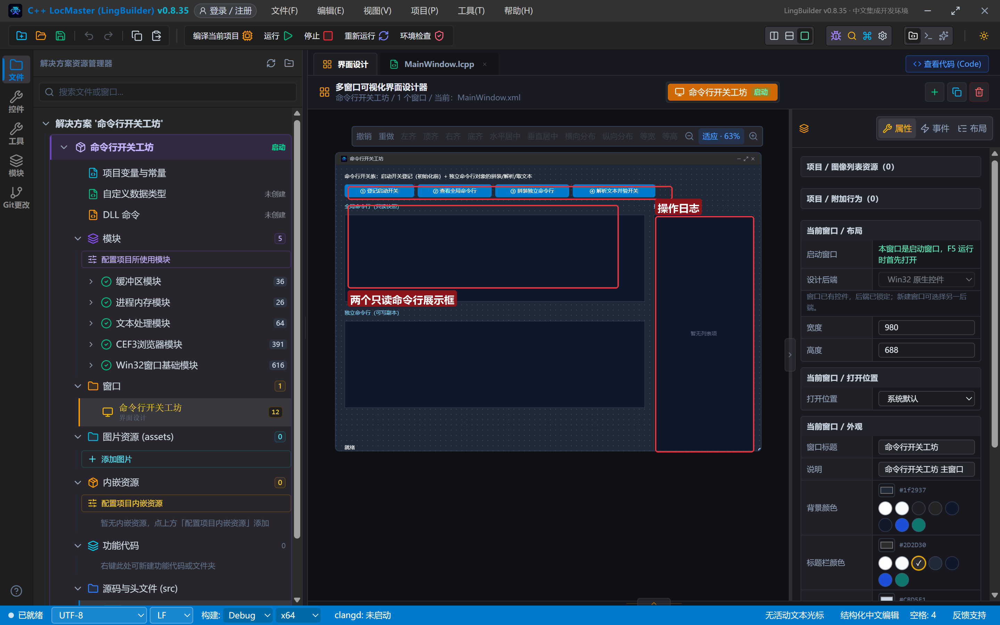
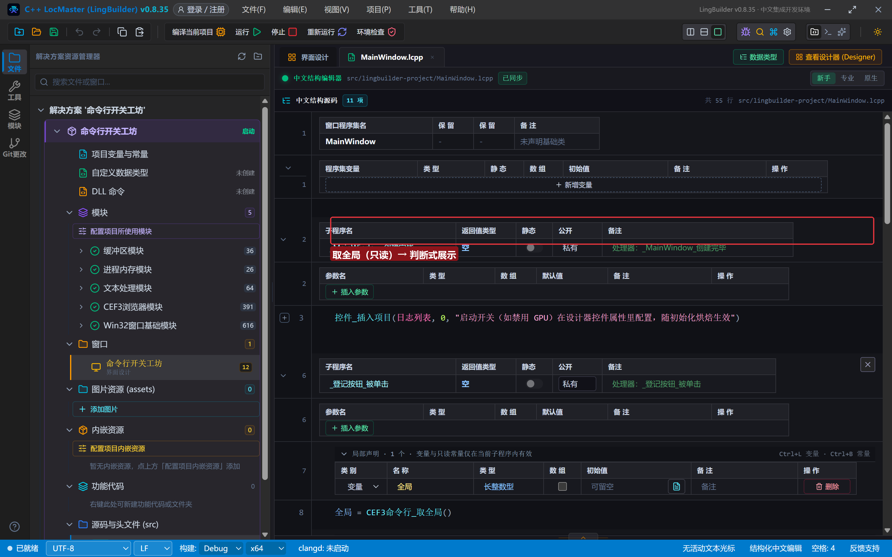
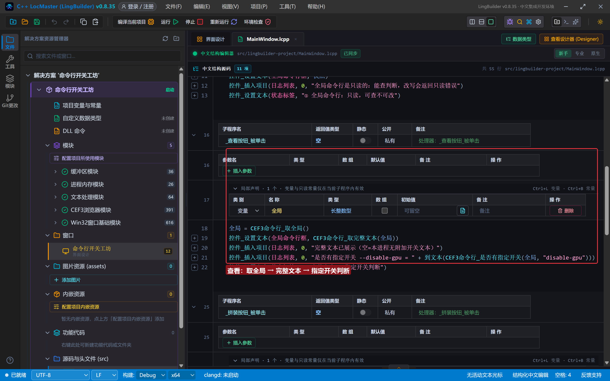
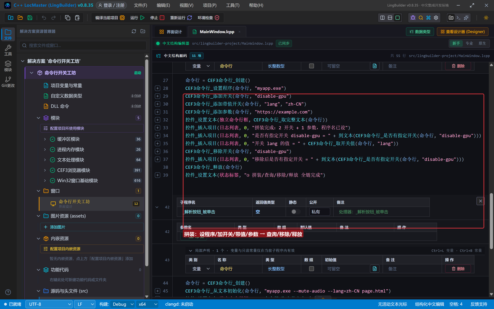
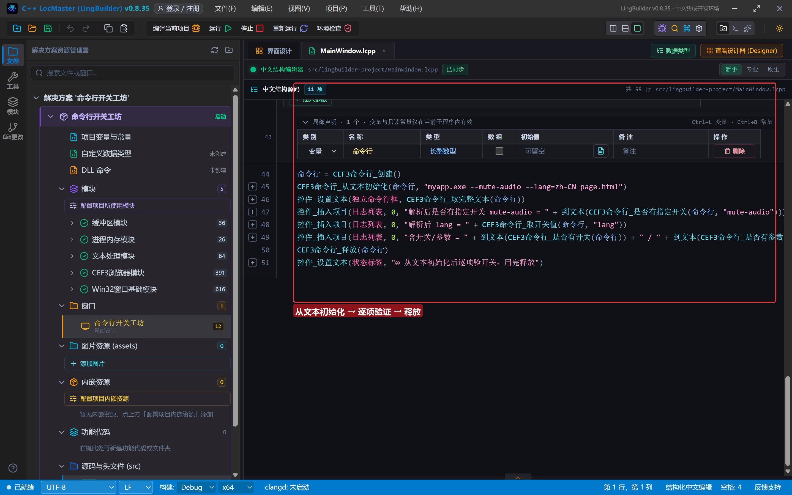
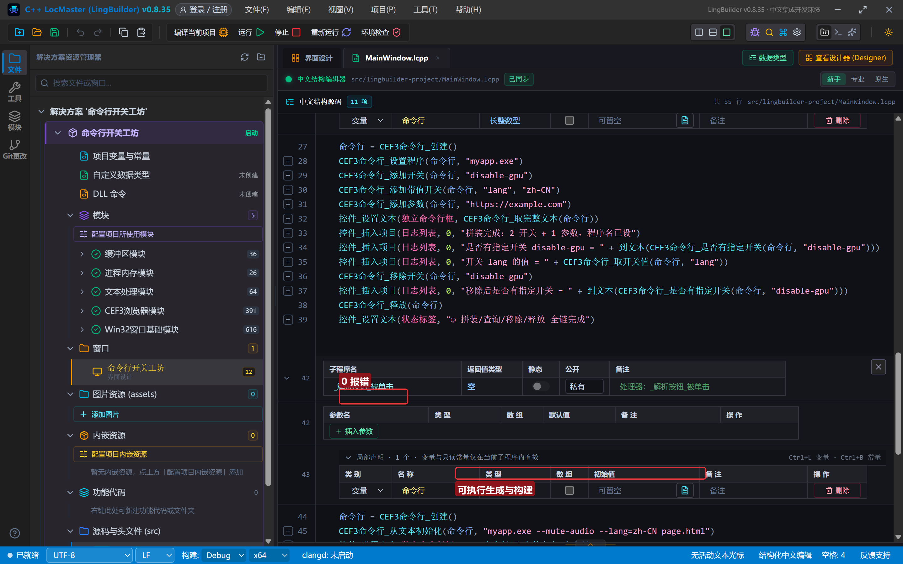
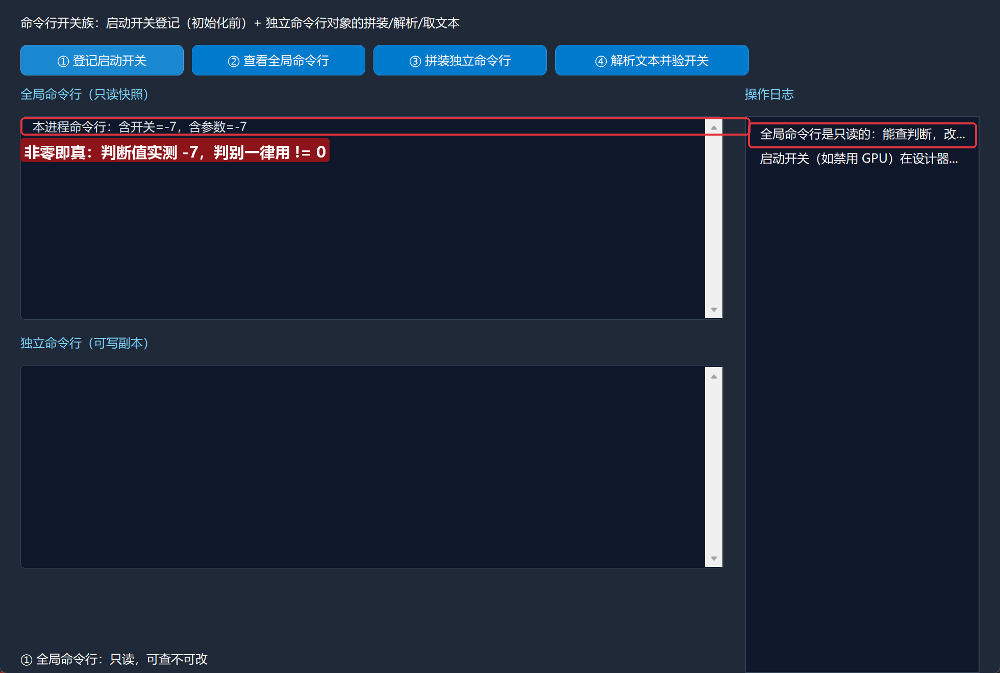
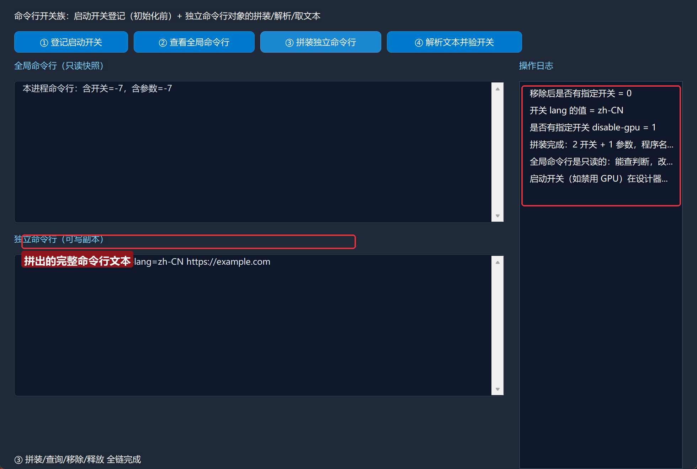
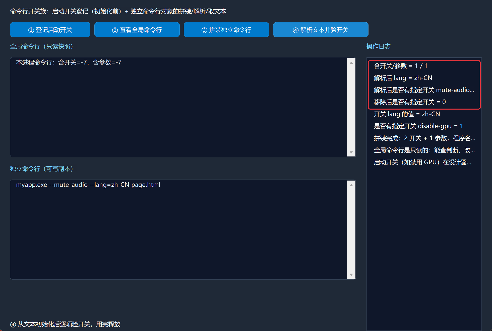

# CEF3 合集 23 · 命令行开关族：启动参数与行为调优

> 《LingBuilder CEF3 浏览器合集》第 23 集（CEF3 特色大族篇）。Chromium 的大量行为靠**命令行开关**调节——禁 GPU、禁远程字体、强制色彩配置……CEF3 把这条通道完整暴露出来：**进程级启动开关**随初始化烘焙生效；**独立命令行对象**则可以随意拼装、解析、查询，给多进程/子进程场景当"命令行模板"用。本集把这两层都跑通。全程约 30 分钟。
>
> **模块获取**：CEF3 浏览器模块**免费**；另需 **CEF3 平台工具模块**（命令行族在这里）。
>
> 前置要求：学过[第 1 集](/guide/tutorials/cef3-01)的模块启用。本集源码包见文末。

## 这一集你将学会

- `CEF3命令行_取全局()`：拿进程全局命令行的**只读**句柄
- `CEF3命令行_是否有开关(句柄)` / `CEF3命令行_是否有参数(句柄)`：判断含不含开关/位置参数
- `CEF3命令行_是否有指定开关(句柄, 开关名)` / `CEF3命令行_取开关值(句柄, 开关名)`：按名查询
- `CEF3命令行_创建()` → `设置程序` / `添加开关` / `添加带值开关` / `添加参数` → `取完整文本`：拼装一条完整命令行
- `CEF3命令行_从文本初始化(句柄, 文本)`：解析既有的命令行文本
- `CEF3命令行_移除开关` / `CEF3命令行_释放`：修改与回收

## 1. 命令一张表

| 命令 | 参数 | 返回 |
| --- | --- | --- |
| `CEF3命令行_取全局` | （无） | 长整数型（全局只读句柄） |
| `CEF3命令行_创建` | （无） | 长整数型（可写句柄） |
| `CEF3命令行_是否有开关` | 句柄 | 整数型（含开关与否） |
| `CEF3命令行_是否有参数` | 句柄 | 整数型（含位置参数与否） |
| `CEF3命令行_是否有指定开关` | 句柄, 开关名 | 整数型 |
| `CEF3命令行_取开关值` | 句柄, 开关名 | 文本型 |
| `CEF3命令行_添加开关` | 句柄, 开关名 | 整数型 |
| `CEF3命令行_添加带值开关` | 句柄, 开关名, 开关值 | 整数型 |
| `CEF3命令行_添加参数` | 句柄, 参数 | 整数型 |
| `CEF3命令行_移除开关` | 句柄, 开关名 | 整数型 |
| `CEF3命令行_设置程序` / `取程序` | 句柄[, 程序名] | 整数型 / 文本型 |
| `CEF3命令行_取完整文本` | 句柄 | 文本型 |
| `CEF3命令行_从文本初始化` | 句柄, 命令行文本 | 整数型 |
| `CEF3命令行_释放` | 句柄 | 整数型 |

三条**红线**先记住：

- **全局命令行是只读的**：能查询判断，所有"添加/移除"操作都会返回只读错误。要拼自己的命令行，用 `CEF3命令行_创建` 造可写副本。
- **判断类命令"非零即真"**：本机实测 `是否有开关` 返回 **-7** 这样的负数——受管桥的返回值不保证是 0/1，**判别一律写 `!= 0`**，千万别写 `== 1`。
- **启动开关必须在 CEF 初始化前生效**：想给本进程的 CEF 加启动开关（如禁 GPU），用设计器浏览器控件的启动开关属性（随初始化烘焙）；运行期才调用是来不及的。命令行族的价值在"查询"与"独立拼装"。

## 2. 设计界面

新建项目「命令行开关工坊」，窗口 980×688（客户区 980×660），四按钮 + 两个多行文本框 + 右侧日志：

| 控件 | 名称 | 显示内容/属性 | 左距 | 顶距 | 宽度 | 高度 |
| --- | --- | --- | --- | --- | --- | --- |
| 标签 | 说明标签 | 命令行开关族：启动开关登记（初始化前）+ 独立命令行对象的拼装/解析/取文本 | 20 | 14 | 740 | 22 |
| 按钮 | 登记按钮 | ① 登记启动开关 | 20 | 44 | 160 | 30 |
| 按钮 | 查看按钮 | ② 查看全局命令行 | 188 | 44 | 170 | 30 |
| 按钮 | 拼装按钮 | ③ 拼装独立命令行 | 366 | 44 | 170 | 30 |
| 按钮 | 解析按钮 | ④ 解析文本并验开关 | 544 | 44 | 190 | 30 |
| 标签 | 命令行标题 | 全局命令行（只读快照） | 20 | 84 | 400 | 22 |
| 多行编辑框 | 全局命令行框 | （空，多行） | 20 | 114 | 690 | 200 |
| 标签 | 独立标题 | 独立命令行（可写副本） | 20 | 328 | 400 | 22 |
| 多行编辑框 | 独立命令行框 | （空，多行） | 20 | 358 | 690 | 200 |
| 标签 | 日志标题 | 操作日志 | 730 | 84 | 230 | 22 |
| 列表框 | 日志列表 | （空） | 730 | 114 | 230 | 546 |
| 标签 | 状态标签 | 就绪 | 20 | 638 | 690 | 22 |



**模块面板**记得启用「CEF3 平台工具模块」——命令行族登记在它名下，只启用 CEF3 浏览器模块会报"未知的命令"。

## 3. 写代码

### 3.1 全局命令行：只读查询

```lcpp
事件 _登记按钮_被单击()
    局部 长整数型 全局
    全局 = CEF3命令行_取全局()
    局部 文本型 快照
    快照 = "本进程命令行：含开关=" + 到文本(CEF3命令行_是否有开关(全局)) + "，含参数=" + 到文本(CEF3命令行_是否有参数(全局))
    控件_设置文本(全局命令行框, 快照)
    控件_插入项目(日志列表, 0, "全局命令行是只读的：能查判断，改写会返回只读错误")
    控件_设置文本(状态标签, "① 全局命令行：只读，可查不可改")
结束
```

`取全局` 返回的句柄直接可查。运行后文本框显示 `含开关=-7`——**非零即真**的活教材。



### 3.2 查看完整文本 + 指定开关

```lcpp
事件 _查看按钮_被单击()
    局部 长整数型 全局
    全局 = CEF3命令行_取全局()
    控件_设置文本(全局命令行框, CEF3命令行_取完整文本(全局))
    控件_插入项目(日志列表, 0, "完整文本已展示（空=本进程无附加开关文本）")
    控件_插入项目(日志列表, 0, "是否有指定开关 --disable-gpu = " + 到文本(CEF3命令行_是否有指定开关(全局, "disable-gpu")))
    控件_设置文本(状态标签, "② 完整文本 + 指定开关判断")
结束
```



### 3.3 拼装独立命令行（本集核心）

```lcpp
事件 _拼装按钮_被单击()
    局部 长整数型 命令行
    命令行 = CEF3命令行_创建()
    CEF3命令行_设置程序(命令行, "myapp.exe")
    CEF3命令行_添加开关(命令行, "disable-gpu")
    CEF3命令行_添加带值开关(命令行, "lang", "zh-CN")
    CEF3命令行_添加参数(命令行, "https://example.com")
    控件_设置文本(独立命令行框, CEF3命令行_取完整文本(命令行))
    控件_插入项目(日志列表, 0, "是否有指定开关 disable-gpu = " + 到文本(CEF3命令行_是否有指定开关(命令行, "disable-gpu")))
    控件_插入项目(日志列表, 0, "开关 lang 的值 = " + CEF3命令行_取开关值(命令行, "lang"))
    CEF3命令行_移除开关(命令行, "disable-gpu")
    控件_插入项目(日志列表, 0, "移除后是否有指定开关 = " + 到文本(CEF3命令行_是否有指定开关(命令行, "disable-gpu")))
    CEF3命令行_释放(命令行)
    控件_设置文本(状态标签, "③ 拼装/查询/移除/释放 全链完成")
结束
```

流程：`创建` 造可写句柄 → 设程序名 → 加无值开关（`--disable-gpu`）→ 加带值开关（`--lang=zh-CN`）→ 加位置参数 → `取完整文本` 得到 `myapp.exe --disable-gpu --lang=zh-CN https://example.com`；再走一遍"查询→取值→移除→再查询"，验证修改生效；用完 `释放`。



### 3.4 解析既有命令行文本

```lcpp
事件 _解析按钮_被单击()
    局部 长整数型 命令行
    命令行 = CEF3命令行_创建()
    CEF3命令行_从文本初始化(命令行, "myapp.exe --mute-audio --lang=zh-CN page.html")
    控件_设置文本(独立命令行框, CEF3命令行_取完整文本(命令行))
    控件_插入项目(日志列表, 0, "解析后是否有指定开关 mute-audio = " + 到文本(CEF3命令行_是否有指定开关(命令行, "mute-audio")))
    控件_插入项目(日志列表, 0, "解析后 lang = " + CEF3命令行_取开关值(命令行, "lang"))
    控件_插入项目(日志列表, 0, "含开关/参数 = " + 到文本(CEF3命令行_是否有开关(命令行)) + " / " + 到文本(CEF3命令行_是否有参数(命令行)))
    CEF3命令行_释放(命令行)
    控件_设置文本(状态标签, "④ 从文本初始化后逐项验开关，用完释放")
结束
```

`从文本初始化` 按 Windows `GetCommandLineW` 格式解析整段文本——拿到别的程序的命令行字符串，一步拆成结构化的开关与参数。



## 4. 编译：先看错误列表

「错误列表」**(0)** 才继续：



## 5. 运行：四按钮全链

点「运行」：

- **① 登记启动开关** → 全局框显示判断快照，`-7` 即"非零即真"的实证：



- **③ 拼装独立命令行** → 独立框出现 `myapp.exe --disable-gpu --lang=zh-CN https://example.com`，日志依次报出"有 disable-gpu、lang=zh-CN、移除后没有了"：



- **④ 解析文本并验开关** → 解析 `--mute-audio --lang=zh-CN page.html`，逐项验证通过：



## 常见问题急救表

| 症状 | 原因 | 解法 |
| --- | --- | --- |
| 报"未知的命令 CEF3命令行_*" | 只启用了 CEF3 浏览器模块 | 启用「CEF3 平台工具模块」 |
| 判断结果不是 0/1 而是 -7 | 桥的整数返回"非零即真" | 判别写 `!= 0`；展示时直接 `到文本` 会露出原值 |
| 全局命令行加了开关没效果 | 全局对象只读，改写被拒 | 启动开关走设计器控件属性（初始化前生效）；独立对象才可写 |
| `取开关值` 返回空 | 该开关无值或不存在 | 无值开关用 `是否有指定开关` 判断；带值开关才有 `取开关值` |
| 从文本初始化后查不到开关 | 文本格式不是 Windows 命令行格式 | 按 `程序名 --开关[=值] 参数` 的 GetCommandLineW 格式给 |
| 句柄用完没释放 | 泄漏受管句柄 | `CEF3命令行_释放`；释放后再用会报明确错误 |

## 本集小结

- 命令行分两层：**全局（只读，能查不能改）** 与 **独立对象（可写，创建→拼装→查询→修改→释放）**。
- 判断类命令"非零即真"，判别一律 `!= 0`。
- 进程级启动开关必须在 CEF 初始化前生效（设计器控件属性/烘焙）；命令行族的核心价值是**查询**与**独立拼装/解析**。

## 源码包

本集完整源码已打包为 **CEF3合集23-命令行开关工坊.lcpppkg**（见[示例源码区](/demos)），导入即可运行对照学习。

**下一篇预告**：平台与环境族精选——跨域白名单等环境控制。

[回合集总览](/guide/tutorials/cef3)
