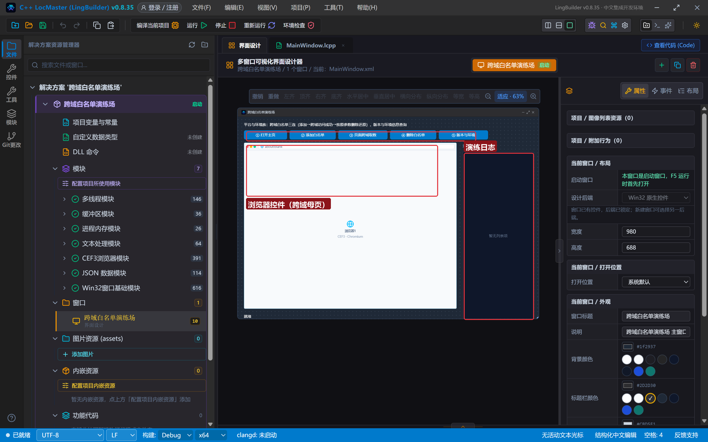
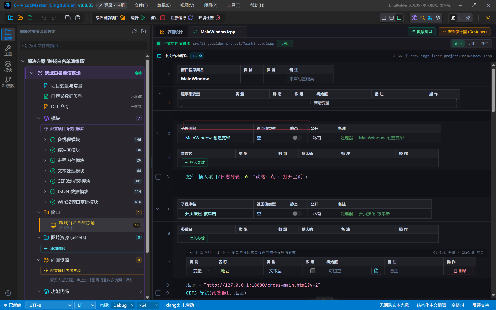
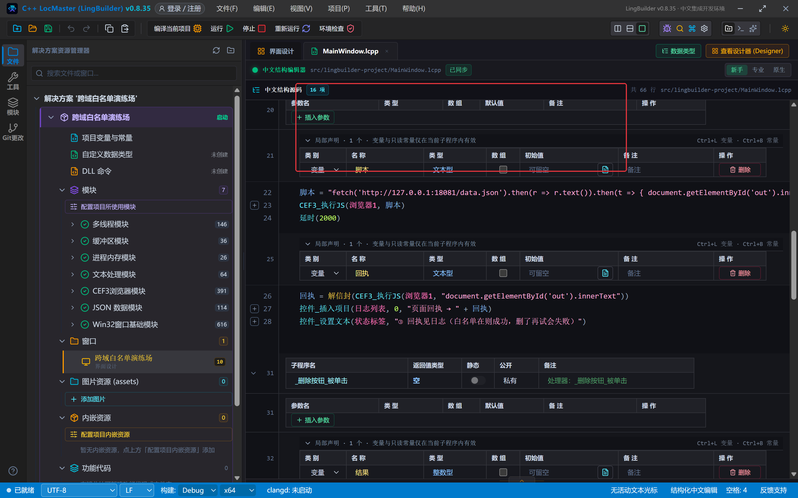
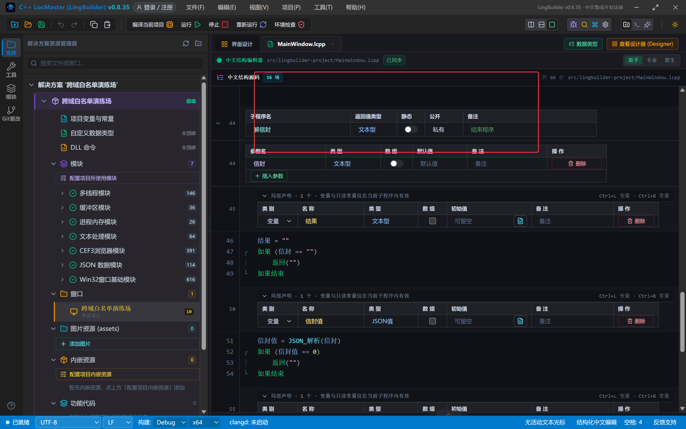
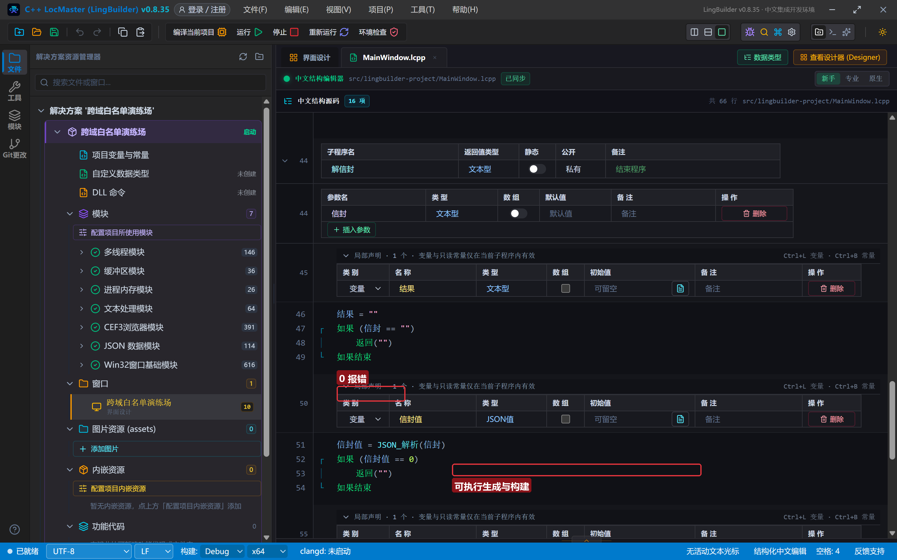
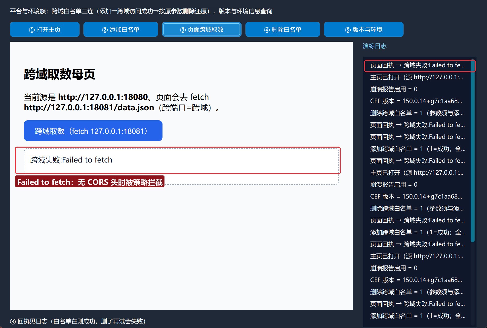
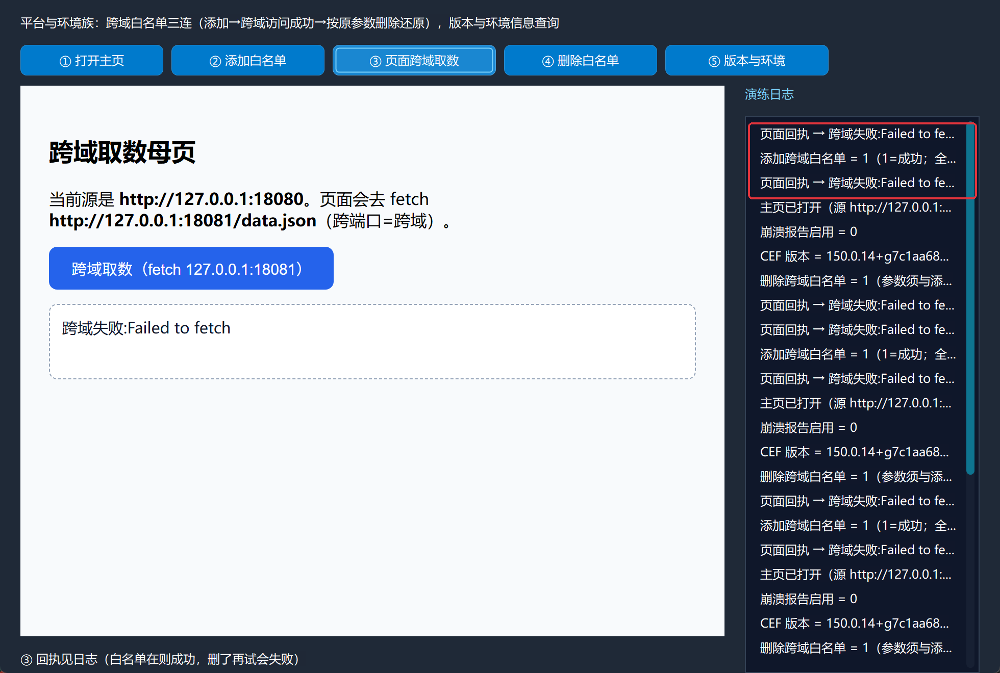
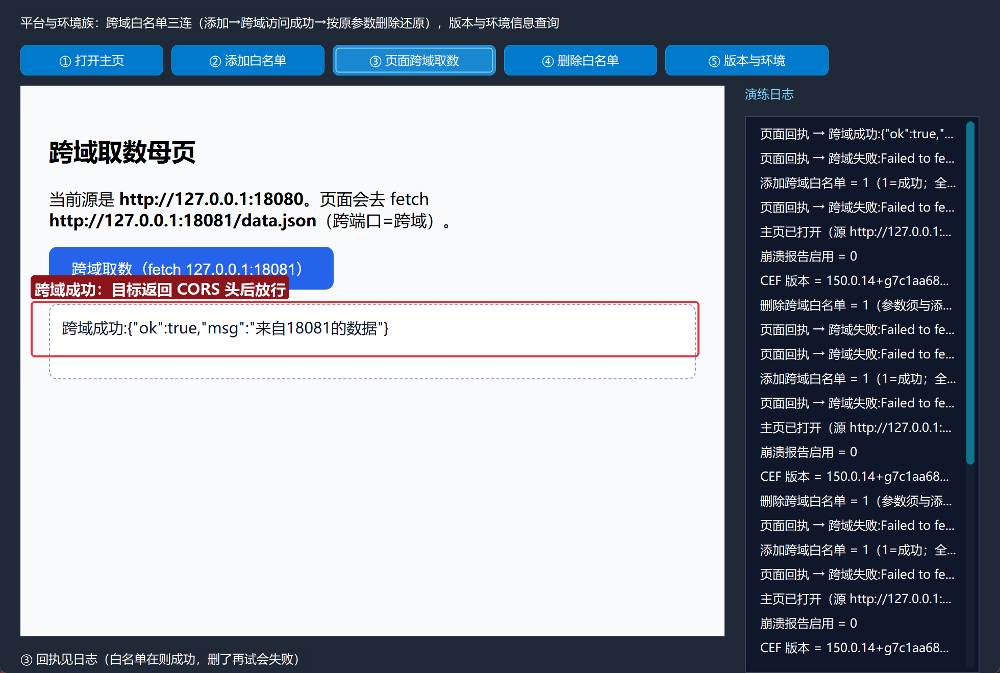
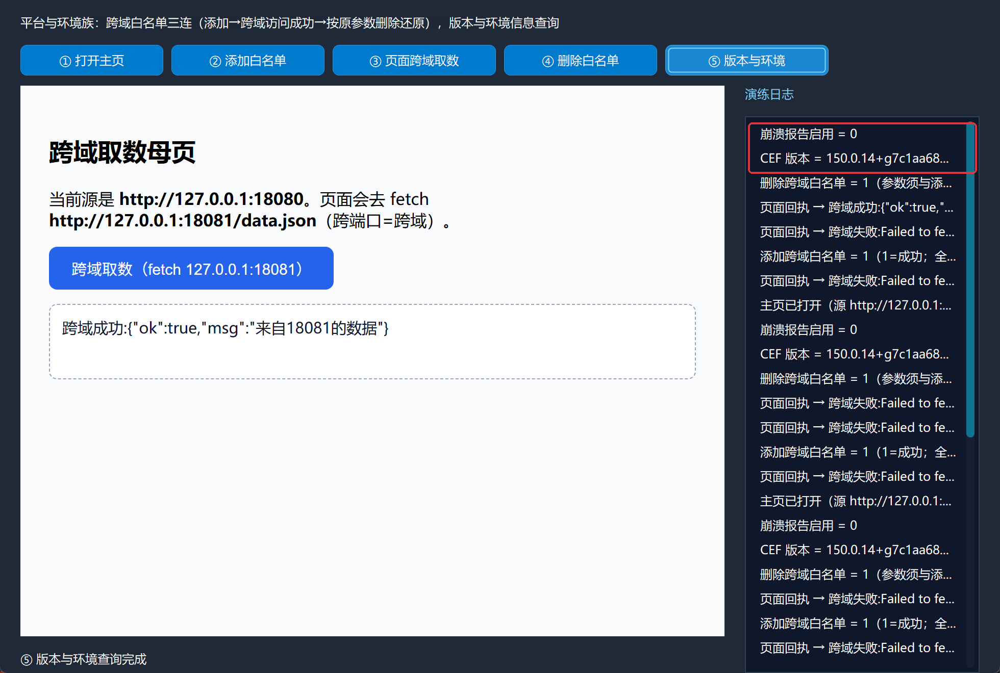

# CEF3 合集 24 · 平台与环境族：跨域白名单与环境查询（实测边界）

> 《LingBuilder CEF3 浏览器合集》第 24 集（CEF3 特色大族篇）。CEF3 平台与环境族有 50 多条命令，本集抓最常用的两块：**跨域白名单三连**（添加 → 跨域访问 → 按原参数删除）与 **版本/环境查询**。更重要的是本集的**实测边界结论**：跨域白名单命令返回成功，但**在现代 Chromium 网络服务下对页面 fetch 并不生效**——想让跨域取数真正成功，正解是目标服务器返回 CORS 头。两条路都演示，让你不再踩坑。全程约 30 分钟。
>
> **模块获取**：CEF3 浏览器模块**免费**；另需 **CEF3 平台工具模块**（跨域白名单/版本命令）、JSON 数据模块（解析执行JS信封）。
>
> 前置要求：学过[第 17 集](/guide/tutorials/cef3-17)的执行JS信封解析。本集源码包见文末。

## 这一集你将学会

- `CEF3平台_添加跨域白名单(源站点, 目标协议, 目标域名, 允许目标子域)`：登记放行规则（命令返回 1=成功）
- `CEF3平台_删除跨域白名单(...)`：**四个参数与添加时完全一致**才能删掉
- `CEF3平台_取版本()`：CEF/Chromium 版本文本
- `CEF3_是否启用崩溃报告()`：崩溃报告配置查询
- **跨域实测边界**：白名单是旧机制，现代网络服务不消费；正解 = 目标服务返回 `Access-Control-Allow-Origin` 头

## 1. 命令一张表

| 命令 | 参数 | 返回 |
| --- | --- | --- |
| `CEF3平台_添加跨域白名单` | 源站点, 目标协议, 目标域名, 允许目标子域（逻辑型） | 整数型（1=成功） |
| `CEF3平台_删除跨域白名单` | 与添加时**完全一致**的四个参数 | 整数型 |
| `CEF3平台_取版本` | （无） | 文本型 |
| `CEF3_是否启用崩溃报告` | （无） | 整数型 |

三条红线：

- **白名单是全局的**：影响进程内全部浏览器实例，且必须在浏览器已初始化后调用。
- **删除必须按原参数**：目标协议、域名、子域开关任一不一致，删除失败。
- **实测边界（CEF 150）**：`添加跨域白名单` 返回 1，但页面 `fetch` 跨域**依旧被拦**——现代 Chromium 网络服务的 CORS 检查在浏览器网络层，白名单机制已不被消费。**跨域取数的正解是目标服务器返回 CORS 头**（`Access-Control-Allow-Origin`）。

## 2. 设计界面与演示环境

新建项目「跨域白名单演练场」，窗口 980×688（客户区 980×660），五按钮 + 浏览器控件 + 日志：

| 控件 | 名称 | 显示内容/属性 | 左距 | 顶距 | 宽度 | 高度 |
| --- | --- | --- | --- | --- | --- | --- |
| 标签 | 说明标签 | 平台与环境族：跨域白名单三连 + 版本与环境信息查询 | 20 | 14 | 740 | 22 |
| 按钮 | 开页按钮 | ① 打开主页 | 20 | 44 | 140 | 30 |
| 按钮 | 添加按钮 | ② 添加白名单 | 168 | 44 | 150 | 30 |
| 按钮 | 访问按钮 | ③ 页面跨域取数 | 326 | 44 | 160 | 30 |
| 按钮 | 删除按钮 | ④ 删除白名单 | 494 | 44 | 150 | 30 |
| 按钮 | 版本按钮 | ⑤ 版本与环境 | 652 | 44 | 160 | 30 |
| **CEF3浏览器** | **浏览器1** | about:blank；勾选「禁用 GPU 加速」 | 20 | 84 | 690 | 540 |
| 标签 | 日志标题 | 演练日志 | 730 | 84 | 230 | 22 |
| 列表框 | 日志列表 | （空） | 730 | 114 | 230 | 546 |
| 标签 | 状态标签 | 就绪 | 20 | 638 | 690 | 22 |



**演示环境**（跨端口=跨域的真实场景）：

```text
127.0.0.1:18080  —— 母页 http 服务（assets/lingbuilder-project 目录）
127.0.0.1:18081  —— 数据服务（datasite 目录，data.json）
```

各起一个 `python -m http.server` 即可。母页里一个按钮执行 `fetch('http://127.0.0.1:18081/data.json')`，把结果写到页面黑板上。

## 3. 写代码

### 3.1 打开主页 + 白名单三连

```lcpp
事件 _开页按钮_被单击()
    局部 文本型 地址
    地址 = "http://127.0.0.1:18080/cross-main.html?v=2"
    CEF3_导航(浏览器1, 地址)
    控件_插入项目(日志列表, 0, "主页已打开（源 http://127.0.0.1:18080）")
结束

事件 _添加按钮_被单击()
    局部 整数型 结果
    结果 = CEF3平台_添加跨域白名单("http://127.0.0.1:18080", "http", "127.0.0.1", 真)
    控件_插入项目(日志列表, 0, "添加跨域白名单 = " + 到文本(结果) + "（1=成功；全局生效）")
    控件_设置文本(状态标签, "② 白名单已加：源 127.0.0.1:18080 → 目标 127.0.0.1")
结束

事件 _删除按钮_被单击()
    局部 整数型 结果
    结果 = CEF3平台_删除跨域白名单("http://127.0.0.1:18080", "http", "127.0.0.1", 真)
    控件_插入项目(日志列表, 0, "删除跨域白名单 = " + 到文本(结果) + "（参数须与添加时一致）")
    控件_设置文本(状态标签, "④ 已还原")
结束
```

注意两点：**允许目标子域是逻辑型**，写 `真`/`假`（写整数 1 会被实参类型门禁拦下）；导航地址带 `?v=2` 是防 CEF 磁盘缓存返回旧页面的小技巧。



### 3.2 页面跨域取数（执行JS 发 fetch）

```lcpp
事件 _访问按钮_被单击()
    局部 文本型 脚本
    脚本 = "fetch('http://127.0.0.1:18081/data.json').then(r => r.text()).then(t => { document.getElementById('out').innerText = '跨域成功:' + t; }).catch(e => { document.getElementById('out').innerText = '跨域失败:' + e.message; }); '启动'"
    CEF3_执行JS(浏览器1, 脚本)
    延时(2000)
    局部 文本型 回执
    回执 = 解信封(CEF3_执行JS(浏览器1, "document.getElementById('out').innerText"))
    控件_插入项目(日志列表, 0, "页面回执 → " + 回执)
    控件_设置文本(状态标签, "③ 回执见日志")
结束
```

两步走：先发一段"fetch + 把结果写进黑板"的脚本，等 2 秒，再读黑板内容。读回走第 17 集的 `解信封` 三步。



### 3.3 版本与环境查询

```lcpp
事件 _版本按钮_被单击()
    控件_插入项目(日志列表, 0, "CEF 版本 = " + CEF3平台_取版本())
    控件_插入项目(日志列表, 0, "崩溃报告启用 = " + 到文本(CEF3_是否启用崩溃报告()))
    控件_设置文本(状态标签, "⑤ 版本与环境查询完成")
结束
```



## 4. 编译：先看错误列表

「错误列表」**(0)** 才继续：



## 5. 运行：三条路全走一遍

点「运行」，按序体验（本集把 18081 数据服务在"无 CORS 头/有 CORS 头"两态间切换）：

- **① 打开主页**（源 http://127.0.0.1:18080）→ **③ 跨域取数**：目标无 CORS 头 → **Failed to fetch**：



- **② 添加白名单** → 返回 1（命令成功）；**③ 再取数** → **依旧失败**——CEF 150 的现代网络服务不消费白名单（实测边界）：



- 把 18081 换成**带 `Access-Control-Allow-Origin: *` 头**的数据服务，**③ 再取数** → **跨域成功**，黑板上拿到 `{"ok":true,"msg":"来自18081的数据"}`：



- **④ 删除白名单**（按原参数）→ ⑤ **版本与环境**：CEF 版本 150.0.14、崩溃报告状态：



## 常见问题急救表

| 症状 | 原因 | 解法 |
| --- | --- | --- |
| 白名单加了 fetch 仍失败 | 现代 Chromium 网络服务不消费跨域白名单（实测 CEF 150） | **目标服务返回 CORS 头**；或数据经 C++ 层代理请求 |
| 删除白名单返回 0 | 参数与添加时不一致 | 四个参数逐字对齐（含子域开关的 真/假） |
| 逻辑型参数写 1 报类型错 | 实参类型门禁 | 写 `真` / `假` |
| 页面改了却加载旧内容 | CEF 磁盘缓存命中同 URL | 导航地址加 `?v=2` 之类的 cache-bust 参数 |
| fetch 显示 Failed to fetch | 可能是 CORS 拦截，也可能是目标不可达 | 先确认目标主机可达（浏览器直接开），再查 CORS 头 |
| 解信封拿到空 | 执行JS 无返回或信封异常 | 第 17 集急救表；黑板读取前先 `延时` 等网络完成 |

## 本集小结

- 跨域白名单三连：添加（1=成功）→ 访问 → 按原参数删除；命令面完整可用。
- **实测边界**：CEF 150 现代网络服务下白名单对页面 fetch 不生效；跨域放行的正解是**目标服务返回 CORS 头**。
- 版本与环境查询一行一个：`CEF3平台_取版本`、`CEF3_是否启用崩溃报告`。

## 源码包

本集完整源码已打包为 **CEF3合集24-跨域白名单演练场.lcpppkg**（见[示例源码区](/demos)），导入即可运行对照学习（演示需自起 18080/18081 两个本地 http 服务）。

**下一篇预告**：值/字典/列表——CEF3 数据结构三件套，受管句柄的创建、读写与释放。

[回合集总览](/guide/tutorials/cef3)
