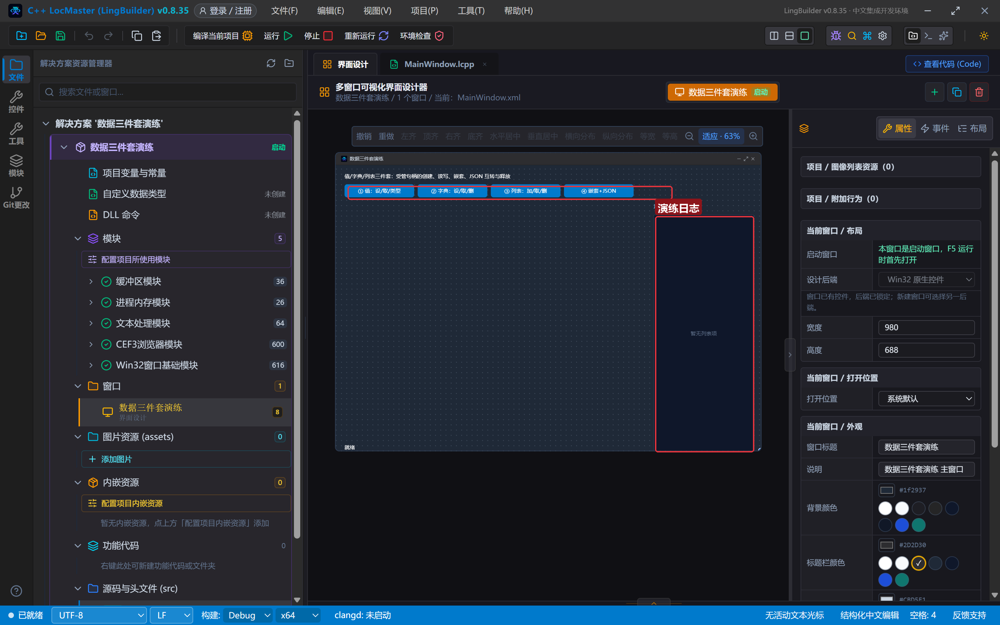
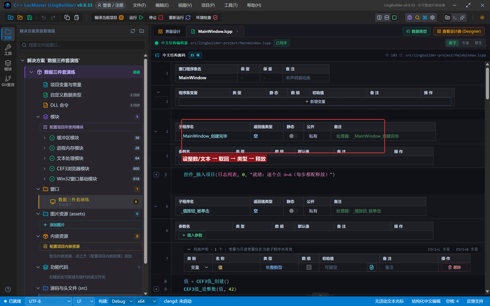
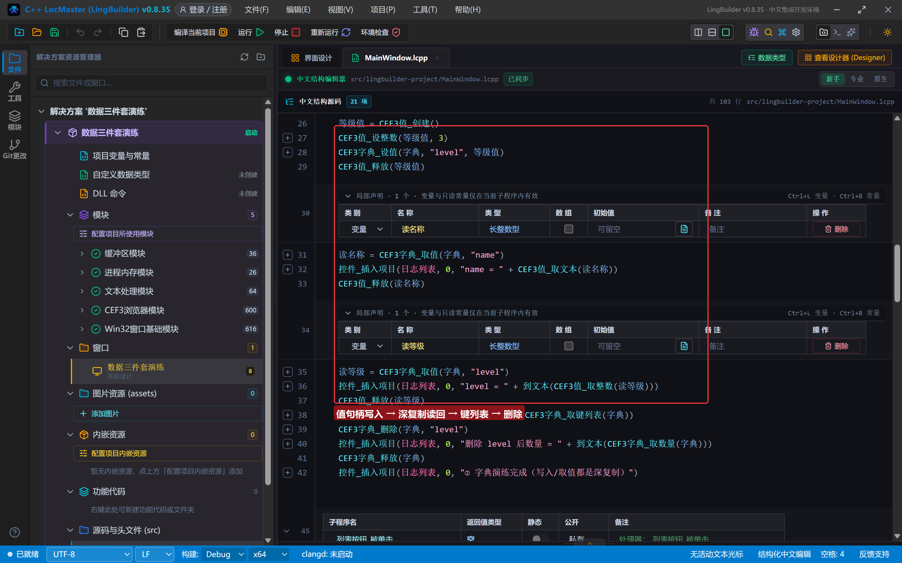
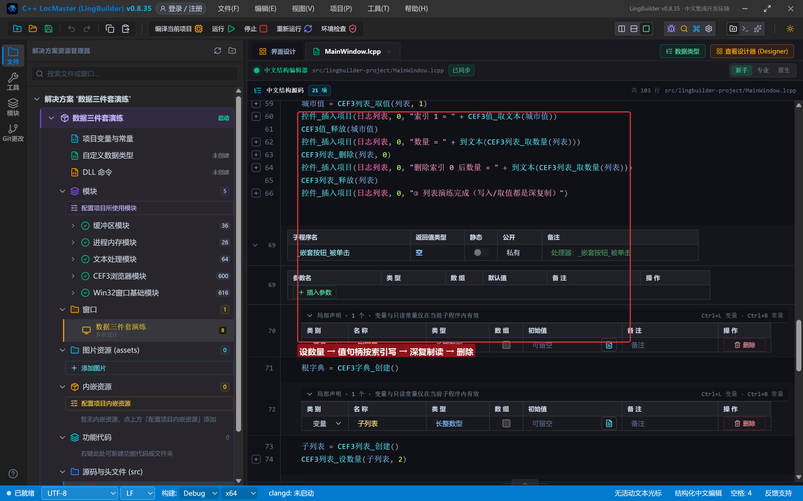
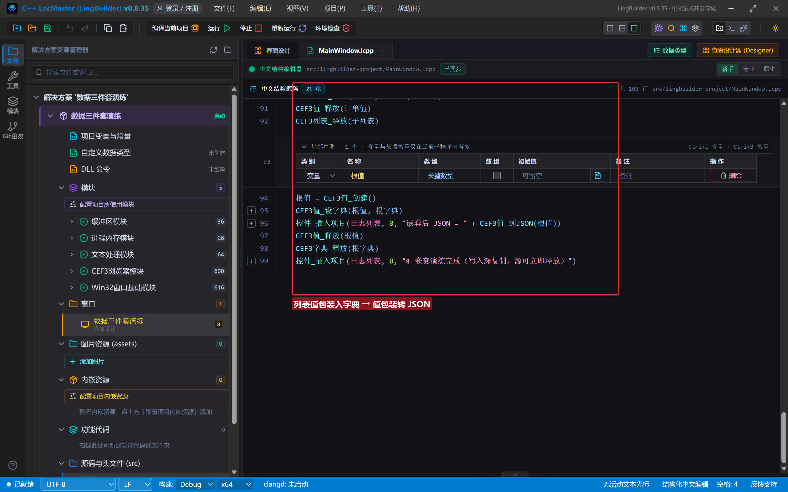
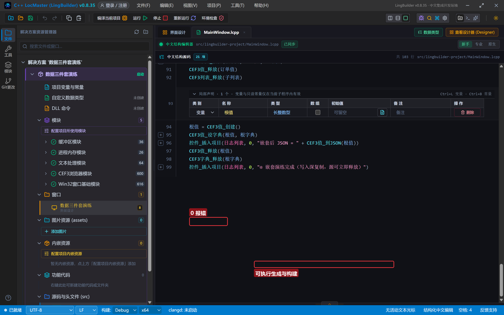
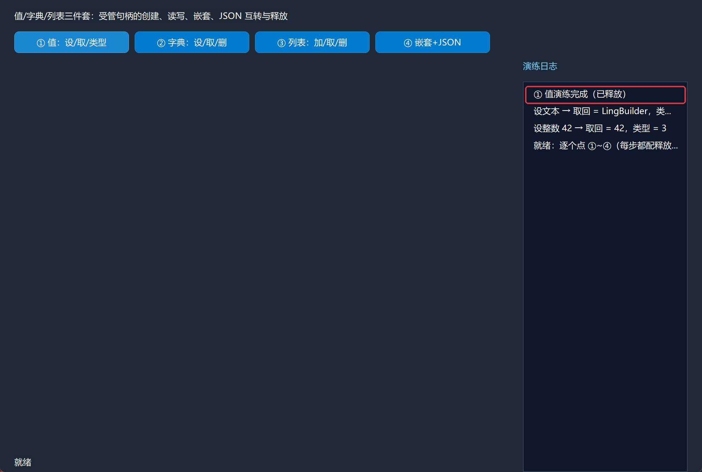
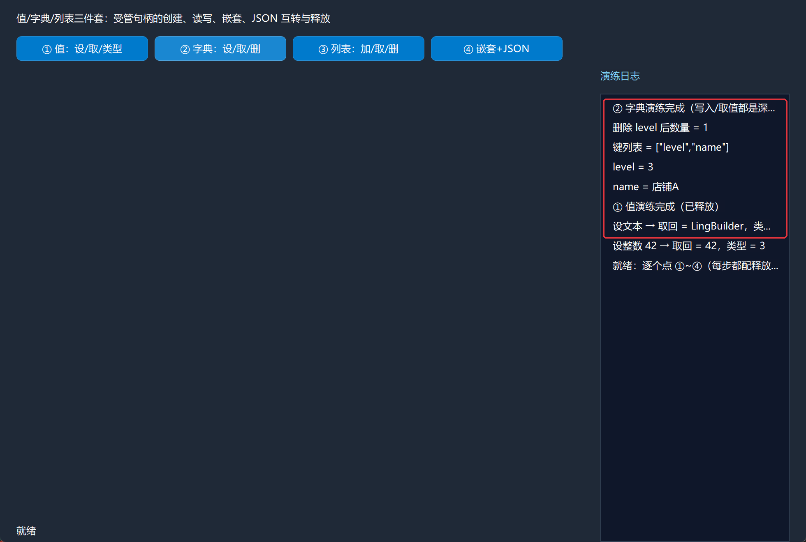
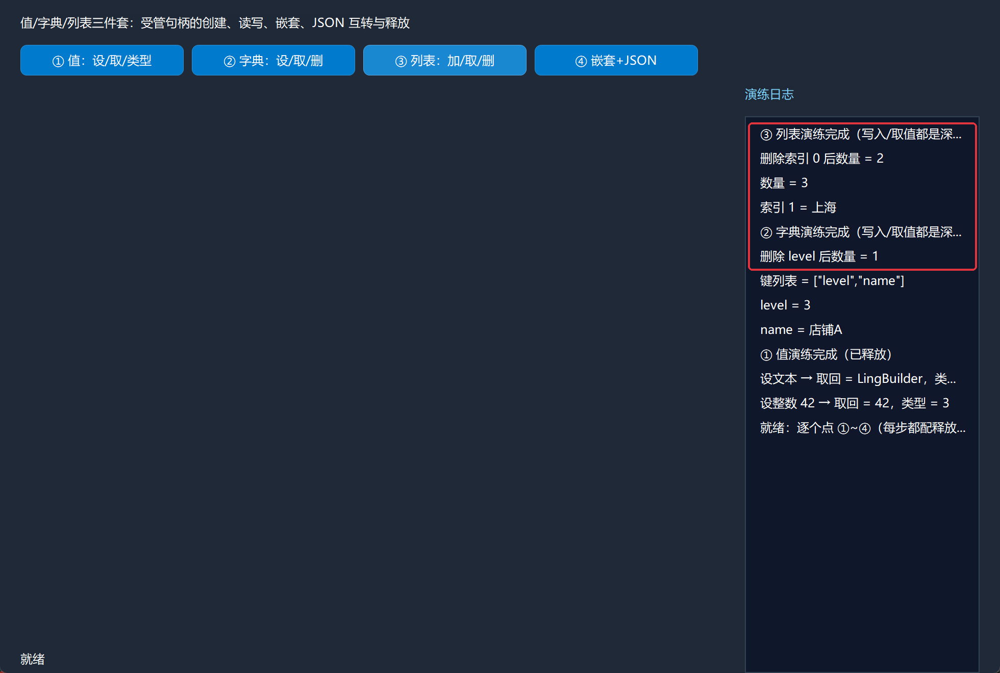
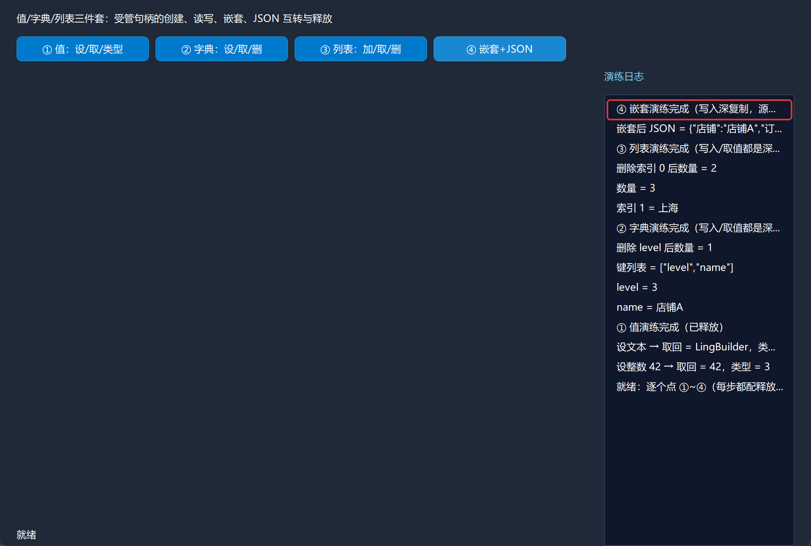

# CEF3 合集 25 · 值/字典/列表：CEF3 数据结构三件套

> 《LingBuilder CEF3 浏览器合集》第 25 集（数据与传输篇）。CEF 的数据在进程间传递靠三件受管容器：**CEF3值**（万能标量/容器包装）、**CEF3字典**（键值表）、**CEF3列表**（数组）。三件套的共同心法只有一句话：**一切都是值句柄，写入是深复制，读出也是深复制，用完必须释放**。本集在四个按钮里把增删改查、嵌套与 JSON 互转全部跑通。全程约 30 分钟。
>
> **模块获取**：CEF3 浏览器模块**免费**；另需 **CEF3 受管对象模块**（三件套登记在它名下）。
>
> 前置要求：无（本集是数据篇起点）。本集源码包见文末。

## 这一集你将学会

- `CEF3值_创建` → `设整数/设文本/设字典/设列表` → `取整数/取文本` → `取类型` → `到JSON` → `释放`
- `CEF3字典_创建` → `设值(键, 值句柄)` → `取值(键)` → `取键列表` → `删除` → `取数量` → `释放`
- `CEF3列表_创建` → `设数量` → `设值(索引, 值句柄)` → `取值(索引)` → `删除` → `释放`
- **深复制语义**：写入时容器复制一份值（源句柄可立即释放）；读出时返回独立副本（要用完释放）

## 1. 命令一张表

| 命令 | 参数 | 返回 |
| --- | --- | --- |
| `CEF3值_创建` | （无） | 长整数型（值句柄） |
| `CEF3值_设整数 / 设文本 / 设字典 / 设列表` | 值句柄[, 数据] | 整数型 |
| `CEF3值_取整数 / 取文本` | 值句柄 | 长整数型 / 文本型 |
| `CEF3值_取类型` | 值句柄 | 整数型（类型枚举） |
| `CEF3值_到JSON` | 值句柄 | 文本型 |
| `CEF3值_释放` | 值句柄 | 整数型 |
| `CEF3字典_创建 / 设值 / 取值 / 取键列表 / 删除 / 取数量 / 释放` | 见代码 | 见代码 |
| `CEF3列表_创建 / 设数量 / 设值 / 取值 / 删除 / 取数量 / 释放` | 见代码 | 见代码 |

三条**心法**先背下来：

- **字典/列表的"设值"第三参是值句柄**，不是裸文本/数字——先 `CEF3值_创建` 填好再传入（写整数 3、写"店铺A" 都会被实参类型门禁拦下）。
- **写入/读出都是深复制**：`设值` 之后源值句柄立刻可释放；`取值` 拿到的是独立副本，用完也要释放。一个容器演练下来释放次数比创建还多，是正常现象。
- **到JSON 只收值句柄**：想序列化字典/列表，先用 `CEF3值_设字典/设列表` 包装成值再调。

## 2. 设计界面

新建项目「数据三件套演练」，窗口 980×688（客户区 980×660），四按钮 + 右侧日志：

| 控件 | 名称 | 显示内容/属性 | 左距 | 顶距 | 宽度 | 高度 |
| --- | --- | --- | --- | --- | --- | --- |
| 标签 | 说明标签 | 值/字典/列表三件套：受管句柄的创建、读写、嵌套、JSON 互转与释放 | 20 | 14 | 740 | 22 |
| 按钮 | 值按钮 | ① 值：设/取/类型 | 20 | 44 | 160 | 30 |
| 按钮 | 字典按钮 | ② 字典：设/取/删 | 188 | 44 | 160 | 30 |
| 按钮 | 列表按钮 | ③ 列表：加/取/删 | 356 | 44 | 160 | 30 |
| 按钮 | 嵌套按钮 | ④ 嵌套+JSON | 524 | 44 | 160 | 30 |
| 标签 | 日志标题 | 演练日志 | 730 | 84 | 230 | 22 |
| 列表框 | 日志列表 | （空） | 730 | 114 | 230 | 546 |
| 标签 | 状态标签 | 就绪 | 20 | 638 | 690 | 22 |



模块面板确认启用：CEF3 浏览器模块 + **CEF3 受管对象模块**。

## 3. 写代码

### 3.1 值：设 → 取 → 类型

```lcpp
事件 _值按钮_被单击()
    局部 长整数型 值
    值 = CEF3值_创建()
    CEF3值_设整数(值, 42)
    控件_插入项目(日志列表, 0, "设整数 42 → 取回 = " + 到文本(CEF3值_取整数(值)) + "，类型 = " + 到文本(CEF3值_取类型(值)))
    CEF3值_设文本(值, "LingBuilder")
    控件_插入项目(日志列表, 0, "设文本 → 取回 = " + CEF3值_取文本(值) + "，类型 = " + 到文本(CEF3值_取类型(值)))
    CEF3值_释放(值)
    控件_插入项目(日志列表, 0, "① 值演练完成（已释放）")
结束
```

同一个值句柄先装整数再装文本——值是"可变类型容器"，`取类型` 会跟着变（整数与文本的类型枚举不同）。



### 3.2 字典：值句柄写入 → 深复制读回

```lcpp
事件 _字典按钮_被单击()
    局部 长整数型 字典
    字典 = CEF3字典_创建()
    局部 长整数型 名称值
    名称值 = CEF3值_创建()
    CEF3值_设文本(名称值, "店铺A")
    CEF3字典_设值(字典, "name", 名称值)
    CEF3值_释放(名称值)
    局部 长整数型 等级值
    等级值 = CEF3值_创建()
    CEF3值_设整数(等级值, 3)
    CEF3字典_设值(字典, "level", 等级值)
    CEF3值_释放(等级值)
    局部 长整数型 读名称
    读名称 = CEF3字典_取值(字典, "name")
    控件_插入项目(日志列表, 0, "name = " + CEF3值_取文本(读名称))
    CEF3值_释放(读名称)
    局部 长整数型 读等级
    读等级 = CEF3字典_取值(字典, "level")
    控件_插入项目(日志列表, 0, "level = " + 到文本(CEF3值_取整数(读等级)))
    CEF3值_释放(读等级)
    控件_插入项目(日志列表, 0, "键列表 = " + CEF3字典_取键列表(字典))
    CEF3字典_删除(字典, "level")
    控件_插入项目(日志列表, 0, "删除 level 后数量 = " + 到文本(CEF3字典_取数量(字典)))
    CEF3字典_释放(字典)
    控件_插入项目(日志列表, 0, "② 字典演练完成（写入/取值都是深复制）")
结束
```

数一数释放：写了 2 次（源值各一次）、读了 2 次（副本各一次）、容器 1 次——**每次取值都是新的句柄**，漏一次就泄漏。



### 3.3 列表：按索引写读

```lcpp
事件 _列表按钮_被单击()
    局部 长整数型 列表
    列表 = CEF3列表_创建()
    CEF3列表_设数量(列表, 3)
    局部 长整数型 城市
    城市 = CEF3值_创建()
    CEF3值_设文本(城市, "北京")
    CEF3列表_设值(列表, 0, 城市)
    CEF3值_设文本(城市, "上海")
    CEF3列表_设值(列表, 1, 城市)
    CEF3值_设文本(城市, "深圳")
    CEF3列表_设值(列表, 2, 城市)
    CEF3值_释放(城市)
    局部 长整数型 城市值
    城市值 = CEF3列表_取值(列表, 1)
    控件_插入项目(日志列表, 0, "索引 1 = " + CEF3值_取文本(城市值))
    CEF3值_释放(城市值)
    控件_插入项目(日志列表, 0, "数量 = " + 到文本(CEF3列表_取数量(列表)))
    CEF3列表_删除(列表, 0)
    控件_插入项目(日志列表, 0, "删除索引 0 后数量 = " + 到文本(CEF3列表_取数量(列表)))
    CEF3列表_释放(列表)
    控件_插入项目(日志列表, 0, "③ 列表演练完成（写入/取值都是深复制）")
结束
```

技巧：**一个值句柄反复改内容、多次写入**——因为写入是深复制，容器里存的是每次的快照，源句柄复用完全安全（省两次创建/释放）。



### 3.4 嵌套 + JSON（本集压轴）

```lcpp
事件 _嵌套按钮_被单击()
    局部 长整数型 根字典
    根字典 = CEF3字典_创建()
    局部 长整数型 子列表
    子列表 = CEF3列表_创建()
    CEF3列表_设数量(子列表, 2)
    局部 长整数型 单号
    单号 = CEF3值_创建()
    CEF3值_设文本(单号, "订单001")
    CEF3列表_设值(子列表, 0, 单号)
    CEF3值_设文本(单号, "订单002")
    CEF3列表_设值(子列表, 1, 单号)
    CEF3值_释放(单号)
    局部 长整数型 店铺值
    店铺值 = CEF3值_创建()
    CEF3值_设文本(店铺值, "店铺A")
    CEF3字典_设值(根字典, "店铺", 店铺值)
    CEF3值_释放(店铺值)
    局部 长整数型 订单值
    订单值 = CEF3值_创建()
    CEF3值_设列表(订单值, 子列表)
    CEF3字典_设值(根字典, "订单", 订单值)
    CEF3值_释放(订单值)
    CEF3列表_释放(子列表)
    局部 长整数型 根值
    根值 = CEF3值_创建()
    CEF3值_设字典(根值, 根字典)
    控件_插入项目(日志列表, 0, "嵌套后 JSON = " + CEF3值_到JSON(根值))
    CEF3值_释放(根值)
    CEF3字典_释放(根字典)
    控件_插入项目(日志列表, 0, "④ 嵌套演练完成（写入深复制，源可立即释放）")
结束
```

嵌套的两条包装规则：**列表放进字典**要 `CEF3值_设列表(值, 列表)` 包装；**字典转 JSON** 要 `CEF3值_设字典(值, 字典)` 包装——`到JSON` 只认值句柄。写入后子容器句柄立刻释放（深复制已落库）。



## 4. 编译：先看错误列表

「错误列表」**(0)** 才继续：



## 5. 运行：四步全绿

点「运行」，依次点四个按钮：

- **① 值** → `设整数 42 → 取回 = 42，类型 = 3`；`设文本 → 取回 = LingBuilder`：



- **② 字典** → `name = 店铺A`、`level = 3`、键列表 `["level","name"]`、删除后数量 1：



- **③ 列表** → `索引 1 = 上海`、数量 3 → 删除后 2：



- **④ 嵌套+JSON** → `嵌套后 JSON = {"店铺":"店铺A","订单":["订单001","订单002"]}`：



## 常见问题急救表

| 症状 | 原因 | 解法 |
| --- | --- | --- |
| 设值报类型不符 | 第三参要求值句柄，传了裸文本/数字 | 先 `CEF3值_创建` + `设文本/设整数` 再传入 |
| `到JSON` 返回空 | 传了字典/列表句柄，它只收值句柄 | `CEF3值_设字典/设列表` 包装后再调 |
| 容器里少了刚写的数据 | 写入前源值没填内容 | 先设文本/整数，再 `设值`（顺序不能反） |
| 程序慢慢吃内存 | 取值的副本没释放 | 每次取值配一次释放；写入的源值也释放 |
| `取类型` 返回值看不懂 | 类型枚举 | 空类型返回 0、整数返回 3、文本返回 4（本集实测）|
| 列表设值越界 | 索引超出 `设数量` 范围 | 先 `设数量` 再按索引写 |
| 嵌套后子容器读不出 | 直接把子容器句柄当值传入 | `CEF3值_设列表/设字典` 包装 |

## 本集小结

- 三件套一个心法：**一切都是值句柄；写入/读出都是深复制；用完释放**。
- 字典按键、列表按索引；键列表是 JSON 数组文本，可直接展示或交给 JSON 模块。
- 嵌套与序列化的包装规则：`值_设列表/设字典` 上行包装，`到JSON` 下行导出。

## 源码包

本集完整源码已打包为 **CEF3合集25-数据三件套演练.lcpppkg**（见[示例源码区](/demos)），导入即可运行对照学习。

**下一篇预告**：传输读写流（一）——写入流：把内存数据写进受管流。

[回合集总览](/guide/tutorials/cef3)
