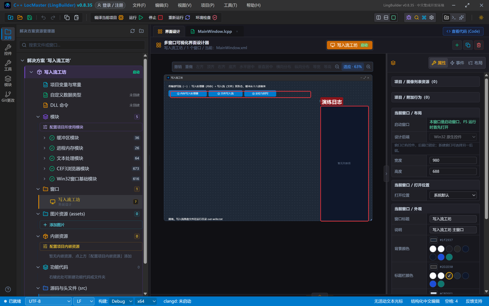
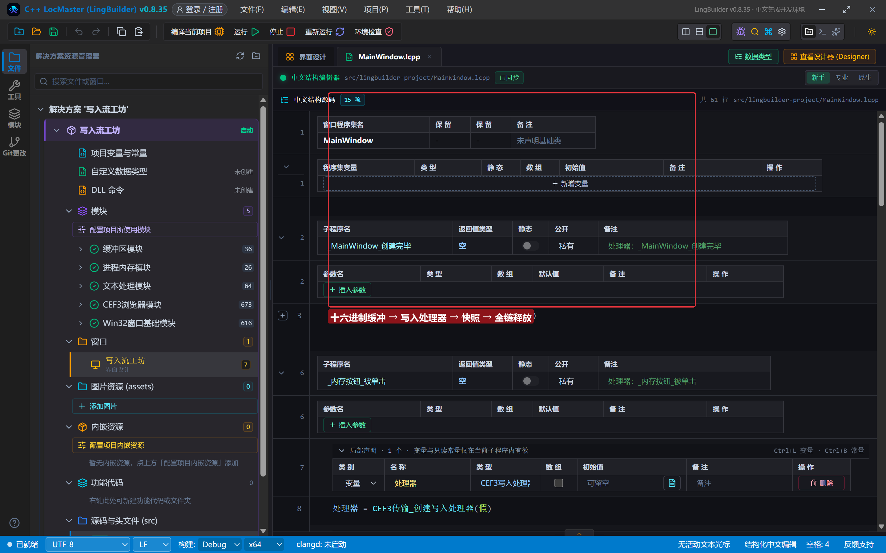
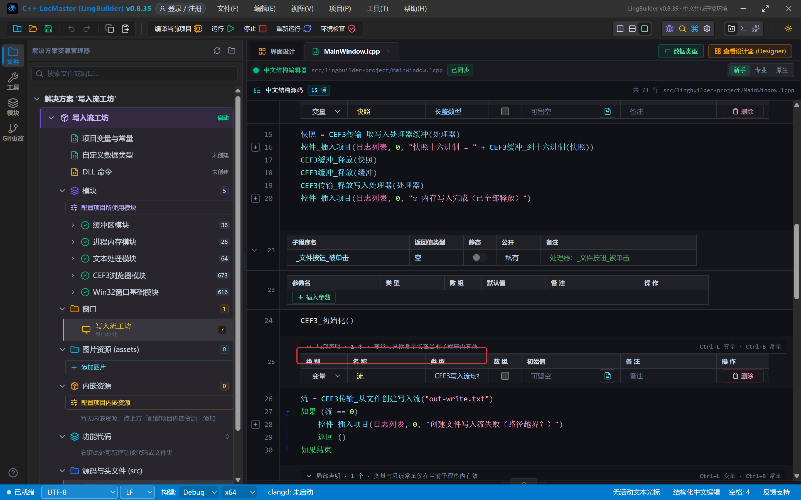
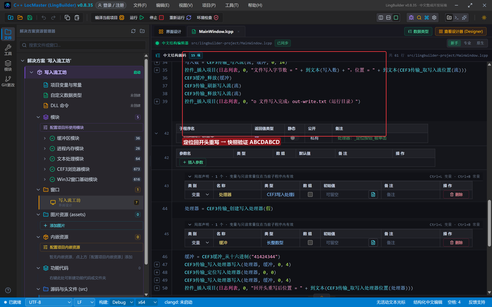
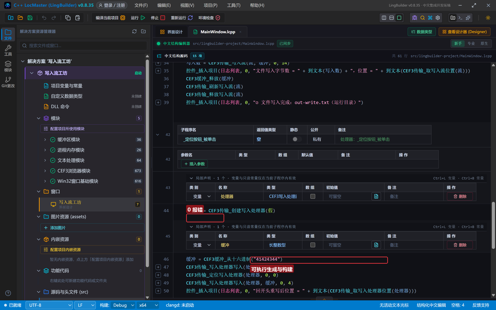
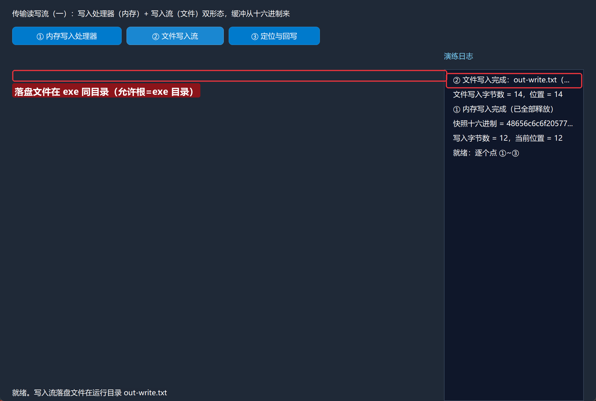
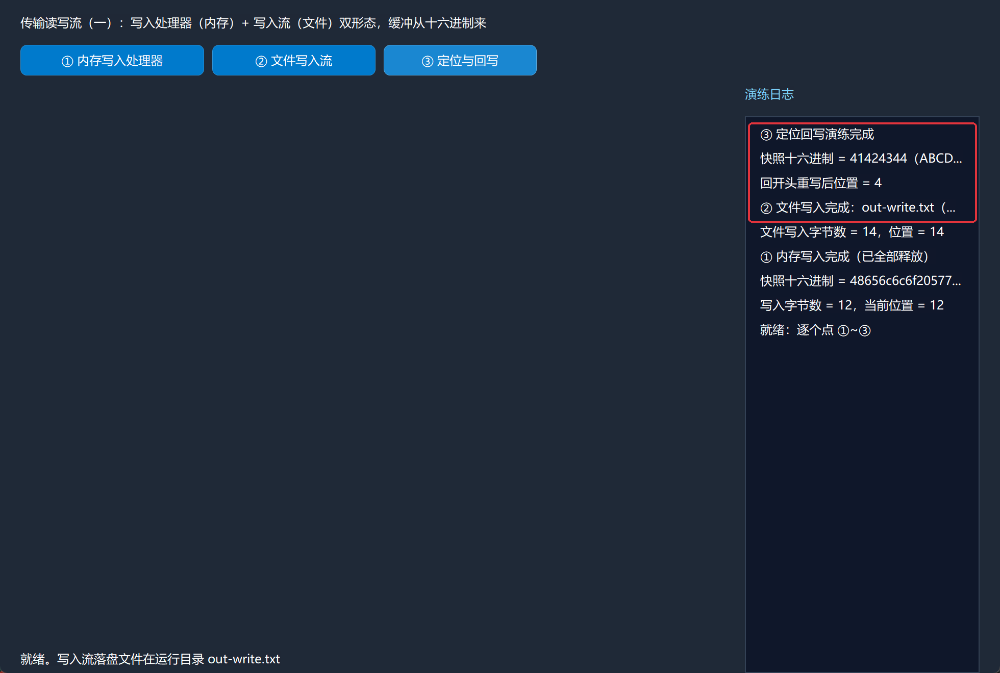

# CEF3 合集 26 · 传输读写流（一）：写入流（写入处理器 + 文件流）

> 《LingBuilder CEF3 浏览器合集》第 26 集（数据与传输篇）。CEF 下载/上传/自定义协议都要"流"：**写入处理器**（内存流，数据落在受管内存里随时快照）和**写入流**（文件流，直接落盘）。本集把两种形态都跑通，顺带讲清最关键的一条红线：**文件流的允许根 = exe 所在目录，且无浏览器控件的项目要先调 CEF3_初始化**。全程约 30 分钟。
>
> **模块获取**：CEF3 浏览器模块**免费**；另需 **CEF3 受管对象模块**（缓冲族）与 **CEF3 传输模块**（读写流族）。
>
> 前置要求：学过[第 25 集](/guide/tutorials/cef3-25)的受管句柄纪律。本集源码包见文末。

## 这一集你将学会

- `CEF3传输_创建写入处理器(可能阻塞)`：内存写入流（64MiB 容量上限）
- `CEF3缓冲_从十六进制(文本)`：造测试数据最省事的方式
- `CEF3传输_写入处理器写入(句柄, 缓冲, 起始偏移, 字节数)` / `取写入处理器缓冲` / `取写入处理器位置`
- `CEF3传输_从文件创建写入流(路径)` / `CEF3传输_写入流` / `刷新写入流` / `释放写入流`：文件落盘三件套
- `CEF3传输_定位写入处理器(句柄, 偏移, 基准)`：回开头重写

## 1. 命令一张表

| 命令 | 参数 | 返回 |
| --- | --- | --- |
| `CEF3传输_创建写入处理器` | 可能阻塞（逻辑型） | CEF3写入处理器句柄 |
| `CEF3传输_写入处理器写入` | 句柄, 缓冲句柄, 起始偏移, 写入字节数 | 长整数型（实际写入；负数=错误码） |
| `CEF3传输_取写入处理器缓冲` | 句柄 | 长整数型（快照缓冲，需释放） |
| `CEF3传输_取写入处理器位置` | 句柄 | 长整数型 |
| `CEF3传输_定位写入处理器` | 句柄, 偏移量, 基准(0开头/1当前/2结尾) | 整数型 |
| `CEF3传输_释放写入处理器` | 句柄 | 整数型 |
| `CEF3传输_从文件创建写入流` | 路径 | CEF3写入流句柄 |
| `CEF3传输_写入流` | 句柄, 缓冲句柄, 起始偏移, 写入字节数 | 长整数型 |
| `CEF3传输_刷新写入流` / `释放写入流` | 句柄 | 整数型 |
| `CEF3缓冲_从十六进制` / `到十六进制` / `释放` | 见代码 | 见代码 |

四条红线先记住：

- **无浏览器控件的项目，文件流之前必须 `CEF3_初始化()`**——它同时完成"允许根目录"登记（root = exe 所在目录）。本集实测：不初始化直接创建文件流，一律失败。
- **允许根 = exe 所在目录**：路径超出该目录一律拒绝（安全边界）。写相对路径 `out-write.txt` 就落在 exe 旁。
- **写入字节数不能超过缓冲大小**：`CEF3缓冲_从十六进制("4865...")` 的 hex 字符数 ÷ 2 = 字节数，写多了返回负错误码（本集实测 -2）。
- **句柄名义类型**：`局部 CEF3写入处理器句柄 处理器`，不能声明成长整数型（类型门禁拦截）。

## 2. 设计界面

新建项目「写入流工坊」，窗口 980×688（客户区 980×660），三按钮 + 日志：

| 控件 | 名称 | 显示内容/属性 | 左距 | 顶距 | 宽度 | 高度 |
| --- | --- | --- | --- | --- | --- | --- |
| 标签 | 说明标签 | 传输读写流（一）：写入处理器（内存）+ 写入流（文件）双形态，缓冲从十六进制来 | 20 | 14 | 740 | 22 |
| 按钮 | 内存按钮 | ① 内存写入处理器 | 20 | 44 | 180 | 30 |
| 按钮 | 文件按钮 | ② 文件写入流 | 208 | 44 | 160 | 30 |
| 按钮 | 定位按钮 | ③ 定位与回写 | 376 | 44 | 150 | 30 |
| 标签 | 日志标题 | 演练日志 | 730 | 84 | 230 | 22 |
| 列表框 | 日志列表 | （空） | 730 | 114 | 230 | 546 |
| 标签 | 状态标签 | 就绪。写入流落盘文件在运行目录 out-write.txt | 20 | 638 | 690 | 22 |



模块面板确认启用：CEF3 浏览器模块 + CEF3 受管对象模块 + **CEF3 传输模块**。

## 3. 写代码

### 3.1 内存写入处理器：写入 → 快照 → 全链释放

```lcpp
事件 _内存按钮_被单击()
    局部 CEF3写入处理器句柄 处理器
    处理器 = CEF3传输_创建写入处理器(假)
    局部 长整数型 缓冲
    缓冲 = CEF3缓冲_从十六进制("48656C6C6F205772697465 72")
    局部 长整数型 写入数
    写入数 = CEF3传输_写入处理器写入(处理器, 缓冲, 0, 12)
    控件_插入项目(日志列表, 0, "写入字节数 = " + 到文本(写入数) + "，当前位置 = " + 到文本(CEF3传输_取写入处理器位置(处理器)))
    局部 长整数型 快照
    快照 = CEF3传输_取写入处理器缓冲(处理器)
    控件_插入项目(日志列表, 0, "快照十六进制 = " + CEF3缓冲_到十六进制(快照))
    CEF3缓冲_释放(快照)
    CEF3缓冲_释放(缓冲)
    CEF3传输_释放写入处理器(处理器)
    控件_插入项目(日志列表, 0, "① 内存写入完成（已全部释放）")
结束
```

hex `"48656C6C6F20577269746572"` = "Hello Writer" 的 12 字节。写入、读位置、快照回读、三层句柄全释放——一步不落。



### 3.2 文件写入流：初始化 → 落盘

```lcpp
事件 _文件按钮_被单击()
    CEF3_初始化()
    局部 CEF3写入流句柄 流
    流 = CEF3传输_从文件创建写入流("out-write.txt")
    如果 (流 == 0)
        控件_插入项目(日志列表, 0, "创建文件写入流失败（路径越界？）")
        返回 ()
    如果结束
    局部 长整数型 缓冲
    缓冲 = CEF3缓冲_从十六进制("C1F7B4F0C0EFCAF42D7772697465")
    局部 长整数型 写入数
    写入数 = CEF3传输_写入流(流, 缓冲, 0, 14)
    控件_插入项目(日志列表, 0, "文件写入字节数 = " + 到文本(写入数) + "，位置 = " + 到文本(CEF3传输_取写入流位置(流)))
    CEF3缓冲_释放(缓冲)
    CEF3传输_刷新写入流(流)
    CEF3传输_释放写入流(流)
    控件_插入项目(日志列表, 0, "② 文件写入完成：out-write.txt（exe 同目录）")
结束
```

`CEF3_初始化()` 是 ② 的**隐藏前提**（无浏览器控件的项目必须显式调，有控件的项目窗口创建期已自动做过）。hex `"C1F7B4F0C0EFCAF42D7772697465"` = GBK"到达"+`-write` 共 14 字节——落盘后用十六进制查看器可验证内容一致。



### 3.3 定位与回写

```lcpp
事件 _定位按钮_被单击()
    局部 CEF3写入处理器句柄 处理器
    处理器 = CEF3传输_创建写入处理器(假)
    局部 长整数型 缓冲
    缓冲 = CEF3缓冲_从十六进制("41424344")
    CEF3传输_写入处理器写入(处理器, 缓冲, 0, 4)
    CEF3传输_定位写入处理器(处理器, 0, 0)
    CEF3传输_写入处理器写入(处理器, 缓冲, 0, 4)
    控件_插入项目(日志列表, 0, "回开头重写后位置 = " + 到文本(CEF3传输_取写入处理器位置(处理器)))
    局部 长整数型 快照
    快照 = CEF3传输_取写入处理器缓冲(处理器)
    控件_插入项目(日志列表, 0, "快照十六进制 = " + CEF3缓冲_到十六进制(快照) + "（ABCDABCD）")
    CEF3缓冲_释放(快照)
    CEF3缓冲_释放(缓冲)
    CEF3传输_释放写入处理器(处理器)
    控件_插入项目(日志列表, 0, "③ 定位回写演练完成")
结束
```

`定位写入处理器(句柄, 0, 0)` = Seek 到开头（基准 0），重写后快照是 `4142434441424344`（ABCDABCD）——定位语义与 C 标准库 fseek 一致。



## 4. 编译：先看错误列表

「错误列表」**(0)** 才继续：



## 5. 运行：三条链全绿

点「运行」：

- **① 内存写入处理器** → `写入字节数 = 12，当前位置 = 12`，快照十六进制回读一致：


- **② 文件写入流** → 写入 14 字节成功，exe 同目录出现 `out-write.txt`（内容 = GBK"到达-write"）：



- **③ 定位与回写** → 位置 4、快照 ABCDABCD：



## 常见问题急救表

| 症状 | 原因 | 解法 |
| --- | --- | --- |
| 文件流创建总失败 | 无浏览器控件的项目未初始化，允许根未登记 | 创建前先 `CEF3_初始化()`（本集实测） |
| 路径被判越界 | 允许根 = exe 所在目录，路径超出 | 写相对路径落在 exe 旁；或绝对路径限定在 exe 目录内 |
| 写入返回 -2 之类负数 | 写入字节数超过缓冲大小 | hex 字符数 ÷ 2 = 字节数，对齐后再写 |
| 句柄声明成长整数型报错 | 类型门禁 | 用名义类型：`局部 CEF3写入处理器句柄 处理器` |
| 数据没落盘 | 文件流缺刷新 | `刷新写入流` 后再 `释放写入流` |
| 快照十六进制为空 | 写入失败在先（字节数为负） | 先看写入返回值，负数查字节数与缓冲 |
| 定位后追加变覆盖 | Seek 基准语义 | 基准 0=开头、1=当前位置、2=结尾；追加用基准 2 |

## 本集小结

- 写入双形态：**写入处理器**（内存，快照即取）与**写入流**（文件，刷新后落盘）。
- 文件流的隐藏前提：无控件项目先 `CEF3_初始化()`；允许根 = exe 目录，路径别越界。
- 写入字节数 ≤ 缓冲大小；句柄用名义类型声明；三层句柄（快照/缓冲/处理器）各自释放。

## 源码包

本集完整源码已打包为 **CEF3合集26-写入流工坊.lcpppkg**（见[示例源码区](/demos)），导入即可运行对照学习。

**下一篇预告**：传输读写流（二）——读取流与读取处理器：把数据从流里读回来。

[回合集总览](/guide/tutorials/cef3)
