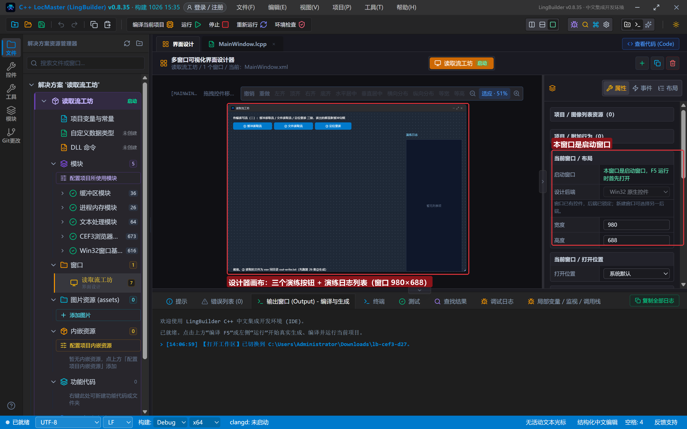
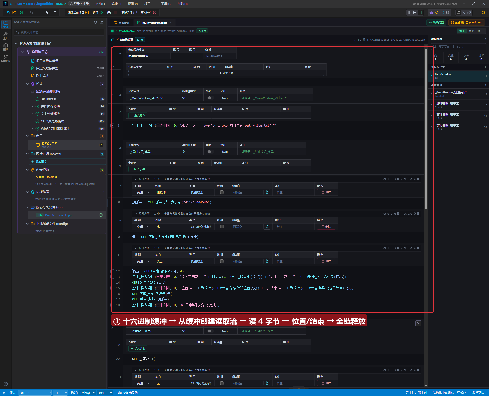
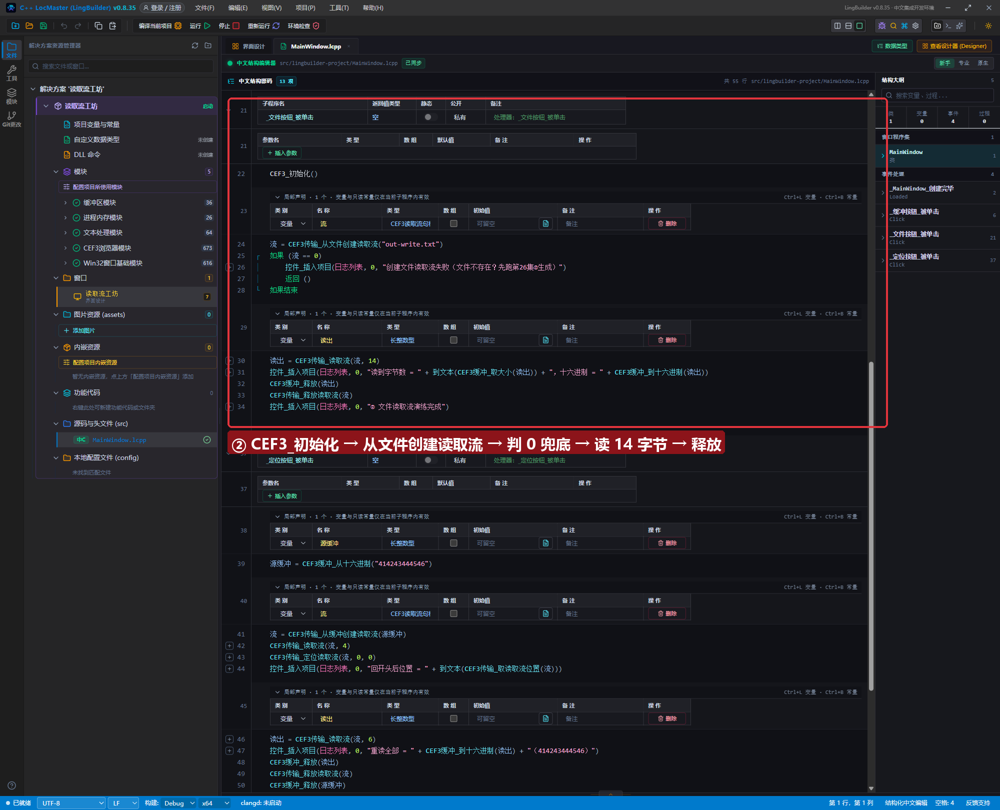
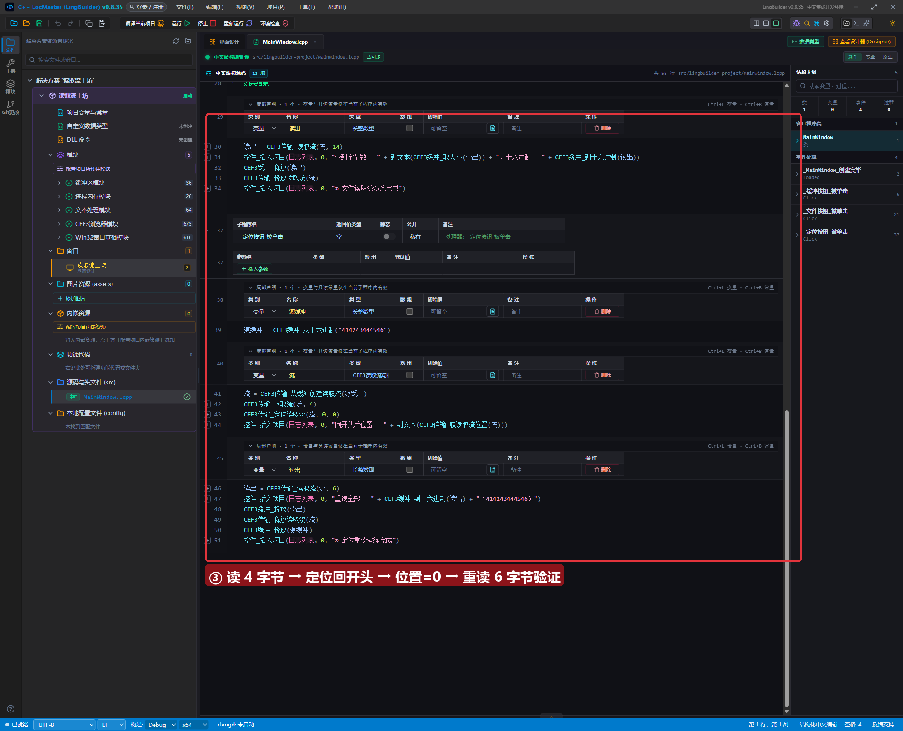
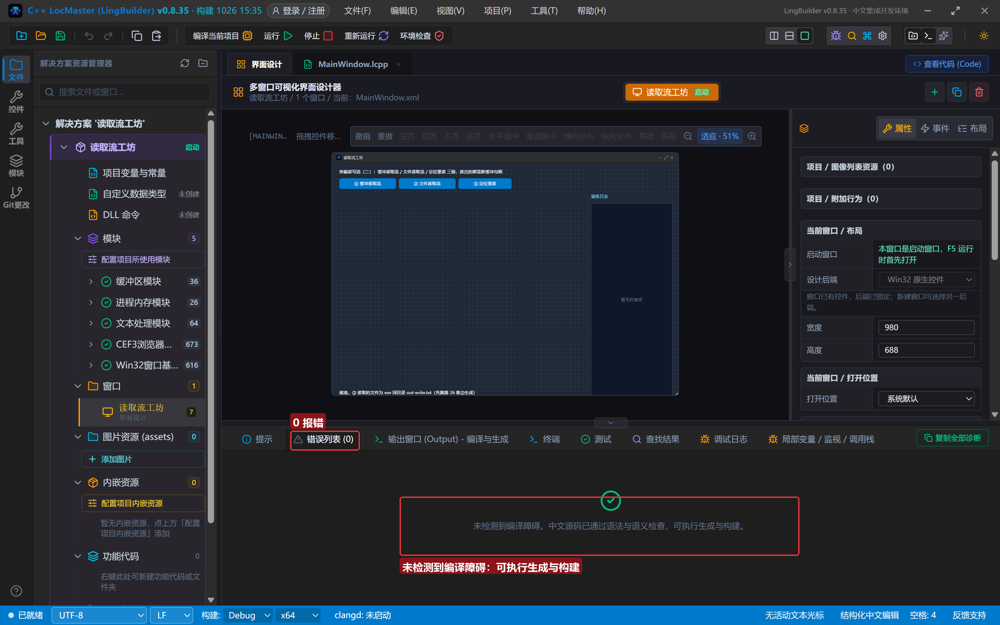
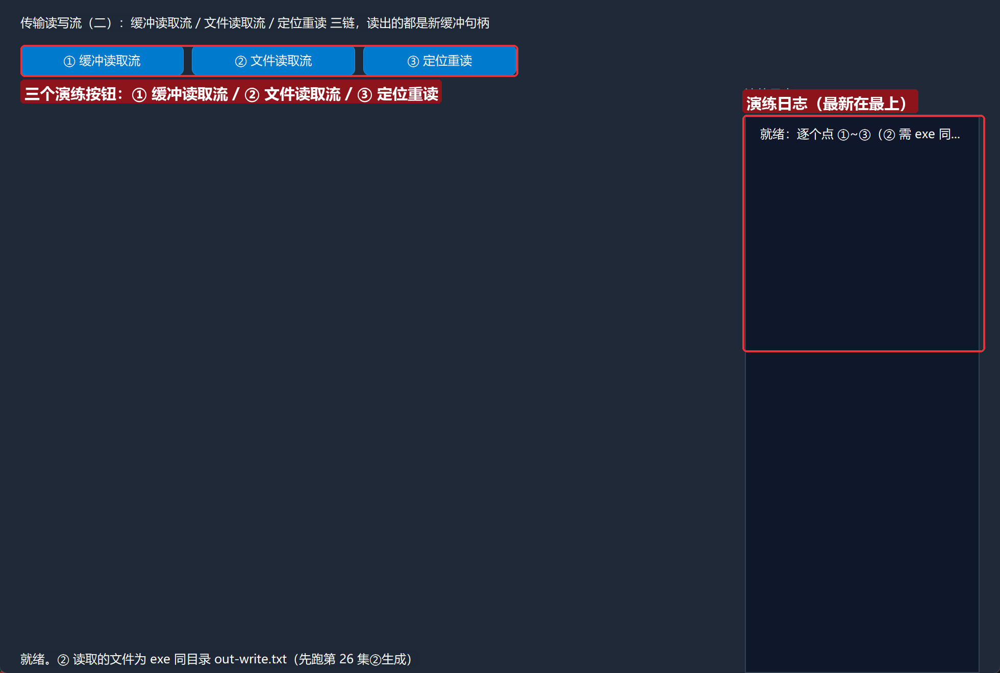
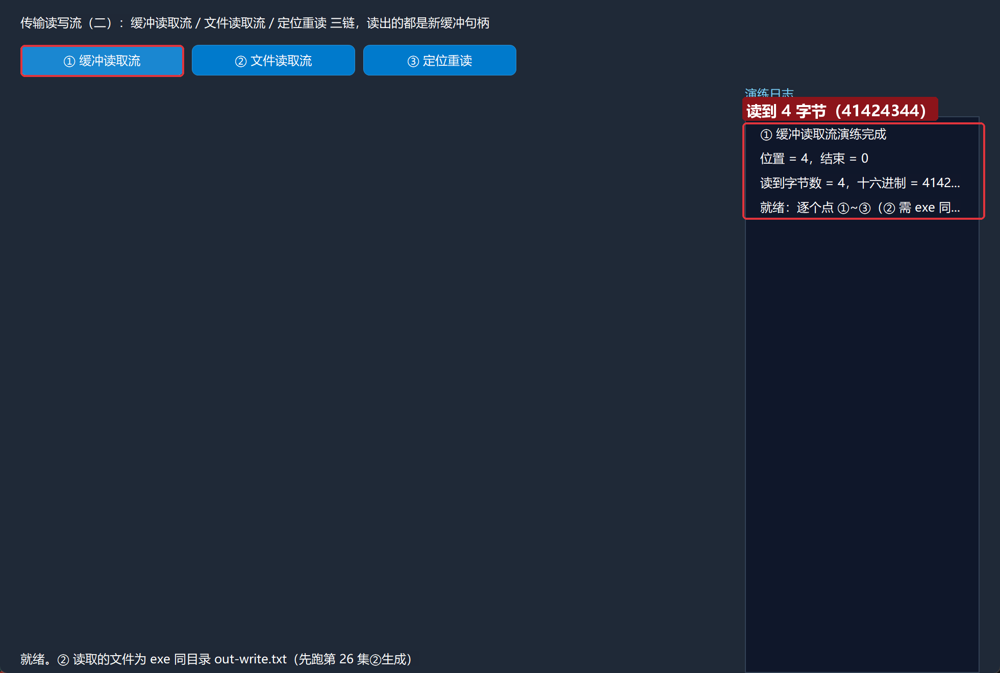
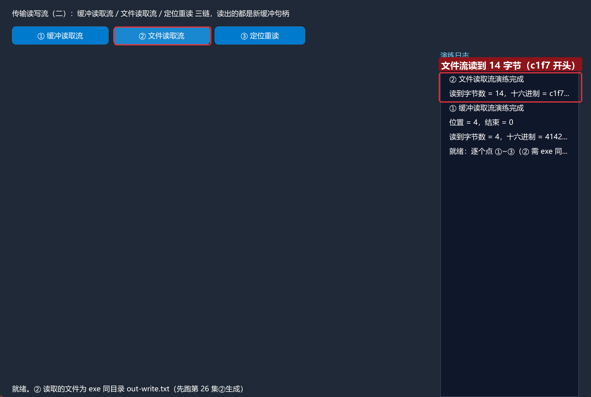
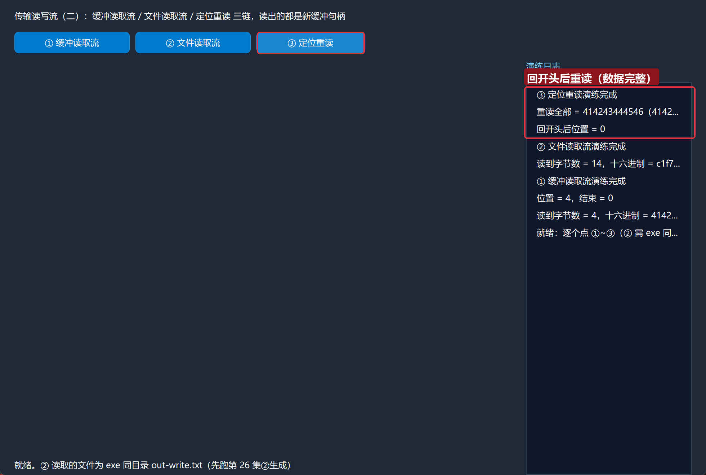

# CEF3 合集 27 · 传输读写流（二）：读取流与处理族

> 《LingBuilder CEF3 浏览器合集》第 27 集（数据与传输篇）。第 26 集把数据**写进去**，这一集把数据**读出来**：缓冲读取流、文件读取流、定位重读三条链全部跑通。核心只有一句话——**每次 `CEF3传输_读取流` 读回来的都是一块新缓冲句柄**，读多少由返回缓冲的 `取大小` 说了算，用完记得释放。全程约 30 分钟。
>
> **模块获取**：CEF3 浏览器模块**免费**；另需 **CEF3 受管对象模块**（缓冲族）与 **CEF3 传输模块**（读写流族）。
>
> 前置要求：学过[第 26 集](/guide/tutorials/cef3-26)的写入流（本集 ② 直接读它写出的 `out-write.txt`）。本集源码包见文末。

## 这一集你将学会

- `CEF3传输_从缓冲创建读取流(缓冲)`：把一块内存缓冲包装成可读的流
- `CEF3传输_从文件创建读取流(路径)`：把 exe 同目录的文件变成可读的流
- `CEF3传输_读取流(句柄, 字节数)`：读出**新缓冲句柄**（要用 `CEF3缓冲_释放` 释放）
- `CEF3传输_取读取流位置` / `读取流是否结束`：读进展的两位"仪表盘"
- `CEF3传输_定位读取流(句柄, 偏移, 基准)`：Seek 回开头重读

## 1. 命令一张表

| 命令 | 参数 | 返回 |
| --- | --- | --- |
| `CEF3传输_从缓冲创建读取流` | 缓冲句柄 | CEF3读取流句柄 |
| `CEF3传输_从文件创建读取流` | 路径 | CEF3读取流句柄（0=失败） |
| `CEF3传输_读取流` | 句柄, 请求字节数 | 长整数型（**新缓冲句柄**，需释放） |
| `CEF3传输_取读取流位置` | 句柄 | 长整数型 |
| `CEF3传输_读取流是否结束` | 句柄 | 整数型（0=未结束） |
| `CEF3传输_定位读取流` | 句柄, 偏移量, 基准(0开头/1当前/2结尾) | 整数型 |
| `CEF3传输_释放读取流` | 句柄 | 整数型 |
| `CEF3缓冲_取大小` / `到十六进制` / `释放` | 见代码 | 见代码 |

四条红线先记住：

- **读取流返回的是新缓冲**：`局部 长整数型 读出 = CEF3传输_读取流(流, 4)` 里的 `读出` 是一块独立缓冲，看内容用 `CEF3缓冲_取大小/到十六进制`，看完必须 `CEF3缓冲_释放(读出)`。
- **文件读取流的前提与写入流一致**：无浏览器控件的项目先 `CEF3_初始化()`（登记允许根 = exe 目录），路径越界直接创建失败返回 0。
- **句柄名义类型**：`局部 CEF3读取流句柄 流`，不能声明成长整数型（类型门禁拦截）。
- **定位基准与写入侧同语义**：0=开头、1=当前位置、2=结尾；`定位读取流(流, 0, 0)` 就是"倒带回开头"。

## 2. 设计界面

新建项目「读取流工坊」，窗口 980×688（客户区 980×660），三按钮 + 日志：

| 控件 | 名称 | 显示内容/属性 | 左距 | 顶距 | 宽度 | 高度 |
| --- | --- | --- | --- | --- | --- | --- |
| 标签 | 说明标签 | 传输读写流（二）：缓冲读取流 / 文件读取流 / 定位重读 三链，读出的都是新缓冲句柄 | 20 | 14 | 740 | 22 |
| 按钮 | 缓冲按钮 | ① 缓冲读取流 | 20 | 44 | 160 | 30 |
| 按钮 | 文件按钮 | ② 文件读取流 | 188 | 44 | 160 | 30 |
| 按钮 | 定位按钮 | ③ 定位重读 | 356 | 44 | 150 | 30 |
| 标签 | 日志标题 | 演练日志 | 730 | 84 | 230 | 22 |
| 列表框 | 日志列表 | （空） | 730 | 114 | 230 | 546 |
| 标签 | 状态标签 | 就绪。② 读取的文件为 exe 同目录 out-write.txt（先跑第 26 集②生成） | 20 | 638 | 690 | 22 |



模块面板确认启用：CEF3 浏览器模块 + CEF3 受管对象模块 + **CEF3 传输模块**。

## 3. 写代码

### 3.1 缓冲读取流：造数据 → 读 4 字节 → 看位置

```lcpp
事件 _缓冲按钮_被单击()
    局部 长整数型 源缓冲
    源缓冲 = CEF3缓冲_从十六进制("414243444546")
    局部 CEF3读取流句柄 流
    流 = CEF3传输_从缓冲创建读取流(源缓冲)
    局部 长整数型 读出
    读出 = CEF3传输_读取流(流, 4)
    控件_插入项目(日志列表, 0, "读到字节数 = " + 到文本(CEF3缓冲_取大小(读出)) + "，十六进制 = " + CEF3缓冲_到十六进制(读出))
    CEF3缓冲_释放(读出)
    控件_插入项目(日志列表, 0, "位置 = " + 到文本(CEF3传输_取读取流位置(流)) + "，结束 = " + 到文本(CEF3传输_读取流是否结束(流)))
    CEF3传输_释放读取流(流)
    CEF3缓冲_释放(源缓冲)
    控件_插入项目(日志列表, 0, "① 缓冲读取流演练完成")
结束
```

6 字节源缓冲（ABCDEF）里读 4 字节：`读到字节数 = 4`、十六进制 `41424344`（ABCD），位置停在 4、还没结束。三个句柄（读出/流/源缓冲）按申请顺序逆序释放。



### 3.2 文件读取流：初始化 → 读第 26 集的落盘文件

```lcpp
事件 _文件按钮_被单击()
    CEF3_初始化()
    局部 CEF3读取流句柄 流
    流 = CEF3传输_从文件创建读取流("out-write.txt")
    如果 (流 == 0)
        控件_插入项目(日志列表, 0, "创建文件读取流失败（文件不存在？先跑第26集②生成）")
        返回 ()
    如果结束
    局部 长整数型 读出
    读出 = CEF3传输_读取流(流, 14)
    控件_插入项目(日志列表, 0, "读到字节数 = " + 到文本(CEF3缓冲_取大小(读出)) + "，十六进制 = " + CEF3缓冲_到十六进制(读出))
    CEF3缓冲_释放(读出)
    CEF3传输_释放读取流(流)
    控件_插入项目(日志列表, 0, "② 文件读取流演练完成")
结束
```

`CEF3_初始化()` 照旧是无控件项目的**隐藏前提**。读的就是第 26 集 ② 写出的 `out-write.txt`（GBK"到达-write"共 14 字节），实测读回 `c1f7…` 开头的 14 字节，和写入侧完全对得上。文件不存在时走 `流 == 0` 兜底——判 0 是文件读取流的标准开场。



### 3.3 定位重读：Seek 回开头再读一遍

```lcpp
事件 _定位按钮_被单击()
    局部 长整数型 源缓冲
    源缓冲 = CEF3缓冲_从十六进制("414243444546")
    局部 CEF3读取流句柄 流
    流 = CEF3传输_从缓冲创建读取流(源缓冲)
    CEF3传输_读取流(流, 4)
    CEF3传输_定位读取流(流, 0, 0)
    控件_插入项目(日志列表, 0, "回开头后位置 = " + 到文本(CEF3传输_取读取流位置(流)))
    局部 长整数型 读出
    读出 = CEF3传输_读取流(流, 6)
    控件_插入项目(日志列表, 0, "重读全部 = " + CEF3缓冲_到十六进制(读出) + "（414243444546）")
    CEF3缓冲_释放(读出)
    CEF3传输_释放读取流(流)
    CEF3缓冲_释放(源缓冲)
    控件_插入项目(日志列表, 0, "③ 定位重读演练完成")
结束
```

先读 4 字节把位置推到 4，再 `定位读取流(流, 0, 0)` 倒回开头：位置归 0，重读 6 字节拿回完整的 `414243444546`——流没有"读完即焚"，Seek 之后想读几遍读几遍。



## 4. 编译：先看错误列表

「错误列表」**(0)** 才继续：



## 5. 运行：三条链全绿

点「运行」：

- 窗口就绪，日志里只有就绪提示：



- **① 缓冲读取流** → `读到字节数 = 4，十六进制 = 4142…`，`位置 = 4，结束 = 0`：



- **② 文件读取流** → `读到字节数 = 14，十六进制 = c1f7…`（与第 26 集 ② 写入内容一致）：



- **③ 定位重读** → `回开头后位置 = 0`，`重读全部 = 414243444546`：



## 常见问题急救表

| 症状 | 原因 | 解法 |
| --- | --- | --- |
| 创建文件读取流返回 0 | 文件不在 exe 目录 / 未初始化 | 先 `CEF3_初始化()`；文件放 exe 同目录（或先跑第 26 集②） |
| 读出内容打印为空 | 把读出句柄当文本直接拼接 | 先 `CEF3缓冲_到十六进制(读出)` 再拼进日志 |
| 程序越跑内存越大 | 读出缓冲没释放 | 每次 `读取流` 后配对 `CEF3缓冲_释放(读出)` |
| 句柄声明成长整数型报错 | 类型门禁 | 用名义类型：`局部 CEF3读取流句柄 流` |
| 重读读不到数据 | 流位置还停在末尾 | `CEF3传输_定位读取流(流, 0, 0)` 倒回开头再读 |
| 想"接着上次读" | 每次读取自动推进位置 | 直接连续调 `读取流` 即可，位置会自己往前走 |

## 本集小结

- 读取双形态：**缓冲读取流**（内存数据包装成流）与**文件读取流**（exe 同目录文件，判 0 兜底）。
- `读取流` 每次返回**新缓冲句柄**：字节数看 `取大小`、内容看 `到十六进制`、用完必须释放。
- 位置与结束状态随读取自动推进；`定位读取流(流, 0, 0)` 倒回开头即可重读。

## 源码包

本集完整源码已打包为 **CEF3合集27-读取流工坊.lcpppkg**（见[示例源码区](/demos)），导入即可运行对照学习。

**下一篇预告**：第 28 集——网页截图与图像处理：把浏览器画面变成图片再加工。

[回合集总览](/guide/tutorials/cef3)
