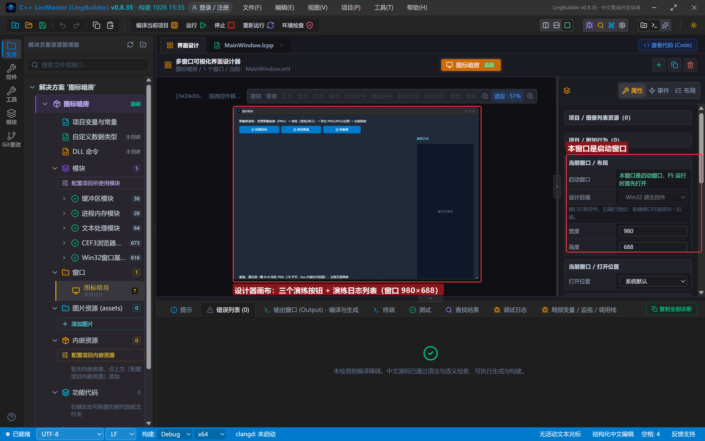
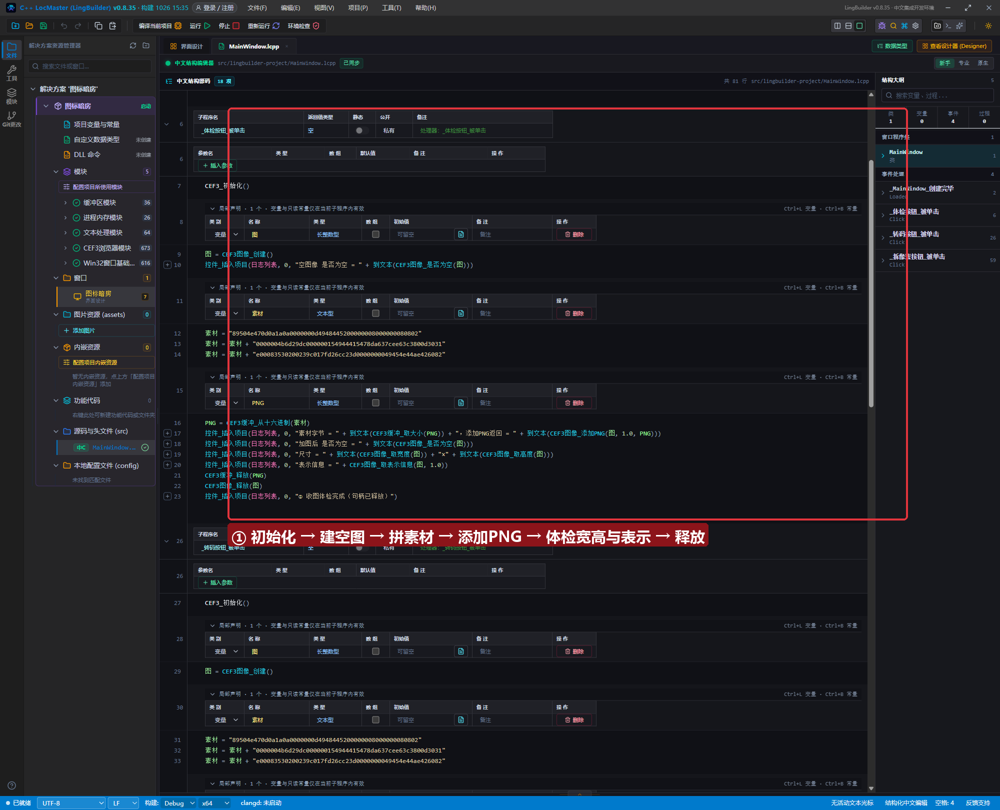
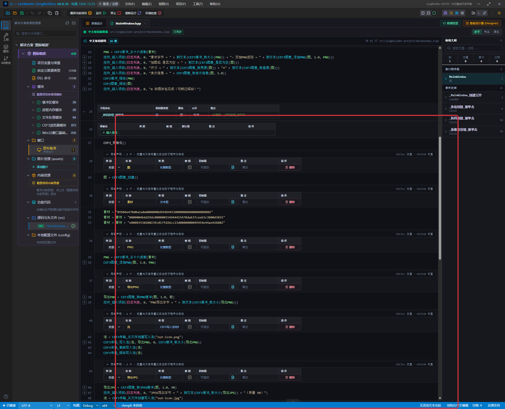
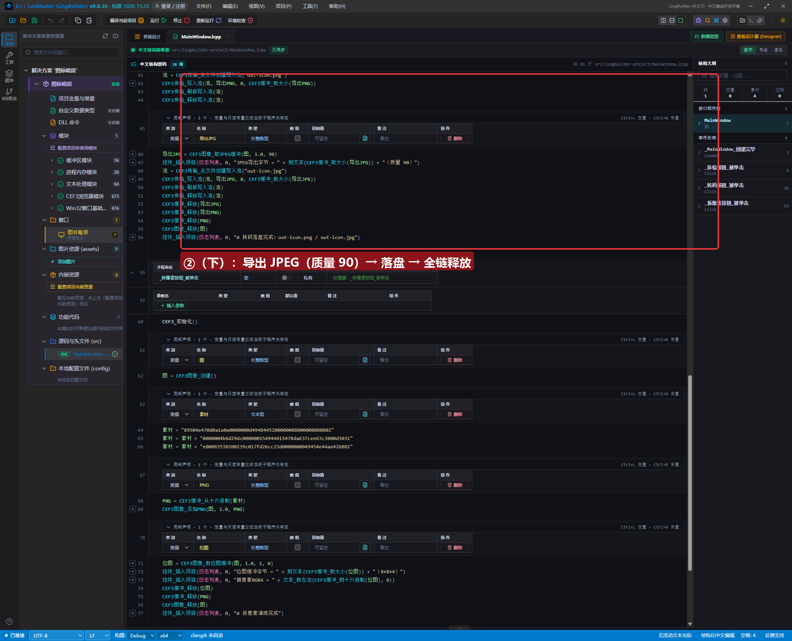
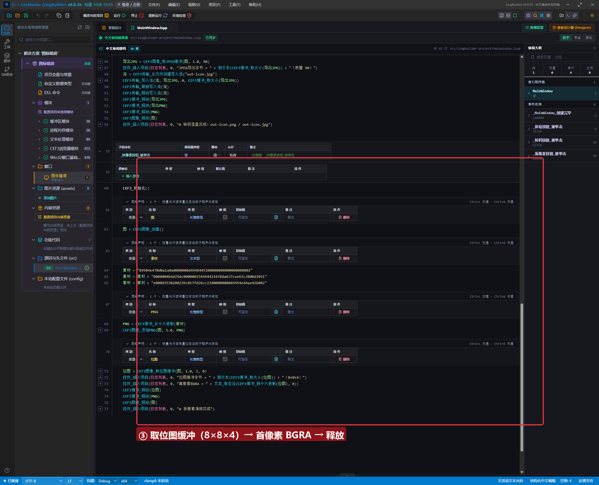
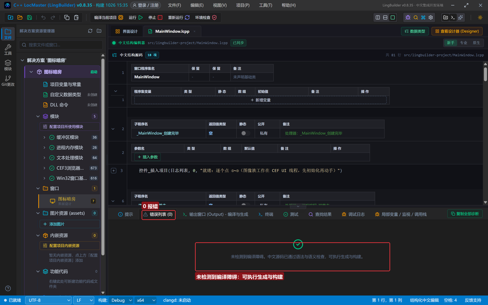
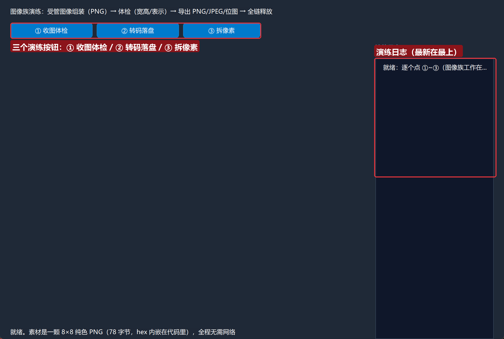
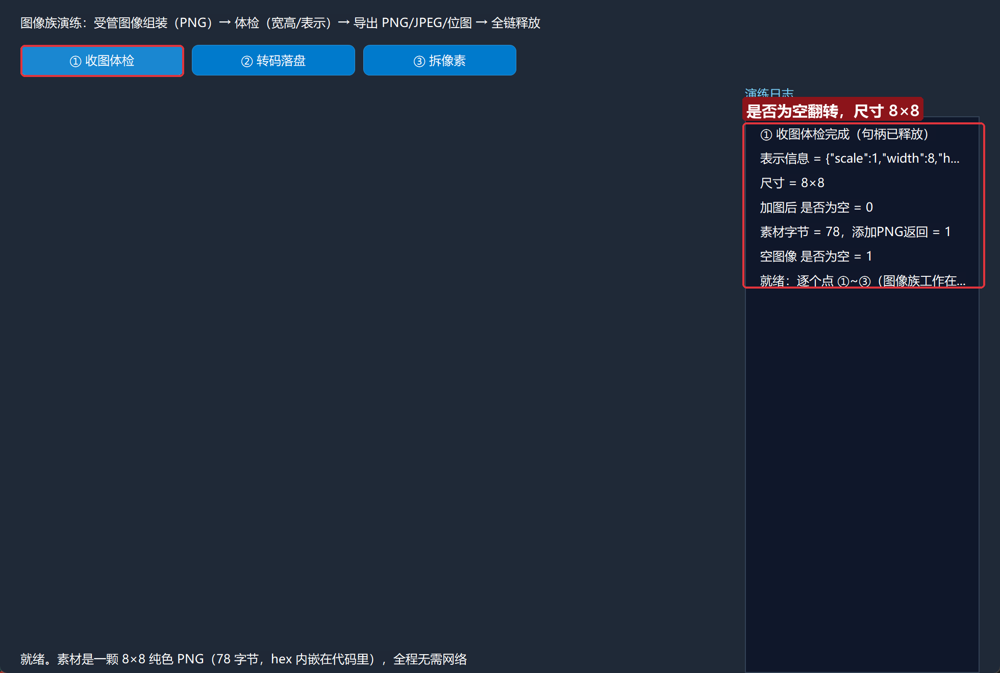
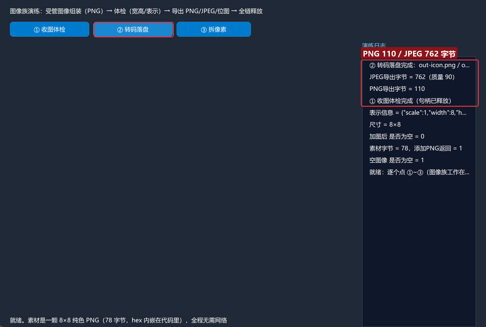
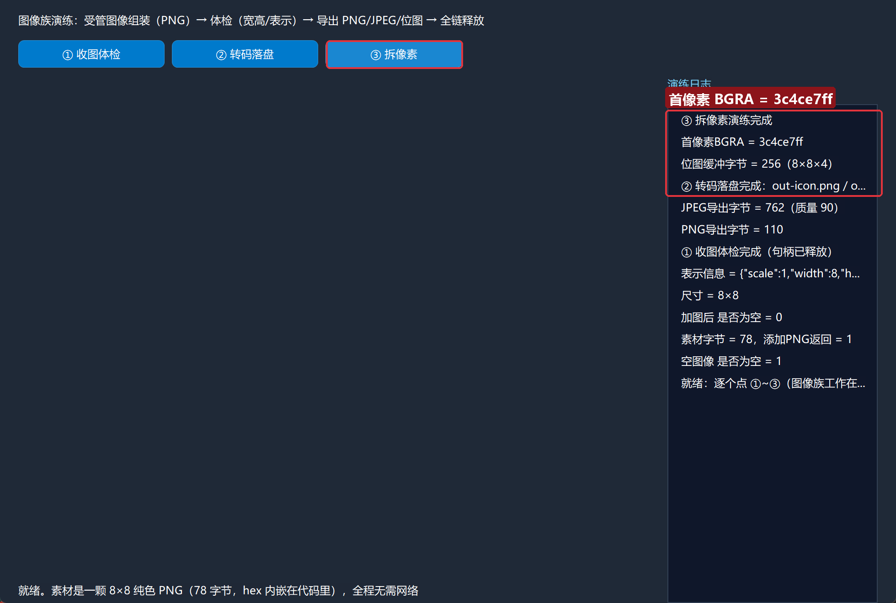

# CEF3 合集 28 · 图像族：受管图像的组装、体检与导出

> 《LingBuilder CEF3 浏览器合集》第 28 集（数据与传输篇）。CEF 里的 `CefImage` 是"一图多表示"的受管图像对象（同一张图可以挂 1.0/2.0 多档缩放），窗口图标、favicon 这类场景都靠它。本集用一颗 8×8 的纯色 PNG 做素材，把图像族的完整生命周期跑通：**创建 → 加 PNG → 体检（宽高/表示）→ 导出 PNG/JPEG/位图 → 落盘 → 全链释放**。全程约 30 分钟。
>
> **模块获取**：CEF3 浏览器模块**免费**；另需 **CEF3 受管对象模块**（图像族、缓冲族）与 **CEF3 传输模块**（② 落盘要用写入流）。
>
> 前置要求：学过[第 26 集](/guide/tutorials/cef3-26)写入流与[第 27 集](/guide/tutorials/cef3-27)缓冲纪律。本集源码包见文末。

## 这一集你将学会

- `CEF3图像_创建()` / `CEF3图像_释放(图)`：受管图像的生与死
- `CEF3图像_添加PNG(图, 缩放, PNG缓冲)`：从受管缓冲装一张缩放表示（`添加JPEG`/`添加位图` 同理）
- `CEF3图像_是否为空` / `取宽度` / `取高度` / `取表示信息`：图像体检四件套
- `CEF3图像_取PNG缓冲(图, 缩放, 保留透明)` / `取JPEG缓冲(图, 缩放, 质量)` / `取位图缓冲(图, 缩放, 颜色类型, 透明类型)`：三种导出
- 老朋友：`CEF3缓冲_从十六进制`（造素材）、`CEF3传输_写入流`（落盘）

## 1. 命令一张表

| 命令 | 参数 | 返回 |
| --- | --- | --- |
| `CEF3图像_创建` | 无 | 长整数型（图像受管句柄） |
| `CEF3图像_添加PNG` | 图, 缩放, PNG缓冲 | 整数型（1=成功） |
| `CEF3图像_添加JPEG` / `添加位图` | 见模块文档 | 整数型 |
| `CEF3图像_是否为空` | 图 | 整数型（1=空） |
| `CEF3图像_取宽度` / `取高度` | 图 | 长整数型 |
| `CEF3图像_取表示信息` | 图, 缩放 | 文本型（JSON：实际缩放+像素宽高） |
| `CEF3图像_取PNG缓冲` | 图, 缩放, 保留透明 | 长整数型（新缓冲，需释放） |
| `CEF3图像_取JPEG缓冲` | 图, 缩放, 质量 0~100 | 长整数型（新缓冲，需释放） |
| `CEF3图像_取位图缓冲` | 图, 缩放, 颜色类型, 透明类型 | 长整数型（宽×高×4 字节，需释放） |
| `CEF3图像_释放` | 图 | 整数型 |

四条红线先记住：

- **图像族工作在 CEF UI 线程**：无浏览器控件的项目，动手前先 `CEF3_初始化()`（本集三条链开头都调了它）。
- **导出命令返回的都是新缓冲**：`取PNG缓冲/取JPEG缓冲/取位图缓冲` 与第 27 集的 `读取流` 一个脾气——拿到的句柄要自己 `CEF3缓冲_释放`。
- **位图缓冲大小恒为 宽×高×4**：颜色类型 1 = BGRA、透明类型 0 = 不透明（本集实测值）。
- **缩放是"表示"的钥匙**：`添加PNG(图, 1.0, 缓冲)` 挂 1.0 档，之后 `取宽度/取PNG缓冲` 都用同一档缩放去取。

## 2. 设计界面

新建项目「图标暗房」，窗口 980×688（客户区 980×660），三按钮 + 日志：

| 控件 | 名称 | 显示内容/属性 | 左距 | 顶距 | 宽度 | 高度 |
| --- | --- | --- | --- | --- | --- | --- |
| 标签 | 说明标签 | 图像族演练：受管图像组装（PNG）→ 体检（宽高/表示）→ 导出 PNG/JPEG/位图 → 全链释放 | 20 | 14 | 740 | 22 |
| 按钮 | 体检按钮 | ① 收图体检 | 20 | 44 | 160 | 30 |
| 按钮 | 转码按钮 | ② 转码落盘 | 188 | 44 | 160 | 30 |
| 按钮 | 拆像素按钮 | ③ 拆像素 | 356 | 44 | 150 | 30 |
| 标签 | 日志标题 | 演练日志 | 730 | 84 | 230 | 22 |
| 列表框 | 日志列表 | （空） | 730 | 114 | 230 | 546 |
| 标签 | 状态标签 | 就绪。素材是一颗 8×8 纯色 PNG（78 字节，hex 内嵌在代码里），全程无需网络 | 20 | 638 | 690 | 22 |



模块面板确认启用：CEF3 浏览器模块 + CEF3 受管对象模块 + **CEF3 传输模块**（② 落盘）+ 文本处理模块（③ 取左边）。

素材说明：本集不依赖网络也不依赖截图——素材是一颗 **8×8 纯色 PNG（78 字节）**，以 156 个 hex 字符分三段写在代码里，用 `CEF3缓冲_从十六进制` 现场还原成受管缓冲。读者照抄即可，不需要额外准备图片文件。

## 3. 写代码

### 3.1 收图体检：建空图 → 加 PNG → 报三围

```lcpp
事件 _体检按钮_被单击()
    CEF3_初始化()
    局部 长整数型 图
    图 = CEF3图像_创建()
    控件_插入项目(日志列表, 0, "空图像 是否为空 = " + 到文本(CEF3图像_是否为空(图)))
    局部 文本型 素材
    素材 = "89504e470d0a1a0a0000000d4948445200000008000000080802"
    素材 = 素材 + "0000004b6d29dc000000154944415478da637cee63c3800d3031"
    素材 = 素材 + "e00083530200239c017fd26cc23d0000000049454e44ae426082"
    局部 长整数型 PNG
    PNG = CEF3缓冲_从十六进制(素材)
    控件_插入项目(日志列表, 0, "素材字节 = " + 到文本(CEF3缓冲_取大小(PNG)) + "，添加PNG返回 = " + 到文本(CEF3图像_添加PNG(图, 1.0, PNG)))
    控件_插入项目(日志列表, 0, "加图后 是否为空 = " + 到文本(CEF3图像_是否为空(图)))
    控件_插入项目(日志列表, 0, "尺寸 = " + 到文本(CEF3图像_取宽度(图)) + "×" + 到文本(CEF3图像_取高度(图)))
    控件_插入项目(日志列表, 0, "表示信息 = " + CEF3图像_取表示信息(图, 1.0))
    CEF3缓冲_释放(PNG)
    CEF3图像_释放(图)
    控件_插入项目(日志列表, 0, "① 收图体检完成（句柄已释放）")
结束
```

空图像 `是否为空 = 1`，`添加PNG` 返回 1 后翻转为 0，尺寸报 `8×8`，表示信息回 JSON `{"scale":1,"width":8,"height":8}`——一张受管图像就组装好了。



### 3.2 转码落盘：PNG 进，PNG/JPEG 出

```lcpp
事件 _转码按钮_被单击()
    CEF3_初始化()
    局部 长整数型 图
    图 = CEF3图像_创建()
    局部 文本型 素材
    素材 = "89504e470d0a1a0a0000000d4948445200000008000000080802"
    素材 = 素材 + "0000004b6d29dc000000154944415478da637cee63c3800d3031"
    素材 = 素材 + "e00083530200239c017fd26cc23d0000000049454e44ae426082"
    局部 长整数型 PNG
    PNG = CEF3缓冲_从十六进制(素材)
    CEF3图像_添加PNG(图, 1.0, PNG)
    局部 长整数型 导出PNG
    导出PNG = CEF3图像_取PNG缓冲(图, 1.0, 假)
    控件_插入项目(日志列表, 0, "PNG导出字节 = " + 到文本(CEF3缓冲_取大小(导出PNG)))
    局部 CEF3写入流句柄 流
    流 = CEF3传输_从文件创建写入流("out-icon.png")
    CEF3传输_写入流(流, 导出PNG, 0, CEF3缓冲_取大小(导出PNG))
    CEF3传输_刷新写入流(流)
    CEF3传输_释放写入流(流)
    局部 长整数型 导出JPG
    导出JPG = CEF3图像_取JPEG缓冲(图, 1.0, 90)
    控件_插入项目(日志列表, 0, "JPEG导出字节 = " + 到文本(CEF3缓冲_取大小(导出JPG)) + "（质量 90）")
    流 = CEF3传输_从文件创建写入流("out-icon.jpg")
    CEF3传输_写入流(流, 导出JPG, 0, CEF3缓冲_取大小(导出JPG))
    CEF3传输_刷新写入流(流)
    CEF3传输_释放写入流(流)
    CEF3缓冲_释放(导出JPG)
    CEF3缓冲_释放(导出PNG)
    CEF3缓冲_释放(PNG)
    CEF3图像_释放(图)
    控件_插入项目(日志列表, 0, "② 转码落盘完成：out-icon.png / out-icon.jpg")
结束
```

`取PNG缓冲(图, 1.0, 假)` 导出的 110 字节直接落盘 `out-icon.png`；`取JPEG缓冲(图, 1.0, 90)` 同一张图转出 762 字节 JPEG。第 26 集的写入流三件套（写入 → 刷新 → 释放）在这里原样复用。





### 3.3 拆像素：位图缓冲里的 BGRA

```lcpp
事件 _拆像素按钮_被单击()
    CEF3_初始化()
    局部 长整数型 图
    图 = CEF3图像_创建()
    局部 文本型 素材
    素材 = "89504e470d0a1a0a0000000d4948445200000008000000080802"
    素材 = 素材 + "0000004b6d29dc000000154944415478da637cee63c3800d3031"
    素材 = 素材 + "e00083530200239c017fd26cc23d0000000049454e44ae426082"
    局部 长整数型 PNG
    PNG = CEF3缓冲_从十六进制(素材)
    CEF3图像_添加PNG(图, 1.0, PNG)
    局部 长整数型 位图
    位图 = CEF3图像_取位图缓冲(图, 1.0, 1, 0)
    控件_插入项目(日志列表, 0, "位图缓冲字节 = " + 到文本(CEF3缓冲_取大小(位图)) + "（8×8×4）")
    控件_插入项目(日志列表, 0, "首像素BGRA = " + 文本_取左边(CEF3缓冲_到十六进制(位图), 8))
    CEF3缓冲_释放(位图)
    CEF3缓冲_释放(PNG)
    CEF3图像_释放(图)
    控件_插入项目(日志列表, 0, "③ 拆像素演练完成")
结束
```

`取位图缓冲(图, 1.0, 1, 0)`（颜色类型 1=BGRA、透明类型 0=不透明）导出 256 字节 = 8×8×4。首像素十六进制 `3c4ce7ff` 按字节拆就是 B=3C、G=4C、R=E7、A=FF——正是素材的 RGB(231,76,60)。拿到像素缓冲，接第 23 集以后的内存扫描/自绘都是这条路。



## 4. 编译：先看错误列表

「错误列表」**(0)** 才继续：



## 5. 运行：三条链全绿

点「运行」：

- 窗口就绪：



- **① 收图体检** → `是否为空` 1→0，`尺寸 = 8×8`，表示信息 JSON：



- **② 转码落盘** → `PNG导出字节 = 110`、`JPEG导出字节 = 762（质量 90）`，exe 同目录出现两张图（用看图软件打开，是一颗 8×8 的橙红色方块）：



- **③ 拆像素** → `位图缓冲字节 = 256（8×8×4）`、`首像素BGRA = 3c4ce7ff`：



## 常见问题急救表

| 症状 | 原因 | 解法 |
| --- | --- | --- |
| 调图像命令无响应/崩溃 | 未初始化，CEF UI 线程没起来 | 每条链开头先 `CEF3_初始化()` |
| `添加PNG` 返回 0 | PNG 缓冲内容不合法 | 用十六进制工具核对文件头 `89504e47`，别手改 hex |
| `取宽度` 返回 0 | 取的缩放档没挂表示 | 添加与取值用同一个缩放（本集都用 1.0） |
| 导出缓冲打印为空 | 把缓冲句柄当文本拼接 | 先 `CEF3缓冲_到十六进制` 再拼 |
| 位图缓冲大小不对 | 宽×高×4 没对上 | 8×8 图就是 256 字节；换图先算清楚 |
| 首像素颜色对不上 | 颜色类型选错 | 本集用 1=BGRA；RGB 布局传 0 |
| 程序越跑内存越大 | 图像/导出缓冲没释放 | `图`、`导出PNG/JPG`、`位图`、素材缓冲逐一释放 |

## 本集小结

- 受管图像 = **一个句柄 + 多档缩放表示**：`添加PNG/JPEG/位图` 挂图，`取宽度/取表示信息` 体检。
- 三种导出全部返回**新缓冲**：PNG（可留透明）、JPEG（控质量）、位图（宽×高×4，BGRA 逐像素可拆）。
- 素材可以完全离线：小图 hex 内嵌 + `CEF3缓冲_从十六进制`，不依赖网络与截图。

## 源码包

本集完整源码已打包为 **CEF3合集28-图标暗房.lcpppkg**（见[示例源码区](/demos)），导入即可运行对照学习。

**下一篇预告**：第 29 集——证书与安全：证书族 17 条 + 证书主族 8 条，看懂 HTTPS 站点的"身份证"。

[回合集总览](/guide/tutorials/cef3)
