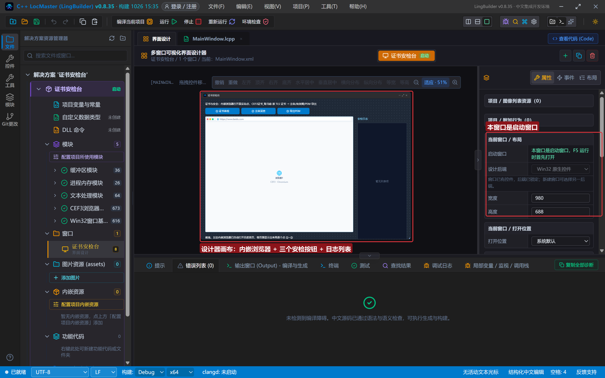
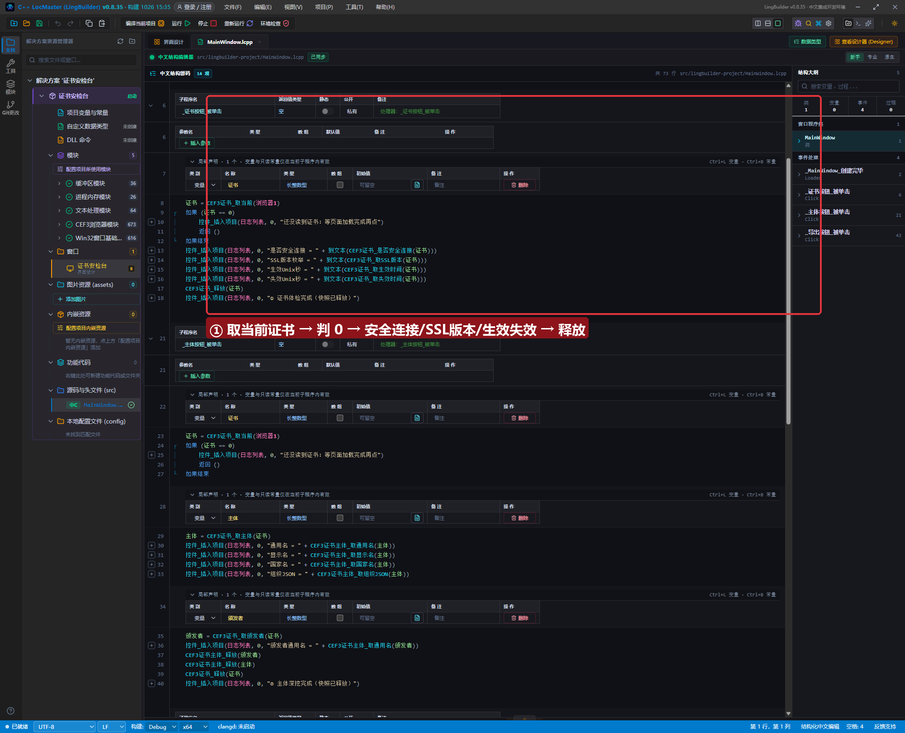
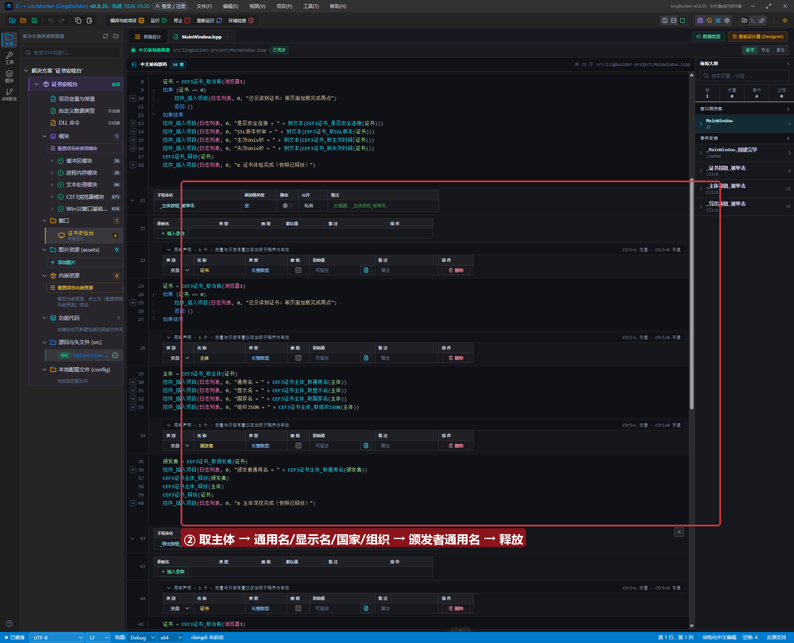
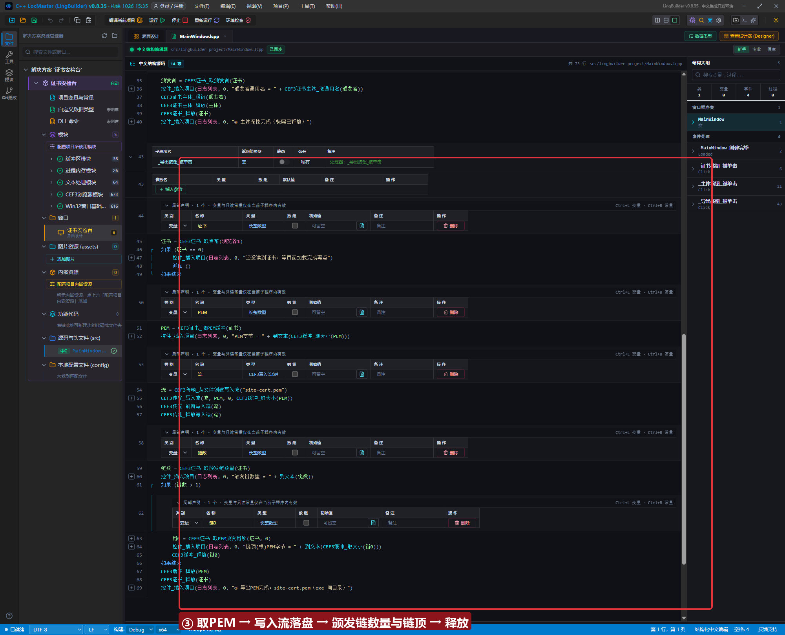
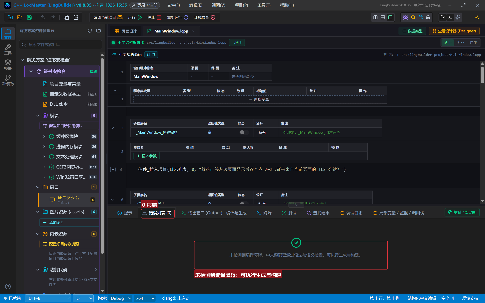
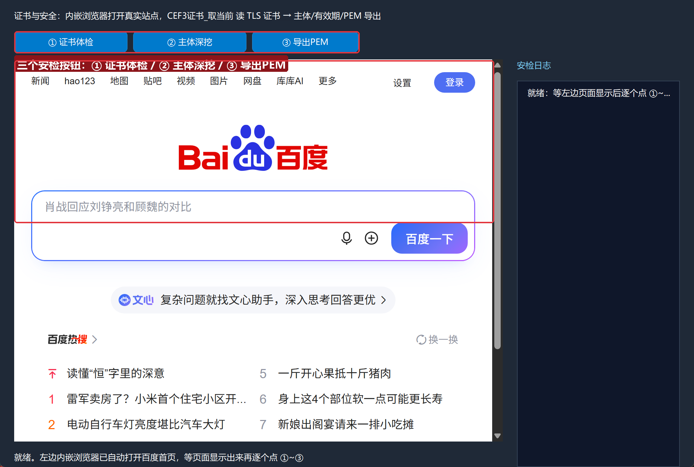
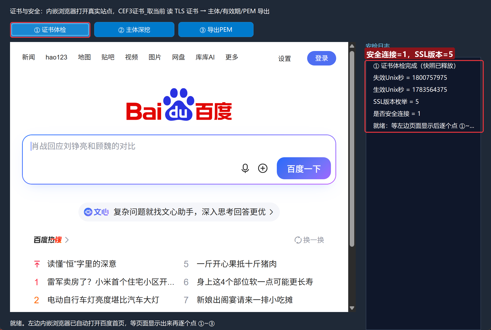
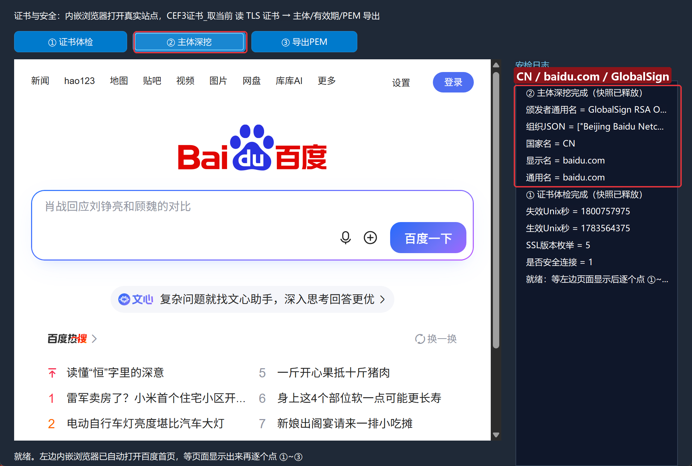
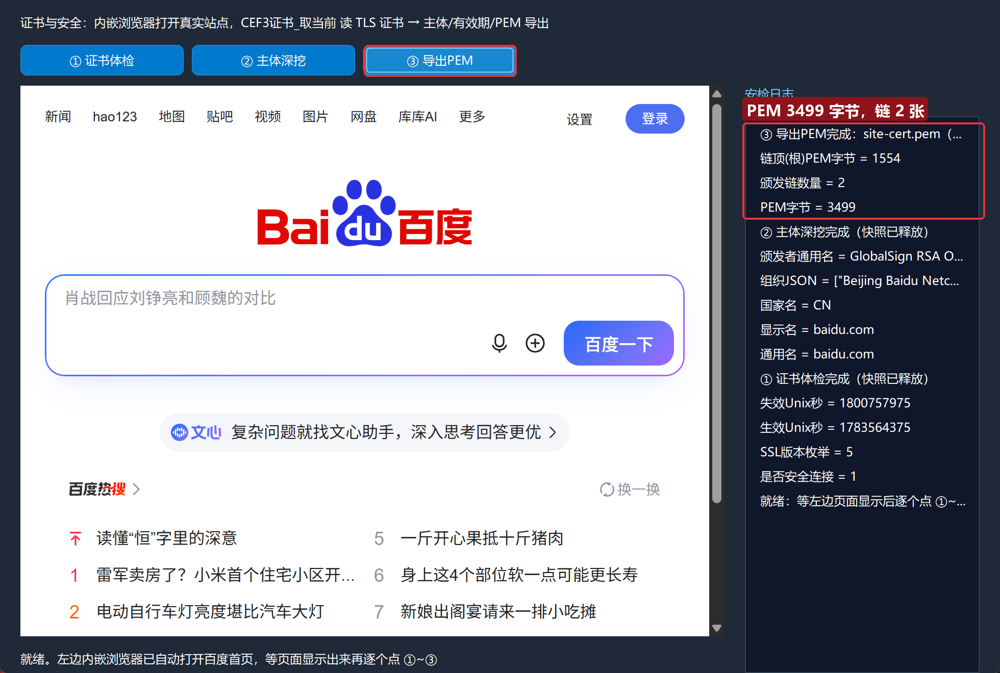

# CEF3 合集 29 · 证书与安全：证书安检台

> 《LingBuilder CEF3 浏览器合集》第 29 集（数据与传输篇）。浏览器地址栏那把小锁背后就是 TLS 证书：谁颁的、颁给谁、什么时候过期、证书链有多长。本集做一个「证书安检台」——内嵌浏览器打开真实站点（百度首页），用 **CEF3证书_取当前** 把当前页面的 TLS 证书快照读出来，做体检、挖主体、导 PEM，一共 3 条链。全程约 30 分钟。
>
> **模块获取**：CEF3 浏览器模块**免费**（含 CEF3浏览器控件与证书族）；另需 **CEF3 受管对象模块**（缓冲族）与 **CEF3 传输模块**（③ 落盘 PEM）。
>
> 前置要求：学过[第 1 集](/guide/tutorials/cef3-01)的 CEF3浏览器控件用法、[第 26 集](/guide/tutorials/cef3-26)写入流三件套。本集源码包见文末。

## 这一集你将学会

- `CEF3证书_取当前(浏览器控件)`：读取当前页面 TLS 证书的**不可变受管快照**
- `CEF3证书_是否安全连接` / `取SSL版本` / `取生效时间` / `取失效时间`：连接与有效期体检
- `CEF3证书_取主体` / `取颁发者` → `CEF3证书主体_取通用名/显示名/国家名/组织JSON`：证书身份深挖
- `CEF3证书_取PEM缓冲` / `取颁发链数量` / `取PEM颁发链项`：导出证书与证书链
- 每个快照句柄用完 `CEF3证书_释放` / `CEF3证书主体_释放`

## 1. 命令一张表

| 命令 | 参数 | 返回 |
| --- | --- | --- |
| `CEF3证书_取当前` | 浏览器控件（控件名） | 长整数型（证书快照句柄，0=失败） |
| `CEF3证书_是否安全连接` | 证书句柄 | 整数型（1=安全） |
| `CEF3证书_取SSL版本` | 证书句柄 | 整数型（TLS 版本枚举） |
| `CEF3证书_取生效时间` / `取失效时间` | 证书句柄 | 长整数型（Unix 秒） |
| `CEF3证书_取主体` / `取颁发者` | 证书句柄 | 长整数型（主体快照句柄） |
| `CEF3证书主体_取通用名` / `取显示名` / `取国家名` | 主体句柄 | 文本型 |
| `CEF3证书主体_取组织JSON` / `取组织单位JSON` | 主体句柄 | 文本型（JSON 数组） |
| `CEF3证书_取PEM缓冲` / `取DER缓冲` | 证书句柄 | 长整数型（新缓冲，需释放） |
| `CEF3证书_取颁发链数量` | 证书句柄 | 整数型 |
| `CEF3证书_取PEM颁发链项` | 证书句柄, 索引（0=链顶根证书） | 长整数型（新缓冲，需释放） |
| `CEF3证书_释放` / `CEF3证书主体_释放` | 句柄 | 整数型 |

四条红线先记住：

- **快照不可变**：`取当前` 返回的是"按下按钮那一刻"的证书拷贝，页面随后跳转不影响它；同样，**每次 `取当前` 都是全新句柄**，用完必须 `CEF3证书_释放`。
- **主体/颁发者也是快照**：`取主体`、`取颁发者` 返回的句柄要用 `CEF3证书主体_释放` 释放——本集 ② 一共三层句柄（颁发者→主体→证书），逆序释放。
- **读证书前页面必须加载完**：证书挂在"当前可见导航项"上，页面没加载完 `取当前` 返回 0——判 0 兜底提示"等页面加载完成再点"。
- **时间拿的是 Unix 秒**：`取生效时间/取失效时间` 返回长整数，本集直接展示；要给人看可再接日期时间模块格式化。

## 2. 设计界面

新建项目「证书安检台」，窗口 980×688（客户区 980×660）。这次的主角是第 1 集学过的 **CEF3浏览器控件**：

| 控件 | 名称 | 显示内容/属性 | 左距 | 顶距 | 宽度 | 高度 |
| --- | --- | --- | --- | --- | --- | --- |
| 标签 | 说明标签 | 证书与安全：内嵌浏览器打开真实站点，CEF3证书_取当前 读 TLS 证书 → 主体/有效期/PEM 导出 | 20 | 14 | 700 | 22 |
| 按钮 | 证书按钮 | ① 证书体检 | 20 | 44 | 160 | 30 |
| 按钮 | 主体按钮 | ② 主体深挖 | 188 | 44 | 160 | 30 |
| 按钮 | 导出按钮 | ③ 导出PEM | 356 | 44 | 150 | 30 |
| 标签 | 日志标题 | 安检日志 | 730 | 84 | 230 | 22 |
| 列表框 | 日志列表 | （空） | 730 | 114 | 230 | 546 |
| 标签 | 状态标签 | 就绪。左边内嵌浏览器已自动打开百度首页，等页面显示出来再逐个点 ①~③ | 20 | 638 | 690 | 22 |
| **CEF3浏览器** | 浏览器1 | 打开地址 = `https://www.baidu.com`，缓存目录 = `.cef3/cert-site` | 20 | 84 | 690 | 540 |



CEF3浏览器控件的「打开地址」属性填 `https://www.baidu.com`——程序一启动就自动加载，等页面画出来再点按钮。控件版浏览器会在窗口创建期自动完成 CEF 初始化，所以本集代码里**不需要**再调 `CEF3_初始化()`（无控件项目才要，见第 26 集）。

模块面板确认启用：CEF3 浏览器模块 + CEF3 受管对象模块 + CEF3 传输模块。

## 3. 写代码

### 3.1 证书体检：取快照 → 判 0 → 报连接与有效期

```lcpp
事件 _证书按钮_被单击()
    局部 长整数型 证书
    证书 = CEF3证书_取当前(浏览器1)
    如果 (证书 == 0)
        控件_插入项目(日志列表, 0, "还没读到证书：等页面加载完成再点")
        返回 ()
    如果结束
    控件_插入项目(日志列表, 0, "是否安全连接 = " + 到文本(CEF3证书_是否安全连接(证书)))
    控件_插入项目(日志列表, 0, "SSL版本枚举 = " + 到文本(CEF3证书_取SSL版本(证书)))
    控件_插入项目(日志列表, 0, "生效Unix秒 = " + 到文本(CEF3证书_取生效时间(证书)))
    控件_插入项目(日志列表, 0, "失效Unix秒 = " + 到文本(CEF3证书_取失效时间(证书)))
    CEF3证书_释放(证书)
    控件_插入项目(日志列表, 0, "① 证书体检完成（快照已释放）")
结束
```

实测百度首页：`是否安全连接 = 1`、`SSL版本枚举 = 5`（TLS 1.3 档）、有效期是一对十位 Unix 秒。



### 3.2 主体深挖：网站身份证的正反面

```lcpp
事件 _主体按钮_被单击()
    局部 长整数型 证书
    证书 = CEF3证书_取当前(浏览器1)
    如果 (证书 == 0)
        控件_插入项目(日志列表, 0, "还没读到证书：等页面加载完成再点")
        返回 ()
    如果结束
    局部 长整数型 主体
    主体 = CEF3证书_取主体(证书)
    控件_插入项目(日志列表, 0, "通用名 = " + CEF3证书主体_取通用名(主体))
    控件_插入项目(日志列表, 0, "显示名 = " + CEF3证书主体_取显示名(主体))
    控件_插入项目(日志列表, 0, "国家名 = " + CEF3证书主体_取国家名(主体))
    控件_插入项目(日志列表, 0, "组织JSON = " + CEF3证书主体_取组织JSON(主体))
    局部 长整数型 颁发者
    颁发者 = CEF3证书_取颁发者(证书)
    控件_插入项目(日志列表, 0, "颁发者通用名 = " + CEF3证书主体_取通用名(颁发者))
    CEF3证书主体_释放(颁发者)
    CEF3证书主体_释放(主体)
    CEF3证书_释放(证书)
    控件_插入项目(日志列表, 0, "② 主体深挖完成（快照已释放）")
结束
```

实测：主体通用名/显示名都是 `baidu.com`、国家名 `CN`、组织 JSON `["Beijing Baidu Netcom…"]`；颁发者通用名 `GlobalSign RSA O…`——这就是"百度拿 GlobalSign 签的证书"在代码里的样子。



### 3.3 导出PEM：把证书存成文件

```lcpp
事件 _导出按钮_被单击()
    局部 长整数型 证书
    证书 = CEF3证书_取当前(浏览器1)
    如果 (证书 == 0)
        控件_插入项目(日志列表, 0, "还没读到证书：等页面加载完成再点")
        返回 ()
    如果结束
    局部 长整数型 PEM
    PEM = CEF3证书_取PEM缓冲(证书)
    控件_插入项目(日志列表, 0, "PEM字节 = " + 到文本(CEF3缓冲_取大小(PEM)))
    局部 CEF3写入流句柄 流
    流 = CEF3传输_从文件创建写入流("site-cert.pem")
    CEF3传输_写入流(流, PEM, 0, CEF3缓冲_取大小(PEM))
    CEF3传输_刷新写入流(流)
    CEF3传输_释放写入流(流)
    局部 长整数型 链数
    链数 = CEF3证书_取颁发链数量(证书)
    控件_插入项目(日志列表, 0, "颁发链数量 = " + 到文本(链数))
    如果 (链数 > 1)
        局部 长整数型 链0
        链0 = CEF3证书_取PEM颁发链项(证书, 0)
        控件_插入项目(日志列表, 0, "链顶(根)PEM字节 = " + 到文本(CEF3缓冲_取大小(链0)))
        CEF3缓冲_释放(链0)
    如果结束
    CEF3缓冲_释放(PEM)
    CEF3证书_释放(证书)
    控件_插入项目(日志列表, 0, "③ 导出PEM完成：site-cert.pem（exe 同目录）")
结束
```

实测 `PEM字节 = 3499`、`颁发链数量 = 2`、链顶根证书 PEM 1554 字节。落盘的 `site-cert.pem` 是标准 PEM 文本（`-----BEGIN CERTIFICATE-----` 开头），双击能用系统证书查看器打开——第 26 集写入流三件套在真实场景的直接复用。



## 4. 编译：先看错误列表

「错误列表」**(0)** 才继续：



## 5. 运行：三条链全绿

点「运行」，等左边页面显示出来：



- **① 证书体检** → `是否安全连接 = 1`、`SSL版本枚举 = 5`、生效/失效 Unix 秒：



- **② 主体深挖** → `通用名 = baidu.com`、`国家名 = CN`、`颁发者通用名 = GlobalSign…`：



- **③ 导出PEM** → `PEM字节 = 3499`、`颁发链数量 = 2`、`链顶(根)PEM字节 = 1554`：



## 常见问题急救表

| 症状 | 原因 | 解法 |
| --- | --- | --- |
| `取当前` 一直返回 0 | 页面没加载完 / 控件名写错 | 等页面画出来再点；控件名与设计器一致（裸名不加引号） |
| 页面打不开 ERR_NAME_NOT_RESOLVED | 站点域名解析失败 | 换一个可达的 HTTPS 站点（控件「打开地址」属性） |
| 程序退出时报句柄错误 | 证书/主体快照没释放 | 每层句柄配对释放：主体/颁发者 → 证书 |
| 通用名打印为空 | 把主体句柄当成证书句柄用 | `取主体` 的返回值才传给 `主体_取通用名` |
| 想看人类可读的过期时间 | 拿到的是 Unix 秒 | 接日期时间模块格式化，或先展示原始值 |
| PEM 文件双击打不开 | 落盘缺刷新 | `写入流` 后必须 `刷新写入流` 再 `释放写入流` |

## 本集小结

- **证书快照三层结构**：证书 → 主体/颁发者 → 字段文本；每一层都是受管句柄，逆序释放。
- 体检三件套：`是否安全连接`（1=HTTPS）、`SSL版本枚举`、生效/失效 Unix 秒。
- PEM/DER 导出返回**新缓冲**，配写入流即可落盘成标准证书文件；`取PEM颁发链项(证书, 0)` 拿链顶根证书。

## 源码包

本集完整源码已打包为 **CEF3合集29-证书安检台.lcpppkg**（见[示例源码区](/demos)），导入即可运行对照学习。

**下一篇预告**：第 30 集（收官）——开发者工具族与纯协议请求：CEF3网络_发起请求 过 302 风控，任务族与缓冲族收尾。

[回合集总览](/guide/tutorials/cef3)
