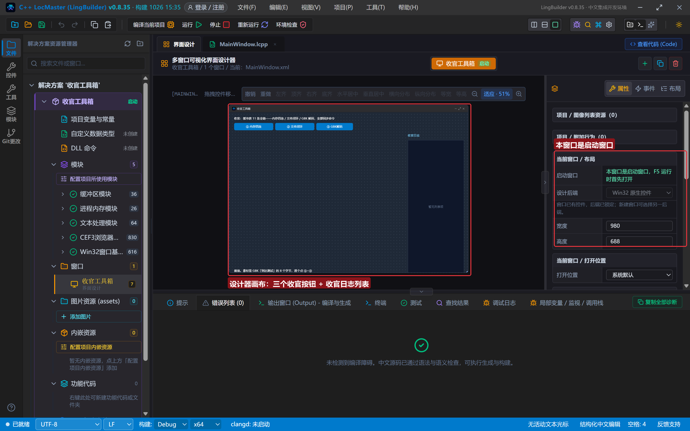
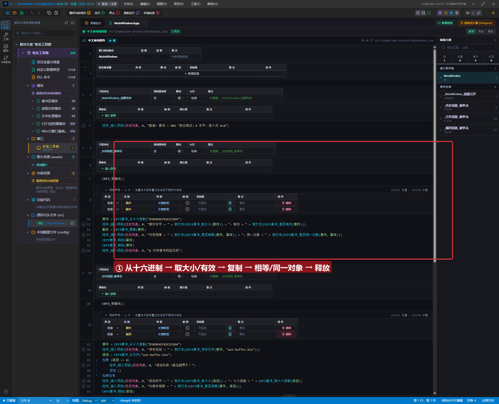
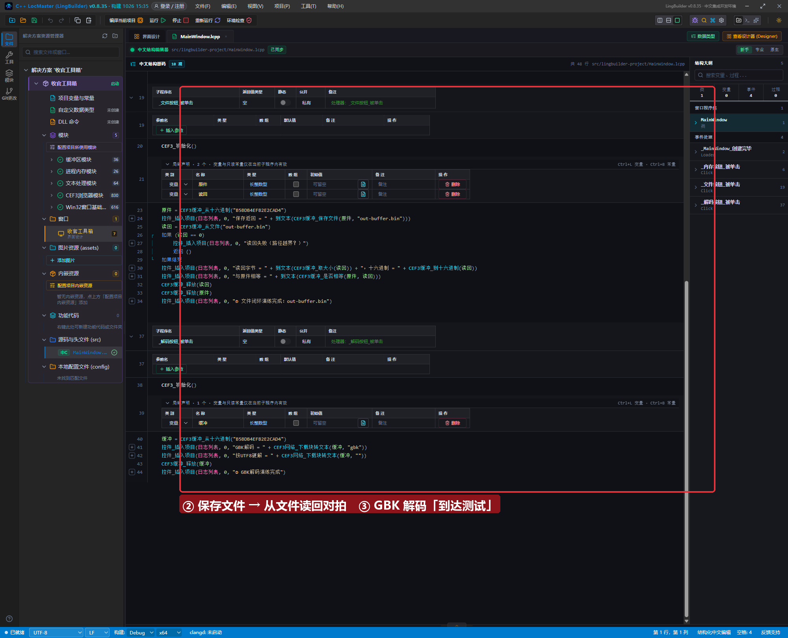
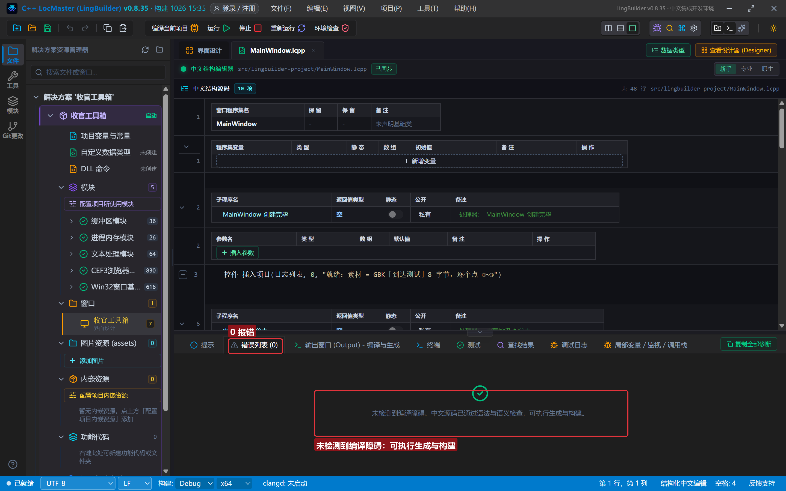
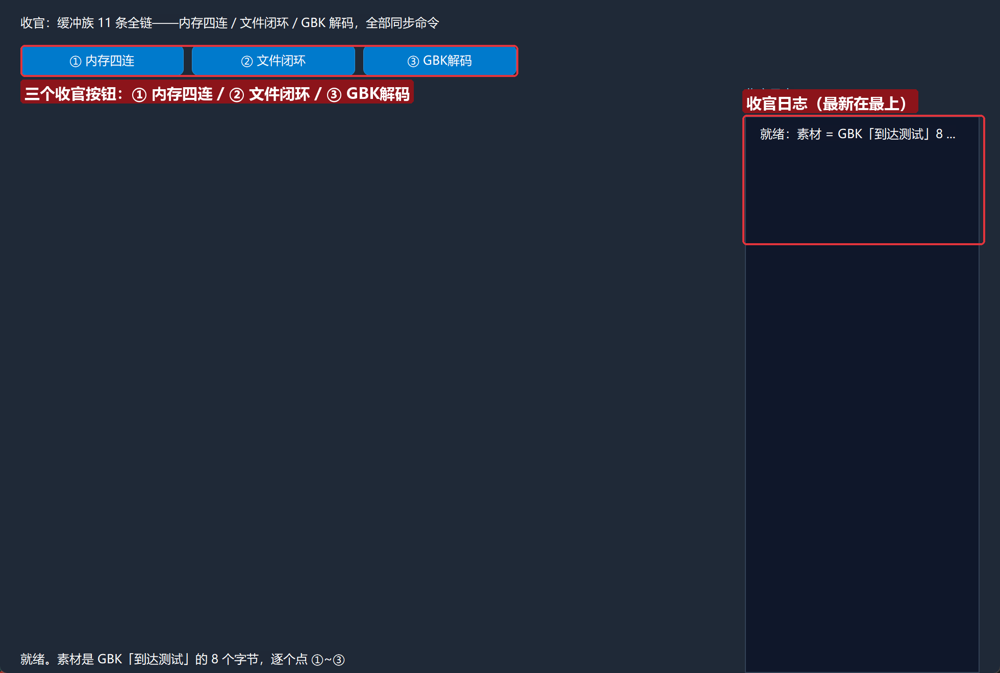
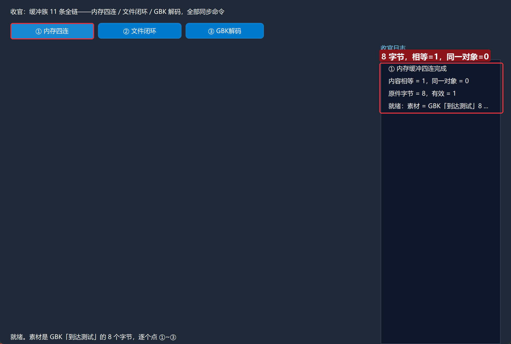
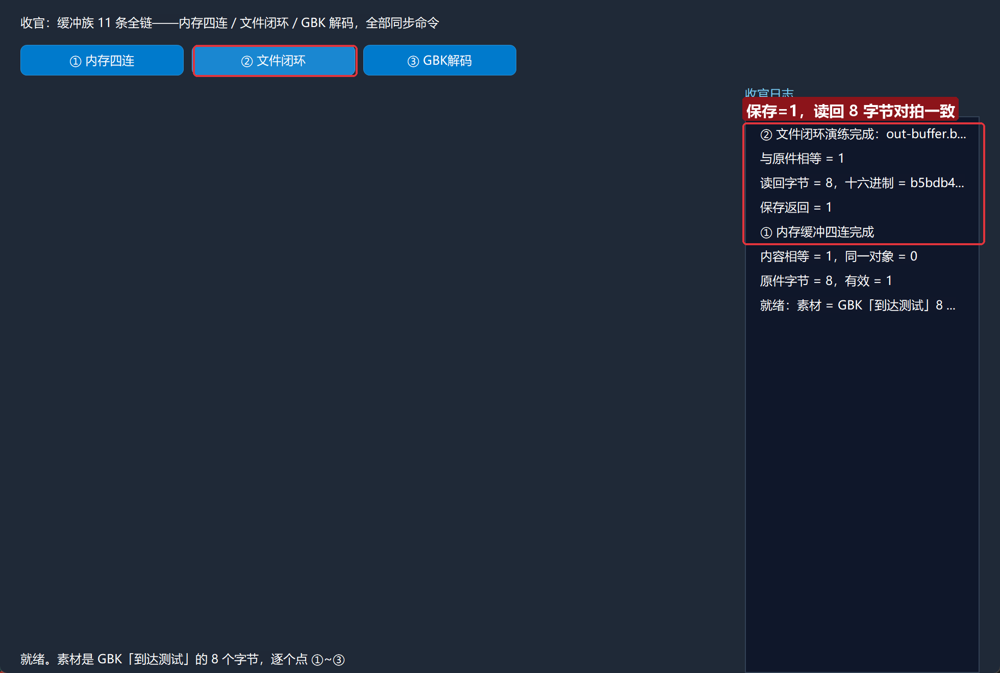
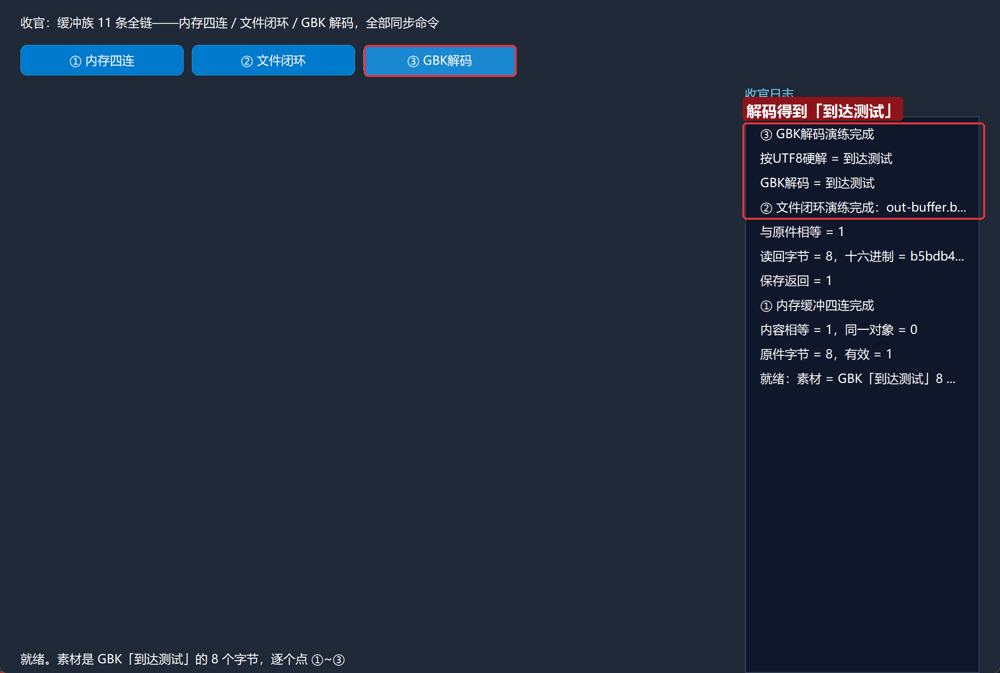

# CEF3 合集 30 · 收官：缓冲族全链（内存四连 / 文件闭环 / GBK 解码）

> 《LingBuilder CEF3 浏览器合集》第 30 集（收官集）。30 集走下来，`CEF3缓冲_*` 这 11 条命令一直在当配角：第 26 集造写入数据、第 27 集接读取结果、第 28 集装图像、第 29 集导证书。收官集让它当一回主角——用 GBK「到达测试」的 8 个字节，把缓冲族的**内存操作、文件闭环、编码解码**一次跑完。全部是同步命令，零等待零回调，最适合收尾。全程约 30 分钟。
>
> **模块获取**：CEF3 浏览器模块**免费**；另需 **CEF3 受管对象模块**（缓冲族）与 **CEF3 网络模块**（③ 借用它的解码器）。
>
> 前置要求：学过[第 26 集](/guide/tutorials/cef3-26)允许根规则。本集源码包见文末。

## 这一集你将学会

- `CEF3缓冲_从十六进制` / `到十六进制`：字节与文本的两个方向
- `CEF3缓冲_取大小` / `是否有效`：缓冲体检
- `CEF3缓冲_复制` / `是否相等` / `是否同一对象`：内容比较与句柄区分
- `CEF3缓冲_保存文件` / `从文件`：落盘与读回（允许根 = exe 目录）
- `CEF3网络_下载块转文本(缓冲, 编码)`：把字节缓冲按 GBK/UTF-8 解码成文本

## 1. 命令一张表

| 命令 | 参数 | 返回 |
| --- | --- | --- |
| `CEF3缓冲_从十六进制` | hex 文本 | 长整数型（受管缓冲句柄） |
| `CEF3缓冲_到十六进制` | 缓冲句柄 | 文本型 |
| `CEF3缓冲_取大小` | 缓冲句柄 | 长整数型（字节数） |
| `CEF3缓冲_是否有效` | 缓冲句柄 | 整数型（1=有效） |
| `CEF3缓冲_复制` | 缓冲句柄 | 长整数型（独立新句柄） |
| `CEF3缓冲_是否相等` | 缓冲A, 缓冲B | 整数型（按内容比较） |
| `CEF3缓冲_是否同一对象` | 缓冲A, 缓冲B | 整数型（按句柄比较） |
| `CEF3缓冲_保存文件` | 缓冲句柄, 路径 | 整数型（1=成功，拒绝越界路径） |
| `CEF3缓冲_从文件` | 路径 | 长整数型（0=失败） |
| `CEF3缓冲_释放` | 缓冲句柄 | 整数型 |
| `CEF3网络_下载块转文本` | 缓冲句柄, 编码 | 文本型（"utf-8"/"gbk"/"gb18030"，空=自动嗅探） |

四条红线先记住：

- **`复制` 出来的新句柄，内容相等但不是同一对象**：`是否相等` 比 `1`、`是否同一对象` 比 `0`——这两个判据一起用，才能讲清"受管句柄 vs 底层数据"。
- **文件读写都锁在允许根**：`保存文件/从文件` 只认 exe 同目录（相对路径）或目录内的绝对路径，越界一律拒绝。
- **无浏览器控件的项目先 `CEF3_初始化()`**：缓冲的文件读写走允许根登记，老规矩。
- **解码编码留空不是"随便"**：内核会嗅探编码，本集 GBK 字节用空编码也解对了；拿别人的字节流时别赌嗅探，显式传 "gbk"。

## 2. 设计界面

新建项目「收官工具箱」，窗口 980×688（客户区 980×660），三按钮 + 日志——30 集同款布局最后一次登场：

| 控件 | 名称 | 显示内容/属性 | 左距 | 顶距 | 宽度 | 高度 |
| --- | --- | --- | --- | --- | --- | --- |
| 标签 | 说明标签 | 收官：缓冲族 11 条全链——内存四连 / 文件闭环 / GBK 解码，全部同步命令 | 20 | 14 | 740 | 22 |
| 按钮 | 内存按钮 | ① 内存四连 | 20 | 44 | 160 | 30 |
| 按钮 | 文件按钮 | ② 文件闭环 | 188 | 44 | 160 | 30 |
| 按钮 | 解码按钮 | ③ GBK解码 | 356 | 44 | 150 | 30 |
| 标签 | 日志标题 | 收官日志 | 730 | 84 | 230 | 22 |
| 列表框 | 日志列表 | （空） | 730 | 114 | 230 | 546 |
| 标签 | 状态标签 | 就绪。素材是 GBK「到达测试」的 8 个字节，逐个点 ①~③ | 20 | 638 | 690 | 22 |



模块面板确认启用：CEF3 浏览器模块 + CEF3 受管对象模块 + **CEF3 网络模块**（③ 解码）+ 文本处理模块。

## 3. 写代码

### 3.1 内存四连：复制出来的句柄，内容相等、对象不同

```lcpp
事件 _内存按钮_被单击()
    CEF3_初始化()
    局部 长整数型 原件
    局部 长整数型 副本
    原件 = CEF3缓冲_从十六进制("B5BDB4EFB2E2CAD4")
    控件_插入项目(日志列表, 0, "原件字节 = " + 到文本(CEF3缓冲_取大小(原件)) + "，有效 = " + 到文本(CEF3缓冲_是否有效(原件)))
    副本 = CEF3缓冲_复制(原件)
    控件_插入项目(日志列表, 0, "内容相等 = " + 到文本(CEF3缓冲_是否相等(原件, 副本)) + "，同一对象 = " + 到文本(CEF3缓冲_是否同一对象(原件, 副本)))
    CEF3缓冲_释放(副本)
    CEF3缓冲_释放(原件)
    控件_插入项目(日志列表, 0, "① 内存缓冲四连完成")
结束
```

`B5BDB4EFB2E2CAD4` 是 GBK「到达测试」。实测：8 字节、有效 = 1；`复制` 后 `内容相等 = 1` 而 `同一对象 = 0`——两份独立内存装着同样的数据。



### 3.2 文件闭环：保存 → 读回 → 对拍

```lcpp
事件 _文件按钮_被单击()
    CEF3_初始化()
    局部 长整数型 原件
    局部 长整数型 读回
    原件 = CEF3缓冲_从十六进制("B5BDB4EFB2E2CAD4")
    控件_插入项目(日志列表, 0, "保存返回 = " + 到文本(CEF3缓冲_保存文件(原件, "out-buffer.bin")))
    读回 = CEF3缓冲_从文件("out-buffer.bin")
    如果 (读回 == 0)
        控件_插入项目(日志列表, 0, "读回失败（路径越界？）")
        返回 ()
    如果结束
    控件_插入项目(日志列表, 0, "读回字节 = " + 到文本(CEF3缓冲_取大小(读回)) + "，十六进制 = " + CEF3缓冲_到十六进制(读回))
    控件_插入项目(日志列表, 0, "与原件相等 = " + 到文本(CEF3缓冲_是否相等(原件, 读回)))
    CEF3缓冲_释放(读回)
    CEF3缓冲_释放(原件)
    控件_插入项目(日志列表, 0, "② 文件闭环演练完成：out-buffer.bin")
结束
```

实测：`保存返回 = 1`，读回 8 字节，`到十六进制` 打出 `b5bdb4…` 与素材一致，`与原件相等 = 1`。落盘的 `out-buffer.bin` 用十六进制查看器打开，头 4 字节正是 GBK「到达」。



### 3.3 GBK 解码：字节变汉字

```lcpp
事件 _解码按钮_被单击()
    CEF3_初始化()
    局部 长整数型 缓冲
    缓冲 = CEF3缓冲_从十六进制("B5BDB4EFB2E2CAD4")
    控件_插入项目(日志列表, 0, "GBK解码 = " + CEF3网络_下载块转文本(缓冲, "gbk"))
    控件_插入项目(日志列表, 0, "按UTF8硬解 = " + CEF3网络_下载块转文本(缓冲, ""))
    CEF3缓冲_释放(缓冲)
    控件_插入项目(日志列表, 0, "③ GBK解码演练完成")
结束
```

`下载块转文本(缓冲, "gbk")` 稳稳解出「到达测试」；有意思的是空编码那行**也**解对了——内核嗅探兜底认出了 GBK。记住结论：**自己知道编码就显式传，嗅探只是保底**。二进制正文别解码，用 `CEF3缓冲_保存文件` 直接落盘。

## 4. 编译：先看错误列表

「错误列表」**(0)** 才继续：



## 5. 运行：三条链全绿



- **① 内存四连** → `原件字节 = 8，有效 = 1`；`内容相等 = 1，同一对象 = 0`：



- **② 文件闭环** → `保存返回 = 1`，读回 8 字节对拍一致：



- **③ GBK解码** → 两行都解出「到达测试」（显式 GBK 与嗅探兜底）：



## 常见问题急救表

| 症状 | 原因 | 解法 |
| --- | --- | --- |
| 保存/从文件返回 0 | 无控件项目未初始化 / 路径越界 | 先 `CEF3_初始化()`；路径写相对路径落在 exe 旁 |
| `复制` 后改一个另一个也变 | 不可能出现 | 复制是深拷贝独立内存；出现即说明拿到的是同一句柄 |
| 解码结果是乱码 | 编码传错 | 明确知道编码就显式传 "gbk"/"utf-8"；别依赖嗅探 |
| 二进制文件被解成乱码文本 | 对二进制用了转文本 | 改用 `CEF3缓冲_保存文件` 原样落盘 |
| hex 里混入空格解不出 | 素材不干净 | hex 只能有 0-9a-f；先 `文本_删全部空白` |
| 句柄忘释放越跑越占 | 缓冲纪律 | 每个 `从十六进制/从文件/复制` 配对一个 `释放` |

## 本集小结

- 缓冲族 11 条全覆盖：**造（从十六进制/从文件）→ 查（取大小/是否有效）→ 比（复制/是否相等/是否同一对象）→ 存（保存文件）→ 解（下载块转文本）→ 释放**。
- `内容相等` 与 `同一对象` 是两把尺子：前者比数据，后者比句柄。
- 30 集的终点也是起点：缓冲 + 传输 + 事件 + 会话 + 网络，这套受管句柄纪律就是你用中文 C++ 驾驭 Chromium 的地基。

## 源码包

本集完整源码已打包为 **CEF3合集30-收官工具箱.lcpppkg**（见[示例源码区](/demos)），导入即可运行对照学习。

**系列收官**：30 集全部完结。回[合集总览](/guide/tutorials/cef3)从头复习，或去[示例源码区](/demos)把 30 个源码包一次抱走。
