# Edge 合集 02 · 导航进阶：页面信息查看器

> 《LingBuilder Edge 浏览器合集》第 2 集（基础篇）。上一集我们用 4 条命令做了一个迷你浏览器；这一集把**导航族 11 条命令**一次讲全，并动手做「页面信息查看器」——取页面标题、取当前地址、看历史状态，还有一个不联网也能跑的绝活：**把一段 HTML 文本直接变成页面**。全程约 30 分钟。
>
> 前置要求：学过[第 1 集](/guide/tutorials/edge-01)。本集源码包见文末。

## 这一集你将学会

- 导航族 11 条命令的全家福（本集动手用 6 条，其余 5 条进阶条目混个脸熟）
- `EdgeView导航_取标题` / `EdgeView导航_取地址`：把页面信息「问」回来
- `EdgeView导航_取状态JSON`：一条命令看清后退/前进可用性
- `EdgeView导航_HTML`：不联网，内存 HTML 直接变页面
- 多行文本块 `"""..."""`：把大段文本写进中文代码

## 1. 导航族 11 条命令全家福

| 命令 | 作用 | 本集 |
| --- | --- | --- |
| `EdgeView导航_HTML(控件, HTML)` | 把内存里的一段 HTML 直接显示成页面 | ✅ 动手 |
| `EdgeView导航_停止(控件)` | 停止当前加载 | ✅ 动手 |
| `EdgeView导航_取标题(控件)` | 返回当前页面标题（文本型） | ✅ 动手 |
| `EdgeView导航_取地址(控件)` | 返回当前页面地址（文本型） | ✅ 动手 |
| `EdgeView导航_取状态JSON(控件)` | 返回后退/前进/挂起/进程等状态 JSON | ✅ 动手 |
| `EdgeView导航_挂起异步(控件, &完成处理器)` | 挂起浏览器省内存（后台标签页的原理） | 进阶 |
| `EdgeView导航_恢复(控件)` | 恢复挂起的浏览器 | 进阶 |
| `EdgeView导航_取进程信息异步(控件, &完成处理器)` | 异步取浏览器进程清单 | 进阶 |
| `EdgeView导航_请求(控件, 地址, 方法, 请求头, 正文)` | 带方法/请求头/正文的高级导航 | 进阶 |
| `EdgeView导航_设置虚拟主机(控件, 主机名, 目录, 访问模式)` | 把一个虚拟域名映射到本地目录 | 进阶 |
| `EdgeView导航_清除虚拟主机(控件, 主机名)` | 清除虚拟主机映射 | 进阶 |

> 带「异步」和「完成处理器」的命令要配合 `&处理器名` 使用，属于第 3、4 集的内容，这里先不展开。

## 2. 新建项目

欢迎页点「新建项目」，项目名称填 **页面信息查看器**，模板「Windows 界面设计」，创建位置留空：

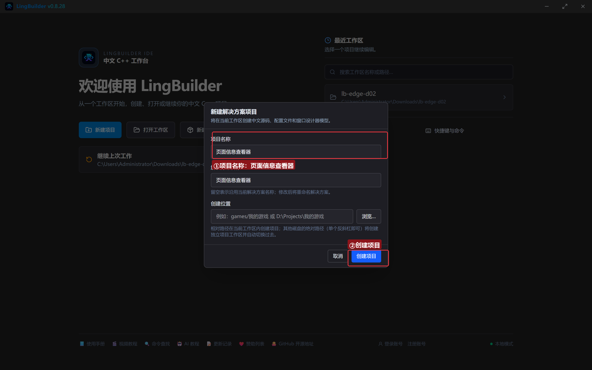

## 3. 启用模块

和第 1 集一样，确认三个模块在「已启用」分组：**EdgeView 浏览器模块**、**Win32窗口基础模块**、**文本处理模块**（判空还要用 `文本_取长度`）：

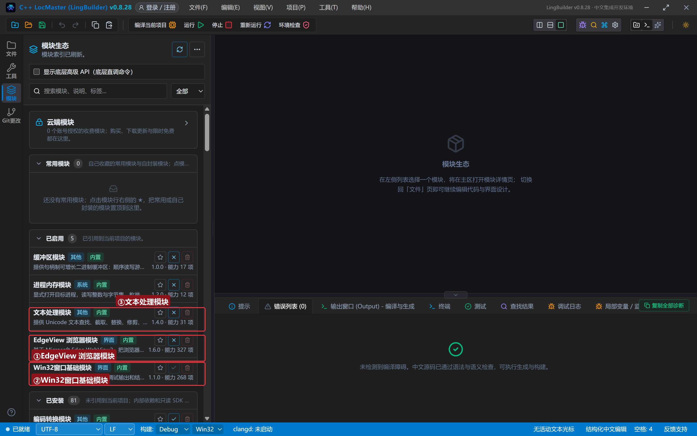

## 4. 设计界面

窗口 960×720。比第 1 集多了一个「结果列表」——页面信息一行行列出来，比状态标签更能装：

| 控件 | 名称 | 显示内容 | 左距 | 顶距 | 宽度 | 高度 |
| --- | --- | --- | --- | --- | --- | --- |
| 标签 | 地址标签 | 地址 | 20 | 18 | 50 | 22 |
| 编辑框 | 地址框 | https://example.com | 76 | 14 | 600 | 28 |
| 按钮 | 打开按钮 | 打开网页 | 686 | 12 | 90 | 32 |
| 按钮 | 停止按钮 | 停止加载 | 786 | 12 | 90 | 32 |
| 按钮 | 后退按钮 | 后退 | 20 | 56 | 90 | 30 |
| 按钮 | 前进按钮 | 前进 | 120 | 56 | 90 | 30 |
| **Edge浏览器** | **浏览器1** | （控件面板拖入） | 20 | 96 | 920 | 400 |
| 列表框 | 结果列表 | — | 20 | 508 | 920 | 130 |
| 按钮 | 取标题按钮 | 取页面标题 | 20 | 648 | 150 | 30 |
| 按钮 | 取地址按钮 | 取当前地址 | 180 | 648 | 150 | 30 |
| 按钮 | 历史状态按钮 | 看历史状态 | 340 | 648 | 150 | 30 |
| 按钮 | 本地页面按钮 | 加载本地页面 | 500 | 648 | 180 | 30 |
| 标签 | 状态标签 | 就绪 | 690 | 654 | 250 | 24 |

绑 8 个按钮事件 + 窗口「创建完毕」。

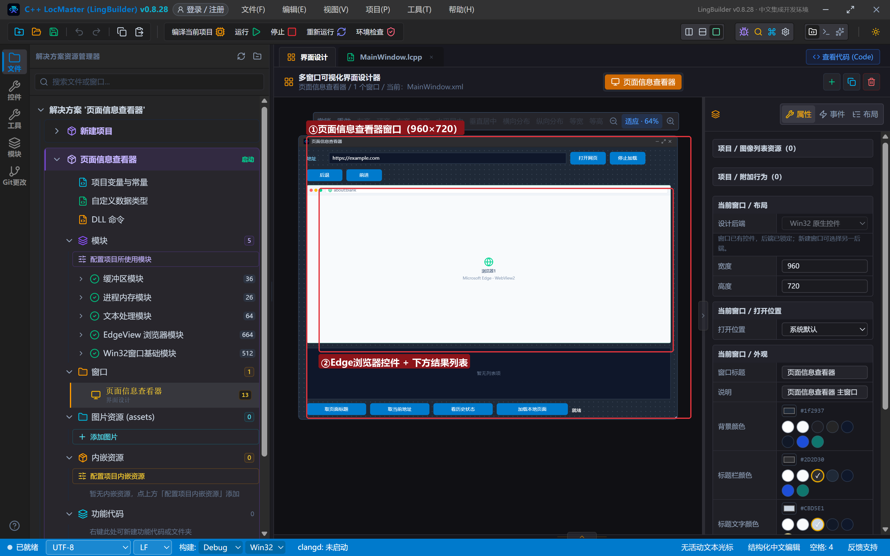

## 5. 写代码

### 5.1 创建完毕：还是熟悉的三行

```lcpp
事件 _MainWindow_创建完毕()
    控件_设置文本(地址框, "https://example.com")
    EdgeView_导航控件(浏览器1, "https://example.com")
    控件_设置文本(状态标签, "正在打开主页……")
结束
```

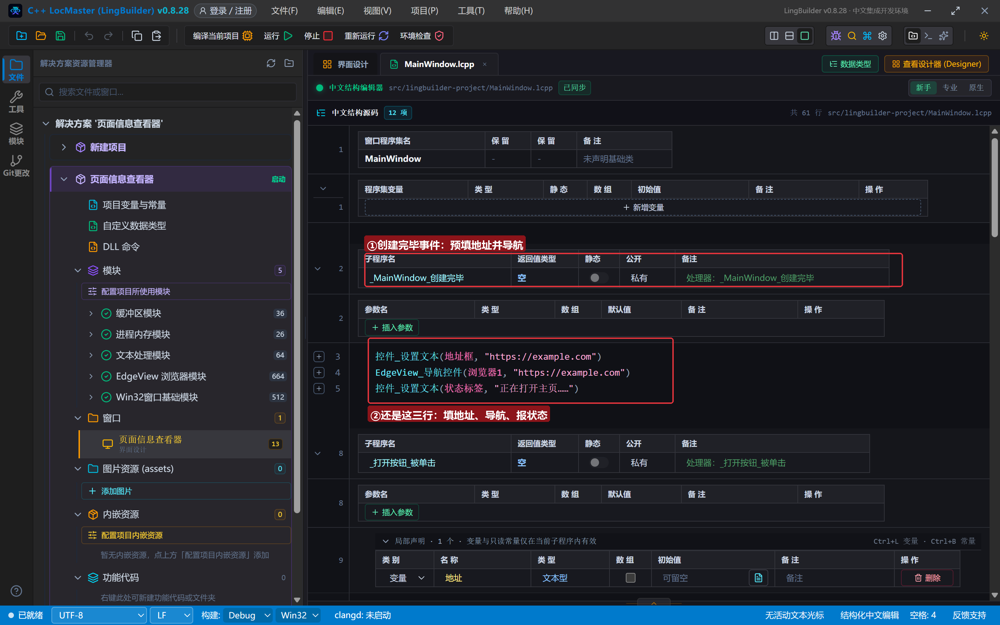

### 5.2 打开网页与停止加载

```lcpp
事件 _打开按钮_被单击()
    局部 文本型 地址
    地址 = 控件_取文本(地址框)
    如果 (文本_取长度(地址) = 0)
        控件_添加项目(结果列表, "请先在地址栏输入网址")
        返回()
    如果结束
    EdgeView_导航控件(浏览器1, 地址)
    控件_添加项目(结果列表, "正在打开：" + 地址)
结束

事件 _停止按钮_被单击()
    EdgeView导航_停止(浏览器1)
    控件_添加项目(结果列表, "已调用停止加载（页面加载慢时能看到加载被打断）")
结束
```

`EdgeView导航_停止` 就一句话。页面秒开时看不出效果——网速慢、页面大时点它，加载立刻被打断。它不会出错：停止一个已经加载完的页面，什么也不会发生。

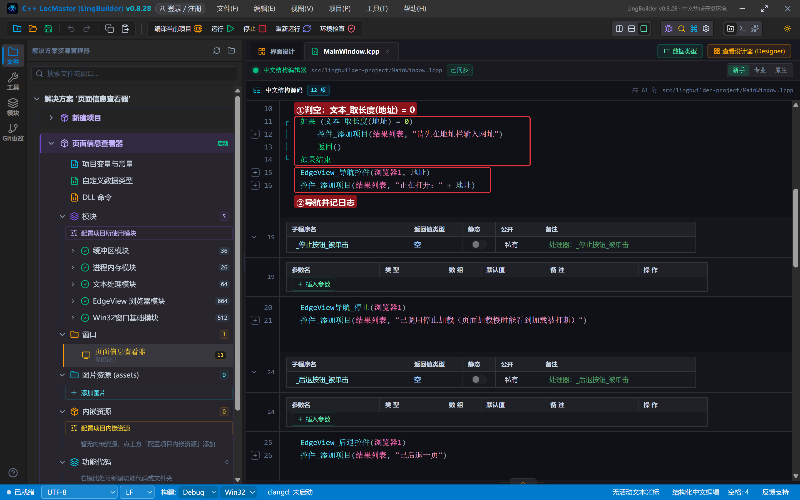

### 5.3 取标题 / 取地址：把页面信息「问」回来

```lcpp
事件 _取标题按钮_被单击()
    控件_添加项目(结果列表, "页面标题：" + EdgeView导航_取标题(浏览器1))
结束

事件 _取地址按钮_被单击()
    控件_添加项目(结果列表, "当前地址：" + EdgeView导航_取地址(浏览器1))
结束
```

两条命令都返回文本型，直接拼接进结果列表。**注意**：页面还在加载时取到的可能是旧值——「取数前先等页面加载完」，这个「等」的正确姿势在第 3 集（事件）。

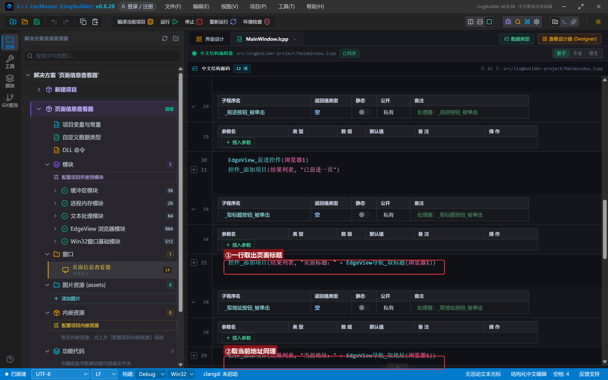

### 5.4 看历史状态：一条 JSON 全知道

```lcpp
事件 _历史状态按钮_被单击()
    控件_添加项目(结果列表, "历史状态：" + EdgeView导航_取状态JSON(浏览器1))
结束
```

返回的是一段 JSON，长得像这样：

```json
{"canGoBack":"true","canGoForward":"false","suspended":"false","browserProcessId":"42968","frameId":"1","userDataFolder":".edgeview/edge_..."}
```

`canGoBack` 是 `true` 就说明能后退；`canGoForward` 是 `true` 就说明能前进。以后做自己的浏览器按钮置灰/点亮，就靠它。

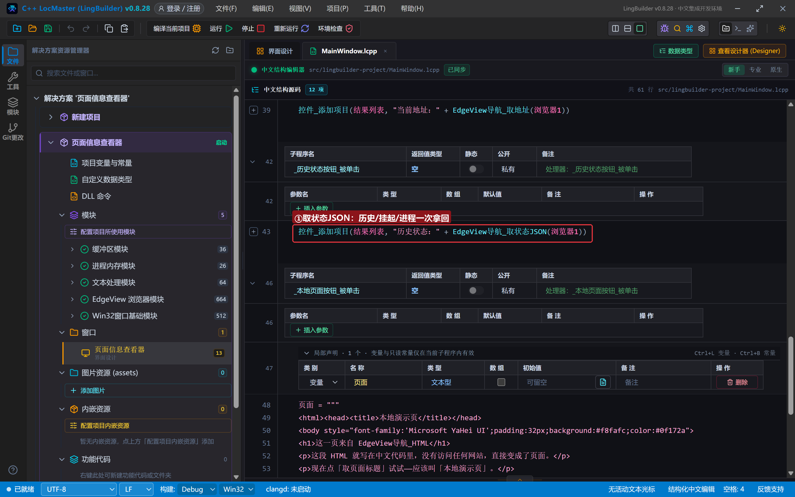

### 5.5 加载本地页面：不联网的绝活

先声明一个文本型变量，用**多行文本块** `"""..."""` 把整段 HTML 原样装进去，再一条命令交给浏览器：

```lcpp
事件 _本地页面按钮_被单击()
    局部 文本型 页面
    页面 = """
<html><head><title>本地演示页</title></head>
<body style="font-family:'Microsoft YaHei UI';padding:32px;background:#f8fafc;color:#0f172a">
<h1>这一页来自 EdgeView导航_HTML</h1>
<p>这段 HTML 就写在中文代码里，没有访问任何网站，直接变成了页面。</p>
<p>现在点「取页面标题」试试——应该叫「本地演示页」。</p>
</body></html>
"""
    EdgeView导航_HTML(浏览器1, 页面)
    控件_添加项目(结果列表, "已加载内存 HTML（没有联网）")
结束
```

多行文本块以 `"""` 开头、`"""` 结尾，中间的内容**原样保留**——换行、引号都不用转义，是往代码里塞 HTML、JSON、SQL 的标准姿势。

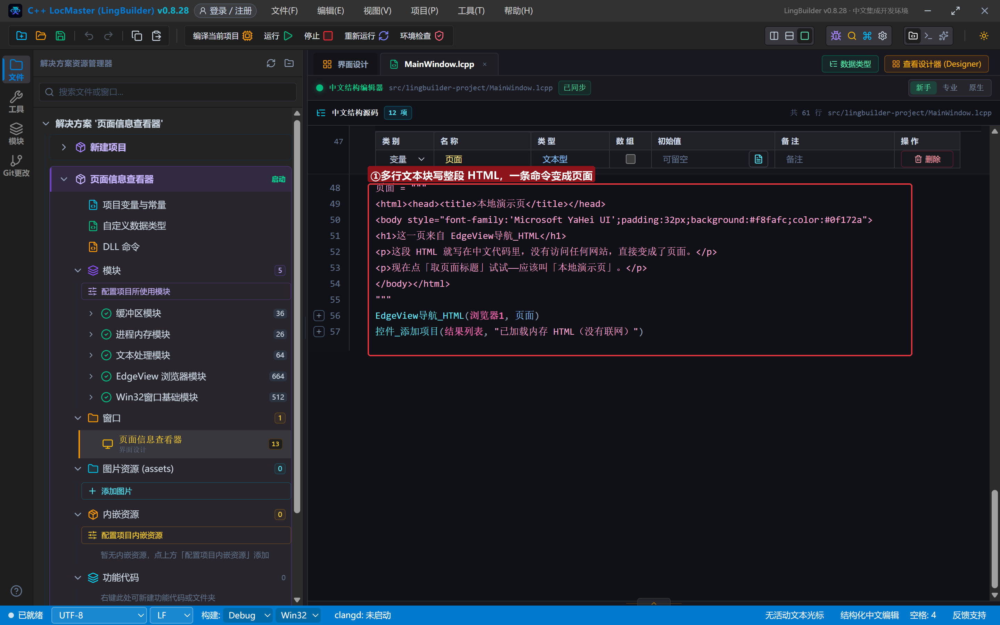

## 6. 编译：错误列表 (0)

点「编译当前项目」，先看底部错误列表——(0)，未检测到编译障碍：

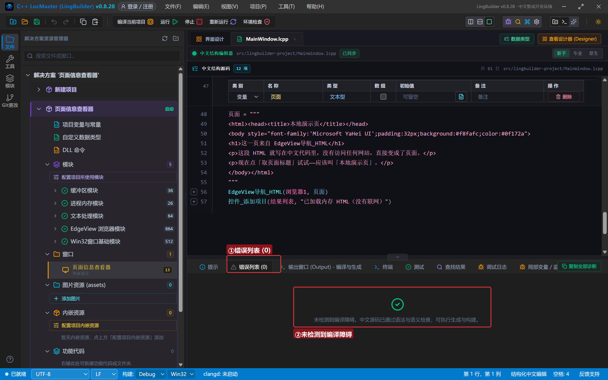

## 7. 运行：页面信息自己报上门

### 7.1 取标题、取地址

程序一打开就把 example.com 装进浏览器。点「取页面标题」，再点「取当前地址」：

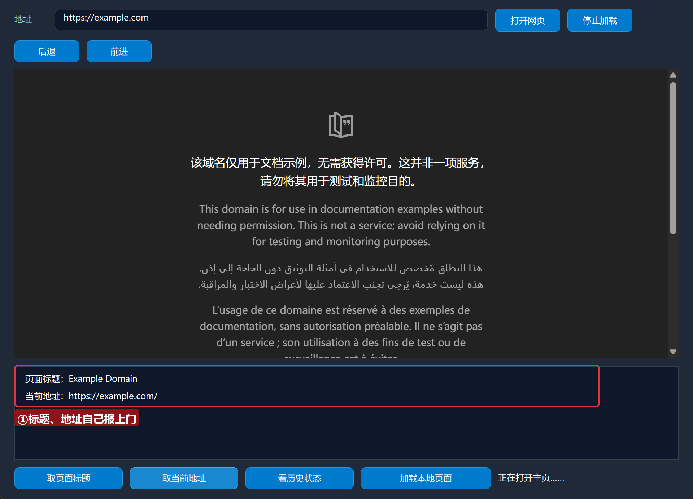

结果列表报出「页面标题：Example Domain」和「当前地址：https://example.com/」——没滚动、没复制，页面信息自己回来了。

### 7.2 加载本地页面

点「加载本地页面」，再点「取页面标题」：

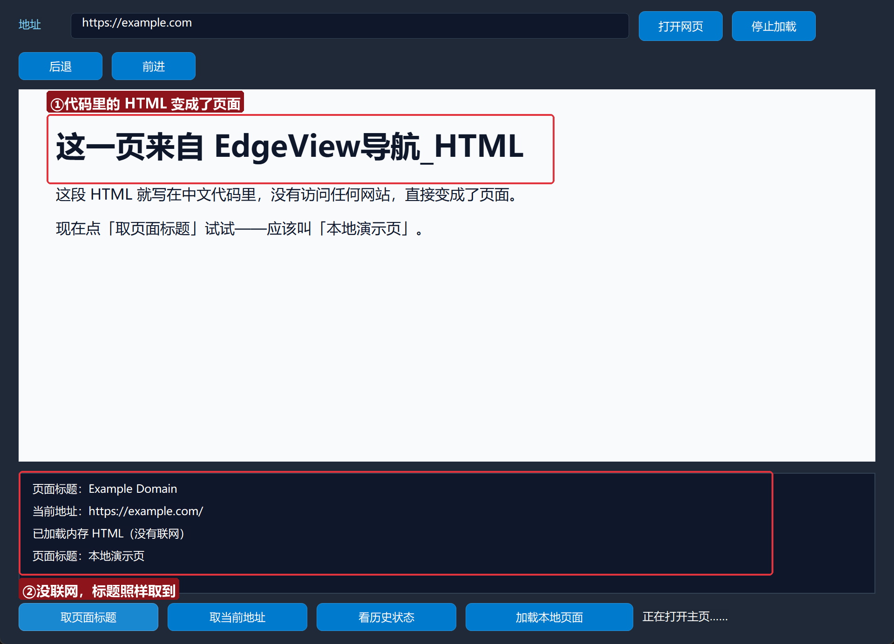

页面变成了我们代码里写的那段 HTML，标题取回来是「本地演示页」——**全程没联网**。做软件的「关于页」「帮助页」「本地报表」，这一招就够了。

### 7.3 看历史状态

现在浏览器里已经先后打开过 example.com 和本地页面两页。点「看历史状态」：

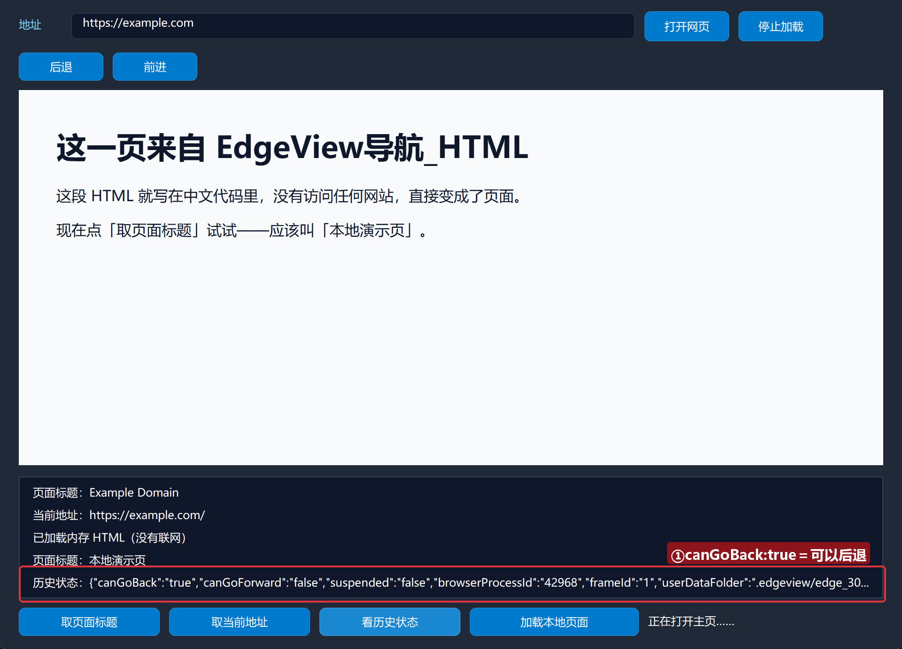

`canGoBack:true` ——可以后退。点「后退」，浏览器回到 example.com，再点「取页面标题」，又是「Example Domain」：

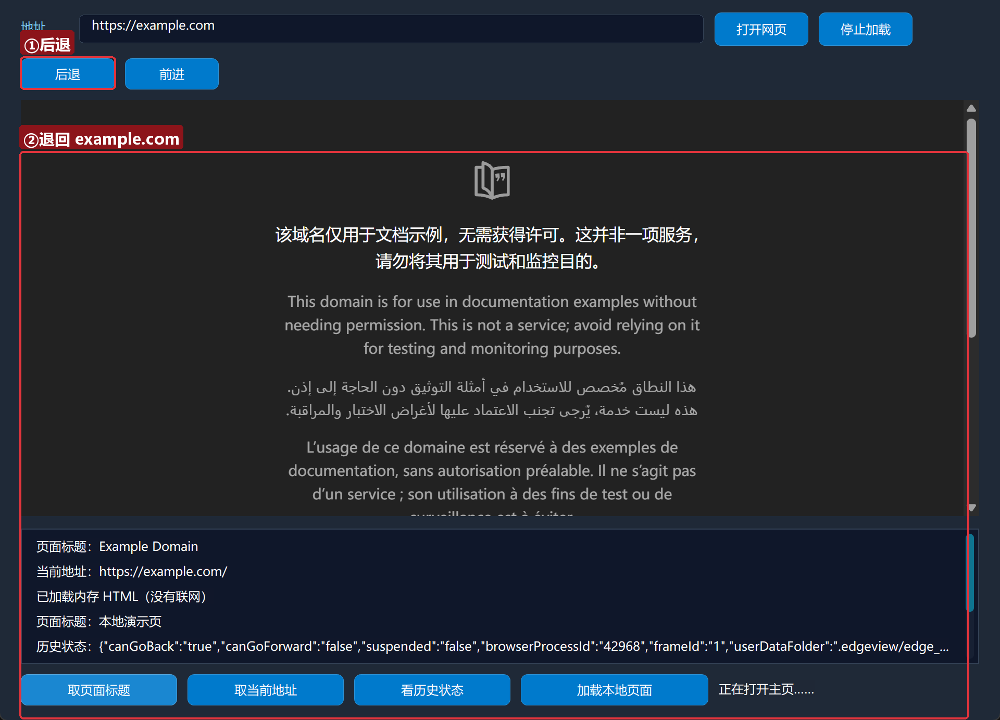

### 7.4 停止加载

「停止加载」按钮在地址栏右边。页面秒开时点它看不到过程——找个网络慢的时候（或很大的网页）再试，加载会立刻被打断：

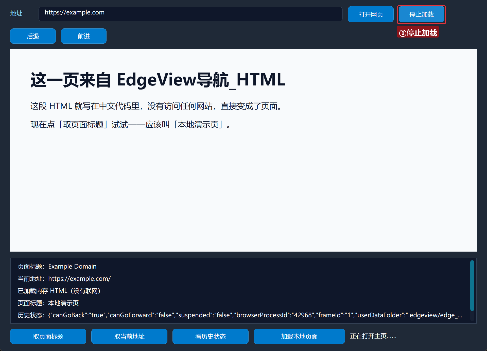

## 8. 常见问题急救表

| 症状 | 原因 | 解法 |
| --- | --- | --- |
| 取标题返回空或旧值 | 页面还没加载完 | 等页面渲染出来再取；正确姿势见第 3 集事件 |
| 多行文本块报错 | `"""` 没有成对、没单独成结构 | 开头结尾各一行 `"""`，中间原样写 |
| HTML 显示乱码 | 页面没写 `<meta charset>` 或标题栏字体问题 | 文本块里加 `<meta charset="UTF-8">`（本集页面纯 ASCII 标题不受影响） |
| 状态 JSON 看不懂 | 它就是一段文本 | 认准 `canGoBack` / `canGoForward` 两个键 |
| 停止加载没反应 | 页面已经加载完了 | 它只能打断「正在进行的」加载 |
| 想让一个域名指向本地目录 | 这是虚拟主机的事 | `EdgeView导航_设置虚拟主机`，进阶条目，配合第 3 集事件食用更佳 |

## 本集小结

- 导航族 11 条命令见面完毕：本集动手 6 条（HTML/停止/取标题/取地址/取状态JSON/导航控件），进阶 5 条留有印象。
- 取信息三件套：`取标题` / `取地址` / `取状态JSON`——都是「问回来」的命令，要在页面加载完之后问。
- `EdgeView导航_HTML` + 多行文本块 = 不联网造页面。
- 「等页面加载完再取数」还差一个正经办法——下集事件驱动，让浏览器主动通知我们。

## 源码包

本集完整源码已打包为 **页面信息查看器.lcpppkg**（随本教程同目录分发，官网示例源码区可下载），导入即可运行。

**下一集预告**：《事件驱动》——浏览器一有风吹草动就通知我们：加载完成、地址变化、标题变化，做一个真正的「浏览器状态栏」，把第 1 集留下的「地址栏不联动」彻底解决。

[回合集总览](/guide/tutorials/edge)
