# Edge 合集 04 · 执行 JavaScript：脚本控制台

> 《LingBuilder Edge 浏览器合集》第 4 集（基础篇）收官。前三集我们在浏览器「外面」操作——导航、取信息、听事件；这一集往页面里派一个「内应」：**执行 JavaScript**。页面里有浏览器才知道的细节（有多少链接、某个输入框填了什么、某个按钮在哪），一段脚本就能全拿回来。本集做一个「脚本控制台」，并把脚本族 7 条命令与 **JS 返回值回读规则**一次讲透。全程约 30 分钟。
>
> 前置要求：学过[第 1 集](/guide/tutorials/edge-01)~[第 3 集](/guide/tutorials/edge-03)。不需要系统学过 JavaScript，本集用到的都是一看就懂的表达式。本集源码包见文末。

## 这一集你将学会

- `EdgeView_执行JS控件`：一条命令在页面里跑 JavaScript、拿回返回值
- **返回值回读规则**：数字、文本、逻辑值回到中文代码里长什么样
- `EdgeView脚本_执行详情异步`：脚本出错了，错误名字、行号一条不落
- `EdgeView脚本_文档预注入异步`：注册「开机脚本」，以后每个页面都自动执行
- 脚本族 7 条命令全家福

## 1. 脚本族 7 条命令全家福

| 命令 | 作用 | 本集 |
| --- | --- | --- |
| `EdgeView_执行JS控件(控件, 脚本)` | 执行 JavaScript，直接返回 JSON 编码结果 | ✅ 动手 |
| `EdgeView脚本_执行异步(控件, 脚本, &完成处理器)` | 异步执行，结果走完成处理器 | 进阶 |
| `EdgeView脚本_执行详情异步(控件, 脚本, &完成处理器)` | 异步执行，成功/JSON/字符串/异常详情全都要 | ✅ 动手 |
| `EdgeView脚本_文档预注入异步(控件, 脚本, &完成处理器)` | 注册「每个新文档创建前自动执行」的脚本 | ✅ 动手 |
| `EdgeView脚本_移除文档预注入(控件, 脚本ID)` | 移除已注册的开机脚本 | 进阶 |
| `EdgeView脚本_发送字符串消息(控件, 消息)` | 向网页推送字符串（网页用 chrome.webview 接收） | JS双向桥篇 |
| `EdgeView脚本_发送JSON消息(控件, JSON)` | 向网页推送 JSON | JS双向桥篇 |

> 「发送消息」两条是把数据**推给**网页（网页端要写接收代码），属于《JS 双向桥篇》的内容；本集专注「从网页**拿回**」。

## 2. 先背下这条规则：返回值是 JSON 编码

`EdgeView_执行JS控件` 的返回值**不是裸值**，而是 WebView2 按 **JSON 规则编码**后的文本：

| 脚本 | 页面里的值 | 你拿到的文本 |
| --- | --- | --- |
| `document.links.length` | 数字 23 | `23`（没有引号） |
| `document.title` | 文本 Internet Assigned Numbers Authority | `"Internet Assigned Numbers Authority"`（**带英文双引号**） |
| `true` | 逻辑值 | `true` |
| `null` / 不存在的变量 | 空 | `null` |

所以：拿数字直接用；拿文本要记得它带着引号（需要纯文本时把首尾各去掉 1 个字符即可）。**这是初学最容易懵的一处，本集全程用真实返回值示范。**

## 3. 新建项目

欢迎页点「新建项目」，项目名称填 **脚本控制台**，模板「Windows 界面设计」，创建位置留空：

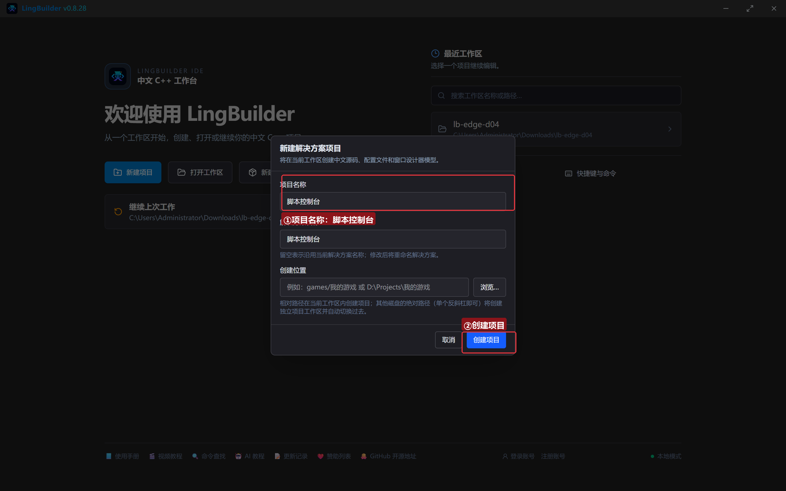

## 4. 启用模块

老三样：**EdgeView 浏览器模块**、**Win32窗口基础模块**、**文本处理模块**：

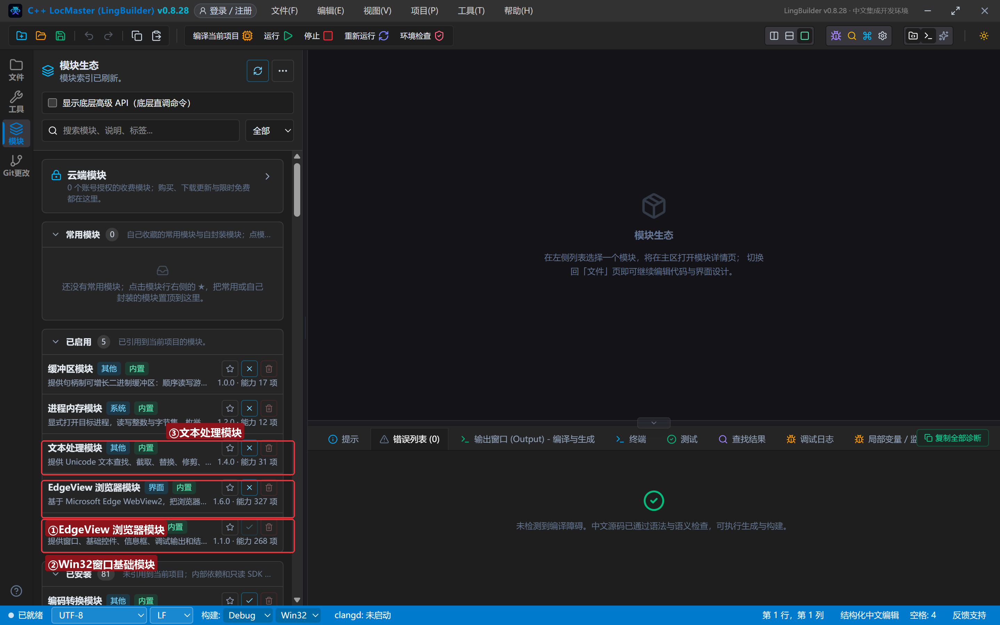

## 5. 设计界面

窗口 960×720。上半是浏览器，下半是「控制台」：一个多行脚本框 + 四颗预设按钮 + 一个结果列表：

| 控件 | 名称 | 显示内容 | 左距 | 顶距 | 宽度 | 高度 |
| --- | --- | --- | --- | --- | --- | --- |
| 标签 | 脚本标签 | 脚本 | 20 | 18 | 50 | 22 |
| 编辑框 | 脚本框 | document.title（多行：是） | 76 | 14 | 700 | 70 |
| 按钮 | 执行按钮 | 执行脚本 | 786 | 32 | 90 | 34 |
| **Edge浏览器** | **浏览器1** | （控件面板拖入） | 20 | 96 | 920 | 380 |
| 列表框 | 结果列表 | — | 20 | 488 | 920 | 140 |
| 按钮 | 数链接按钮 | 数一数链接 | 20 | 640 | 150 | 30 |
| 按钮 | 换背景按钮 | 换个背景色 | 180 | 640 | 150 | 30 |
| 按钮 | 出错详情按钮 | 出错详情 | 340 | 640 | 150 | 30 |
| 按钮 | 注入按钮 | 注入开机脚本 | 500 | 640 | 180 | 30 |
| 标签 | 状态标签 | 就绪 | 690 | 644 | 250 | 22 |

> 脚本框记得把「多行」勾上——JavaScript 经常要写长。

绑 5 个按钮事件 + 窗口「创建完毕」。

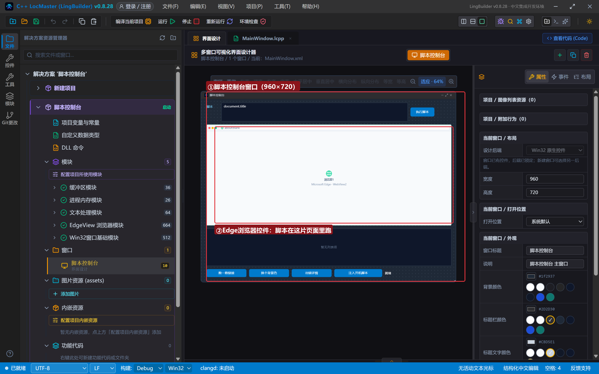

## 6. 写代码

### 6.1 创建完毕

```lcpp
事件 _MainWindow_创建完毕()
    控件_设置文本(脚本框, "document.title")
    EdgeView_导航控件(浏览器1, "https://www.iana.org")
    控件_设置文本(状态标签, "正在打开 iana.org……等加载完再执行")
    控件_插入项目(结果列表, 0, "等页面加载完，点「执行脚本」拿返回值")
结束
```

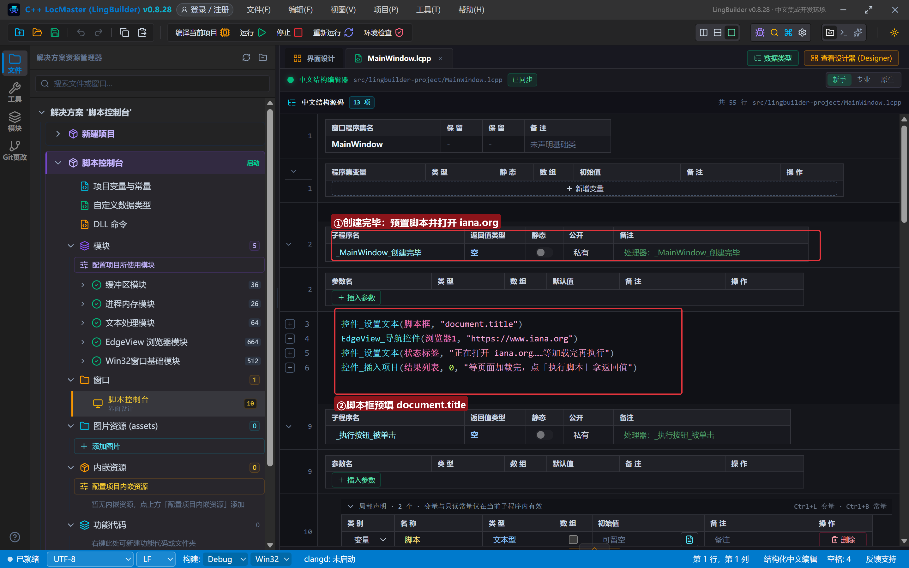

### 6.2 执行脚本：一条命令拿返回值

```lcpp
事件 _执行按钮_被单击()
    局部 文本型 脚本
    局部 文本型 结果
    脚本 = 控件_取文本(脚本框)
    如果 (文本_取长度(脚本) = 0)
        控件_插入项目(结果列表, 0, "请先在脚本框里输入 JavaScript")
        返回()
    如果结束
    结果 = EdgeView_执行JS控件(浏览器1, 脚本)
    控件_插入项目(结果列表, 0, "返回(JSON)：" + 结果)
    控件_插入项目(结果列表, 0, "执行：" + 脚本)
    控件_设置文本(状态标签, "已执行，返回值见结果列表")
结束
```

`EdgeView_执行JS控件(控件, 脚本)` 会等脚本跑完再把结果交给你——在按钮处理器里这样用刚刚好。脚本框里写什么，它就执行什么：改 `document.title` 为 `document.links.length`、`document.body.innerText.length`……任何「有值」的 JavaScript 表达式都行。

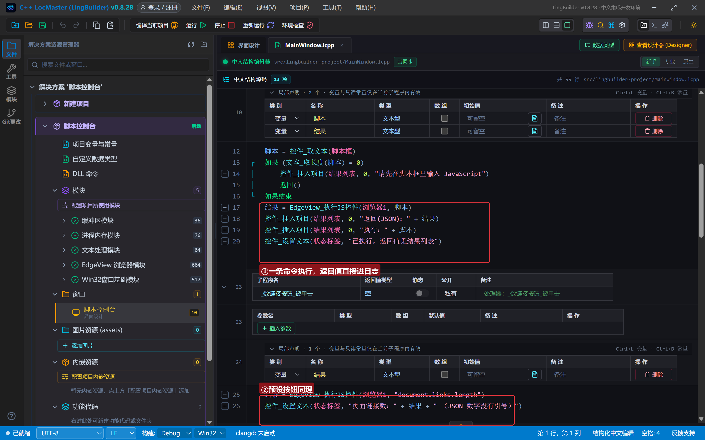

### 6.3 两颗预设按钮

```lcpp
事件 _数链接按钮_被单击()
    局部 文本型 结果
    结果 = EdgeView_执行JS控件(浏览器1, "document.links.length")
    控件_设置文本(状态标签, "页面链接数：" + 结果 + " （JSON 数字没有引号）")
结束

事件 _换背景按钮_被单击()
    局部 文本型 结果
    结果 = EdgeView_执行JS控件(浏览器1, "document.body.style.background='#fef3c7'; 'done'")
    控件_设置文本(状态标签, "改背景返回：" + 结果 + " （最后那个 'done' 是脚本的返回值）")
结束
```

第二段脚本演示两个要点：① 脚本可以**做多件事**（先改背景，再返回值）；② 多条语句用分号隔开时，**最后一条的值**就是返回值——我们让它返回 `'done'`，拿回来就是带引号的 `"done"`。

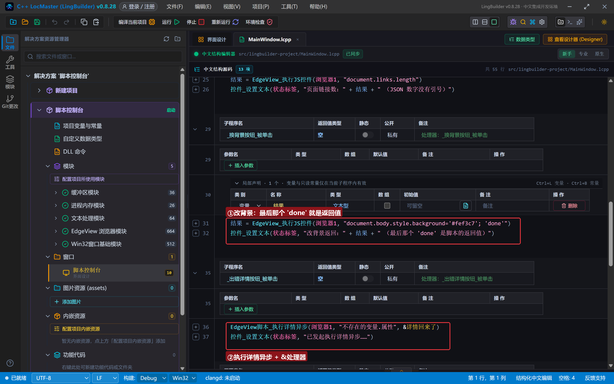

### 6.4 出错详情：异常名字、行号全知道

脚本写错怎么办？`EdgeView_执行JS控件` 出错时只返回空文本；想知道**错在哪**，用 `EdgeView脚本_执行详情异步`——异步命令，结果通过完成处理器取回：

```lcpp
事件 _出错详情按钮_被单击()
    EdgeView脚本_执行详情异步(浏览器1, "不存在的变量.属性", &详情回来了)
    控件_设置文本(状态标签, "已发起执行详情异步……")
结束

事件 详情回来了()
    控件_插入项目(结果列表, 0, "详情返回：" + EdgeView任务_取结果(EdgeView任务_取当前任务ID()))
    控件_设置文本(状态标签, "详情已取回，看结果列表第一行")
结束
```

两个新面孔：`&处理器名`（异步命令完成时自动调用的处理器，`&` 后名字必须一字不差）和 `EdgeView任务_取结果(EdgeView任务_取当前任务ID())`（取回本次任务的结果文本，是一段 JSON，异常时带 `exceptionName`/`exceptionMessage`/行号列号）。

### 6.5 开机脚本：每个页面都自动执行

```lcpp
事件 _注入按钮_被单击()
    EdgeView脚本_文档预注入异步(浏览器1, "window.__lingbuilder = '注入成功'", &注入完成)
    控件_设置文本(状态标签, "已注册开机脚本：以后每个页面都自动执行")
结束

事件 注入完成()
    控件_插入项目(结果列表, 0, "开机脚本已注册（ID：" + EdgeView任务_取结果(EdgeView任务_取当前任务ID()) + "），重新打开页面…")
    EdgeView_导航控件(浏览器1, "https://www.iana.org")
结束
```

「文档预注入」注册的脚本在**每个新文档创建之前**自动执行（比页面自己的脚本还早）。注意它**只对以后打开的页面生效**——当前已经打开的页面不会补跑，所以注册完成处理器里顺手重新导航一次。之后在脚本框执行 `window.__lingbuilder`，就能拿到 `"注入成功"`。想撤销时用 `EdgeView脚本_移除文档预注入` 传入注册时返回的脚本 ID。

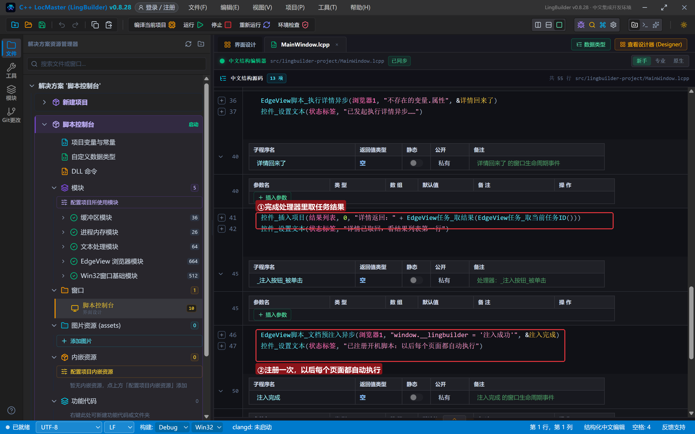

## 7. 编译：错误列表 (0)

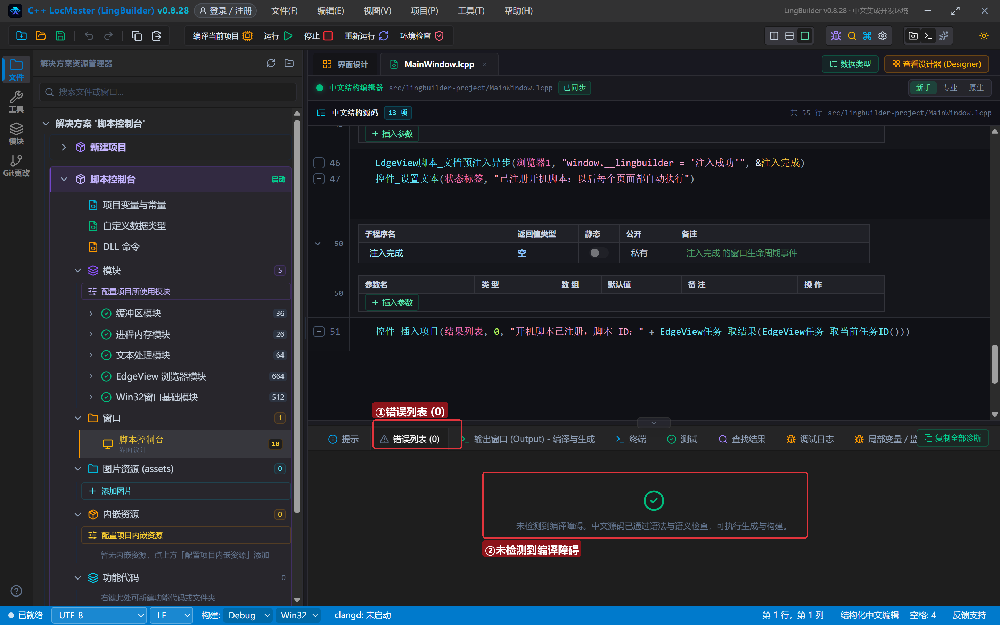

## 8. 运行：让网页替我们干活

### 8.1 取页面标题

程序打开 iana.org 后，直接点「执行脚本」（脚本框已预填 `document.title`）：

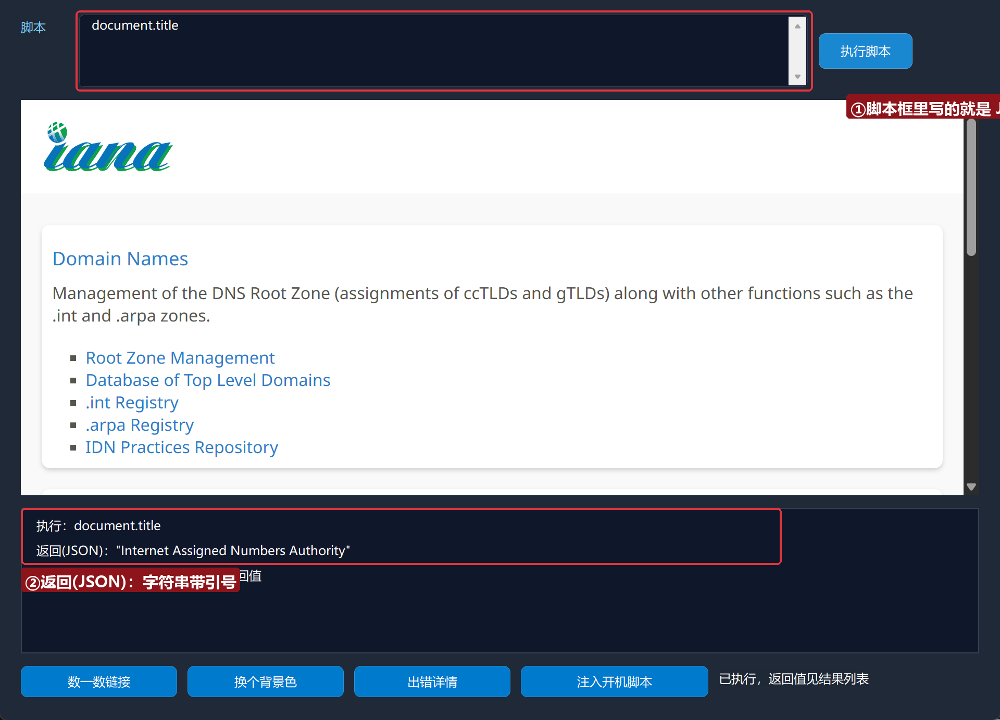

结果列表报出 `返回(JSON)："Internet Assigned Numbers Authority"`——看清楚，**两边带着英文双引号**，这就是 JSON 编码的文本。

### 8.2 数一数链接

点「数一数链接」——状态栏显示页面链接数，纯数字没有引号：

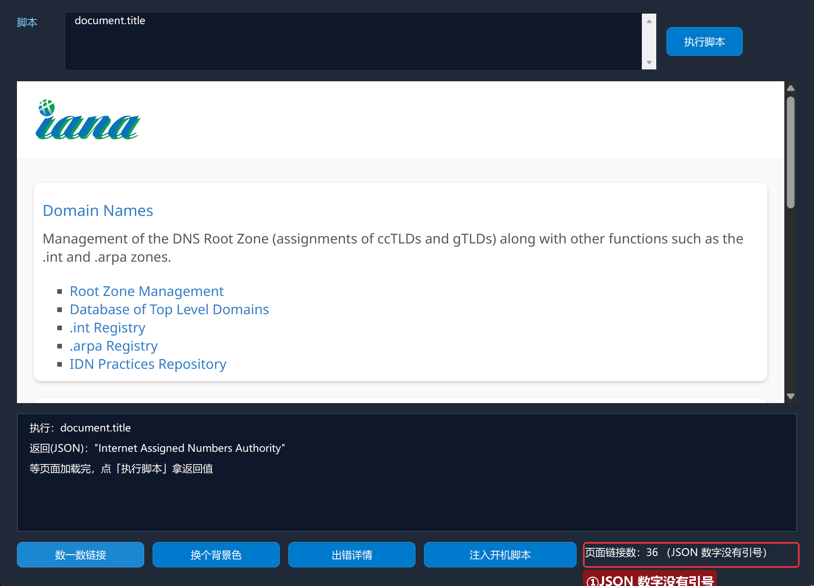

### 8.3 换个背景色

点「换个背景色」——页面底色当场变成奶油色，状态栏报 `返回 "done"`：

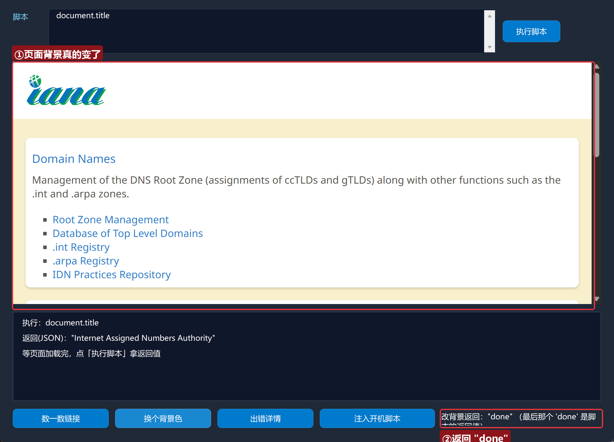

中文代码不仅「读」了页面，还「改」了页面——读写全通。

### 8.4 出错详情

点「出错详情」——脚本 `不存在的变量.属性` 是故意写错的：

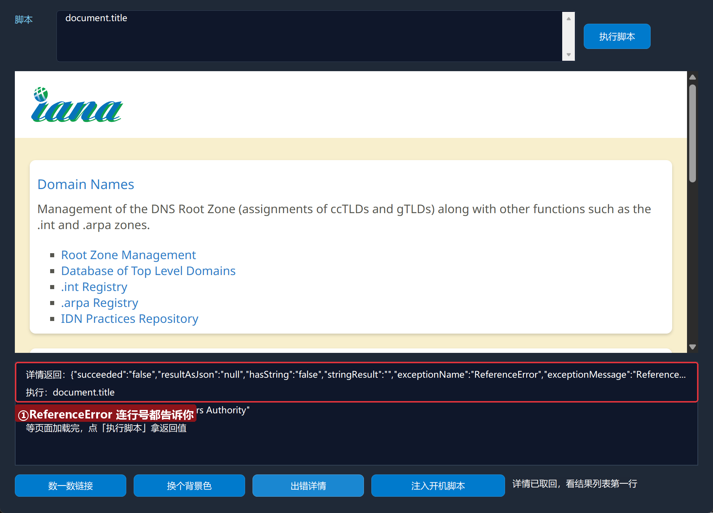

结果列表的详情 JSON 里 `exceptionName:"ReferenceError"` 清清楚楚——以后排查脚本，看它就够了。

### 8.5 开机脚本

点「注入开机脚本」——注册完成后程序自动重新打开页面，再把脚本框改成 `window.__lingbuilder` 点「执行脚本」：

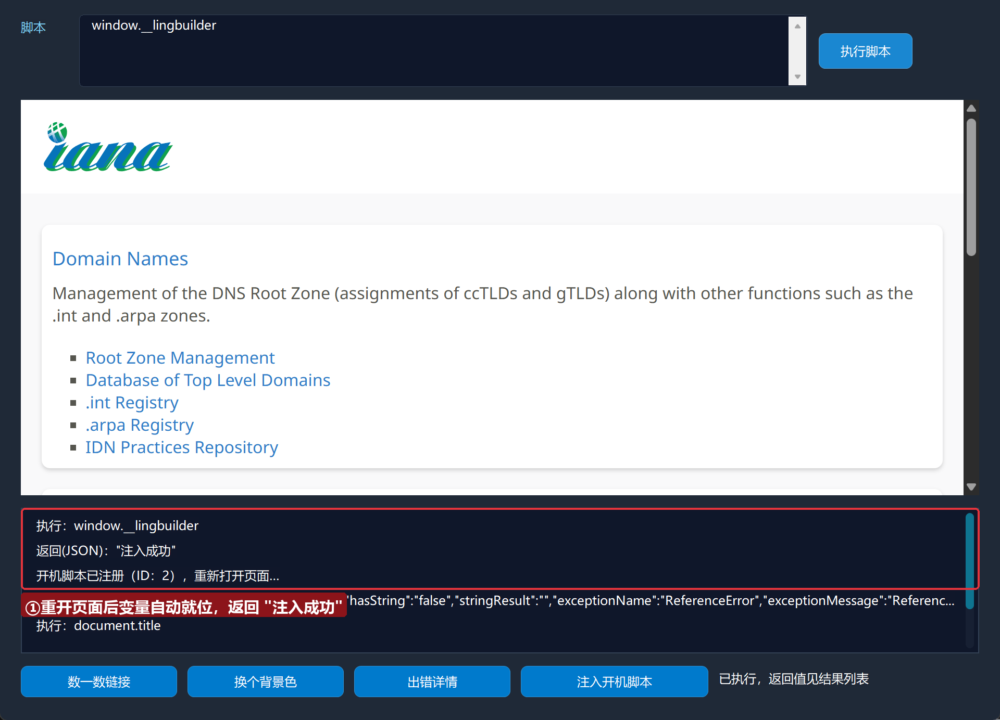

返回 `"注入成功"`——这段代码我们没有对这一页执行过，是页面加载时**自动**跑的。做去广告、改排版、自动登录前处理，全靠它。

## 常见问题急救表

| 症状 | 原因 | 解法 |
| --- | --- | --- |
| 返回值两边有引号 | JSON 编码规则：文本带引号 | 正常现象；要纯文本就去掉首尾各 1 字符 |
| 返回 `null` | 表达式没有值，或变量还没注入 | 检查脚本；预注入只对「以后打开」的页面生效 |
| 返回空文本 | 脚本出错了 | 用 `EdgeView脚本_执行详情异步` 看异常详情 |
| 编译报「未知的命令」 | 脚本族命令都在 EdgeView 模块里 | 确认模块已启用 |
| 处理器没被调用 | `&` 后名字与事件声明不一致 | `&详情回来了` 必须与 `事件 详情回来了()` 一字不差 |
| 页面没加载完就执行 | 脚本跑在了空白页上 | 先等加载完成（第 3 集的「导航完成」事件）再执行 |

## 本集小结

- `EdgeView_执行JS控件` 一条命令读写页面；返回值按 **JSON 编码**（文本带引号、数字裸值、空值 `null`）。
- 脚本出错用 `执行详情异步` + `&处理器` + `任务_取结果` 三件套看异常详情。
- `文档预注入` = 开机脚本，对以后每个页面自动生效，`移除文档预注入` 可撤销。
- 至此基础篇收官：控件、导航、事件、脚本四块拼图集齐——《网页操作篇》开始真正的网页自动化（取数、填表、自动登录）。

## 源码包

本集完整源码已打包为 **脚本控制台.lcpppkg**（随本教程同目录分发，官网示例源码区可下载），导入即可运行。

**下一集预告**：《网页取数实战》——把「执行 JS + 文本分割 + 数组」串起来，从真实网页里提取结构化数据。

[回合集总览](/guide/tutorials/edge)
