# Edge 合集 06 · 网页填表（一）：让程序替你在网页上「输入」和「点击」

> 《LingBuilder Edge 浏览器合集》第 6 集（网页操作篇）。上一集我们学会了「看」网页（取数）；这一集开始「动手」——**填表族 22 条命令**登场：按 CSS 选择器把文字写进输入框、把复选框勾上、替用户点按钮。我们依然用一个不联网的「会员登录演示页」当靶子，把「赋值 → 勾选 → 点击 → 读回」这条自动化链路一次跑通。全程约 30 分钟。
>
> 前置要求：学过[第 5 集](/guide/tutorials/edge-05)（会执行 JavaScript、知道什么是 CSS 选择器）。本集源码包见文末。

## 这一集你将学会

- **填表族的共同套路**：`EdgeView填表_命令(控件名, 框架句柄, 选择器, 序号, …)`
- `EdgeView填表_赋值`：往输入框写文字（自动补发 input/change 事件）
- `EdgeView填表_置选择框`：勾选 / 取消复选框
- `EdgeView填表_点击元素`：替用户点页面按钮
- `EdgeView填表_聚焦元素` / `EdgeView填表_滚动到元素`：聚焦与滚动定位
- `EdgeView填表_取值` + 完成处理器：异步读回输入框内容

## 1. 三分钟理解：填表族怎么「瞄准」元素

填表族每条命令都要回答「操作谁」，靠的是 **CSS 选择器**：

| 选择器 | 匹配 | 例子 |
| --- | --- | --- |
| `#user` | id 为 user 的元素（页面里唯一） | 账号输入框 |
| `.item` | class 含 item 的元素（可能很多） | 所有品项 |
| `input[name=qq]` | 属性匹配 | 更复杂的页面 |

**框架句柄传 0 就代表主文档**（顶层页面）。要操作 iframe 里的元素才需要真句柄（从「框架创建」事件或 `EdgeView框架_枚举JSON` 拿）。「序号」是同一选择器匹配到多个元素时选第几个，从 0 起，**传 -1 表示取第一个**。

写入类命令（赋值/置选择框/点击）发出去就执行；读取类命令（取值/取选择框…）是异步的，要配一个**完成处理器**，在处理器里用 `EdgeView任务_取结果(EdgeView任务_取当前任务ID())` 拿结果。

## 2. 新建项目与启用模块

欢迎页点「新建项目」，项目名称 **自动填表机**，「Windows 界面设计」，创建位置留空：

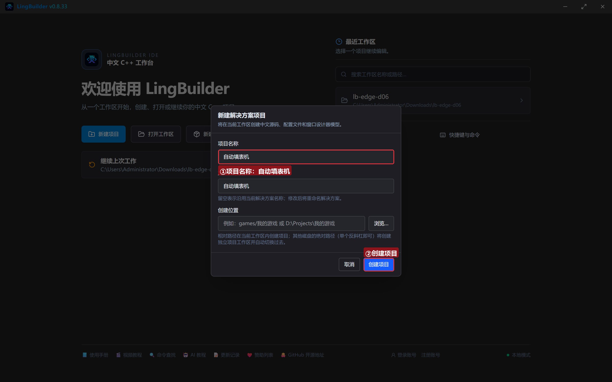

模块生态确认三个模块已启用：**EdgeView 浏览器模块**（填表命令全家）、**文本处理模块**、**Win32窗口基础模块**：

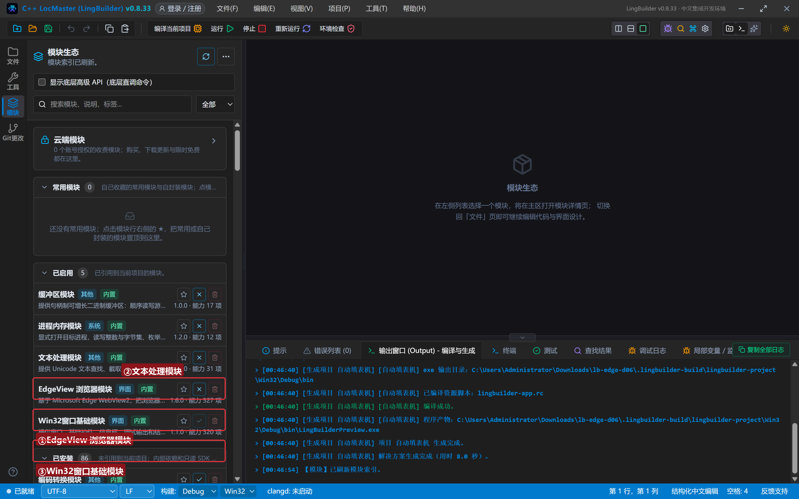

## 3. 设计界面

窗口 960×720。上面两排按钮对应九个演示动作，中间是浏览器，下面是执行日志：

| 控件 | 名称 | 显示内容 | 左距 | 顶距 | 宽度 | 高度 |
| --- | --- | --- | --- | --- | --- | --- |
| 按钮 | 填账号按钮 | 填账号 | 20 | 14 | 118 | 32 |
| 按钮 | 填密码按钮 | 填密码 | 150 | 14 | 118 | 32 |
| 按钮 | 填邮箱按钮 | 填邮箱 | 280 | 14 | 118 | 32 |
| 按钮 | 勾条款按钮 | 勾条款 | 410 | 14 | 118 | 32 |
| 按钮 | 点登录按钮 | 点登录 | 540 | 14 | 118 | 32 |
| 按钮 | 聚焦邮箱按钮 | 聚焦邮箱框 | 20 | 56 | 118 | 32 |
| 按钮 | 滚到登录按钮 | 滚到登录 | 150 | 56 | 118 | 32 |
| 按钮 | 读回按钮 | 读回账号 | 280 | 56 | 118 | 32 |
| 按钮 | 一键全填按钮 | 一键全填并登录 | 410 | 56 | 150 | 32 |
| **Edge浏览器** | **浏览器1** | （从控件面板拖入） | 20 | 100 | 920 | 420 |
| 标签 | 日志标题 | 执行日志 | 20 | 532 | 120 | 20 |
| 列表框 | 日志列表 | （清空） | 20 | 556 | 920 | 100 |
| 标签 | 状态标签 | 就绪。演示页加载完再点按钮 | 20 | 664 | 920 | 20 |

9 个按钮各绑「被单击」，窗口绑「创建完毕」。

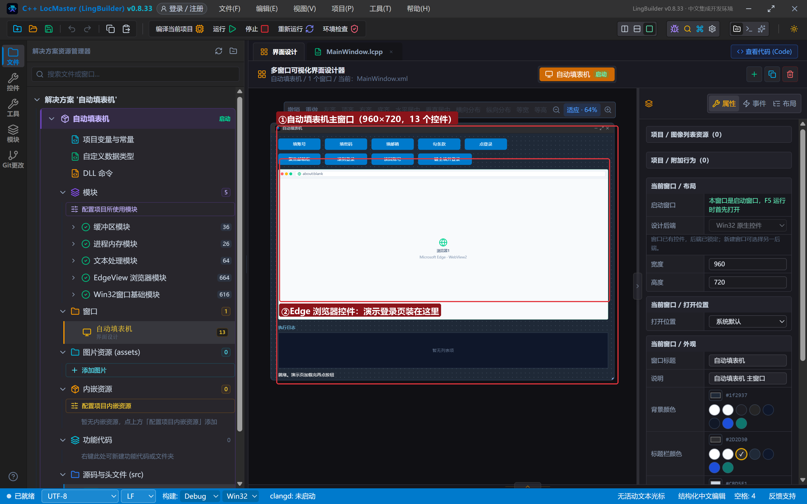

## 4. 写代码

### 4.1 创建完毕：造一个带表单的演示页

```lcpp
事件 _MainWindow_创建完毕()
    局部 文本型 页面
    页面 = "<!DOCTYPE html><html><head><meta charset='utf-8'><title>会员登录演示</title>"
    页面 = 页面 + "<style>…（表单样式）…</style></head><body>"
    页面 = 页面 + "<h2>会员登录演示</h2><div class='row'><label>账号</label><input id='user'></div>…"
    页面 = 页面 + "<div class='row'><label class='chk'><input type='checkbox' id='agree'> 我已阅读并同意会员条款</label></div><button id='login' onclick='doLogin()'>登 录</button><div id='msg'>等待填写……</div>"
    页面 = 页面 + "<script>function doLogin(){…把表单值拼进 #msg…}</script>"
    页面 = 页面 + "</body></html>"
    EdgeView导航_HTML(浏览器1, 页面)
    控件_插入项目(日志列表, 0, "演示登录页已打开（内存 HTML，不联网）")
结束
```

页面里有 4 个输入类元素和 1 个按钮，全部带 id：`#user`（账号）、`#pass`（密码）、`#mail`（邮箱）、`#agree`（复选框）、`#login`（登录按钮）。`doLogin()` 是页面自己的 JS：被点击时把表单值写进 `#msg`——它就是「程序真的点到了按钮」的见证。

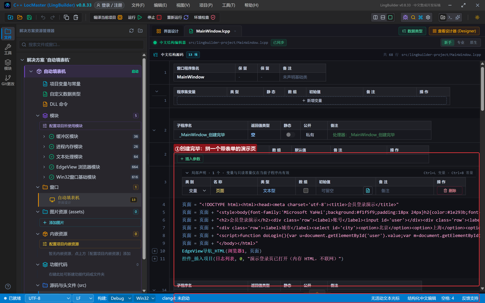

### 4.2 填账号 / 填邮箱 / 勾条款

```lcpp
事件 _填账号按钮_被单击()
    EdgeView填表_赋值(浏览器1, 0, "#user", -1, "lingbuilder")
    控件_插入项目(日志列表, 0, "填表_赋值 → #user = lingbuilder")
结束

事件 _填密码按钮_被单击()
    EdgeView填表_赋值(浏览器1, 0, "#pass", -1, "LB-2026-8888")
    控件_插入项目(日志列表, 0, "填表_赋值 → #pass（密码框，圆点显示）")
结束

事件 _填邮箱按钮_被单击()
    EdgeView填表_赋值(浏览器1, 0, "#mail", -1, "service@lingbuilder.com")
    控件_插入项目(日志列表, 0, "填表_赋值 → #mail = service@lingbuilder.com")
结束

事件 _勾条款按钮_被单击()
    EdgeView填表_置选择框(浏览器1, 0, "#agree", -1, 真)
    控件_插入项目(日志列表, 0, "填表_置选择框 → #agree 勾选")
结束
```

四个事件同一个模子：**命令 + 日志**。`填表_赋值` 会自动补发 `input` 和 `change` 事件，所以那些依赖这两个事件的网页框架（Vue/React 表单）也能正确感知；`填表_置选择框` 最后一个参数传 真 勾选、传 假 取消。

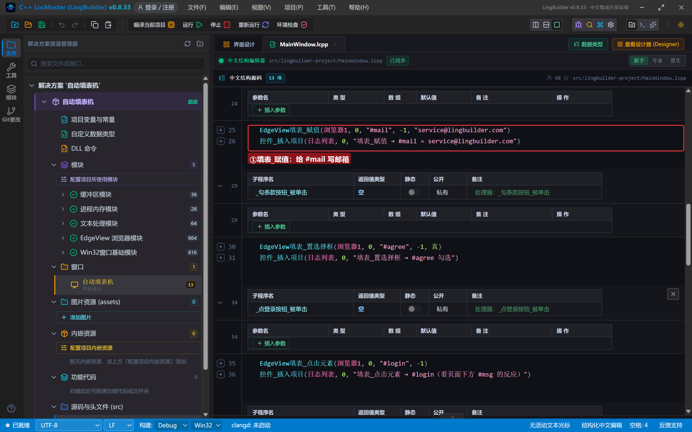

### 4.3 点登录：替用户按下页面按钮

```lcpp
事件 _点登录按钮_被单击()
    EdgeView填表_点击元素(浏览器1, 0, "#login", -1)
    控件_插入项目(日志列表, 0, "填表_点击元素 → #login（看页面下方 #msg 的反应）")
结束
```

`填表_点击元素` 优先调用元素自身的 `click()`，失败时回退为合成 click 事件——效果和真人点击一致，页面的 `onclick` 照常触发。

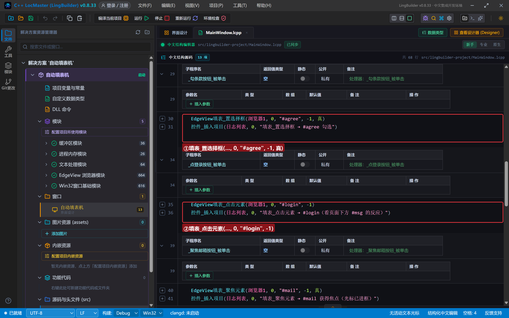

### 4.4 聚焦与滚动：两个定位小工具

```lcpp
事件 _聚焦邮箱按钮_被单击()
    EdgeView填表_聚焦元素(浏览器1, 0, "#mail", -1, 真)
    控件_插入项目(日志列表, 0, "填表_聚焦元素 → #mail 获得焦点（光标已进框）")
结束

事件 _滚到登录按钮_被单击()
    EdgeView填表_滚动到元素(浏览器1, 0, "#login", -1, 真)
    控件_插入项目(日志列表, 0, "填表_滚动到元素 → #login 滚进可视区")
结束
```

`聚焦元素` 最后一个参数 真=给焦点、假=移除焦点；`滚动到元素` 的最后参数 真=贴顶对齐、假=尽量贴底。页面很长时先滚动再操作，截图/录屏也更友好。

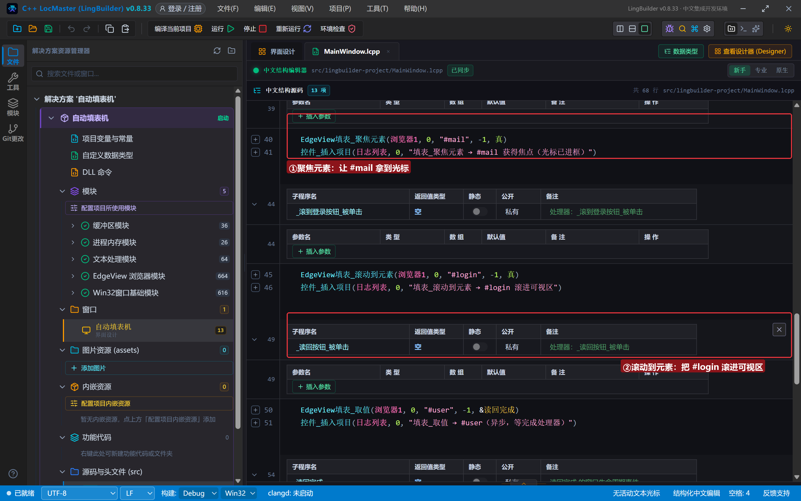

### 4.5 读回账号：异步取值 + 完成处理器

```lcpp
事件 _读回按钮_被单击()
    EdgeView填表_取值(浏览器1, 0, "#user", -1, &读回完成)
    控件_插入项目(日志列表, 0, "填表_取值 → #user（异步，等完成处理器）")
结束

事件 读回完成()
    控件_插入项目(日志列表, 0, "读回 #user = " + EdgeView任务_取结果(EdgeView任务_取当前任务ID()))
结束
```

注意两个规矩：**处理器名必须与 `&` 后面一字不差**（`&读回完成` 对应 `事件 读回完成()`）；结果是 **JSON 信封** `{"ok":true,"value":"lingbuilder"}`——`ok` 表示读到了，`value` 才是内容。直接整段显示最直观，下一集教你按字段拆。

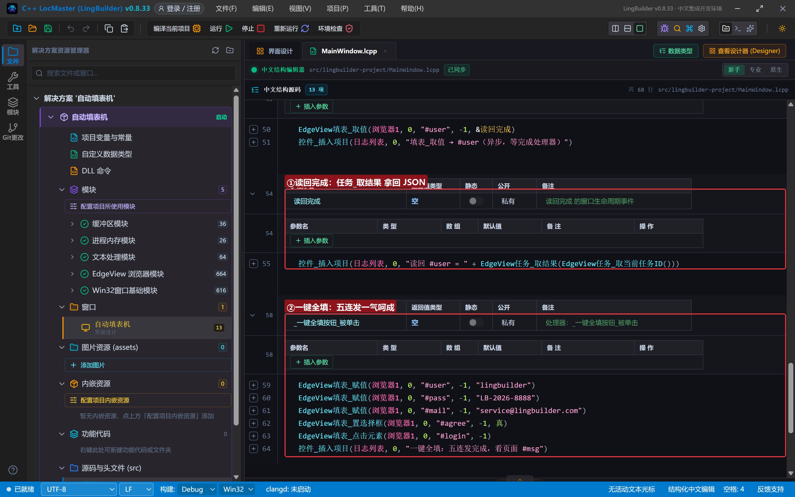

### 4.6 一键全填：把五条命令串成流水线

```lcpp
事件 _一键全填按钮_被单击()
    EdgeView填表_赋值(浏览器1, 0, "#user", -1, "lingbuilder")
    EdgeView填表_赋值(浏览器1, 0, "#pass", -1, "LB-2026-8888")
    EdgeView填表_赋值(浏览器1, 0, "#mail", -1, "service@lingbuilder.com")
    EdgeView填表_置选择框(浏览器1, 0, "#agree", -1, 真)
    EdgeView填表_点击元素(浏览器1, 0, "#login", -1)
    控件_插入项目(日志列表, 0, "一键全填：五连发完成，看页面 #msg")
结束
```

这就是「自动登录」的雏形——第 8 集会把它做成完整的实战项目。

## 5. 编译：先看错误列表

点工具栏「编译当前项目」，错误列表 (0)、输出窗口「生成完成」：

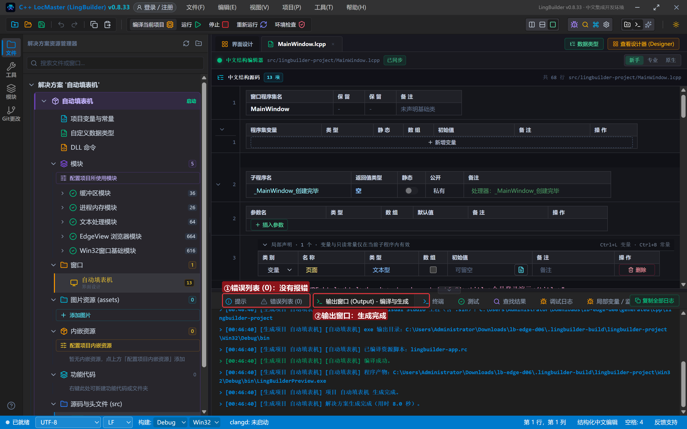

## 6. 运行：程序替你填表

点「运行」。窗口打开，演示登录页已就位，所有输入框都是空的：

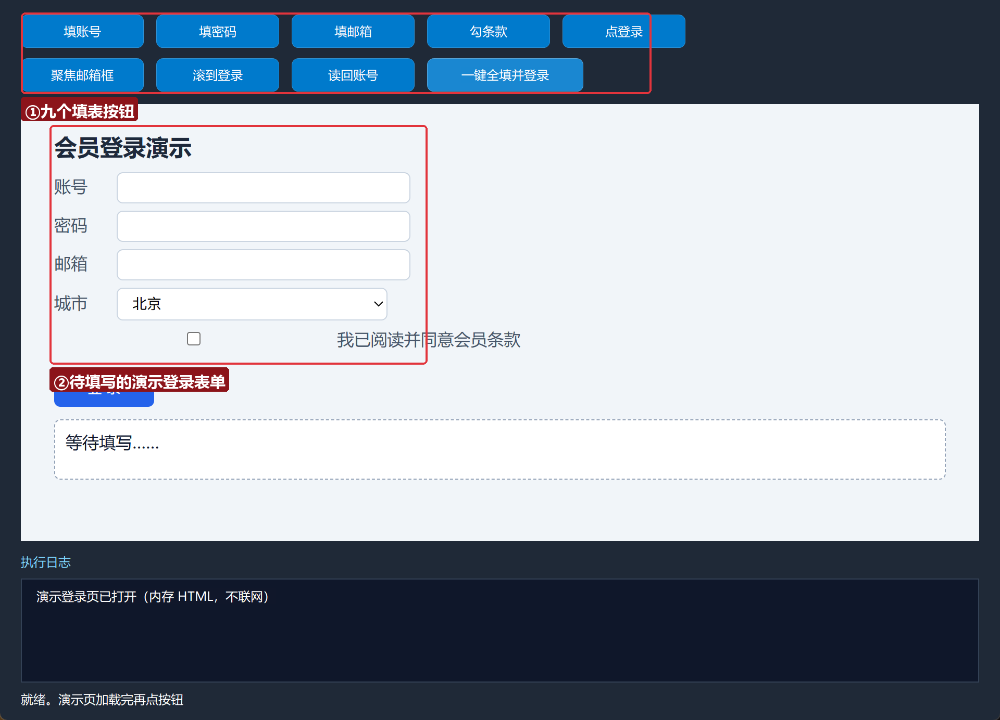

### 6.1 填账号

点「填账号」——`#user` 框里出现了 `lingbuilder`，执行日志同步记账：

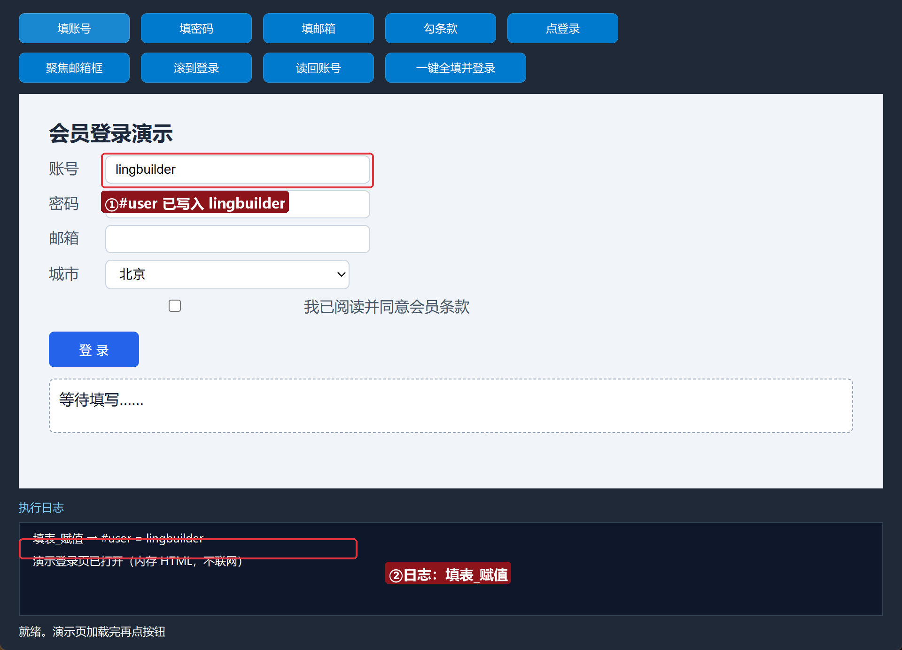

再点「填密码」「填邮箱」，密码框显示圆点（页面按密码框规则渲染），邮箱框填入地址。

### 6.2 勾条款

点「勾条款」——复选框被勾上：

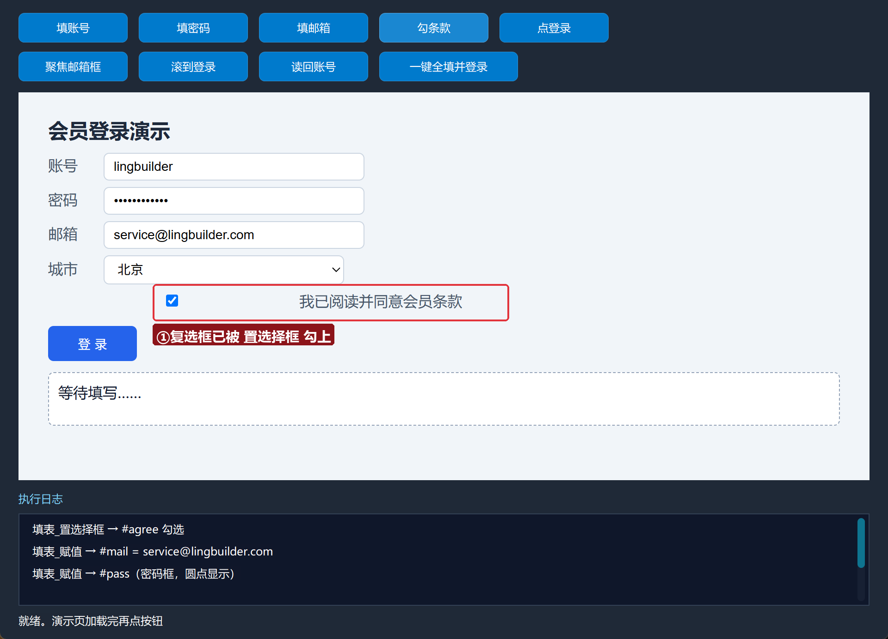

### 6.3 点登录

点「点登录」——页面下方的 `#msg` 立刻给出回执：「登录请求已发出：账号=lingbuilder，邮箱=…，城市=北京，条款=已勾选」。这是页面自己的 JS 在说话，证明程序真的点到了按钮：

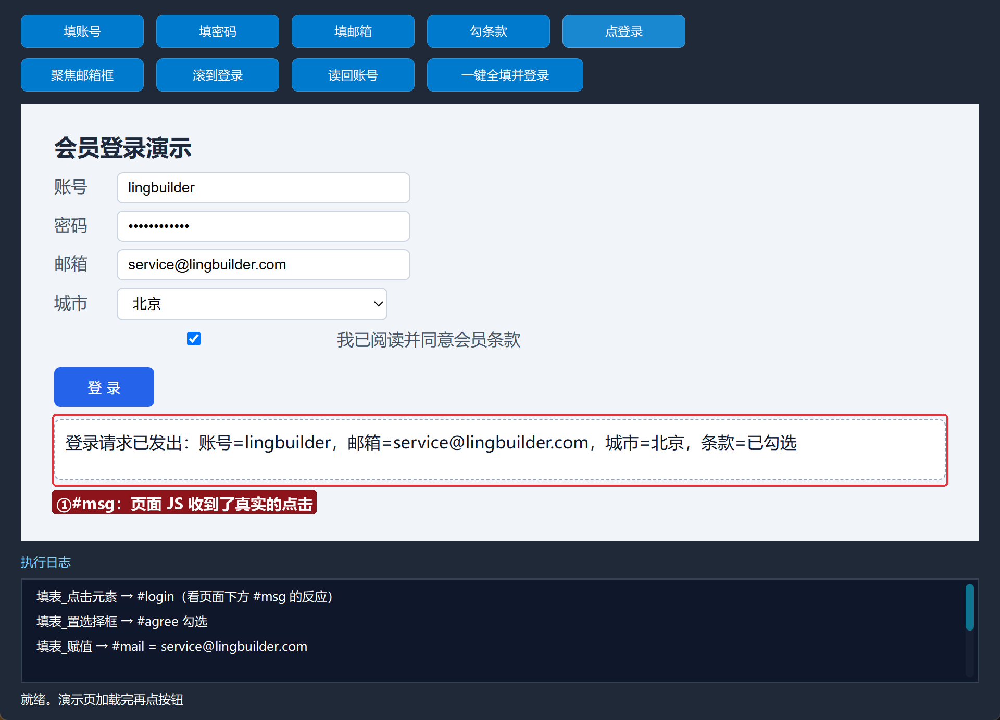

### 6.4 读回账号

点「读回账号」——异步任务完成，日志显示 `读回 #user = {"ok":true,"value":"lingbuilder"}`：

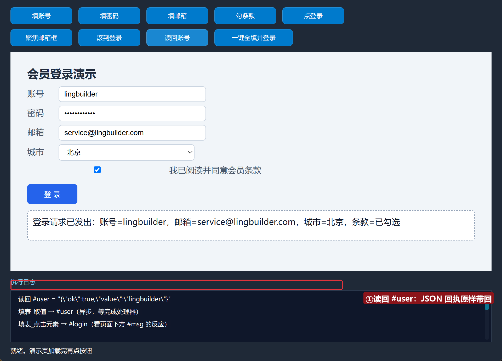

### 6.5 一键全填

点「一键全填并登录」——五条命令一气呵成，页面直接给出登录回执：

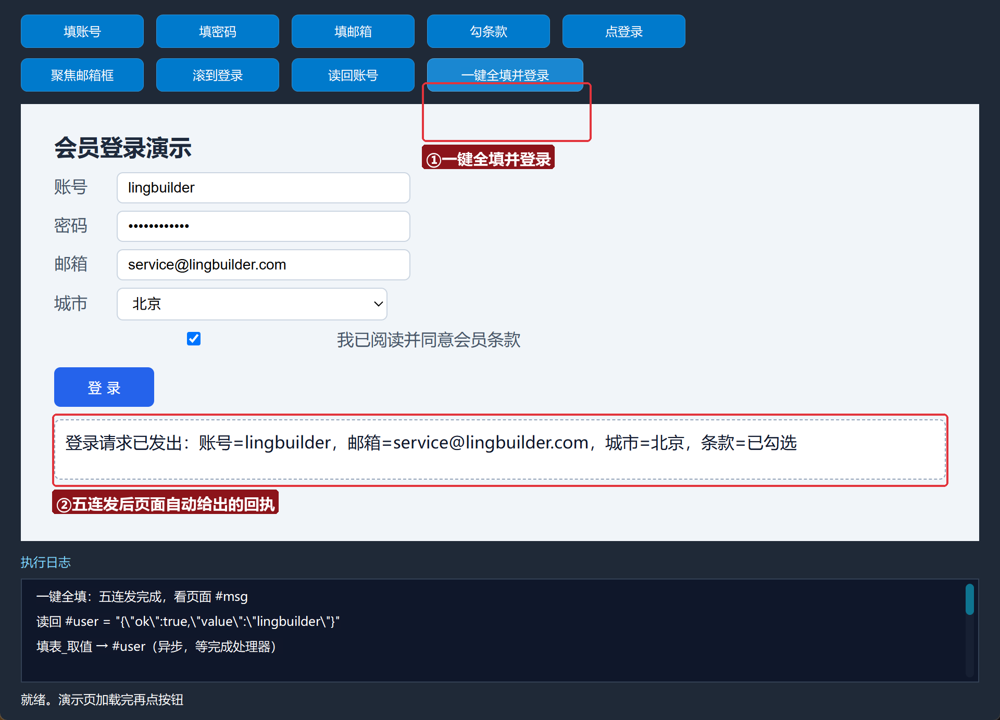

## 7. 填表族的「全家福」

本集用到的 6 条只是 22 条里的写入与读取主力，剩下的按用途记：

| 用途 | 命令 |
| --- | --- |
| 写值 | 填表_赋值 / 置选择框 / 置选择项（下拉框）/ 置内文本 / 置外文本 / 置内代码 / 置外代码 / 置属性 / 触发事件 |
| 读值 | 填表_取值 / 取选择框 / 取选择项 / 取内文本 / 取外文本 / 取内代码 / 取外代码 / 取属性（全部异步 + 完成处理器） |
| 定位 | 填表_点击元素 / 聚焦元素 / 滚动到元素 / 元素是否存在 / 取坐标 |

下一集（填表二）专攻**下拉选择与读回解析**。

## 常见问题急救表

| 症状 | 原因 | 解法 |
| --- | --- | --- |
| 填了但页面没反应 | 页面框架监听的是 keypress 而非 input/change | 用 填表_触发事件 补发 keydown/keypress，或改用 执行JS 兜底 |
| 选择器明明存在却没填进去 | 序号越界或元素在 iframe 里 | 序号传 -1 取首个；iframe 要传框架句柄，主文档传 0 |
| 取值处理器没被调用 | 处理器名与 & 后不一致 | `&读回完成` 必须对应 `事件 读回完成()`，一字不差 |
| 读回结果是 JSON 不是纯文本 | 任务结果统一 JSON 信封 | 取 `value` 字段；下一集教拆解 |
| 编译报「未知的命令 EdgeView填表_赋值」 | EdgeView 模块没启用 | 模块生态里启用 EdgeView 浏览器模块 |

## 本集小结

- 填表族统一套路：`EdgeView填表_命令(控件名, 框架句柄, 选择器, 序号, …)`，**主文档框架句柄传 0**。
- 写入三件套：`赋值`（自动补发 input/change）、`置选择框`、`点击元素`。
- 定位两件套：`聚焦元素`、`滚动到元素`。
- 读取是异步的：`&完成处理器` + `EdgeView任务_取结果(EdgeView任务_取当前任务ID())`，结果统一 JSON。

## 源码包

本集完整源码已打包为 **自动填表机.lcpppkg**（随本教程同目录分发，官网示例源码区可下载）。在 LingBuilder 欢迎页点「打开工作区」，或直接双击 `.lcpppkg` 文件即可导入运行。

**下一集预告**：《网页填表（二）》——下拉框选择、读回值解析（JSON 信封拆字段），再做一个小型「信息回填工具」。

[回合集总览](/guide/tutorials/edge)
