# Edge 合集 07 · 网页填表（二）：下拉框、取值回读与 JSON 拆信封

> 《LingBuilder Edge 浏览器合集》第 7 集（网页操作篇）。上一集写了「输入与点击」，这一集补上填表族的**读取侧**：把下拉框选中某一项、读回输入框的值、读回复选框状态、判断元素存不存在、拿到元素坐标——并且教会你**拆开任务结果的 JSON 信封**，把 `{"ok":true,"value":"深圳"}` 变成干干净净的 `深圳`。全程约 30 分钟。
>
> 前置要求：学过[第 5 集](/guide/tutorials/edge-05)（文本_分割/数组_取成员）和[第 6 集](/guide/tutorials/edge-06)（填表族套路、&完成处理器）。本集源码包见文末。

## 这一集你将学会

- `EdgeView填表_置选择项`：按**下标**选中下拉框的某一项
- `EdgeView填表_取选择项`：读回下拉框当前选中的下标
- `EdgeView填表_取值` / `EdgeView填表_取选择框`：读回文本值 / 勾选状态
- `EdgeView填表_元素是否存在` / `EdgeView填表_取坐标`：存在性判断与元素矩形
- `EdgeView填表_触发事件`：给元素补发一个 DOM 事件（change）
- **JSON 信封拆解三步法**：去引号 → 去反斜杠 → 按 `value:` 分割

## 1. 任务结果的「JSON 信封」长什么样

第 6 集结尾我们看到，读回账号的结果是：

```
"{\"ok\":true,\"value\":\"lingbuilder\"}"
```

它有三层包装：最外层是 JSON 字符串的引号；里层因为「字符串里还有引号」，每个引号前面都挂了一个反斜杠 `\`；中间才是 `{"ok":true,"value":"..."}` 信封。**拆法固定三步**：

```lcpp
结果 = 文本_替换(结果, "\"", "")    ! 第一步：删掉所有引号字符
结果 = 文本_替换(结果, "\\", "")    ! 第二步：删掉所有反斜杠
文本_分割(结果, "value:", 部件, 真)  ! 第三步：按 value: 分割，后半段就是值
```

拆完之后 `部件` 的第 1 个成员（下标 1）就是 `深圳}` 这样的尾巴，再按 `}` 分割一次、取下标 0，就得到纯值。这套配方对**文本值、布尔值（true/假）、数字值**全部通用——字符串值原本带引号，布尔和数字不带，但两步清洗会把它们统一成一样的形态。

## 2. 新建项目与启用模块

欢迎页「新建项目」，项目名称 **信息回填工具**，「Windows 界面设计」：

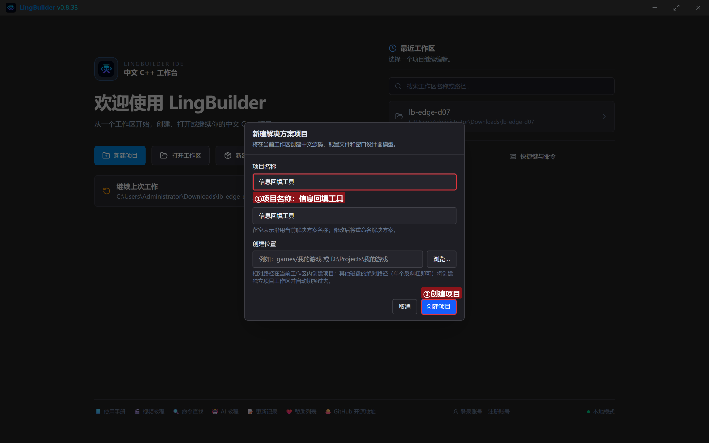

模块生态确认四个模块已启用：**EdgeView 浏览器模块**、**文本处理模块**（清洗与分割）、**数组操作模块**（取成员）、**Win32窗口基础模块**：

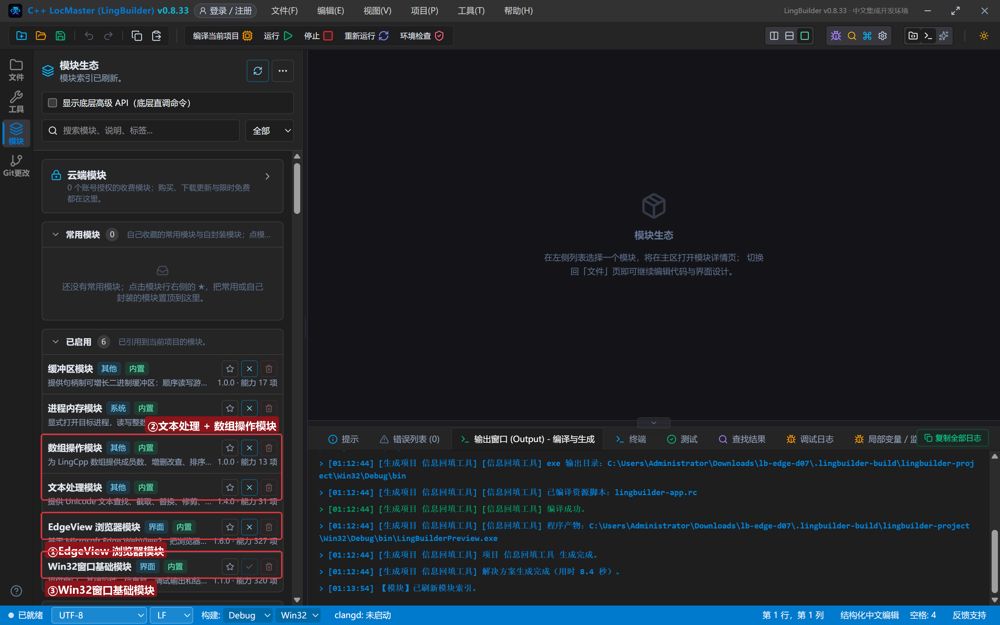

## 3. 设计界面

窗口 960×720，按钮分两排：第一排「写」（下拉选择、勾选、补发事件），第二排「读」（四个读取命令）：

| 控件 | 名称 | 显示内容 | 左距 | 顶距 | 宽度 | 高度 |
| --- | --- | --- | --- | --- | --- | --- |
| 按钮 | 选上海按钮 | 下拉选上海 | 20 | 14 | 130 | 32 |
| 按钮 | 选深圳按钮 | 下拉选深圳 | 162 | 14 | 130 | 32 |
| 按钮 | 勾VIP按钮 | 勾上VIP | 304 | 14 | 118 | 32 |
| 按钮 | 派发按钮 | 补发change事件 | 434 | 14 | 150 | 32 |
| 按钮 | 读城市按钮 | 读回城市 | 20 | 56 | 118 | 32 |
| 按钮 | 读勾选按钮 | 读回勾选 | 150 | 56 | 118 | 32 |
| 按钮 | 读下标按钮 | 读回下标 | 280 | 56 | 118 | 32 |
| 按钮 | 有没有按钮 | 元素在不在 | 410 | 56 | 118 | 32 |
| 按钮 | 在哪按钮 | 取元素坐标 | 540 | 56 | 118 | 32 |
| **Edge浏览器** | **浏览器1** | （从控件面板拖入） | 20 | 100 | 920 | 420 |
| 标签 | 日志标题 | 回读日志 | 20 | 532 | 120 | 20 |
| 列表框 | 日志列表 | （清空） | 20 | 556 | 920 | 100 |
| 标签 | 状态标签 | 就绪。先写后读，看回读日志 | 20 | 664 | 920 | 20 |

9 个按钮各绑「被单击」，窗口绑「创建完毕」。

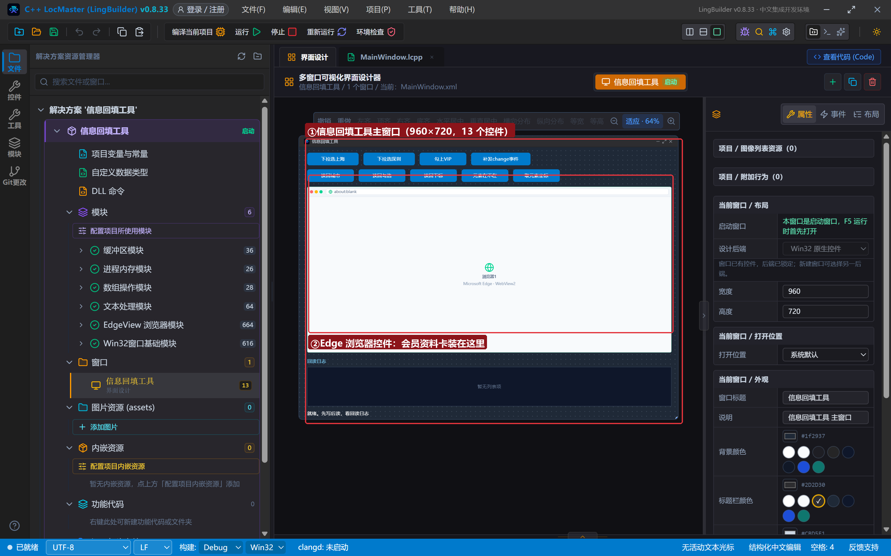

## 4. 写代码

### 4.1 创建完毕：带下拉框的会员资料卡

```lcpp
事件 _MainWindow_创建完毕()
    局部 文本型 页面
    页面 = "<!DOCTYPE html><html><head><meta charset='utf-8'><title>会员资料卡</title>"
    页面 = 页面 + "<style>…（样式）…</style></head><body>"
    页面 = 页面 + "<h2>会员资料卡</h2><div class='row'><label>城市</label><select id='city' onchange='sync()'><option>北京</option><option>上海</option><option>广州</option><option>深圳</option></select></div><div class='row'><label>电话</label><input id='phone' value='13800001111'></div><div class='row'><label class='chk'><input type='checkbox' id='vip' onchange='sync()'> 我是 VIP 会员</label></div><div id='state'>资料卡状态：等待同步……</div>"
    页面 = 页面 + "<script>function sync(){…把城市和 VIP 写进 #state…}</script>"
    页面 = 页面 + "</body></html>"
    EdgeView导航_HTML(浏览器1, 页面)
    控件_插入项目(日志列表, 0, "会员资料卡已打开（内存 HTML，不联网）")
结束
```

页面元素：下拉框 `#city`（4 个选项，下标 0~3）、电话框 `#phone`、复选框 `#vip`、状态条 `#state`。`sync()` 是页面自己的函数：城市或 VIP 一变就把状态条刷新。

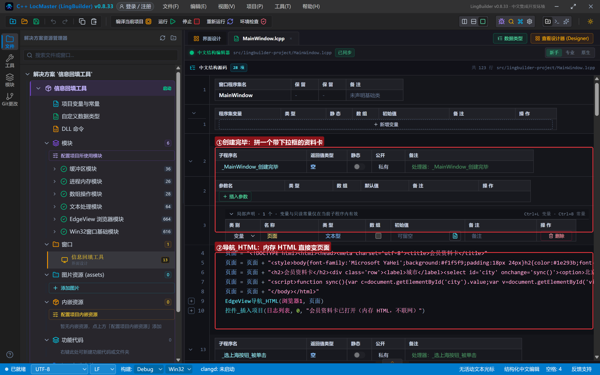

### 4.2 写侧：下拉选上海 / 选深圳 / 勾 VIP

```lcpp
事件 _选上海按钮_被单击()
    EdgeView填表_置选择项(浏览器1, 0, "#city", -1, 1)
    控件_插入项目(日志列表, 0, "置选择项 → #city 选中下标 1（上海）")
结束

事件 _选深圳按钮_被单击()
    EdgeView填表_置选择项(浏览器1, 0, "#city", -1, 3)
    控件_插入项目(日志列表, 0, "置选择项 → #city 选中下标 3（深圳）")
结束

事件 _勾VIP按钮_被单击()
    EdgeView填表_置选择框(浏览器1, 0, "#vip", -1, 真)
    控件_插入项目(日志列表, 0, "置选择框 → #vip 勾选")
结束
```

`置选择项` 的最后一个参数就是 **option 的下标**（从 0 起）：北京 0、上海 1、广州 2、深圳 3。选中后它会自动补发 `change` 事件。

### 4.3 补发 change 事件：让页面「感觉」到变化

```lcpp
事件 _派发按钮_被单击()
    EdgeView填表_触发事件(浏览器1, 0, "#city", -1, "change", 0)
    控件_插入项目(日志列表, 0, "触发事件 → #city 补发 change（看页面状态条）")
结束
```

`触发事件` 能在指定元素上合成任意 DOM 事件（click、input、change、keydown…，键盘事件配按键码）。那些「不监听 input/change 就不更新」的网页框架，靠它兜底。

### 4.4 读侧：读回城市（重点看拆信封）

```lcpp
事件 _读城市按钮_被单击()
    EdgeView填表_取值(浏览器1, 0, "#city", -1, &读城市完成)
    控件_插入项目(日志列表, 0, "取值 → #city（异步）")
结束

事件 读城市完成()
    局部 文本型 结果
    局部 文本型 部件[]
    局部 文本型 字段[]
    结果 = EdgeView任务_取结果(EdgeView任务_取当前任务ID())
    结果 = 文本_替换(结果, "\"", "")
    结果 = 文本_替换(结果, "\\", "")
    文本_分割(结果, "value:", 部件, 真)
    如果 (数组_取成员数(部件) > 1)
        文本_分割(数组_取成员(部件, 1), "}", 字段, 真)
        控件_插入项目(日志列表, 0, "当前城市：" + 数组_取成员(字段, 0))
    否则
        控件_插入项目(日志列表, 0, "原始结果：" + 结果)
    如果结束
结束
```

这就是第 1 节三步法的完整落地：**去引号、去反斜杠、按 `value:` 分割、再按 `}` 分割**。`数组_取成员数(部件) > 1` 是防御：信封格式万一变了，把原始结果打出来而不是静默出错。

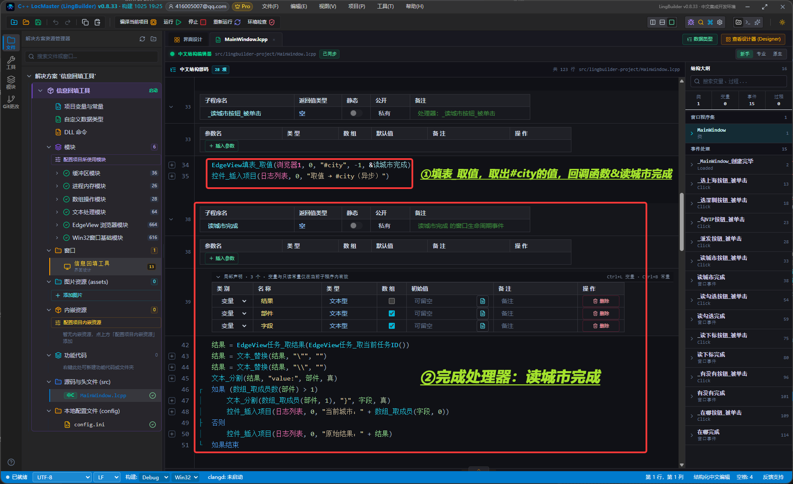

### 4.5 读侧：勾选状态与下拉下标（同一配方）

```lcpp
事件 读勾选完成()
    …同上清洗与分割…
    控件_插入项目(日志列表, 0, "VIP 勾选状态：" + 数组_取成员(字段, 0))
结束

事件 读下标完成()
    …同上清洗与分割…
    控件_插入项目(日志列表, 0, "城市下拉框当前下标：" + 数组_取成员(字段, 0))
结束
```

布尔值读回来是 `true`/`假` 字样、下标是数字——三步法之后都变成干净的纯值。

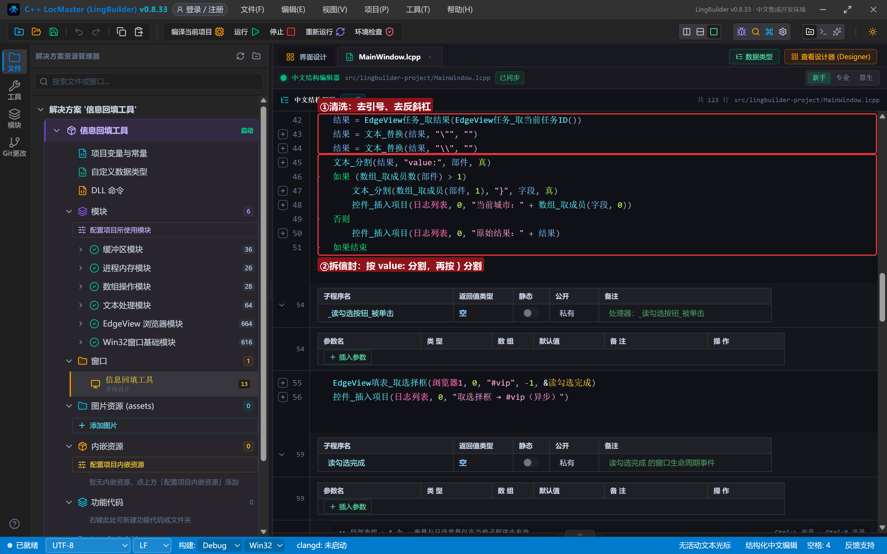

### 4.6 读侧：元素存在性与坐标

```lcpp
事件 _有没有按钮_被单击()
    EdgeView填表_元素是否存在(浏览器1, 0, "#phone", -1, &有没有完成)
    控件_插入项目(日志列表, 0, "元素是否存在 → #phone（异步）")
结束

事件 有没有完成()
    局部 文本型 结果
    结果 = EdgeView任务_取结果(EdgeView任务_取当前任务ID())
    结果 = 文本_替换(结果, "\"", "")
    结果 = 文本_替换(结果, "\\", "")
    控件_插入项目(日志列表, 0, "#phone 存在性：" + 结果)
结束
```

`取坐标` 同理，回读的是 `{"ok":true,"value":{"x":…,"y":…,"width":…,"height":…}}`——对象型结果清洗后原样展示，要看字段时再按需拆。写脚本前先判断元素存在，是抓取类程序稳不稳的分水岭。

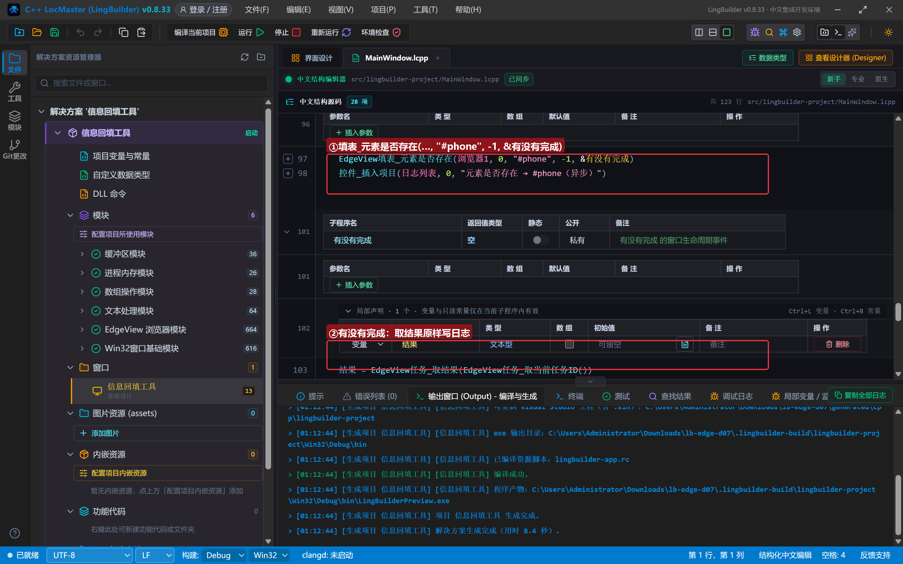

## 5. 编译：先看错误列表

错误列表 (0)，输出窗口「生成完成」：

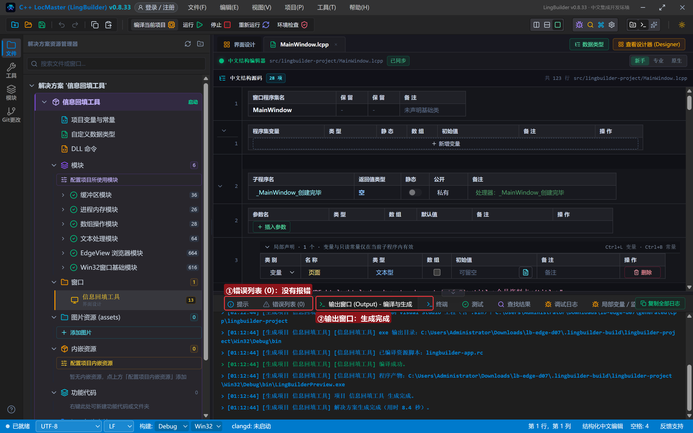

## 6. 运行：先写后读

点「运行」。资料卡就位，城市默认「北京」、VIP 未勾：

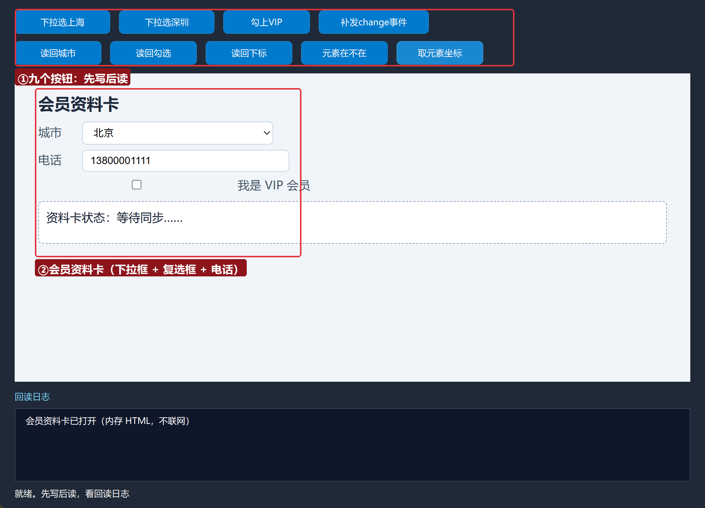

### 6.1 下拉选深圳

点「下拉选深圳」——下拉框直接跳到「深圳」（下标 3）：

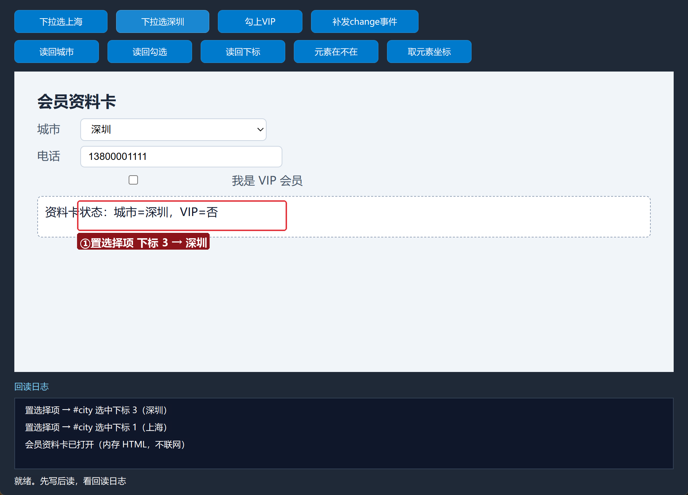

### 6.2 勾 VIP 并补发 change

点「勾上VIP」「补发change事件」——页面状态条显示「资料卡状态：城市=深圳，VIP=是」，说明补发的 change 事件被页面收到了：

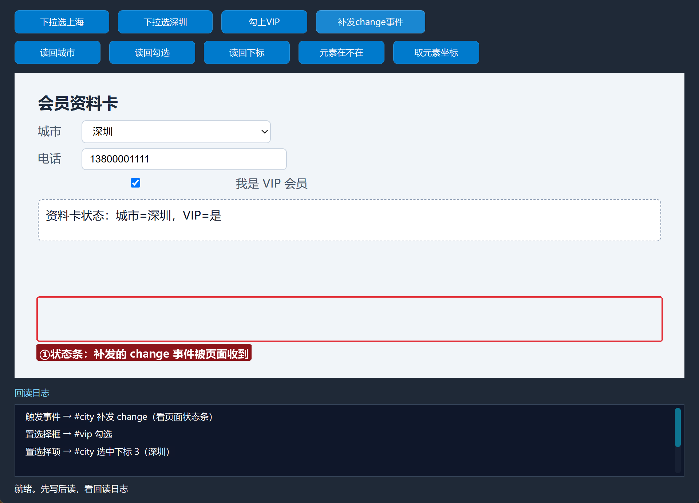

### 6.3 读回城市

点「读回城市」——回读日志第一行「当前城市：深圳」，信封已拆好：

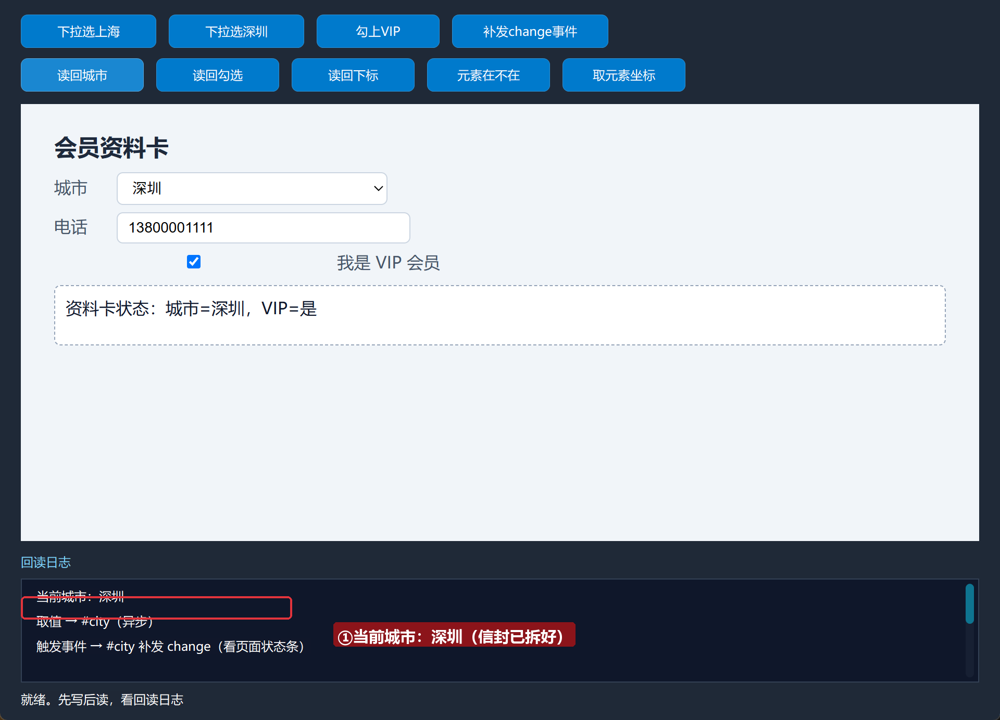

### 6.4 读回勾选与下标

点「读回勾选」「读回下标」——日志给出「VIP 勾选状态：true」「城市下拉框当前下标：3」：

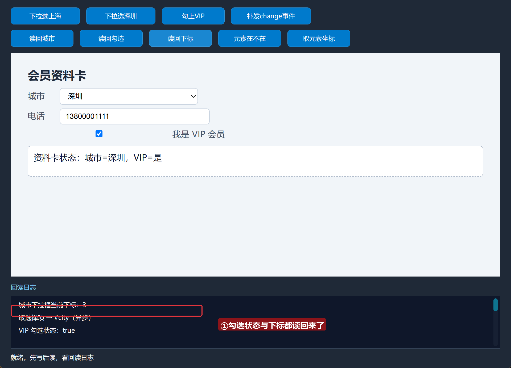

### 6.5 元素在不在、坐标在哪

点「元素在不在」「取元素坐标」——`#phone` 存在性 true，坐标矩形给出 x/y/宽/高：

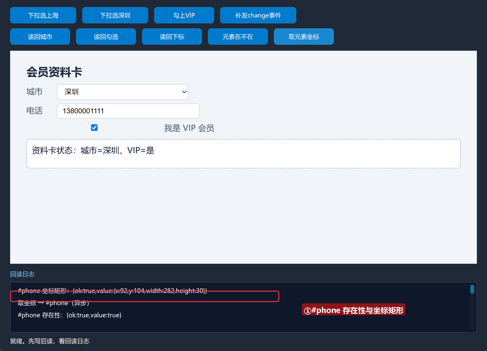

## 常见问题急救表

| 症状 | 原因 | 解法 |
| --- | --- | --- |
| 拆出来还是 `{"ok":true…` | 忘了删反斜杠那一步 | 两步 替换 都要有：先去引号、再去反斜杠 |
| 勾选状态读回来是 `true` 不是「真」 | JSON 布尔就是 true/false | 直接和 "true" 文本比较，或展示原样 |
| 置选择项 没生效 | 选项序号越界 | 先 取选择项 读总数核对下标范围（0 起） |
| 元素明明在页面上却报不存在 | 元素在 iframe 里 | 主文档传 0；iframe 要传框架句柄 |
| 处理器没被调用 | 处理器名与 & 后不一致 | `&读城市完成` 必须对应 `事件 读城市完成()` |

## 本集小结

- 读取侧五连：`取值` / `取选择框` / `取选择项` / `元素是否存在` / `取坐标`，全部异步 + 完成处理器。
- **JSON 信封拆解三步法**：去引号 → 去反斜杠 → 按 `value:` 分割（文本/布尔/数字通用）。
- `置选择项` 按下标选中下拉框；`触发事件` 能补发任意 DOM 事件。
- 先判存在再操作，是自动化脚本稳定性的第一道闸。

## 源码包

本集完整源码已打包为 **信息回填工具.lcpppkg**（随本教程同目录分发，官网示例源码区可下载）。在 LingBuilder 欢迎页点「打开工作区」，或直接双击 `.lcpppkg` 文件即可导入运行。

**下一集预告**：《网页填表（三）·自动登录实战》——把三集所学串成一条真实登录流水线，外加执行JS 兜底写法。

[回合集总览](/guide/tutorials/edge)
