# Edge 合集 09 · 页内查找与定位：给程序装上「页面内 Ctrl+F」

> 《LingBuilder Edge 浏览器合集》第 9 集（网页操作篇收官）。这一集轻快——**查找族 5 条命令**，让你的程序在网页里做「Ctrl+F」：全部匹配自动高亮、计数、上下切换、一键清除。这也是网页操作篇的最后一集，学完它，操控网页的「读、写、点、查」四件事就凑齐了。全程约 20 分钟。
>
> 前置要求：学过[第 1~4 集](/guide/tutorials/edge)基础篇。本集源码包见文末。

## 这一集你将学会

- `EdgeView查找_开始异步(控件, 文本, 选项JSON, &完成处理器)`：开始查找，匹配项自动高亮
- `EdgeView查找_下一项` / `EdgeView查找_上一项`：切换当前匹配项
- `EdgeView查找_停止`：停止并清除高亮
- `EdgeView查找_取状态JSON`：读匹配总数与当前下标

## 1. 查找族速览

| 命令 | 作用 | 返回/说明 |
| --- | --- | --- |
| `查找_开始异步(控件, 文本, 选项JSON, &处理器)` | 开始查找并高亮 | 异步任务；选项JSON 传 `"{}"` 用默认 |
| `查找_下一项(控件)` | 切到下一个匹配 | 同步，立即生效 |
| `查找_上一项(控件)` | 切到上一个匹配 | 同步 |
| `查找_停止(控件)` | 停止并清除全部高亮 | 同步 |
| `查找_取状态JSON(控件)` | 读匹配状态 | `{"matchCount":"8","activeMatchIndex":"1"}` |

两个状态字段的含义：`matchCount` 匹配总数；`activeMatchIndex` 当前选中项的**下标，从 0 起**。

## 2. 新建项目与启用模块

欢迎页「新建项目」，项目名称 **页内查找器**，「Windows 界面设计」：

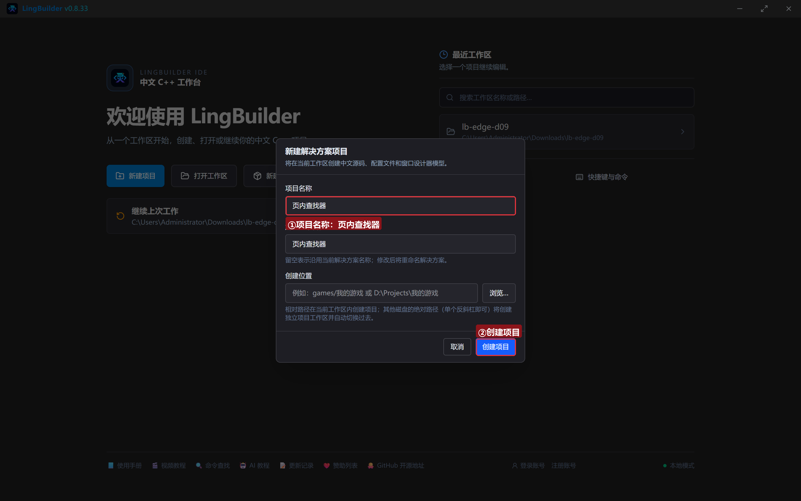

模块确认三个已启用：**EdgeView 浏览器模块**（查找族）、**文本处理模块**（判空）、**Win32窗口基础模块**：

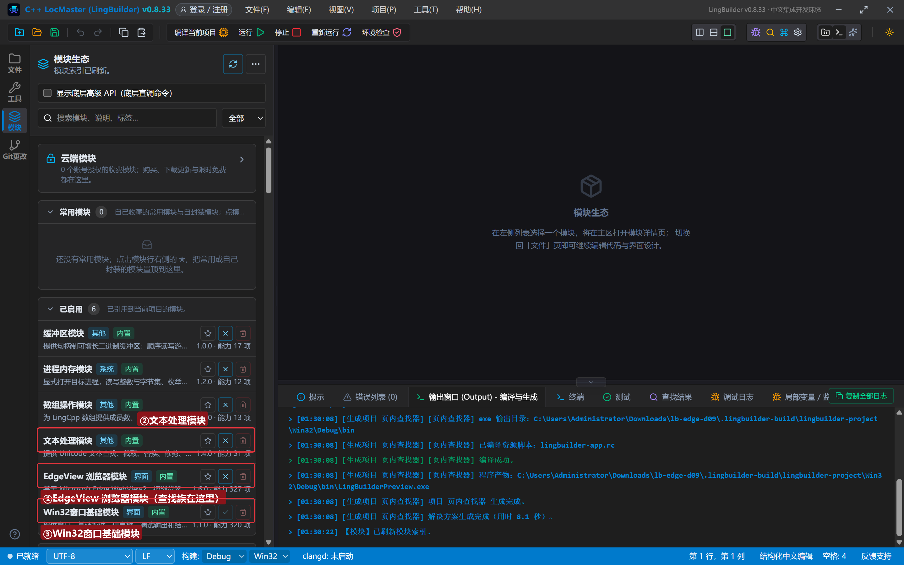

## 3. 设计界面

| 控件 | 名称 | 显示内容 | 左距 | 顶距 | 宽度 | 高度 |
| --- | --- | --- | --- | --- | --- | --- |
| 标签 | 查找词标签 | 查找词 | 20 | 19 | 56 | 22 |
| 编辑框 | 查找词框 | 协议 | 80 | 14 | 180 | 30 |
| 按钮 | 开始按钮 | 开始查找 | 274 | 14 | 110 | 32 |
| 按钮 | 下一个按钮 | 下一个 | 396 | 14 | 100 | 32 |
| 按钮 | 上一个按钮 | 上一个 | 508 | 14 | 100 | 32 |
| 按钮 | 停止按钮 | 停止并清除 | 620 | 14 | 120 | 32 |
| 按钮 | 取状态按钮 | 读匹配状态 | 752 | 14 | 120 | 32 |
| **Edge浏览器** | **浏览器1** | （从控件面板拖入） | 20 | 60 | 920 | 450 |
| 标签 | 日志标题 | 查找日志 | 20 | 522 | 120 | 20 |
| 列表框 | 日志列表 | （清空） | 20 | 546 | 920 | 100 |
| 标签 | 状态标签 | 就绪。输入查找词后点「开始查找」 | 20 | 660 | 920 | 20 |

5 个按钮各绑「被单击」，窗口绑「创建完毕」。

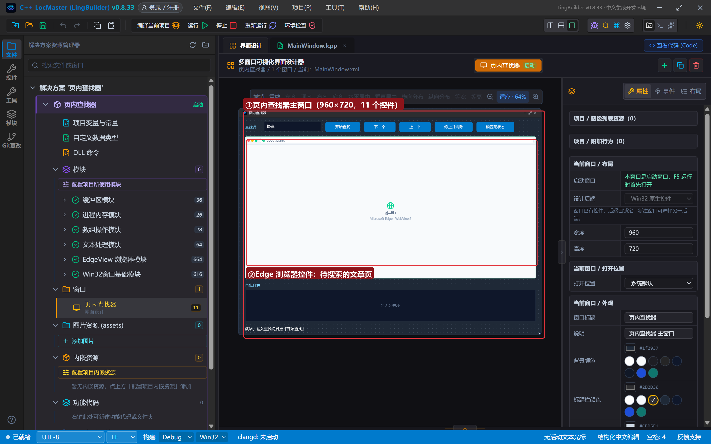

## 4. 写代码

### 4.1 创建完毕：一篇用来搜的文章

```lcpp
事件 _MainWindow_创建完毕()
    局部 文本型 页面
    页面 = "<!DOCTYPE html><html><head><meta charset='utf-8'><title>开源协议小课堂</title>"
    页面 = 页面 + "<style>…（样式，黄色高亮 b 标签）…</style></head><body>"
    页面 = 页面 + "<h2>开源协议小课堂</h2>"
    页面 = 页面 + "<p>给项目选 <b>协议</b> 是开源的第一步。……</p>"
    页面 = 页面 + "<p>……</p><p>本页一共出现了 8 次「协议」二字……</p>"
    页面 = 页面 + "</body></html>"
    EdgeView导航_HTML(浏览器1, 页面)
    控件_插入项目(日志列表, 0, "演示文章已打开（内含 8 个「协议」）")
结束
```

文章里刻意让「协议」出现 8 次，高亮效果和计数一目了然。

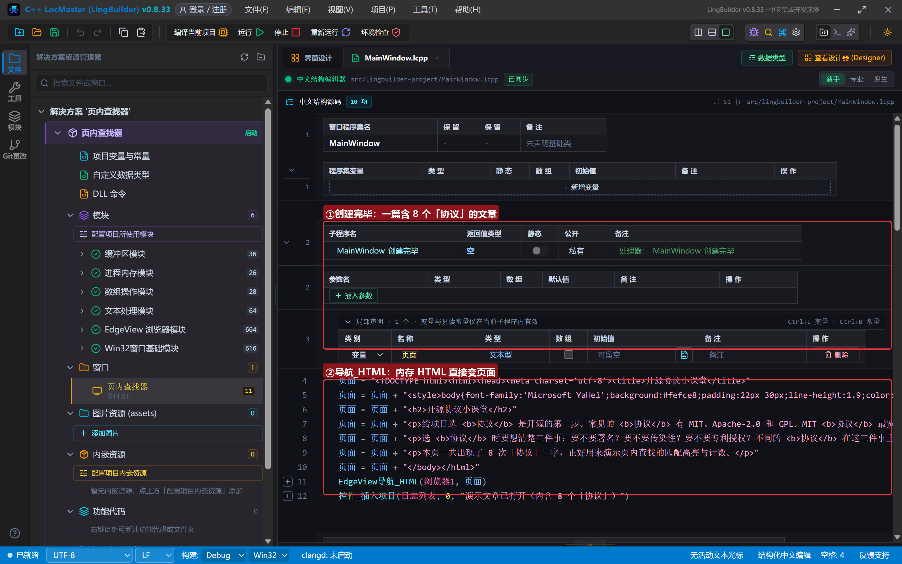

### 4.2 开始查找 + 完成处理器

```lcpp
事件 _开始按钮_被单击()
    局部 文本型 词
    词 = 控件_取文本(查找词框)
    如果 (文本_取长度(词) = 0)
        控件_设置文本(状态标签, "请先输入查找词")
        返回()
    如果结束
    EdgeView查找_开始异步(浏览器1, 词, "{}", &查找完成)
    控件_插入项目(日志列表, 0, "开始查找：" + 词)
结束

事件 查找完成()
    控件_插入项目(日志列表, 0, "查找任务完成，匹配状态：" + EdgeView查找_取状态JSON(浏览器1))
结束
```

`开始异步` 的第三个参数是**查找选项 JSON**：传 `"{}"` 表示全部默认；想要大小写敏感可以传 `{"isCaseSensitive":true}`（WebView2 驼峰键名）。完成后处理器里顺手把匹配状态打进日志。

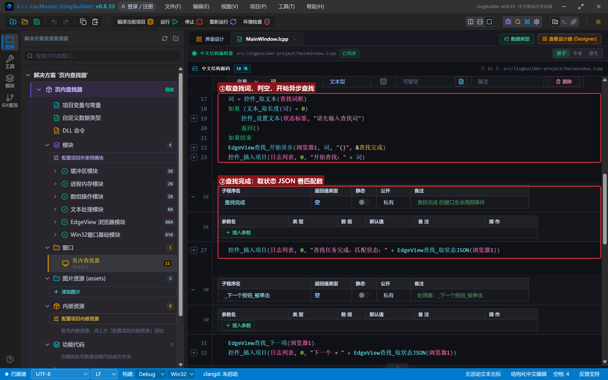

### 4.3 上下切换、停止、读状态

```lcpp
事件 _下一个按钮_被单击()
    EdgeView查找_下一项(浏览器1)
    控件_插入项目(日志列表, 0, "下一个 → " + EdgeView查找_取状态JSON(浏览器1))
结束

事件 _上一个按钮_被单击()
    EdgeView查找_上一项(浏览器1)
    控件_插入项目(日志列表, 0, "上一个 → " + EdgeView查找_取状态JSON(浏览器1))
结束

事件 _停止按钮_被单击()
    EdgeView查找_停止(浏览器1)
    控件_插入项目(日志列表, 0, "已停止查找并清除高亮")
    控件_设置文本(状态标签, "高亮已清除")
结束

事件 _取状态按钮_被单击()
    控件_设置文本(状态标签, "匹配状态：" + EdgeView查找_取状态JSON(浏览器1))
结束
```

`下一项`/`上一项` 是同步命令，调用完立刻 `取状态JSON` 就能拿到最新的当前下标。

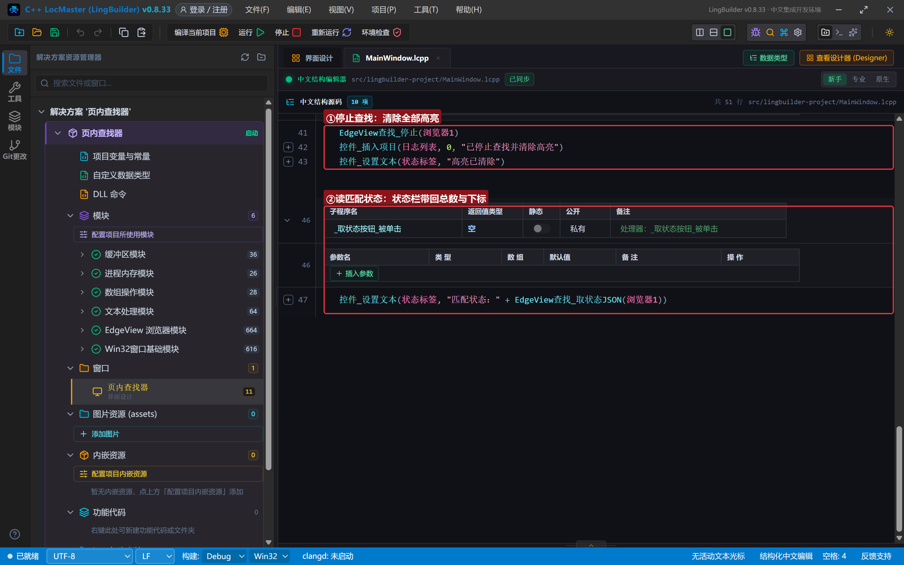

## 5. 编译：先看错误列表

错误列表 (0)，输出窗口「生成完成」：

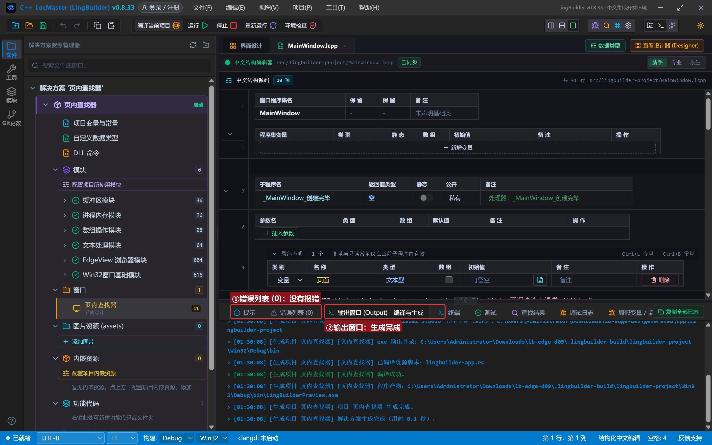

## 6. 运行：黄色高亮+橙色当前项

点「运行」。文章就位：

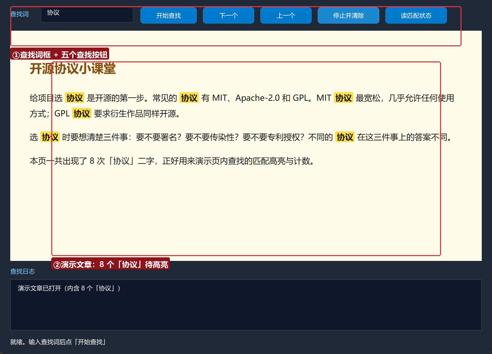

### 6.1 开始查找

点「开始查找」——页面里 8 个「协议」全部黄底高亮，WebView2 原生查找条出现在右上角显示「8」；日志给出 `{"matchCount":"8","activeMatchIndex":"1"}`：

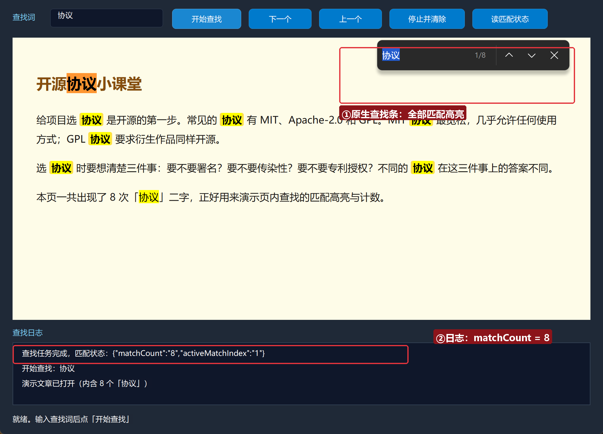

### 6.2 下一个 / 上一个

点「下一个」——当前匹配项切到第 2 个（橙色底），查找条显示 2/8：

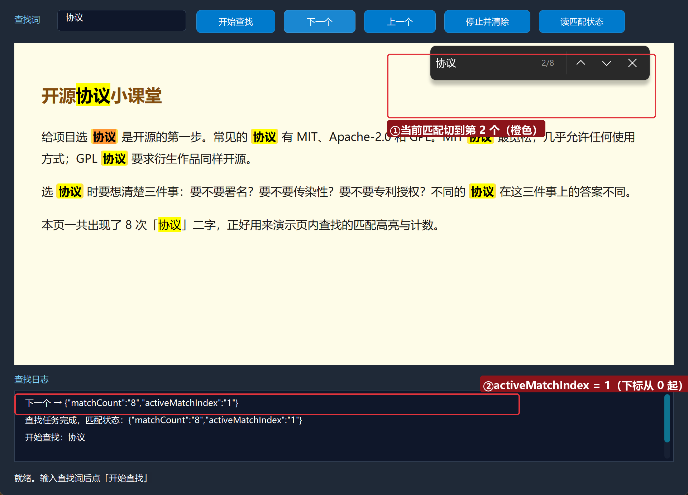

点「上一个」——下标回退（`activeMatchIndex` 变回 0）：

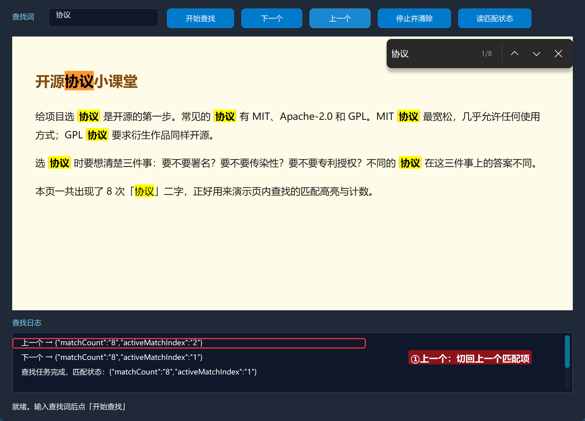

### 6.3 读匹配状态

点「读匹配状态」——状态栏显示当前匹配总数与下标：

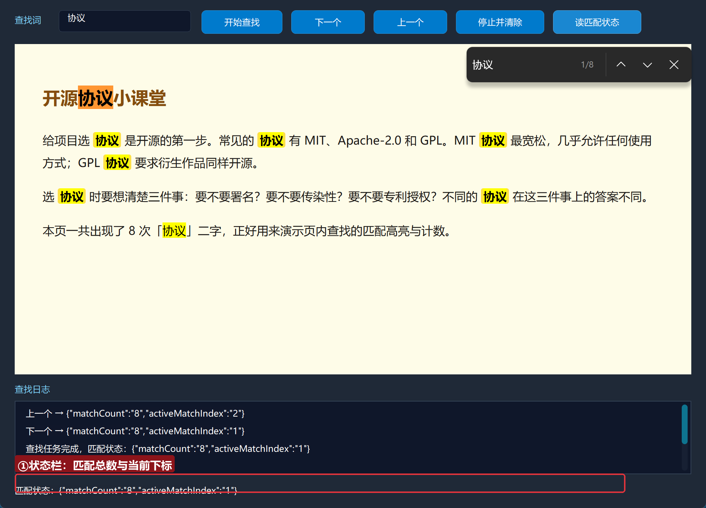

### 6.4 停止并清除

点「停止并清除」——高亮全部消失、查找条关闭：

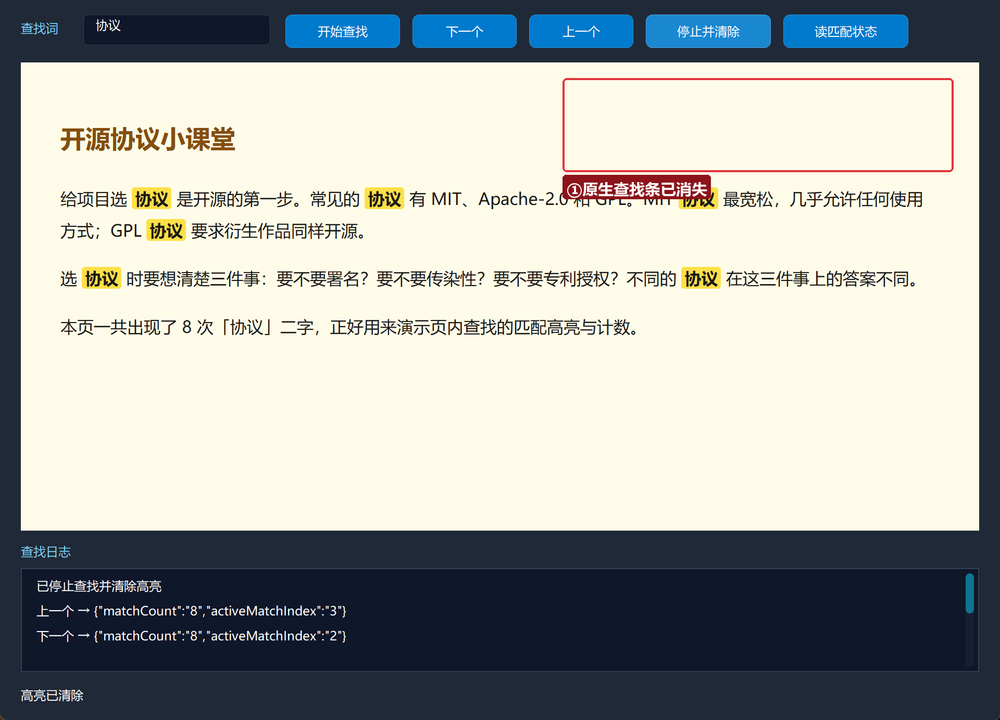

## 常见问题急救表

| 症状 | 原因 | 解法 |
| --- | --- | --- |
| 开始查找没反应 | 查找词为空 | 判空已在示例里；先输入再点 |
| matchCount 一直是 0 | 页面还没加载完 | 等「导航完成」后再开始查找 |
| 高亮清除不干净 | 又点了一次开始 | 先 查找_停止 再开始新查找 |
| 选项 JSON 传了没生效 | 键名不是驼峰 | 用 WebView2 驼峰键，如 isCaseSensitive |

## 本集小结

- 查找族 5 条：`开始异步`（+完成处理器）、`下一项`、`上一项`、`停止`、`取状态JSON`。
- `matchCount` 是总数、`activeMatchIndex` 是当前项下标（0 起）。
- 网页操作篇到此收官：**读（取数）、写（填表）、点（点击）、查（查找）**四件套齐活。

## 源码包

本集完整源码已打包为 **页内查找器.lcpppkg**（随本教程同目录分发，官网示例源码区可下载）。在 LingBuilder 欢迎页点「打开工作区」，或直接双击 `.lcpppkg` 文件即可导入运行。

**下一集预告**：《页面调原生》——进入 JS 双向桥篇：网页里的 JavaScript 第一次主动给你的程序「打电话」（postMessage 桥）。

[回合集总览](/guide/tutorials/edge)
