# Edge 合集 11 · 原生应答与推送：让网页仪表盘实时刷新本地数据

> 《LingBuilder Edge 浏览器合集》第 11 集（JS 双向桥篇）。上一集学会了双向桥的「一问一答」；这一集让它**不知疲倦**：时钟组件每秒触发一次，把本地数据推给网页仪表盘——网页上的温度卡片**秒级刷新**，全程不需要用户点任何按钮。顺带学一招「文档预注入」：注册一段开机脚本，以后每个页面都先执行它。全程约 25 分钟。
>
> 前置要求：学过[第 10 集](/guide/tutorials/edge-10)（postMessage 双向桥）。本集源码包见文末。

## 这一集你将学会

- 设计器「**时钟**」非可视组件：每秒触发「周期到期」事件
- `时钟_启动` / `时钟_停止`：推送开关
- **类级变量**（程序集变量）：跨周期累计推送次数
- `EdgeView脚本_发送字符串消息`：周期性原生 → 网页推送
- `EdgeView脚本_文档预注入异步`：注册「每个页面都先执行」的开机脚本

## 1. 推送式架构：谁来定时？

上一集的回信是「用户点一下、原生答一句」；仪表盘要的是「**我不问，你也要持续说**」——这就是推送。定时器用设计器的「时钟」组件：设定周期 1000 毫秒，每次「周期到期」事件里把最新数据发一条消息给网页。网页侧只需挂一个监听器（第 10 集已学），收到就刷新卡片。

数据格式用最简单的**竖线分隔**：`"22.31|23.81|51|第 33 次推送"`——温度A、温度B、湿度、时间戳四段，网页 `split('|')` 一拆就用。

## 2. 新建项目与启用模块

欢迎页「新建项目」，项目名称 **实时仪表盘**，「Windows 界面设计」：

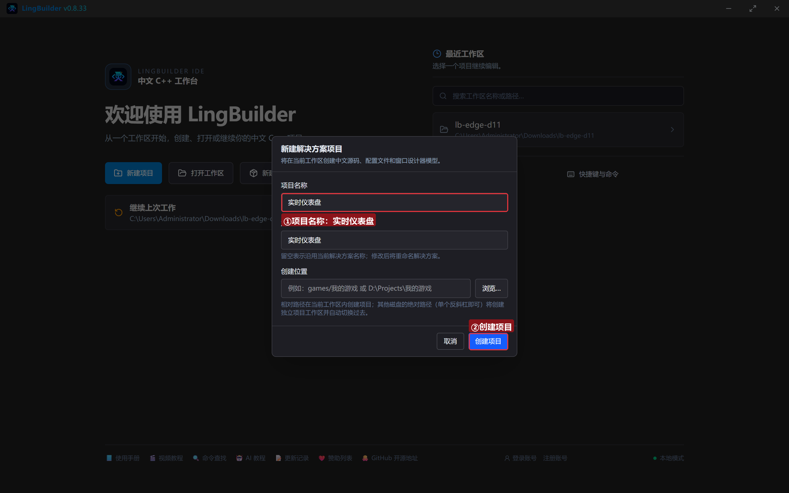

模块确认四个已启用：**EdgeView 浏览器模块**、**文本处理模块**、**数学模块**（取随机数模拟温度）、**Win32窗口基础模块**（时钟组件在这里）：

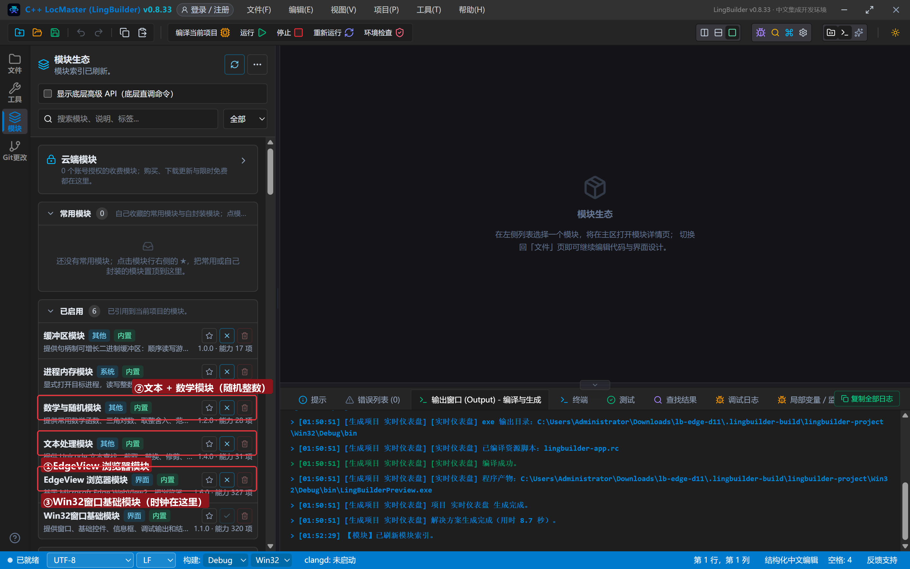

## 3. 设计界面（含时钟组件）

| 控件 | 名称 | 显示内容 | 左距 | 顶距 | 宽度 | 高度 |
| --- | --- | --- | --- | --- | --- | --- |
| 按钮 | 暂停按钮 | 暂停推送 | 20 | 14 | 130 | 32 |
| 按钮 | 恢复按钮 | 恢复推送 | 162 | 14 | 130 | 32 |
| 按钮 | 预注入按钮 | 注入开机脚本 | 304 | 14 | 150 | 32 |
| 标签 | 计数标签 | 已推送 0 次 | 466 | 19 | 300 | 22 |
| **Edge浏览器** | **浏览器1** | （拖入） | 20 | 60 | 920 | 470 |
| 标签 | 日志标题 | 推送日志 | 20 | 542 | 120 | 20 |
| 列表框 | 日志列表 | （清空） | 20 | 566 | 920 | 96 |
| 标签 | 状态标签 | 就绪。时钟每秒把本地数据推给网页仪表盘 | 20 | 664 | 920 | 20 |

再加一个**时钟组件**：设计器左侧「添加非可视组件 → 时钟」，命名 **推送时钟**，周期 1000 毫秒，「周期到期」处理器填 `_推送时钟_周期到期`（先不勾自动启动，由代码启动）。时钟是非可视的，画布上只占一个图标位。

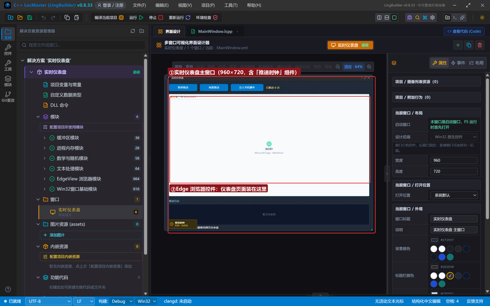

## 4. 写代码

### 4.1 创建完毕：仪表盘页面 + 启动时钟

```lcpp
事件 _MainWindow_创建完毕()
    局部 文本型 页面
    页面 = "<!DOCTYPE html><html><head><meta charset='utf-8'><title>机房温度监控</title>"
    页面 = 页面 + "<style>…（深色卡片样式）…</style></head><body>"
    页面 = 页面 + "<h2>机房温度监控（原生每秒推送）</h2><div class='cards'><div class='card'><div class='k'>A 机房温度</div><div class='v' id='t1'>--</div></div><div class='card'><div class='k'>B 机房温度</div><div class='v' id='t2'>--</div></div><div class='card'><div class='k'>湿度</div><div class='v' id='h'>--</div></div></div><div id='stamp'>等待原生数据……</div>"
    页面 = 页面 + "<script>window.chrome.webview.addEventListener('message',function(e){var p=e.data.split('|');document.getElementById('t1').innerText=p[0]+' ℃';document.getElementById('t2').innerText=p[1]+' ℃';document.getElementById('h').innerText=p[2]+' %';document.getElementById('stamp').innerText='更新时间：'+p[3];});</script>"
    页面 = 页面 + "</body></html>"
    EdgeView导航_HTML(浏览器1, 页面)
    时钟_启动(推送时钟)
    控件_插入项目(日志列表, 0, "仪表盘已打开，推送时钟已启动（每秒 1 次）")
结束
```

监听器里 `e.data.split('|')` 把推送串拆成四段，三张卡片 + 时间戳各就各位。

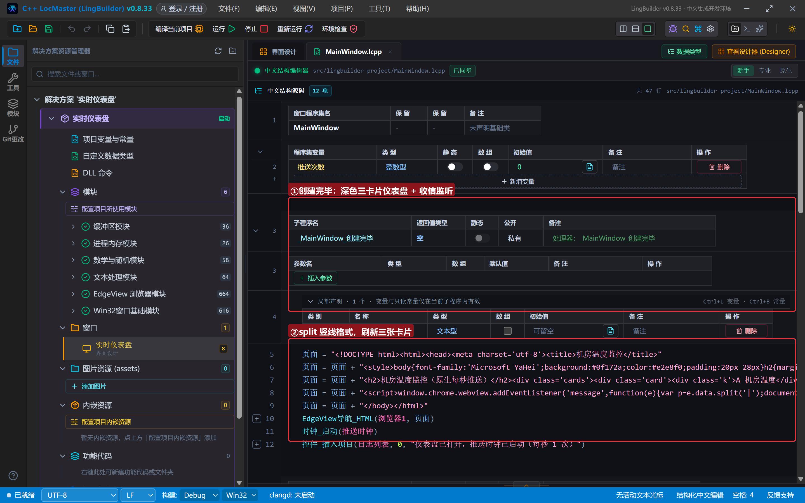

### 4.2 周期到期：每秒的推送作业

```lcpp
整数型 推送次数 = 0

事件 _推送时钟_周期到期()
    局部 文本型 数据
    局部 小数型 温度
    局部 整数型 湿度
    温度 = 22 + 到小数(到文本(数学_随机整数(0, 600))) / 100
    湿度 = 数学_随机整数(40, 65)
    数据 = 到文本(温度) + "|" + 到文本(温度 + 1.5) + "|" + 到文本(湿度) + "|第 " + 到文本(推送次数 + 1) + " 次推送"
    EdgeView脚本_发送字符串消息(浏览器1, 数据)
    推送次数 = 推送次数 + 1
    控件_设置文本(计数标签, "已推送 " + 到文本(推送次数) + " 次")
结束
```

三个细节：**`整数型 推送次数 = 0` 写在类里、事件外面**——这是类级变量（程序集变量），跨周期保留；`数学_随机整数(0, 600) / 100` 模拟温度小数（`到小数` 的参数要文本，所以套一层 `到文本`）；真实项目里这一行换成读串口/传感器/数据库即可，推送骨架不变。

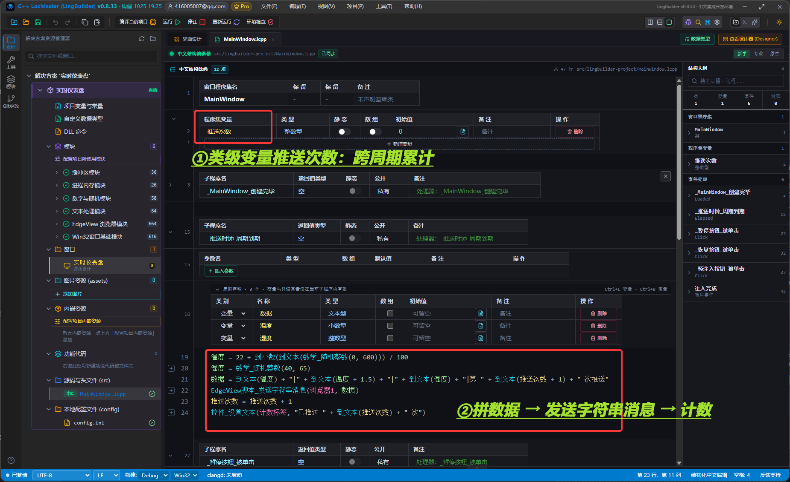

### 4.3 暂停 / 恢复 / 开机脚本

```lcpp
事件 _暂停按钮_被单击()
    时钟_停止(推送时钟)
    控件_插入项目(日志列表, 0, "推送已暂停（时钟停止）")
结束

事件 _恢复按钮_被单击()
    时钟_启动(推送时钟)
    控件_插入项目(日志列表, 0, "推送已恢复（时钟启动）")
结束

事件 _预注入按钮_被单击()
    EdgeView脚本_文档预注入异步(浏览器1, "window.__injected = '已注入';console.log('开机脚本运行');", &注入完成)
    控件_插入项目(日志列表, 0, "已注册文档预注入脚本（以后每个页面都先执行它）")
结束

事件 注入完成()
    控件_插入项目(日志列表, 0, "预注入脚本注册完成，脚本 ID：" + EdgeView任务_取结果(EdgeView任务_取当前任务ID()))
结束
```

**文档预注入**（第 4 集学过）在这里的意义：如果仪表盘页面会跳转、会刷新，监听器会随页面重建而丢失——把监听器放进预注入脚本，每个新页面还没加载完就先把监听器挂好。

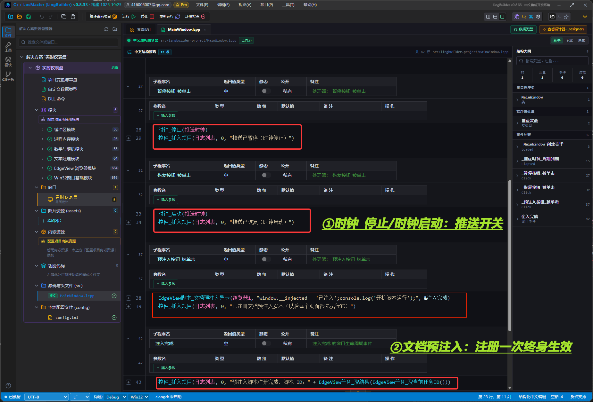

## 5. 编译：先看错误列表

错误列表 (0)，输出窗口「生成完成」：

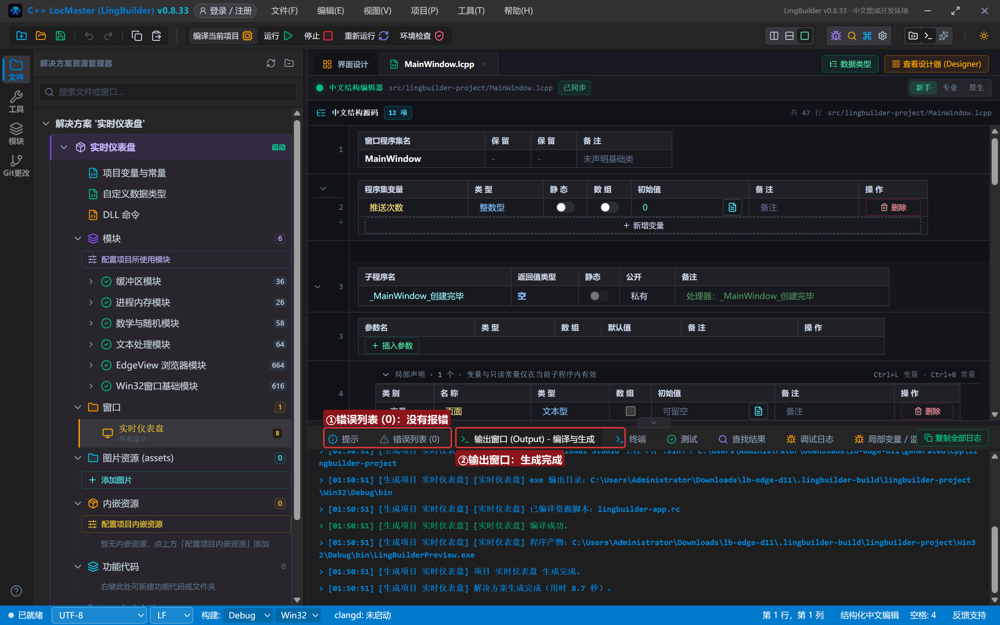

## 6. 运行：秒级刷新的仪表盘

点「运行」。三张卡片先是「--」：

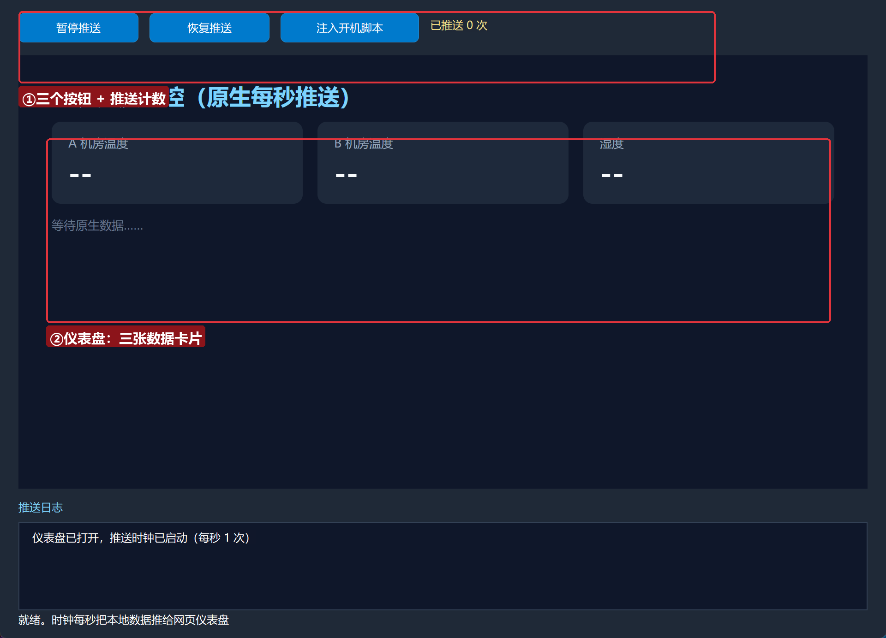

### 6.1 每秒推送

什么都不用点——一秒后卡片全部点亮，数字每秒跳动，计数标签一路上涨：

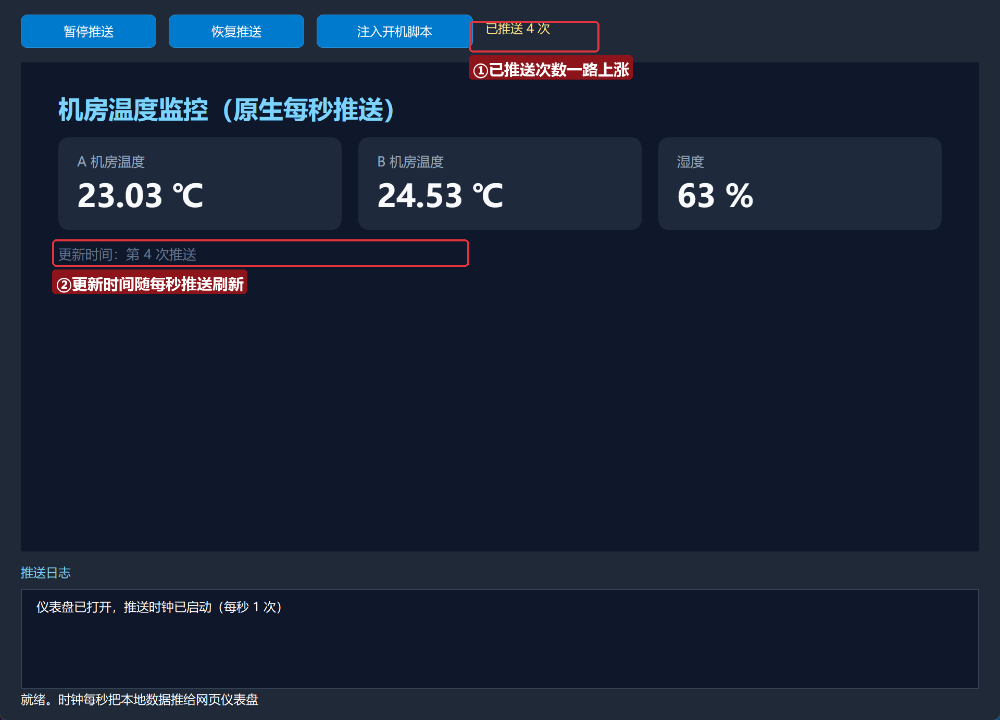

### 6.2 暂停与恢复

点「暂停推送」——卡片数字停住（时钟停止，不再发消息）；点「恢复推送」——继续跳：

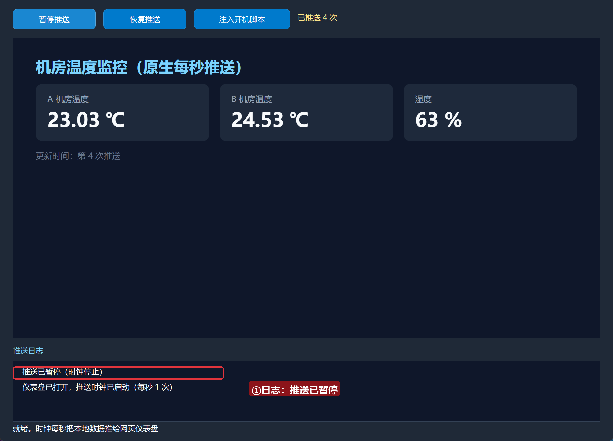

### 6.3 注入开机脚本

点「注入开机脚本」——日志给出脚本 ID。此后页面无论怎么刷新，开机脚本都会先跑：

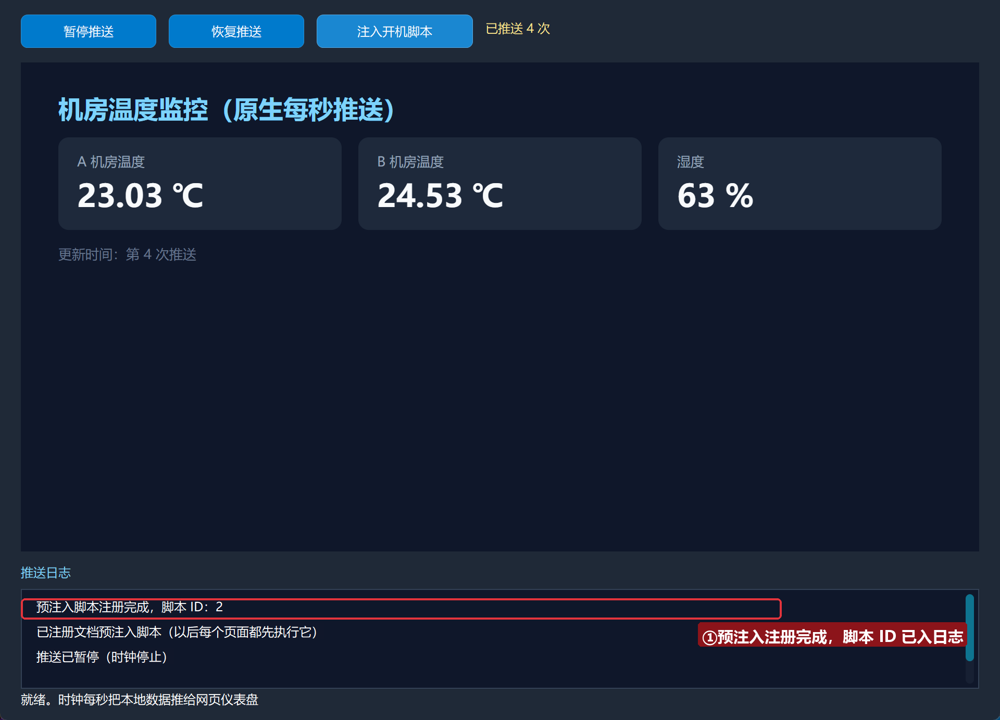

## 常见问题急救表

| 症状 | 原因 | 解法 |
| --- | --- | --- |
| 卡片一直是「--」 | 时钟没启动 / 页面监听器没挂 | 检查 时钟_启动 是否调用、页面 script 是否注册监听 |
| 温度全是整数 | 600/100 是整数除法 | 先 到文本 再 到小数 再除 100 |
| 编译报「到小数 实参类型不符」 | 到小数 只收文本 | `到小数(到文本(整数))` 套一层 |
| 推送次数从 1 重新开始 | 把计数器声明成了局部变量 | 计数器必须是类级变量（写在事件外面） |
| 页面刷新后收不到推送 | 监听器随页面销毁 | 用文档预注入把监听器挂到每个新页面 |

## 本集小结

- **时钟组件**是原生侧的节拍器：周期到期 → 组数据 → 发送字符串消息，三步就是推送。
- 类级变量（程序集变量）跨事件保留状态；`到小数` 收文本不收整数。
- 文档预注入让「每个新页面都自带监听器」，推送架构从此不怕页面刷新。

## 源码包

本集完整源码已打包为 **实时仪表盘.lcpppkg**（随本教程同目录分发，官网示例源码区可下载）。在 LingBuilder 欢迎页点「打开工作区」，或直接双击 `.lcpppkg` 文件即可导入运行。

**下一集预告**：《子框架支持》——框架族 6 条命令，钻进 iframe 里操作另一个世界。

[回合集总览](/guide/tutorials/edge)
