# Edge 合集 15 · 多店铺弹窗：一个程序同时开 N 家「店」

> 《LingBuilder Edge 浏览器合集》第 15 集（会话与多开篇）。多账号管理的终极大招：**实例级浏览器**。`EdgeView_创建弹窗浏览器` 一条命令就能开出一个**独立顶层窗口**（任务栏可见、可拖动缩放），配上**独立缓存目录**——每家「店」的 Cookie、localStorage 完全隔离，店铺 A 登 A 号、店铺 B 登 B 号，互不串味。全程约 25 分钟。
>
> 前置要求：学过[第 13~14 集](/guide/tutorials/edge-13)（Cookie 基础）。本集源码包见文末。

## 这一集你将学会

- `EdgeView_创建弹窗浏览器(实例编号, 窗口标题, 宽, 高, 地址, 独立缓存目录, 用户代理)`：开一家店
- `EdgeView_执行JS实例(实例编号, 脚本)`：在指定实例里执行 JS（**同步**返回）
- `EdgeView_枚举实例JSON()`：列出全部存活实例
- `EdgeView_关闭全部实例()`：统一打烊
- 核心概念：**实例编号**是这些命令的「门牌号」；**独立缓存目录**是 Cookie 隔离的边界

## 1. 控件版 vs 实例版：怎么选

| | 控件版（前 14 集） | 实例版（本集） |
| --- | --- | --- |
| 界面 | 嵌在窗口里的控件 | 独立顶层窗口 |
| 数量 | 一窗口几个控件 | 想开几家开几家 |
| Cookie | 共用控件所在 Profile | **每实例独立缓存目录** |
| 典型场景 | 内嵌浏览器、仪表盘 | 多账号、多店铺并行 |

## 2. 新建项目与启用模块

欢迎页「新建项目」，项目名称 **多店铺弹窗**，「Windows 界面设计」：

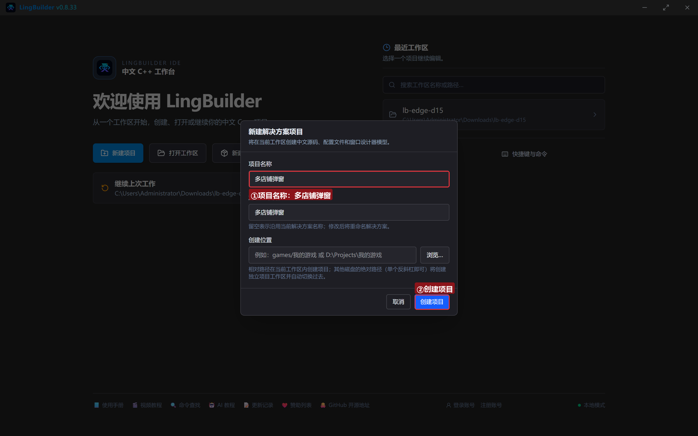

模块确认四个已启用：**EdgeView 浏览器模块**、**文本处理模块**、**数组操作模块**、**Win32窗口基础模块**：

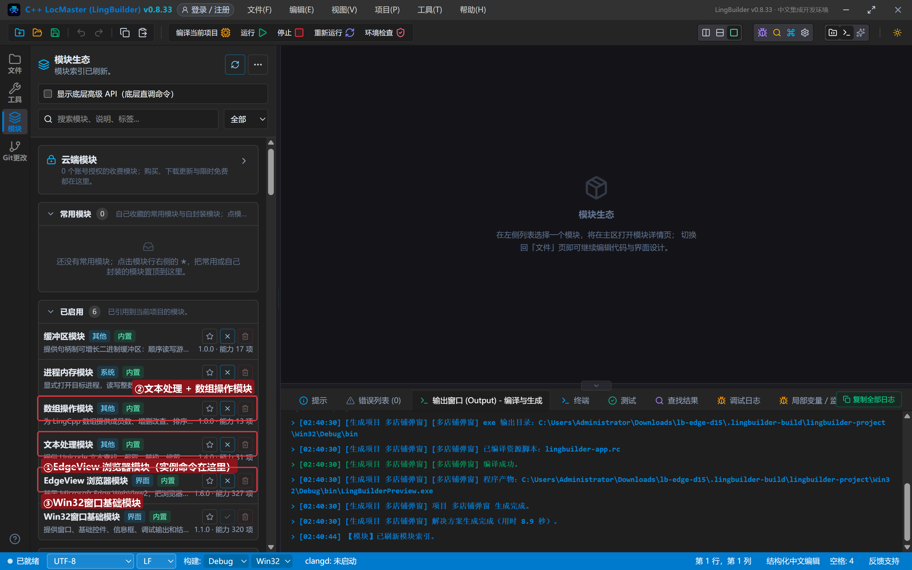

## 3. 设计界面

主窗口只是「指挥部」——真正的浏览器都是弹窗实例，不占主窗口位置：

| 控件 | 名称 | 显示内容 | 左距 | 顶距 | 宽度 | 高度 |
| --- | --- | --- | --- | --- | --- | --- |
| 按钮 | 开店按钮 | 同时开三家店 | 20 | 14 | 150 | 32 |
| 按钮 | 分身按钮 | 各店执行JS | 182 | 14 | 140 | 32 |
| 按钮 | 枚举按钮 | 列出实例 | 334 | 14 | 120 | 32 |
| 按钮 | 关门按钮 | 全部关闭 | 466 | 14 | 120 | 32 |
| **Edge浏览器** | **浏览器1** | （拖入，占位即可） | 20 | 60 | 920 | 470 |
| 标签 | 日志标题 | 实例日志 | 20 | 542 | 120 | 20 |
| 列表框 | 日志列表 | （清空） | 20 | 566 | 920 | 96 |
| 标签 | 状态标签 | 就绪。每家店 = 独立实例 + 独立缓存目录 | 20 | 664 | 920 | 20 |

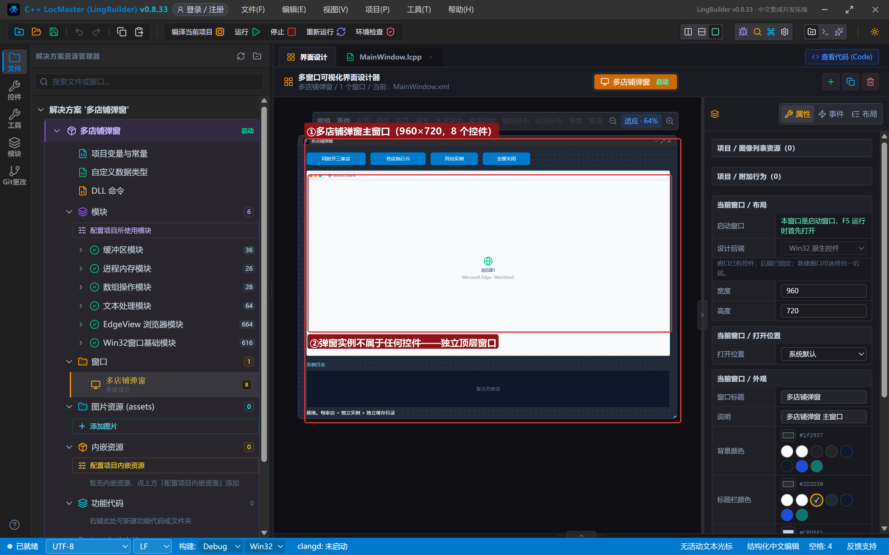

## 4. 写代码

### 4.1 同时开三家店

```lcpp
事件 _开店按钮_被单击()
    EdgeView_创建弹窗浏览器(1, "店铺A", 900, 640, "https://example.com", "独立缓存A", "")
    EdgeView_创建弹窗浏览器(2, "店铺B", 900, 640, "https://www.iana.org", "独立缓存B", "")
    EdgeView_创建弹窗浏览器(3, "店铺C", 900, 640, "https://www.baidu.com", "独立缓存C", "")
    控件_插入项目(日志列表, 0, "已创建 3 个实例：A(example.com) / B(iana.org) / C(baidu.com)")
    控件_设置文本(状态标签, "三家店已开门：独立缓存目录，Cookie 互不影响")
结束
```

参数逐个看：**实例编号** 1/2/3 是门牌号（后面所有实例命令靠它寻址）；**独立缓存目录** 是隔离的关键——三家用三个不同目录，Cookie/存储互不可见（目录相对路径按工作区解析，建议每店一个固定名）。返回 1 成功。

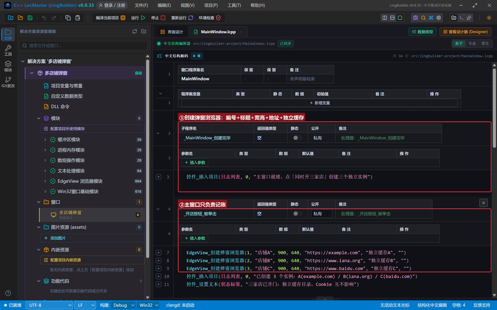

### 4.2 在指定实例里执行 JS（同步版）

```lcpp
事件 _分身按钮_被单击()
    局部 文本型 店A
    局部 文本型 店B
    店A = EdgeView_执行JS实例(1, "document.title")
    店B = EdgeView_执行JS实例(2, "document.title")
    控件_插入项目(日志列表, 0, "店A标题：" + 店A)
    控件_插入项目(日志列表, 0, "店B标题：" + 店B)
结束
```

`执行JS实例` 是**同步命令**：返回值直接就是 JSON 编码结果，不用完成处理器——单条指令场景比异步版更顺手。

### 4.3 列出实例与统一打烊

```lcpp
事件 _枚举按钮_被单击()
    控件_插入项目(日志列表, 0, "实例枚举：" + EdgeView_枚举实例JSON())
结束

事件 _关门按钮_被单击()
    EdgeView_关闭全部实例()
    控件_插入项目(日志列表, 0, "全部实例已关闭（独立缓存目录保留）")
    控件_设置文本(状态标签, "已打烊：下次开门登录态还在")
结束
```

枚举 JSON 每项带编号/标题/地址，可用于自检；关闭全部实例只关窗口、**不删缓存目录**——登录态保留，下次开门自动续期。

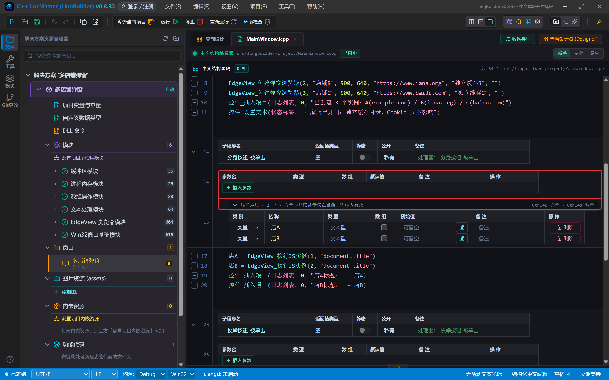

## 5. 编译：先看错误列表

错误列表 (0)，输出窗口「生成完成」：

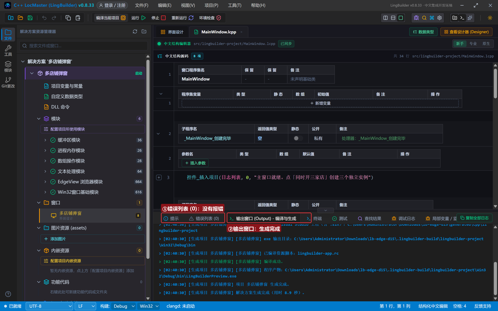

## 6. 运行：三家店同时营业

点「运行」，主窗口就位：

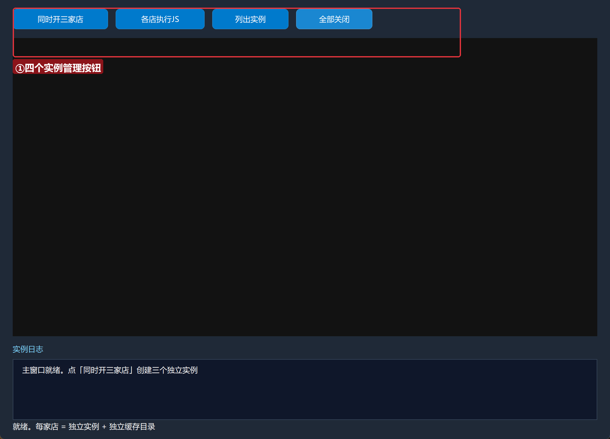

### 6.1 三家店开门

点「同时开三家店」——屏幕上多出三个独立浏览器窗口（任务栏各一个图标），主窗口日志记账：

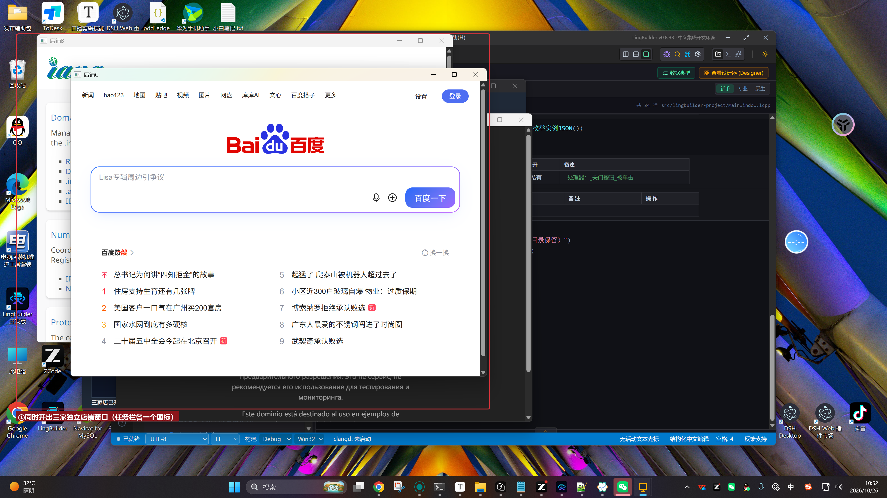

### 6.2 各店执行 JS

点「各店执行JS」——店A/店B 的页面标题各自取回：

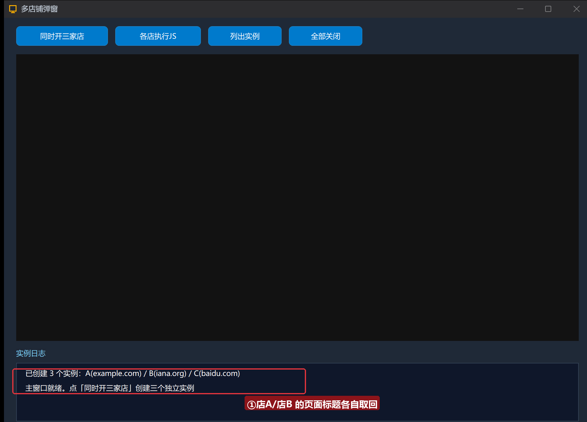

### 6.3 列出实例与打烊

点「列出实例」看名册；点「全部关闭」统一打烊：

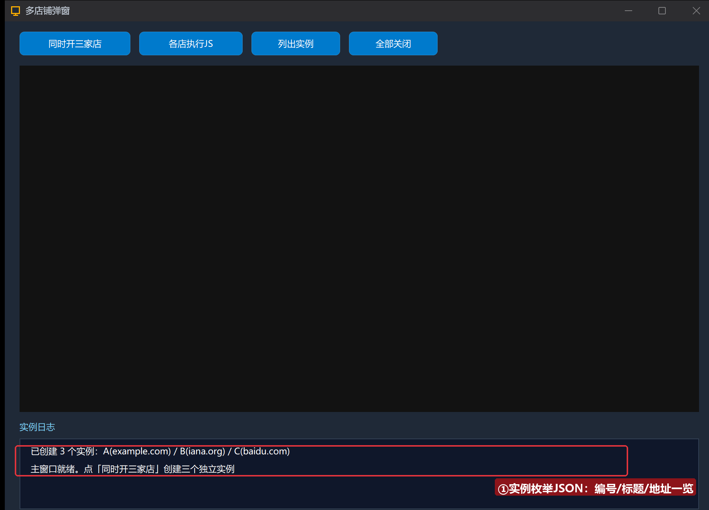

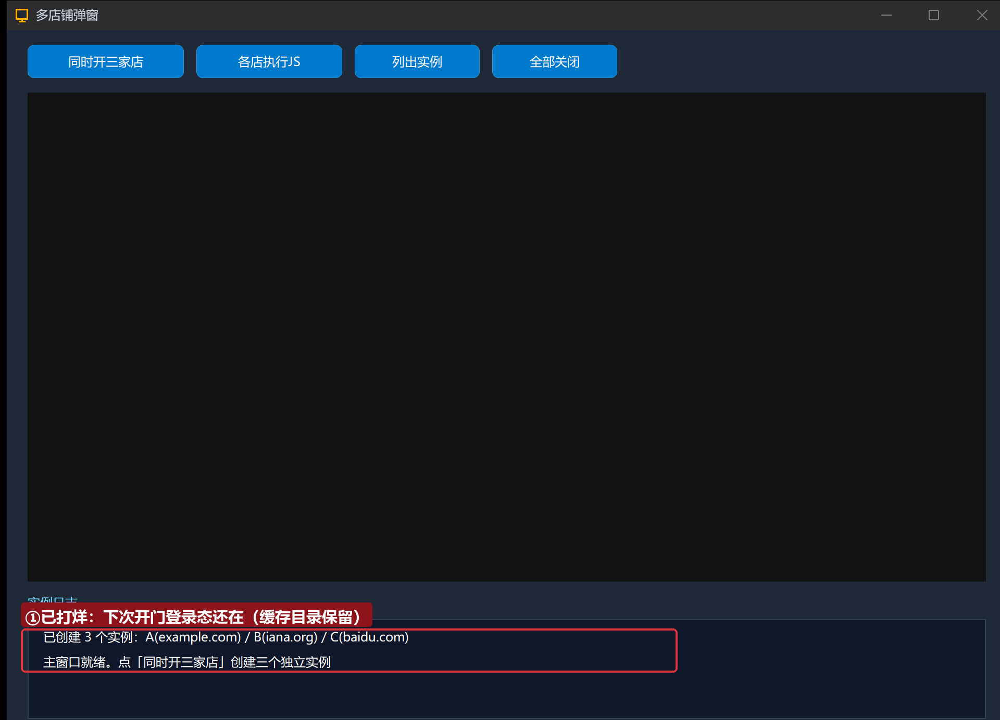

## 常见问题急救表

| 症状 | 原因 | 解法 |
| --- | --- | --- |
| 创建返回 0 | 实例编号已被存活实例占用 | 先 关闭实例 或换编号；用 枚举实例JSON 自检 |
| 两家店 Cookie 串了 | 用了同一个缓存目录 | 每家店一个独立缓存目录，名字别重复 |
| 执行JS实例 返回空 | 实例不存在或页面未加载完 | 编号核对枚举JSON；导航完成后重试 |
| 关闭主窗口后弹窗全没了 | 设计如此（连带关闭） | 主窗口就是宿主，打烊请用 关闭全部实例 |
| 编译报「实参类型不符」 | 创建弹窗浏览器是 7 参（含宽高） | 按本集签名：编号/标题/宽/高/地址/缓存/UA |

## 本集小结

- **创建弹窗浏览器** 七参数：编号/标题/宽/高/地址/独立缓存/UA；编号即门牌。
- 独立缓存目录 = Cookie 隔离边界；多账号多店铺的正确打开方式。
- `执行JS实例`（同步）vs `EdgeView脚本_执行异步`（异步+处理器）按需选。
- 关闭全部实例保留缓存目录——登录态可复用，这才是「保险柜」。

## 源码包

本集完整源码已打包为 **多店铺弹窗.lcpppkg**（随本教程同目录分发，官网示例源码区可下载）。在 LingBuilder 欢迎页点「打开工作区」，或直接双击 `.lcpppkg` 文件即可导入运行。

**下一集预告**：《设置族（一）》——浏览器配置与用户代理：让每个店穿上不同的「马甲」。

[回合集总览](/guide/tutorials/edge)
