# Edge 合集 16 · 设置族（一）：用户代理、脚本开关、缩放与配色

> 《LingBuilder Edge 浏览器合集》第 16 集（会话与多开篇）。设置族 53 条命令是浏览器的「控制面板」：本集挑最常用的四个先上手——**用户代理（UA）**、**页面脚本开关**、**缩放**、**配色方案**。改设置有一个共同脾气：**多数要对之后的请求/新页面才生效**，本集会把这个时机讲透。全程约 25 分钟。
>
> 前置要求：学过[第 1 集](/guide/tutorials/edge-01)（导航控件）。本集源码包见文末。

## 这一集你将学会

- `EdgeView设置_置用户代理` / `EdgeView设置_取用户代理`：换 UA 马甲与读回
- `EdgeView设置_置脚本执行(真/假)`：一键禁用/恢复页面 JavaScript
- `EdgeView设置_置缩放(1.5)`：页面 150% 缩放
- `EdgeView会话_置配色方案(2)`：Profile 级深色配色
- 设置生效时机的通用规律

## 1. 设置族的「生效时机」速记

| 设置 | 生效时机 |
| --- | --- |
| 用户代理 | **之后的请求**（已打开的页面不变，重新导航即用新 UA） |
| 脚本执行 | **刷新后可见**（当前页已跑的脚本不受影响） |
| 缩放 | 立即 |
| 配色方案 | 立即（Profile 级，所有页面共享） |

通用思路：**改设置 → 重新导航 → 验证效果**。

## 2. 新建项目与启用模块

欢迎页「新建项目」，项目名称 **伪装工作室**，「Windows 界面设计」：

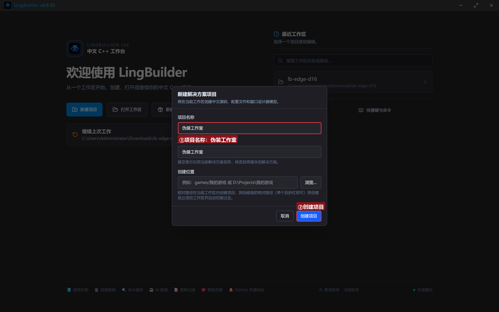

模块确认三个已启用：**EdgeView 浏览器模块**（设置族 53 条）、**文本处理模块**、**Win32窗口基础模块**：

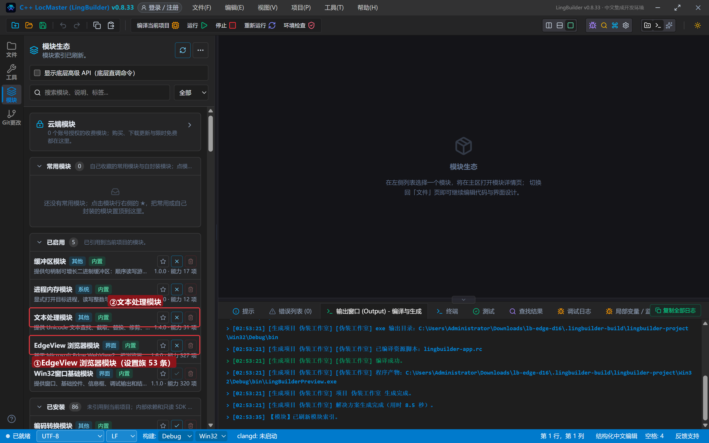

## 3. 设计界面

| 控件 | 名称 | 显示内容 | 左距 | 顶距 | 宽度 | 高度 |
| --- | --- | --- | --- | --- | --- | --- |
| 标签 | UA标签 | 自定义 User-Agent | 20 | 19 | 150 | 22 |
| 编辑框 | UA框 | （预填安卓手机 UA） | 180 | 14 | 560 | 30 |
| 按钮 | 应用UA按钮 | 应用UA | 756 | 14 | 120 | 32 |
| 按钮 | 查UA按钮 | 查当前UA | 20 | 56 | 130 | 32 |
| 按钮 | 禁脚本按钮 | 禁用页面脚本 | 162 | 56 | 140 | 32 |
| 按钮 | 启脚本按钮 | 恢复页面脚本 | 314 | 56 | 140 | 32 |
| 按钮 | 缩放按钮 | 试试缩放 | 466 | 56 | 120 | 32 |
| 按钮 | 暗色按钮 | 暗色配色 | 598 | 56 | 120 | 32 |
| **Edge浏览器** | **浏览器1** | （拖入） | 20 | 100 | 920 | 410 |
| 标签 | 日志标题 | 设置日志 | 20 | 542 | 120 | 20 |
| 列表框 | 日志列表 | （清空） | 20 | 566 | 920 | 96 |
| 标签 | 状态标签 | 就绪。改设置 → 刷新页面才生效 | 20 | 664 | 920 | 20 |

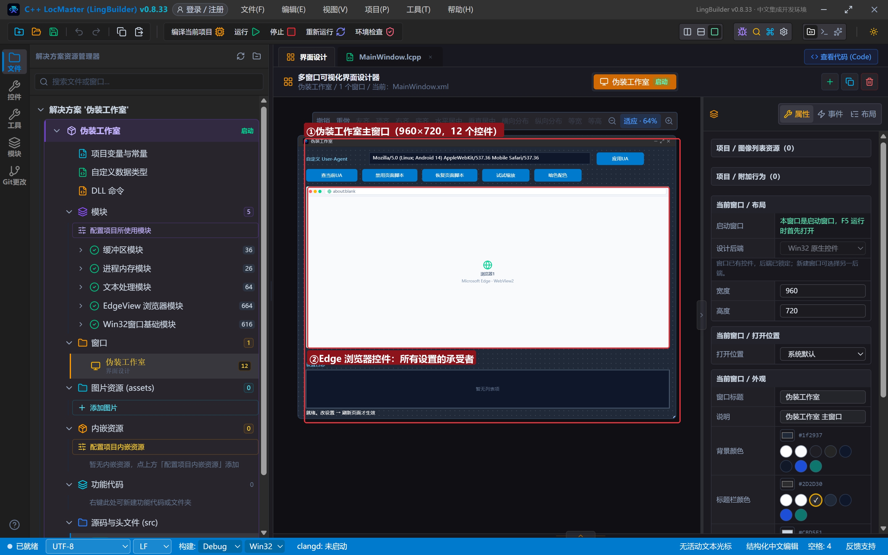

## 4. 写代码

### 4.1 打开实验台

```lcpp
事件 _MainWindow_创建完毕()
    EdgeView_导航控件(浏览器1, "https://www.iana.org")
    控件_插入项目(日志列表, 0, "已打开 iana.org，试试下面的设置")
结束
```

iana.org 页面素净、无登录、加载快，适合当「设置效果观察台」。

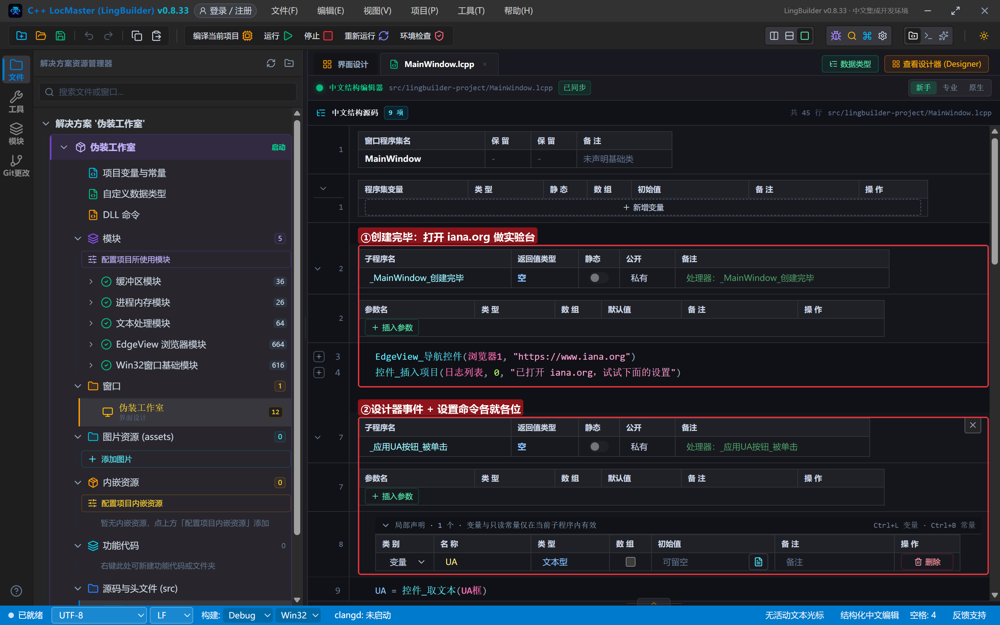

### 4.2 用户代理：换马甲

```lcpp
事件 _应用UA按钮_被单击()
    局部 文本型 UA
    UA = 控件_取文本(UA框)
    如果 (文本_取长度(UA) = 0)
        控件_设置文本(状态标签, "UA 框是空的")
        返回()
    如果结束
    EdgeView设置_置用户代理(浏览器1, UA)
    控件_插入项目(日志列表, 0, "UA 已应用（对之后的请求生效）")
结束

事件 _查UA按钮_被单击()
    控件_插入项目(日志列表, 0, "当前 UA：" + EdgeView设置_取用户代理(浏览器1))
结束
```

UA 应用后**重新导航**才会用新 UA——网页服务器看到的就是手机浏览器了（很多站点会因此改版排版）。想验证，把 UA 改成安卓手机后再导航，页面会切成移动版。

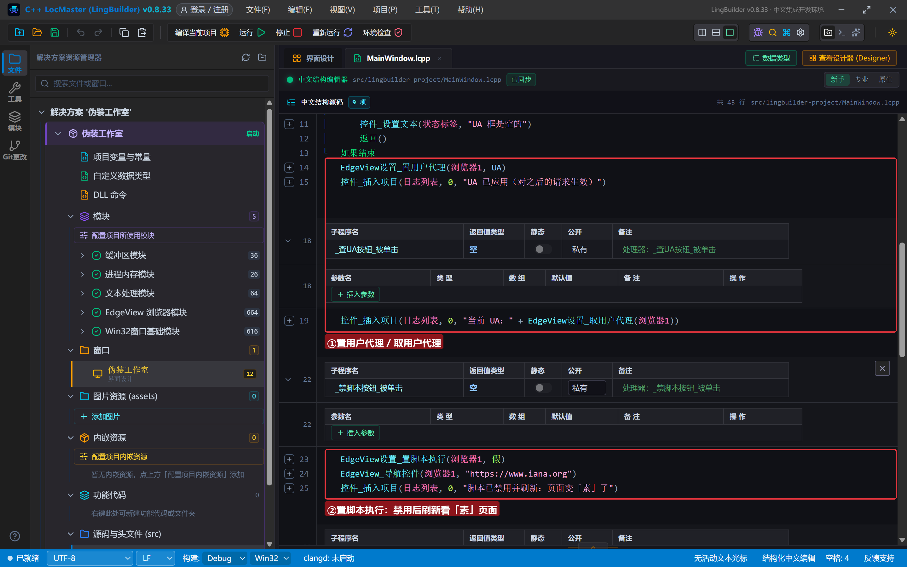

### 4.3 脚本开关：最直观的设置

```lcpp
事件 _禁脚本按钮_被单击()
    EdgeView设置_置脚本执行(浏览器1, 假)
    EdgeView_导航控件(浏览器1, "https://www.iana.org")
    控件_插入项目(日志列表, 0, "脚本已禁用并刷新：页面变「素」了")
结束

事件 _启脚本按钮_被单击()
    EdgeView设置_置脚本执行(浏览器1, 真)
    EdgeView_导航控件(浏览器1, "https://www.iana.org")
    控件_插入项目(日志列表, 0, "脚本已恢复并刷新")
结束
```

禁用脚本后刷新，所有靠 JS 渲染的动效/懒加载全部消失——这是判断「页面是不是 JS 驱动」的最快办法，也是爬虫预研的常用手段。

### 4.4 缩放与配色

```lcpp
事件 _缩放按钮_被单击()
    EdgeView设置_置缩放(浏览器1, 1.5)
    控件_插入项目(日志列表, 0, "缩放已设为 150%")
结束

事件 _暗色按钮_被单击()
    EdgeView会话_置配色方案(浏览器1, 2)
    控件_插入项目(日志列表, 0, "Profile 配色方案 = 深色（2）")
结束
```

缩放 1.5 = 150%；配色方案 0 自动 / 1 浅色 / 2 深色，**Profile 级**设置（对所有页面生效）。

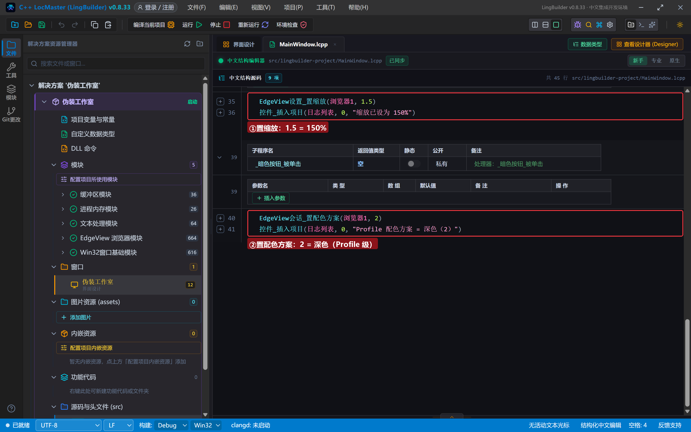

## 5. 编译：先看错误列表

错误列表 (0)，输出窗口「生成完成」：

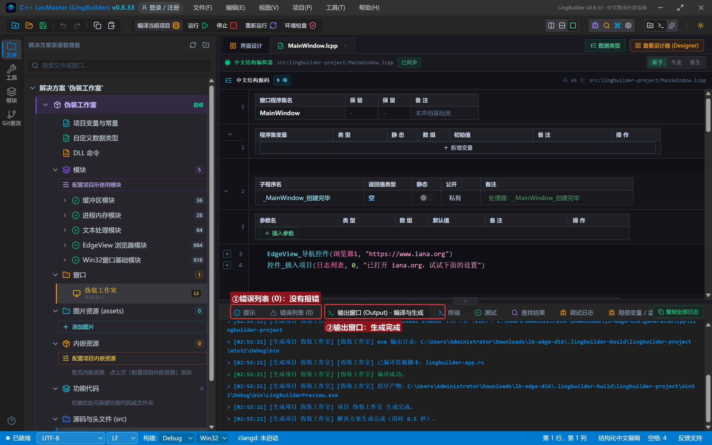

## 6. 运行：一项一项验证

点「运行」：

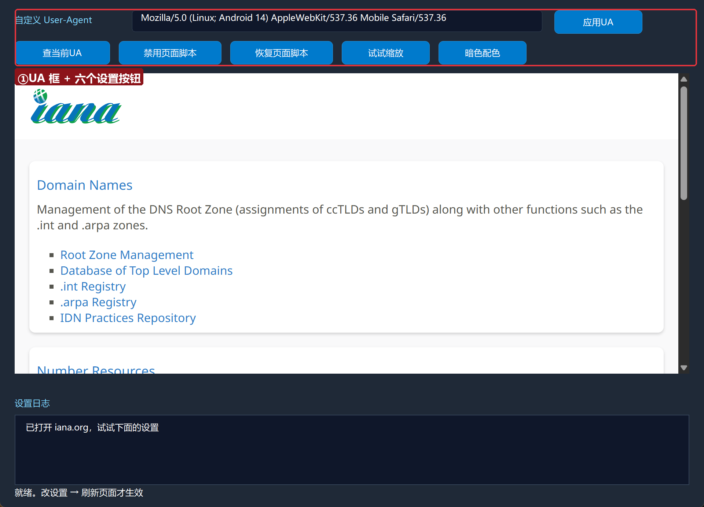

### 6.1 应用 UA 并读回

点「应用UA」再点「查当前UA」——日志读回完整的安卓 UA：

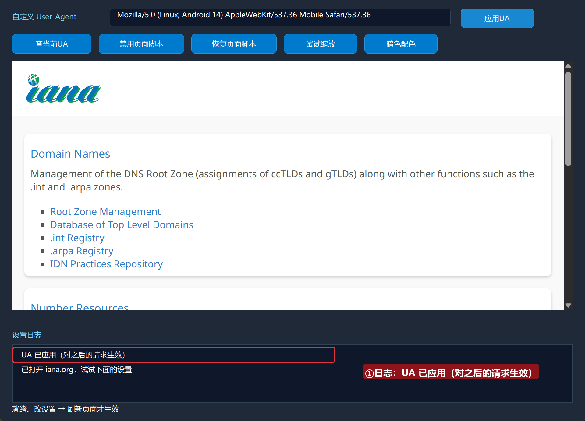

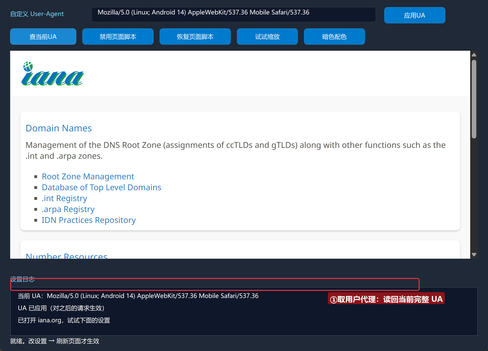

### 6.2 禁用脚本

点「禁用页面脚本」——刷新后页面明显变「素」（脚本驱动的部分全部失效）：

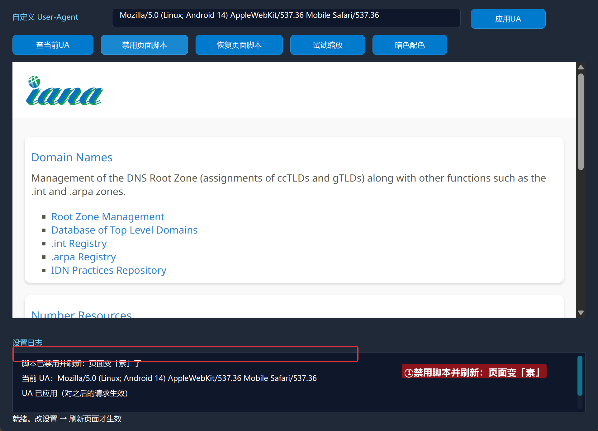

### 6.3 缩放 150%

点「试试缩放」——页面整体放大，字变大：

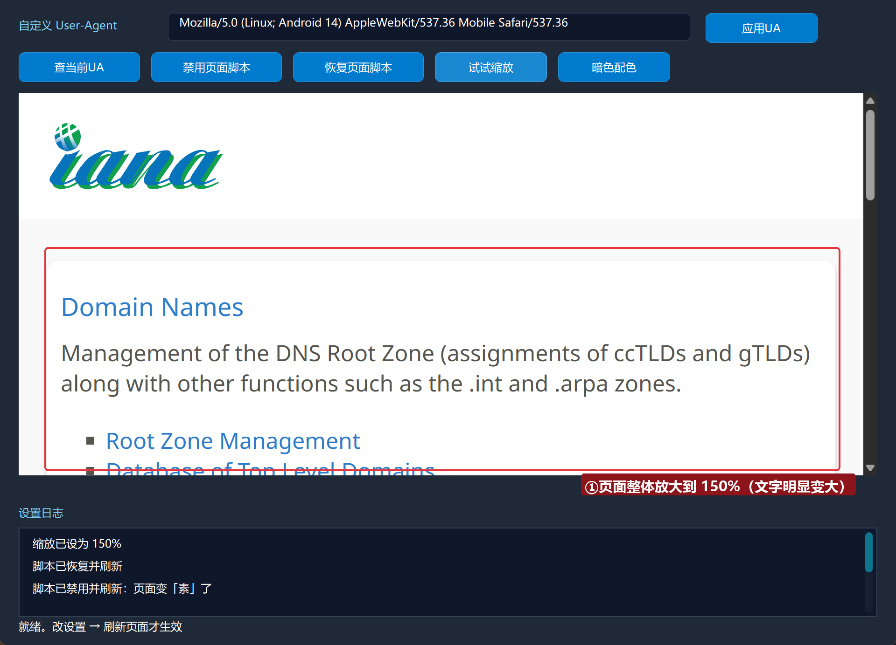

### 6.4 深色配色

点「暗色配色」——Profile 切到深色：

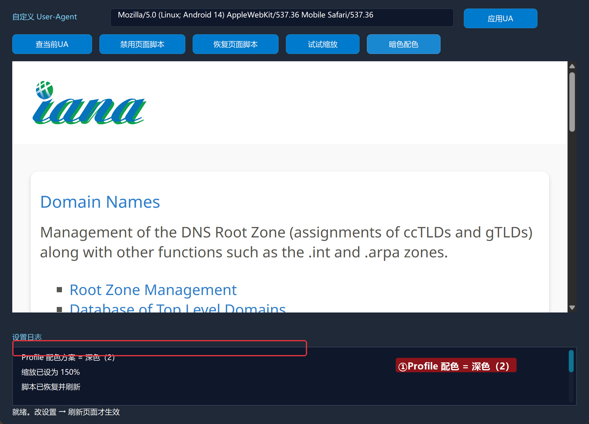

## 常见问题急救表

| 症状 | 原因 | 解法 |
| --- | --- | --- |
| 改了 UA 页面没变化 | UA 只对之后的请求生效 | 重新导航一次再观察 |
| 禁脚本后当前页还能动 | 已运行的脚本不受影响 | 刷新页面（禁用状态下导航） |
| 缩放数字不生效 | 传了字符串 | 缩放参数是小数型：1.5 不是 "1.5" |
| 深色没反应 | 站点不支持 prefers-color-scheme | 该设置只发偏好，站点可忽略 |
| 编译报「未知的命令 EdgeView设置_置用户代理」 | EdgeView 模块没启用 | 模块生态里启用 EdgeView 浏览器模块 |

## 本集小结

- 设置族四件套：`置用户代理` / `置脚本执行` / `置缩放` / `置配色方案`。
- 生效时机口诀：**UA 对之后的请求、脚本开关要刷新、缩放配色立即生效**。
- `取用户代理` 读回当前值，自检利器。

## 源码包

本集完整源码已打包为 **伪装工作室.lcpppkg**（随本教程同目录分发，官网示例源码区可下载）。在 LingBuilder 欢迎页点「打开工作区」，或直接双击 `.lcpppkg` 文件即可导入运行。

**下一集预告**：《设置族（二）》——创建期选项：附加启动参数、跨域开关、独立代理与通道搜索。

[回合集总览](/guide/tutorials/edge)
