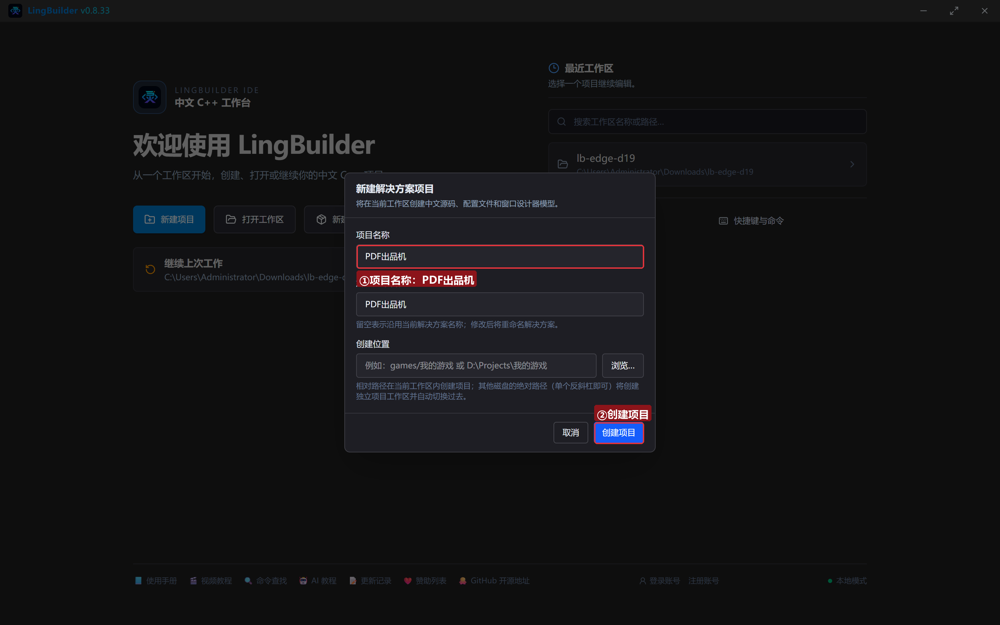
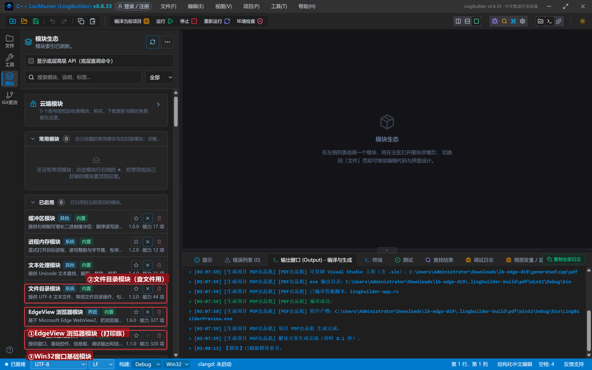
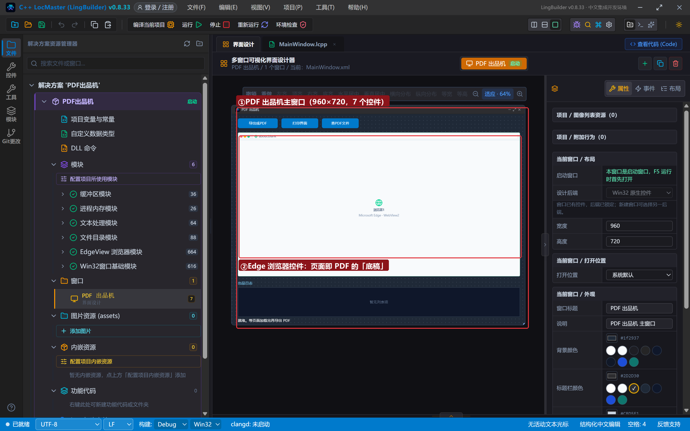
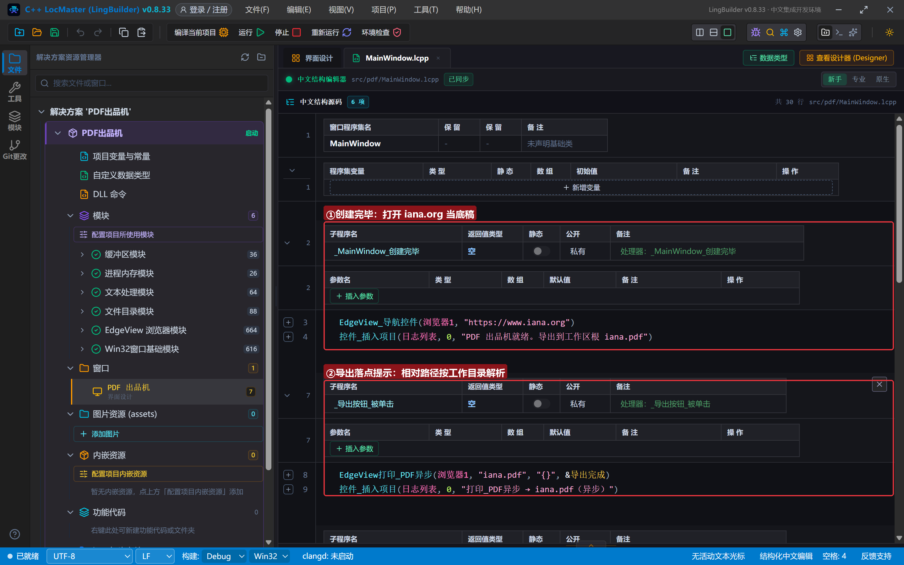
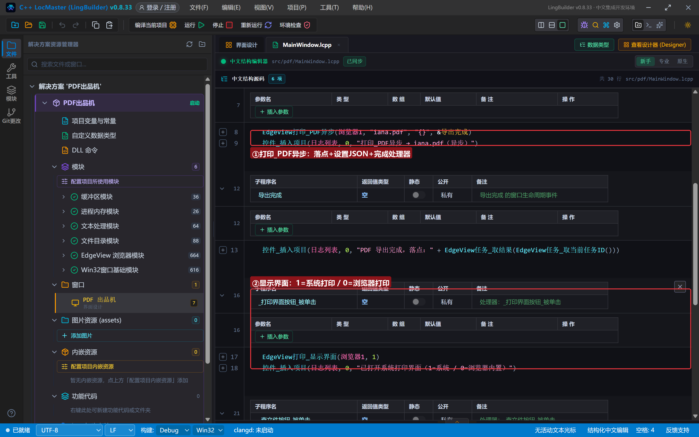
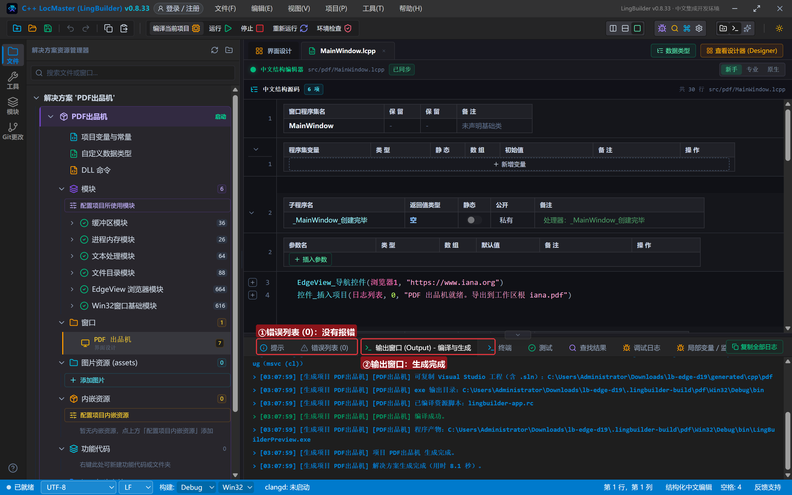
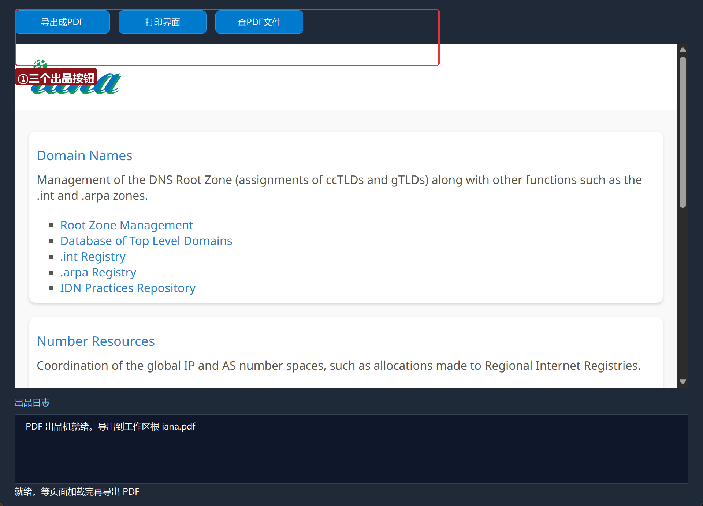
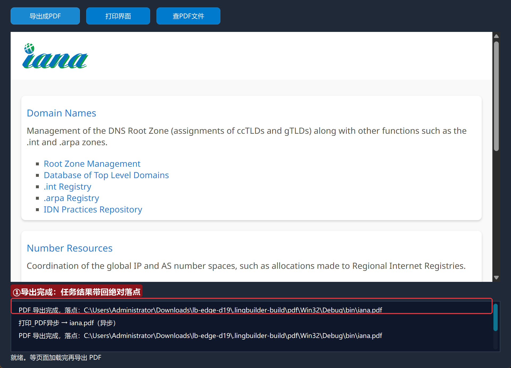
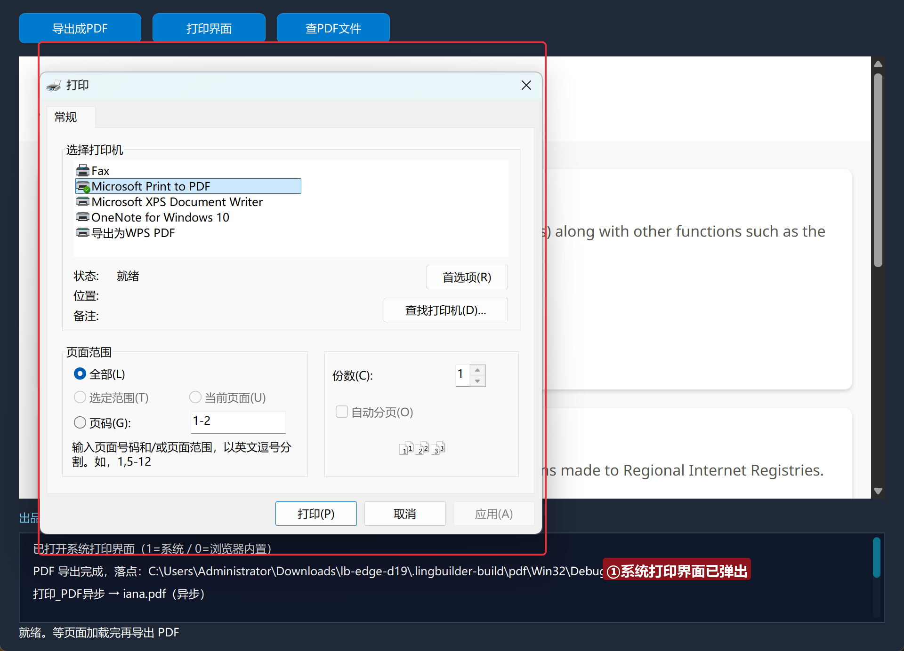

# Edge 合集 19 · 打印与 PDF 导出：打印族 4 条

> 《LingBuilder Edge 浏览器合集》第 19 集（下载与媒体篇）。打印族 4 条命令做三件事：**把页面导出成 PDF 文件**（最常用）、**弹出打印界面**给用户选打印机、还有一整套打印设置（纸张/边距/方向，以设置JSON 覆盖）。本集做一台「PDF 出品机」：点一下按钮，当前网页变成 PDF 落盘。全程约 20 分钟。
>
> 前置要求：学过[第 5 集](/guide/tutorials/edge-05)（异步任务与完成处理器）。本集源码包见文末。

## 这一集你将学会

- `EdgeView打印_PDF异步(控件, 文件路径, 设置JSON, &完成处理器)`：页面 → PDF 落盘
- `EdgeView打印_显示界面(控件, 0或1)`：浏览器内置 / 系统打印界面
- 任务结果带回**绝对落点**；相对路径按当前工作目录解析
- 打印设置 JSON（驼峰键）覆盖纸张/边距等

## 1. 打印族地图

| 命令 | 作用 |
| --- | --- |
| `打印_PDF异步(控件, 路径, 设置JSON, &处理器)` | 页面导出 PDF 文件 |
| `打印_显示界面(控件, 界面类型)` | 0=浏览器内置打印界面，1=系统打印对话框 |
| `打印_置*` / `取*`（缩放倍数/页宽高/边距/方向/纸张…） | 打印设置项 |
| 设置JSON | 传 `{}` 用当前设置；传驼峰键覆盖（如 `{"pageWidth":8.5}` 单位英寸） |

## 2. 新建项目与启用模块

欢迎页「新建项目」，项目名称 **PDF出品机**，「Windows 界面设计」：



模块确认四个已启用：**EdgeView 浏览器模块**（打印族）、**文件目录模块**（查文件）、**文本处理模块**、**Win32窗口基础模块**：



## 3. 设计界面

| 控件 | 名称 | 显示内容 | 左距 | 顶距 | 宽度 | 高度 |
| --- | --- | --- | --- | --- | --- | --- |
| 按钮 | 导出按钮 | 导出成PDF | 20 | 14 | 130 | 32 |
| 按钮 | 打印界面按钮 | 打印界面 | 162 | 14 | 120 | 32 |
| 按钮 | 查文件按钮 | 查PDF文件 | 294 | 14 | 120 | 32 |
| **Edge浏览器** | **浏览器1** | （拖入） | 20 | 60 | 920 | 470 |
| 标签 | 日志标题 | 出品日志 | 20 | 542 | 120 | 20 |
| 列表框 | 日志列表 | （清空） | 20 | 566 | 920 | 96 |
| 标签 | 状态标签 | 就绪。等页面加载完再导出 PDF | 20 | 664 | 920 | 20 |



## 4. 写代码

### 4.1 打开底稿页面

```lcpp
事件 _MainWindow_创建完毕()
    EdgeView_导航控件(浏览器1, "https://www.iana.org")
    控件_插入项目(日志列表, 0, "PDF 出品机就绪。导出到工作区根 iana.pdf")
结束
```



### 4.2 导出 PDF 与打印界面

```lcpp
事件 _导出按钮_被单击()
    EdgeView打印_PDF异步(浏览器1, "iana.pdf", "{}", &导出完成)
    控件_插入项目(日志列表, 0, "打印_PDF异步 → iana.pdf（异步）")
结束

事件 导出完成()
    控件_插入项目(日志列表, 0, "PDF 导出完成，落点：" + EdgeView任务_取结果(EdgeView任务_取当前任务ID()))
结束

事件 _打印界面按钮_被单击()
    EdgeView打印_显示界面(浏览器1, 1)
    控件_插入项目(日志列表, 0, "已打开系统打印界面（1=系统 / 0=浏览器内置）")
结束
```

三个要点：**设置JSON 传 "{}"** 用当前打印设置；**相对路径按当前工作目录解析**（任务结果带回的是解析后的绝对落点）；等**页面加载完成**再导出，半渲染页面导出来是白纸。



## 5. 编译：先看错误列表

错误列表 (0)，输出窗口「生成完成」：



## 6. 运行：一键出 PDF

点「运行」：



### 6.1 导出成 PDF

点「导出成PDF」——任务完成后日志给出绝对落点，`iana.pdf` 已经躺在工作目录：



### 6.2 打印界面

点「打印界面」——系统打印对话框弹出（真机打印选这里）：



## 常见问题急救表

| 症状 | 原因 | 解法 |
| --- | --- | --- |
| 导出的 PDF 是白纸 | 页面还没加载完 | 等「导航完成」事件后再导出 |
| 找不到生成的 PDF | 相对路径按工作目录解析 | 用任务结果带回的绝对落点 |
| 设置JSON 传了没生效 | 键名不是驼峰 | 用 WebView2 驼峰键（pageWidth 等） |
| 打印界面类型弄反 | 0/1 记混 | 0=浏览器内置，1=系统对话框 |
| 编译报「未知的命令 EdgeView打印_PDF异步」 | EdgeView 模块没启用 | 模块生态里启用 EdgeView 浏览器模块 |

## 本集小结

- `打印_PDF异步` 四参数：控件、路径、设置JSON、完成处理器；结果带回绝对落点。
- `显示界面` 0/1 切换浏览器内置与系统打印对话框。
- 打印设置项（置/取 家族）与设置JSON 都可覆盖默认。

## 源码包

本集完整源码已打包为 **PDF出品机.lcpppkg**（随本教程同目录分发，官网示例源码区可下载）。在 LingBuilder 欢迎页点「打开工作区」，或直接双击 `.lcpppkg` 文件即可导入运行。

**下一集预告**：《媒体控制》——媒体族 4 条：静音、音频状态、全屏状态与 Favicon 抓取。

[回合集总览](/guide/tutorials/edge)
