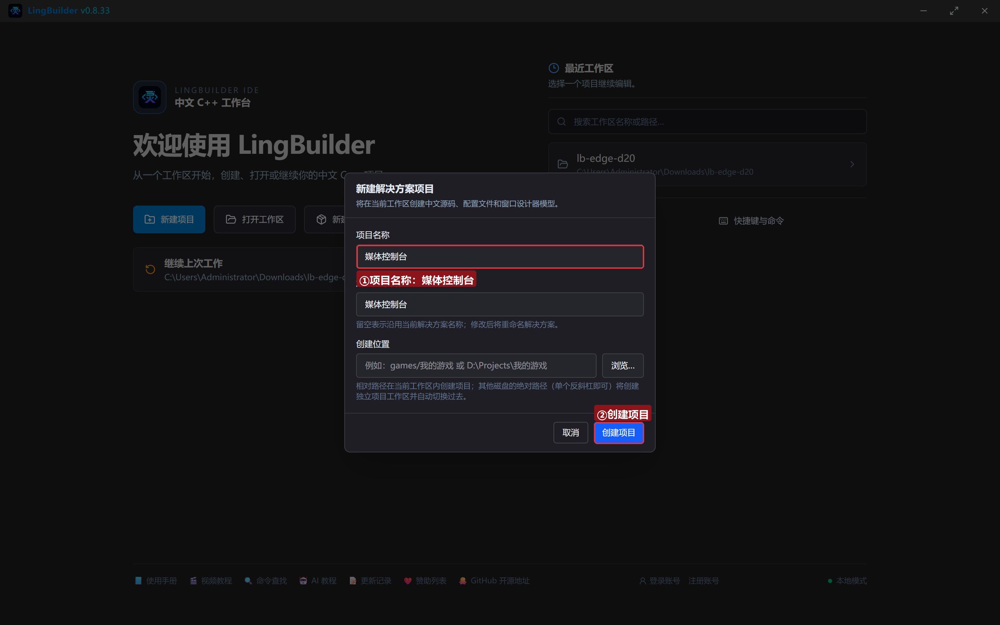
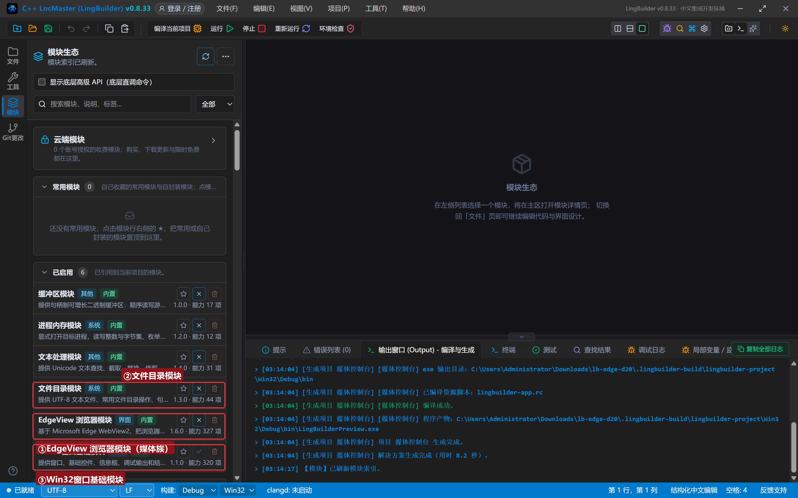
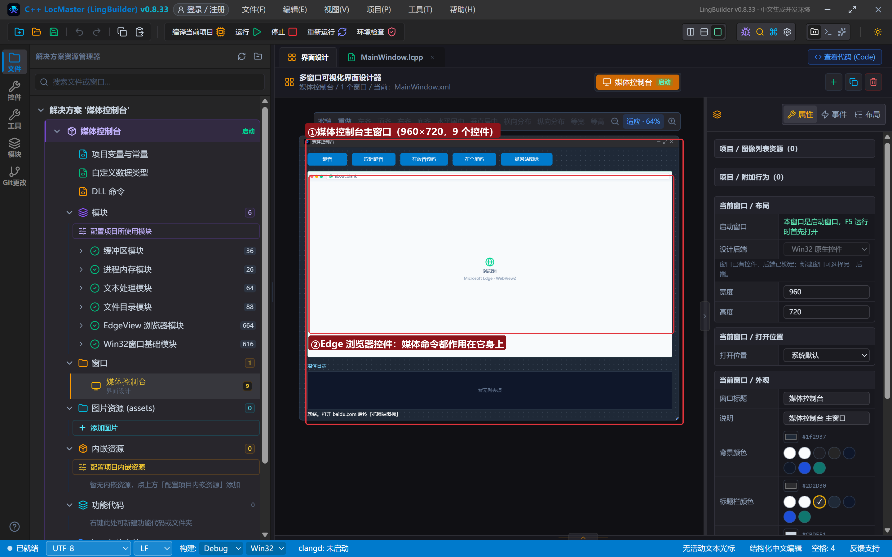
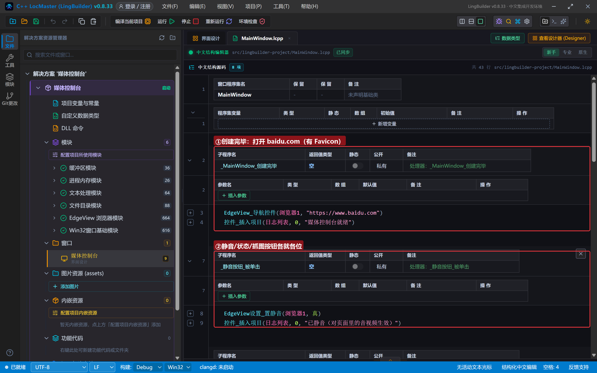
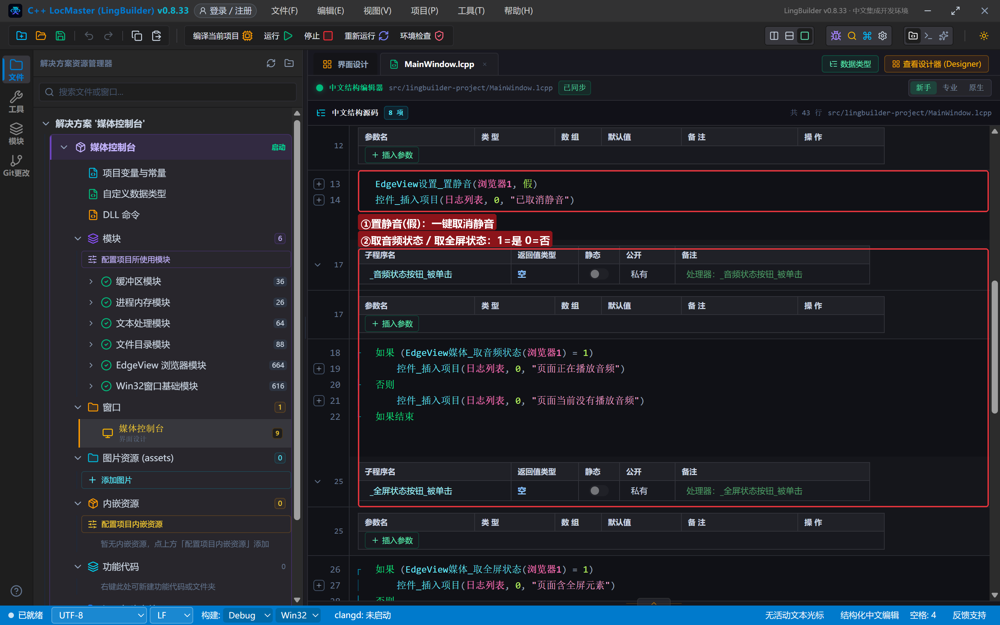
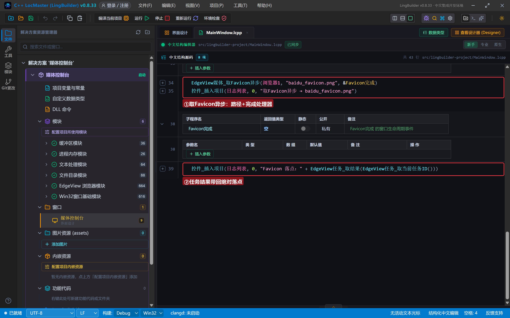
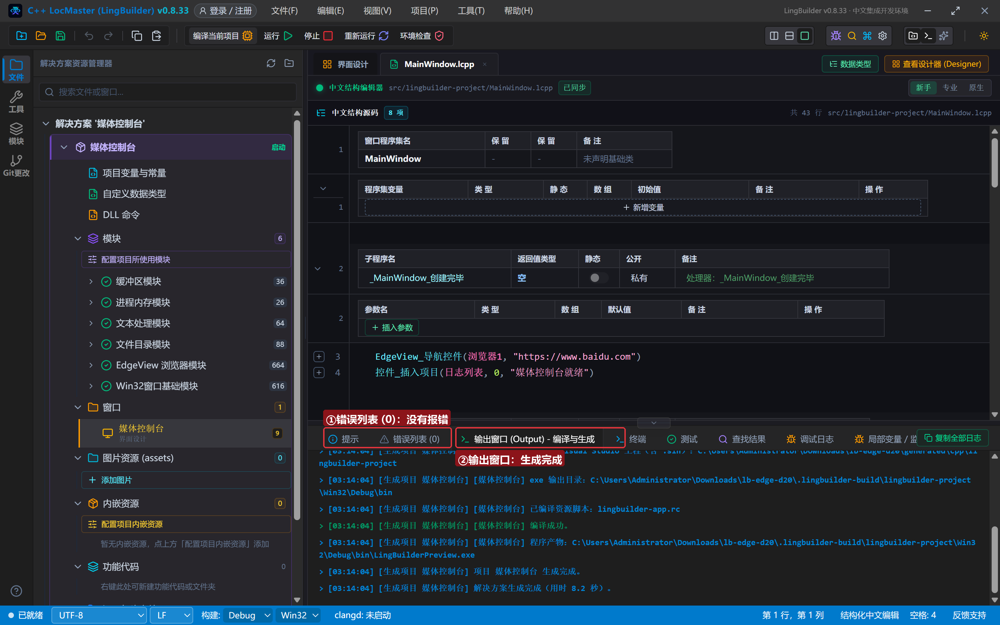
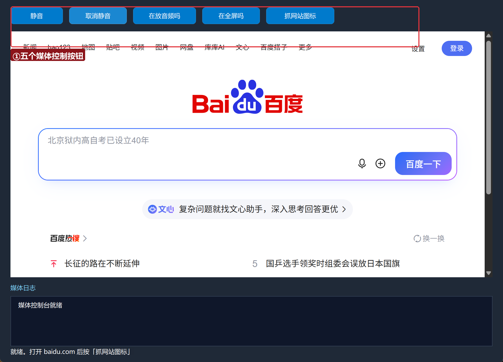
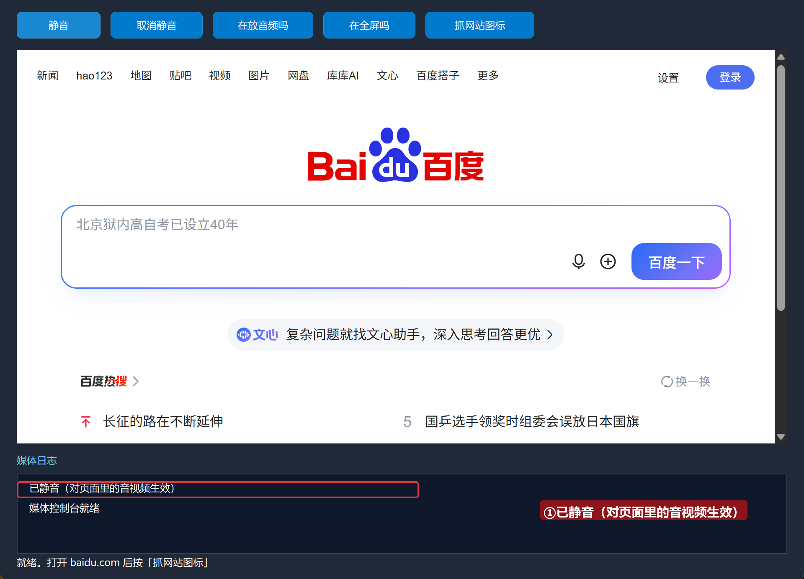
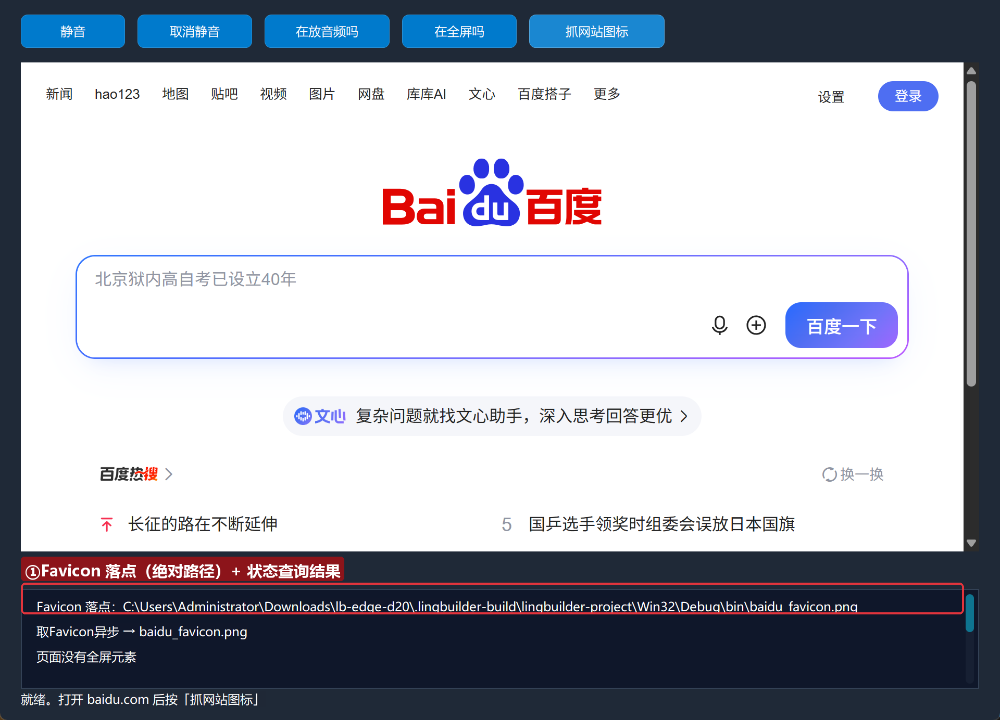

# Edge 合集 20 · 媒体控制：静音、音频状态与 Favicon 抓取

> 《LingBuilder Edge 浏览器合集》第 20 集（下载与媒体篇收官）。媒体族 4 条命令管「网页里正在响、正在全屏的东西」：**一键静音**（页面里的音视频全部闭嘴）、**音频/全屏状态查询**（1=是 0=否），外加一个超实用彩蛋 **Favicon 抓取**——把网站图标抓成本地 PNG，做书签、做应用列表都用得上。全程约 20 分钟。
>
> 前置要求：学过[第 1 集](/guide/tutorials/edge-01)（导航控件）。本集源码包见文末。

## 这一集你将学会

- `EdgeView设置_置静音(真/假)`：页面级静音开关
- `EdgeView媒体_取音频状态` / `EdgeView媒体_取全屏状态`：1=是、0=否
- `EdgeView媒体_取Favicon异步(控件, 路径, &完成处理器)`：抓网站图标落盘
- 静音是「设置」族、其余在「媒体」族——按族记忆好找

## 1. 媒体族地图

| 命令 | 作用 | 返回 |
| --- | --- | --- |
| `设置_置静音(控件, 真/假)` | 页面静音开关 | 1 成功 |
| `媒体_取音频状态(控件)` | 页面是否在播放音频 | 1 是 / 0 否 |
| `媒体_取全屏状态(控件)` | 页面是否含全屏元素 | 1 是 / 0 否 |
| `媒体_取Favicon异步(控件, 路径, &处理器)` | 抓当前页图标到 PNG | 任务结果=绝对落点 |
| `媒体_截图异步(控件, 路径, 格式, &处理器)` | 页面截图（下一集无头篇对比用） | 任务结果=绝对落点 |

## 2. 新建项目与启用模块

欢迎页「新建项目」，项目名称 **媒体控制台**，「Windows 界面设计」：



模块确认四个已启用：**EdgeView 浏览器模块**（媒体族）、**文件目录模块**、**文本处理模块**、**Win32窗口基础模块**：



## 3. 设计界面

| 控件 | 名称 | 显示内容 | 左距 | 顶距 | 宽度 | 高度 |
| --- | --- | --- | --- | --- | --- | --- |
| 按钮 | 静音按钮 | 静音 | 20 | 14 | 100 | 32 |
| 按钮 | 取消静音按钮 | 取消静音 | 132 | 14 | 110 | 32 |
| 按钮 | 音频状态按钮 | 在放音频吗 | 254 | 14 | 120 | 32 |
| 按钮 | 全屏状态按钮 | 在全屏吗 | 386 | 14 | 110 | 32 |
| 按钮 | Favicon按钮 | 抓网站图标 | 508 | 14 | 130 | 32 |
| **Edge浏览器** | **浏览器1** | （拖入） | 20 | 60 | 920 | 470 |
| 标签 | 日志标题 | 媒体日志 | 20 | 542 | 120 | 20 |
| 列表框 | 日志列表 | （清空） | 20 | 566 | 920 | 96 |
| 标签 | 状态标签 | 就绪。打开 baidu.com 后按「抓网站图标」 | 20 | 664 | 920 | 20 |



## 4. 写代码

### 4.1 打开有图标的页面

```lcpp
事件 _MainWindow_创建完毕()
    EdgeView_导航控件(浏览器1, "https://www.baidu.com")
    控件_插入项目(日志列表, 0, "媒体控制台就绪")
结束
```



### 4.2 静音与两个状态查询

```lcpp
事件 _静音按钮_被单击()
    EdgeView设置_置静音(浏览器1, 真)
    控件_插入项目(日志列表, 0, "已静音（对页面里的音视频生效）")
结束

事件 _取消静音按钮_被单击()
    EdgeView设置_置静音(浏览器1, 假)
    控件_插入项目(日志列表, 0, "已取消静音")
结束

事件 _音频状态按钮_被单击()
    如果 (EdgeView媒体_取音频状态(浏览器1) = 1)
        控件_插入项目(日志列表, 0, "页面正在播放音频")
    否则
        控件_插入项目(日志列表, 0, "页面当前没有播放音频")
    如果结束
结束

事件 _全屏状态按钮_被单击()
    如果 (EdgeView媒体_取全屏状态(浏览器1) = 1)
        控件_插入项目(日志列表, 0, "页面含全屏元素")
    否则
        控件_插入项目(日志列表, 0, "页面没有全屏元素")
    如果结束
结束
```

状态查询是**即时快照**：打开一个带视频的页面再查，结果就变 1。



### 4.3 抓网站图标

```lcpp
事件 _Favicon按钮_被单击()
    EdgeView媒体_取Favicon异步(浏览器1, "baidu_favicon.png", &Favicon完成)
    控件_插入项目(日志列表, 0, "取Favicon异步 → baidu_favicon.png")
结束

事件 Favicon完成()
    控件_插入项目(日志列表, 0, "Favicon 落点：" + EdgeView任务_取结果(EdgeView任务_取当前任务ID()))
结束
```

Favicon 异步的「路径」是相对路径按当前工作目录解析；结果带回**绝对落点**。做书签工具/启动器时，配合这个图标文件就能拼出好看的界面。



## 5. 编译：先看错误列表

错误列表 (0)，输出窗口「生成完成」：



## 6. 运行：静音与抓图

点「运行」：



### 6.1 静音 / 取消静音

点「静音」「取消静音」——对页面里正在播放的音视频立即生效：



### 6.2 抓网站图标

点「抓网站图标」——日志给出 PNG 绝对落点，打开就是百度的图标：



## 常见问题急救表

| 症状 | 原因 | 解法 |
| --- | --- | --- |
| 静音了还能听到声音 | 页面在静音前打开的系统音频 | 静音只管 WebView2 内的音视频；系统音量另算 |
| Favicon 是空图/默认图 | 站点没配图标或加载未完成 | 等页面加载完重试；无图站点返回默认图标 |
| 取音频状态一直是 0 | 页面没有 `<audio>/<video>` 在播 | 状态是即时快照，播放中再查 |
| 编译报「未知的命令 EdgeView媒体_取Favicon异步」 | EdgeView 模块没启用 | 模块生态里启用 EdgeView 浏览器模块 |

## 本集小结

- 静音在「设置」族；音频/全屏/Favicon 在「媒体」族。
- 两个状态查询返回 1/0，即查即得。
- `取Favicon异步` 结果带回绝对落点，站点图标一抓即得。

## 源码包

本集完整源码已打包为 **媒体控制台.lcpppkg**（随本教程同目录分发，官网示例源码区可下载）。在 LingBuilder 欢迎页点「打开工作区」，或直接双击 `.lcpppkg` 文件即可导入运行。

**下一集预告**：《无头实例》——高级篇开篇：隐窗伪无头的适用边界与红线（截图不可用，取数可以）。

[回合集总览](/guide/tutorials/edge)
