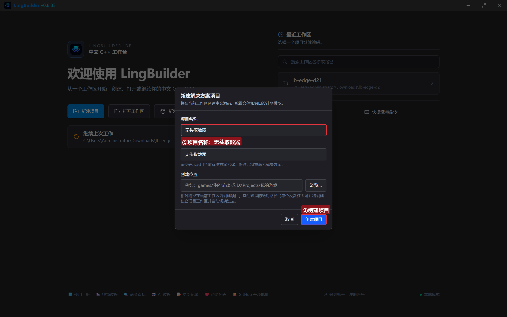
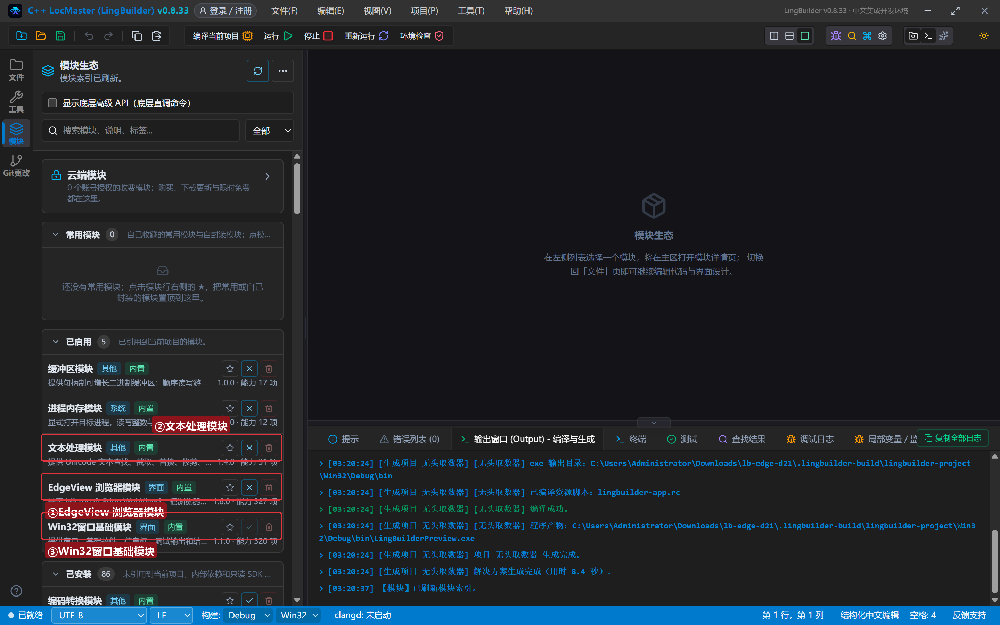
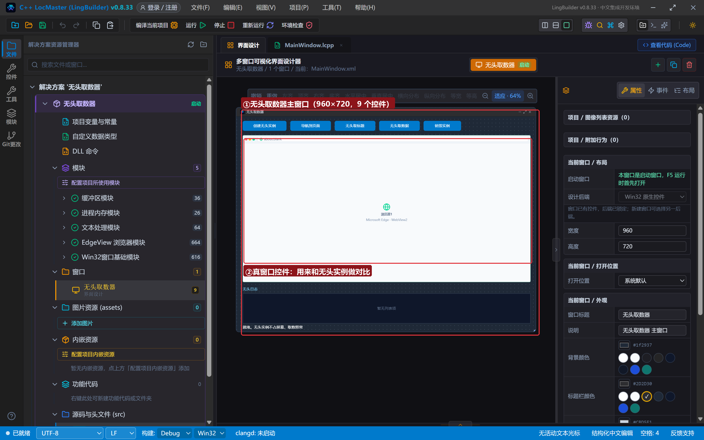
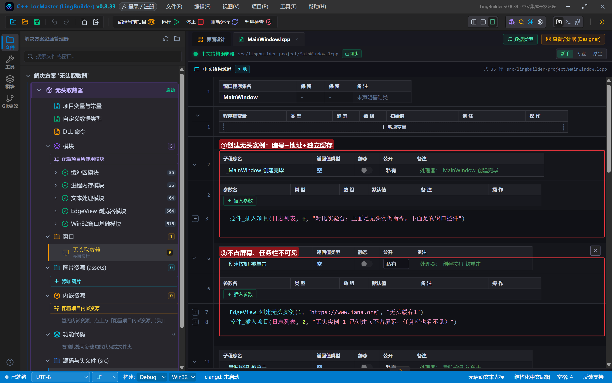
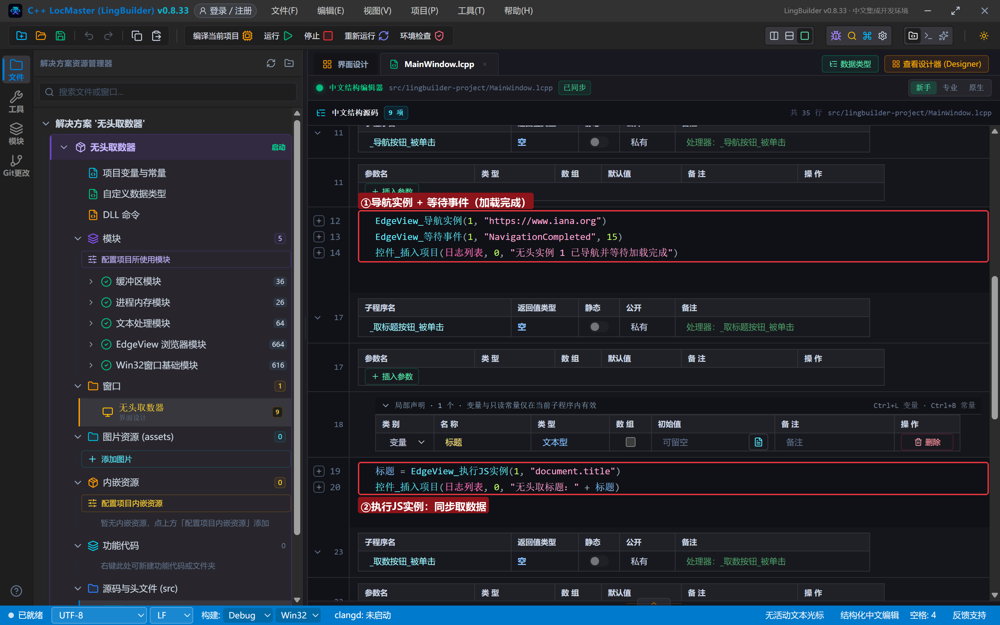
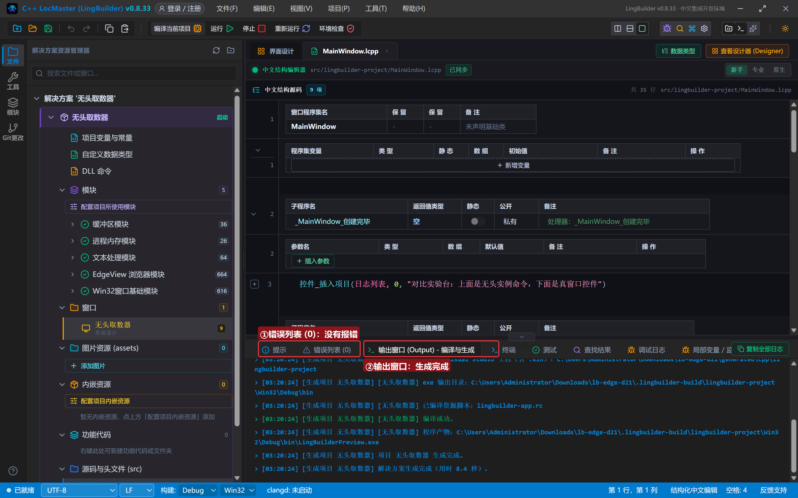
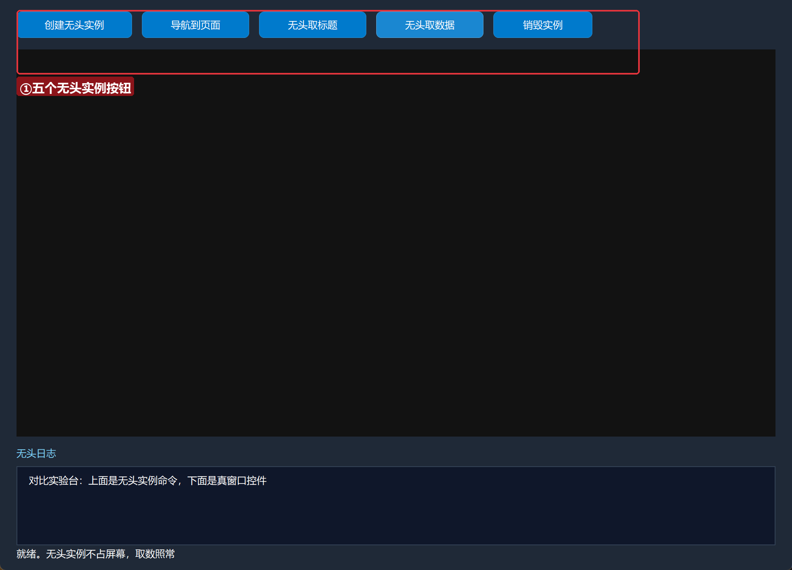
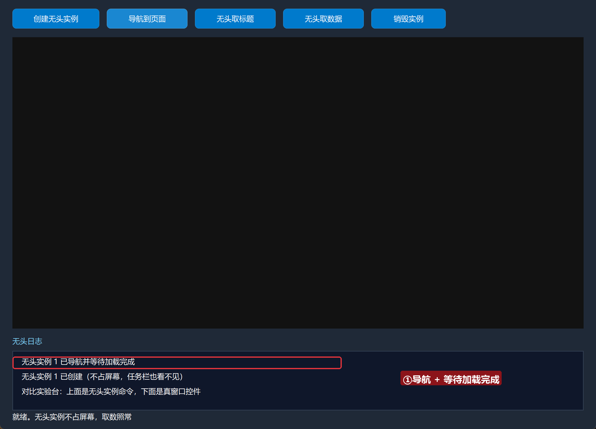
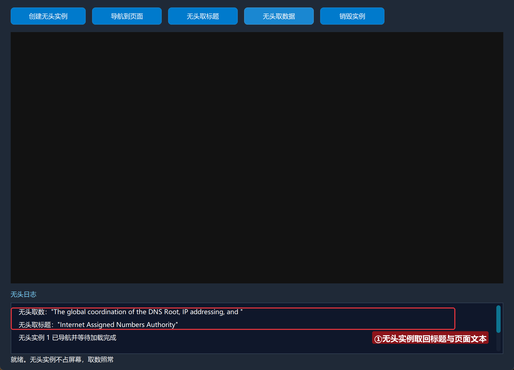
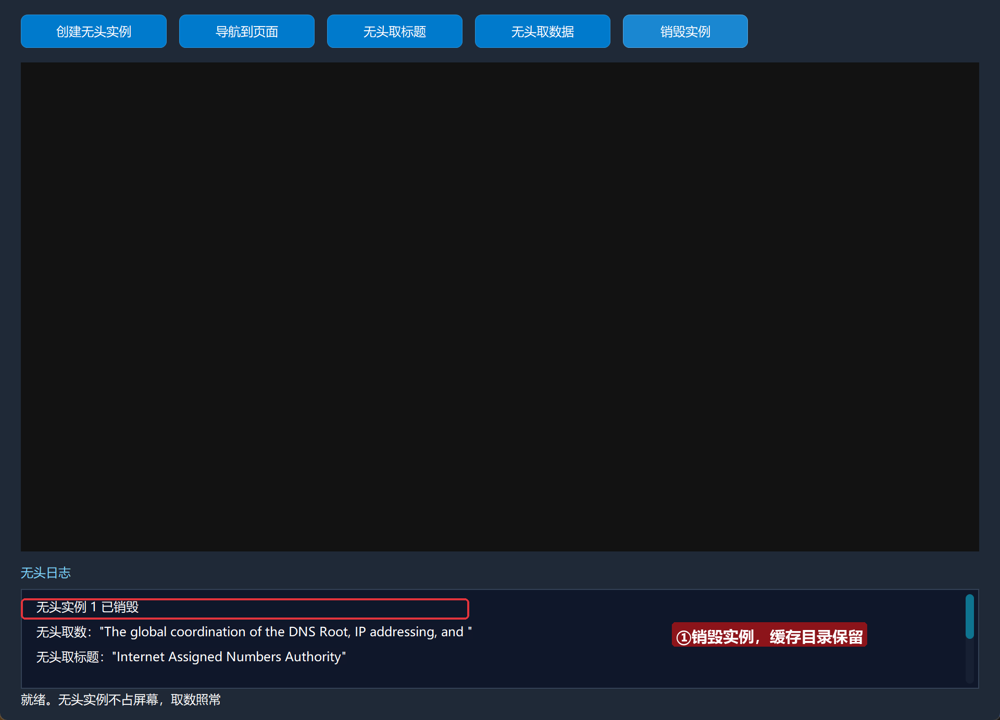

# Edge 合集 21 · 无头实例：不占屏幕的取数引擎（高级篇开篇）

> 《LingBuilder Edge 浏览器合集》第 21 集（高级篇）。前 20 集的浏览器都「看得见」；这一集开一个**看不见**的：`EdgeView_创建无头实例`——不占屏幕、任务栏不可见，但导航、执行 JS、取 Cookie 全部照常。它是后台批量取数的首选形态。本集也把它的**能力边界**一次讲透：截图/PDF 不可用，取文本取数可以。全程约 25 分钟。
>
> 前置要求：学过[第 15 集](/guide/tutorials/edge-15)（实例概念）。本集源码包见文末。

## 这一集你将学会

- `EdgeView_创建无头实例(实例编号, 地址, 独立缓存目录)`：创建看不见的浏览器
- `EdgeView_导航实例` + `EdgeView_等待事件(编号, "NavigationCompleted", 秒)`：导航并等加载完成
- `EdgeView_执行JS实例`：无头取数（同步返回）
- `EdgeView_关闭实例`：销毁
- **能力边界**：为什么截图/PDF 不可用

## 1. 无头的真相：隐窗伪无头

WebView2 **没有官方无头 API**——控制器必须挂一个窗口。EdgeView 的做法：内部挂一个**从不调用 ShowWindow 的离屏隐藏宿主**，这是平台允许的最接近无头的形态。由此产生两条硬边界：

1. **截图类命令不可用**（页面从没画过）——需要页面图像请用 `CDP_启动浏览器`（真无头独立进程）；
2. **rAF 等可见性行为按隐藏页节流**——依赖动画帧的逻辑可能变慢。

而**取数能力完全保留**：导航实例、执行JS实例、等待事件、绑定事件、会话 Cookie 族、UA、独立代理照常可用。

## 2. 新建项目与启用模块

欢迎页「新建项目」，项目名称 **无头取数器**，「Windows 界面设计」：



模块确认三个已启用：**EdgeView 浏览器模块**、**文本处理模块**、**Win32窗口基础模块**：



## 3. 设计界面

| 控件 | 名称 | 显示内容 | 左距 | 顶距 | 宽度 | 高度 |
| --- | --- | --- | --- | --- | --- | --- |
| 按钮 | 创建按钮 | 创建无头实例 | 20 | 14 | 140 | 32 |
| 按钮 | 导航按钮 | 导航到页面 | 172 | 14 | 130 | 32 |
| 按钮 | 取标题按钮 | 无头取标题 | 314 | 14 | 130 | 32 |
| 按钮 | 取数按钮 | 无头取数据 | 456 | 14 | 130 | 32 |
| 按钮 | 关闭按钮 | 销毁实例 | 598 | 14 | 120 | 32 |
| **Edge浏览器** | **浏览器1** | （拖入，作对比参照） | 20 | 60 | 920 | 470 |
| 标签 | 日志标题 | 无头日志 | 20 | 542 | 120 | 20 |
| 列表框 | 日志列表 | （清空） | 20 | 566 | 920 | 96 |
| 标签 | 状态标签 | 就绪。无头实例不占屏幕，取数照常 | 20 | 664 | 920 | 20 |



## 4. 写代码

### 4.1 创建无头实例

```lcpp
事件 _创建按钮_被单击()
    EdgeView_创建无头实例(1, "https://www.iana.org", "无头缓存1")
    控件_插入项目(日志列表, 0, "无头实例 1 已创建（不占屏幕，任务栏也看不见）")
结束
```

三参数：实例编号、起始地址、独立缓存目录（无头实例同样用缓存目录隔离 Cookie）。



### 4.2 导航、等待、取数

```lcpp
事件 _导航按钮_被单击()
    EdgeView_导航实例(1, "https://www.iana.org")
    EdgeView_等待事件(1, "NavigationCompleted", 15)
    控件_插入项目(日志列表, 0, "无头实例 1 已导航并等待加载完成")
结束

事件 _取标题按钮_被单击()
    局部 文本型 标题
    标题 = EdgeView_执行JS实例(1, "document.title")
    控件_插入项目(日志列表, 0, "无头取标题：" + 标题)
结束

事件 _取数按钮_被单击()
    局部 文本型 数据
    数据 = EdgeView_执行JS实例(1, "document.body.innerText.substring(0, 60)")
    控件_插入项目(日志列表, 0, "无头取数：" + 数据)
结束

事件 _关闭按钮_被单击()
    EdgeView_关闭实例(1)
    控件_插入项目(日志列表, 0, "无头实例 1 已销毁")
结束
```

**取数前必须等加载完成**：`EdgeView_等待事件(1, "NavigationCompleted", 15)` 最多等 15 秒。`执行JS实例` 同步返回 JSON 结果——取数一条龙不用完成处理器。



## 5. 编译：先看错误列表

错误列表 (0)，输出窗口「生成完成」：



## 6. 运行：看不见的浏览器在干活

点「运行」，主窗口是「指挥部」（真控件只做对比参照）：



### 6.1 创建并导航

点「创建无头实例」「导航到页面」——屏幕上什么都没出现，日志在记账：



### 6.2 无头取数

点「无头取标题」「无头取数据」——看不见的实例把标题和页面文本取了回来：



### 6.3 销毁

点「销毁实例」——无头实例关闭，缓存目录保留：



## 常见问题急救表

| 症状 | 原因 | 解法 |
| --- | --- | --- |
| 执行JS实例 返回空 | 页面没加载完 | 先 等待事件 NavigationCompleted 再取 |
| 截图/导出PDF 是空图 | 无头实例不渲染画面 | 能力边界：改用 CDP_启动浏览器 或真窗口 |
| 无头实例找不到 | 编号不对或已销毁 | 用编号命名法管理（1=A 店 2=B 店…） |
| 想让无头实例走代理 | 多账号需要独立 IP | 用 创建无头实例代理（地址+UA 五参数版） |
| 编译报「未知的命令 EdgeView_创建无头实例」 | EdgeView 模块没启用 | 模块生态里启用 EdgeView 浏览器模块 |

## 本集小结

- `创建无头实例` 三参数：编号/地址/独立缓存；界面零显示但取数全功能。
- **取数前等加载完成**：`等待事件(编号, "NavigationCompleted", 秒)`。
- 能力边界：截图/PDF 不可用（伪无头）；要图像走 CDP_启动浏览器。
- 后台批量取数的标准形态：无头实例 × N + 独立缓存 + 独立代理。

## 源码包

本集完整源码已打包为 **无头取数器.lcpppkg**（随本教程同目录分发，官网示例源码区可下载）。在 LingBuilder 欢迎页点「打开工作区」，或直接双击 `.lcpppkg` 文件即可导入运行。

**下一集预告**：《资源与缓冲》——资源族 5 条＋缓冲族 5 条：请求拦截与共享内存。

[回合集总览](/guide/tutorials/edge)
