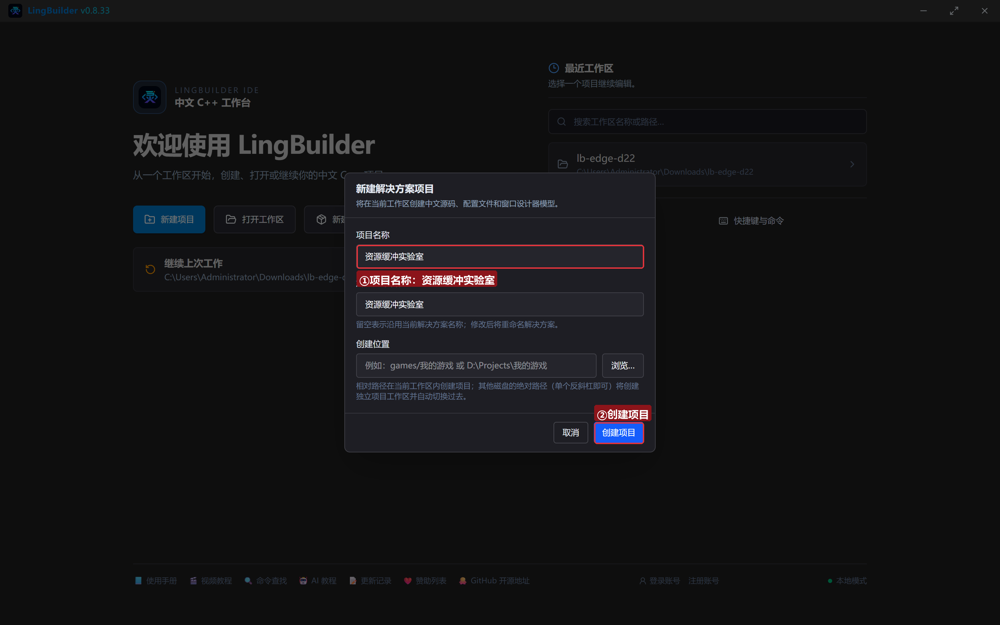
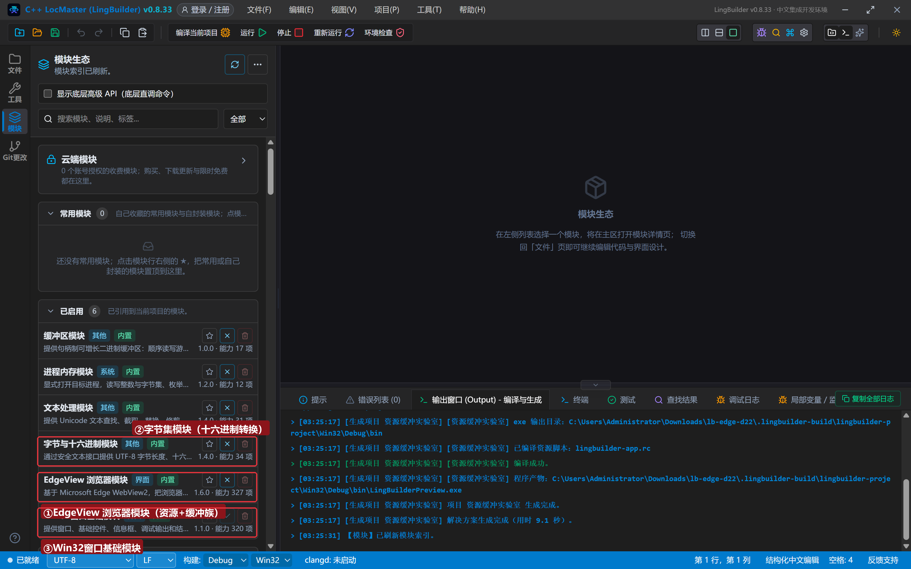
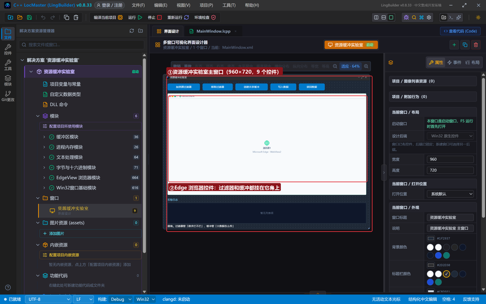
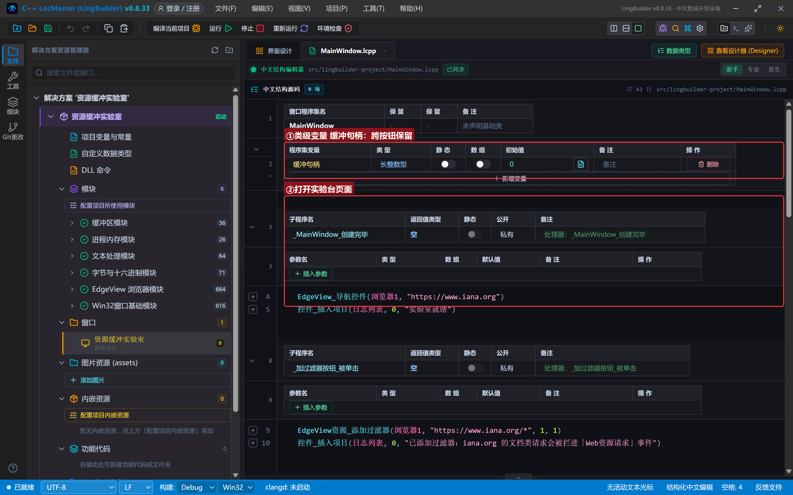
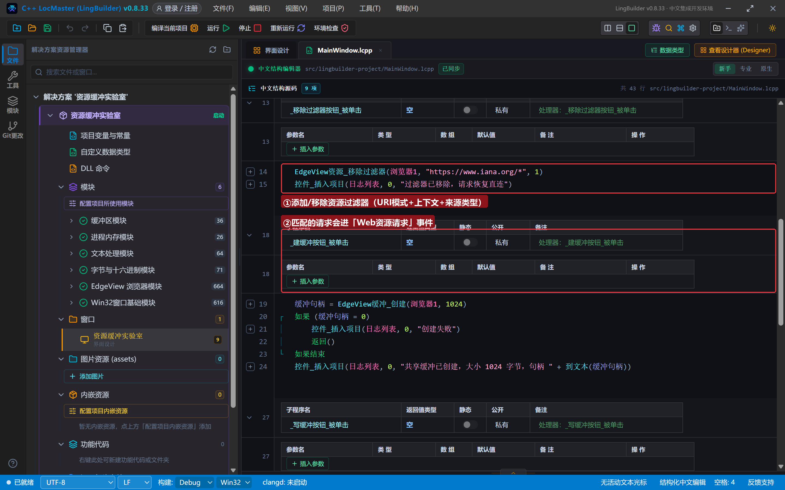
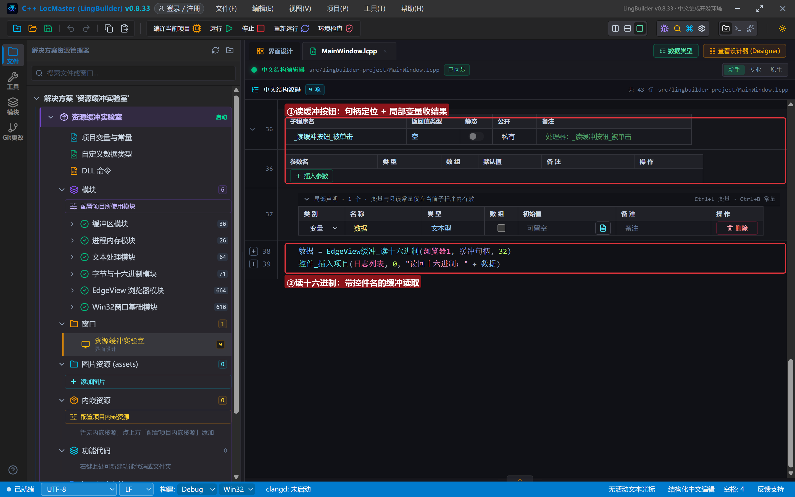
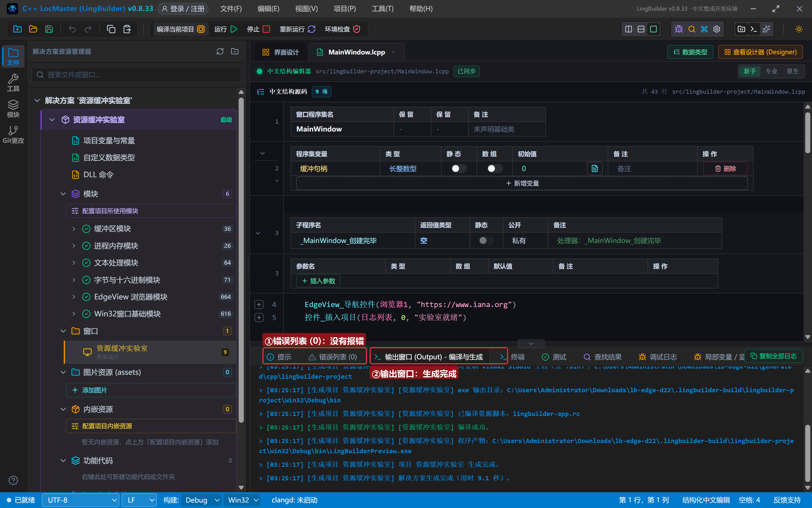
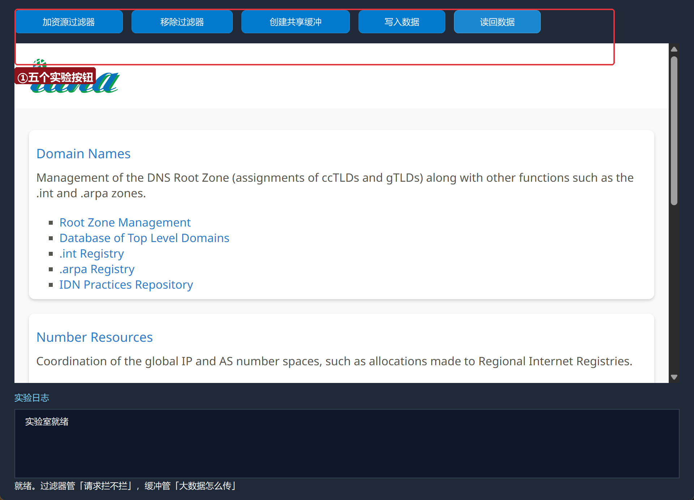
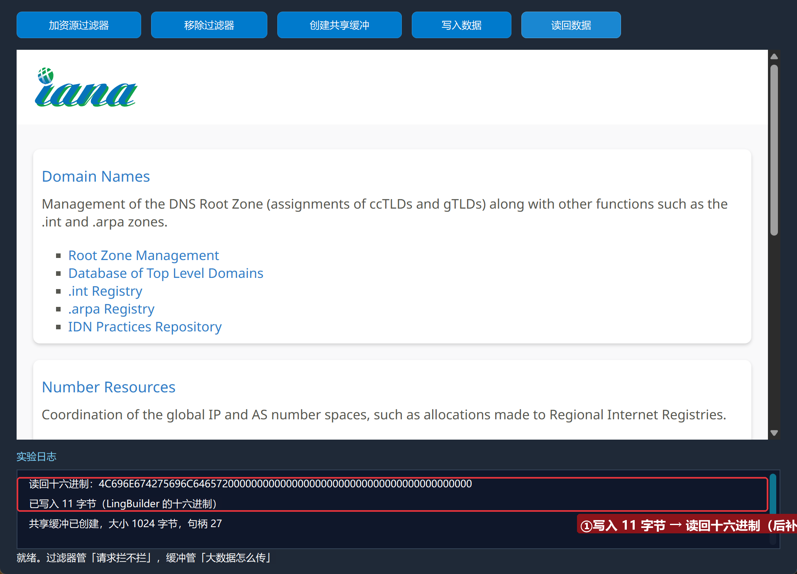
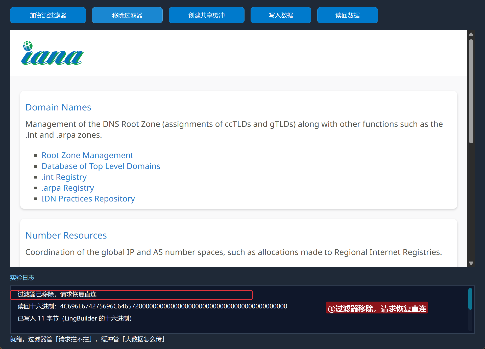

# Edge 合集 22 · 资源与缓冲：请求过滤器和共享内存

> 《LingBuilder Edge 浏览器合集》第 22 集（高级篇）。这一集的两组命令平时藏得深、用起来猛：**资源族 5 条**管「哪些请求要拦进事件」（爬虫改包、广告过滤的根基）；**缓冲族 5 条**管「原生与网页之间怎么传大块数据」（共享内存，不走 JSON 序列化）。全程约 25 分钟。
>
> 前置要求：学过[第 10 集](/guide/tutorials/edge-10)（事件绑定）。本集源码包见文末。

## 这一集你将学会

- `EdgeView资源_添加过滤器(控件, URI模式, 上下文, 来源类型)`：声明「这类请求要拦」
- `EdgeView资源_移除过滤器`：恢复直连
- `EdgeView缓冲_创建(控件, 字节数)`：创建共享缓冲（受管句柄）
- `EdgeView缓冲_写十六进制` / `读十六进制`：按十六进制读写缓冲
- **类级变量**保存受管句柄

## 1. 两组命令的分工

| 族 | 命令 | 干什么 |
| --- | --- | --- |
| 资源 | 添加/移除过滤器、设置事件响应文本、读响应正文 | 拦截匹配 URI 模式的请求，进「Web资源请求」事件裁决 |
| 缓冲 | 创建/取大小/写十六进制/读十六进制/发送到网页 | 原生 ↔ 网页共享一块内存（≤16 MiB） |

过滤器匹配的请求**默认放行**，要改响应需要在「Web资源请求」事件里调 `EdgeView资源_设置事件响应文本`（本集先打地基）。

## 2. 新建项目与启用模块

欢迎页「新建项目」，项目名称 **资源缓冲实验室**，「Windows 界面设计」：



模块确认四个已启用：**EdgeView 浏览器模块**、**字节集模块**（十六进制工具）、**文本处理模块**、**Win32窗口基础模块**：



## 3. 设计界面

| 控件 | 名称 | 显示内容 | 左距 | 顶距 | 宽度 | 高度 |
| --- | --- | --- | --- | --- | --- | --- |
| 按钮 | 加过滤器按钮 | 加资源过滤器 | 20 | 14 | 150 | 32 |
| 按钮 | 移除过滤器按钮 | 移除过滤器 | 182 | 14 | 140 | 32 |
| 按钮 | 建缓冲按钮 | 创建共享缓冲 | 334 | 14 | 150 | 32 |
| 按钮 | 写缓冲按钮 | 写入数据 | 496 | 14 | 120 | 32 |
| 按钮 | 读缓冲按钮 | 读回数据 | 628 | 14 | 120 | 32 |
| **Edge浏览器** | **浏览器1** | （拖入） | 20 | 60 | 920 | 470 |
| 标签 | 日志标题 | 实验日志 | 20 | 542 | 120 | 20 |
| 列表框 | 日志列表 | （清空） | 20 | 566 | 920 | 96 |
| 标签 | 状态标签 | 就绪。过滤器管「请求拦不拦」，缓冲管「大数据怎么传」 | 20 | 664 | 920 | 20 |



## 4. 写代码

### 4.1 类级变量：缓冲句柄跨按钮保留

```lcpp
长整数型 缓冲句柄 = 0

事件 _MainWindow_创建完毕()
    EdgeView_导航控件(浏览器1, "https://www.iana.org")
    控件_插入项目(日志列表, 0, "实验室就绪")
结束
```



### 4.2 资源过滤器：拦进事件的「闸门」

```lcpp
事件 _加过滤器按钮_被单击()
    EdgeView资源_添加过滤器(浏览器1, "https://www.iana.org/*", 1, 1)
    控件_插入项目(日志列表, 0, "已添加过滤器：iana.org 的文档类请求会被拦进「Web资源请求」事件")
结束

事件 _移除过滤器按钮_被单击()
    EdgeView资源_移除过滤器(浏览器1, "https://www.iana.org/*", 1)
    控件_插入项目(日志列表, 0, "过滤器已移除，请求恢复直连")
结束
```

参数解读：`URI模式` 用通配符（`*` 匹配任意后缀）；`上下文` 1=文档请求；`来源类型` 1=常规页面发起。加过滤器后记得绑「Web资源请求」事件，否则请求只是被拦进事件没人处理。



### 4.3 共享缓冲：创建、写、读

```lcpp
事件 _建缓冲按钮_被单击()
    缓冲句柄 = EdgeView缓冲_创建(浏览器1, 1024)
    如果 (缓冲句柄 = 0)
        控件_插入项目(日志列表, 0, "创建失败")
        返回()
    如果结束
    控件_插入项目(日志列表, 0, "共享缓冲已创建，大小 1024 字节，句柄 " + 到文本(缓冲句柄))
结束

事件 _写缓冲按钮_被单击()
    如果 (缓冲句柄 = 0)
        控件_设置文本(状态标签, "先创建共享缓冲")
        返回()
    如果结束
    EdgeView缓冲_写十六进制(浏览器1, 缓冲句柄, "4C696E674275696C646572")
    控件_插入项目(日志列表, 0, "已写入 11 字节（LingBuilder 的十六进制）")
结束

事件 _读缓冲按钮_被单击()
    局部 文本型 数据
    数据 = EdgeView缓冲_读十六进制(浏览器1, 缓冲句柄, 32)
    控件_插入项目(日志列表, 0, "读回十六进制：" + 数据)
结束
```

缓冲是**受管句柄**对象：创建返回句柄，写读都要带控件名和句柄；`发送到网页` 把缓冲以只读/读写模式递给页面脚本（配 `chrome.webview` 的 SharedBuffer API）。



## 5. 编译：先看错误列表

错误列表 (0)，输出窗口「生成完成」：



## 6. 运行：过滤器和缓冲都活起来了

点「运行」：



### 6.1 缓冲写入与读回

点「创建共享缓冲」「写入数据」「读回数据」——写入 `4C696E67…`（"LingBuilder" 的十六进制），读回一致（剩余字节补零）：



### 6.2 移除过滤器

点「移除过滤器」——请求恢复直连：



## 常见问题急救表

| 症状 | 原因 | 解法 |
| --- | --- | --- |
| 加了过滤器页面打不开 | 请求被拦进事件但没人放行 | 绑「Web资源请求」事件；不用时 移除过滤器 |
| 缓冲_创建 返回 0 | 字节数超限（≤16 MiB）或参数错 | 缩小字节数重试 |
| 读回来的数据后面全是 0 | 读取长度大于写入长度 | 按写入长度读取，或自己截断 |
| 编译报「未知的命令 EdgeView缓冲_创建」 | EdgeView 模块没启用 | 模块生态里启用 EdgeView 浏览器模块 |

## 本集小结

- 过滤器是「事件闸门」：URI 模式 + 上下文 + 来源类型 三参声明。
- 缓冲是「共享内存」：受管句柄 + 十六进制读写 + 发送到网页。
- 句柄类对象（缓冲）跨事件保留用**类级变量**。

## 源码包

本集完整源码已打包为 **资源缓冲实验室.lcpppkg**（随本教程同目录分发，官网示例源码区可下载）。在 LingBuilder 欢迎页点「打开工作区」，或直接双击 `.lcpppkg` 文件即可导入运行。

**下一集预告**：《异步任务与工作线程》——任务族 6 条＋工作线程族 6 条：不卡界面的批量取数。

[回合集总览](/guide/tutorials/edge)
